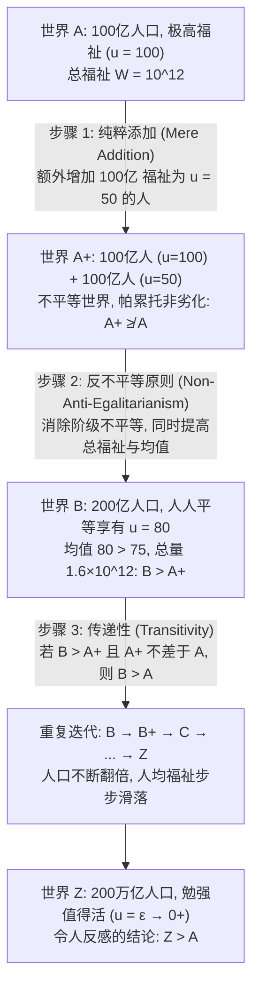

## 导论：当“人口规模 $N$”本身成为道德变量

在古典规范伦理学与福利经济学的大多数问题中，我们通常默认处于<strong>固定人口（Fixed-Population）</strong>的框架之下：世界上已经存在确定数量的 $N$ 个个体，道德哲学的核心任务是如何在这 $N$ 个人之间公正地分配资源或最大化他们的总福祉。然而，一旦我们将视野扩展到气候变化政策、地球资源枯竭、生育补贴、太空殖民以及关系到人类未来数万年命运的<strong>长远主义（Longtermism）</strong>与生存性风险（Existential Risk）时，这一默认前提便瞬间瓦解——我们当下的决策不仅决定了未来人过得“有多好（福祉质量 $u_i$）”，而且直接决定了未来会有“多少人存在（人口规模 $N$）”，甚至决定了“究竟是哪些具体的人会出生”。

这就是<strong>人口伦理学（Population Ethics）</strong>与<strong>可变人口价值论（Variable-Population Axiology）</strong>的研究疆域。1984年，当代英国最伟大的伦理学家<strong>德里克·帕菲特（Derek Parfit, 1942–2017）</strong>在其划时代的巨著《理与人》（*Reasons and Persons*）第四部分中，向整个现代哲学界投下了一枚重磅炸弹。他证明，如果我们采纳自亨利·西季威克（Henry Sidgwick）以来最为正统的<strong>总体功利主义（Total Utilitarianism）</strong>，我们将无可逃避地推导出一个在道德直觉上令人毛骨悚然的命题——<strong>“令人反感的结论（The Repugnant Conclusion）”</strong>。更令人震惊的是，此后的哲学与数理逻辑研究表明，任何试图修正总体功利主义以逃避这一结论的替代理论，都会不可避免地坠入其他同样荒谬的伦理深渊。

---

## 第一章 从固定人口到可变人口：西季威克的分岔路口

### 1.1 社会福利函数的形式化定义

设某一个可能世界（或人口状态）$X$ 包含 $N(X) \in \mathbb{N}^+$ 个个体，其终身净福祉向量表示为 $X = (u_1, u_2, \dots, u_N) \in \mathbb{R}^N$。在人口伦理学中，我们定义一个关键的基准线——<strong>中性福祉水平（Neutral Level）</strong> $u = 0$：
* 当 $u_i > 0$ 时，个体 $i$ 的一生在总体上是<strong>值得过的（A life worth living）</strong>，正向体验超过痛苦；
* 当 $u_i = 0$ 时，生命处于纯粹中性状态（或等同于未曾出生的虚无状态）；
* 当 $u_i < 0$ 时，个体 $i$ 的一生饱受折磨，在总体上是<strong>不值得过的（A life not worth living）</strong>。

当两个状态的人口规模相同时（$N(X) = N(Y) = N$），<strong>总体功利主义（Total Utilitarianism）</strong>与<strong>平均功利主义（Average Utilitarianism）</strong>在排序上是完全等价的，因为总量最大化直接等价于均值最大化：

$$W_{\text{total}}(X) = \sum_{i=1}^{N} u_i = N \cdot \bar{u}, \qquad W_{\text{avg}}(X) = \frac{1}{N} \sum_{i=1}^{N} u_i = \bar{u}$$

### 1.2 亨利·西季威克的选择

然而，当人口规模 $N$ 可变时，两条道路发生了剧烈分岔。早期经济学家（如约翰·斯图亚特·密尔 John Stuart Mill 与克努特·维克塞尔 Knut Wicksell 在探讨马尔萨斯人口论时）倾向于关注人均福祉 $\bar{u}$。但古典功利主义的集大成者<strong>亨利·西季威克（Henry Sidgwick）</strong>在《伦理学方法》（*The Methods of Ethics*, 1874）第四卷中敏锐地指出：如果功利主义的终极善是宇宙间快乐对痛苦的净余额，那么要使这一总体产物最大化，我们不仅应当提高既有入口的平均快乐，而且应当在人均快乐保持为正的前提下，尽可能增加享受快乐的人口数量。西季威克明确选择了总体功利函数 $W_{\text{total}}(X) = N \cdot \bar{u}$。正是这一看似顺理成章的数学选择，埋下了帕菲特悖论的引信。

---

## 第二章 帕菲特与“令人反感的结论”（The Repugnant Conclusion）

### 2.1 世界 $A$ 与世界 $Z$：莫扎特与哲学 vs. 罐头音乐与土豆

在《理与人》第142节中，帕菲特构建了一个著名的思想实验。请比较以下两个处于不同人口规模但内部完全平等的可能世界：

* <strong>世界 $A$（高福祉精英世界）</strong>：拥有 $N_A = 100\text{ 亿} = 10^{10}$ 人口。在这个世界里，每一个人都享有极高质量的幸福生活（设 $u_A = 100$）——他们身体健康、精神富足，一生充满了深邃的科学探索、真挚的爱情以及帕菲特所说的<strong>“莫扎特与哲学（Mozart and philosophy）”</strong>。世界 $A$ 的总福祉为：
  $$W_{\text{total}}(A) = N_A \cdot u_A = 10^{10} \times 100 = 10^{12}$$
* <strong>世界 $Z$（极度拥挤的微弱生存世界）</strong>：拥有极其庞大的人口，例如 $N_Z = 200\text{ 万亿} = 2 \times 10^{14}$ 人口。在这个世界里，每一个人的生活质量都仅仅略高于“还不如死掉”的中性零点（设 $u_Z = \varepsilon = 0.01 > 0$）。他们的一生极其单调、匮乏，没有任何高级文化与深刻欢愉，生活中唯一的慰藉只有帕菲特形象地称之为<strong>“低俗背景音乐（Muzak）与土豆（Muzak and potatoes）”</strong>的最低限度感官维持。然而，由于人口基数 $N_Z$ 足够庞大，世界 $Z$ 的总福祉达到了：
  $$W_{\text{total}}(Z) = N_Z \cdot u_Z = (2 \times 10^{14}) \times 0.01 = 2 \times 10^{12}$$

由于 $W_{\text{total}}(Z) = 2 \times 10^{12} > 10^{12} = W_{\text{total}}(A)$，根据总体功利主义（或任何满足无界数量可替代性的价值论），<strong>世界 $Z$ 在道德价值上严格优于世界 $A$（$Z \succ A$）</strong>。帕菲特将这一推论正式命名为<strong>“令人反感的结论（The Repugnant Conclusion）”</strong>：

> <strong>令人反感的结论的定义</strong>：对于任何一个由极高生活质量人口所组成的世界（无论其人口有多少、生活有多么美妙），只要另一个世界的人口数量足够庞大，哪怕其中每一个人的生活都仅仅是勉强值得活下去（$u_i = \varepsilon \to 0^+$），在其他条件相同时，后一个世界也必然比前一个世界更好。

### 2.2 为什么这一结论令人深感反感？

这一结论之所以在直觉上令人难以接受，是因为它意味着<strong>数量（Quantity）可以无限度地吞噬并替代质量（Quality）</strong>。在总体功利主义的账本上，人类文明最高级的审美、智性与情感成就（莫扎特与哲学），可以被无穷无尽的、如同养殖场般拥挤而麻木的微弱生存状态（罐头音乐与土豆）彻底碾压。如果有一位全能的宇宙规划者遵循总体功利主义，他应当毫不犹豫地摧毁充满创造力与幸福的世界 $A$，将其改造成拥挤不堪但总效用翻倍的世界 $Z$。

---

## 第三章 纯粹添加悖论（The Mere Addition Paradox）：通往深渊的滑坡

也许有人会说：“既然总体功利主义导致了令人反感的结论，那我们直接放弃总体功利主义不就行了吗？”帕菲特随后构造了更为致命的<strong>纯粹添加悖论（The Mere Addition Paradox）</strong>，证明即使我们完全不依赖总体功利主义，仅凭三个极其温和、各自看来无可辩驳的道德直觉，依然会被一步步推向世界 $Z$。

请看帕菲特设计的三步推理链条：

1. <strong>从世界 $A$ 到世界 $A^+$（纯粹添加原则 Mere Addition Principle）</strong>：
   假设在世界 $A$（100亿人，福祉 $u = 100$）的基础上，我们在另一片互不干扰的大陆上<strong>纯粹添加（Mere Addition）</strong>了另外100亿人，这部分新人口的福祉为 $u = 50$（虽然不如原住民富有，但依然拥有相当幸福、绝对值得活的一生），且原住民的福祉丝毫未受影响（仍为 $100$）。这就构成了世界 $A^+$。
   根据<strong>纯粹添加原则</strong>：只要新增加的人口过着值得活的正向生活（$u > 0$），且没有损害任何既有成员的利益，这种添加绝不会使世界变得<strong>更糟</strong>。因此，世界 $A^+$ 至少<strong>不比世界 $A$ 差</strong>（$A^+ \not\prec A$，或者记为 $A^+ \succeq A$）。
2. <strong>从世界 $A^+$ 到世界 $B$（非反平等主义原则 Non-Anti-Egalitarianism / 平等优势原则）</strong>：
   在世界 $A^+$ 中，存在着100亿 $u=100$ 的精英与100亿 $u=50$ 的次等公民（总福祉为 $1500\text{ 亿}$，人均福祉为 $75$）。现在考虑世界 $B$：同样拥有这200亿人口，但通过资源再分配与协同合作，消除了阶级分化，使<strong>全部200亿人都平等地享有 $u = 80$ 的高福祉</strong>（总福祉上升至 $1600\text{ 亿}$，人均福祉上升至 $80$）。
   比较 $A^+$ 与 $B$：世界 $B$ 不仅总福祉更高（$1600 > 1500$）、平均福祉更高（$80 > 75$），而且实现了完全的平等！根据任何合理的平等主义或功利主义直觉，<strong>世界 $B$ 严格优于世界 $A^+$（$B \succ A^+$）</strong>。
3. <strong>传递性（Transitivity）与迭代滑坡</strong>：
   如果 $B$ 严格优于 $A^+$（$B \succ A^+$），而 $A^+$ 又不比 $A$ 差（$A^+ \succeq A$），那么根据价值关系的基本<strong>传递性（Transitivity）</strong>，必然得出：<strong>世界 $B$（200亿人，$u=80$）严格优于世界 $A$（100亿人，$u=100$）！</strong>
   一旦承认 $B \succ A$，我们就可以对世界 $B$ 重复完全相同的操作：$B \to B^+ \to C$（400亿人，$u=64$）$\to D \to \dots \to Z$。经过有限步的严格传递，我们必然得出 $Z \succ A$——无需直接诉诸总体功利主义，我们依然坠入了令人反感的结论！

---

## 第四章 逃离的尝试与破产：从虐待狂结论到非同一性问题

为了躲避令人反感的结论，哲学家与经济学家提出了四大类替代价值论，但每一种方案都付出了惨重的代价。

| 人口价值论模型 | 数学社会福利函数 $W(X)$ | 是否避免“令人反感的结论”？ | 致命理论代价与衍生悖论 |
| :--- | :--- | :--- | :--- |
| <strong>总体功利主义 (Total Utilitarianism)</strong> | $W_{\text{total}} = \sum_{i=1}^{N} u_i = N \cdot \bar{u}$ | <strong>否</strong>（直接导出 $Z \succ A$） | 数量无限替代质量，沦为“罐头音乐与土豆”世界 |
| <strong>平均功利主义 (Average Utilitarianism)</strong> | $W_{\text{avg}} = \frac{1}{N} \sum_{i=1}^{N} u_i = \bar{u}$ | <strong>是</strong>（因 $\bar{u}_A = 100 > \varepsilon = \bar{u}_Z$） | 导出“地狱添加悖论”与<strong>虐待狂结论 (Sadistic Conclusion)</strong> |
| <strong>可变价值论 / 渐近上限论 (Variable Value)</strong> | $W_{\text{var}} = f(N) \cdot \bar{u}, \ \lim_{N \to \infty} f(N) = M$ | <strong>是</strong>（人口价值存在渐近上限 $M$） | 在高人口区间违背纯粹添加原则，同样诱发虐待狂结论 |
| <strong>临界水平功利主义 (Critical-Level, CLU)</strong> | $W_{\text{CL}} = \sum_{i=1}^{N} (u_i - \alpha) \ (\alpha > 0)$ | <strong>是</strong>（当 $u_Z = \varepsilon < \alpha$ 时为负贡献） | 导出<strong>极端虐待狂结论 (Very Sadistic Conclusion)</strong>：宁可选少数人受酷刑，也不选大量幸福人口 |
| <strong>影响个体观 (Person-Affecting View)</strong> | 仅比较对“既定存在个体”的利害影响 | <strong>视形式而定</strong> | 遭遇<strong>非对称性难题 (Asymmetry)</strong>与帕菲特<strong>非同一性问题 (Non-Identity Problem)</strong> |

### 4.1 平均功利主义与“虐待狂结论”（The Sadistic Conclusion）

如果我们改用<strong>平均功利主义</strong> $W_{\text{avg}}(X) = \bar{u}$，确实可以轻松判定 $A \succ Z$（因为 $100 > 0.01$）。然而，平均功利主义会导致一系列荒谬绝伦的后果：
* <strong>向地狱添加受苦者（Addition to Hell）</strong>：假设世界里原本有100个遭受极度酷刑折磨的人，其福祉为 $u = -100$。此时如果再新出生一个同样遭受酷刑但痛苦略微轻一点的人（例如 $u = -90$，依然生不如死），整个世界的平均福祉竟然从 $-100$ “上升”到了 $-99.9$！按照平均功利主义，创造一个生不如死的受苦生命竟然是一件“改善世界”的善举！
* <strong>虐待狂结论（The Sadistic Conclusion）</strong>：瑞典哲学家<strong>古斯塔夫·阿雷尼乌斯（Gustaf Arrhenius）</strong>证明，在平均功利主义（以及许多试图打折人口数量价值的理论）下，如果我们面临两个选择：在既有高福祉人口的基础上，（选项一）额外添加一大群生活幸福但福祉低于当前均值的人（这会拉低平均分）；或者（选项二）额外添加<strong>一小群遭受酷刑折磨、生不如死的人（$u < 0$）</strong>。只要受酷刑的人数足够少，他们对平均分的拉低幅度就会小于那一大群幸福人口对平均分的拉低幅度！于是，平均功利主义竟然认为：<strong>添加少数受酷刑折磨的人，在道德上优于添加大量过着幸福生活的人！</strong>这比“令人反感的结论”更加令人发指。

### 4.2 可变价值论（Variable Value）与临界水平功利主义（Critical-Level Utilitarianism）

1. <strong>托马斯·赫尔卡（Thomas Hurka）与黄有光（Yew-Kwang Ng）的可变价值论</strong>：主张人口规模的边际价值递减，即 $W_{\text{var}}(X) = f(N) \cdot \bar{u}$，其中 $f'(N) > 0, f''(N) < 0$，且当 $N \to \infty$ 时收敛于有限上限 $\lim_{N \to \infty} f(N) = M < \infty$。这样无论世界 $Z$ 有多少人，其总价值永远不可能超过 $M \cdot \varepsilon$，从而避免了 $Z \succ A$。
2. <strong>布莱克比、博サート与唐纳森（Blackorby, Bossert, and Donaldson）的临界水平功利主义（CLU）</strong>：引入一个严格大于零的道德临界阈值 $\alpha > 0$（例如 $\alpha = 10$），社会福利函数定义为：
   $$W_{\text{CL}}(X) = \sum_{i=1}^{N} (u_i - \alpha) = N \cdot (\bar{u} - \alpha) \quad (\alpha > 0)$$
   在 CLU 下，任何福祉处于 $0 < u_i < \alpha$ 之间的生命（虽然对本人而言值得活，但低于临界值 $\alpha$），其出生都会对社会总价值产生<strong>负贡献</strong>。因此，当 $\varepsilon < \alpha$ 时，$W_{\text{CL}}(Z) = N_Z(\varepsilon - \alpha) \to -\infty$，彻底阻断了令人反感的结论。

<strong>致命缺陷——极端虐待狂结论（The Very Sadistic Conclusion）</strong>：阿雷尼乌斯指出，在临界水平功利主义下，对于足够庞大的世界 $Z$（其中每个人都过着正向生活 $0 < \varepsilon < \alpha$），其社会总价值 $N_Z(\varepsilon - \alpha)$ 是一个绝对值极其巨大的负数。此时，哪怕另一个世界 $H$ 由一万个每天遭受地狱般酷刑折磨的人（$u = -1000$）组成，只要满足 $10^4(-1000 - \alpha) > N_Z(\varepsilon - \alpha)$，临界水平功利主义就会判定：<strong>纯粹由受酷刑者组成的地狱世界 $H$，严格优于几十万亿人平静度日的世界 $Z$！</strong>

### 4.3 影响个体观（Person-Affecting View）、非对称性与非同一性问题

加拿大哲学家<strong>简·纳维森（Jan Narveson）</strong>在1967年提出了一句名言：<strong>“我们赞成让人们变得幸福，而不是制造幸福的人（We are in favor of making people happy, not of making happy people）。”</strong>这就是<strong>影响个体观（Person-Affecting View）</strong>的核心口号：一个行为或状态只有在对某个“既定存在的人”有利或有害时，才具有道德好坏。由于未出生的人并不存在，不生下潜在的幸福婴儿并没有伤害任何人。

然而，这一立场立刻遭遇了两大跨不过去的障碍：
1. <strong>杰夫·麦克马汉（Jeff McMahan, 1981）的生育非对称性（The Asymmetry）</strong>：我们普遍持有这样一对直觉：（a）如果一对夫妇预见到孩子出生后会患上极度痛苦的绝症（$u < 0$），他们有强烈的道德义务<strong>不生</strong>这个孩子；（b）如果他们预见到孩子会非常幸福（$u > 0$），他们却<strong>没有</strong>道德义务必须生下这个孩子。影响个体观很难在逻辑自洽的前提下同时解释这种不对称性。
2. <strong>帕菲特的“非同一性问题”（The Non-Identity Problem）</strong>：这是《理与人》中另一个震撼整个哲学界的发现。假设人类面临两项宏观政策选择：<strong>“消耗政策（Depletion）”</strong>会在未来两百年内大肆挥霍地球资源，导致300年后的人类生活在严重污染但仍然值得活（$u = 20 > 0$）的环境中；而<strong>“保育政策（Conservation）”</strong>则会保护环境，使300年后的人类享有极高福祉（$u = 100$）。
   帕菲特指出：宏观经济与能源政策的改变，会彻底改变全人类的日常出行、婚配时间与受孕时刻。哪怕受孕时间仅仅相差几秒钟，结合的精子与卵子就会完全不同！这意味着：<strong>300年后在“消耗政策”下出生的那100亿人，与在“保育政策”下出生的那100亿人，在基因与个人同一性上是完全不同的两批人（$\text{Pop}_{\text{deplete}} \cap \text{Pop}_{\text{conserve}} = \emptyset$）！</strong>
   如果我们严格坚持狭义的“影响特定个体观”，那么选择污染地球的“消耗政策”<strong>并没有使300年后的任何一个具体个人变得更糟</strong>——因为如果不采取消耗政策，那些在污染世界中出生的人根本就不会存在，而且他们活着依然比不存在好（$u = 20 > 0$）！为了能够理直气壮地谴责消耗政策、捍卫子孙后代的福祉，我们必须引入<strong>非特定个体的（Impersonal）</strong>价值原则；而一旦引入非特定个体的总体价值原则，我们便再次回到了通往“令人反感的结论”的轨道上。

---

## 第五章 阿雷尼乌斯不可能性定理与当代长远主义的范式转向

### 5.1 人口伦理学的不可能性定理（Arrhenius's Impossibility Theorem）

经过三十余年的探索，瑞典哲学家<strong>古斯塔夫·阿雷尼乌斯（Gustaf Arrhenius）</strong>在其集大成的研究中，借鉴肯尼思·阿罗（Kenneth Arrow）社会选择理论的公理化方法，严格证明了<strong>人口伦理学的不可能性定理（Impossibility Theorems in Population Ethics）</strong>。

阿雷尼乌斯证明，<strong>不存在任何一个满足传递性（Transitivity）的人口价值排序关系 $\succeq$，能够同时满足以下四个在直觉上极其基本的道德公理</strong>：
1. <strong>平等优势原则（Egalitarian Dominance）</strong>：若两个人口规模相同的世界 $X$ 与 $Y$ 满足 $Y$ 的总福祉更高且分配更平等，则 $Y \succ X$。
2. <strong>反精英主义 / 质量条件（Quality / Avoidance of the Repugnant Conclusion）</strong>：至少存在某个高福祉世界 $A$，优于任何生活质量极度微弱（$u_i = \varepsilon \to 0^+$）的世界 $Z$。
3. <strong>数量条件 / 纯粹添加（Quantity / Mere Addition）</strong>：添加足够多过着正向幸福生活的人不会使世界变差。
4. <strong>非虐待狂原则（Non-Sadism）</strong>：添加受酷刑折磨的负福祉人口（$u < 0$），绝不优于添加过着幸福生活的正福祉人口（$u > 0$）。

这一数学定理宣告了：人类关于人口、质量、数量与平等的常识道德直觉之间，存在着<strong>根本性的逻辑不相容（Fundamental Logical Inconsistency）</strong>。任何完备的伦理学体系都必须在上述公理中做出痛苦的割舍。

### 5.2 2021年《政治哲学期刊》联合宣言与长远主义（Longtermism）

面对阿雷尼乌斯的不可能性定理，当代伦理学界发生了一场重大的范式转移。2021年，包括彼得·辛格（Peter Singer）、希拉里·格里夫斯（Hilary Greaves）、托比·奥德（Toby Ord）、威廉·麦克阿斯基尔（William MacAskill）与黄有光在内的29位顶尖哲学家与经济学家，在《政治哲学期刊》（*Journal of Political Philosophy*）上联合发表了题为《克服令人反感的结论》（*Overcoming the Repugnant Conclusion*）的纲领性宣言。

他们指出：过去四十年来，伦理学家们把“避免令人反感的结论”当作评判一切人口理论的绝对红线，结果却被迫接受了更加违背道德良知的“虐待狂结论”或违背传递性的非理性理论。事实上，人类直觉之所以对世界 $Z$ 感到反感，很大程度上是因为以下两种<strong>认知偏差</strong>：
1. <strong>人类对超大数字的直觉麻木（Scope Insensitivity）</strong>：人类大脑在演化过程中只能直观理解几百人的部落规模，根本无法在心理上真正想象 $200\text{ 万亿}$（$2 \times 10^{14}$）个独立意识主体所汇聚成的正向价值总和。
2. <strong>对“微弱值得活的生活（$u = \varepsilon$）”的错误想象</strong>：人们在想象世界 $Z$ 时，往往下意识地将其想象成一个充满痛苦、压抑、饥饿的地狱（其实那是 $u < 0$ 的世界），而忽略了假设前提明确规定 $u = \varepsilon > 0$ 依然是一个正向的、当事人欣然愿意活下去的世界。

因此，以<strong>有效利他主义（Effective Altruism）</strong>与<strong>长远主义（Longtermism）</strong>为代表的当代学者主张：与其陷入虐待狂结论，我们应当勇敢地修正直觉，接纳总体功利主义或包含正值人口权重的价值论。更重要的是，在现实政策中，防止人类灭绝（Existential Risk Mitigation）与推动可持续科技进步，能够让未来世代<strong>同时实现庞大的人口存续（大 $N$）与极高的生活质量（高 $\bar{u}$）</strong>——从而在现实历史中共同迈向帕菲特梦寐以求的至善之境。
