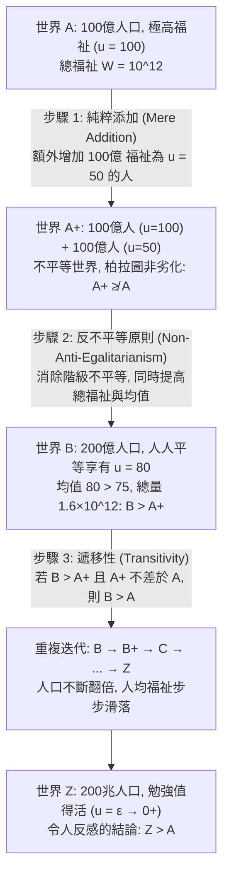

## 導論：當「人口規模 $N$」本身成為道德變數

在古典規範倫理學與福利經濟學的大多數問題中，我們通常預設處於<strong>固定人口（Fixed-Population）</strong>的框架之下：世界上已經存在確定數量的 $N$ 個個體，道德哲學的核心任務是如何在這 $N$ 個人之間公正地分配資源或最大化他們的總福祉。然而，一旦我們將視野擴展到氣候變遷政策、地球資源枯竭、生育補貼、太空殖民以及關係到人類未來數萬年命運的<strong>長遠主義（Longtermism）</strong>與生存性風險（Existential Risk）時，這一預設前提便瞬間瓦解——我們當下的決策不僅決定了未來人過得「有多好（福祉品質 $u_i$）」，而且直接決定了未來會有「多少人存在（人口規模 $N$）」，甚至決定了「究竟是哪些具體的人會出生」。

這就是<strong>人口倫理學（Population Ethics）</strong>與<strong>可變人口價值論（Variable-Population Axiology）</strong>的研究疆域。1984年，當代英國最偉大的倫理學家<strong>德瑞克·帕菲特（Derek Parfit, 1942–2017）</strong>在其劃時代的巨著《理與人》（*Reasons and Persons*）第四部分中，向整個現代哲學界投下了一枚震撼彈。他證明，如果我們採納自亨利·西季威克（Henry Sidgwick）以來最為正統的<strong>總體功利主義（Total Utilitarianism）</strong>，我們將無可逃避地推導出一個在道德直覺上令人毛骨悚然的命題——<strong>「令人反感的結論（The Repugnant Conclusion）」</strong>。更令人震驚的是，此後的哲學與數理邏輯研究表明，任何試圖修正總體功利主義以逃避這一結論的替代方案，都會不可避免地墜入其他同樣荒謬的倫理深淵。

---

## 第一章 從固定人口到可變人口：西季威克的分岔路口

### 1.1 社會福利函數的形式化定義

設某一個可能世界（或人口狀態）$X$ 包含 $N(X) \in \mathbb{N}^+$ 個個體，其終身淨福祉向量表示為 $X = (u_1, u_2, \dots, u_N) \in \mathbb{R}^N$。在人口倫理學中，我們定義一個關鍵的基準線——<strong>中性福祉水準（Neutral Level）</strong> $u = 0$：
* 當 $u_i > 0$ 時，個體 $i$ 的一生在總體上是<strong>值得過的（A life worth living）</strong>，正向體驗超過痛苦；
* 當 $u_i = 0$ 時，生命處於純粹中性狀態（或等同於未曾出生的虛無狀態）；
* 當 $u_i < 0$ 時，個體 $i$ 的一生飽受折磨，在總體上是<strong>不值得過的（A life not worth living）</strong>。

當兩個狀態的人口規模相同時（$N(X) = N(Y) = N$），<strong>總體功利主義（Total Utilitarianism）</strong>與<strong>平均功利主義（Average Utilitarianism）</strong>在排序上是完全等價的，因為總量最大化直接等價於均值最大化：

$$W_{\text{total}}(X) = \sum_{i=1}^{N} u_i = N \cdot \bar{u}, \qquad W_{\text{avg}}(X) = \frac{1}{N} \sum_{i=1}^{N} u_i = \bar{u}$$

### 1.2 亨利·西季威克的選擇

然而，當人口規模 $N$ 可變時，兩條道路發生了劇烈分岔。早期經濟學家（如約翰·史都華·彌爾 John Stuart Mill 與克努特·維克塞爾 Knut Wicksell 在探討馬爾薩斯人口論時）傾向於關注人均福祉 $\bar{u}$。但古典功利主義的集大成者<strong>亨利·西季威克（Henry Sidgwick）</strong>在《倫理學方法》（*The Methods of Ethics*, 1874）第四卷中敏銳地指出：如果功利主義的終極善是宇宙間快樂對痛苦的淨餘額，那麼要使這一總體產物最大化，我們不僅應當提高既有入口的平均快樂，而且應當在人均快樂保持為正的前提下，盡可能增加享受快樂的人口數量。西季威克明確選擇了總體功利函數 $W_{\text{total}}(X) = N \cdot \bar{u}$。正是這一看似順理成章的數學選擇，埋下了帕菲特悖論的引信。

---

## 第二章 帕菲特與「令人反感的結論」（The Repugnant Conclusion）

### 2.1 世界 $A$ 與世界 $Z$：莫札特與哲學 vs. 罐頭音樂與馬鈴薯

在《理與人》第142節中，帕菲特構建了一個著名的思想實驗。請比較以下兩個處於不同人口規模但內部完全平等的可能世界：

* <strong>世界 $A$（高福祉精英世界）</strong>：擁有 $N_A = 100\text{ 億} = 10^{10}$ 人口。在這個世界裡，每一個人都享有極高品質的幸福生活（設 $u_A = 100$）——他們身體健康、精神富足，一生充滿了深邃的科學探索、真摯的愛情以及帕菲特所說的<strong>「莫札特與哲學（Mozart and philosophy）」</strong>。世界 $A$ 的總福祉為：
  $$W_{\text{total}}(A) = N_A \cdot u_A = 10^{10} \times 100 = 10^{12}$$
* <strong>世界 $Z$（極度擁擠的微弱生存世界）</strong>：擁有極其龐大的人口，例如 $N_Z = 200\text{ 兆} = 2 \times 10^{14}$ 人口。在這個世界裡，每一個人的生活品質都僅僅略高於「還不如死掉」的中性零點（設 $u_Z = \varepsilon = 0.01 > 0$）。他們的一生極其單調、匱乏，沒有任何高級文化與深刻歡愉，生活中唯一的慰藉只有帕菲特形象地稱之為<strong>「低俗背景音樂（Muzak）與馬鈴薯（Muzak and potatoes）」</strong>的最低限度感官維持。然而，由於人口基數 $N_Z$ 足夠龐大，世界 $Z$ 的總福祉達到了：
  $$W_{\text{total}}(Z) = N_Z \cdot u_Z = (2 \times 10^{14}) \times 0.01 = 2 \times 10^{12}$$

由於 $W_{\text{total}}(Z) = 2 \times 10^{12} > 10^{12} = W_{\text{total}}(A)$，根據總體功利主義（或任何滿足無界數量可替代性的價值論），<strong>世界 $Z$ 在道德價值上嚴格優於世界 $A$（$Z \succ A$）</strong>。帕菲特將這一推論正式命名為<strong>「令人反感的結論（The Repugnant Conclusion）」</strong>：

> <strong>令人反感的結論的定義</strong>：對於任何一個由極高生活品質人口所組成的世界（無論其人口有多少、生活有多麼美妙），只要另一個世界的人口數量足夠龐大，哪怕其中每一個人的生活都僅僅是勉強值得活下去（$u_i = \varepsilon \to 0^+$），在其他條件相同時，後一個世界也必然比前一個世界更好。

### 2.2 為什麼這一結論令人深感反感？

這一結論之所以在直覺上令人難以接受，是因為它意味著<strong>數量（Quantity）可以無限度地吞噬並替代品質（Quality）</strong>。在總體功利主義的帳本上，人類文明最高級的審美、智性與情感成就（莫札特與哲學），可以被無窮無盡的、如同養殖場般擁擠而麻木的微弱生存狀態（罐頭音樂與馬鈴薯）徹底碾壓。如果有一位全能的宇宙規劃者遵循總體功利主義，他應當毫不猶豫地摧毀充滿創造力與幸福的世界 $A$，將其改造成擁擠不堪但總效用翻倍的世界 $Z$。

---

## 第三章 純粹添加悖論（The Mere Addition Paradox）：通往深淵的滑坡

也許有人會說：「既然總體功利主義導致了令人反感的結論，那我們直接放棄總體功利主義不就行了嗎？」帕菲特隨後構造了更為致命的<strong>純粹添加悖論（The Mere Addition Paradox）</strong>，證明即使我們完全不依賴總體功利主義，僅憑三個極其溫和、各自看來無可辯駁的道德直覺，依然會被一步步推向世界 $Z$。

請看帕菲特設計的三步推理鏈條：

1. <strong>從世界 $A$ 到世界 $A^+$（純粹添加原則 Mere Addition Principle）</strong>：
   假設在世界 $A$（100億人，福祉 $u = 100$）的基礎上，我們在另一片互不干擾的大陸上<strong>純粹添加（Mere Addition）</strong>了另外100億人，這部分新人口的福祉為 $u = 50$（雖然不如原住民富有，但依然擁有相當幸福、絕對值得活的一生），且原住民的福祉絲毫未受影響（仍為 $100$）。這就構成了世界 $A^+$。
   根據<strong>純粹添加原則</strong>：只要新增加的人口過著值得活的正向生活（$u > 0$），且沒有損害任何既有成員的利益，這種添加絕不會使世界變得<strong>更糟</strong>。因此，世界 $A^+$ 至少<strong>不比世界 $A$ 差</strong>（$A^+ \not\prec A$，或者記為 $A^+ \succeq A$）。
2. <strong>從世界 $A^+$ 到世界 $B$（非反平等主義原則 Non-Anti-Egalitarianism / 平等優勢原則）</strong>：
   在世界 $A^+$ 中，存在著100億 $u=100$ 的精英與100億 $u=50$ 的次等公民（總福祉為 $1500\text{ 億}$，人均福祉為 $75$）。現在考慮世界 $B$：同樣擁有這200億人口，但透過資源再分配與協同合作，消除了階級分化，使<strong>全部200億人都平等地享有 $u = 80$ 的高福祉</strong>（總福祉上升至 $1600\text{ 億}$，人均福祉上升至 $80$）。
   比較 $A^+$ 與 $B$：世界 $B$ 不僅總福祉更高（$1600 > 1500$）、平均福祉更高（$80 > 75$），而且實現了完全的平等！根據任何合理的平等主義或功利主義直覺，<strong>世界 $B$ 嚴格優於世界 $A^+$（$B \succ A^+$）</strong>。
3. <strong>遞移性（Transitivity）與迭代滑坡</strong>：
   如果 $B$ 嚴格優於 $A^+$（$B \succ A^+$），而 $A^+$ 又不比 $A$ 差（$A^+ \succeq A$），那麼根據價值關係的基本<strong>遞移性（Transitivity）</strong>，必然得出：<strong>世界 $B$（200億人，$u=80$）嚴格優於世界 $A$（100億人，$u=100$）！</strong>
   一旦承認 $B \succ A$，我們就可以對世界 $B$ 重複完全相同的操作：$B \to B^+ \to C$（400億人，$u=64$）$\to D \to \dots \to Z$。經過有限步的嚴格遞移，我們必然得出 $Z \succ A$——無需直接訴諸總體功利主義，我們依然墜入了令人反感的結論！

---

## 第四章 逃離的嘗試與破產：從虐待狂結論到非同一性問題

為了躲避令人反感的結論，哲學家與經濟學家提出了四大類替代價值論，但每一種方案都付出了慘重的代價。

| 人口價值論模型 | 數學社會福利函數 $W(X)$ | 是否避免「令人反感的結論」？ | 致命理論代價與衍生悖論 |
| :--- | :--- | :--- | :--- |
| <strong>總體功利主義 (Total Utilitarianism)</strong> | $W_{\text{total}} = \sum_{i=1}^{N} u_i = N \cdot \bar{u}$ | <strong>否</strong>（直接導出 $Z \succ A$） | 數量無限替代品質，淪為「罐頭音樂與馬鈴薯」世界 |
| <strong>平均功利主義 (Average Utilitarianism)</strong> | $W_{\text{avg}} = \frac{1}{N} \sum_{i=1}^{N} u_i = \bar{u}$ | <strong>是</strong>（因 $\bar{u}_A = 100 > \varepsilon = \bar{u}_Z$） | 導出「地獄添加悖論」與<strong>虐待狂結論 (Sadistic Conclusion)</strong> |
| <strong>可變價值論 / 漸近上限論 (Variable Value)</strong> | $W_{\text{var}} = f(N) \cdot \bar{u}, \ \lim_{N \to \infty} f(N) = M$ | <strong>是</strong>（人口價值存在漸近上限 $M$） | 在高人口區間違背純粹添加原則，同樣誘發虐待狂結論 |
| <strong>臨界水準功利主義 (Critical-Level, CLU)</strong> | $W_{\text{CL}} = \sum_{i=1}^{N} (u_i - \alpha) \ (\alpha > 0)$ | <strong>是</strong>（當 $u_Z = \varepsilon < \alpha$ 時為負貢獻） | 導出<strong>極端虐待狂結論 (Very Sadistic Conclusion)</strong>：寧可選少數人受酷刑，也不選大量幸福人口 |
| <strong>影響個體觀 (Person-Affecting View)</strong> | 僅比較對「既定存在個體」的利害影響 | <strong>視形式而定</strong> | 遭遇<strong>非對稱性難題 (Asymmetry)</strong>與帕菲特<strong>非同一性問題 (Non-Identity Problem)</strong> |

### 4.1 平均功利主義與「虐待狂結論」（The Sadistic Conclusion）

如果我們改用<strong>平均功利主義</strong> $W_{\text{avg}}(X) = \bar{u}$，確實可以輕鬆判定 $A \succ Z$（因為 $100 > 0.01$）。然而，平均功利主義會導致一系列荒謬絕倫的後果：
* <strong>向地獄添加受苦者（Addition to Hell）</strong>：假設世界裡原本有100個遭受極度酷刑折磨的人，其福祉為 $u = -100$。此時如果再新出生一個同樣遭受酷刑但痛苦略微輕一點的人（例如 $u = -90$，依然生不如死），整個世界的平均福祉竟然從 $-100$ 「上升」到了 $-99.9$！按照平均功利主義，創造一個生不如死的受苦生命竟然是一件「改善世界」的善舉！
* <strong>虐待狂結論（The Sadistic Conclusion）</strong>：瑞典哲學家<strong>古斯塔夫·阿雷尼烏斯（Gustaf Arrhenius）</strong>證明，在平均功利主義（以及許多試圖打折人口數量價值的理論）下，如果我們面臨兩個選擇：在既有高福祉人口的基礎上，（選項一）額外添加一大群生活幸福但福祉低於當前均值的人（這會拉低平均分）；或者（選項二）額外添加<strong>一小群遭受酷刑折磨、生不如死的人（$u < 0$）</strong>。只要受酷刑的人數足夠少，他們對平均分的拉低幅度就會小於那一大群幸福人口對平均分的拉低幅度！於是，平均功利主義竟然認為：<strong>添加少數受酷刑折磨的人，在道德上優於添加大量過著幸福生活的人！</strong>這比「令人反感的結論」更加令人髮指。

### 4.2 可變價值論（Variable Value）與臨界水準功利主義（Critical-Level Utilitarianism）

1. <strong>湯瑪斯·赫爾卡（Thomas Hurka）與黃有光（Yew-Kwang Ng）的可變價值論</strong>：主張人口規模的邊際價值遞減，即 $W_{\text{var}}(X) = f(N) \cdot \bar{u}$，其中 $f'(N) > 0, f''(N) < 0$，且當 $N \to \infty$ 時收斂於有限上限 $\lim_{N \to \infty} f(N) = M < \infty$。這樣無論世界 $Z$ 有多少人，其總價值永遠不可能超過 $M \cdot \varepsilon$，從而避免了 $Z \succ A$。
2. <strong>布萊克比、博薩特與唐納森（Blackorby, Bossert, and Donaldson）的臨界水準功利主義（CLU）</strong>：引入一個嚴格大於零的道德臨界閾值 $\alpha > 0$（例如 $\alpha = 10$），社會福利函數定義為：
   $$W_{\text{CL}}(X) = \sum_{i=1}^{N} (u_i - \alpha) = N \cdot (\bar{u} - \alpha) \quad (\alpha > 0)$$
   在 CLU 下，任何福祉處於 $0 < u_i < \alpha$ 之間的生命（雖然對本人而言值得活，但低於臨界值 $\alpha$），其出生都會對社會總價值產生<strong>負貢獻</strong>。因此，當 $\varepsilon < \alpha$ 時，$W_{\text{CL}}(Z) = N_Z(\varepsilon - \alpha) \to -\infty$，徹底阻斷了令人反感的結論。

<strong>致命缺陷——極端虐待狂結論（The Very Sadistic Conclusion）</strong>：阿雷尼烏斯指出，在臨界水準功利主義下，對於足夠龐大的世界 $Z$（其中每個人都過著正向生活 $0 < \varepsilon < \alpha$），其社會總價值 $N_Z(\varepsilon - \alpha)$ 是一個絕對值極其巨大的負數。此時，哪怕另一個世界 $H$ 由一萬個每天遭受地獄般酷刑折磨的人（$u = -1000$）組成，只要滿足 $10^4(-1000 - \alpha) > N_Z(\varepsilon - \alpha)$，臨界水準功利主義就會判定：<strong>純粹由受酷刑者組成的地獄世界 $H$，嚴格優於幾十兆人平靜度日的世界 $Z$！</strong>

### 4.3 影響個體觀（Person-Affecting View）、非對稱性與非同一性問題

加拿大哲學家<strong>簡·納維森（Jan Narveson）</strong>在1967年提出了一句名言：<strong>「我們贊成讓人們變得幸福，而不是製造幸福的人（We are in favor of making people happy, not of making happy people）。」</strong>這就是<strong>影響個體觀（Person-Affecting View）</strong>的核心口號：一個行為或狀態只有在對某個「既定存在的人」有利或有害時，才具有道德好壞。由於未出生的人並不存在，不生下潛在的幸福嬰兒並沒有傷害任何人。

然而，這一立場立刻遭遇了兩大跨不過去的障礙：
1. <strong>傑夫·麥克馬漢（Jeff McMahan, 1981）的生育非對稱性（The Asymmetry）</strong>：我們普遍持有這樣一對直覺：（a）如果一對夫婦預見到孩子出生後會患上極度痛苦的絕症（$u < 0$），他們有強烈的道德義務<strong>不生</strong>這個孩子；（b）如果他們預見到孩子會非常幸福（$u > 0$），他們卻<strong>沒有</strong>道德義務必須生下這個孩子。影響個體觀很難在邏輯自洽的前提下同時解釋這種不對稱性。
2. <strong>帕菲特的「非同一性問題」（The Non-Identity Problem）</strong>：這是《理與人》中另一個震撼整個哲學界的發現。假設人類面臨兩項宏觀政策選擇：<strong>「消耗政策（Depletion）」</strong>會在未來兩百年內大肆揮霍地球資源，導致300年後的人類生活在嚴重污染但仍然值得活（$u = 20 > 0$）的環境中；而<strong>「保育政策（Conservation）」</strong>則會保護環境，使300年後的人類享有極高福祉（$u = 100$）。
   帕菲特指出：宏觀經濟與能源政策的改變，會徹底改變全人類的日常出行、婚配時間與受孕時刻。哪怕受孕時間僅僅相差幾秒鐘，結合的精子與卵子就會完全不同！這意味著：<strong>300年後在「消耗政策」下出生的那100億人，與在「保育政策」下出生的那100億人，在基因與個人同一性上是完全不同的兩批人（$\text{Pop}_{\text{deplete}} \cap \text{Pop}_{\text{conserve}} = \emptyset$）！</strong>
   如果我們嚴格堅持狹義的「影響特定個體觀」，那麼選擇污染地球的「消耗政策」<strong>並沒有使300年後的任何一個具體個人變得更糟</strong>——因為如果不採取消耗政策，那些在污染世界中出生的人根本就不會存在，而且他們活著依然比不存在好（$u = 20 > 0$）！為了能夠理直氣壯地譴責消耗政策、捍衛子孫後代的福祉，我們必須引入<strong>非特定個體的（Impersonal）</strong>價值原則；而一旦引入非特定個體的總體價值原則，我們便再次回到了通往「令人反感的結論」的軌道上。

---

## 第五章 阿雷尼烏斯不可能性定理與當代長遠主義的典範轉移

### 5.1 人口倫理學的不可能性定理（Arrhenius's Impossibility Theorem）

經過三十餘年的探索，瑞典哲學家<strong>古斯塔夫·阿雷尼烏斯（Gustaf Arrhenius）</strong>在其集大成的研究中，借鑑肯尼斯·阿羅（Kenneth Arrow）社會選擇理論的公理化方法，嚴格證明了<strong>人口倫理學的不可能性定理（Impossibility Theorems in Population Ethics）</strong>。

阿雷尼烏斯證明，<strong>不存在任何一個滿足遞移性（Transitivity）的人口價值排序關係 $\succeq$，能夠同時滿足以下四個在直覺上極其基本的道德公理</strong>：
1. <strong>平等優勢原則（Egalitarian Dominance）</strong>：若兩個入口規模相同的世界 $X$ 與 $Y$ 滿足 $Y$ 的總福祉更高且分配更平等，則 $Y \succ X$。
2. <strong>反精英主義 / 品質條件（Quality / Avoidance of the Repugnant Conclusion）</strong>：至少存在某個高福祉世界 $A$，優於任何生活品質極度微弱（$u_i = \varepsilon \to 0^+$）的世界 $Z$。
3. <strong>數量條件 / 純粹添加（Quantity / Mere Addition）</strong>：添加足夠多過著正向幸福生活的人不會使世界變差。
4. <strong>非虐待狂原則（Non-Sadism）</strong>：添加受酷刑折磨的負福祉人口（$u < 0$），絕不優於添加過著幸福生活的正福祉人口（$u > 0$）。

這一數學定理宣告了：人類關於人口、品質、數量與平等的常識道德直覺之間，存在著<strong>根本性的邏輯不相容（Fundamental Logical Inconsistency）</strong>。任何完備的倫理學體系都必須在上述公理中做出痛苦的割捨。

### 5.2 2021年《政治哲學期刊》聯合宣言與長遠主義（Longtermism）

面對阿雷尼烏斯的不可能性定理，當代倫理學界發生了一場重大的典範轉移。2021年，包括彼得·辛格（Peter Singer）、希拉蕊·格里夫斯（Hilary Greaves）、托比·奧德（Toby Ord）、威廉·麥克阿斯基爾（William MacAskill）與黃有光在內的29位頂尖哲學家與經濟學家，在《政治哲學期刊》（*Journal of Political Philosophy*）上聯合發表了題為《克服令人反感的結論》（*Overcoming the Repugnant Conclusion*）的綱領性宣言。

他們指出：過去四十年來，倫理學家們把「避免令人反感的結論」當作評判一切人口理論的絕對紅線，結果卻被迫接受了更加違背道德良知的「虐待狂結論」或違背遞移性的非理性理論。事實上，人類直覺之所以對世界 $Z$ 感到反感，很大程度上是因為以下兩種<strong>認知偏差</strong>：
1. <strong>人類對超大數字的直覺麻木（Scope Insensitivity）</strong>：人類大腦在演化過程中只能直觀理解幾百人的部落規模，根本無法在心理上真正想像 $200\text{ 兆}$（$2 \times 10^{14}$）個獨立意識主體所匯聚成的正向價值總和。
2. <strong>對「微弱值得活的生活（$u = \varepsilon$）」的錯誤想像</strong>：人們在想像世界 $Z$ 時，往往下意識地將其想像成一個充滿痛苦、壓抑、飢餓的地獄（其實那是 $u < 0$ 的世界），而忽略了假設前提明確規定 $u = \varepsilon > 0$ 依然是一個正向的、當事人欣然願意活下去的世界。

因此，以<strong>有效利他主義（Effective Altruism）</strong>與<strong>長遠主義（Longtermism）</strong>為代表的當代學者主張：與其陷入虐待狂結論，我們應當勇敢地修正直覺，接納總體功利主義或包含正值人口權重的價值論。更重要的是，在現實政策中，防止人類滅絕（Existential Risk Mitigation）與推動永續科技進步，能夠讓未來世代<strong>同時實現龐大的人口存續（大 $N$）與極高的生活品質（高 $\bar{u}$）</strong>——從而在現實歷史中共同邁向帕菲特夢寐以求的至善之境。
