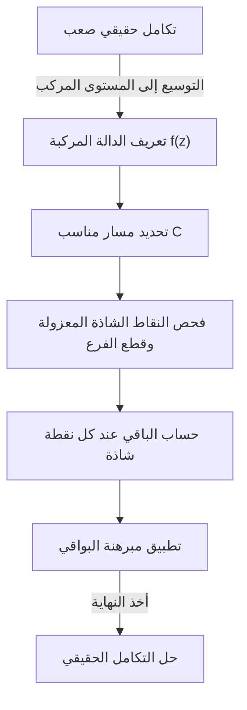
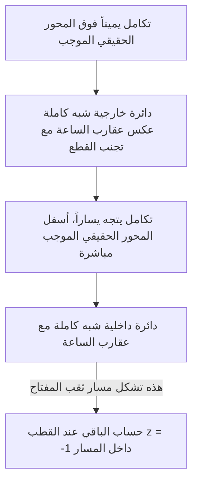

## مقدمة: حدود التكاملات الحقيقية والقفزة إلى المستوى المركب

التكاملات المحددة أداة مهمة في الفيزياء والهندسة، لكن إيجاد دالة أصلية مباشرةً بالمتغيرات الحقيقية قد يكون صعباً. تحت فرضيات مناسبة، توفر مبرهنة البواقي طريقة أخرى لحساب بعض هذه التكاملات. نبدأ بالتكامل المعتل التالي:

$$
I = \int_{-\infty}^{\infty} \frac{1}{x^2 + 1} dx
$$

يمكن حساب هذا التكامل باستخدام $\arctan(x)$. مع دوال كسرية أو مثلثية أكثر تعقيداً، قد يكون البحث المباشر عن دالة أصلية أقل ملاءمة من استخدام طريقة للتكامل على مسار في المستوى المركب.

تربط **مبرهنة البواقي** تكاملاً على المحور الحقيقي بتكامل على مسار مغلق في المستوى المركب، باستخدام معلومات محلية حول النقاط الشاذة المعزولة. اختيار امتداد مركب مناسب وتقدير مساهمات أجزاء المسار الإضافية أمران أساسيان؛ فالانتقال إلى المستوى المركب لا يحسب تلقائياً أي تكامل حقيقي.

## التكامل المركب والنقاط الشاذة

تُكامل الدالة المركبة $f(z)$ على منحنى في المستوى المركب. إذا كان $C$ منحنى مغلقاً بسيطاً من الصنف $C^1$ قطعياً، وكانت $f$ هولومورفية على مجموعة مفتوحة تحتوي $C$ وداخله، انطبقت النتيجة التالية من **[مبرهنة تكامل كوشي](/ar/p/cauchys-integral-theorem/)**. الهولومورفية وحدها لا تبرر النتيجة لكل منحنى في مجال ذي ثقوب.

$$
\oint_C f(z) dz = 0 \quad (\text{إذا كانت الدالة هولومورفية داخل وعلى } C)
$$

ماذا يتغير عند وجود نقطة شاذة داخل المسار؟ **النقطة الشاذة المعزولة** $z_0$ تعني هنا أن $f$ هولومورفية في جوار مثقوب $0<|z-z_0|<r$، ولكنها ليست كذلك عند $z_0$. نميز بين النقاط القابلة للإزالة، والأقطاب، والنقاط الشاذة الجوهرية (essential singularities). للـ**قطب** جزء رئيسي غير صفري مؤلف من عدد منته من الحدود في متسلسلة لوران؛ وليست كل نقطة شاذة قطباً. وقد يزول انعدام المقام بالاختزال: في $(z^2-1)/(z-1)$ تكون النقطة $1$ قابلة للإزالة، بينما $0$ نقطة شاذة جوهرية للدالة $e^{1/z}$.

## متسلسلة لوران والبواقي

إذا كانت $f$ هولومورفية في جوار مثقوب $0<|z-z_0|<r$ لنقطة شاذة معزولة، فلها **متسلسلة لوران** متقاربة هناك. توسع هذه [متسلسلة تايلور](/ar/p/taylor-and-maclaurin-series/) إلى الأسس السالبة، وتكتب كما يلي. وبصورة أعم، ننظر في متسلسلات لوران داخل مجالات حلقية تكون فيها الدالة هولومورفية.

$$
f(z) = \sum_{n=0}^{\infty} a_n (z - z_0)^n + \sum_{n=1}^{\infty} \frac{b_n}{(z - z_0)^n}
$$

مجموع الحدود ذات الأسس السالبة — أي المجموع الثاني في الطرف الأيمن — هو **الجزء الرئيسي**، وهو الذي يحدد نوع النقطة الشاذة. وعلى وجه الخصوص، يسمى معامل $(z-z_0)^{-1}$، أي $b_1$، **باقي** $f$ عند $z_0$، ويرمز إليه كما يلي:

$$
\text{Res}(f, z_0) = b_1
$$

يمتاز معامل $(z-z_0)^{-1}$ لأن تكامل $1/(z-z_0)^n$ على دائرة صغيرة داخل الجوار المثقوب، تُقطع مرة واحدة عكس عقارب الساعة، يساوي $2\pi i$ للعدد الصحيح $n=1$، وصفراً لبقية الأعداد الصحيحة. وعكس الاتجاه يغير الإشارة.

## مبرهنة البواقي لكوشي

ليكن $C$ منحنى مغلقاً بسيطاً من الصنف $C^1$ قطعياً، موجهاً إيجابياً، أي عكس عقارب الساعة. نفترض أن $f$ هولومورفية على مجموعة مفتوحة تحتوي $C$ وداخله، باستثناء عدد منته من النقاط الشاذة المعزولة الداخلية $z_1,\ldots,z_k$، وألا توجد نقاط شاذة على المنحنى نفسه. عندئذ تنص **مبرهنة البواقي** على أن:

$$
\oint_C f(z) dz = 2\pi i \sum_{j=1}^{k} \text{Res}(f, z_j)
$$

تحت هذه الفرضيات نجمع البواقي داخل المسار ونضرب في $2\pi i$. الصيغة العامة للمنحنيات ذات التقاطعات الذاتية أو المرور المتكرر تستخدم أيضاً عدد الالتفاف حول كل نقطة شاذة. ولا يجوز تطبيق الصيغة المعروضة مباشرةً على مسار يمر بنقطة شاذة أو يعبر قطع الفرع.

## التطبيق: حل التكاملات الحقيقية

دعونا نستخدم بالفعل مبرهنة البواقي لحل التكامل المقدم في البداية.

$$
I = \int_{-\infty}^{\infty} \frac{1}{x^2 + 1} dx
$$

### الخطوة 1: التوسيع إلى دالة مركبة وتحديد المسار
نضع $f(z)=1/(z^2+1)$ ونختار $R>1$. نسير على المحور الحقيقي من $-R$ إلى $R$، ثم نعود على القوس نصف الدائري العلوي $C_R$ من $R$ إلى $-R$ عكس عقارب الساعة. يشكل ذلك المسار المغلق ذا الاتجاه الموجب $C$.

يمكن تحليل التكامل على المنحنى المغلق $C$ على النحو التالي:

$$
\oint_C f(z) dz = \int_{-R}^{R} f(x) dx + \int_{C_R} f(z) dz
$$

على القوس، $|z^2+1|\ge R^2-1$، ولذلك $\left|\int_{C_R}f(z)\,dz\right|\le\pi R/(R^2-1)\to0$. وعلى المحور الحقيقي تكون الدالة تحت التكامل من الرتبة $O(x^{-2})$ عند اللانهاية، فيتقارب التكامل المعتل تقارباً مطلقاً. لذلك تعطي النهاية التالية التكامل المعتل المعتاد، لا مجرد قيمة كوشي الرئيسية الناتجة عن قطع متناظر:

$$
\lim_{R \to \infty} \oint_C f(z) dz = \int_{-\infty}^{\infty} \frac{1}{x^2 + 1} dx
$$

### الخطوة 2: النقاط الشاذة وحساب الباقي
الدالة $f(z) = \frac{1}{z^2 + 1} = \frac{1}{(z - i)(z + i)}$ لها أقطاب من الرتبة 1 عند $z = i$ و $z = -i$.
النقطة الشاذة الوحيدة داخل المسار $C$ (في النصف العلوي من المستوى) هي $z = i$.

دعونا نحسب الباقي عند $z = i$. يمكن حساب الباقي لقطب بسيط (من الرتبة 1) على النحو التالي:

$$
\text{Res}(f, i) = \lim_{z \to i} (z - i) f(z) = \lim_{z \to i} \frac{1}{z + i} = \frac{1}{2i}
$$

### الخطوة 3: تطبيق مبرهنة البواقي
بواسطة مبرهنة البواقي، يصبح التكامل على المنحنى المغلق $C$:

$$
\oint_C f(z) dz = 2\pi i \times \text{Res}(f, i) = 2\pi i \times \frac{1}{2i} = \pi
$$

وبالتالي، فإن قيمة التكامل المحدد الحقيقي المطلوب هي $\pi$.

$$
\int_{-\infty}^{\infty} \frac{1}{x^2 + 1} dx = \pi
$$

بهذه الطريقة، من خلال إضافة بُعد واحد (المستوى المركب)، نجد "طريقاً مختصراً" كان غير مرئي باستخدام الأعداد الحقيقية فقط، مما يتيح لنا إجراء الحساب بسهولة مدهشة.

## لمّة جوردان والتكاملات المثلثية

كمثال آخر أكثر تعقيداً بعض الشيء، ضع في اعتبارك التكامل التالي الذي يظهر بشكل متكرر في الفيزياء (على سبيل المثال، تحويلات فورييه للدوال الموجية في ميكانيكا الكم):

$$
J = \int_{-\infty}^{\infty} \frac{\cos(kx)}{x^2 + a^2} dx \quad (k > 0, a > 0)
$$

ننظر في $f(z)=e^{ikz}/(z^2+a^2)$. من [صيغة أويلر](/ar/p/euler/)، $e^{ikx}=\cos(kx)+i\sin(kx)$، فيعطي الجزء الحقيقي للتكامل المركب النتيجة المطلوبة. عند $k>0,a>0$ يتقارب التكامل على المحور الحقيقي تقارباً مطلقاً، مما يجيز أخذ الجزء الحقيقي تحت إشارة التكامل.

نختار مجدداً $R>a$، ونسير على المحور الحقيقي من $-R$ إلى $R$ ثم نعود على نصف الدائرة العلوي من $R$ إلى $-R$. هناك $|e^{ikz}|=e^{-k\operatorname{Im}z}\le1$، فلا تتجاوز القيمة المطلقة لتكامل القوس $\pi R/(R^2-a^2)$، وتؤول إلى الصفر. توفر **لمّة جوردان** (Jordan's lemma) تقديراً أعم لـ $e^{ikz}g(z)$: عند تثبيت $k>0$، إذا آل الحد الأعلى الأصغر لـ $|g|$ على نصف الدائرة العلوي إلى الصفر، آل تكامل القوس إلى الصفر أيضاً. في هذا المثال، يكفي أصلاً التناقص التربيعي الناتج عن المقام.

النقطة الشاذة هي $z = ia$ (النصف العلوي من المستوى). نحسب الباقي:

$$
\text{Res}(f, ia) = \lim_{z \to ia} (z - ia) \frac{e^{ikz}}{(z - ia)(z + ia)} = \frac{e^{-ka}}{2ia}
$$

نطبق مبرهنة البواقي:

$$
\int_{-\infty}^{\infty} \frac{e^{ikx}}{x^2 + a^2} dx = 2\pi i \times \frac{e^{-ka}}{2ia} = \frac{\pi e^{-ka}}{a}
$$

الجانب الأيمن هو عدد حقيقي بحت. لذلك، من خلال مقارنة الأجزاء الحقيقية، نحصل على النتيجة الجميلة التالية:

$$
\int_{-\infty}^{\infty} \frac{\cos(kx)}{x^2 + a^2} dx = \frac{\pi e^{-ka}}{a}
$$

## قطع الفرع ومسارات ثقب المفتاح

تطبيق أكثر تقدماً يتعلق بتعابير مثل $\log z$ و$z^a$، ذات القيم المتعددة. لاستخدام دالة أحادية القيمة وهولومورفية على مجال مناسب، نختار فرعاً ونضع قطعاً في المستوى المركب يسمى **قطع الفرع** (branch cut).

على سبيل المثال، ضع في اعتبارك التكامل التالي (حيث $0 < a < 1$):

$$
K = \int_{0}^{\infty} \frac{x^{-a}}{x + 1} dx
$$

عند $0<a<1$ تكون الدالة تحت التكامل من الرتبة $O(x^{-a})$ قرب الصفر، ومن الرتبة $O(x^{-a-1})$ عند اللانهاية، فيتقارب التكامل. نضع القطع على المحور الحقيقي الموجب ونختار الفرع $0<\arg z<2\pi$، حيث $\operatorname{Log}z=\log|z|+i\arg z$ و$F(z)=z^{-a}/(z+1)=e^{-a\operatorname{Log}z}/(z+1)$. نأخذ $0<\varepsilon<1<R$، ونسير إلى الخارج فوق القطع مباشرةً، ثم على الدائرة الخارجية عكس عقارب الساعة، ثم إلى الداخل تحت القطع مباشرةً، وأخيراً على الدائرة الداخلية مع عقارب الساعة. يتجنب المسار المستخدم القطع، ونأخذ نهايات من جانبيه.

لا تتجاوز القيمة المطلقة للمساهمة الخارجية $2\pi R^{1-a}/(R-1)$، فتؤول إلى الصفر عندما $R\to\infty$. ولا تتجاوز المساهمة الداخلية $2\pi\varepsilon^{1-a}/(1-\varepsilon)$، فتؤول إلى الصفر عندما $\varepsilon\to0$. فوق القطع، $z^{-a}\to x^{-a}$؛ وتحته، $z^{-a}\to e^{-2\pi ia}x^{-a}$. ولأن الجانب السفلي يُقطع بالاتجاه المعاكس، يؤول مجموع القطعتين المستقيمتين إلى $(1-e^{-2\pi ia})K$. في الفرع المختار $\arg(-1)=\pi$، فيكون الباقي عند $-1$ مساوياً لـ $e^{-\pi ia}$. إذن $(1-e^{-2\pi ia})K=2\pi i\,e^{-\pi ia}$. وباستخدام $1-e^{-2\pi ia}=2i\,e^{-\pi ia}\sin(\pi a)$، نحصل على:

$$
\int_{0}^{\infty} \frac{x^{-a}}{x + 1} dx = \frac{\pi}{\sin(a\pi)}
$$

## الخاتمة

تعتبر مبرهنة البواقي مثالاً للأناقة الرياضية، حيث تربط ببراعة بين "الأقطاب المركبة" و "التكاملات الحقيقية" التي تبدو غير مرتبطة. لحل مشكلة تتعلق بدالة حقيقية، تقفز مؤقتاً إلى العالم الأوسع للمستوى المركب، وتفحص فقط خصائص (البواقي) الخاصة بـ "العقبات" (النقاط الشاذة)، وعندما تعود إلى العالم الأصلي، تجد أن المشكلة قد حُلت ببراعة.

تظهر هذه الطرق أيضاً في [تحويل لابلاس](/ar/p/laplace-transform/) العكسي وتكاملات فورييه. ويتطلب استخدامها الموثوق التحقق من نوع النقاط الشاذة واتجاه المسار والتقارب عند اللانهاية وقرب نقاط التفرع.

## المراجع

- [MIT 18.04 Topic 8: Residues and the residue theorem](https://ocw.mit.edu/courses/18-04-complex-variables-with-applications-spring-2018/3c58ce71ec6f7573804221d76158a0bd_MIT18_04S18_topic8.pdf)
- [MIT 18.04 Topic 9: Definite integrals using the residue theorem](https://ocw.mit.edu/courses/18-04-complex-variables-with-applications-spring-2018/f69bc227ae476839819fb18e5b283072_MIT18_04S18_topic9.pdf)
- [NIST DLMF §1.10: Functions of a Complex Variable](https://dlmf.nist.gov/1.10)
