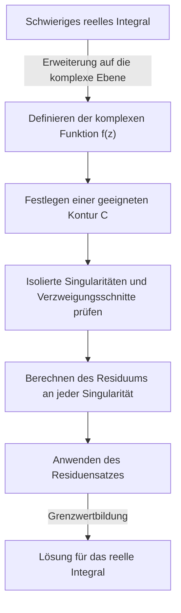
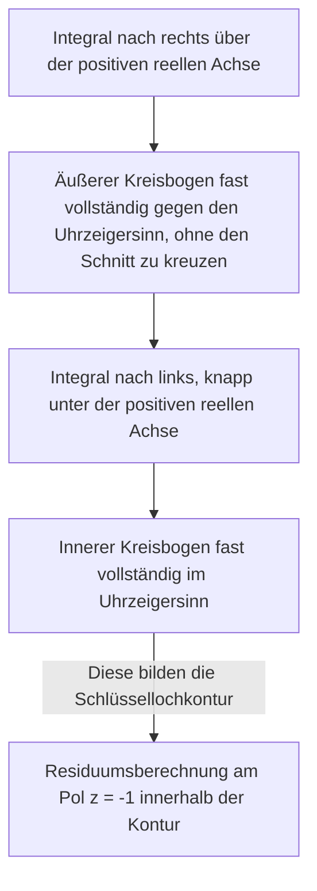

## Einführung: Die Grenzen reeller Integrale und der Sprung in die komplexe Ebene

Bestimmte Integrale sind wichtige Werkzeuge in Physik und Ingenieurwesen. Eine Stammfunktion direkt in reellen Variablen zu finden, kann jedoch schwierig sein. Unter geeigneten Voraussetzungen bietet der Residuensatz eine weitere Methode zur Berechnung mancher solcher Integrale. Beginnen wir mit dem folgenden uneigentlichen Integral:

$$
I = \int_{-\infty}^{\infty} \frac{1}{x^2 + 1} dx
$$

Dieses Integral lässt sich mit $\arctan(x)$ berechnen. Bei komplizierteren rationalen oder trigonometrischen Integranden kann die direkte Suche nach einer Stammfunktion unpraktisch sein, sodass eine Methode der Konturintegration hilfreich ist.

Der **Residuensatz** verbindet ein Integral auf der reellen Achse mit einem Integral über eine geschlossene Kontur in der komplexen Ebene. Er nutzt lokale Informationen in der Nähe isolierter Singularitäten. Eine geeignete komplexe Fortsetzung und die Abschätzung der zusätzlichen Konturstücke sind wesentlich; der Übergang in die komplexe Ebene berechnet nicht automatisch jedes reelle Integral.

## Komplexe Integration und Singularitäten

Eine komplexe Funktion $f(z)$ wird entlang einer Kurve in der komplexen Ebene integriert. Ist $C$ eine einfache geschlossene, stückweise stetig differenzierbare Kurve und $f$ auf einer offenen Menge holomorph, die $C$ und ihr Inneres enthält, so gilt die folgende Konsequenz des **[Cauchyschen Integralsatzes](/de/p/cauchys-integral-theorem/)**. Holomorphie allein rechtfertigt diese Aussage nicht für jede Kurve in einem Gebiet mit Löchern.

$$
\oint_C f(z) dz = 0 \quad (\text{wenn die Funktion innerhalb und auf } C \text{ holomorph ist})
$$

Was ändert sich bei einer Singularität im Inneren der Kontur? Eine **isolierte Singularität** bei $z_0$ bedeutet hier, dass $f$ auf einer punktierten Umgebung $0<|z-z_0|<r$ holomorph ist, aber nicht bei $z_0$. Man unterscheidet hebbare Singularitäten, Pole und wesentliche Singularitäten. Ein **Pol** hat einen nicht verschwindenden Hauptteil mit endlich vielen Termen in seiner Laurent-Reihe; nicht jede Singularität ist ein Pol. Ein verschwindender Nenner kann sich kürzen: $(z^2-1)/(z-1)$ hat bei $1$ eine hebbare Singularität, während $e^{1/z}$ bei $0$ eine wesentliche Singularität hat.

## Laurent-Reihen und Residuen

Ist $f$ auf einer punktierten Umgebung $0<|z-z_0|<r$ einer isolierten Singularität holomorph, so besitzt sie dort eine konvergente **Laurent-Reihe**. Diese erweitert die [Taylor-Reihe](/de/p/taylor-and-maclaurin-series/) auf negative Potenzen und lässt sich wie folgt schreiben. Allgemeiner betrachtet man Laurent-Entwicklungen auf Kreisringen der Holomorphie.

$$
f(z) = \sum_{n=0}^{\infty} a_n (z - z_0)^n + \sum_{n=1}^{\infty} \frac{b_n}{(z - z_0)^n}
$$

Die Summe der Terme mit negativen Potenzen — die zweite Summe auf der rechten Seite — ist der **Hauptteil**. Er bestimmt die Art der Singularität. Insbesondere heißt der Koeffizient $b_1$ von $(z-z_0)^{-1}$ das **Residuum** von $f$ bei $z_0$, geschrieben als:

$$
\text{Res}(f, z_0) = b_1
$$

Der Koeffizient von $(z-z_0)^{-1}$ ist besonders, weil das Integral von $1/(z-z_0)^n$ über eine kleine Kreislinie in der punktierten Umgebung, einmal gegen den Uhrzeigersinn durchlaufen, für die ganze Zahl $n=1$ gleich $2\pi i$ und für alle anderen ganzen Zahlen gleich $0$ ist. Umkehrung der Orientierung ändert das Vorzeichen.

## Der Residuensatz von [Cauchy](https://kenji.blog/de/p/cauchy/)

Sei $C$ eine einfache geschlossene, stückweise stetig differenzierbare Kurve mit positiver Orientierung, also gegen den Uhrzeigersinn. Die Funktion $f$ sei auf einer offenen Menge holomorph, die $C$ und ihr Inneres enthält, mit Ausnahme endlich vieler isolierter Singularitäten $z_1,\ldots,z_k$ im Inneren; auf der Kurve selbst liegen keine Singularitäten. Dann besagt der **Residuensatz**:

$$
\oint_C f(z) dz = 2\pi i \sum_{j=1}^{k} \text{Res}(f, z_j)
$$

Unter diesen Voraussetzungen werden die Residuen im Inneren addiert und mit $2\pi i$ multipliziert. Die allgemeine Fassung für Kurven mit Selbstschnitten oder mehrfachen Umläufen berücksichtigt zusätzlich die Umlaufzahl um jede Singularität. Auf einen Weg durch eine Singularität oder über einen Verzweigungsschnitt lässt sich die angezeigte Formel nicht unverändert anwenden.

## Anwendung: Lösen reeller Integrale

Lassen Sie uns den Residuensatz tatsächlich verwenden, um das zu Beginn eingeführte Integral zu lösen.

$$
I = \int_{-\infty}^{\infty} \frac{1}{x^2 + 1} dx
$$

### Schritt 1: Erweiterung zu einer komplexen Funktion und Festlegung der Kontur
Setzen wir $f(z)=1/(z^2+1)$. Für $R>1$ folgen wir der reellen Strecke von $-R$ nach $R$ und kehren entlang des oberen Halbkreisbogens $C_R$ von $R$ nach $-R$ gegen den Uhrzeigersinn zurück. Zusammen ergibt dies die positiv orientierte geschlossene Kontur $C$.

Das Integral auf der geschlossenen Kurve $C$ kann wie folgt zerlegt werden:

$$
\oint_C f(z) dz = \int_{-R}^{R} f(x) dx + \int_{C_R} f(z) dz
$$

Auf dem Bogen gilt $|z^2+1|\ge R^2-1$, also $\left|\int_{C_R}f(z)\,dz\right|\le\pi R/(R^2-1)\to0$. Auf der reellen Achse ist der Integrand im Unendlichen $O(x^{-2})$, sodass das uneigentliche Integral absolut konvergiert. Der folgende Grenzwert liefert daher das uneigentliche Integral und nicht bloß einen symmetrisch abgeschnittenen Cauchy-Hauptwert:

$$
\lim_{R \to \infty} \oint_C f(z) dz = \int_{-\infty}^{\infty} \frac{1}{x^2 + 1} dx
$$

### Schritt 2: Singularitäten und Berechnung des Residuums
Die Funktion $f(z) = \frac{1}{z^2 + 1} = \frac{1}{(z - i)(z + i)}$ hat Pole 1. Ordnung bei $z = i$ und $z = -i$.
Die einzige Singularität innerhalb der Kontur $C$ (in der oberen Halbebene) ist $z = i$.

Berechnen wir das Residuum bei $z = i$. Das Residuum für einen einfachen Pol (1. Ordnung) kann wie folgt berechnet werden:

$$
\text{Res}(f, i) = \lim_{z \to i} (z - i) f(z) = \lim_{z \to i} \frac{1}{z + i} = \frac{1}{2i}
$$

### Schritt 3: Anwendung des Residuensatzes
Nach dem Residuensatz wird das Integral auf der geschlossenen Kurve $C$ zu:

$$
\oint_C f(z) dz = 2\pi i \times \text{Res}(f, i) = 2\pi i \times \frac{1}{2i} = \pi
$$

Somit ist der Wert des gewünschten bestimmten reellen Integrals $\pi$.

$$
\int_{-\infty}^{\infty} \frac{1}{x^2 + 1} dx = \pi
$$

Auf diese Weise finden wir durch Hinzufügen einer Dimension (der komplexen Ebene) eine "Abkürzung", die mit nur reellen Zahlen unsichtbar war, was es uns ermöglicht, die Berechnung erstaunlich einfach durchzuführen.

## Jordansches Lemma und trigonometrische Integrale

Als ein weiteres etwas komplexeres Beispiel betrachten Sie das folgende Integral, das häufig in der Physik auftritt (z. B. Fourier-Transformationen von Wellenfunktionen in der Quantenmechanik):

$$
J = \int_{-\infty}^{\infty} \frac{\cos(kx)}{x^2 + a^2} dx \quad (k > 0, a > 0)
$$

Betrachten wir $f(z)=e^{ikz}/(z^2+a^2)$. Nach der [Eulerschen Formel](/de/p/euler/) ist $e^{ikx}=\cos(kx)+i\sin(kx)$, sodass der Realteil des komplexen Integrals das gesuchte Ergebnis liefert. Für $k>0,a>0$ konvergiert das Integral auf der reellen Achse absolut; daher darf der Realteil unter das Integral gezogen werden.

Wählen wir wieder $R>a$, gehen auf der reellen Achse von $-R$ nach $R$ und kehren über den oberen Halbkreisbogen von $R$ nach $-R$ zurück. Dort ist $|e^{ikz}|=e^{-k\operatorname{Im}z}\le1$, also ist der Betrag des Bogenintegrals höchstens $\pi R/(R^2-a^2)$ und geht gegen null. Das **Jordansche Lemma** liefert eine allgemeinere Abschätzung für $e^{ikz}g(z)$: Geht bei festem $k>0$ das Supremum von $|g|$ auf dem oberen Halbkreisbogen gegen null, so auch das Bogenintegral. In diesem Beispiel genügt bereits das quadratische Abklingen des Nenners.

Die Singularität ist $z = ia$ (obere Halbebene). Wir berechnen das Residuum:

$$
\text{Res}(f, ia) = \lim_{z \to ia} (z - ia) \frac{e^{ikz}}{(z - ia)(z + ia)} = \frac{e^{-ka}}{2ia}
$$

Wenden Sie den Residuensatz an:

$$
\int_{-\infty}^{\infty} \frac{e^{ikx}}{x^2 + a^2} dx = 2\pi i \times \frac{e^{-ka}}{2ia} = \frac{\pi e^{-ka}}{a}
$$

Die rechte Seite ist eine rein reelle Zahl. Indem wir die Realteile vergleichen, erhalten wir das folgende schöne Ergebnis:

$$
\int_{-\infty}^{\infty} \frac{\cos(kx)}{x^2 + a^2} dx = \frac{\pi e^{-ka}}{a}
$$

## Verzweigungsschnitte und Schlüssellochkonturen

Eine fortgeschrittenere Anwendung des Residuensatzes beinhaltet die Integration von mehrdeutigen Funktionen (Funktionen, die mehrere Ausgaben für eine einzelne Eingabe haben). Typische Beispiele sind Integrale mit der logarithmischen Funktion $\log(z)$ oder gebrochenen Potenzen $z^a$. Um diese als eindeutige Funktionen zu behandeln, ist es notwendig, einen Schlitz namens **Verzweigungsschnitt** (Branch Cut) in der komplexen Ebene einzuführen.

Betrachten Sie als Beispiel das folgende Integral (wobei $0 < a < 1$):

$$
K = \int_{0}^{\infty} \frac{x^{-a}}{x + 1} dx
$$

Für $0<a<1$ ist der Integrand nahe null von der Größenordnung $O(x^{-a})$ und im Unendlichen $O(x^{-a-1})$, sodass das Integral konvergiert. Wir legen den Schnitt auf die positive reelle Achse und wählen den Zweig $0<\arg z<2\pi$, mit $\operatorname{Log}z=\log|z|+i\arg z$ und $F(z)=z^{-a}/(z+1)=e^{-a\operatorname{Log}z}/(z+1)$. Für $0<\varepsilon<1<R$ gehen wir knapp oberhalb des Schnitts nach außen, auf dem äußeren Kreisbogen gegen den Uhrzeigersinn, knapp unterhalb des Schnitts nach innen und auf dem inneren Kreisbogen im Uhrzeigersinn zurück. Der verwendete Weg meidet den Schnitt; beide Seiten werden als Grenzwerte betrachtet.

Der Betrag des äußeren Beitrags ist höchstens $2\pi R^{1-a}/(R-1)$ und geht für $R\to\infty$ gegen null. Der innere Beitrag ist höchstens $2\pi\varepsilon^{1-a}/(1-\varepsilon)$ und geht für $\varepsilon\to0$ gegen null. Oberhalb des Schnitts gilt $z^{-a}\to x^{-a}$, unterhalb $z^{-a}\to e^{-2\pi ia}x^{-a}$. Wegen der umgekehrten Laufrichtung unten geht die Summe der geraden Stücke gegen $(1-e^{-2\pi ia})K$. Auf dem gewählten Zweig ist $\arg(-1)=\pi$, also beträgt das Residuum bei $-1$ gerade $e^{-\pi ia}$. Somit gilt $(1-e^{-2\pi ia})K=2\pi i\,e^{-\pi ia}$. Mit $1-e^{-2\pi ia}=2i\,e^{-\pi ia}\sin(\pi a)$ folgt:

$$
\int_{0}^{\infty} \frac{x^{-a}}{x + 1} dx = \frac{\pi}{\sin(a\pi)}
$$

## Fazit

Der Residuensatz ist der Inbegriff mathematischer Eleganz und verbindet meisterhaft scheinbar nicht zusammenhängende "komplexe Pole" und "reelle Integrale". Um ein Problem mit einer reellen Funktion zu lösen, springen Sie vorübergehend in die breitere Welt der komplexen Ebene, untersuchen nur die Eigenschaften (Residuen) der "Hindernisse" (Singularitäten), und wenn Sie in die ursprüngliche Welt zurückkehren, ist das Problem brillant gelöst.

Diese Konturmethoden treten auch bei der inversen [Laplace-Transformation](/de/p/laplace-transform/) und bei Fourier-Integralen auf. Für ihre zuverlässige Anwendung müssen Singularitätstypen, Orientierung und Konvergenz im Unendlichen und nahe Verzweigungspunkten geprüft werden.

## Literatur

- [MIT 18.04 Topic 8: Residues and the residue theorem](https://ocw.mit.edu/courses/18-04-complex-variables-with-applications-spring-2018/3c58ce71ec6f7573804221d76158a0bd_MIT18_04S18_topic8.pdf)
- [MIT 18.04 Topic 9: Definite integrals using the residue theorem](https://ocw.mit.edu/courses/18-04-complex-variables-with-applications-spring-2018/f69bc227ae476839819fb18e5b283072_MIT18_04S18_topic9.pdf)
- [NIST DLMF §1.10: Functions of a Complex Variable](https://dlmf.nist.gov/1.10)
