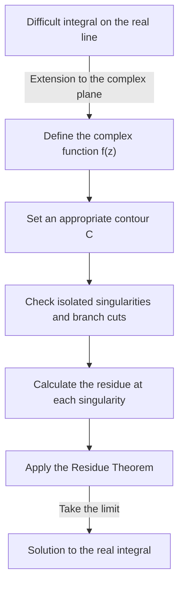
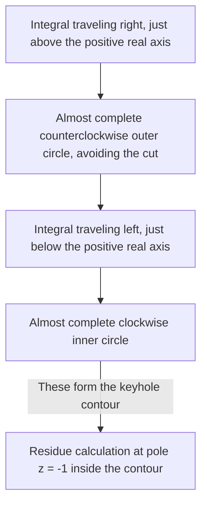

## Introduction: The Limits of Real Integrals and the Leap to the Complex Plane

Definite integrals are important tools in physics and engineering. Finding an antiderivative directly in real variables can, however, be difficult. Under suitable hypotheses, the residue theorem offers another way to evaluate some such integrals. We begin with the following improper integral:

$$
I = \int_{-\infty}^{\infty} \frac{1}{x^2 + 1} dx
$$

This integral can be evaluated using $\arctan(x)$. For more complicated rational or trigonometric integrands, directly finding an antiderivative may be less convenient, making a contour method useful.

The **residue theorem** connects an integral on the real line to a closed-contour integral in the complex plane. It uses local information around isolated singularities. Choosing a suitable complex extension and estimating the additional contour pieces are essential; complexification does not automatically evaluate an arbitrary real integral.

## Complex Integration and Singularities

A complex function $f(z)$ is integrated along a curve in the complex plane. If $C$ is a piecewise $C^1$ simple closed contour and $f$ is holomorphic on an open set containing $C$ and its interior, the following consequence of **[Cauchy's integral theorem](https://kenji.blog/en/p/cauchys-integral-theorem/)** holds. Holomorphy alone does not justify the same conclusion for every contour in a domain with holes.

$$
\oint_C f(z) dz = 0 \quad (\text{if the function is holomorphic inside and on } C)
$$

What changes when there is a singularity inside the contour? Here an **isolated singularity** at $z_0$ means that $f$ is holomorphic on some punctured neighborhood $0<|z-z_0|<r$, but not at $z_0$. We distinguish removable singularities, poles and essential singularities. A **pole** has a finite nonzero principal part in its Laurent series; not every singularity is a pole. A zero denominator may cancel: $(z^2-1)/(z-1)$ has a removable singularity at $1$, whereas $e^{1/z}$ has an essential singularity at $0$.

## Laurent Series and Residues

If $f$ is holomorphic on a punctured neighborhood $0<|z-z_0|<r$ of an isolated singularity, it has a **Laurent series** converging there. This extends the [Taylor series](https://kenji.blog/en/p/taylor-and-maclaurin-series/) to negative powers. More generally, Laurent expansions are considered on annuli of holomorphy.

$$
f(z) = \sum_{n=0}^{\infty} a_n (z - z_0)^n + \sum_{n=1}^{\infty} \frac{b_n}{(z - z_0)^n}
$$

The sum of the negative-power terms (the second sum on the right) is the **principal part**. It determines the nature of the singularity. In particular, the coefficient $b_1$ of $(z-z_0)^{-1}$ is the **residue** of $f$ at $z_0$, written as:

$$
\text{Res}(f, z_0) = b_1
$$

The coefficient of $(z-z_0)^{-1}$ is special because integration around a small counterclockwise circle within the punctured neighborhood gives $2\pi i$ for $1/(z-z_0)^n$ when the integer $n=1$, and $0$ otherwise. Reversing the orientation changes the sign.

## [Cauchy](https://kenji.blog/en/p/cauchy/)'s Residue Theorem

Let $C$ be a positively oriented (counterclockwise), piecewise $C^1$ simple closed contour. Suppose $f$ is holomorphic on an open set containing $C$ and its interior except at finitely many isolated singularities $z_1,\ldots,z_k$ inside $C$, with none on the contour itself. The **residue theorem** then states:

$$
\oint_C f(z) dz = 2\pi i \sum_{j=1}^{k} \text{Res}(f, z_j)
$$

Under these hypotheses, sum the residues inside the contour and multiply by $2\pi i$. A general formulation for self-intersecting or repeatedly traversed contours also uses winding numbers. The displayed formula cannot simply be applied to a contour passing through a singularity or crossing a branch cut.

## Application: Solving Real Integrals

Let's actually use the residue theorem to solve the integral introduced at the beginning.

$$
I = \int_{-\infty}^{\infty} \frac{1}{x^2 + 1} dx
$$

### Step 1: Extension to a Complex Function and Setting the Contour
Set $f(z)=1/(z^2+1)$. For $R>1$, follow the real segment from $-R$ to $R$, then the upper semicircle $C_R$ counterclockwise from $R$ to $-R$. Together they form the positively oriented closed contour $C$.

The integral on the closed curve $C$ can be decomposed as follows:

$$
\oint_C f(z) dz = \int_{-R}^{R} f(x) dx + \int_{C_R} f(z) dz
$$

On the semicircle, $|z^2+1|\ge R^2-1$, so $\left|\int_{C_R}f(z)\,dz\right|\le\pi R/(R^2-1)\to0$. On the real axis, the integrand is $O(x^{-2})$ at infinity and the improper integral converges absolutely. Thus the following limit gives the ordinary improper integral, rather than merely a symmetric principal value:

$$
\lim_{R \to \infty} \oint_C f(z) dz = \int_{-\infty}^{\infty} \frac{1}{x^2 + 1} dx
$$

### Step 2: Singularities and Residue Calculation
The function $f(z) = \frac{1}{z^2 + 1} = \frac{1}{(z - i)(z + i)}$ has poles of order 1 at $z = i$ and $z = -i$.
The only singularity inside the contour $C$ (in the upper half-plane) is $z = i$.

Let's calculate the residue at $z = i$. The residue for a simple pole (order 1) can be calculated as follows:

$$
\text{Res}(f, i) = \lim_{z \to i} (z - i) f(z) = \lim_{z \to i} \frac{1}{z + i} = \frac{1}{2i}
$$

### Step 3: Applying the Residue Theorem
By the residue theorem, the integral on the closed curve $C$ becomes:

$$
\oint_C f(z) dz = 2\pi i \times \text{Res}(f, i) = 2\pi i \times \frac{1}{2i} = \pi
$$

Thus, the value of the desired real definite integral is $\pi$.

$$
\int_{-\infty}^{\infty} \frac{1}{x^2 + 1} dx = \pi
$$

In this way, by adding one dimension (the complex plane), we find a "shortcut" that was invisible with only real numbers, allowing us to perform the calculation surprisingly easily.

## Jordan's Lemma and Trigonometric Integrals

As another slightly more complex example, consider the following integral that frequently appears in physics (e.g., Fourier transforms of wavefunctions in quantum mechanics):

$$
J = \int_{-\infty}^{\infty} \frac{\cos(kx)}{x^2 + a^2} dx \quad (k > 0, a > 0)
$$

Consider $f(z)=e^{ikz}/(z^2+a^2)$. By [Euler's formula](https://kenji.blog/en/p/euler/), $e^{ikx}=\cos(kx)+i\sin(kx)$, so the real part of the complex integral gives the desired result. For $k>0,a>0$, the real-axis integral is absolutely convergent, allowing us to take its real part under the integral sign.

Again choose $R>a$, follow the real axis from $-R$ to $R$, and return along the upper semicircle from $R$ to $-R$. There $|e^{ikz}|=e^{-k\operatorname{Im}z}\le1$, so the arc integral has absolute value at most $\pi R/(R^2-a^2)$ and tends to zero. **Jordan's lemma** provides a more general estimate for $e^{ikz}g(z)$: for fixed $k>0$, if the supremum of $|g|$ on the upper semicircle tends to zero, then so does the arc integral. In this example, the quadratic denominator already gives a sufficient bound.

The singularity is $z = ia$ (upper half-plane). We calculate the residue:

$$
\text{Res}(f, ia) = \lim_{z \to ia} (z - ia) \frac{e^{ikz}}{(z - ia)(z + ia)} = \frac{e^{-ka}}{2ia}
$$

Apply the residue theorem:

$$
\int_{-\infty}^{\infty} \frac{e^{ikx}}{x^2 + a^2} dx = 2\pi i \times \frac{e^{-ka}}{2ia} = \frac{\pi e^{-ka}}{a}
$$

The right side is a purely real number. Therefore, by comparing the real parts, we get the following beautiful result:

$$
\int_{-\infty}^{\infty} \frac{\cos(kx)}{x^2 + a^2} dx = \frac{\pi e^{-ka}}{a}
$$

## Branch Cuts and Keyhole Contours

A more advanced application of the residue theorem involves the integration of multivalued functions (functions that have multiple outputs for a single input). Typical examples are integrals involving the logarithmic function $\log(z)$ or fractional powers $z^a$. To treat these as single-valued functions, it is necessary to introduce a "slit" called a **branch cut** in the complex plane.

As an example, consider the following integral (where $0 < a < 1$):

$$
K = \int_{0}^{\infty} \frac{x^{-a}}{x + 1} dx
$$

For $0<a<1$, the integrand is $O(x^{-a})$ near zero and $O(x^{-a-1})$ at infinity, so the integral converges. Cut along the positive real axis and choose the branch $0<\arg z<2\pi$, with $\operatorname{Log}z=\log|z|+i\arg z$ and $F(z)=z^{-a}/(z+1)=e^{-a\operatorname{Log}z}/(z+1)$. For $0<\varepsilon<1<R$, travel outward just above the cut, counterclockwise along the outer circle, inward just below the cut, and clockwise along the inner circle. The actual contour avoids the cut; its two sides are approached as limits.

The outer-circle contribution has absolute value at most $2\pi R^{1-a}/(R-1)$, which tends to zero as $R\to\infty$. The inner-circle contribution is at most $2\pi\varepsilon^{1-a}/(1-\varepsilon)$, tending to zero as $\varepsilon\to0$. Above the cut, $z^{-a}\to x^{-a}$; below it, $z^{-a}\to e^{-2\pi ia}x^{-a}$. Because the lower side runs in reverse, the straight pieces sum to $(1-e^{-2\pi ia})K$. On the chosen branch, $\arg(-1)=\pi$, so the residue at $-1$ is $e^{-\pi ia}$. Therefore $(1-e^{-2\pi ia})K=2\pi i\,e^{-\pi ia}$. Using $1-e^{-2\pi ia}=2i\,e^{-\pi ia}\sin(\pi a)$ gives:

$$
\int_{0}^{\infty} \frac{x^{-a}}{x + 1} dx = \frac{\pi}{\sin(a\pi)}
$$

## Conclusion

The residue theorem is the epitome of mathematical elegance, masterfully connecting seemingly unrelated "complex poles" and "real integrals." To solve a real function problem, you temporarily jump into the broader world of the complex plane, examine only the properties (residues) of the "obstacles" (singularities), and when you return to the original world, the problem is brilliantly solved.

These contour methods also occur in inverse [Laplace transforms](/en/p/laplace-transform/) and Fourier integrals. Their reliable use depends on checking the singularity types, contour orientation, and convergence at infinity and near branch points.

## References

- [MIT 18.04 Topic 8: Residues and the residue theorem](https://ocw.mit.edu/courses/18-04-complex-variables-with-applications-spring-2018/3c58ce71ec6f7573804221d76158a0bd_MIT18_04S18_topic8.pdf)
- [MIT 18.04 Topic 9: Definite integrals using the residue theorem](https://ocw.mit.edu/courses/18-04-complex-variables-with-applications-spring-2018/f69bc227ae476839819fb18e5b283072_MIT18_04S18_topic9.pdf)
- [NIST DLMF §1.10: Laurent series, singularities and the residue theorem](https://dlmf.nist.gov/1.10)
