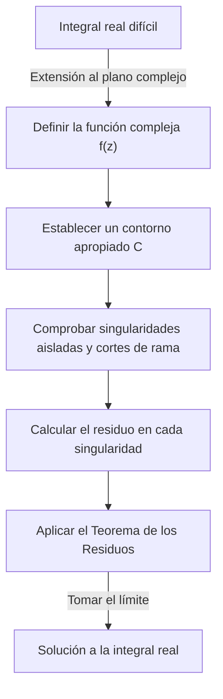
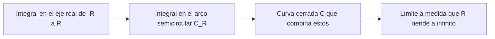
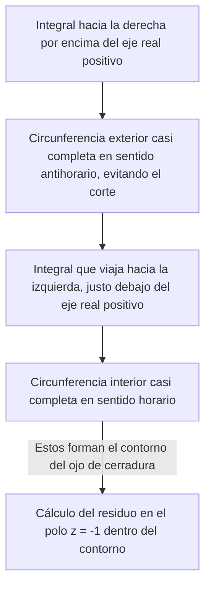

## Introducción: Los Límites de las Integrales Reales y el Salto al Plano Complejo

Las integrales definidas son herramientas importantes en física e ingeniería. Sin embargo, hallar directamente una primitiva en variables reales puede ser difícil. Bajo las hipótesis adecuadas, el teorema de los residuos ofrece otro método para calcular algunas de estas integrales. Empecemos por la siguiente integral impropia:

$$
I = \int_{-\infty}^{\infty} \frac{1}{x^2 + 1} dx
$$

Esta integral puede calcularse con $\arctan(x)$. Para funciones racionales o trigonométricas más complicadas, buscar directamente una primitiva puede resultar menos conveniente, y un método de integración de contorno puede ser útil.

El **teorema de los residuos** relaciona una integral en la recta real con una integral sobre un contorno cerrado del plano complejo. Utiliza información local alrededor de singularidades aisladas. Es esencial elegir una extensión compleja adecuada y estimar las contribuciones de los tramos adicionales; pasar al plano complejo no resuelve automáticamente cualquier integral real.

## Integración Compleja y Singularidades

Una función compleja $f(z)$ se integra a lo largo de una curva del plano complejo. Si $C$ es una curva cerrada simple de clase $C^1$ a trozos y $f$ es holomorfa en un abierto que contiene $C$ y su interior, se cumple la siguiente consecuencia del **[teorema integral de Cauchy](/es/p/cauchys-integral-theorem/)**. La holomorfía por sí sola no justifica esa conclusión para cualquier curva en un dominio con agujeros.

$$
\oint_C f(z) dz = 0 \quad (\text{si la función es holomorfa dentro y sobre } C)
$$

¿Qué ocurre si hay una singularidad dentro del contorno? Una **singularidad aislada** en $z_0$ significa aquí que $f$ es holomorfa en algún entorno perforado $0<|z-z_0|<r$, pero no en $z_0$. Distinguimos singularidades evitables, polos y singularidades esenciales. Un **polo** tiene una parte principal no nula con un número finito de términos en su serie de Laurent; no toda singularidad es un polo. Un denominador nulo puede cancelarse: $(z^2-1)/(z-1)$ tiene una singularidad evitable en $1$, mientras que $e^{1/z}$ tiene una singularidad esencial en $0$.

## Series de Laurent y Residuos

Si $f$ es holomorfa en un entorno perforado $0<|z-z_0|<r$ de una singularidad aislada, tiene una **serie de Laurent** convergente allí. Esta amplía la [serie de Taylor](/es/p/taylor-and-maclaurin-series/) a potencias negativas y puede escribirse como sigue. Más generalmente, los desarrollos de Laurent se consideran en anillos de holomorfía.

$$
f(z) = \sum_{n=0}^{\infty} a_n (z - z_0)^n + \sum_{n=1}^{\infty} \frac{b_n}{(z - z_0)^n}
$$

La suma de los términos de potencias negativas —la segunda suma del lado derecho— es la **parte principal**. Esta determina la naturaleza de la singularidad. En particular, el coeficiente $b_1$ de $(z-z_0)^{-1}$ es el **residuo** de $f$ en $z_0$, y se escribe:

$$
\text{Res}(f, z_0) = b_1
$$

El coeficiente de $(z-z_0)^{-1}$ es especial porque la integral de $1/(z-z_0)^n$ sobre una circunferencia pequeña recorrida una vez en sentido antihorario, dentro del entorno perforado, vale $2\pi i$ para el entero $n=1$ y $0$ para los demás enteros. Invertir la orientación cambia el signo.

## Teorema de los Residuos de [Cauchy](https://kenji.blog/es/p/cauchy/)

Sea $C$ una curva cerrada simple, de clase $C^1$ a trozos y orientada positivamente (en sentido antihorario). Supongamos que $f$ es holomorfa en un abierto que contiene $C$ y su interior, salvo en un número finito de singularidades aisladas $z_1,\ldots,z_k$ interiores, y que no hay singularidades sobre la curva. El **teorema de los residuos** establece entonces:

$$
\oint_C f(z) dz = 2\pi i \sum_{j=1}^{k} \text{Res}(f, z_j)
$$

Bajo estas hipótesis, sumamos los residuos interiores y multiplicamos por $2\pi i$. La formulación general para curvas con autointersecciones o recorridos repetidos también usa el índice de la curva alrededor de cada singularidad, es decir, el número de vueltas. La fórmula mostrada no se aplica sin más a un contorno que pasa por una singularidad o cruza un corte de rama.

## Aplicación: Resolución de Integrales Reales

Usemos realmente el teorema de los residuos para resolver la integral introducida al principio.

$$
I = \int_{-\infty}^{\infty} \frac{1}{x^2 + 1} dx
$$

### Paso 1: Extensión a una Función Compleja y Establecimiento del Contorno
Tomemos $f(z)=1/(z^2+1)$. Para $R>1$, recorremos el segmento real de $-R$ a $R$ y regresamos por el arco semicircular superior $C_R$, de $R$ a $-R$, en sentido antihorario. Así obtenemos el contorno cerrado positivamente orientado $C$.

La integral en la curva cerrada $C$ se puede descomponer de la siguiente manera:

$$
\oint_C f(z) dz = \int_{-R}^{R} f(x) dx + \int_{C_R} f(z) dz
$$

En el arco, $|z^2+1|\ge R^2-1$, por lo que $\left|\int_{C_R}f(z)\,dz\right|\le\pi R/(R^2-1)\to0$. En la recta real el integrando es $O(x^{-2})$ en el infinito, y la integral impropia converge absolutamente. Por tanto, el siguiente límite da la integral impropia ordinaria, y no solo un valor principal de Cauchy obtenido por truncamiento simétrico:

$$
\lim_{R \to \infty} \oint_C f(z) dz = \int_{-\infty}^{\infty} \frac{1}{x^2 + 1} dx
$$

### Paso 2: Singularidades y Cálculo de Residuos
La función $f(z) = \frac{1}{z^2 + 1} = \frac{1}{(z - i)(z + i)}$ tiene polos de orden 1 en $z = i$ y $z = -i$.
La única singularidad dentro del contorno $C$ (en el semiplano superior) es $z = i$.

Calculemos el residuo en $z = i$. El residuo para un polo simple (orden 1) se puede calcular de la siguiente manera:

$$
\text{Res}(f, i) = \lim_{z \to i} (z - i) f(z) = \lim_{z \to i} \frac{1}{z + i} = \frac{1}{2i}
$$

### Paso 3: Aplicación del Teorema de los Residuos
Por el teorema de los residuos, la integral en la curva cerrada $C$ se convierte en:

$$
\oint_C f(z) dz = 2\pi i \times \text{Res}(f, i) = 2\pi i \times \frac{1}{2i} = \pi
$$

Así, el valor de la integral definida real deseada es $\pi$.

$$
\int_{-\infty}^{\infty} \frac{1}{x^2 + 1} dx = \pi
$$

De esta manera, agregando una dimensión (el plano complejo), encontramos un "atajo" que era invisible solo con números reales, permitiéndonos realizar el cálculo con una facilidad sorprendente.

## Lema de Jordan e Integrales Trigonométricas

Como otro ejemplo un poco más complejo, considere la siguiente integral que aparece frecuentemente en física (por ejemplo, transformadas de Fourier de funciones de onda en mecánica cuántica):

$$
J = \int_{-\infty}^{\infty} \frac{\cos(kx)}{x^2 + a^2} dx \quad (k > 0, a > 0)
$$

Consideremos $f(z)=e^{ikz}/(z^2+a^2)$. Por la [fórmula de Euler](/es/p/euler/), $e^{ikx}=\cos(kx)+i\sin(kx)$, de modo que la parte real de la integral compleja proporciona el resultado buscado. Para $k>0,a>0$, la integral en la recta real converge absolutamente, lo que permite tomar la parte real bajo el signo integral.

Elijamos de nuevo $R>a$, recorramos el eje real de $-R$ a $R$ y volvamos por el semicírculo superior de $R$ a $-R$. Allí $|e^{ikz}|=e^{-k\operatorname{Im}z}\le1$, de modo que el valor absoluto de la integral del arco no supera $\pi R/(R^2-a^2)$ y tiende a cero. El **lema de Jordan** ofrece una estimación más general para $e^{ikz}g(z)$: con $k>0$ fijo, si el supremo de $|g|$ sobre el semicírculo superior tiende a cero, también lo hace la integral del arco. En este ejemplo ya basta el decrecimiento cuadrático del denominador.

La singularidad es $z = ia$ (semiplano superior). Calculamos el residuo:

$$
\text{Res}(f, ia) = \lim_{z \to ia} (z - ia) \frac{e^{ikz}}{(z - ia)(z + ia)} = \frac{e^{-ka}}{2ia}
$$

Aplicamos el teorema de los residuos:

$$
\int_{-\infty}^{\infty} \frac{e^{ikx}}{x^2 + a^2} dx = 2\pi i \times \frac{e^{-ka}}{2ia} = \frac{\pi e^{-ka}}{a}
$$

El lado derecho es un número puramente real. Por tanto, comparando las partes reales, obtenemos el siguiente hermoso resultado:

$$
\int_{-\infty}^{\infty} \frac{\cos(kx)}{x^2 + a^2} dx = \frac{\pi e^{-ka}}{a}
$$

## Cortes de Rama y Contornos de Ojo de Cerradura

Una aplicación más avanzada del teorema de los residuos implica la integración de funciones multivaluadas (funciones que tienen múltiples salidas para una sola entrada). Ejemplos típicos son las integrales que involucran la función logarítmica $\log(z)$ o potencias fraccionarias $z^a$. Para tratarlas como funciones univaluadas, es necesario introducir una "ranura" llamada **corte de rama** (Branch Cut) en el plano complejo.

Como ejemplo, considere la siguiente integral (donde $0 < a < 1$):

$$
K = \int_{0}^{\infty} \frac{x^{-a}}{x + 1} dx
$$

Para $0<a<1$, el integrando es $O(x^{-a})$ cerca de cero y $O(x^{-a-1})$ en el infinito, por lo que la integral converge. Cortamos por el eje real positivo y elegimos la rama $0<\arg z<2\pi$, con $\operatorname{Log}z=\log|z|+i\arg z$ y $F(z)=z^{-a}/(z+1)=e^{-a\operatorname{Log}z}/(z+1)$. Para $0<\varepsilon<1<R$, avanzamos hacia fuera justo por encima del corte, seguimos la circunferencia exterior en sentido antihorario, regresamos hacia dentro por debajo del corte y cerramos por la circunferencia interior en sentido horario. El contorno utilizado evita el corte y se toman límites desde ambos lados.

La contribución exterior tiene valor absoluto a lo sumo $2\pi R^{1-a}/(R-1)$, que tiende a cero cuando $R\to\infty$. La interior no supera $2\pi\varepsilon^{1-a}/(1-\varepsilon)$ y tiende a cero cuando $\varepsilon\to0$. Encima del corte, $z^{-a}\to x^{-a}$; debajo, $z^{-a}\to e^{-2\pi ia}x^{-a}$. Como el tramo inferior se recorre al revés, los tramos rectos suman $(1-e^{-2\pi ia})K$ en el límite. En la rama elegida, $\arg(-1)=\pi$, y el residuo en $-1$ es $e^{-\pi ia}$. Por tanto, $(1-e^{-2\pi ia})K=2\pi i\,e^{-\pi ia}$. Usando $1-e^{-2\pi ia}=2i\,e^{-\pi ia}\sin(\pi a)$, obtenemos:

$$
\int_{0}^{\infty} \frac{x^{-a}}{x + 1} dx = \frac{\pi}{\sin(a\pi)}
$$

## Conclusión

El teorema de los residuos es el epítome de la elegancia matemática, conectando magistralmente "polos complejos" e "integrales reales" aparentemente no relacionados. Para resolver un problema de función real, saltas temporalmente al mundo más amplio del plano complejo, examinas solo las propiedades (residuos) de los "obstáculos" (singularidades), y cuando regresas al mundo original, el problema está resuelto brillantemente.

Estos métodos de contorno también aparecen en la transformada inversa de [Laplace](/es/p/laplace-transform/) y en integrales de Fourier. Para usarlos con rigor, hay que comprobar los tipos de singularidad, la orientación del contorno y la convergencia en el infinito y cerca de los puntos de ramificación.

## Referencias

- [MIT 18.04 Topic 8: Residues and the residue theorem](https://ocw.mit.edu/courses/18-04-complex-variables-with-applications-spring-2018/3c58ce71ec6f7573804221d76158a0bd_MIT18_04S18_topic8.pdf)
- [MIT 18.04 Topic 9: Definite integrals using the residue theorem](https://ocw.mit.edu/courses/18-04-complex-variables-with-applications-spring-2018/f69bc227ae476839819fb18e5b283072_MIT18_04S18_topic9.pdf)
- [NIST DLMF §1.10: Functions of a Complex Variable](https://dlmf.nist.gov/1.10)
