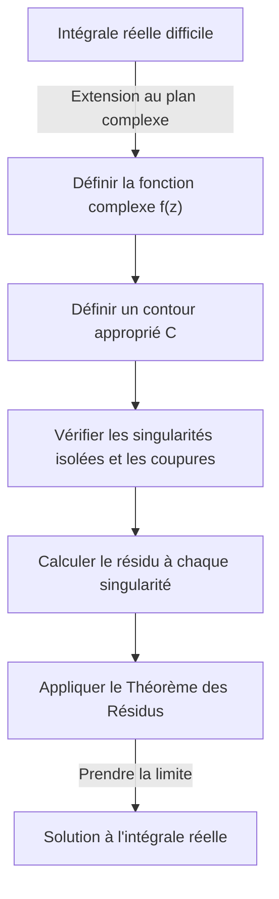
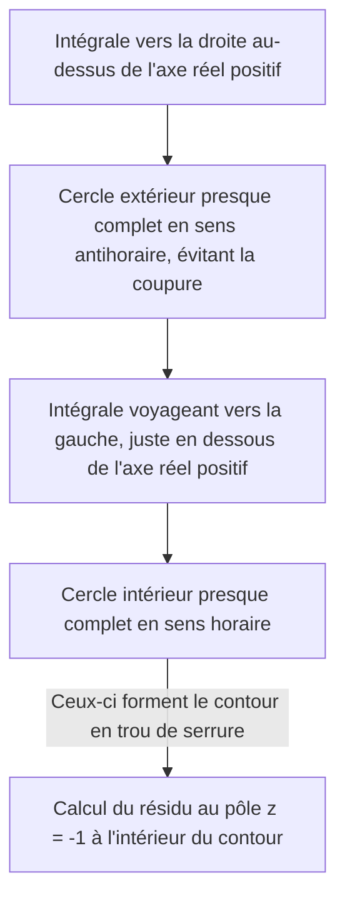

## Introduction : Les Limites des Intégrales Réelles et le Saut vers le Plan Complexe

Les intégrales définies sont des outils importants en physique et en ingénierie. Trouver directement une primitive en variables réelles peut toutefois être difficile. Sous des hypothèses appropriées, le théorème des résidus fournit une autre méthode pour calculer certaines de ces intégrales. Commençons par l'intégrale impropre suivante :

$$
I = \int_{-\infty}^{\infty} \frac{1}{x^2 + 1} dx
$$

Cette intégrale se calcule avec $\arctan(x)$. Pour des fonctions rationnelles ou trigonométriques plus compliquées, chercher directement une primitive peut être moins commode qu'utiliser une méthode d'intégration sur un contour.

Le **théorème des résidus** relie une intégrale sur la droite réelle à une intégrale sur un contour fermé du plan complexe. Il utilise des informations locales autour des singularités isolées. Le choix d'une extension complexe appropriée et l'estimation des morceaux supplémentaires du contour sont essentiels ; passer au plan complexe ne calcule pas automatiquement une intégrale réelle arbitraire.

## Intégration Complexe et Singularités

Une fonction complexe $f(z)$ s'intègre le long d'une courbe du plan complexe. Si $C$ est une courbe fermée simple de classe $C^1$ par morceaux et si $f$ est holomorphe dans un ouvert contenant $C$ et son intérieur, on a la conséquence suivante du **[théorème intégral de Cauchy](/fr/p/cauchys-integral-theorem/)**. L'holomorphie seule ne justifie pas cette conclusion pour toute courbe dans un domaine troué.

$$
\oint_C f(z) dz = 0 \quad (\text{si la fonction est holomorphe à l'intérieur et sur } C)
$$

Que change la présence d'une singularité à l'intérieur du contour ? Une **singularité isolée** en $z_0$ signifie ici que $f$ est holomorphe dans un voisinage épointé $0<|z-z_0|<r$, mais pas en $z_0$. On distingue singularités éliminables, pôles et singularités essentielles. Un **pôle** possède une partie principale non nulle comportant un nombre fini de termes dans sa série de Laurent ; toute singularité n'est pas un pôle. Un dénominateur nul peut se simplifier : $(z^2-1)/(z-1)$ a une singularité éliminable en $1$, tandis que $e^{1/z}$ a une singularité essentielle en $0$.

## Séries de Laurent et Résidus

Si $f$ est holomorphe dans un voisinage épointé $0<|z-z_0|<r$ d'une singularité isolée, elle admet une **série de Laurent** convergente dans ce voisinage. Celle-ci étend la [série de Taylor](/fr/p/taylor-and-maclaurin-series/) aux puissances négatives et s'écrit comme suit. Plus généralement, les développements de Laurent se considèrent dans des couronnes d'holomorphie.

$$
f(z) = \sum_{n=0}^{\infty} a_n (z - z_0)^n + \sum_{n=1}^{\infty} \frac{b_n}{(z - z_0)^n}
$$

La somme des termes de puissances négatives — la deuxième somme du membre de droite — est la **partie principale**. Elle détermine la nature de la singularité. En particulier, le coefficient $b_1$ de $(z-z_0)^{-1}$ est le **résidu** de $f$ en $z_0$, noté :

$$
\text{Res}(f, z_0) = b_1
$$

Le coefficient de $(z-z_0)^{-1}$ est particulier parce que l'intégrale de $1/(z-z_0)^n$ sur un petit cercle parcouru une fois dans le sens inverse des aiguilles d'une montre, à l'intérieur du voisinage épointé, vaut $2\pi i$ pour l'entier $n=1$ et $0$ pour les autres entiers. Inverser l'orientation change le signe.

## Théorème des Résidus de [Cauchy](https://kenji.blog/fr/p/cauchy/)

Soit $C$ une courbe fermée simple, de classe $C^1$ par morceaux et orientée positivement (dans le sens inverse des aiguilles d'une montre). Supposons $f$ holomorphe dans un ouvert contenant $C$ et son intérieur, sauf en un nombre fini de singularités isolées intérieures $z_1,\ldots,z_k$, sans singularité sur la courbe. Le **théorème des résidus** donne alors :

$$
\oint_C f(z) dz = 2\pi i \sum_{j=1}^{k} \text{Res}(f, z_j)
$$

Sous ces hypothèses, on additionne les résidus intérieurs et on multiplie par $2\pi i$. La formulation générale pour une courbe qui se recoupe ou effectue plusieurs tours utilise aussi son indice par rapport à chaque singularité. La formule affichée ne s'applique pas directement à un contour passant par une singularité ou traversant une coupure.

## Application : Résolution d'Intégrales Réelles

Utilisons réellement le théorème des résidus pour résoudre l'intégrale introduite au début.

$$
I = \int_{-\infty}^{\infty} \frac{1}{x^2 + 1} dx
$$

### Étape 1 : Extension à une Fonction Complexe et Choix du Contour
Posons $f(z)=1/(z^2+1)$. Pour $R>1$, parcourons le segment réel de $-R$ à $R$, puis l'arc du demi-cercle supérieur $C_R$ de $R$ à $-R$, dans le sens inverse des aiguilles d'une montre. Cela forme le contour fermé positivement orienté $C$.

L'intégrale sur la courbe fermée $C$ peut être décomposée comme suit :

$$
\oint_C f(z) dz = \int_{-R}^{R} f(x) dx + \int_{C_R} f(z) dz
$$

Sur l'arc, $|z^2+1|\ge R^2-1$, donc $\left|\int_{C_R}f(z)\,dz\right|\le\pi R/(R^2-1)\to0$. Sur la droite réelle, l'intégrande est $O(x^{-2})$ à l'infini, et l'intégrale impropre converge absolument. La limite suivante donne donc l'intégrale impropre ordinaire, et pas seulement une valeur principale de Cauchy obtenue par troncature symétrique :

$$
\lim_{R \to \infty} \oint_C f(z) dz = \int_{-\infty}^{\infty} \frac{1}{x^2 + 1} dx
$$

### Étape 2 : Singularités et Calcul des Résidus
La fonction $f(z) = \frac{1}{z^2 + 1} = \frac{1}{(z - i)(z + i)}$ a des pôles d'ordre 1 en $z = i$ et $z = -i$.
La seule singularité à l'intérieur du contour $C$ (dans le demi-plan supérieur) est $z = i$.

Calculons le résidu en $z = i$. Le résidu pour un pôle simple (d'ordre 1) peut être calculé comme suit :

$$
\text{Res}(f, i) = \lim_{z \to i} (z - i) f(z) = \lim_{z \to i} \frac{1}{z + i} = \frac{1}{2i}
$$

### Étape 3 : Application du Théorème des Résidus
Par le théorème des résidus, l'intégrale sur la courbe fermée $C$ devient :

$$
\oint_C f(z) dz = 2\pi i \times \text{Res}(f, i) = 2\pi i \times \frac{1}{2i} = \pi
$$

Ainsi, la valeur de l'intégrale définie réelle souhaitée est $\pi$.

$$
\int_{-\infty}^{\infty} \frac{1}{x^2 + 1} dx = \pi
$$

De cette manière, en ajoutant une dimension (le plan complexe), nous trouvons un "raccourci" qui était invisible avec uniquement des nombres réels, nous permettant d'effectuer le calcul de manière étonnamment facile.

## Lemme de Jordan et Intégrales Trigonométriques

Comme autre exemple légèrement plus complexe, considérez l'intégrale suivante qui apparaît fréquemment en physique (par exemple, les transformées de Fourier des fonctions d'onde en mécanique quantique) :

$$
J = \int_{-\infty}^{\infty} \frac{\cos(kx)}{x^2 + a^2} dx \quad (k > 0, a > 0)
$$

Considérons $f(z)=e^{ikz}/(z^2+a^2)$. Par la [formule d'Euler](/fr/p/euler/), $e^{ikx}=\cos(kx)+i\sin(kx)$, et la partie réelle de l'intégrale complexe fournit le résultat voulu. Pour $k>0,a>0$, l'intégrale sur la droite réelle converge absolument, ce qui permet de prendre la partie réelle sous le signe intégral.

Choisissons encore $R>a$, parcourons l'axe réel de $-R$ à $R$, puis revenons par le demi-cercle supérieur de $R$ à $-R$. On y a $|e^{ikz}|=e^{-k\operatorname{Im}z}\le1$, donc le module de l'intégrale sur l'arc ne dépasse pas $\pi R/(R^2-a^2)$ et tend vers zéro. Le **lemme de Jordan** fournit une estimation plus générale pour $e^{ikz}g(z)$ : à $k>0$ fixé, si le supremum de $|g|$ sur le demi-cercle supérieur tend vers zéro, l'intégrale sur l'arc aussi. Dans cet exemple, la décroissance quadratique du dénominateur suffit déjà.

La singularité est $z = ia$ (demi-plan supérieur). Nous calculons le résidu :

$$
\text{Res}(f, ia) = \lim_{z \to ia} (z - ia) \frac{e^{ikz}}{(z - ia)(z + ia)} = \frac{e^{-ka}}{2ia}
$$

Appliquons le théorème des résidus :

$$
\int_{-\infty}^{\infty} \frac{e^{ikx}}{x^2 + a^2} dx = 2\pi i \times \frac{e^{-ka}}{2ia} = \frac{\pi e^{-ka}}{a}
$$

Le côté droit est un nombre purement réel. Par conséquent, en comparant les parties réelles, nous obtenons le magnifique résultat suivant :

$$
\int_{-\infty}^{\infty} \frac{\cos(kx)}{x^2 + a^2} dx = \frac{\pi e^{-ka}}{a}
$$

## Coupures de Branche et Contours en Trou de Serrure

Une application plus avancée du théorème des résidus implique l'intégration de fonctions multiformes (fonctions qui ont plusieurs sorties pour une seule entrée). Des exemples typiques sont les intégrales impliquant la fonction logarithmique $\log(z)$ ou des puissances fractionnaires $z^a$. Pour les traiter comme des fonctions uniformes, il est nécessaire d'introduire une "fente" appelée **coupure de branche** (Branch Cut) dans le plan complexe.

À titre d'exemple, considérez l'intégrale suivante (où $0 < a < 1$) :

$$
K = \int_{0}^{\infty} \frac{x^{-a}}{x + 1} dx
$$

Pour $0<a<1$, l'intégrande est $O(x^{-a})$ près de zéro et $O(x^{-a-1})$ à l'infini, donc l'intégrale converge. Plaçons une coupure sur l'axe réel positif et choisissons la branche $0<\arg z<2\pi$, avec $\operatorname{Log}z=\log|z|+i\arg z$ et $F(z)=z^{-a}/(z+1)=e^{-a\operatorname{Log}z}/(z+1)$. Pour $0<\varepsilon<1<R$, avançons vers l'extérieur juste au-dessus de la coupure, suivons le cercle extérieur dans le sens inverse des aiguilles d'une montre, revenons vers l'intérieur juste sous la coupure et fermons le contour par le cercle intérieur dans le sens horaire. Le contour utilisé évite la coupure ; on prend les limites de part et d'autre.

Le module de la contribution extérieure est au plus $2\pi R^{1-a}/(R-1)$, qui tend vers zéro quand $R\to\infty$. Celui de la contribution intérieure ne dépasse pas $2\pi\varepsilon^{1-a}/(1-\varepsilon)$ et tend vers zéro quand $\varepsilon\to0$. Au-dessus de la coupure, $z^{-a}\to x^{-a}$ ; en dessous, $z^{-a}\to e^{-2\pi ia}x^{-a}$. Le côté inférieur étant parcouru en sens inverse, la somme des segments tend vers $(1-e^{-2\pi ia})K$. Dans la branche choisie, $\arg(-1)=\pi$, donc le résidu en $-1$ vaut $e^{-\pi ia}$. Ainsi, $(1-e^{-2\pi ia})K=2\pi i\,e^{-\pi ia}$. Avec $1-e^{-2\pi ia}=2i\,e^{-\pi ia}\sin(\pi a)$, on obtient :

$$
\int_{0}^{\infty} \frac{x^{-a}}{x + 1} dx = \frac{\pi}{\sin(a\pi)}
$$

## Conclusion

Le théorème des résidus est la quintessence de l'élégance mathématique, reliant magistralement des "pôles complexes" et des "intégrales réelles" apparemment sans rapport. Pour résoudre un problème de fonction réelle, vous sautez temporairement dans le monde plus vaste du plan complexe, n'examinez que les propriétés (résidus) des "obstacles" (singularités), et lorsque vous revenez dans le monde d'origine, le problème est brillamment résolu.

Ces méthodes de contour interviennent aussi dans la transformée inverse de [Laplace](/fr/p/laplace-transform/) et dans des intégrales de Fourier. Leur emploi rigoureux exige de vérifier les types de singularités, l'orientation du contour et la convergence à l'infini et près des points de branchement.

## Références

- [MIT 18.04 Topic 8: Residues and the residue theorem](https://ocw.mit.edu/courses/18-04-complex-variables-with-applications-spring-2018/3c58ce71ec6f7573804221d76158a0bd_MIT18_04S18_topic8.pdf)
- [MIT 18.04 Topic 9: Definite integrals using the residue theorem](https://ocw.mit.edu/courses/18-04-complex-variables-with-applications-spring-2018/f69bc227ae476839819fb18e5b283072_MIT18_04S18_topic9.pdf)
- [NIST DLMF §1.10: Functions of a Complex Variable](https://dlmf.nist.gov/1.10)
