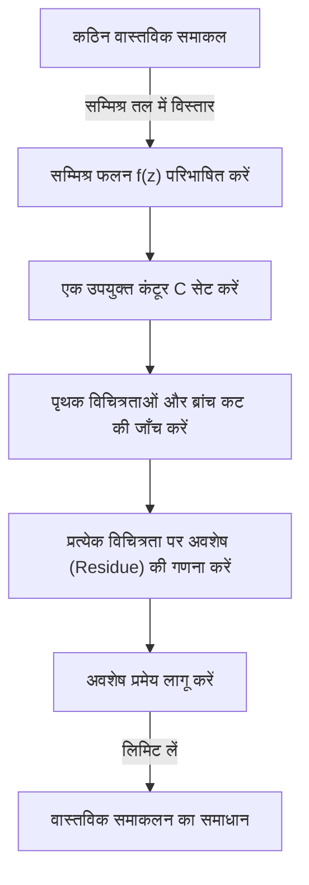
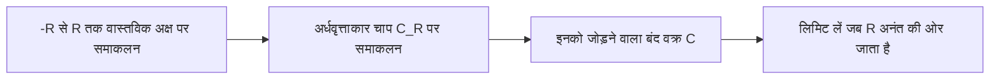
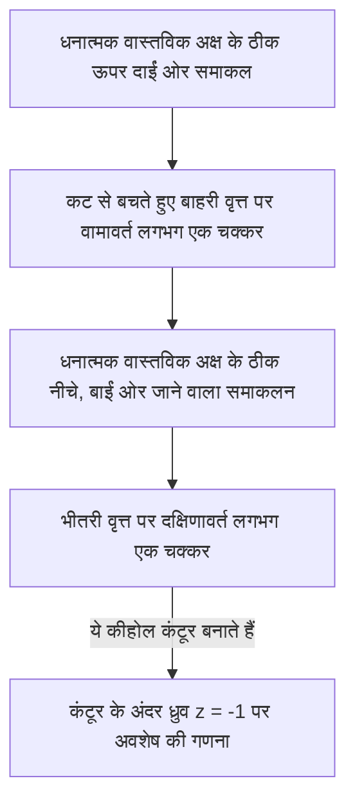

## परिचय: वास्तविक समाकलनों की सीमाएँ और सम्मिश्र तल (Complex Plane) की ओर छलांग

निश्चित समाकल भौतिकी और इंजीनियरिंग के महत्वपूर्ण उपकरण हैं। फिर भी वास्तविक चरों में प्रतिअवकलज सीधे खोजना कठिन हो सकता है। उपयुक्त धारणाओं के अंतर्गत अवशेष प्रमेय ऐसे कुछ समाकलों की गणना का दूसरा तरीका देता है। पहले निम्न अनुचित समाकल पर विचार करें:

$$
I = \int_{-\infty}^{\infty} \frac{1}{x^2 + 1} dx
$$

यह समाकल $\arctan(x)$ से निकाला जा सकता है। अधिक जटिल परिमेय या त्रिकोणमितीय फलनों के लिए सीधे प्रतिअवकलज ढूँढना कम सुविधाजनक हो सकता है; ऐसे में समोच्च समाकलन उपयोगी होता है।

**अवशेष प्रमेय** वास्तविक रेखा के समाकल को सम्मिश्र तल के बंद समोच्च पर समाकल से जोड़ता है और पृथक विचित्रताओं के निकट की स्थानीय जानकारी का उपयोग करता है। उपयुक्त सम्मिश्र विस्तार चुनना और पथ के अतिरिक्त भागों के योगदान का आकलन करना आवश्यक है। केवल सम्मिश्र तल में जाने से हर वास्तविक समाकल अपने-आप हल नहीं होता।

## सम्मिश्र समाकलन और विचित्रताएँ (Singularities)

सम्मिश्र फलन $f(z)$ का समाकल सम्मिश्र तल के वक्र पर लिया जाता है। यदि $C$ सरल बंद खंडशः $C^1$ वक्र है और $f$ ऐसे खुले समुच्चय में होलोमोर्फिक है जो $C$ और उसके आंतरिक भाग को समाहित करता है, तो निम्न **[कॉची का समाकलन प्रमेय](/hi/p/cauchys-integral-theorem/)** लागू होता है। छेद वाले प्रांत में केवल होलोमोर्फिकता से किसी भी बंद वक्र के लिए यही निष्कर्ष नहीं निकाला जा सकता।

$$
\oint_C f(z) dz = 0 \quad (\text{यदि फलन } C \text{ के अंदर और ऊपर होलोमोर्फिक है})
$$

यदि समोच्च के अंदर विचित्रता हो तो क्या बदलता है? यहाँ $z_0$ पर **पृथक विचित्रता** (isolated singularity) का अर्थ है कि $f$ किसी छिद्रित प्रतिवेश $0<|z-z_0|<r$ में होलोमोर्फिक है, लेकिन $z_0$ पर नहीं। हटाई जा सकने वाली विचित्रता (removable singularity), ध्रुव और अनिवार्य विचित्रता (essential singularity) में भेद करना आवश्यक है। **ध्रुव** की लॉरेंट श्रेणी का मुख्य भाग अशून्य होता है और उसमें सीमित संख्या में पद होते हैं; हर विचित्रता ध्रुव नहीं होती। हर शून्य होने पर भी गुणनखंड कट सकता है: $(z^2-1)/(z-1)$ में $1$ की विचित्रता हटाई जा सकती है, जबकि $e^{1/z}$ में $0$ अनिवार्य विचित्रता है।

## लॉरेंट श्रेणी (Laurent Series) और अवशेष (Residues)

यदि $f$ पृथक विचित्रता $z_0$ के छिद्रित प्रतिवेश $0<|z-z_0|<r$ में होलोमोर्फिक है, तो वहाँ उसकी अभिसारी **लॉरेंट श्रेणी** होती है। यह [टेलर श्रेणी](/hi/p/taylor-and-maclaurin-series/) को ऋणात्मक घातों तक विस्तारित करती है और नीचे के रूप में लिखी जा सकती है। अधिक सामान्य रूप में, लॉरेंट विस्तार उन वलयाकार प्रांतों में लिए जाते हैं जहाँ फलन होलोमोर्फिक है।

$$
f(z) = \sum_{n=0}^{\infty} a_n (z - z_0)^n + \sum_{n=1}^{\infty} \frac{b_n}{(z - z_0)^n}
$$

ऋणात्मक घातों वाले पदों का योग, अर्थात दाएँ पक्ष का दूसरा योग, **मुख्य भाग** है। यह विचित्रता की प्रकृति निर्धारित करता है। विशेष रूप से, $(z-z_0)^{-1}$ का गुणांक $b_1$, $z_0$ पर $f$ का **अवशेष** कहलाता है और इस प्रकार लिखा जाता है:

$$
\text{Res}(f, z_0) = b_1
$$

$(z-z_0)^{-1}$ का गुणांक विशेष इसलिए है कि छिद्रित प्रतिवेश के अंदर छोटे वृत्त पर एक बार वामावर्त घूमते हुए $1/(z-z_0)^n$ का समाकल, पूर्णांक $n=1$ के लिए $2\pi i$ और अन्य पूर्णांकों के लिए $0$ होता है। दिशा उलटने पर चिह्न बदल जाता है।

## कॉची का अवशेष प्रमेय

मान लें कि $C$ धनात्मक अभिविन्यास वाला, अर्थात वामावर्त, सरल बंद खंडशः $C^1$ वक्र है। $f$ ऐसे खुले समुच्चय में होलोमोर्फिक है जो $C$ और उसके अंदर के भाग को समाहित करता है, सिवाय अंदर स्थित सीमित संख्या की पृथक विचित्रताओं $z_1,\ldots,z_k$ के; वक्र पर कोई विचित्रता नहीं है। तब **अवशेष प्रमेय** के अनुसार:

$$
\oint_C f(z) dz = 2\pi i \sum_{j=1}^{k} \text{Res}(f, z_j)
$$

इन धारणाओं के अंतर्गत अंदर के अवशेषों को जोड़कर $2\pi i$ से गुणा करते हैं। स्वयं को काटने वाले या कई बार घूमने वाले पथों के सामान्य रूप में प्रत्येक विचित्रता के चारों ओर की परिक्रमा संख्या (winding number) भी शामिल होती है। विचित्रता से गुजरने या ब्रांच कट को पार करने वाले समोच्च पर ऊपर का सूत्र सीधे नहीं लगाया जा सकता।

## अनुप्रयोग: वास्तविक समाकलनों को हल करना

आइए शुरुआत में पेश किए गए समाकलन को हल करने के लिए वास्तव में अवशेष प्रमेय का उपयोग करें।

$$
I = \int_{-\infty}^{\infty} \frac{1}{x^2 + 1} dx
$$

### चरण 1: एक सम्मिश्र फलन में विस्तार और कंटूर सेट करना
$f(z)=1/(z^2+1)$ लें और $R>1$ चुनें। वास्तविक अक्ष पर $-R$ से $R$ तक जाएँ और फिर ऊपरी अर्धतल के अर्धवृत्ताकार चाप $C_R$ पर $R$ से $-R$ तक वामावर्त लौटें। इससे धनात्मक दिशा वाला बंद समोच्च $C$ बनता है।

बंद वक्र $C$ पर समाकलन को इस प्रकार विघटित किया जा सकता है:

$$
\oint_C f(z) dz = \int_{-R}^{R} f(x) dx + \int_{C_R} f(z) dz
$$

चाप पर $|z^2+1|\ge R^2-1$ है, इसलिए $\left|\int_{C_R}f(z)\,dz\right|\le\pi R/(R^2-1)\to0$। वास्तविक अक्ष पर समाकल्य अनंत पर $O(x^{-2})$ है, अतः अनुचित समाकल निरपेक्ष रूप से अभिसरित होता है। इसलिए अगली सीमा सामान्य अनुचित समाकल देती है, केवल सममित काट से मिलने वाला कॉची प्रधान मान नहीं:

$$
\lim_{R \to \infty} \oint_C f(z) dz = \int_{-\infty}^{\infty} \frac{1}{x^2 + 1} dx
$$

### चरण 2: विचित्रताएँ और अवशेष की गणना
फलन $f(z) = \frac{1}{z^2 + 1} = \frac{1}{(z - i)(z + i)}$ में $z = i$ और $z = -i$ पर कोटि (order) 1 के ध्रुव हैं।
कंटूर $C$ (ऊपरी आधे तल में) के अंदर एकमात्र विचित्रता $z = i$ है।

आइए $z = i$ पर अवशेष की गणना करें। एक साधारण ध्रुव (कोटि 1) के लिए अवशेष की गणना इस प्रकार की जा सकती है:

$$
\text{Res}(f, i) = \lim_{z \to i} (z - i) f(z) = \lim_{z \to i} \frac{1}{z + i} = \frac{1}{2i}
$$

### चरण 3: अवशेष प्रमेय लागू करना
अवशेष प्रमेय द्वारा, बंद वक्र $C$ पर समाकलन बन जाता है:

$$
\oint_C f(z) dz = 2\pi i \times \text{Res}(f, i) = 2\pi i \times \frac{1}{2i} = \pi
$$

इस प्रकार, वांछित वास्तविक निश्चित समाकलन का मान $\pi$ है।

$$
\int_{-\infty}^{\infty} \frac{1}{x^2 + 1} dx = \pi
$$

इस तरह, एक आयाम (सम्मिश्र तल) जोड़कर, हमें एक "शॉर्टकट" मिलता है जो केवल वास्तविक संख्याओं के साथ अदृश्य था, जिससे हम आश्चर्यजनक रूप से आसानी से गणना कर सकते हैं।

## जॉर्डन का उपप्रमेय (Jordan's lemma) और त्रिकोणमितीय समाकल

एक और थोड़ा अधिक जटिल उदाहरण के रूप में, निम्नलिखित समाकलन पर विचार करें जो भौतिकी में अक्सर दिखाई देता है (उदाहरण के लिए, क्वांटम यांत्रिकी में तरंग फलनों के फूरियर रूपांतरण):

$$
J = \int_{-\infty}^{\infty} \frac{\cos(kx)}{x^2 + a^2} dx \quad (k > 0, a > 0)
$$

$f(z)=e^{ikz}/(z^2+a^2)$ पर विचार करें। [यूलर के सूत्र](/hi/p/euler/) के अनुसार $e^{ikx}=\cos(kx)+i\sin(kx)$, इसलिए सम्मिश्र समाकल का वास्तविक भाग वांछित परिणाम है। $k>0,a>0$ के लिए वास्तविक अक्ष का समाकल निरपेक्ष रूप से अभिसरित होता है, इसलिए समाकल के अंदर वास्तविक भाग ले सकते हैं।

फिर $R>a$ चुनें, वास्तविक अक्ष पर $-R$ से $R$ तक जाएँ और ऊपरी अर्धवृत्त पर $R$ से $-R$ तक लौटें। वहाँ $|e^{ikz}|=e^{-k\operatorname{Im}z}\le1$ है, इसलिए चाप के समाकल का निरपेक्ष मान $\pi R/(R^2-a^2)$ से अधिक नहीं है और शून्य की ओर जाता है। **जॉर्डन का उपप्रमेय** (Jordan's lemma) $e^{ikz}g(z)$ के लिए अधिक सामान्य आकलन देता है: नियत $k>0$ पर, यदि ऊपरी अर्धवृत्त पर $|g|$ का उच्चिष्ठ शून्य की ओर जाए, तो चाप का समाकल भी शून्य की ओर जाता है। इस उदाहरण में हर का द्विघाती क्षय ही पर्याप्त है।

विचित्रता $z = ia$ (ऊपरी आधा तल) है। हम अवशेष की गणना करते हैं:

$$
\text{Res}(f, ia) = \lim_{z \to ia} (z - ia) \frac{e^{ikz}}{(z - ia)(z + ia)} = \frac{e^{-ka}}{2ia}
$$

अवशेष प्रमेय लागू करें:

$$
\int_{-\infty}^{\infty} \frac{e^{ikx}}{x^2 + a^2} dx = 2\pi i \times \frac{e^{-ka}}{2ia} = \frac{\pi e^{-ka}}{a}
$$

दाईं ओर एक पूर्णतः वास्तविक संख्या है। इसलिए, वास्तविक भागों की तुलना करने पर, हमें निम्नलिखित सुंदर परिणाम मिलता है:

$$
\int_{-\infty}^{\infty} \frac{\cos(kx)}{x^2 + a^2} dx = \frac{\pi e^{-ka}}{a}
$$

## ब्रांच कट (Branch Cuts) और कीहोल कंटूर (Keyhole Contours)

अवशेष प्रमेय का एक उन्नत अनुप्रयोग $\log z$ और $z^a$ जैसे व्यंजकों से जुड़ा है, जिनके एक निवेश पर कई संभव मान होते हैं। सम्मिश्र तल के उपयुक्त प्रांत में एक शाखा चुनकर इन्हें एकल-मान फलन के रूप में लेते हैं। इसके लिए हम ब्रांच कट (branch cut), अर्थात चुनी हुई कट-रेखा, का उपयोग करेंगे।

एक उदाहरण के रूप में, निम्नलिखित समाकलन पर विचार करें (जहाँ $0 < a < 1$):

$$
K = \int_{0}^{\infty} \frac{x^{-a}}{x + 1} dx
$$

$0<a<1$ के लिए समाकल्य मूल बिंदु के पास $O(x^{-a})$ और अनंत पर $O(x^{-a-1})$ है, इसलिए समाकल अभिसरित होता है। धनात्मक वास्तविक अक्ष पर ब्रांच कट रखें और $0<\arg z<2\pi$ वाली शाखा चुनें। $\operatorname{Log}z=\log|z|+i\arg z$ तथा $F(z)=z^{-a}/(z+1)=e^{-a\operatorname{Log}z}/(z+1)$ लें। $0<\varepsilon<1<R$ के लिए कट के ठीक ऊपर बाहर की ओर जाएँ, बाहरी वृत्त पर वामावर्त घूमें, कट के ठीक नीचे अंदर लौटें और भीतरी वृत्त पर दक्षिणावर्त घूमकर पथ बंद करें। चुना हुआ पथ कट को छूता या पार नहीं करता; दोनों ओर से सीमाएँ लेते हैं।

बाहरी वृत्त का योगदान निरपेक्ष मान में $2\pi R^{1-a}/(R-1)$ से अधिक नहीं है, जो $R\to\infty$ पर शून्य की ओर जाता है। भीतरी वृत्त का योगदान $2\pi\varepsilon^{1-a}/(1-\varepsilon)$ से अधिक नहीं है और $\varepsilon\to0$ पर शून्य की ओर जाता है। कट के ऊपर $z^{-a}\to x^{-a}$ और नीचे $z^{-a}\to e^{-2\pi ia}x^{-a}$ है। निचले भाग की दिशा उलटी होने से सीधे खंडों का योग $(1-e^{-2\pi ia})K$ की ओर जाता है। चुनी हुई शाखा पर $\arg(-1)=\pi$ है, इसलिए $-1$ पर अवशेष $e^{-\pi ia}$ है। अतः $(1-e^{-2\pi ia})K=2\pi i\,e^{-\pi ia}$। अब $1-e^{-2\pi ia}=2i\,e^{-\pi ia}\sin(\pi a)$ का उपयोग करने पर मिलता है:

$$
\int_{0}^{\infty} \frac{x^{-a}}{x + 1} dx = \frac{\pi}{\sin(a\pi)}
$$

## निष्कर्ष

अवशेष प्रमेय गणितीय लालित्य का प्रतीक है, जो प्रतीत होने वाले असंबंधित "सम्मिश्र ध्रुवों" और "वास्तविक समाकलनों" को कुशलतापूर्वक जोड़ता है। एक वास्तविक फलन की समस्या को हल करने के लिए, आप अस्थायी रूप से सम्मिश्र तल की व्यापक दुनिया में कूदते हैं, केवल "बाधाओं" (विचित्रताओं) के गुणों (अवशेषों) की जांच करते हैं, और जब आप मूल दुनिया में लौटते हैं, तो समस्या शानदार ढंग से हल हो जाती है।

ये समोच्च विधियाँ व्युत्क्रम [लाप्लास रूपांतरण](/hi/p/laplace-transform/) और फूरियर समाकलों में भी उपयोग होती हैं। इन्हें सही ढंग से लागू करने के लिए विचित्रता का प्रकार, पथ की दिशा, तथा अनंत और शाखा-बिंदुओं के पास अभिसरण की जाँच करनी चाहिए।

## संदर्भ

- [MIT 18.04 Topic 8: Residues and the residue theorem](https://ocw.mit.edu/courses/18-04-complex-variables-with-applications-spring-2018/3c58ce71ec6f7573804221d76158a0bd_MIT18_04S18_topic8.pdf)
- [MIT 18.04 Topic 9: Definite integrals using the residue theorem](https://ocw.mit.edu/courses/18-04-complex-variables-with-applications-spring-2018/f69bc227ae476839819fb18e5b283072_MIT18_04S18_topic9.pdf)
- [NIST DLMF §1.10: Functions of a Complex Variable](https://dlmf.nist.gov/1.10)
