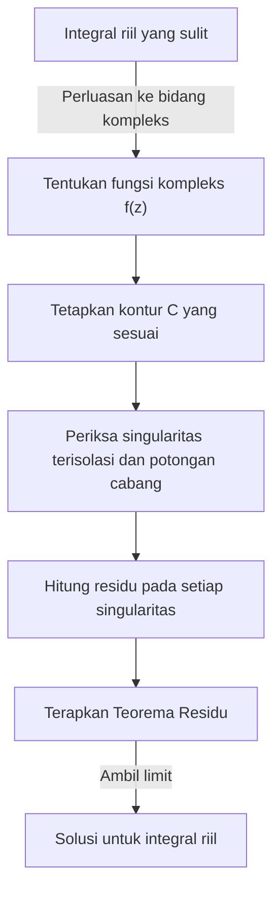
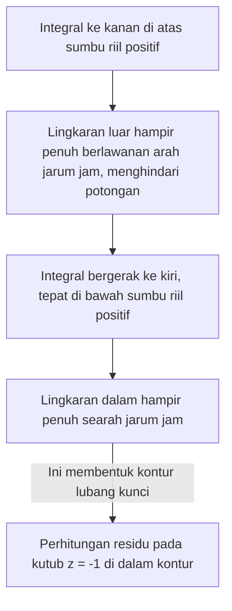

## Pengantar: Batas-batas Integral Riil dan Lompatan ke Bidang Kompleks

Integral tentu merupakan alat penting dalam fisika dan teknik. Namun, mencari antiturunan secara langsung dalam variabel riil bisa sulit. Dengan asumsi yang sesuai, teorema residu menyediakan cara lain untuk menghitung sebagian integral tersebut. Kita mulai dengan integral tak wajar berikut:

$$
I = \int_{-\infty}^{\infty} \frac{1}{x^2 + 1} dx
$$

Integral ini dapat dihitung menggunakan $\arctan(x)$. Untuk fungsi rasional atau trigonometri yang lebih rumit, mencari antiturunan secara langsung mungkin kurang praktis, sehingga metode integral kontur dapat membantu.

**Teorema residu** menghubungkan integral pada garis riil dengan integral pada kontur tertutup di bidang kompleks. Teorema ini menggunakan informasi lokal di sekitar singularitas terisolasi. Pemilihan perluasan kompleks yang sesuai dan estimasi bagian kontur tambahan sangat penting; beralih ke bidang kompleks tidak otomatis menyelesaikan sembarang integral riil.

## Integrasi Kompleks dan Singularitas

Fungsi kompleks $f(z)$ diintegralkan sepanjang kurva di bidang kompleks. Jika $C$ merupakan kurva tertutup sederhana yang berkelas $C^1$ sepotong-sepotong dan $f$ holomorfik pada himpunan terbuka yang memuat $C$ beserta bagian dalamnya, berlaku akibat **[teorema integral Cauchy](/id/p/cauchys-integral-theorem/)** berikut. Holomorfisitas saja tidak menjamin kesimpulan yang sama untuk semua kurva dalam domain berlubang.

$$
\oint_C f(z) dz = 0 \quad (\text{jika fungsinya holomorfik di dalam dan pada } C)
$$

Apa yang berubah jika ada singularitas di dalam kontur? **Singularitas terisolasi** di $z_0$ di sini berarti $f$ holomorfik pada suatu lingkungan berlubang $0<|z-z_0|<r$, tetapi tidak di $z_0$. Kita membedakan singularitas yang dapat dihilangkan, kutub, dan singularitas esensial. **Kutub** memiliki bagian utama yang tidak nol dengan sejumlah berhingga suku pada deret Laurent; tidak semua singularitas merupakan kutub. Penyebut nol dapat tercoret: $(z^2-1)/(z-1)$ memiliki singularitas yang dapat dihilangkan di $1$, sedangkan $e^{1/z}$ memiliki singularitas esensial di $0$.

## Deret Laurent dan Residu

Jika $f$ holomorfik pada lingkungan berlubang $0<|z-z_0|<r$ dari singularitas terisolasi, fungsi tersebut memiliki **deret Laurent** yang konvergen di sana. Deret ini memperluas [deret Taylor](/id/p/taylor-and-maclaurin-series/) ke pangkat negatif dan dapat ditulis sebagai berikut. Secara lebih umum, ekspansi Laurent dipertimbangkan pada daerah cincin tempat fungsi holomorfik.

$$
f(z) = \sum_{n=0}^{\infty} a_n (z - z_0)^n + \sum_{n=1}^{\infty} \frac{b_n}{(z - z_0)^n}
$$

Jumlah suku berpangkat negatif — jumlah kedua pada ruas kanan — adalah **bagian utama**. Bagian ini menentukan sifat singularitas. Khususnya, koefisien $b_1$ dari $(z-z_0)^{-1}$ disebut **residu** $f$ di $z_0$, ditulis sebagai:

$$
\text{Res}(f, z_0) = b_1
$$

Koefisien $(z-z_0)^{-1}$ istimewa karena integral $1/(z-z_0)^n$ pada lingkaran kecil dalam lingkungan berlubang, yang dilalui sekali berlawanan arah jarum jam, bernilai $2\pi i$ untuk bilangan bulat $n=1$ dan $0$ untuk bilangan bulat lainnya. Membalik orientasi mengubah tanda.

## Teorema Residu [Cauchy](https://kenji.blog/id/p/cauchy/)

Misalkan $C$ kurva tertutup sederhana, berkelas $C^1$ sepotong-sepotong, dan berorientasi positif (berlawanan arah jarum jam). Misalkan $f$ holomorfik pada himpunan terbuka yang memuat $C$ beserta bagian dalamnya, kecuali pada sejumlah berhingga singularitas terisolasi $z_1,\ldots,z_k$ di bagian dalam, tanpa singularitas pada kurva. **Teorema residu** menyatakan:

$$
\oint_C f(z) dz = 2\pi i \sum_{j=1}^{k} \text{Res}(f, z_j)
$$

Dengan asumsi tersebut, jumlahkan residu di dalam kontur lalu kalikan dengan $2\pi i$. Rumusan umum untuk kurva yang berpotongan dengan dirinya sendiri atau dilalui berulang juga memakai indeks kurva terhadap setiap singularitas, yaitu bilangan lilitan (winding number). Rumus yang ditampilkan tidak dapat langsung dipakai pada kontur yang melewati singularitas atau melintasi potongan cabang.

## Aplikasi: Memecahkan Integral Riil

Mari kita benar-benar menggunakan teorema residu untuk memecahkan integral yang diperkenalkan di awal.

$$
I = \int_{-\infty}^{\infty} \frac{1}{x^2 + 1} dx
$$

### Langkah 1: Perluasan ke Fungsi Kompleks dan Penetapan Kontur
Ambil $f(z)=1/(z^2+1)$. Untuk $R>1$, ikuti segmen riil dari $-R$ ke $R$, lalu kembali melalui busur setengah lingkaran atas $C_R$ dari $R$ ke $-R$, berlawanan arah jarum jam. Gabungannya membentuk kontur tertutup berorientasi positif $C$.

Integral pada kurva tertutup $C$ dapat diurai sebagai berikut:

$$
\oint_C f(z) dz = \int_{-R}^{R} f(x) dx + \int_{C_R} f(z) dz
$$

Pada busur, $|z^2+1|\ge R^2-1$, sehingga $\left|\int_{C_R}f(z)\,dz\right|\le\pi R/(R^2-1)\to0$. Pada garis riil, integrannya adalah $O(x^{-2})$ di tak terhingga dan integral tak wajarnya konvergen mutlak. Jadi limit berikut memberikan integral tak wajar biasa, bukan sekadar nilai utama Cauchy yang diperoleh dengan pemotongan simetris:

$$
\lim_{R \to \infty} \oint_C f(z) dz = \int_{-\infty}^{\infty} \frac{1}{x^2 + 1} dx
$$

### Langkah 2: Singularitas dan Perhitungan Residu
Fungsi $f(z) = \frac{1}{z^2 + 1} = \frac{1}{(z - i)(z + i)}$ memiliki kutub orde 1 pada $z = i$ dan $z = -i$.
Satu-satunya singularitas di dalam kontur $C$ (di setengah bidang atas) adalah $z = i$.

Mari kita hitung residu di $z = i$. Residu untuk kutub sederhana (orde 1) dapat dihitung sebagai berikut:

$$
\text{Res}(f, i) = \lim_{z \to i} (z - i) f(z) = \lim_{z \to i} \frac{1}{z + i} = \frac{1}{2i}
$$

### Langkah 3: Menerapkan Teorema Residu
Berdasarkan teorema residu, integral pada kurva tertutup $C$ menjadi:

$$
\oint_C f(z) dz = 2\pi i \times \text{Res}(f, i) = 2\pi i \times \frac{1}{2i} = \pi
$$

Jadi, nilai integral tentu riil yang diinginkan adalah $\pi$.

$$
\int_{-\infty}^{\infty} \frac{1}{x^2 + 1} dx = \pi
$$

Dengan cara ini, dengan menambahkan satu dimensi (bidang kompleks), kita menemukan "jalan pintas" yang tidak terlihat hanya dengan bilangan riil, yang memungkinkan kita melakukan perhitungan dengan sangat mudah.

## Lema Jordan dan Integral Trigonometri

Sebagai contoh lain yang sedikit lebih kompleks, pertimbangkan integral berikut yang sering muncul dalam fisika (misalnya, transformasi Fourier dari fungsi gelombang dalam mekanika kuantum):

$$
J = \int_{-\infty}^{\infty} \frac{\cos(kx)}{x^2 + a^2} dx \quad (k > 0, a > 0)
$$

Pertimbangkan $f(z)=e^{ikz}/(z^2+a^2)$. Berdasarkan [rumus Euler](/id/p/euler/), $e^{ikx}=\cos(kx)+i\sin(kx)$, sehingga bagian riil integral kompleks memberi hasil yang dicari. Untuk $k>0,a>0$, integral pada garis riil konvergen mutlak, sehingga kita boleh mengambil bagian riil di dalam integral.

Pilih lagi $R>a$, ikuti sumbu riil dari $-R$ ke $R$, lalu kembali melalui busur setengah lingkaran atas dari $R$ ke $-R$. Di sana $|e^{ikz}|=e^{-k\operatorname{Im}z}\le1$, sehingga nilai mutlak integral busur tidak melebihi $\pi R/(R^2-a^2)$ dan menuju nol. **Lema Jordan** memberi estimasi lebih umum untuk $e^{ikz}g(z)$: untuk $k>0$ tetap, jika supremum $|g|$ pada busur setengah lingkaran atas menuju nol, integral busurnya juga menuju nol. Dalam contoh ini, peluruhan kuadratik penyebut sudah cukup.

Singularitasnya adalah $z = ia$ (setengah bidang atas). Kita hitung residunya:

$$
\text{Res}(f, ia) = \lim_{z \to ia} (z - ia) \frac{e^{ikz}}{(z - ia)(z + ia)} = \frac{e^{-ka}}{2ia}
$$

Terapkan teorema residu:

$$
\int_{-\infty}^{\infty} \frac{e^{ikx}}{x^2 + a^2} dx = 2\pi i \times \frac{e^{-ka}}{2ia} = \frac{\pi e^{-ka}}{a}
$$

Sisi kanannya adalah murni bilangan riil. Oleh karena itu, dengan membandingkan bagian-bagian riilnya, kita mendapatkan hasil indah berikut ini:

$$
\int_{-\infty}^{\infty} \frac{\cos(kx)}{x^2 + a^2} dx = \frac{\pi e^{-ka}}{a}
$$

## Potongan Cabang dan Kontur Lubang Kunci

Aplikasi yang lebih lanjut dari teorema residu melibatkan integrasi fungsi bernilai jamak (multivalued) (fungsi yang memiliki beberapa keluaran untuk satu masukan). Contoh tipikal adalah integral yang melibatkan fungsi logaritma $\log(z)$ atau pangkat pecahan $z^a$. Untuk memperlakukannya sebagai fungsi bernilai tunggal, perlu untuk memperkenalkan "celah" yang disebut **potongan cabang** (Branch Cut) di bidang kompleks.

Sebagai contoh, pertimbangkan integral berikut (di mana $0 < a < 1$):

$$
K = \int_{0}^{\infty} \frac{x^{-a}}{x + 1} dx
$$

Untuk $0<a<1$, integrannya adalah $O(x^{-a})$ dekat nol dan $O(x^{-a-1})$ di tak terhingga, sehingga integralnya konvergen. Buat potongan pada sumbu riil positif dan pilih cabang $0<\arg z<2\pi$, dengan $\operatorname{Log}z=\log|z|+i\arg z$ dan $F(z)=z^{-a}/(z+1)=e^{-a\operatorname{Log}z}/(z+1)$. Untuk $0<\varepsilon<1<R$, bergeraklah ke luar tepat di atas potongan, ikuti lingkaran luar berlawanan arah jarum jam, kembali ke dalam tepat di bawah potongan, lalu tutup melalui lingkaran dalam searah jarum jam. Kontur yang dipakai menghindari potongan; kedua sisinya didekati sebagai limit.

Nilai mutlak kontribusi lingkaran luar paling besar $2\pi R^{1-a}/(R-1)$, yang menuju nol saat $R\to\infty$. Kontribusi lingkaran dalam tidak melebihi $2\pi\varepsilon^{1-a}/(1-\varepsilon)$ dan menuju nol saat $\varepsilon\to0$. Di atas potongan, $z^{-a}\to x^{-a}$; di bawahnya, $z^{-a}\to e^{-2\pi ia}x^{-a}$. Karena sisi bawah dilalui terbalik, jumlah bagian lurus menuju $(1-e^{-2\pi ia})K$. Pada cabang yang dipilih, $\arg(-1)=\pi$, sehingga residu di $-1$ adalah $e^{-\pi ia}$. Jadi $(1-e^{-2\pi ia})K=2\pi i\,e^{-\pi ia}$. Dengan $1-e^{-2\pi ia}=2i\,e^{-\pi ia}\sin(\pi a)$, diperoleh:

$$
\int_{0}^{\infty} \frac{x^{-a}}{x + 1} dx = \frac{\pi}{\sin(a\pi)}
$$

## Kesimpulan

Teorema residu adalah lambang keanggunan matematika, yang secara ahli menghubungkan "kutub kompleks" dan "integral riil" yang tampaknya tidak berhubungan. Untuk memecahkan masalah fungsi riil, Anda untuk sementara melompat ke dunia bidang kompleks yang lebih luas, memeriksa hanya sifat-sifat (residu) dari "hambatan" (singularitas), dan ketika Anda kembali ke dunia asal, masalahnya terpecahkan dengan cemerlang.

Metode kontur ini juga muncul dalam invers [transformasi Laplace](/id/p/laplace-transform/) dan integral Fourier. Untuk menggunakannya dengan benar, periksa jenis singularitas, orientasi kontur, serta konvergensi di tak terhingga dan dekat titik cabang.

## Referensi

- [MIT 18.04 Topic 8: Residues and the residue theorem](https://ocw.mit.edu/courses/18-04-complex-variables-with-applications-spring-2018/3c58ce71ec6f7573804221d76158a0bd_MIT18_04S18_topic8.pdf)
- [MIT 18.04 Topic 9: Definite integrals using the residue theorem](https://ocw.mit.edu/courses/18-04-complex-variables-with-applications-spring-2018/f69bc227ae476839819fb18e5b283072_MIT18_04S18_topic9.pdf)
- [NIST DLMF §1.10: Functions of a Complex Variable](https://dlmf.nist.gov/1.10)
