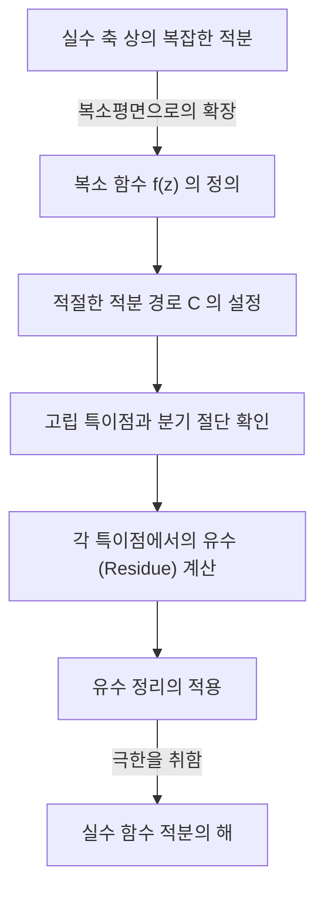
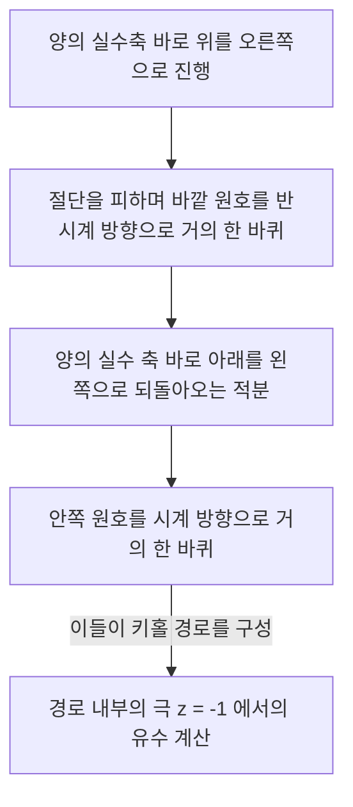

## 서론: 실수 적분의 한계와 복소평면으로의 도약

정적분은 물리학과 공학의 중요한 도구입니다. 하지만 실변수로 원시함수를 직접 구하는 일은 어려울 수 있습니다. 적절한 가정 아래에서 유수 정리는 이런 정적분을 계산하는 다른 방법을 제공합니다. 먼저 다음 이상적분을 생각해 봅시다.

$$
I = \int_{-\infty}^{\infty} \frac{1}{x^2 + 1} dx
$$

이 적분은 $\arctan(x)$로 계산할 수 있습니다. 더 복잡한 유리함수나 삼각함수의 적분에서는 원시함수를 직접 찾는 방법보다 복소평면의 경로 적분이 편리할 수 있습니다.

**유수 정리**는 실수축의 적분을 복소평면의 폐곡선 적분과 연결하고, 고립 특이점 주변의 국소 정보를 이용합니다. 적절한 복소 함수로 확장하고 추가 경로의 적분을 추정해야 하며, 복소평면으로 옮긴다고 임의의 실수 적분이 자동으로 풀리는 것은 아닙니다.

## 복소 적분과 특이점

복소 함수 $f(z)$는 복소평면의 곡선을 따라 적분합니다. $C$가 구간별로 $C^1$인 단순 폐곡선이고 $f$가 $C$와 그 내부를 포함하는 열린 집합에서 정칙이면, 다음 **[코시의 적분 정리](/ko/p/cauchys-integral-theorem/)**가 성립합니다. 구멍이 있는 영역에서 정칙성만으로 임의의 폐곡선에 같은 결론을 적용할 수는 없습니다.

$$
\oint_C f(z) dz = 0 \quad (\text{함수가 } C \text{ 의 내부 및 경계에서 정칙인 경우})
$$

곡선 내부에 특이점이 있으면 어떻게 될까요? 여기서 **고립 특이점** $z_0$는 어떤 뚫린 근방 $0<|z-z_0|<r$에서는 $f$가 정칙이지만 $z_0$에서는 정칙이 아닌 점을 뜻합니다. 제거 가능 특이점, 극, 본질적 특이점을 구별해야 합니다. **극**은 로랑 급수의 주부가 0이 아니고 유한 개의 항으로 이루어진 경우이며, 모든 특이점이 극인 것은 아닙니다. 분모가 0이어도 약분으로 제거 가능할 수 있습니다. 예를 들어 $(z^2-1)/(z-1)$의 $1$은 제거 가능 특이점이고, $e^{1/z}$의 $0$은 본질적 특이점입니다.

## 로랑 급수와 유수 (Residue)

고립 특이점 $z_0$의 뚫린 근방 $0<|z-z_0|<r$에서 정칙인 함수는 그 범위에서 수렴하는 **로랑 급수**를 가집니다. 이는 [테일러 급수](/ko/p/taylor-and-maclaurin-series/)를 음의 거듭제곱으로 확장한 것이며 다음과 같이 쓸 수 있습니다. 더 일반적으로는 정칙인 원환 영역마다 로랑 전개를 생각합니다.

$$
f(z) = \sum_{n=0}^{\infty} a_n (z - z_0)^n + \sum_{n=1}^{\infty} \frac{b_n}{(z - z_0)^n}
$$

음의 거듭제곱 항들의 합, 즉 우변의 두 번째 합을 **주부**라고 합니다. 주부는 특이점의 성질을 결정합니다. 특히 $(z-z_0)^{-1}$의 계수 $b_1$을 $z_0$에서 $f$의 **유수**라고 하며 다음과 같이 씁니다.

$$
\text{Res}(f, z_0) = b_1
$$

$(z-z_0)^{-1}$의 계수가 특별한 이유는 뚫린 근방 안의 작은 원을 반시계 방향으로 한 번 돌며 $1/(z-z_0)^n$을 적분하면, 정수 $n=1$일 때만 $2\pi i$이고 나머지 정수에서는 $0$이 되기 때문입니다. 방향을 뒤집으면 부호도 바뀝니다.

## 코시의 유수 정리

$C$를 양의 방향(반시계 방향)의 구간별로 $C^1$인 단순 폐곡선이라고 합시다. $f$는 $C$와 그 내부를 포함하는 열린 집합에서 내부의 유한 개 고립 특이점 $z_1,\ldots,z_k$를 제외하고 정칙이며, 곡선 위에는 특이점이 없다고 가정합니다. 그러면 **유수 정리**에 의해 다음이 성립합니다.

$$
\oint_C f(z) dz = 2\pi i \sum_{j=1}^{k} \text{Res}(f, z_j)
$$

이 가정 아래에서 내부의 고립 특이점들의 유수를 더한 뒤 $2\pi i$를 곱하면 적분값을 얻습니다. 자기 교차나 여러 번의 회전을 허용하는 일반형에서는 각 특이점에 대한 감김수도 고려해야 합니다. 특이점을 지나거나 분기 절단을 가로지르는 경로에 이 식을 그대로 적용할 수는 없습니다.

## 응용 예: 실수 함수의 적분 계산

그러면 실제로 유수 정리를 사용하여 서두의 적분을 풀어봅시다.

$$
I = \int_{-\infty}^{\infty} \frac{1}{x^2 + 1} dx
$$

### 단계 1: 복소 함수로의 확장과 적분 경로 설정
$f(z)=1/(z^2+1)$로 놓고 $R>1$을 택합니다. 실수축을 $-R$에서 $R$까지 간 뒤, 상반평면의 반원호 $C_R$를 $R$에서 $-R$까지 반시계 방향으로 돌아오면 양의 방향 폐곡선 $C$가 됩니다.

폐곡선 $C$ 상의 적분은 다음과 같이 분해할 수 있습니다.

$$
\oint_C f(z) dz = \int_{-R}^{R} f(x) dx + \int_{C_R} f(z) dz
$$

반원호에서 $|z^2+1|\ge R^2-1$이므로 $\left|\int_{C_R}f(z)\,dz\right|\le\pi R/(R^2-1)\to0$입니다. 실수축에서는 피적분 함수가 무한대에서 $O(x^{-2})$이므로 이상적분이 절대수렴합니다. 따라서 아래 극한은 대칭적으로 잘라 얻은 코시 주값에 그치지 않고 통상적인 이상적분을 나타냅니다.

$$
\lim_{R \to \infty} \oint_C f(z) dz = \int_{-\infty}^{\infty} \frac{1}{x^2 + 1} dx
$$

### 단계 2: 특이점과 유수 계산
함수 $f(z)=1/(z^2+1)=1/((z-i)(z+i))$는 $z=i$와 $z=-i$에 단순극, 즉 1차 극을 가집니다.
적분 경로 $C$ (상반평면) 내부에 있는 특이점은 $z = i$ 뿐입니다.

$z=i$에서의 유수를 계산합니다. 단순극의 유수는 다음 극한으로 구할 수 있습니다.

$$
\text{Res}(f, i) = \lim_{z \to i} (z - i) f(z) = \lim_{z \to i} \frac{1}{z + i} = \frac{1}{2i}
$$

### 단계 3: 유수 정리의 적용
유수 정리에 의해 폐곡선 $C$ 상의 적분은 다음과 같습니다.

$$
\oint_C f(z) dz = 2\pi i \times \text{Res}(f, i) = 2\pi i \times \frac{1}{2i} = \pi
$$

따라서 구하고자 하는 실수 함수 정적분의 값은 $\pi$ 가 됩니다.

$$
\int_{-\infty}^{\infty} \frac{1}{x^2 + 1} dx = \pi
$$

이처럼 복소평면이라는 차원을 하나 추가함으로써 실수만으로는 보이지 않던 '지름길'을 찾아내어 놀랍도록 간단하게 계산을 수행할 수 있습니다.

## 조르당의 보조정리와 삼각함수의 적분

조금 더 복잡한 예로서, 물리학(예를 들어 양자역학에서 파동함수의 푸리에 변환 등)에서 빈번하게 등장하는 다음과 같은 적분을 생각해 봅시다.

$$
J = \int_{-\infty}^{\infty} \frac{\cos(kx)}{x^2 + a^2} dx \quad (k > 0, a > 0)
$$

$f(z)=e^{ikz}/(z^2+a^2)$를 생각합시다. [오일러의 공식](/ko/p/euler/) $e^{ikx}=\cos(kx)+i\sin(kx)$에 따라 복소 적분의 실수부가 구하려는 값입니다. $k>0,a>0$일 때 실수축 적분이 절대수렴하므로 적분 안에서 실수부를 취할 수 있습니다.

다시 $R>a$를 택해 실수축을 $-R$에서 $R$까지 간 뒤 상반원호를 따라 $R$에서 $-R$로 돌아옵니다. 여기서는 $|e^{ikz}|=e^{-k\operatorname{Im}z}\le1$이므로 원호 적분의 절댓값은 $\pi R/(R^2-a^2)$ 이하이고 0으로 갑니다. **조르당의 보조정리**는 더 일반적인 $e^{ikz}g(z)$에 대한 추정입니다. 예를 들어 $k>0$이 고정되어 있고 상반원호 위 $|g|$의 상한이 0으로 가면 원호 적분도 0으로 갑니다. 이 예에서는 분모의 2차 감쇠만으로도 충분합니다.

특이점은 $z = ia$ (상반평면)입니다. 유수를 계산합니다.

$$
\text{Res}(f, ia) = \lim_{z \to ia} (z - ia) \frac{e^{ikz}}{(z - ia)(z + ia)} = \frac{e^{-ka}}{2ia}
$$

유수 정리를 적용합니다.

$$
\int_{-\infty}^{\infty} \frac{e^{ikx}}{x^2 + a^2} dx = 2\pi i \times \frac{e^{-ka}}{2ia} = \frac{\pi e^{-ka}}{a}
$$

우변은 순수한 실수가 됩니다. 따라서 실수부를 비교함으로써 다음과 같은 아름다운 결과를 얻을 수 있습니다.

$$
\int_{-\infty}^{\infty} \frac{\cos(kx)}{x^2 + a^2} dx = \frac{\pi e^{-ka}}{a}
$$

## 분기 절단 (Branch Cut)과 키홀 적분

유수 정리의 더욱 고급 응용은 다가 함수(하나의 입력에 대해 여러 개의 출력을 가지는 함수)의 적분입니다. 대표적인 예가 로그 함수 $\log(z)$ 나 분수 거듭제곱 $z^a$ 를 포함하는 적분입니다. 이들을 일가 함수로 다루기 위해서는 복소평면 상에 **분기 절단** (Branch Cut)이라는 '절개선'을 설정해야 합니다.

예로서 다음 적분을 생각해 봅시다 (단, $0 < a < 1$).

$$
K = \int_{0}^{\infty} \frac{x^{-a}}{x + 1} dx
$$

$0<a<1$에서는 피적분 함수가 원점 근처에서 $O(x^{-a})$, 무한대에서 $O(x^{-a-1})$이므로 적분이 수렴합니다. 양의 실수축에 분기 절단을 놓고 $0<\arg z<2\pi$인 가지를 택합니다. $\operatorname{Log}z=\log|z|+i\arg z$, $F(z)=z^{-a}/(z+1)=e^{-a\operatorname{Log}z}/(z+1)$로 정의합니다. $0<\varepsilon<1<R$에 대해 절단 바로 위를 바깥쪽으로, 바깥 원호를 반시계 방향으로, 절단 바로 아래를 안쪽으로, 안쪽 원호를 시계 방향으로 돕니다. 실제 경로는 절단을 피하며 양쪽에서 극한을 취합니다.

바깥 원호의 기여의 절댓값은 $2\pi R^{1-a}/(R-1)$ 이하로 $R\to\infty$일 때 0으로 갑니다. 안쪽 원호에서는 $2\pi\varepsilon^{1-a}/(1-\varepsilon)$ 이하이므로 $\varepsilon\to0$일 때 0으로 갑니다. 절단 위에서는 $z^{-a}\to x^{-a}$, 아래에서는 $z^{-a}\to e^{-2\pi ia}x^{-a}$이고, 아래쪽은 역방향이므로 직선 부분의 합은 $(1-e^{-2\pi ia})K$로 갑니다. 선택한 가지에서 $\arg(-1)=\pi$이므로 $-1$에서의 유수는 $e^{-\pi ia}$입니다. 따라서 $(1-e^{-2\pi ia})K=2\pi i\,e^{-\pi ia}$이고, $1-e^{-2\pi ia}=2i\,e^{-\pi ia}\sin(\pi a)$를 쓰면 다음을 얻습니다.

$$
\int_{0}^{\infty} \frac{x^{-a}}{x + 1} dx = \frac{\pi}{\sin(a\pi)}
$$

## 결론

유수 정리는 언뜻 보기에 무관해 보이는 '복소수의 극'과 '실수 함수의 적분'을 훌륭하게 결합하는 수학적 우아함의 극치입니다. 실수 함수 문제를 풀기 위해 일단 복소평면이라는 넓은 세계로 뛰어들어 특이점이라는 '장애물'의 성질(유수)만을 조사하고 원래의 세계로 돌아오면 문제가 멋지게 해결되어 있는 것입니다.

이런 경로 적분 방법은 [라플라스 변환](/ko/p/laplace-transform/)의 역변환과 푸리에 적분 등에도 나타납니다. 올바르게 적용하려면 특이점의 종류, 경로의 방향, 무한대와 분기점 근처에서의 수렴을 먼저 확인해야 합니다.

## 참고 자료

- [MIT 18.04 Topic 8: Residues and the residue theorem](https://ocw.mit.edu/courses/18-04-complex-variables-with-applications-spring-2018/3c58ce71ec6f7573804221d76158a0bd_MIT18_04S18_topic8.pdf)
- [MIT 18.04 Topic 9: Definite integrals using the residue theorem](https://ocw.mit.edu/courses/18-04-complex-variables-with-applications-spring-2018/f69bc227ae476839819fb18e5b283072_MIT18_04S18_topic9.pdf)
- [NIST DLMF §1.10: Functions of a Complex Variable](https://dlmf.nist.gov/1.10)
