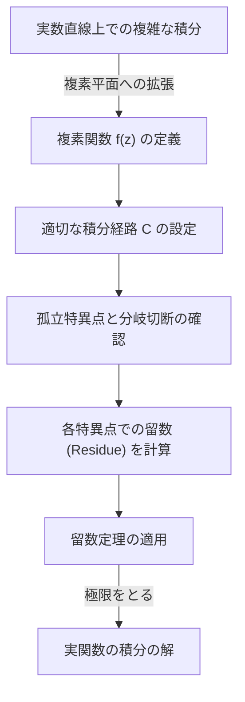
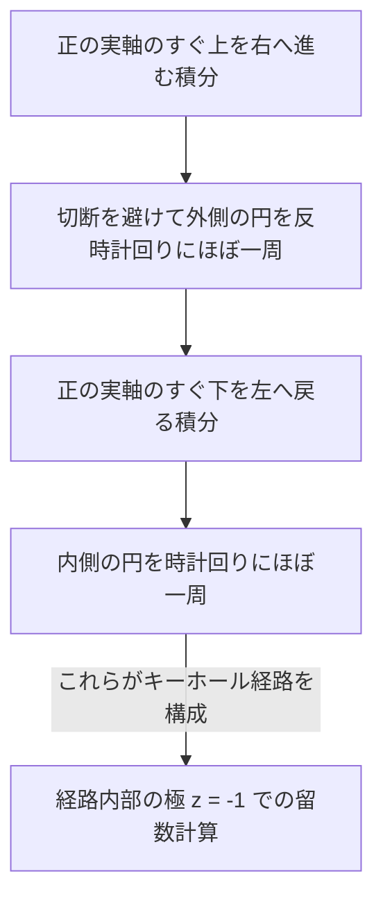

## はじめに：実関数の積分の限界と複素平面への飛躍

高校数学や大学初年度の微積分で学ぶ定積分は、物理学や工学の問題を解くための重要な道具です。ただし、実変数の原始関数を直接求めようとすると計算が難しくなる場合があります。留数定理は、適切な条件の下で、そのような定積分を別の方法で計算する手段を与えます。まず次の広義積分を考えましょう。

$$
I = \int_{-\infty}^{\infty} \frac{1}{x^2 + 1} dx
$$

この積分自体は $\arctan(x)$ を用いて計算できますが、分母がさらに高次な多項式になったり、サインやコサインといった三角関数が複雑に絡み合ったりすると、実関数の範囲で不定積分を見つけることは非常に困難になります。

ここで使うのが、複素解析における**留数定理**（residue theorem）です。実数直線上の積分を複素平面上の閉曲線積分と結び付け、孤立特異点の周りの情報から求めます。複素平面への拡張と補助経路の積分の評価が必要であり、任意の積分が自動的に解けるわけではありません。

## 複素積分と特異点

複素関数 $f(z)$ の積分は、複素平面上の曲線に沿って行います。区分的に $C^1$ 級の単純閉曲線 $C$ とその内部を含む開集合で $f$ が正則なら、次のコーシーの積分定理が成り立ちます。正則性だけを見て、任意の穴のある領域の閉曲線にも同じ結論を適用することはできません。

$$
\oint_C f(z) dz = 0 \quad (\text{関数が } C \text{ の内部および周上で正則な場合})
$$

では、曲線の内部に特異点がある場合はどうでしょうか。ここで扱う**孤立特異点** $z_0$ とは、ある穴あき近傍 $0<|z-z_0|<r$ では正則だが、その点では正則でない点です。除去可能特異点、極、真性特異点を区別します。**極**は有限の負べきの主要部を持つ孤立特異点であり、特異点すべてが極とは限りません。また、分母が0でも約分によって除去可能になることがあります。例えば $(z^2-1)/(z-1)$ の $z=1$ は除去可能で、$e^{1/z}$ の $z=0$ は真性特異点です。

## ローラン展開と留数 (Residue)

孤立特異点 $z_0$ の穴あき近傍 $0<|z-z_0|<r$ で正則な関数は、その範囲で収束する**ローラン展開**を持ちます。これは[テイラー展開](/p/taylor-and-maclaurin-series/)を負のべきへ拡張したもので、次の形で表せます。より一般には、正則な円環領域ごとに展開を考えます。

$$
f(z) = \sum_{n=0}^{\infty} a_n (z - z_0)^n + \sum_{n=1}^{\infty} \frac{b_n}{(z - z_0)^n}
$$

負のべきの項を集めた和（右辺の第2の総和）を**主要部**と呼びます。主要部は特異点の性質を決めます。特に、$(z-z_0)^{-1}$ の係数 $b_1$ を、関数 $f(z)$ の $z_0$ における**留数**（residue）と呼び、次のように記します。

$$
\text{留数}(f, z_0) = b_1
$$

$(z-z_0)^{-1}$ の係数が特別なのは、穴あき近傍内で $z_0$ を一周する小円を反時計回りにたどると、$1/(z-z_0)^n$ の積分が整数 $n=1$ のときだけ $2\pi i$ となり、それ以外では $0$ になるからです。時計回りなら符号が逆になります。

## [コーシー](https://kenji.blog/p/cauchy/)の留数定理

区分的に $C^1$ 級で、正向き（反時計回り）の単純閉曲線 $C$ を考えます。$f$ は $C$ とその内部を含む開集合上で、内部の有限個の孤立特異点 $z_1,\ldots,z_k$ を除いて正則であり、曲線上には特異点がないとします。このとき、**留数定理**は次の形になります。

$$
\oint_C f(z) dz = 2\pi i \sum_{j=1}^{k} \text{留数}(f, z_j)
$$

この条件の下では、内部の各孤立特異点の留数を足して $2\pi i$ を掛ければ積分が求まります。自己交差する経路や複数回の周回を扱う一般形では、各点の周りの巻き数も考慮します。特異点を通る経路や分岐切断を横切る経路に、この式をそのまま使うことはできません。

## 応用例：実関数の積分を計算する

それでは、実際に留数定理を使って冒頭の積分を解いてみましょう。

$$
I = \int_{-\infty}^{\infty} \frac{1}{x^2 + 1} dx
$$

### ステップ1：複素関数への拡張と積分経路の設定
実変数 $x$ を複素変数 $z$ に置き換え、$f(z)=1/(z^2+1)$ とします。$R>1$ とし、実軸上を $-R$ から $R$ へ進み、上半平面の半円弧 $C_R$ を $R$ から $-R$ へ反時計回りにたどる正向きの閉曲線 $C$ を使います。

閉曲線 $C$ 上の積分は次のように分解できます。

$$
\oint_C f(z) dz = \int_{-R}^{R} f(x) dx + \int_{C_R} f(z) dz
$$

半円弧上では $|z^2+1|\ge R^2-1$ なので、$\left|\int_{C_R}f(z)\,dz\right|\le \pi R/(R^2-1)\to0$ です。また、実軸上の被積分関数は無限遠で $O(x^{-2})$ となり、広義積分は絶対収束します。したがって、対称な打ち切りによる主値だけではなく、通常の広義積分として次の極限が成り立ちます。

$$
\lim_{R \to \infty} \oint_C f(z) dz = \int_{-\infty}^{\infty} \frac{1}{x^2 + 1} dx
$$

### ステップ2：特異点と留数の計算
関数 $f(z) = \frac{1}{z^2 + 1} = \frac{1}{(z - i)(z + i)}$ は、 $z = i$ と $z = -i$ に 1位の極を持ちます。
積分経路 $C$ （上半平面）の内部にある特異点は $z = i$ だけです。

$z = i$ における留数を計算します。1位の極の留数は、次のように計算できます。

$$
\text{留数}(f, i) = \lim_{z \to i} (z - i) f(z) = \lim_{z \to i} \frac{1}{z + i} = \frac{1}{2i}
$$

### ステップ3：留数定理の適用
留数定理より、閉曲線 $C$ 上の積分は次のようになります。

$$
\oint_C f(z) dz = 2\pi i \times \text{留数}(f, i) = 2\pi i \times \frac{1}{2i} = \pi
$$

したがって、求める実関数の定積分の値は $\pi$ となります。

$$
\int_{-\infty}^{\infty} \frac{1}{x^2 + 1} dx = \pi
$$

このように、複素平面という次元を一つ追加することで、実数だけでは見えなかった「抜け道」が見つかり、驚くほど簡単に計算を行うことができるのです。

## ジョルダンの補題と三角関数の積分

もう一つ、少し複雑な例として、物理学（例えば量子力学における波動関数のフーリエ変換など）で頻出する次のような積分を考えてみましょう。

$$
J = \int_{-\infty}^{\infty} \frac{\cos(kx)}{x^2 + a^2} dx \quad (k > 0, a > 0)
$$

この積分は、複素関数 $f(z)=e^{ikz}/(z^2+a^2)$ を使うと計算しやすくなります。[オイラー](https://kenji.blog/p/euler/)の公式 $e^{ikx}=\cos(kx)+i\sin(kx)$ より、複素積分の実部が求める積分です。$k>0,a>0$ の下で実軸上では絶対収束するため、実部を積分の外へ取り出せます。

ここでも $R>a$ として、実軸を $-R$ から $R$ へ、半円弧を $R$ から $-R$ へ進む経路を使います。上半円では $|e^{ikz}|=e^{-k\operatorname{Im}z}\le1$ なので、円弧積分の絶対値は $\pi R/(R^2-a^2)$ 以下となり、0へ収束します。**ジョルダンの補題**は、より一般の $e^{ikz}g(z)$ にも用いる評価です。例えば固定した $k>0$ に対し、上半円上の $\sup|g(z)|$ が0へ近づくなら、円弧積分は0へ近づきます。この例では、分母の2次の減衰だけでも十分な評価が得られます。

特異点は $z = ia$ （上半平面）です。留数を計算します。

$$
\text{留数}(f, ia) = \lim_{z \to ia} (z - ia) \frac{e^{ikz}}{(z - ia)(z + ia)} = \frac{e^{-ka}}{2ia}
$$

留数定理を適用します。

$$
\int_{-\infty}^{\infty} \frac{e^{ikx}}{x^2 + a^2} dx = 2\pi i \times \frac{e^{-ka}}{2ia} = \frac{\pi e^{-ka}}{a}
$$

右辺は純粋な実数となります。したがって、実部を比較することで、次の美しい結果が得られます。

$$
\int_{-\infty}^{\infty} \frac{\cos(kx)}{x^2 + a^2} dx = \frac{\pi e^{-ka}}{a}
$$

## 分岐切断（Branch Cut）とキーホール積分

留数定理のさらに高度な応用として、多価関数（一つの入力に対して複数の出力を持つ関数）の積分があります。代表的な例が対数関数 $\log(z)$ や分数べき $z^a$ を含む積分です。これらを単値関数として扱うためには、複素平面上に **分岐切断** （Branch Cut）と呼ばれる「切り込み」を入れる必要があります。

例として、次の積分を考えます（ただし $0 < a < 1$ ）。

$$
K = \int_{0}^{\infty} \frac{x^{-a}}{x + 1} dx
$$

$0<a<1$ では、被積分関数は原点付近で $O(x^{-a})$、無限遠で $O(x^{-a-1})$ なので積分は収束します。正の実軸に分岐切断を置き、$0<\arg z<2\pi$ の枝で $\operatorname{Log}z=\log|z|+i\arg z$、$F(z)=z^{-a}/(z+1)=e^{-a\operatorname{Log}z}/(z+1)$ と定めます。$0<\varepsilon<1<R$ とし、切断のすぐ上を外向きに、外側の円を反時計回りに、切断のすぐ下を内向きに、内側の円を時計回りにたどるキーホール経路を取ります。実際の経路は切断上を避け、両側からの極限を考えます。

外側の円の寄与の絶対値は $2\pi R^{1-a}/(R-1)$ 以下で、$R\to\infty$ で0です。内側の円では $2\pi\varepsilon^{1-a}/(1-\varepsilon)$ 以下となり、$\varepsilon\to0$ で0です。切断の上側では $z^{-a}\to x^{-a}$、下側では $z^{-a}\to e^{-2\pi ia}x^{-a}$ となり、下側を逆向きに進むため、直線部分の和は $(1-e^{-2\pi ia})K$ に近づきます。選んだ枝では $\arg(-1)=\pi$ なので、$z=-1$ での留数は $e^{-\pi ia}$。したがって $(1-e^{-2\pi ia})K=2\pi i\,e^{-\pi ia}$ です。$1-e^{-2\pi ia}=2i\,e^{-\pi ia}\sin(\pi a)$ を用いると、次の結果が得られます。

$$
\int_{0}^{\infty} \frac{x^{-a}}{x + 1} dx = \frac{\pi}{\sin(a\pi)}
$$

## 結論

留数定理は、一見すると無関係に見える「複素数の極」と「実関数の積分」を見事に結びつける、数学的エレガンスの極致です。実数関数の問題を解くために、一旦複素平面という広い世界に飛び出し、特異点という「障害物」の性質（留数）だけを調べて元の世界に戻ってくると、問題が鮮やかに解決しているのです。

この考え方は、[ラプラス変換](https://kenji.blog/p/laplace-transform/)の逆変換やフーリエ積分などにも現れます。大切なのは、特異点の種類、経路の向き、無限遠や分岐点付近での収束を確かめてから定理を使うことです。

## 参考資料

- [MIT 18.04 Topic 8：留数と留数定理](https://ocw.mit.edu/courses/18-04-complex-variables-with-applications-spring-2018/3c58ce71ec6f7573804221d76158a0bd_MIT18_04S18_topic8.pdf)
- [MIT 18.04 Topic 9：留数定理による定積分](https://ocw.mit.edu/courses/18-04-complex-variables-with-applications-spring-2018/f69bc227ae476839819fb18e5b283072_MIT18_04S18_topic9.pdf)
- [NIST DLMF §1.10：ローラン展開・特異点・留数定理](https://dlmf.nist.gov/1.10)
