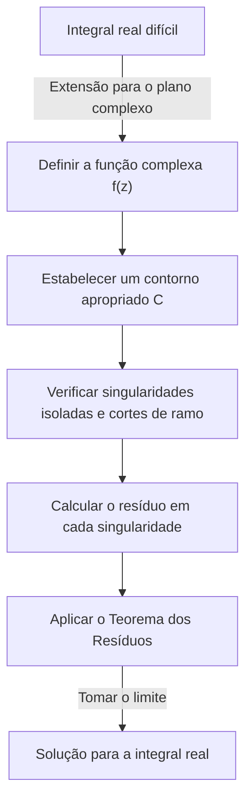
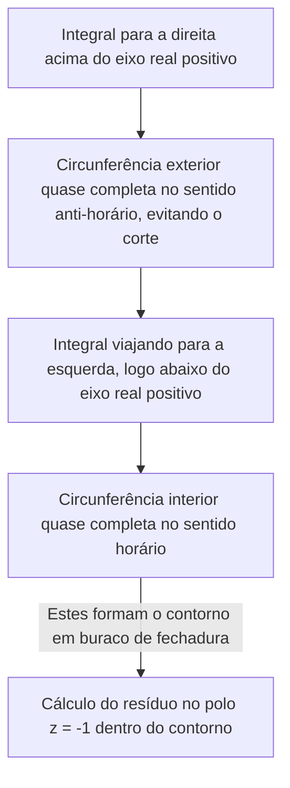

## Introdução: Os Limites das Integrais Reais e o Salto para o Plano Complexo

As integrais definidas são ferramentas importantes na física e na engenharia. Encontrar diretamente uma primitiva em variáveis reais pode, porém, ser difícil. Sob hipóteses adequadas, o teorema dos resíduos oferece outro método para calcular algumas dessas integrais. Comecemos pela seguinte integral imprópria:

$$
I = \int_{-\infty}^{\infty} \frac{1}{x^2 + 1} dx
$$

Esta integral pode ser calculada com $\arctan(x)$. Para funções racionais ou trigonométricas mais complicadas, procurar diretamente uma primitiva pode ser menos conveniente, e um método de integração de contorno pode ser útil.

O **teorema dos resíduos** relaciona uma integral na reta real a uma integral sobre um contorno fechado no plano complexo, usando informação local em torno de singularidades isoladas. É essencial escolher uma extensão complexa adequada e estimar as contribuições dos trechos adicionais. Passar ao plano complexo não resolve automaticamente qualquer integral real.

## Integração Complexa e Singularidades

Uma função complexa $f(z)$ é integrada ao longo de uma curva no plano complexo. Se $C$ é uma curva fechada simples de classe $C^1$ por partes e $f$ é holomorfa em um aberto que contém $C$ e seu interior, vale a seguinte consequência do **[teorema integral de Cauchy](/pt/p/cauchys-integral-theorem/)**. A holomorfia, isoladamente, não justifica a mesma conclusão para qualquer curva em um domínio com buracos.

$$
\oint_C f(z) dz = 0 \quad (\text{se a função for holomorfa dentro e sobre } C)
$$

O que muda quando há uma singularidade dentro do contorno? Uma **singularidade isolada** em $z_0$ significa aqui que $f$ é holomorfa em alguma vizinhança perfurada $0<|z-z_0|<r$, mas não em $z_0$. Distinguimos singularidades removíveis, polos e singularidades essenciais. Um **polo** tem uma parte principal não nula com um número finito de termos na série de Laurent; nem toda singularidade é um polo. Um denominador nulo pode ser cancelado: $(z^2-1)/(z-1)$ tem uma singularidade removível em $1$, enquanto $e^{1/z}$ tem uma singularidade essencial em $0$.

## Séries de Laurent e Resíduos

Se $f$ é holomorfa em uma vizinhança perfurada $0<|z-z_0|<r$ de uma singularidade isolada, possui uma **série de Laurent** convergente ali. Ela amplia a [série de Taylor](/pt/p/taylor-and-maclaurin-series/) para potências negativas e pode ser escrita como segue. Mais geralmente, expansões de Laurent são consideradas em anéis de holomorfia.

$$
f(z) = \sum_{n=0}^{\infty} a_n (z - z_0)^n + \sum_{n=1}^{\infty} \frac{b_n}{(z - z_0)^n}
$$

A soma dos termos de potências negativas — a segunda soma do lado direito — é a **parte principal**. Ela determina a natureza da singularidade. Em particular, o coeficiente $b_1$ de $(z-z_0)^{-1}$ é o **resíduo** de $f$ em $z_0$, escrito como:

$$
\text{Res}(f, z_0) = b_1
$$

O coeficiente de $(z-z_0)^{-1}$ é especial porque a integral de $1/(z-z_0)^n$ sobre uma pequena circunferência percorrida uma vez no sentido anti-horário, dentro da vizinhança perfurada, vale $2\pi i$ para o inteiro $n=1$ e $0$ para os demais inteiros. Inverter a orientação muda o sinal.

## Teorema dos Resíduos de [Cauchy](https://kenji.blog/pt/p/cauchy/)

Seja $C$ uma curva fechada simples, de classe $C^1$ por partes e com orientação positiva (sentido anti-horário). Suponhamos que $f$ seja holomorfa em um aberto que contém $C$ e seu interior, exceto em um número finito de singularidades isoladas interiores $z_1,\ldots,z_k$, sem singularidades sobre a curva. O **teorema dos resíduos** afirma então:

$$
\oint_C f(z) dz = 2\pi i \sum_{j=1}^{k} \text{Res}(f, z_j)
$$

Sob essas hipóteses, somamos os resíduos interiores e multiplicamos por $2\pi i$. A formulação geral para curvas com autointerseções ou percursos repetidos também usa o índice da curva em torno de cada singularidade, isto é, o número de voltas. A fórmula exibida não se aplica diretamente a um contorno que passa por uma singularidade ou cruza um corte de ramo.

## Aplicação: Resolvendo Integrais Reais

Vamos realmente usar o teorema dos resíduos para resolver a integral introduzida no início.

$$
I = \int_{-\infty}^{\infty} \frac{1}{x^2 + 1} dx
$$

### Passo 1: Extensão para uma Função Complexa e Estabelecimento do Contorno
Tomemos $f(z)=1/(z^2+1)$. Para $R>1$, percorremos o segmento real de $-R$ a $R$ e retornamos pelo arco semicircular superior $C_R$, de $R$ a $-R$, no sentido anti-horário. Assim obtemos o contorno fechado positivamente orientado $C$.

A integral na curva fechada $C$ pode ser decomposta da seguinte forma:

$$
\oint_C f(z) dz = \int_{-R}^{R} f(x) dx + \int_{C_R} f(z) dz
$$

No arco, $|z^2+1|\ge R^2-1$, de modo que $\left|\int_{C_R}f(z)\,dz\right|\le\pi R/(R^2-1)\to0$. Na reta real, o integrando é $O(x^{-2})$ no infinito, e a integral imprópria converge absolutamente. Portanto, o limite seguinte fornece a integral imprópria usual, e não apenas um valor principal de Cauchy obtido por truncamento simétrico:

$$
\lim_{R \to \infty} \oint_C f(z) dz = \int_{-\infty}^{\infty} \frac{1}{x^2 + 1} dx
$$

### Passo 2: Singularidades e Cálculo de Resíduos
A função $f(z) = \frac{1}{z^2 + 1} = \frac{1}{(z - i)(z + i)}$ tem polos de ordem 1 em $z = i$ e $z = -i$.
A única singularidade dentro do contorno $C$ (no semiplano superior) é $z = i$.

Vamos calcular o resíduo em $z = i$. O resíduo para um polo simples (ordem 1) pode ser calculado da seguinte forma:

$$
\text{Res}(f, i) = \lim_{z \to i} (z - i) f(z) = \lim_{z \to i} \frac{1}{z + i} = \frac{1}{2i}
$$

### Passo 3: Aplicando o Teorema dos Resíduos
Pelo teorema dos resíduos, a integral na curva fechada $C$ torna-se:

$$
\oint_C f(z) dz = 2\pi i \times \text{Res}(f, i) = 2\pi i \times \frac{1}{2i} = \pi
$$

Assim, o valor da integral definida real desejada é $\pi$.

$$
\int_{-\infty}^{\infty} \frac{1}{x^2 + 1} dx = \pi
$$

Desta forma, adicionando uma dimensão (o plano complexo), encontramos um "atalho" que era invisível com apenas números reais, permitindo-nos realizar o cálculo com surpreendente facilidade.

## Lema de Jordan e Integrais Trigonométricas

Como outro exemplo um pouco mais complexo, considere a seguinte integral que aparece frequentemente na física (por exemplo, transformadas de Fourier de funções de onda na mecânica quântica):

$$
J = \int_{-\infty}^{\infty} \frac{\cos(kx)}{x^2 + a^2} dx \quad (k > 0, a > 0)
$$

Consideremos $f(z)=e^{ikz}/(z^2+a^2)$. Pela [fórmula de Euler](/pt/p/euler/), $e^{ikx}=\cos(kx)+i\sin(kx)$, de modo que a parte real da integral complexa fornece o resultado procurado. Para $k>0,a>0$, a integral na reta real converge absolutamente, permitindo tomar a parte real sob o sinal de integração.

Escolhemos novamente $R>a$, percorremos o eixo real de $-R$ a $R$ e voltamos pelo semicírculo superior de $R$ a $-R$. Ali $|e^{ikz}|=e^{-k\operatorname{Im}z}\le1$, logo o valor absoluto da integral do arco não supera $\pi R/(R^2-a^2)$ e tende a zero. O **lema de Jordan** oferece uma estimativa mais geral para $e^{ikz}g(z)$: para $k>0$ fixo, se o supremo de $|g|$ sobre o semicírculo superior tende a zero, a integral do arco também tende a zero. Neste exemplo, o decaimento quadrático do denominador já é suficiente.

A singularidade é $z = ia$ (semiplano superior). Calculamos o resíduo:

$$
\text{Res}(f, ia) = \lim_{z \to ia} (z - ia) \frac{e^{ikz}}{(z - ia)(z + ia)} = \frac{e^{-ka}}{2ia}
$$

Aplique o teorema dos resíduos:

$$
\int_{-\infty}^{\infty} \frac{e^{ikx}}{x^2 + a^2} dx = 2\pi i \times \frac{e^{-ka}}{2ia} = \frac{\pi e^{-ka}}{a}
$$

O lado direito é um número puramente real. Portanto, comparando as partes reais, obtemos o seguinte belo resultado:

$$
\int_{-\infty}^{\infty} \frac{\cos(kx)}{x^2 + a^2} dx = \frac{\pi e^{-ka}}{a}
$$

## Cortes de Ramo e Contornos de Buraco de Fechadura

Uma aplicação mais avançada do teorema dos resíduos envolve a integração de funções multivaloradas (funções que têm múltiplas saídas para uma única entrada). Exemplos típicos são integrais envolvendo a função logarítmica $\log(z)$ ou potências fracionárias $z^a$. Para tratá-las como funções univaloradas, é necessário introduzir uma "fenda" chamada **corte de ramo** (Branch Cut) no plano complexo.

Como exemplo, considere a seguinte integral (onde $0 < a < 1$):

$$
K = \int_{0}^{\infty} \frac{x^{-a}}{x + 1} dx
$$

Para $0<a<1$, o integrando é $O(x^{-a})$ perto de zero e $O(x^{-a-1})$ no infinito, portanto a integral converge. Fazemos um corte no eixo real positivo e escolhemos o ramo $0<\arg z<2\pi$, com $\operatorname{Log}z=\log|z|+i\arg z$ e $F(z)=z^{-a}/(z+1)=e^{-a\operatorname{Log}z}/(z+1)$. Para $0<\varepsilon<1<R$, seguimos para fora logo acima do corte, percorremos a circunferência exterior no sentido anti-horário, retornamos para dentro logo abaixo do corte e fechamos pela circunferência interior no sentido horário. O contorno utilizado evita o corte; tomamos limites pelos dois lados.

A contribuição exterior tem valor absoluto no máximo $2\pi R^{1-a}/(R-1)$, que tende a zero quando $R\to\infty$. A interior não supera $2\pi\varepsilon^{1-a}/(1-\varepsilon)$ e tende a zero quando $\varepsilon\to0$. Acima do corte, $z^{-a}\to x^{-a}$; abaixo, $z^{-a}\to e^{-2\pi ia}x^{-a}$. Como o trecho inferior é percorrido ao contrário, os trechos retos somam $(1-e^{-2\pi ia})K$ no limite. No ramo escolhido, $\arg(-1)=\pi$, e o resíduo em $-1$ é $e^{-\pi ia}$. Assim, $(1-e^{-2\pi ia})K=2\pi i\,e^{-\pi ia}$. Usando $1-e^{-2\pi ia}=2i\,e^{-\pi ia}\sin(\pi a)$, obtemos:

$$
\int_{0}^{\infty} \frac{x^{-a}}{x + 1} dx = \frac{\pi}{\sin(a\pi)}
$$

## Conclusão

O teorema dos resíduos é o epítome da elegância matemática, conectando magistralmente "polos complexos" e "integrais reais" aparentemente não relacionados. Para resolver um problema de função real, você salta temporariamente para o mundo mais amplo do plano complexo, examina apenas as propriedades (resíduos) dos "obstáculos" (singularidades) e, quando retorna ao mundo original, o problema está brilhantemente resolvido.

Esses métodos de contorno também aparecem na transformada inversa de [Laplace](/pt/p/laplace-transform/) e em integrais de Fourier. Para usá-los com rigor, é preciso verificar os tipos de singularidade, a orientação do contorno e a convergência no infinito e perto dos pontos de ramificação.

## Referências

- [MIT 18.04 Topic 8: Residues and the residue theorem](https://ocw.mit.edu/courses/18-04-complex-variables-with-applications-spring-2018/3c58ce71ec6f7573804221d76158a0bd_MIT18_04S18_topic8.pdf)
- [MIT 18.04 Topic 9: Definite integrals using the residue theorem](https://ocw.mit.edu/courses/18-04-complex-variables-with-applications-spring-2018/f69bc227ae476839819fb18e5b283072_MIT18_04S18_topic9.pdf)
- [NIST DLMF §1.10: Functions of a Complex Variable](https://dlmf.nist.gov/1.10)
