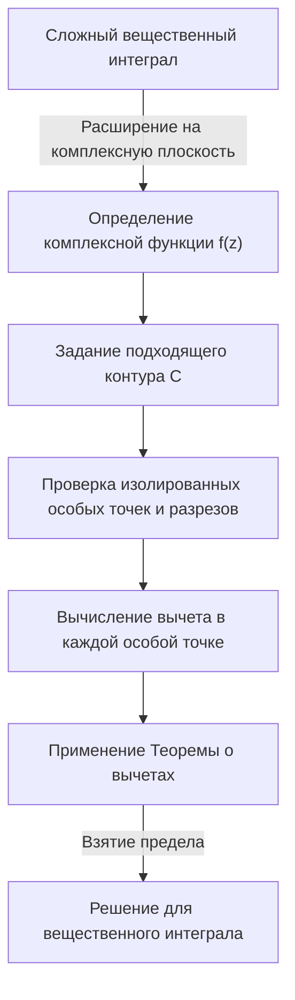
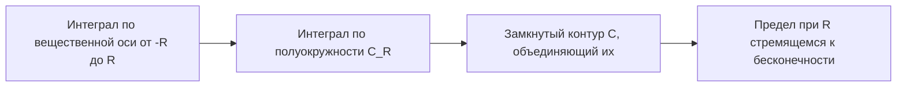
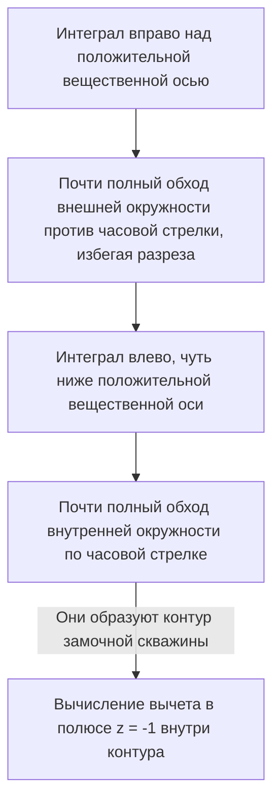

## Введение: Пределы вещественных интегралов и переход на комплексную плоскость

Определённые интегралы — важный инструмент физики и инженерии. Однако непосредственный поиск первообразной в вещественных переменных может быть трудным. При подходящих условиях теорема о вычетах даёт другой способ вычисления некоторых таких интегралов. Начнём со следующего несобственного интеграла:

$$
I = \int_{-\infty}^{\infty} \frac{1}{x^2 + 1} dx
$$

Этот интеграл можно вычислить с помощью $\arctan(x)$. Для более сложных рациональных или тригонометрических подынтегральных функций прямой поиск первообразной может быть менее удобным, чем метод контурного интегрирования.

**Теорема о вычетах** связывает интеграл по вещественной прямой с интегралом по замкнутому контуру в комплексной плоскости. Она использует локальную информацию около изолированных особых точек. Существенны выбор подходящего комплексного продолжения и оценки дополнительных частей контура: переход в комплексную плоскость не вычисляет автоматически произвольный вещественный интеграл.

## Комплексное интегрирование и особые точки

Комплексную функцию $f(z)$ интегрируют вдоль кривой на комплексной плоскости. Если $C$ — простая замкнутая кусочно-гладкая кривая, а $f$ голоморфна на открытом множестве, содержащем $C$ и её внутренность, выполняется следующее следствие **[интегральной теоремы Коши](/ru/p/cauchys-integral-theorem/)**. Одной голоморфности недостаточно, чтобы применять этот вывод к любой кривой в области с отверстиями.

$$
\oint_C f(z) dz = 0 \quad (\text{если функция голоморфна внутри и на } C)
$$

Что меняется, если внутри контура есть особая точка? **Изолированная особая точка** $z_0$ означает здесь, что $f$ голоморфна в некоторой проколотой окрестности $0<|z-z_0|<r$, но не в $z_0$. Различают устранимые особые точки, полюса и существенно особые точки. У **полюса** главная часть ряда Лорана ненулевая и содержит конечное число членов; не всякая особая точка является полюсом. Нулевой знаменатель может сократиться: у $(z^2-1)/(z-1)$ точка $1$ устранимая, тогда как у $e^{1/z}$ точка $0$ существенно особая.

## Ряды Лорана и вычеты

Если $f$ голоморфна в проколотой окрестности $0<|z-z_0|<r$ изолированной особой точки, она имеет сходящийся там **ряд Лорана**. Он расширяет [ряд Тейлора](/ru/p/taylor-and-maclaurin-series/) на отрицательные степени и записывается следующим образом. В общем случае разложения Лорана рассматривают в кольцевых областях голоморфности.

$$
f(z) = \sum_{n=0}^{\infty} a_n (z - z_0)^n + \sum_{n=1}^{\infty} \frac{b_n}{(z - z_0)^n}
$$

Сумма членов с отрицательными степенями — вторая сумма в правой части — называется **главной частью**. Она определяет характер особой точки. В частности, коэффициент $b_1$ при $(z-z_0)^{-1}$ называется **вычетом** $f$ в $z_0$ и записывается так:

$$
\text{Res}(f, z_0) = b_1
$$

Коэффициент при $(z-z_0)^{-1}$ выделяется потому, что интеграл от $1/(z-z_0)^n$ по малой окружности в проколотой окрестности, пройденной один раз против часовой стрелки, равен $2\pi i$ при целом $n=1$ и $0$ при остальных целых $n$. Обращение ориентации меняет знак.

## Теорема Коши о вычетах

Пусть $C$ — простая замкнутая кусочно-гладкая кривая с положительной ориентацией, то есть против часовой стрелки. Предположим, что $f$ голоморфна на открытом множестве, содержащем $C$ и её внутренность, кроме конечного числа изолированных особых точек $z_1,\ldots,z_k$ внутри, а на самой кривой особых точек нет. Тогда **теорема о вычетах** утверждает:

$$
\oint_C f(z) dz = 2\pi i \sum_{j=1}^{k} \text{Res}(f, z_j)
$$

При этих условиях нужно сложить вычеты внутри контура и умножить на $2\pi i$. Общая формулировка для самопересекающихся или многократно проходимых кривых дополнительно учитывает индекс кривой относительно каждой особой точки, то есть число обходов. Показанную формулу нельзя напрямую применять к контуру, проходящему через особую точку или пересекающему разрез.

## Применение: Решение вещественных интегралов

Давайте действительно используем теорему о вычетах для решения интеграла, представленного в начале.

$$
I = \int_{-\infty}^{\infty} \frac{1}{x^2 + 1} dx
$$

### Шаг 1: Расширение до комплексной функции и задание контура
Положим $f(z)=1/(z^2+1)$. При $R>1$ пройдём вещественный отрезок от $-R$ до $R$, а затем верхнюю полуокружность $C_R$ от $R$ до $-R$ против часовой стрелки. Вместе они образуют положительно ориентированный замкнутый контур $C$.

Интеграл по замкнутому контуру $C$ можно разложить следующим образом:

$$
\oint_C f(z) dz = \int_{-R}^{R} f(x) dx + \int_{C_R} f(z) dz
$$

На дуге $|z^2+1|\ge R^2-1$, поэтому $\left|\int_{C_R}f(z)\,dz\right|\le\pi R/(R^2-1)\to0$. На вещественной оси подынтегральная функция имеет порядок $O(x^{-2})$ на бесконечности, и несобственный интеграл сходится абсолютно. Поэтому следующий предел даёт обычный несобственный интеграл, а не только главное значение Коши при симметричном усечении:

$$
\lim_{R \to \infty} \oint_C f(z) dz = \int_{-\infty}^{\infty} \frac{1}{x^2 + 1} dx
$$

### Шаг 2: Особые точки и вычисление вычетов
Функция $f(z) = \frac{1}{z^2 + 1} = \frac{1}{(z - i)(z + i)}$ имеет полюса 1-го порядка в точках $z = i$ и $z = -i$.
Единственная особая точка внутри контура $C$ (в верхней полуплоскости) — это $z = i$.

Давайте вычислим вычет в точке $z = i$. Вычет для простого полюса (порядок 1) можно вычислить следующим образом:

$$
\text{Res}(f, i) = \lim_{z \to i} (z - i) f(z) = \lim_{z \to i} \frac{1}{z + i} = \frac{1}{2i}
$$

### Шаг 3: Применение Теоремы о вычетах
По теореме о вычетах интеграл по замкнутому контуру $C$ становится равным:

$$
\oint_C f(z) dz = 2\pi i \times \text{Res}(f, i) = 2\pi i \times \frac{1}{2i} = \pi
$$

Таким образом, значение искомого определенного вещественного интеграла равно $\pi$.

$$
\int_{-\infty}^{\infty} \frac{1}{x^2 + 1} dx = \pi
$$

Таким образом, добавив одно измерение (комплексную плоскость), мы находим "кратчайший путь", который был невидим только с вещественными числами, что позволяет нам выполнить вычисление удивительно легко.

## Лемма Жордана и тригонометрические интегралы

В качестве еще одного немного более сложного примера рассмотрим следующий интеграл, который часто встречается в физике (например, преобразования Фурье волновых функций в квантовой механике):

$$
J = \int_{-\infty}^{\infty} \frac{\cos(kx)}{x^2 + a^2} dx \quad (k > 0, a > 0)
$$

Рассмотрим $f(z)=e^{ikz}/(z^2+a^2)$. По [формуле Эйлера](/ru/p/euler/) $e^{ikx}=\cos(kx)+i\sin(kx)$, поэтому вещественная часть комплексного интеграла даёт нужный результат. При $k>0,a>0$ интеграл по вещественной прямой сходится абсолютно, что позволяет брать вещественную часть под знаком интеграла.

Снова выберем $R>a$, пройдём по вещественной оси от $-R$ до $R$ и вернёмся по верхней полуокружности от $R$ до $-R$. На ней $|e^{ikz}|=e^{-k\operatorname{Im}z}\le1$, поэтому модуль интеграла по дуге не превосходит $\pi R/(R^2-a^2)$ и стремится к нулю. **Лемма Жордана** даёт более общую оценку для $e^{ikz}g(z)$: при фиксированном $k>0$, если супремум $|g|$ на верхней полуокружности стремится к нулю, то и интеграл по дуге стремится к нулю. В этом примере уже достаточно квадратичного убывания за счёт знаменателя.

Особая точка — $z = ia$ (верхняя полуплоскость). Вычисляем вычет:

$$
\text{Res}(f, ia) = \lim_{z \to ia} (z - ia) \frac{e^{ikz}}{(z - ia)(z + ia)} = \frac{e^{-ka}}{2ia}
$$

Применяем теорему о вычетах:

$$
\int_{-\infty}^{\infty} \frac{e^{ikx}}{x^2 + a^2} dx = 2\pi i \times \frac{e^{-ka}}{2ia} = \frac{\pi e^{-ka}}{a}
$$

Правая часть — чисто вещественное число. Поэтому, сравнивая вещественные части, получаем следующий красивый результат:

$$
\int_{-\infty}^{\infty} \frac{\cos(kx)}{x^2 + a^2} dx = \frac{\pi e^{-ka}}{a}
$$

## Разрезы и контуры типа «замочная скважина»

Более продвинутое применение теоремы о вычетах включает интегрирование многозначных функций (функций, которые имеют несколько выходных значений для одного входного). Типичными примерами являются интегралы, содержащие логарифмическую функцию $\log(z)$ или дробные степени $z^a$. Чтобы рассматривать их как однозначные функции, необходимо ввести "разрез", называемый **разрезом плоскости** (Branch Cut) на комплексной плоскости.

В качестве примера рассмотрим следующий интеграл (где $0 < a < 1$):

$$
K = \int_{0}^{\infty} \frac{x^{-a}}{x + 1} dx
$$

При $0<a<1$ подынтегральная функция имеет порядок $O(x^{-a})$ около нуля и $O(x^{-a-1})$ на бесконечности, поэтому интеграл сходится. Проведём разрез по положительной вещественной оси и выберем ветвь $0<\arg z<2\pi$, где $\operatorname{Log}z=\log|z|+i\arg z$, а $F(z)=z^{-a}/(z+1)=e^{-a\operatorname{Log}z}/(z+1)$. При $0<\varepsilon<1<R$ идём наружу чуть выше разреза, по внешней окружности против часовой стрелки, внутрь чуть ниже разреза и по внутренней окружности по часовой стрелке. Используемый контур не пересекает разрез; его стороны рассматриваются как пределы.

Модуль внешнего вклада не превосходит $2\pi R^{1-a}/(R-1)$ и стремится к нулю при $R\to\infty$. Внутренний вклад не превосходит $2\pi\varepsilon^{1-a}/(1-\varepsilon)$ и стремится к нулю при $\varepsilon\to0$. Выше разреза $z^{-a}\to x^{-a}$, ниже $z^{-a}\to e^{-2\pi ia}x^{-a}$. Из-за обратного направления нижней стороны сумма прямых участков стремится к $(1-e^{-2\pi ia})K$. На выбранной ветви $\arg(-1)=\pi$, поэтому вычет при $-1$ равен $e^{-\pi ia}$. Следовательно, $(1-e^{-2\pi ia})K=2\pi i\,e^{-\pi ia}$. Используя $1-e^{-2\pi ia}=2i\,e^{-\pi ia}\sin(\pi a)$, получаем:

$$
\int_{0}^{\infty} \frac{x^{-a}}{x + 1} dx = \frac{\pi}{\sin(a\pi)}
$$

## Заключение

Теорема о вычетах — это воплощение математической элегантности, мастерски связывающее, казалось бы, не связанные "комплексные полюса" и "вещественные интегралы". Чтобы решить задачу с вещественной функцией, вы временно прыгаете в более широкий мир комплексной плоскости, исследуете только свойства (вычеты) "препятствий" (особых точек), и когда возвращаетесь в исходный мир, задача оказывается блестяще решенной.

Эти контурные методы встречаются также в обратном [преобразовании Лапласа](/ru/p/laplace-transform/) и интегралах Фурье. Для надёжного применения нужно проверять типы особых точек, ориентацию контура и сходимость на бесконечности и около точек ветвления.

## Источники

- [MIT 18.04 Topic 8: Residues and the residue theorem](https://ocw.mit.edu/courses/18-04-complex-variables-with-applications-spring-2018/3c58ce71ec6f7573804221d76158a0bd_MIT18_04S18_topic8.pdf)
- [MIT 18.04 Topic 9: Definite integrals using the residue theorem](https://ocw.mit.edu/courses/18-04-complex-variables-with-applications-spring-2018/f69bc227ae476839819fb18e5b283072_MIT18_04S18_topic9.pdf)
- [NIST DLMF §1.10: Functions of a Complex Variable](https://dlmf.nist.gov/1.10)
