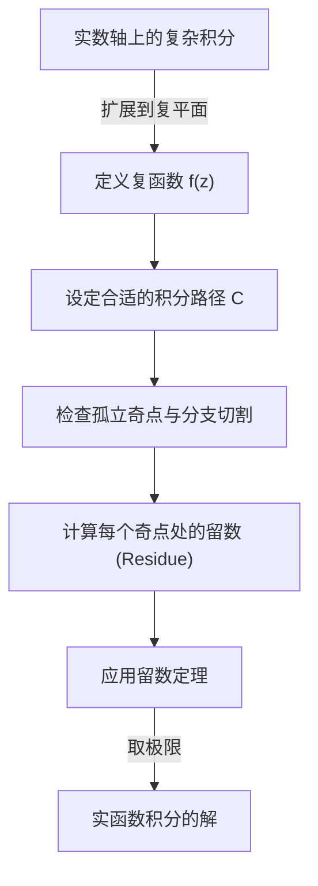
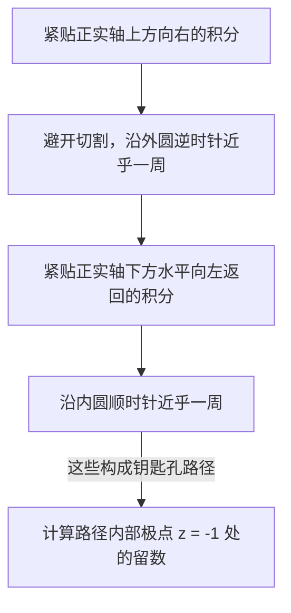

## 引言：实数积分的局限性与向复平面的飞跃

定积分是物理学和工程中的重要工具。不过，直接在实变量范围内寻找原函数有时很困难。在适当条件下，留数定理提供了计算某些定积分的另一种方法。先考虑下面的广义积分：

$$
I = \int_{-\infty}^{\infty} \frac{1}{x^2 + 1} dx
$$

这个积分可以用 $\arctan(x)$ 求解。对于较复杂的有理函数或含三角函数的被积函数，直接寻找原函数可能不够方便，此时可以考虑复平面上的路径积分方法。

**留数定理**把实轴上的积分与复平面上的闭曲线积分联系起来，利用孤立奇点附近的局部信息进行计算。必须选择合适的复函数扩展，并估计附加路径上的积分；把问题放到复平面并不意味着任意实积分都能自动求出。

## 复积分与奇点

复函数 $f(z)$ 的积分沿复平面上的曲线进行。若 $C$ 是分段 $C^1$ 的简单闭曲线，且 $f$ 在包含 $C$ 及其内部的开集上全纯，则下述**[柯西积分定理](/zh-cn/p/cauchys-integral-theorem/)**成立。不能仅凭全纯性，就把同一结论套用于有洞区域内的任意闭曲线。

$$
\oint_C f(z) dz = 0 \quad (\text{当函数在 } C \text{ 内部及边界上全纯时})
$$

若曲线内部存在奇点，情况会发生什么变化？这里的**孤立奇点** $z_0$ 指：$f$ 在某个去心邻域 $0<|z-z_0|<r$ 内全纯，但在 $z_0$ 处不全纯。要区分可去奇点、极点和本性奇点。**极点**的洛朗展开有非零且只有有限项的主要部分；并非所有奇点都是极点。分母为零也可能因约分而成为可去奇点，例如 $(z^2-1)/(z-1)$ 在 $1$ 处的奇点可去，而 $e^{1/z}$ 在 $0$ 处有本性奇点。

## 洛朗展开与留数 (Residue)

若 $f$ 在孤立奇点 $z_0$ 的去心邻域 $0<|z-z_0|<r$ 内全纯，就有在该范围收敛的**洛朗展开**。它把[泰勒展开](/zh-cn/p/taylor-and-maclaurin-series/)推广到负幂项，可写成下式。更一般地，洛朗展开要在相应的全纯圆环域内讨论。

$$
f(z) = \sum_{n=0}^{\infty} a_n (z - z_0)^n + \sum_{n=1}^{\infty} \frac{b_n}{(z - z_0)^n}
$$

负幂项的和（右侧第二个求和式）称为**主要部分**，它决定奇点的性质。特别地，$(z-z_0)^{-1}$ 的系数 $b_1$ 称为 $f$ 在 $z_0$ 处的**留数**，记作：

$$
\text{Res}(f, z_0) = b_1
$$

$(z-z_0)^{-1}$ 的系数之所以特殊，是因为沿去心邻域内绕 $z_0$ 一周的小圆逆时针积分时，对于整数 $n$，$1/(z-z_0)^n$ 只有在 $n=1$ 时积分为 $2\pi i$，其余情况均为 $0$。反转方向会改变积分的符号。

## 柯西留数定理

设 $C$ 是正向（逆时针）的分段 $C^1$ 简单闭曲线。假设 $f$ 在包含 $C$ 及其内部的开集上，除内部有限个孤立奇点 $z_1,\ldots,z_k$ 外处处全纯，且曲线上没有奇点。此时，**留数定理**给出：

$$
\oint_C f(z) dz = 2\pi i \sum_{j=1}^{k} \text{Res}(f, z_j)
$$

在这些条件下，将内部各孤立奇点的留数相加，再乘以 $2\pi i$，即可得到积分。对于有自交或重复绕行的路径，一般形式还要计入绕数。不能把上述公式直接用于经过奇点或跨越分支切割的路径。

## 应用示例：计算实函数积分

那么，让我们实际使用留数定理来解开开头的积分吧。

$$
I = \int_{-\infty}^{\infty} \frac{1}{x^2 + 1} dx
$$

### 步骤1：扩展为复函数并设定积分路径
令 $f(z)=1/(z^2+1)$，取 $R>1$。沿实轴从 $-R$ 到 $R$，再沿上半平面的半圆弧 $C_R$ 逆时针从 $R$ 返回 $-R$，组成正向闭曲线 $C$。

闭曲线 $C$ 上的积分可以分解如下：

$$
\oint_C f(z) dz = \int_{-R}^{R} f(x) dx + \int_{C_R} f(z) dz
$$

在半圆弧上，$|z^2+1|\ge R^2-1$，因此 $\left|\int_{C_R}f(z)\,dz\right|\le\pi R/(R^2-1)\to0$。实轴上的被积函数在无穷远处为 $O(x^{-2})$，故广义积分绝对收敛。因此下面的极限给出通常的广义积分，而不只是对称截断的柯西主值：

$$
\lim_{R \to \infty} \oint_C f(z) dz = \int_{-\infty}^{\infty} \frac{1}{x^2 + 1} dx
$$

### 步骤2：奇点与留数的计算
函数 $f(z) = \frac{1}{z^2 + 1} = \frac{1}{(z - i)(z + i)}$ 在 $z = i$ 和 $z = -i$ 处具有一阶极点。
积分路径 $C$ （上半平面）内部的奇点只有 $z = i$ 。

我们计算 $z = i$ 处的留数。一阶极点的留数可以如下计算：

$$
\text{Res}(f, i) = \lim_{z \to i} (z - i) f(z) = \lim_{z \to i} \frac{1}{z + i} = \frac{1}{2i}
$$

### 步骤3：应用留数定理
根据留数定理，闭曲线 $C$ 上的积分为：

$$
\oint_C f(z) dz = 2\pi i \times \text{Res}(f, i) = 2\pi i \times \frac{1}{2i} = \pi
$$

因此，所求实函数定积分的值为 $\pi$ 。

$$
\int_{-\infty}^{\infty} \frac{1}{x^2 + 1} dx = \pi
$$

就这样，通过增加复平面这一个维度，我们找到了仅凭实数无法看到的“捷径”，从而能够以惊人的简单方式进行计算。

## 约当引理与三角函数积分

作为另一个稍微复杂的例子，让我们考虑在物理学（例如量子力学中波函数的傅里叶变换等）中频繁出现的以下积分：

$$
J = \int_{-\infty}^{\infty} \frac{\cos(kx)}{x^2 + a^2} dx \quad (k > 0, a > 0)
$$

考虑 $f(z)=e^{ikz}/(z^2+a^2)$。由[欧拉公式](/zh-cn/p/euler/)，$e^{ikx}=\cos(kx)+i\sin(kx)$，取复积分的实部即可得到所求结果。对于 $k>0,a>0$，实轴上的积分绝对收敛，因此可以把取实部与积分交换。

仍取 $R>a$，沿实轴从 $-R$ 到 $R$，再沿上半圆从 $R$ 返回 $-R$。由于 $|e^{ikz}|=e^{-k\operatorname{Im}z}\le1$，圆弧积分的绝对值不超过 $\pi R/(R^2-a^2)$，趋于零。**约当引理**适用于更一般的 $e^{ikz}g(z)$：例如，固定 $k>0$，若上半圆上 $|g|$ 的上确界趋于零，则圆弧积分也趋于零。本例仅凭分母的二次衰减就能得到足够的估计。

奇点为 $z = ia$ （上半平面）。我们计算留数：

$$
\text{Res}(f, ia) = \lim_{z \to ia} (z - ia) \frac{e^{ikz}}{(z - ia)(z + ia)} = \frac{e^{-ka}}{2ia}
$$

应用留数定理：

$$
\int_{-\infty}^{\infty} \frac{e^{ikx}}{x^2 + a^2} dx = 2\pi i \times \frac{e^{-ka}}{2ia} = \frac{\pi e^{-ka}}{a}
$$

等式右边是一个纯实数。因此，通过比较实部，我们可以得到以下优美的结果：

$$
\int_{-\infty}^{\infty} \frac{\cos(kx)}{x^2 + a^2} dx = \frac{\pi e^{-ka}}{a}
$$

## 分支切割（Branch Cut）与钥匙孔积分

留数定理更高级的应用涉及多值函数（对一个输入有多个输出的函数）的积分。典型的例子是包含对数函数 $\log(z)$ 或分数次幂 $z^a$ 的积分。为了将这些作为单值函数处理，必须在复平面上设置称为 **分支切割** （Branch Cut）的“切口”。

例如，考虑以下积分（其中 $0 < a < 1$ ）：

$$
K = \int_{0}^{\infty} \frac{x^{-a}}{x + 1} dx
$$

当 $0<a<1$ 时，被积函数在原点附近为 $O(x^{-a})$，在无穷远处为 $O(x^{-a-1})$，所以积分收敛。在正实轴上作分支切割，选择 $0<\arg z<2\pi$ 的分支，令 $\operatorname{Log}z=\log|z|+i\arg z$，$F(z)=z^{-a}/(z+1)=e^{-a\operatorname{Log}z}/(z+1)$。取 $0<\varepsilon<1<R$，沿切割上方向外走，沿外圆逆时针走，再沿切割下方向内返回，最后沿内圆顺时针闭合。实际路径避开切割，并分别从两侧取极限。

外圆贡献的绝对值不超过 $2\pi R^{1-a}/(R-1)$，在 $R\to\infty$ 时趋于零；内圆贡献不超过 $2\pi\varepsilon^{1-a}/(1-\varepsilon)$，在 $\varepsilon\to0$ 时趋于零。切割上方有 $z^{-a}\to x^{-a}$，下方有 $z^{-a}\to e^{-2\pi ia}x^{-a}$。由于下侧方向相反，直线段的和趋于 $(1-e^{-2\pi ia})K$。所选分支上 $\arg(-1)=\pi$，故 $-1$ 处的留数为 $e^{-\pi ia}$。于是 $(1-e^{-2\pi ia})K=2\pi i\,e^{-\pi ia}$。利用 $1-e^{-2\pi ia}=2i\,e^{-\pi ia}\sin(\pi a)$，得到：

$$
\int_{0}^{\infty} \frac{x^{-a}}{x + 1} dx = \frac{\pi}{\sin(a\pi)}
$$

## 结论

留数定理是数学优雅的极致体现，它将看似无关的“复数极点”和“实函数积分”完美地结合在了一起。为了解决实函数的问题，我们暂时跳跃到复平面这个更广阔的世界中，仅考察奇点这个“障碍物”的性质（留数），然后再回到原来的世界，问题就已经迎刃而解了。

这些路径积分方法也出现在[拉普拉斯变换](/zh-cn/p/laplace-transform/)的逆变换和傅里叶积分中。可靠地使用它们，需要先核对奇点类型、路径方向，以及无穷远和分支点附近的收敛性。

## 参考资料

- [MIT 18.04 Topic 8: Residues and the residue theorem](https://ocw.mit.edu/courses/18-04-complex-variables-with-applications-spring-2018/3c58ce71ec6f7573804221d76158a0bd_MIT18_04S18_topic8.pdf)
- [MIT 18.04 Topic 9: Definite integrals using the residue theorem](https://ocw.mit.edu/courses/18-04-complex-variables-with-applications-spring-2018/f69bc227ae476839819fb18e5b283072_MIT18_04S18_topic9.pdf)
- [NIST DLMF §1.10: Functions of a Complex Variable](https://dlmf.nist.gov/1.10)
