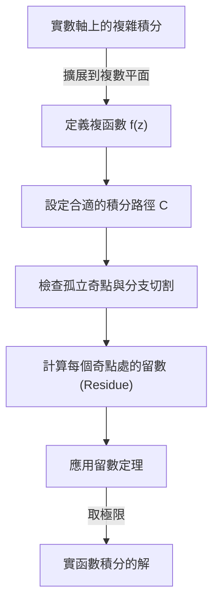
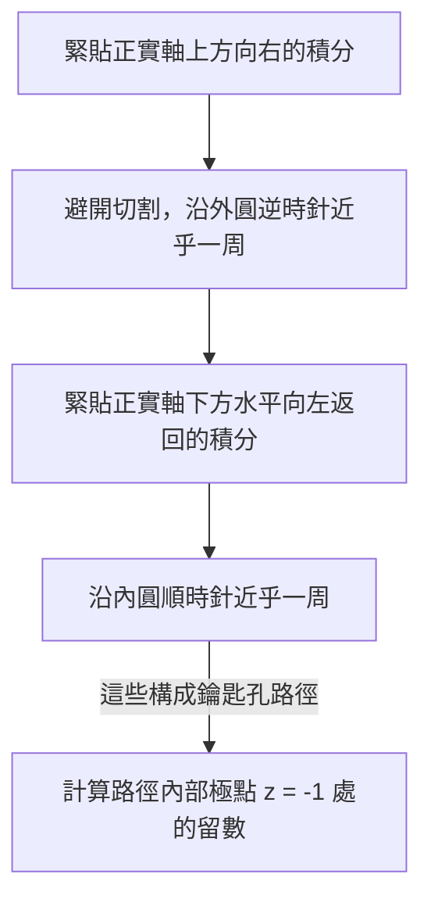

## 引言：實數積分的局限性與向複數平面的飛躍

定積分是物理學和工程中的重要工具。不過，直接在實變數範圍內尋找反導函數有時很困難。在適當條件下，留數定理提供了計算某些定積分的另一種方法。先考慮下面的廣義積分：

$$
I = \int_{-\infty}^{\infty} \frac{1}{x^2 + 1} dx
$$

這個積分可以用 $\arctan(x)$ 求解。對於較複雜的有理函數或含三角函數的被積函數，直接尋找反導函數可能不夠方便，此時可以考慮複數平面上的路徑積分方法。

**留數定理**把實軸上的積分與複數平面上的閉曲線積分聯繫起來，利用孤立奇點附近的局部資訊進行計算。必須選擇合適的複函數延伸，並估計附加路徑上的積分；把問題放到複數平面並不意味著任意實積分都能自動求出。

## 複積分與奇點

複函數 $f(z)$ 的積分沿複數平面上的曲線進行。若 $C$ 是分段 $C^1$ 的簡單閉曲線，且 $f$ 在包含 $C$ 及其內部的開集上全純，則下述**[柯西積分定理](/zh-tw/p/cauchys-integral-theorem/)**成立。不能僅憑全純性，就把同一結論套用於有洞區域內的任意閉曲線。

$$
\oint_C f(z) dz = 0 \quad (\text{當函數在 } C \text{ 內部及邊界上全純時})
$$

若曲線內部存在奇點，情況會發生什麼變化？這裡的**孤立奇點** $z_0$ 指：$f$ 在某個去心鄰域 $0<|z-z_0|<r$ 內全純，但在 $z_0$ 處不全純。要區分可去奇點、極點和本性奇點。**極點**的洛朗展開有非零且只有有限項的主要部分；並非所有奇點都是極點。分母為零也可能因約分而成為可去奇點，例如 $(z^2-1)/(z-1)$ 在 $1$ 處的奇點可去，而 $e^{1/z}$ 在 $0$ 處有本性奇點。

## 洛朗展開與留數 (Residue)

若 $f$ 在孤立奇點 $z_0$ 的去心鄰域 $0<|z-z_0|<r$ 內全純，就有在該範圍收斂的**洛朗展開**。它把[泰勒展開](/zh-tw/p/taylor-and-maclaurin-series/)推廣到負冪項，可寫成下式。更一般地，洛朗展開要在相應的全純圓環域內討論。

$$
f(z) = \sum_{n=0}^{\infty} a_n (z - z_0)^n + \sum_{n=1}^{\infty} \frac{b_n}{(z - z_0)^n}
$$

負冪項的和（右側第二個求和式）稱為**主要部分**，它決定奇點的性質。特別地，$(z-z_0)^{-1}$ 的係數 $b_1$ 稱為 $f$ 在 $z_0$ 處的**留數**，記作：

$$
\text{Res}(f, z_0) = b_1
$$

$(z-z_0)^{-1}$ 的係數之所以特殊，是因為沿去心鄰域內繞 $z_0$ 一周的小圓逆時針積分時，對於整數 $n$，$1/(z-z_0)^n$ 只有在 $n=1$ 時積分為 $2\pi i$，其餘情況均為 $0$。反轉方向會改變積分的符號。

## 柯西留數定理

設 $C$ 是正向（逆時針）的分段 $C^1$ 簡單閉曲線。假設 $f$ 在包含 $C$ 及其內部的開集上，除內部有限個孤立奇點 $z_1,\ldots,z_k$ 外處處全純，且曲線上沒有奇點。此時，**留數定理**給出：

$$
\oint_C f(z) dz = 2\pi i \sum_{j=1}^{k} \text{Res}(f, z_j)
$$

在這些條件下，將內部各孤立奇點的留數相加，再乘以 $2\pi i$，即可得到積分。對於有自交或重複繞行的路徑，一般形式還要計入繞數。不能把上述公式直接用於經過奇點或跨越分支切割的路徑。

## 應用範例：計算實函數積分

那麼，讓我們實際使用留數定理來解開開頭的積分吧。

$$
I = \int_{-\infty}^{\infty} \frac{1}{x^2 + 1} dx
$$

### 步驟1：擴展為複函數並設定積分路徑
令 $f(z)=1/(z^2+1)$，取 $R>1$。沿實軸從 $-R$ 到 $R$，再沿上半平面的半圓弧 $C_R$ 逆時針從 $R$ 返回 $-R$，組成正向閉曲線 $C$。

閉曲線 $C$ 上的積分可以分解如下：

$$
\oint_C f(z) dz = \int_{-R}^{R} f(x) dx + \int_{C_R} f(z) dz
$$

在半圓弧上，$|z^2+1|\ge R^2-1$，因此 $\left|\int_{C_R}f(z)\,dz\right|\le\pi R/(R^2-1)\to0$。實軸上的被積函數在無窮遠處為 $O(x^{-2})$，故廣義積分絕對收斂。因此下面的極限給出通常的廣義積分，而不只是對稱截斷的柯西主值：

$$
\lim_{R \to \infty} \oint_C f(z) dz = \int_{-\infty}^{\infty} \frac{1}{x^2 + 1} dx
$$

### 步驟2：奇點與留數的計算
函數 $f(z) = \frac{1}{z^2 + 1} = \frac{1}{(z - i)(z + i)}$ 在 $z = i$ 和 $z = -i$ 處具有一階極點。
積分路徑 $C$ （上半平面）內部的奇點只有 $z = i$ 。

我們計算 $z = i$ 處的留數。一階極點的留數可以如下計算：

$$
\text{Res}(f, i) = \lim_{z \to i} (z - i) f(z) = \lim_{z \to i} \frac{1}{z + i} = \frac{1}{2i}
$$

### 步驟3：應用留數定理
根據留數定理，閉曲線 $C$ 上的積分為：

$$
\oint_C f(z) dz = 2\pi i \times \text{Res}(f, i) = 2\pi i \times \frac{1}{2i} = \pi
$$

因此，所求實函數定積分的值為 $\pi$ 。

$$
\int_{-\infty}^{\infty} \frac{1}{x^2 + 1} dx = \pi
$$

就這樣，透過增加複數平面這一個維度，我們找到了僅憑實數無法看到的「捷徑」，從而能夠以驚人的簡單方式進行計算。

## 約當引理與三角函數積分

作為另一個稍微複雜的例子，讓我們考慮在物理學（例如量子力學中波函數的傅立葉變換等）中頻繁出現的以下積分：

$$
J = \int_{-\infty}^{\infty} \frac{\cos(kx)}{x^2 + a^2} dx \quad (k > 0, a > 0)
$$

考慮 $f(z)=e^{ikz}/(z^2+a^2)$。由[歐拉公式](/zh-tw/p/euler/)，$e^{ikx}=\cos(kx)+i\sin(kx)$，取複積分的實部即可得到所求結果。對於 $k>0,a>0$，實軸上的積分絕對收斂，因此可以把取實部與積分交換。

仍取 $R>a$，沿實軸從 $-R$ 到 $R$，再沿上半圓從 $R$ 返回 $-R$。由於 $|e^{ikz}|=e^{-k\operatorname{Im}z}\le1$，圓弧積分的絕對值不超過 $\pi R/(R^2-a^2)$，趨於零。**約當引理**適用於更一般的 $e^{ikz}g(z)$：例如，固定 $k>0$，若上半圓上 $|g|$ 的上確界趨於零，則圓弧積分也趨於零。本例僅憑分母的二次衰減就能得到足夠的估計。

奇點為 $z = ia$ （上半平面）。我們計算留數：

$$
\text{Res}(f, ia) = \lim_{z \to ia} (z - ia) \frac{e^{ikz}}{(z - ia)(z + ia)} = \frac{e^{-ka}}{2ia}
$$

應用留數定理：

$$
\int_{-\infty}^{\infty} \frac{e^{ikx}}{x^2 + a^2} dx = 2\pi i \times \frac{e^{-ka}}{2ia} = \frac{\pi e^{-ka}}{a}
$$

等式右邊是一個純實數。因此，透過比較實部，我們可以得到以下優美的結果：

$$
\int_{-\infty}^{\infty} \frac{\cos(kx)}{x^2 + a^2} dx = \frac{\pi e^{-ka}}{a}
$$

## 分支切割（Branch Cut）與鑰匙孔積分

留數定理更進階的應用涉及多值函數（對一個輸入有多個輸出的函數）的積分。典型的例子是包含對數函數 $\log(z)$ 或分數次冪 $z^a$ 的積分。為了將這些作為單值函數處理，必須在複數平面上設置稱為 **分支切割** （Branch Cut）的「切口」。

例如，考慮以下積分（其中 $0 < a < 1$ ）：

$$
K = \int_{0}^{\infty} \frac{x^{-a}}{x + 1} dx
$$

當 $0<a<1$ 時，被積函數在原點附近為 $O(x^{-a})$，在無窮遠處為 $O(x^{-a-1})$，所以積分收斂。在正實軸上作分支切割，選擇 $0<\arg z<2\pi$ 的分支，令 $\operatorname{Log}z=\log|z|+i\arg z$，$F(z)=z^{-a}/(z+1)=e^{-a\operatorname{Log}z}/(z+1)$。取 $0<\varepsilon<1<R$，沿切割上方向外走，沿外圓逆時針走，再沿切割下方向內返回，最後沿內圓順時針閉合。實際路徑避開切割，並分別從兩側取極限。

外圓貢獻的絕對值不超過 $2\pi R^{1-a}/(R-1)$，在 $R\to\infty$ 時趨於零；內圓貢獻不超過 $2\pi\varepsilon^{1-a}/(1-\varepsilon)$，在 $\varepsilon\to0$ 時趨於零。切割上方有 $z^{-a}\to x^{-a}$，下方有 $z^{-a}\to e^{-2\pi ia}x^{-a}$。由於下側方向相反，直線段的和趨於 $(1-e^{-2\pi ia})K$。所選分支上 $\arg(-1)=\pi$，故 $-1$ 處的留數為 $e^{-\pi ia}$。於是 $(1-e^{-2\pi ia})K=2\pi i\,e^{-\pi ia}$。利用 $1-e^{-2\pi ia}=2i\,e^{-\pi ia}\sin(\pi a)$，得到：

$$
\int_{0}^{\infty} \frac{x^{-a}}{x + 1} dx = \frac{\pi}{\sin(a\pi)}
$$

## 結論

留數定理是數學優雅的極致體現，它將看似無關的「複數極點」和「實函數積分」完美地結合在了一起。為了解決實函數的問題，我們暫時跳躍到複數平面這個更廣闊的世界中，僅考察奇點這個「障礙物」的性質（留數），然後再回到原來的世界，問題就已經迎刃而解了。

這些路徑積分方法也出現在[拉普拉斯變換](/zh-tw/p/laplace-transform/)的逆變換和傅立葉積分中。可靠地使用它們，需要先核對奇點類型、路徑方向，以及無窮遠和分支點附近的收斂性。

## 參考資料

- [MIT 18.04 Topic 8: Residues and the residue theorem](https://ocw.mit.edu/courses/18-04-complex-variables-with-applications-spring-2018/3c58ce71ec6f7573804221d76158a0bd_MIT18_04S18_topic8.pdf)
- [MIT 18.04 Topic 9: Definite integrals using the residue theorem](https://ocw.mit.edu/courses/18-04-complex-variables-with-applications-spring-2018/f69bc227ae476839819fb18e5b283072_MIT18_04S18_topic9.pdf)
- [NIST DLMF §1.10: Functions of a Complex Variable](https://dlmf.nist.gov/1.10)
