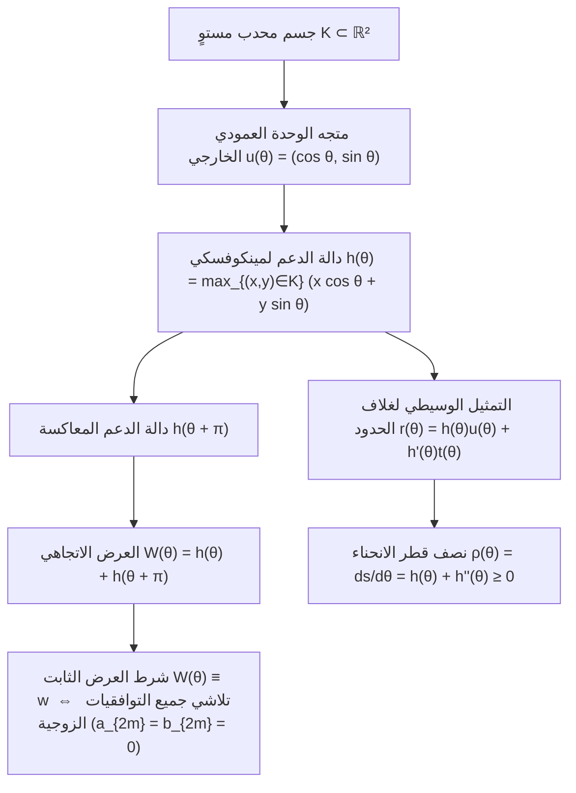
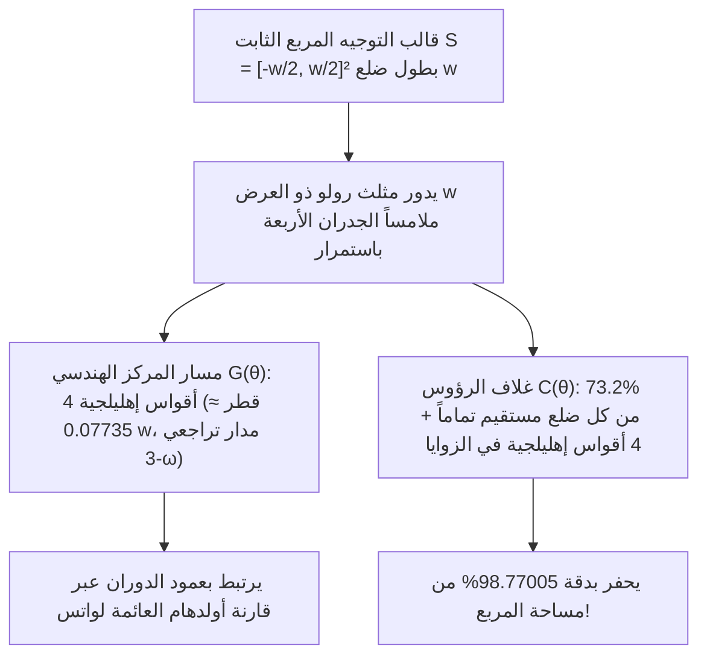

لماذا تُصنع <strong>أغطية غرف التفتيش (المناهل)</strong> في شوارع المدن دائماً تقريباً على شكل دائري؟ هذا اللغز الهندسي الشهير، الذي أشاعه الحائز على جائزة نوبل في الفيزياء ريتشارد فاينمان واشتهر في مقابلات العمل بشركة مايكروسوفت، يرتكز على متباينة هندسية بسيطة.

لو كان غطاء البالوعة <strong>مربعاً</strong> طول ضلعه $w$، فإن الفتحة المربعة سيكون طول ضلعها $w$ أيضاً، لكن طول قطرها وفق مبرهنة فيثاغورس يبلغ $\sqrt{2}w \approx 1.4142\,w$. فإذا رُفع الغطاء المربع الثقيل عمودياً وأُدير بزاوية $45^\circ$ بمحاذاة قطر الفتحة، فإنه بسبب كون $w < \sqrt{2}w$ سينزلق مباشرة عبر فتحته ويسقط إلى قاع البئر. أما <strong>الدائرة</strong> التي قطرها $w$، فلها العرض نفسه $w$ في جميع الاتجاهات، ويستحيل أن تسقط من خلال فتحتها مهما أميلت.

والآن لنطرح السؤال الرياضي العكسي: <strong>هل يجب بالضرورة أن يكون غطاء البالوعة الذي لا يسقط في فتحته — أو الدحروجة التي ينزلق فوقها لوح مسطح أفقياً دون أي اهتزاز رأسي — دائري الشكل؟</strong>

الجواب هو <strong>لا</strong> قاطعة! ففي الهندسة المحدبة (Convex Geometry)، يوجد عدد لا نهائي من الأشكال المستوية غير الدائرية التي تظل فيها المسافة العمودية بين أي خطين مماسيين متوازيين مساوية لقيمة ثابتة $w$ في كل اتجاه؛ وتُعرف هذه الأشكال باسم <strong>المنحنيات ذات العرض الثابت (Curves of Constant Width)</strong>. وأشهر ممثل لها على الإطلاق هو <strong>مثلث رولو (Reuleaux Triangle)</strong>، المسمى باسم مهندس الميكانيكا الألماني في القرن التاسع عشر <strong>فرانز رولو (Franz Reuleaux, 1829–1905)</strong>.

إذا وضعنا لوحاً خشبياً مسطحاً فوق بكرات مقطعها العرضي على شكل مثلث رولو بعرض $w$، فإن اللوح ينزلق عند الارتفاع الثابت $y = w$ <strong>بشكل أفقي تماماً دون أن يرتفع أو ينخفض مليمتراً واحداً</strong>! والأكثر إدهاشاً أنه في عام 1914، قام المهندس هاري جيمس واتس بتركيب ريشة مثقاب بمقطع مثلث رولو في ظرف عائم (Floating Chuck)، مما مكّن آلة ثقب دورانية تقليدية من <strong>حفر ثقب مربع مباشرة في المعدن يغطي بدقة $98.77005\,\%$ من مساحة المربع</strong>!

---

## 1. المفارقة الحركية: دحروجة بلا اهتزاز مقابل محور عجلة يقفز صعوداً وهبوطاً

### 1.1 حركة أفقية مثالية للوح فوق دحروجات رولو

عندما يتدحرج مثلث رولو ذو العرض $w$ دون انزلاق على أرضية أفقية $y = 0$، فإنه يظل عند أي زاوية دوران $\theta \in [0, 2\pi)$ ملامساً للأرضية ($y = 0$) وللسطح السفلي للوح الموضوع فوقه في آنٍ واحد. وبما أن العرض الرأسي بين المماسات الأفقية المتوازية ثابت ويساوي $w$، يبقى اللوح مثبتاً عند الارتفاع $y_{\text{plank}}(\theta) \equiv w$.

### 1.2 التذبذب الرأسي لمحور ثابت يمر بمركز الثقل $G$

لماذا إذن لا تُصنع عجلات الدراجات والسيارات على شكل مثلث رولو؟ لأن المركبة ترتكز على <strong>محور مركزي ثابت</strong> يمر بمركز الثقل الهندسي $G$. وفي مثلث رولو المنشأ على مثلث متساوي الأضلاع $\triangle ABC$ طول ضلعه $w$:

- المسافة من المركز $G$ إلى الرؤوس الثلاثة $A, B, C$ هي $R = \frac{w}{\sqrt{3}} = \frac{\sqrt{3}}{3}w \approx 0.57735\,w$.
- المسافة من المركز $G$ إلى منتصف القوس المقابل هي $r = w - R = \left(1 - \frac{\sqrt{3}}{3}\right)w \approx 0.42265\,w$.

خلال دورة كاملة على الأرض، يرتفع المحور $G$ وينخفض 3 مرات في كل دورة بسعة رأسية قدرها:

$$\Delta y_G = R - r = \left(\frac{2\sqrt{3}}{3} - 1\right) w \approx 0.15470\,w$$

وهذا الانفصال بين <strong>الغلاف الخارجي الثابت</strong> و<strong>المركز الهندسي الذي يدور في مدار لامركزي</strong> هو السر الحركي وراء مثقاب الثقوب المربعة ومحرك فانكل الدوار.

---

## 2. الهندسة المحدبة ودالة الدعم لمينكوفسكي $h_K(\theta)$

### 2.1 دالة الدعم، الغلاف (Envelope)، ونصف قطر الانحناء

ليكن $K \subset \mathbb{R}^2$ جسماً محدباً متراصاً. لكل زاوية اتجاه $\theta \in [0, 2\pi)$، نعرّف متجه الوحدة العمودي الخارجي $\mathbf{u}(\theta) = (\cos\theta, \sin\theta)^\top$ ومتجه الوحدة المماسي $\mathbf{t}(\theta) = (-\sin\theta, \cos\theta)^\top$. تُعرَّف <strong>دالة الدعم لمينكوفسكي (Minkowski Support Function)</strong> للجسم $K$ بالعلاقة:

$$h_K(\theta) \triangleq \max_{(x, y) \in K} \left(x\cos\theta + y\sin\theta\right)$$

عندما تكون $h(\theta) \in C^2(\mathbb{S}^1)$، يُستعاد منحنى الحدود $\partial K$ بوصفه غلافاً لعائلة مستقيمات الدعم $x\cos\theta + y\sin\theta = h(\theta)$ مع مشتقتها $-x\sin\theta + y\cos\theta = h'(\theta)$:

$$\mathbf{r}(\theta) = \begin{pmatrix} x(\theta) \\ y(\theta) \end{pmatrix} = h(\theta)\mathbf{u}(\theta) + h'(\theta)\mathbf{t}(\theta) = \begin{pmatrix} h(\theta)\cos\theta - h'(\theta)\sin\theta \\ h(\theta)\sin\theta + h'(\theta)\cos\theta \end{pmatrix}$$

وبالاشتقاق بالنسبة إلى $\theta$ ($\mathbf{u}' = \mathbf{t}, \mathbf{t}' = -\mathbf{u}$)، نحصل على تفاضل طول القوس $ds$ و<strong>نصف قطر الانحناء</strong> $\rho(\theta)$:

$$\frac{d\mathbf{r}}{d\theta} = \left(h(\theta) + h''(\theta)\right)\mathbf{t}(\theta) \implies \rho(\theta) = \frac{ds}{d\theta} = h(\theta) + h''(\theta) \ge 0$$

### 2.2 شرط العرض الثابت ومتسلسلات فورييه ذات التوافقيات الفردية

العرض في الاتجاه $\theta$ هو $W_K(\theta) = h_K(\theta) + h_K(\theta + \pi)$. وعليه، يكون $K$ <strong>ذا عرض ثابت $w$</strong> إذا وفقط إذا تحقق:

$$h_K(\theta) + h_K(\theta + \pi) = w \qquad (\forall \theta \in [0, 2\pi))$$

ومن ذلك نستنتج أن $\rho(\theta) + \rho(\theta + \pi) = w$، وأن مفكوك متسلسلة فورييه للدالة $h_K(\theta)$ يحتوي <strong>فقط على التوافقيات الفردية</strong> ($a_{2m} = b_{2m} = 0$ لكل $m \ge 1$):

$$h_K(\theta) = \frac{w}{2} + \sum_{k=1}^{\infty} \left(a_{2k-1}\cos((2k-1)\theta) + b_{2k-1}\sin((2k-1)\theta)\right)$$

فعلى سبيل المثال، باختيار $h(\theta) = \frac{w}{2} + \frac{w}{16}\cos(3\theta)$ نجد $\rho(\theta) = \frac{w}{2}(1 - \cos 3\theta) \ge 0$، مما يعطي <strong>منحنى عرض ثابت تحليلياً أملس ($C^\infty$) غير دائري وخالياً تماماً من أي زوايا مدببة</strong> (منحنى رابينوفيتز الجبري من الدرجة الثامنة، 1997).

---

## 3. مساحة مثلث رولو ومضلعات رولو المنتظمة الفردية

برسم ثلاثة أقواس دائرية نصف قطرها $w$ تتمركز عند رؤوس مثلث متساوي الأضلاع $\triangle ABC$ طول ضلعه $w$، نحصل على مثلث رولو. وبمبدأ التضمين والإقصاء، تساوي مساحته مجموع مساحات ثلاثة قطاعات دائرية زاويتها $\frac{\pi}{3}$ ($\frac{\pi}{6}w^2$ لكل منها) مطروحاً منها ضعفا مساحة المثلث المتساوي الأضلاع الأوسط ($\frac{\sqrt{3}}{4}w^2$):

$$A_{\text{Reuleaux}} = 3\left(\frac{\pi}{6}w^2\right) - 2\left(\frac{\sqrt{3}}{4}w^2\right) = \frac{1}{2}\left(\pi - \sqrt{3}\right) w^2 \approx 0.7047709\,w^2$$

وهذه المساحة أصغر بنسبة $10.27\,\%$ من مساحة الدائرة التي لها القطر نفسه $w$ ($A_{\text{circle}} = \frac{\pi}{4}w^2 \approx 0.7853982\,w^2$). ولأي مضلع رولو منتظم ذي عدد فردي من الأضلاع $n = 2k+1$ ($n = 3, 5, 7, \dots$)، تُعطى المساحة الدقيقة بالصيغة العامة:

$$A_n = \frac{w^2}{2}\left(\pi - n\tan\left(\frac{\pi}{2n}\right)\right) \qquad (n = 3, 5, 7, 9, \dots)$$

| منحنى العرض الثابت $w$ | عدد الرؤوس $n$ | المحيط $L$ | صيغة المساحة الدقيقة $A(w)$ | المساحة العددية | النسبة $A / A_{\text{circle}}$ |
| :--- | :---: | :---: | :---: | :---: | :---: |
| <strong>مثلث رولو</strong> | $3$ | $\pi w$ | $\frac{1}{2}\left(\pi - \sqrt{3}\right)w^2$ | $0.704771\,w^2$ | $89.73\%$ (<strong>الأصغر</strong>) |
| <strong>خماسي رولو</strong> | $5$ | $\pi w$ | $\frac{1}{2}\left(\pi - 5\tan\frac{\pi}{10}\right)w^2$ | $0.756827\,w^2$ | $96.36\%$ |
| <strong>سباعي رولو</strong> (عملات بريطانيا 20p/50p) | $7$ | $\pi w$ | $\frac{1}{2}\left(\pi - 7\tan\frac{\pi}{14}\right)w^2$ | $0.770921\,w^2$ | $98.16\%$ |
| <strong>منحنى تحليلي أملس</strong> ($h = \frac{w}{2} + \frac{w}{16}\cos 3\theta$) | $0$ ($C^\infty$) | $\pi w$ | $\frac{63\pi}{256}w^2$ | $0.773126\,w^2$ | $98.44\%$ |
| <strong>الدائرة (Circle)</strong> | $0$ ($C^\infty$) | $\pi w$ | $\frac{\pi}{4}w^2$ | $0.785398\,w^2$ | $100.00\%$ (<strong>الأكبر</strong>) |

---

## 4. برهانان كاملان لمبرهنة باربييه (1860) ومبرهنة بلاشكه–لوبيغ (1914)

> <strong>مبرهنة باربييه (Joseph-Émile Barbier, 1860).</strong>
> <em>كل منحنى محدب مستوٍ ذي عرض ثابت $w$ يمتلك محيطاً مساوياً تماماً لمحيط دائرة قطرها $w$:</em>
> $$L(\partial K) = \pi w$$

### 4.1 البرهان الأول: الهندسة التفاضلية ودالة الدعم

بتكامل عنصر القوس $ds = \left(h(\theta) + h''(\theta)\right)d\theta$ على المجال $[0, 2\pi]$ واستخدام دورية $h'(\theta)$:

$$L(\partial K) = \int_0^{2\pi} h(\theta)\,d\theta + \Big[h'(\theta)\Big]_0^{2\pi} = \int_0^{\pi} \underbrace{\left(h(\theta) + h(\theta + \pi)\right)}_{= w} d\theta = \int_0^{\pi} w\,d\theta = \pi w$$

ولأن منحنى العرض الثابت لا يمكن أن يتضمن قطعاً مستقيمة، فإن $h_K$ تنتمي دائماً إلى الفئة $C^1(\mathbb{S}^1)$ (أو عبر التنعيم بالالتفاف $h_\varepsilon = h_K * \eta_\varepsilon$ في متريك هاوسدورف)، مما يجعل البرهان دقيقاً حتى بوجود رؤوس مدببة. $\blacksquare$

### 4.2 البرهان الثاني: الهندسة التكاملية، صيغة كوشي–كروفتون و«معكرونة بوفون»

في فضاء المستقيمات الموجهة $\ell(p, \theta) : x\cos\theta + y\sin\theta = p$ المزود بالقياس الحركي الصامد $d\ell = dp \wedge d\theta$، تؤدي خطية التوقع الرياضي لعدد نقاط التقاطع $n_\gamma(p, \theta) = \#(\gamma \cap \ell(p, \theta))$ لمنحنى قابل للتقويم («معكرونة بوفون») إلى <strong>صيغة كوشي–كروفتون</strong>:

$$\int_0^{2\pi} \int_{-\infty}^{\infty} n_\gamma(p, \theta)\,dp\,d\theta = 4 L(\gamma)$$

ولحدود جسم محدب $\gamma = \partial K$، يقطع كل مستقيم قاطع الحدود $\partial K$ في نقطتين بالضبط ($n_{\partial K} = 2$) على مجال طوله $W_K(\theta) = w$. ومنه:

$$4 L(\partial K) = \int_0^{2\pi} 2 W_K(\theta)\,d\theta = 2 \int_0^{2\pi} w\,d\theta = 4\pi w \implies L(\partial K) = \pi w \quad \blacksquare$$

### 4.3 مبرهنة بلاشكه–لوبيغ (1914)

تعطي صيغة بلاشكه للمساحة $A(K) = \frac{1}{2}\int_0^{2\pi} \left(h(\theta)^2 - h'(\theta)^2\right)d\theta$ مع متطابقة بارسيفال:

$$A(K) = \frac{\pi}{4} w^2 - \frac{\pi}{2} \sum_{k=2}^{\infty} \left((2k-1)^2 - 1\right)\left(a_{2k-1}^2 + b_{2k-1}^2\right)$$

وعليه فإن الدائرة تعظّم المساحة بشكل فريد ($\frac{\pi}{4}w^2$)، بينما يؤدي تصغير المساحة تحت القيد $0 \le \rho(\theta) \le w$ وفق مبدأ بونترياغين الأعظمي إلى توزيع انحناء حدي «bang-bang» $\rho(\theta) \in \{0, w\}$ بثلاث تبديلات: <strong>مثلث رولو يصغّر المساحة بشكل فريد بين جميع المنحنيات ذات العرض الثابت $w$</strong> (هنري لوبيغ 1914، فيلهلم بلاشكه 1915).

---

## 5. كيف يحفر مثلث رولو ثقباً مربعاً: مثقاب هاري واتس (1914)

داخل المربع الثابت $S = \left[-\frac{w}{2}, \frac{w}{2}\right]^2$، وعلى المجال الأساسي $\theta \in \left[\frac{\pi}{6}, \frac{\pi}{3}\right]$، ينزلق الرأس $A$ على الجدار الأيسر $x = -\frac{w}{2}$ والراس $B$ على الجدار السفلي $y = -\frac{w}{2}$:

$$A(\theta) = \begin{pmatrix} -\frac{w}{2} \\ -\frac{w}{2} + w\sin\theta \end{pmatrix}, \qquad B(\theta) = \begin{pmatrix} -\frac{w}{2} + w\cos\theta \\ -\frac{w}{2} \end{pmatrix}$$

### 5.1 المدار الإهليلجي للمركز $G(\theta)$ وتغطية $98.77\,\%$ من مساحة المربع

1. <strong>مسار مركز الثقل $G(\theta)$</strong>:
   $$x_G(\theta) + \frac{w}{2} = \frac{w}{\sqrt{3}}\cos\left(\theta - \frac{\pi}{6}\right), \qquad y_G(\theta) + \frac{w}{2} = \frac{w}{\sqrt{3}}\sin\left(\theta + \frac{\pi}{6}\right)$$
   وهو قوس قطع ناقص دقيق مركزه زاوية المربع $\left(-\frac{w}{2}, -\frac{w}{2}\right)$ ونصفا محوريه $a_G = \frac{\sqrt{3}+1}{2\sqrt{3}}w$ و $b_G = \frac{\sqrt{3}-1}{2\sqrt{3}}w$. وتشكل الأقواس الأربعة مداراً مغلقاً صغيراً قطره $d_G = \left(\frac{2\sqrt{3}-3}{3}\right)w \approx 0.07735\,w$ يدور بسرعة زاوية $-3\omega$، وتستوعبه <strong>قارنة أولدهام العائمة</strong>.
2. <strong>مسار الزاوية $C(\alpha)$ والمساحة الممسوحة $A_{\text{swept}}$</strong>:
   بوضع $\alpha = \frac{\pi}{3} - \theta \in \left[0, \frac{\pi}{6}\right]$، يرسم الرأس $C$ في الزاوية العليا اليمنى قوس القطع الناقص:
   $$x_C(\alpha) = -\frac{w}{2} + w\cos\alpha, \qquad y_C(\alpha) = -\frac{w}{2} + w\cos\left(\frac{\pi}{6} - \alpha\right)$$
   وعلى كل ضلع من أضلاع المربع، يكون الجزء الأوسط الذي طوله $(\sqrt{3}-1)w \approx 0.73205\,w$ ($73.2\,\%$ من الضلع) <strong>خطاً مستقيماً تماماً من الناحية الرياضية</strong>! وتبلغ المساحة غير المحفورة في زاوية واحدة:
   $$A_{\text{corner}} = w^2 \int_0^{\pi/6} \left(1 - \cos\left(\frac{\pi}{6}-\alpha\right)\right)\sin\alpha\,d\alpha = \left(1 - \frac{\sqrt{3}}{2} - \frac{\pi}{24}\right) w^2 \approx 0.0030749\,w^2$$
   وبالتالي فإن المساحة الكلية للثقب المربع الذي يحفره مثلث رولو تساوي بدقة:
   $$A_{\text{swept}} = w^2 - 4 A_{\text{corner}} = \left(2\sqrt{3} + \frac{\pi}{6} - 3\right) w^2 \approx 0.9877005\,w^2 \quad (98.77\,\%!)$$

---

## 6. التطبيقات الهندسية الحديثة والآفاق ثلاثية الأبعاد: أجسام مايسنر (1911) وحدسية مايسنر (1934)

إلى جانب <strong>محرك فانكل الدوار</strong> (الإبيتروكويد ثنائي الفصوص) و<strong>العملات البريطانية من فئتي 20p و 50p</strong> (سباعيات رولو المنتظمة، $n=7$)، يكشف الانتقال إلى الفضاء ثلاثي الأبعاد أن <strong>رباعي وجوه رولو (Reuleaux Tetrahedron)</strong> <strong>ليس</strong> جسماً ذا عرض ثابت، لأن المسافة بين منتصفي حرفين منحنيين متقابلين تبلغ

$$w_{\text{edge}} = \left(\sqrt{3} - \frac{\sqrt{2}}{2}\right) w \approx 1.024944\,w > w$$

وفي عام 1911، نجح <strong>إرنست مايسنر وفريدريش شيلينغ</strong> في تنعيم ثلاثة من الأحرف الستة باستخدام رقع من سطح طارة مغزلية (<em>spindle torus</em>)، فابتكرا <strong>جسمي مايسنر</strong> $M_1$ و $M_2$ بحجم قدره $V \approx 0.419860\,w^3$. وتظل <strong>حدسية مايسنر (بونيزن–فنخل، 1934)</strong> القائلة بأن جسمي مايسنر يصغّران الحجم (ومساحة السطح عبر علاقة بلاشكه $V = \frac{1}{2}wS - \frac{\pi}{3}w^3$) بين جميع الأجسام المحدبة ثلاثية الأبعاد ذات العرض الثابت $w$، واحدة من أشهر المسائل المفتوحة في الهندسة الرياضية حتى يومنا هذا.
