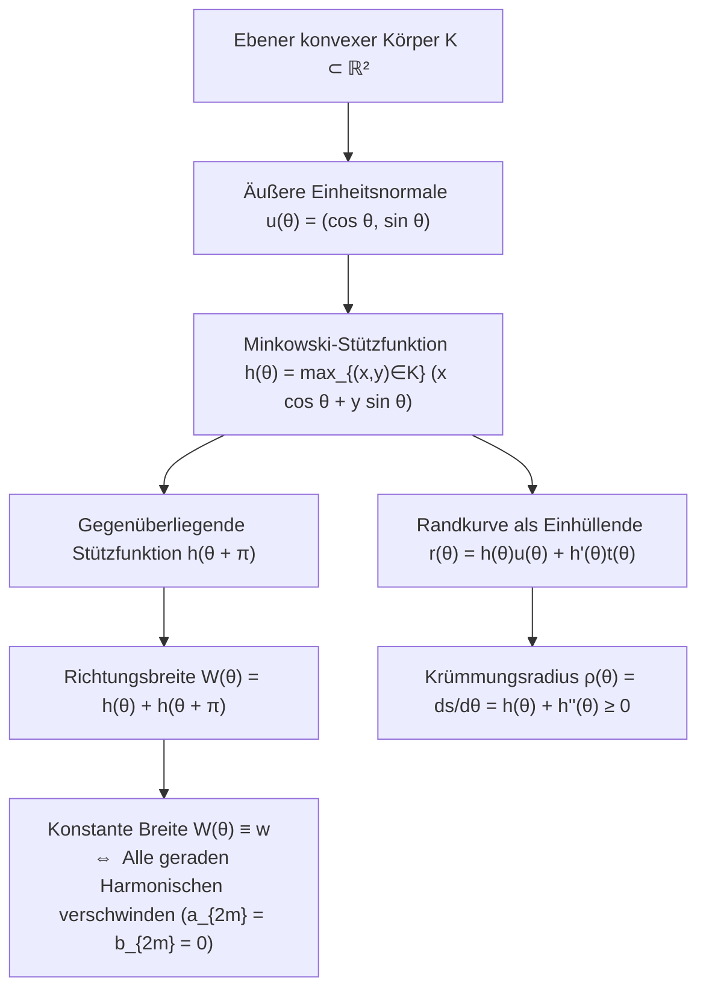
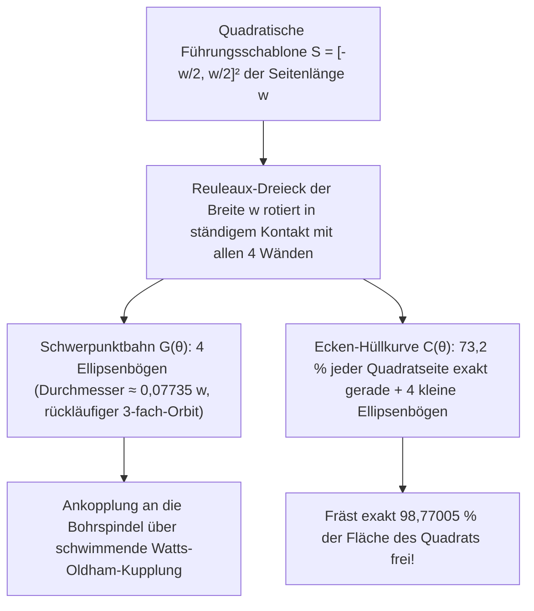

Warum sind <strong>Kanaldeckel (Schachtabdeckungen)</strong> auf unseren Straßen fast ausnahmslos rund? Dieses durch den Physik-Nobelpreisträger Richard Feynman und später durch Vorstellungsgespräche bei Microsoft berühmt gewordene Rätsel beruht auf einer einfachen geometrischen Ungleichung.

Wäre ein Kanaldeckel ein <strong>Quadrat</strong> der Seitenlänge $w$, so hätte die quadratische Öffnung zwar ebenfalls die Seitenlänge $w$, aber nach dem Satz des Pythagoras eine Diagonale der Länge $\sqrt{2}w \approx 1.4142\,w$. Stellt man den schweren gusseisernen Deckel senkrecht auf und dreht ihn um $45^\circ$ in die Diagonale der Öffnung, fällt er wegen $w < \sqrt{2}w$ durch sein eigenes Loch in den Schacht hinab. Ein <strong>Kreis</strong> vom Durchmesser $w$ besitzt hingegen in jeder Richtung dieselbe Breite $w$ und kann niemals durch seine Öffnung fallen.

Doch stellen wir nun die tiefere mathematische Frage: <strong>Muss ein Kanaldeckel – oder eine Transportrolle, auf der ein flaches Brett ohne jedes vertikale Wackeln horizontal gleitet – zwingend kreisrund sein, um in jeder Richtung dieselbe Breite $w$ aufzuweisen?</strong>

Die Antwort lautet <strong>Nein</strong>! In der konvexen Geometrie existieren unendlich viele nicht-kreisförmige ebene Bereiche, bei denen der Abstand paralleler Stützgeraden (Tangenten) in jeder Richtung konstant gleich $w$ ist: sogenannte <strong>Kurven konstanter Breite (Gleichdicke)</strong>. Ihr berühmtester und extremster Vertreter ist das <strong>Reuleaux-Dreieck</strong>, benannt nach dem deutschen Kinematiker <strong>Franz Reuleaux (1829–1905)</strong>, Rektor der Königlichen Technischen Hochschule zu Berlin und Autor des Klassikers <em>Theoretische Kinematik</em> (1875).

Legt man ein Brett auf Walzen mit Reuleaux-Dreiecksquerschnitt der Breite $w$, so gleitet das Brett auf der konstanten Höhe $y = w$ <strong>völlig erschütterungsfrei und exakt horizontal</strong> dahin. Noch verblüffender: Spannt man einen Bohrer mit dem Querschnitt eines Reuleaux-Dreiecks in ein schwimmendes Futter nach Harry James Watts (1914) ein, so <strong>bohrt dieses rotierende Dreieck ein nahezu perfektes quadratisches Loch</strong> (mit exakt $98{,}77005\,\%$ der Quadratfläche) direkt in massives Metall!

---

## 1. Das Roll-Paradoxon: Erschütterungsfreie Walze vs. hüpfende Radachse

### 1.1 Horizontales Gleiten einer Platte auf Reuleaux-Walzen

Ruht eine horizontale Platte auf Reuleaux-Dreiecken der Breite $w$, die auf dem Boden $y = 0$ abrollen, so berührt jedes Reuleaux-Dreieck zu jedem Drehwinkel $\theta \in [0, 2\pi)$ gleichzeitig den Boden ($y = 0$) und die Unterseite der Platte. Da der Abstand paralleler horizontaler Stützgeraden definitionsgemäß konstant gleich $w$ ist, bleibt die Platte exakt auf der Höhe $y_{\text{Platte}}(\theta) \equiv w$.

### 1.2 Warum eine feste Radachse im Schwerpunkt $G$ auf und ab springt

Montiert man das Reuleaux-Dreieck jedoch als Fahrzeugrad mit einer festen Achse im geometrischen Schwerpunkt $G$ des zugrundeliegenden gleichseitigen Dreiecks $\triangle ABC$ der Seitenlänge $w$, so schwankt die Achshöhe dreimal pro Umdrehung massiv:

- Abstand vom Schwerpunkt $G$ zu den drei Ecken $A, B, C$ (Umkreisradius):
  $$R = \frac{w}{\sqrt{3}} = \frac{\sqrt{3}}{3} w \approx 0.57735\,w$$
- Abstand vom Schwerpunkt $G$ zum Mittelpunkt des gegenüberliegenden Kreisbogens:
  $$r = w - R = \left(1 - \frac{\sqrt{3}}{3}\right) w \approx 0.42265\,w$$
- Vertikaler Hub der Radachse $\Delta y_G$:
  $$\Delta y_G = R - r = \left(\frac{2\sqrt{3}}{3} - 1\right) w \approx 0.15470\,w$$

Während die obere Einhüllende starr auf Höhe $w$ verharrt, oszilliert der Schwerpunkt $G$ um $15{,}47\,\%$ der Breite $w$. Genau diese Entkopplung zwischen <strong>ortsfester äußerer Einhüllender</strong> und <strong>exzentrisch kreisendem Schwerpunkt</strong> ermöglicht den Quadratlochbohrer und den Wankelmotor.

---

## 2. Konvexe Geometrie und die Minkowskische Stützfunktion $h_K(\theta)$

### 2.1 Stützfunktion, Einhüllende und Krümmungsradius

Sei $K \subset \mathbb{R}^2$ ein kompakter konvexer Körper. Für jeden Richtungswinkel $\theta \in [0, 2\pi)$ seien $\mathbf{u}(\theta) = (\cos\theta, \sin\theta)^\top$ der äußere Einheitsnormalenvektor und $\mathbf{t}(\theta) = (-\sin\theta, \cos\theta)^\top$ der Einheitstangentenvektor. Die von <strong>Hermann Minkowski</strong> eingeführte <strong>Stützfunktion (Support Function)</strong> ist definiert durch

$$h_K(\theta) \triangleq \max_{(x, y) \in K} \left(x\cos\theta + y\sin\theta\right)$$

Ist $h(\theta) \in C^2(\mathbb{S}^1)$, so ergibt sich die Randkurve $\partial K$ als Einhüllende (Envelope) der Stützgeradenschar $x\cos\theta + y\sin\theta = h(\theta)$ durch Hinzunahme der Ableitung $-x\sin\theta + y\cos\theta = h'(\theta)$ zu

$$\mathbf{r}(\theta) = \begin{pmatrix} x(\theta) \\ y(\theta) \end{pmatrix} = h(\theta)\mathbf{u}(\theta) + h'(\theta)\mathbf{t}(\theta) = \begin{pmatrix} h(\theta)\cos\theta - h'(\theta)\sin\theta \\ h(\theta)\sin\theta + h'(\theta)\cos\theta \end{pmatrix}$$

Differentiation nach $\theta$ liefert wegen $\mathbf{u}'(\theta) = \mathbf{t}(\theta)$ und $\mathbf{t}'(\theta) = -\mathbf{u}(\theta)$ das Bogenelement $ds$ und den <strong>Krümmungsradius</strong> $\rho(\theta)$:

$$\frac{d\mathbf{r}}{d\theta} = \left(h(\theta) + h''(\theta)\right)\mathbf{t}(\theta) \implies \rho(\theta) = \frac{ds}{d\theta} = h(\theta) + h''(\theta) \ge 0$$

### 2.2 Bedingung konstanter Breite und ungerade Fourier-Reihen

Die Breite in Richtung $\theta$ ist $W_K(\theta) = h_K(\theta) + h_K(\theta + \pi)$. Folglich ist $K$ genau dann ein <strong>Gleichdick der Breite $w$</strong>, wenn gilt:

$$h_K(\theta) + h_K(\theta + \pi) = w \qquad (\forall \theta \in [0, 2\pi))$$

Hieraus folgt unmittelbar $\rho(\theta) + \rho(\theta + \pi) = w$ (die Summe der Krümmungsradien in gegenüberliegenden Stützpunkten ist konstant $w$) sowie die Charakterisierung durch <strong>rein ungerade Fourier-Harmonische</strong>:

$$h_K(\theta) = \frac{w}{2} + \sum_{k=1}^{\infty} \left(a_{2k-1}\cos((2k-1)\theta) + b_{2k-1}\sin((2k-1)\theta)\right)$$

Wählt man etwa $h(\theta) = \frac{w}{2} + \frac{w}{16}\cos(3\theta)$, so ist $\rho(\theta) = \frac{w}{2}\left(1 - \cos 3\theta\right) \ge 0$, und man erhält eine <strong>völlig eckenfreie, unendlich oft differenzierbare ($C^\infty$), analytische nicht-kreisförmige Kurve konstanter Breite</strong> (darstellbar als algebraische Kurve 8. Grades nach Rabinowitz 1997).

---

## 3. Konstruktion und Flächeninhalt des Reuleaux-Dreiecks und ungerader Reuleaux-Polygone

Schlägt man um die drei Ecken $A, B, C$ eines gleichseitigen Dreiecks der Seitenlänge $w$ jeweils einen Kreisbogen vom Radius $w$ durch die beiden anderen Ecken, entsteht das Reuleaux-Dreieck. Sein Flächeninhalt $A_{\text{Reuleaux}}$ setzt sich aus drei $60^\circ$-Kreissektoren ($\frac{\pi}{6}w^2$) abzüglich des doppelt überdeckten gleichseitigen Dreiecks ($\frac{\sqrt{3}}{4}w^2$) zusammen:

$$A_{\text{Reuleaux}} = 3\left(\frac{\pi}{6}w^2\right) - 2\left(\frac{\sqrt{3}}{4}w^2\right) = \frac{1}{2}\left(\pi - \sqrt{3}\right) w^2 \approx 0.7047709\,w^2$$

Dies sind $10{,}27\,\%$ weniger Fläche als beim Kreis gleichen Durchmessers ($A_{\text{Kreis}} = \frac{\pi}{4}w^2 \approx 0.7853982\,w^2$). Für ein reguläres Reuleaux-$n$-Eck mit ungerader Eckenzahl $n = 2k+1$ ($n = 3, 5, 7, \dots$) ergibt die Zerlegung in das innere reguläre $n$-Eck und $n$ Kreissegmente vom Radius $w$ die allgemeine Flächenformel:

$$A_n = \frac{w^2}{2}\left(\pi - n\tan\left(\frac{\pi}{2n}\right)\right) \qquad (n = 3, 5, 7, 9, \dots)$$

| Gleichdick der Breite $w$ | Ecken $n$ | Umfang $L$ | Exakte Flächenformel $A(w)$ | Numerischer Wert | Verhältnis $A / A_{\text{Kreis}}$ |
| :--- | :---: | :---: | :---: | :---: | :---: |
| <strong>Reuleaux-Dreieck</strong> | $3$ | $\pi w$ | $\frac{1}{2}\left(\pi - \sqrt{3}\right)w^2$ | $0.704771\,w^2$ | $89.73\%$ (<strong>Minimum</strong>) |
| <strong>Reuleaux-Fünfeck</strong> | $5$ | $\pi w$ | $\frac{1}{2}\left(\pi - 5\tan\frac{\pi}{10}\right)w^2$ | $0.756827\,w^2$ | $96.36\%$ |
| <strong>Reuleaux-Siebeneck</strong> (Britische 20p/50p-Münzen) | $7$ | $\pi w$ | $\frac{1}{2}\left(\pi - 7\tan\frac{\pi}{14}\right)w^2$ | $0.770921\,w^2$ | $98.16\%$ |
| <strong>Glattes Gleichdick</strong> ($h = \frac{w}{2} + \frac{w}{16}\cos 3\theta$) | $0$ ($C^\infty$) | $\pi w$ | $\frac{63\pi}{256}w^2$ | $0.773126\,w^2$ | $98.44\%$ |
| <strong>Kreis (Circle)</strong> | $0$ ($C^\infty$) | $\pi w$ | $\frac{\pi}{4}w^2$ | $0.785398\,w^2$ | $100.00\%$ (<strong>Maximum</strong>) |

---

## 4. Zwei vollständige Beweise des Satzes von Barbier (1860) und der Satz von Blaschke–Lebesgue (1914)

> <strong>Satz von Barbier (Joseph-Émile Barbier, 1860).</strong>
> <em>Jede ebene Kurve konstanter Breite $w$ besitzt exakt denselben Umfang wie ein Kreis vom Durchmesser $w$:</em>
> $$L(\partial K) = \pi w$$

### 4.1 Beweis 1: Differentialgeometrie über die Stützfunktion

Integration des Bogenelements $ds = \left(h(\theta) + h''(\theta)\right)d\theta$ über $[0, 2\pi]$ liefert wegen der $2\pi$-Periodizität von $h'(\theta)$:

$$L(\partial K) = \int_0^{2\pi} h(\theta)\,d\theta + \Big[h'(\theta)\Big]_0^{2\pi} = \int_0^{\pi} \underbrace{\left(h(\theta) + h(\theta + \pi)\right)}_{= w} d\theta = \int_0^{\pi} w\,d\theta = \pi w$$

Da ein Gleichdick keine geradlinigen Randstücke besitzen kann, ist $h_K(\theta)$ stets global $C^1(\mathbb{S}^1)$ (alternativ greift Approximation durch Faltung $h_\varepsilon = h_K * \eta_\varepsilon$ in der Hausdorff-Metrik), sodass der Beweis auch für Kurven mit Ecken exakt gilt. $\blacksquare$

### 4.2 Beweis 2: Integralgeometrie, Cauchy-Crofton-Formel und Buffons Nudel

Im Raum aller orientierten Geraden $\ell(p, \theta) : x\cos\theta + y\sin\theta = p$ mit dem bewegungsinvarianten kinematischen Maß $d\ell = dp \wedge d\theta$ gilt für jede rektifizierbare Kurve $\gamma$ der Länge $L(\gamma)$ und ihre Schnittpunktanzahl $n_\gamma(p, \theta) = \#(\gamma \cap \ell(p, \theta))$ aufgrund der Linearität des Erwartungswerts die <strong>Cauchy-Crofton-Formel</strong>:

$$\int_0^{2\pi} \int_{-\infty}^{\infty} n_\gamma(p, \theta)\,dp\,d\theta = 4 L(\gamma)$$

Für den Rand $\gamma = \partial K$ eines konvexen Körpers $K$ schneidet fast jede treffende Gerade den Rand in genau $n_{\partial K} = 2$ Punkten, und das $p$-Intervall treffender Geraden zur Richtung $\theta$ hat die Länge $W_K(\theta) = w$. Somit folgt sofort:

$$4 L(\partial K) = \int_0^{2\pi} 2 W_K(\theta)\,d\theta = 2 \int_0^{2\pi} w\,d\theta = 4\pi w \implies L(\partial K) = \pi w \quad \blacksquare$$

### 4.3 Der Satz von Blaschke–Lebesgue (1914/1915)

Einsetzen der ungeraden Fourier-Reihe in die Blaschkesche Flächenformel $A(K) = \frac{1}{2}\int_0^{2\pi} \left(h(\theta)^2 - h'(\theta)^2\right)d\theta$ ergibt mit der Parsevalschen Gleichung:

$$A(K) = \frac{\pi}{4} w^2 - \frac{\pi}{2} \sum_{k=2}^{\infty} \left((2k-1)^2 - 1\right)\left(a_{2k-1}^2 + b_{2k-1}^2\right)$$

Hieraus folgt $A(K) \le \frac{\pi}{4}w^2$ (Maximum genau beim Kreis), während die Minimierung des konkaven Funktionals unter $0 \le \rho(\theta) \le w$ auf die Bang-Bang-Lösung $\rho(\theta) \in \{0, w\}$ mit minimaler Schaltzahl $n=3$ führt: <strong>Das Reuleaux-Dreieck minimiert eindeutig den Flächeninhalt unter allen Gleichdicken der Breite $w$</strong> (Henri Lebesgue 1914, Wilhelm Blaschke 1915).

---

## 5. Wie das Reuleaux-Dreieck ein quadratisches Loch bohrt: Der Bohrer von Harry Watts (1914)

Im festen Quadrat $S = \left[-\frac{w}{2}, \frac{w}{2}\right]^2$ gleitet im Fundamentalbereich $\theta \in \left[\frac{\pi}{6}, \frac{\pi}{3}\right]$ die Ecke $A$ an der linken Wand $x = -\frac{w}{2}$ und die Ecke $B$ an der unteren Wand $y = -\frac{w}{2}$ entlang:

$$A(\theta) = \begin{pmatrix} -\frac{w}{2} \\ -\frac{w}{2} + w\sin\theta \end{pmatrix}, \qquad B(\theta) = \begin{pmatrix} -\frac{w}{2} + w\cos\theta \\ -\frac{w}{2} \end{pmatrix}$$

### 5.1 Die Schwerpunktbahn $G(\theta)$ und die Eckentrajektorie $C(\theta)$

1. <strong>Schwerpunktbahn aus 4 Ellipsenbögen</strong>:
   Der Schwerpunkt $G(x_G, y_G)$ erfüllt für $\theta \in \left[\frac{\pi}{6}, \frac{\pi}{3}\right]$:
   $$x_G(\theta) + \frac{w}{2} = \frac{w}{\sqrt{3}}\cos\left(\theta - \frac{\pi}{6}\right), \qquad y_G(\theta) + \frac{w}{2} = \frac{w}{\sqrt{3}}\sin\left(\theta + \frac{\pi}{6}\right)$$
   Dies ist ein exakter Ellipsenbogen um die Quadratecke $\left(-\frac{w}{2}, -\frac{w}{2}\right)$ mit den Halbachsen $a_G = \frac{\sqrt{3}+1}{2\sqrt{3}}w$ und $b_G = \frac{\sqrt{3}-1}{2\sqrt{3}}w$. Vier solche Bögen bilden eine geschlossene Bahn vom Durchmesser $d_G = \left(\frac{2\sqrt{3}-3}{3}\right)w \approx 0.07735\,w$, die mit $\omega_{\text{Orbit}} = -3\omega_{\text{Spin}}$ gegensinnig umläuft und durch eine <strong>Oldham-Kreuzschieberkupplung</strong> ausgeglichen wird.
2. <strong>Eckentrajektorie und $98{,}77\,\%$ Flächendeckung</strong>:
   Mit $\alpha = \frac{\pi}{3} - \theta \in \left[0, \frac{\pi}{6}\right]$ beschreibt die dritte Ecke $C$ in der rechten oberen Quadratecke den Ellipsenbogen
   $$x_C(\alpha) = -\frac{w}{2} + w\cos\alpha, \qquad y_C(\alpha) = -\frac{w}{2} + w\cos\left(\frac{\pi}{6} - \alpha\right)$$
   Auf jeder Quadratseite ist das Mittelstück der Länge $(\sqrt{3}-1)w \approx 0.73205\,w$ ($73{,}2\,\%$ jeder Seite) <strong>mathematisch exakt geradlinig</strong>! Die ungeschnittene Fläche einer Ecke beträgt
   $$A_{\text{Ecke}} = w^2 \int_0^{\pi/6} \left(1 - \cos\left(\frac{\pi}{6}-\alpha\right)\right)\sin\alpha\,d\alpha = \left(1 - \frac{\sqrt{3}}{2} - \frac{\pi}{24}\right) w^2 \approx 0.0030749\,w^2$$
   Damit beträgt die ausgebohrte Gesamtfläche exakt:
   $$A_{\text{gebohrt}} = w^2 - 4 A_{\text{Ecke}} = \left(2\sqrt{3} + \frac{\pi}{6} - 3\right) w^2 \approx 0.9877005\,w^2 \quad (98{,}77\,\%!)$$

---

## 6. Technische Anwendungen und der 3D-Grenzbereich: Meissner-Körper (1911) und die offene Meissner-Vermutung (1934)

Neben dem <strong>Wankel-Kreiskolbenmotor</strong> (in einer zweibogigen Epitrochoide) und den <strong>britischen 20p/50p-Münzen</strong> (reguläre Reuleaux-Siebenecke, $n=7$) führt der Übergang in den $\mathbb{R}^3$ zu einer Überraschung: Das dreidimensionale <strong>Reuleaux-Tetraeder</strong> (Schnitt von vier Kugeln vom Radius $w$ um die Ecken eines regulären Tetraeders der Kantenlänge $w$) besitzt <strong>keine konstante Breite</strong>, da der Abstand der Mittelpunkte zweier gegenüberliegender gekrümmter Kanten

$$w_{\text{Kante}} = \left(\sqrt{3} - \frac{\sqrt{2}}{2}\right) w \approx 1.024944\,w > w$$

beträgt! Erst <strong>Ernst Meissner und Friedrich Schilling (1911)</strong> gelang es an der ETH Zürich, durch Abrunden von jeweils drei Kanten mittels Spindeltorus-Flächenstücken die beiden echten dreidimensionalen Gleichdicke $M_1$ und $M_2$ (<strong>Meissner-Körper</strong>) mit dem Volumen

$$V(M_1) = V(M_2) = \pi w^3 \left(\frac{2}{3} - \frac{\sqrt{3}}{4}\arccos\left(\frac{1}{3}\right)\right) + \frac{\sqrt{2}}{12} w^3 \approx 0.419860\,w^3$$

zu konstruieren. Die 1934 von <strong>Bonnesen und Fenchel</strong> aufgestellte <strong>Meissner-Vermutung</strong>, dass die Meissner-Körper unter allen 3D-Körpern konstanter Breite $w$ das Volumen (und wegen der Blaschke-Relation $V = \frac{1}{2}wS - \frac{\pi}{3}w^3$ zugleich die Oberfläche) minimieren, ist bis heute eines der berühmtesten ungelösten Probleme der Geometrie.
