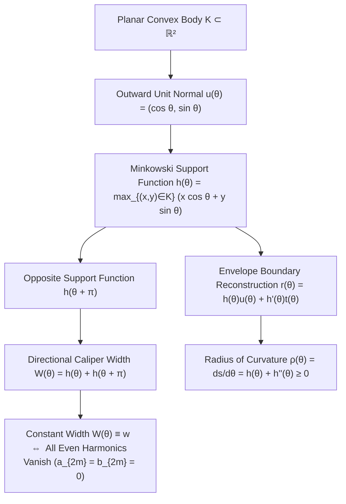
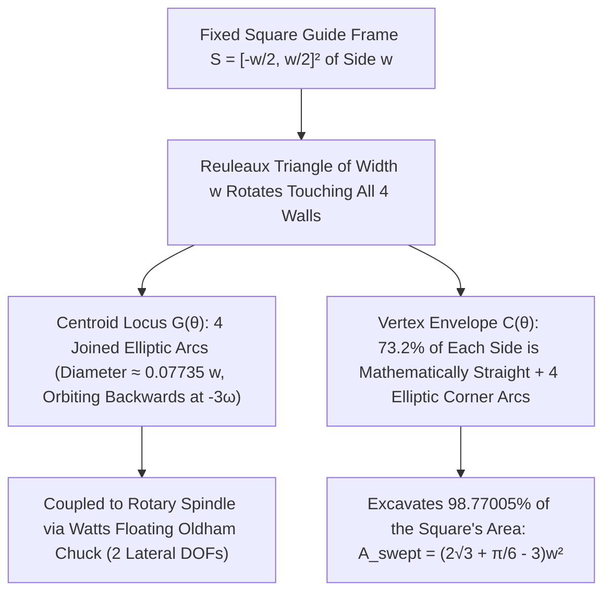

Walk down any city street and look at the cast-iron <strong>manhole covers</strong> beneath your feet. Why are they almost universally round? Popularized by Nobel laureate Richard Feynman and later turned into the most famous logic question in Microsoft's technical interviews, the standard engineering answer rests on a simple geometric inequality.

Suppose a manhole cover were a <strong>square</strong> of side length $w$. While the square opening in the street has side length $w$, its diagonal measures $\sqrt{2}w \approx 1.4142\,w$ by the Pythagorean theorem. If a utility worker lifts the heavy square cover vertically, rotates it by $45^\circ$ to align with the diagonal of the frame, and tilts it slightly, the cover—having width $w < \sqrt{2}w$—will slip straight through its own opening and plunge to the bottom of the sewer shaft. The exact same catastrophe afflicts rectangles, ellipses, and equilateral triangles: whenever a planar shape's minimum caliper width $w_{\min}$ is strictly smaller than its maximum caliper diameter $w_{\max}$, the cover can be turned upright and dropped through its widest span.

A <strong>circle</strong> of diameter $w$, by contrast, has the exact same width $w$ in every direction. No matter how it is tilted or rotated in three-dimensional space, its cross-sectional projection against the lip of the hole never falls below $w$. It can never fall through its own opening.

Now let us ask a deeper mathematical question: <strong>Does a manhole cover—or a cylindrical roller log capable of transporting a flat platform without bobbing up and down—have to be circular to possess the same width in every direction?</strong>

The answer is an emphatic <strong>no</strong>. Infinitely many non-circular planar convex shapes share the property that the perpendicular distance between every pair of parallel supporting tangent lines (calipers) is a fixed constant $w$. Such shapes are known in convex geometry as <strong>curves of constant width</strong> (or <em>orbiforms</em>, as Leonhard Euler christened them in 1778). Their most celebrated and extreme representative is the <strong>Reuleaux triangle</strong>, named after the nineteenth-century German engineer Franz Reuleaux, who pioneered the mathematical theory of mechanisms.

If you lay a row of logs whose cross-sections are Reuleaux triangles of width $w$ on a flat floor and rest a flat wooden plank on top of them, pushing the plank forward causes it to glide <strong>perfectly horizontally at constant height $y = w$ without a single millimeter of vertical oscillation</strong>—even though the geometric center of each triangular log bounces wildly up and down! Even more astonishingly, if you mount a Reuleaux-triangular cutter onto a floating chuck invented by Harry James Watts in 1914 and spin it in a standard rotary drill press, this rotating triangle <strong>drills a nearly perfect square hole</strong> directly into solid steel, sweeping out an exact $98.77005\%$ of the enclosing square's area.

In this comprehensive monograph, we explore the rich interplay of convex geometry, differential geometry, integral geometry, harmonic analysis, and mechanical kinematics that governs curves of constant width. We will formulate the theory rigorously via <strong>Minkowski support functions</strong> and odd-harmonic Fourier series; construct the Reuleaux triangle and general odd Reuleaux polygons; prove <strong>Joseph-Émile Barbier's astonishing 1860 theorem</strong> that every curve of constant width $w$ has the exact same perimeter $L = \pi w$ via two independent methods (differential geometry and Buffon's Noodle / Cauchy–Crofton integral geometry); establish the <strong>Blaschke–Lebesgue theorem (1914)</strong> showing that the Reuleaux triangle uniquely minimizes area among all constant-width bodies; derive the exact parametric equations of the centroid locus and corner envelope of Watts's square-hole drill; and conclude at the three-dimensional frontier with the failure of the Reuleaux tetrahedron, <strong>Ernst Meissner's 1911 surgical construction of the Meissner bodies</strong>, and the still-unsolved <strong>Meissner Conjecture (1934)</strong>.

---

## 1. The Kinematic Paradox: Rolling Without Bobbing vs. Bouncing on a Fixed Axle

Before developing the analytic machinery of support functions, let us resolve the apparent mechanical contradiction that puzzles nearly everyone who encounters the Reuleaux triangle for the first time: <strong>If a Reuleaux triangle has constant height $w$ in every orientation, why can it serve as a smooth roller beneath a flat plank, yet fails miserably as a bicycle wheel?</strong>

### 1.1 A Flat Plank Supported on Reuleaux Triangular Rollers

Imagine a horizontal floor along the line $y = 0$ and a flat rigid plank resting atop a set of rollers whose cross-sections are Reuleaux triangles of constant width $w$. By definition, at any rotation angle $\theta \in [0, 2\pi)$, the Reuleaux triangle is simultaneously tangent to two horizontal supporting lines: the floor $y = 0$ at its lowest point, and the underside of the plank at its highest point.

Because the vertical distance between any pair of parallel horizontal tangents to a curve of constant width $w$ is identically $w$, the underside of the plank remains locked at the exact elevation

$$y_{\text{plank}}(\theta) \equiv w \qquad (\forall \theta \in \mathbb{R})$$

As the plank is pushed forward, the rollers rotate underneath it, and the plank translates at a completely constant height with <strong>zero vertical bobbing</strong>. For moving heavy stone blocks or machinery on rollers—just as ancient engineers used timber logs—logs shaped like Reuleaux triangles roll a load just as smoothly and horizontally as circular cylinders.

### 1.2 Why a Fixed Central Axle Oscillates Vertically

Why, then, are automobile and bicycle wheels always circular rather than Reuleaux triangles? Because a vehicle does not rest on top of unanchored logs; its weight is supported on a <strong>mechanical axle</strong> passing through a fixed point—the geometric centroid $G$—of the rotating wheel.

In a circle of diameter $w$, the center $G$ lies at an isotropic distance $\frac{w}{2}$ from every point on the circumference, so the axle remains at constant height $y_G = \frac{w}{2} = 0.5\,w$ above the road.
In a Reuleaux triangle constructed from an equilateral triangle $\triangle ABC$ of side length $w$, however, the centroid $G$ is <strong>not</strong> equidistant from the boundary:

- The distance from the centroid $G$ to each of the three sharp vertices $A, B, C$ (the circumradius of $\triangle ABC$) is
  $$R = \frac{w}{\sqrt{3}} = \frac{\sqrt{3}}{3} w \approx 0.577350\,w$$
- Since each circular arc has radius $w$ centered at the opposite vertex, the distance from the centroid $G$ to the midpoint of each circular arc is
  $$r = w - R = \left(1 - \frac{\sqrt{3}}{3}\right) w \approx 0.422650\,w$$

Consequently, as a Reuleaux triangle rolls without slipping along the horizontal floor $y = 0$, the height $y_G(\theta)$ of its centroid $G$ oscillates three times per full revolution between these two extremes:

- <strong>Maximum axle height (when a vertex contacts the floor directly below $G$)</strong>:
  $$y_{G,\max} = R = \frac{\sqrt{3}}{3} w \approx 0.577350\,w$$
- <strong>Minimum axle height (when a vertex points straight up and the opposite arc rolls on the floor)</strong>:
  $$y_{G,\min} = r = \left(1 - \frac{\sqrt{3}}{3}\right) w \approx 0.422650\,w$$
- <strong>Peak-to-peak vertical axle excursion $\Delta y_G$</strong>:
  $$\Delta y_G = y_{G,\max} - y_{G,\min} = \left(\frac{2\sqrt{3}}{3} - 1\right) w \approx 0.154701\,w$$

Thus, while the highest point of the Reuleaux triangle stays glued to the line $y = w$, its geometric center $G$ plunges and rises by $15.47\%$ of the wheel's width three times per turn! Whenever the bottom contact is a circular arc centered at the top vertex $A$, the instantaneous center of rotation creates a circular trajectory for $A$ at height $w$, forcing $G$ downward; when a vertex pivots on the ground, $G$ vaults upward along a circular arc of radius $\frac{w}{\sqrt{3}}$. This fundamental decoupling between the <strong>stationary outer bounding envelope</strong> and the <strong>orbiting internal centroid</strong> is the exact kinematic secret that makes both the square-hole drill and the Wankel rotary engine possible.

---

## 2. Convex Geometry and the Minkowski Support Function $h_K(\theta)$

To study curves of constant width with full mathematical rigor—beyond elementary compass-and-straightedge constructions—we turn to the analytic framework introduced by <strong>Hermann Minkowski (1864–1909)</strong> at the turn of the twentieth century: the theory of <strong>support functions</strong> on the unit circle $\mathbb{S}^1$.

### 2.1 Planar Convex Bodies and Supporting Lines

A subset $K \subset \mathbb{R}^2$ is called a <strong>planar convex body</strong> if it is compact (closed and bounded), has non-empty interior ($\text{int}(K) \ne \emptyset$), and is convex, meaning that for every pair of points $\mathbf{x}, \mathbf{y} \in K$ and every scalar $\lambda \in [0, 1]$, the line segment $\lambda \mathbf{x} + (1 - \lambda)\mathbf{y}$ lies entirely within $K$.

For each direction angle $\theta \in \mathbb{R}$, we define the outward unit normal vector $\mathbf{u}(\theta)$ and the counterclockwise unit tangent vector $\mathbf{t}(\theta)$ by

$$\mathbf{u}(\theta) = \begin{pmatrix} \cos\theta \\ \sin\theta \end{pmatrix}, \qquad \mathbf{t}(\theta) = \frac{d\mathbf{u}}{d\theta} = \begin{pmatrix} -\sin\theta \\ \cos\theta \end{pmatrix}$$

Note that $(\mathbf{u}(\theta), \mathbf{t}(\theta))$ forms a positively oriented orthonormal basis of $\mathbb{R}^2$ satisfying the planar Frenet–Serret relations $\mathbf{u}'(\theta) = \mathbf{t}(\theta)$ and $\mathbf{t}'(\theta) = -\mathbf{u}(\theta)$.

The <strong>Minkowski support function</strong> $h_K : \mathbb{R} \to \mathbb{R}$ of a convex body $K$ is defined as the maximum projection of $K$ onto the direction $\mathbf{u}(\theta)$:

$$h_K(\theta) \triangleq \sup_{(x,y) \in K} \langle (x,y), \mathbf{u}(\theta) \rangle = \max_{(x,y) \in K} \left(x\cos\theta + y\sin\theta\right)$$

Geometrically, for each angle $\theta$, the line

$$L(\theta) : x\cos\theta + y\sin\theta = h_K(\theta)$$

is the unique <strong>supporting line</strong> of $K$ with outward normal $\mathbf{u}(\theta)$: the entire convex body $K$ lies in the closed half-plane $x\cos\theta + y\sin\theta \le h_K(\theta)$, and $L(\theta)$ touches the boundary $\partial K$ at one or more contact points. If the coordinate origin $O(0,0)$ is chosen inside the interior of $K$, then $h_K(\theta) > 0$ is simply the perpendicular distance from the origin to the tangent line $L(\theta)$.

### 2.2 Reconstructing the Boundary Curve $\partial K$ as the Envelope of Supporting Lines

By the Hahn–Banach separation theorem in $\mathbb{R}^2$, a compact convex body $K$ is completely determined by the intersection of its supporting half-planes:

$$K = \bigcap_{\theta \in [0, 2\pi)} \left\{ (x,y) \in \mathbb{R}^2 \;\middle|\; x\cos\theta + y\sin\theta \le h_K(\theta) \right\}$$

When the support function $h(\theta) = h_K(\theta)$ is twice continuously differentiable ($h \in C^2(\mathbb{S}^1)$), the boundary curve $\partial K$ is the smooth <strong>envelope</strong> of the one-parameter family of supporting lines $L(\theta)$. A boundary point $\mathbf{r}(\theta) = (x(\theta), y(\theta)) \in \partial K$ with outward normal $\mathbf{u}(\theta)$ must satisfy both the line equation $L(\theta)$ and its derivative with respect to $\theta$:

$$\begin{cases}
x(\theta)\cos\theta + y(\theta)\sin\theta = h(\theta) \\
-x(\theta)\sin\theta + y(\theta)\cos\theta = h'(\theta)
\end{cases}$$

In vector notation, this states that the projections of $\mathbf{r}(\theta)$ onto the orthonormal basis $(\mathbf{u}(\theta), \mathbf{t}(\theta))$ are precisely $h(\theta)$ and $h'(\theta)$. Inverting the $2 \times 2$ orthogonal rotation matrix immediately yields the <strong>support parameterization of the boundary $\partial K$</strong>:

$$\mathbf{r}(\theta) = \begin{pmatrix} x(\theta) \\ y(\theta) \end{pmatrix} = h(\theta)\mathbf{u}(\theta) + h'(\theta)\mathbf{t}(\theta) = \begin{pmatrix} h(\theta)\cos\theta - h'(\theta)\sin\theta \\ h(\theta)\sin\theta + h'(\theta)\cos\theta \end{pmatrix}$$

### 2.3 Radius of Curvature $\rho(\theta)$ and the Differential Inequality for Convexity

Let us differentiate the boundary parameterization $\mathbf{r}(\theta) = h(\theta)\mathbf{u}(\theta) + h'(\theta)\mathbf{t}(\theta)$ with respect to the normal angle $\theta$. Using $\mathbf{u}'(\theta) = \mathbf{t}(\theta)$ and $\mathbf{t}'(\theta) = -\mathbf{u}(\theta)$, the radial terms $h'(\theta)\mathbf{u}(\theta)$ and $-h'(\theta)\mathbf{u}(\theta)$ cancel identically:

$$\begin{aligned}
\frac{d\mathbf{r}}{d\theta} &= h'(\theta)\mathbf{u}(\theta) + h(\theta)\mathbf{u}'(\theta) + h''(\theta)\mathbf{t}(\theta) + h'(\theta)\mathbf{t}'(\theta) \\
&= h'(\theta)\mathbf{u}(\theta) + h(\theta)\mathbf{t}(\theta) + h''(\theta)\mathbf{t}(\theta) - h'(\theta)\mathbf{u}(\theta) \\
&= \left(h(\theta) + h''(\theta)\right)\mathbf{t}(\theta)
\end{aligned}$$

This remarkably compact identity reveals two foundational facts of planar convex differential geometry:

1. The tangent vector $\frac{d\mathbf{r}}{d\theta}$ is always parallel to $\mathbf{t}(\theta) = (-\sin\theta, \cos\theta)^\top$ and orthogonal to $\mathbf{u}(\theta)$.
2. If $s$ denotes the arc length along $\partial K$, then the differential of arc length is $ds = \left\|\frac{d\mathbf{r}}{d\theta}\right\| d\theta$, and the <strong>radius of curvature</strong> $\rho(\theta) = \frac{1}{\kappa(\theta)} = \frac{ds}{d\theta}$ at the boundary point with normal angle $\theta$ is given by the linear differential operator

$$\rho(\theta) = \frac{ds}{d\theta} = h(\theta) + h''(\theta)$$

For a $2\pi$-periodic function $h \in C^2(\mathbb{S}^1)$ to be the valid support function of a convex body $K$ (so that as $\theta$ increases, $\mathbf{r}(\theta)$ traces a simple closed convex curve without cusps or retrograde self-intersections), it is both necessary and sufficient that the radius of curvature be non-negative everywhere:

$$\rho(\theta) = h(\theta) + h''(\theta) \ge 0 \qquad (\forall \theta \in [0, 2\pi))$$

### 2.4 Directional Width (Caliper Function), Double Normals, and Constant Width

When we place a pair of parallel vernier calipers around a convex body $K$ perpendicular to the direction $\mathbf{u}(\theta)$, one jaw rests along the supporting line $L(\theta) : \langle \mathbf{x}, \mathbf{u}(\theta)\rangle = h_K(\theta)$ while the opposite jaw rests along the parallel supporting line with outward normal $\mathbf{u}(\theta + \pi) = -\mathbf{u}(\theta)$, namely $L(\theta + \pi) : \langle \mathbf{x}, -\mathbf{u}(\theta)\rangle = h_K(\theta + \pi)$, or $\langle \mathbf{x}, \mathbf{u}(\theta)\rangle = -h_K(\theta + \pi)$.

The perpendicular distance between these two parallel supporting lines is the <strong>directional width</strong> (or <em>caliper function</em>) $W_K(\theta)$:

$$W_K(\theta) = h_K(\theta) + h_K(\theta + \pi)$$

Therefore, a planar convex body $K$ is a <strong>body of constant width $w$</strong> if and only if its support function satisfies the functional equation

$$h_K(\theta) + h_K(\theta + \pi) = w \qquad (\forall \theta \in [0, 2\pi))$$

Differentiating this identity once and twice with respect to $\theta$ yields two profound geometric corollaries for any smooth curve of constant width $w$:

1. <strong>Co-normality of Opposite Contact Points (The Double Normal Property)</strong>:
   Since $h'(\theta) + h'(\theta + \pi) = 0$, we have $h'(\theta + \pi) = -h'(\theta)$. Let us compute the chord vector connecting the two opposite boundary contact points $\mathbf{r}(\theta)$ and $\mathbf{r}(\theta + \pi)$. Because $\mathbf{u}(\theta + \pi) = -\mathbf{u}(\theta)$ and $\mathbf{t}(\theta + \pi) = -\mathbf{t}(\theta)$, we obtain
   $$\begin{aligned}
   \mathbf{r}(\theta) - \mathbf{r}(\theta + \pi) &= \left(h(\theta)\mathbf{u}(\theta) + h'(\theta)\mathbf{t}(\theta)\right) - \left(-h(\theta + \pi)\mathbf{u}(\theta) - h'(\theta + \pi)\mathbf{t}(\theta)\right) \\
   &= \underbrace{\left(h(\theta) + h(\theta + \pi)\right)}_{= w} \mathbf{u}(\theta) + \underbrace{\left(h'(\theta) + h'(\theta + \pi)\right)}_{= 0} \mathbf{t}(\theta) \\
   &= w\,\mathbf{u}(\theta)
   \end{aligned}$$
   This proves a remarkable theorem: <strong>In any curve of constant width $w$, the chord joining the two contact points of any pair of parallel supporting lines has length exactly $w$ and is strictly perpendicular to both supporting lines!</strong> That is, every normal line to $\partial K$ is a <em>double normal</em> that exits the opposite side of $\partial K$ orthogonally.
2. <strong>Conservation of Opposite Radii of Curvature</strong>:
   Adding $h(\theta) + h(\theta + \pi) = w$ and $h''(\theta) + h''(\theta + \pi) = 0$ immediately gives
   $$\rho(\theta) + \rho(\theta + \pi) = \left(h(\theta) + h''(\theta)\right) + \left(h(\theta + \pi) + h''(\theta + \pi)\right) = w$$
   At every pair of opposite contact points, <strong>the sum of the two radii of curvature is identically equal to $w$</strong>. Consequently, if $\partial K$ has a sharp corner at angle $\theta$ (where $\rho(\theta) = 0$), the opposite boundary portion at $\theta + \pi$ must be a circular arc of radius $\rho(\theta + \pi) = w$ centered at that corner! Conversely, since $\rho(\theta) \ge 0$, we also have the universal upper bound $\rho(\theta) \le w$: no curve of constant width $w$ can ever contain a flat line segment (where $\rho = \infty$) or an arc with radius of curvature exceeding $w$.

### 2.5 Fourier Harmonic Characterization: Why Only Odd Harmonics Survive

Because $h_K(\theta)$ is a continuous $2\pi$-periodic function on $\mathbb{S}^1$, we can expand it in a Fourier series:

$$h_K(\theta) = a_0 + \sum_{n=1}^{\infty} \left(a_n \cos(n\theta) + b_n \sin(n\theta)\right)$$

Under a half-turn shift $\theta \mapsto \theta + \pi$, the trigonometric basis functions transform as $\cos(n(\theta + \pi)) = (-1)^n \cos(n\theta)$ and $\sin(n(\theta + \pi)) = (-1)^n \sin(n\theta)$. Thus, when we form the directional width $W_K(\theta) = h_K(\theta) + h_K(\theta + \pi)$, all odd harmonics ($n = 2k - 1$) cancel out with opposite signs, while all even harmonics ($n = 2m$) double:

$$W_K(\theta) = h_K(\theta) + h_K(\theta + \pi) = 2a_0 + 2\sum_{m=1}^{\infty} \left(a_{2m}\cos(2m\theta) + b_{2m}\sin(2m\theta)\right)$$

By the uniqueness of Fourier series, $W_K(\theta) \equiv w$ holds for all $\theta \in [0, 2\pi)$ if and only if:

- The constant term is $a_0 = \frac{w}{2}$.
- <strong>Every positive even harmonic vanishes identically</strong>:
  $$a_{2m} = 0, \qquad b_{2m} = 0 \qquad (\forall m = 1, 2, 3, \dots)$$
- <strong>Every odd harmonic ($n = 2k - 1 = 1, 3, 5, 7, \dots$) can be chosen completely freely</strong>, provided the resulting sum satisfies the convexity inequality $\rho(\theta) = h_K(\theta) + h_K''(\theta) \ge 0$!

Writing out the general support function of a curve of constant width $w$ and its radius of curvature explicitly:

$$h_K(\theta) = \frac{w}{2} + \sum_{k=1}^{\infty} \left(a_{2k-1}\cos((2k-1)\theta) + b_{2k-1}\sin((2k-1)\theta)\right)$$

$$\rho(\theta) = h_K(\theta) + h_K''(\theta) = \frac{w}{2} - \sum_{k=2}^{\infty} \left((2k-1)^2 - 1\right)\left(a_{2k-1}\cos((2k-1)\theta) + b_{2k-1}\sin((2k-1)\theta)\right) \ge 0$$

Notice that the fundamental harmonic $k = 1$ ($2k - 1 = 1$) has multiplier $1^2 - 1 = 0$ and drops out of $\rho(\theta)$ completely. Geometrically, adding $a_1\cos\theta + b_1\sin\theta$ to $h_K(\theta)$ merely translates the entire convex body $K$ by the vector $(a_1, b_1)^\top \in \mathbb{R}^2$ without altering its shape or curvature. Setting $a_1 = b_1 = 0$ places the origin at the <strong>Steiner point</strong> (curvature centroid) $\mathbf{s}(K) = \frac{1}{\pi}\int_0^{2\pi} \mathbf{u}(\theta)h_K(\theta)\,d\theta$ of the body.

### 2.6 Constructing Smooth ($C^\infty$) Analytic Non-Circular Curves of Constant Width

A widespread misconception in popular mathematics is that all non-circular curves of constant width must be pieced together from circular arcs and therefore possess corners or jump discontinuities in curvature. Our Fourier theorem demolishes this myth instantaneously.

Take a single odd harmonic with $2k - 1 = 3$ ($k = 2$) and set all other harmonics to zero:

$$h(\theta) = \frac{w}{2} + \varepsilon \cos(3\theta)$$

Its radius of curvature is

$$\rho(\theta) = h(\theta) + h''(\theta) = \frac{w}{2} - (3^2 - 1)\varepsilon \cos(3\theta) = \frac{w}{2} - 8\varepsilon \cos(3\theta)$$

Whenever $0 < |\varepsilon| \le \frac{w}{16}$, we have $\rho(\theta) \ge 0$ for all $\theta \in [0, 2\pi)$. In particular, if $0 < |\varepsilon| < \frac{w}{16}$, the radius of curvature is strictly positive ($\rho(\theta) \ge \frac{w}{2} - 8|\varepsilon| > 0$), yielding a <strong>real-analytic, infinitely differentiable ($C^\infty$) non-circular curve of constant width $w$ with no corners whatsoever</strong>!

Even at the critical boundary value $\varepsilon = \frac{w}{16}$—for instance, choosing $w = 16$ and $\varepsilon = 1$ so that $h(\theta) = 8 + \cos(3\theta)$—the boundary curve

$$\begin{cases}
x(\theta) = (8 + \cos 3\theta)\cos\theta + 3\sin 3\theta \sin\theta = 8\cos\theta + 2\cos 2\theta - \cos 4\theta \\
y(\theta) = (8 + \cos 3\theta)\sin\theta - 3\sin 3\theta \cos\theta = 8\sin\theta - 2\sin 2\theta - \sin 4\theta
\end{cases}$$

is a smooth $C^\infty$ algebraic curve with zero vertices. As Stanley Rabinowitz proved in 1997 by eliminating $\theta$ via resultants, this curve is the zero locus of an explicit <strong>polynomial equation of degree 8</strong>:

$$(x^2 + y^2)^4 - 45(x^2 + y^2)^3 - 41283(x^2 + y^2)^2 + 7950960(x^2 + y^2) + 16(x^2 - 3y^2)^3 + 48(x^2 + y^2)(x^2 - 3y^2)^2 + x(x^2 - 3y^2)\left(720(x^2 + y^2)^2 + 14757888(x^2 + y^2) - 594490752\right) - 270426086976 = 0$$

By adding arbitrarily many odd harmonics $\sum_{k=2}^\infty (a_{2k-1}\cos(2k-1)\theta + b_{2k-1}\sin(2k-1)\theta)$ with suficientemente small amplitudes $\sum_{k=2}^\infty (2k-1)^2 \sqrt{a_{2k-1}^2 + b_{2k-1}^2} \le \frac{w}{2}$, we can construct smooth constant-width curves completely devoid of rotational or reflectional symmetry.

---

## 3. Franz Reuleaux's Triangle (1875) and Odd Reuleaux Polygons

Let us now turn to the most famous curve of constant width: the <strong>Reuleaux triangle</strong>. Although it bears the name of <strong>Franz Reuleaux (1829–1905)</strong>—rector of the Royal Technical Academy in Berlin and author of the landmark 1875 treatise <em>Theoretische Kinematik: Grundzüge einer Theorie des Maschinenwesens</em>, who analyzed its role in positive-return cam mechanisms—the shape appeared centuries earlier across art, cartography, and pure mathematics:

- <strong>13th-Century Gothic Architecture</strong>: Master masons used Reuleaux triangles extensively for the spherical triangular tracery and rose windows of the Cathedral of Notre-Dame in Paris, the Church of Our Lady in Bruges, and Westminster Abbey.
- <strong>Leonardo da Vinci (c. 1514)</strong>: In the <em>Codex Vallardi</em> (held at the Louvre), Leonardo drafted one of the earliest world maps showing the newly discovered Americas by slicing the globe into eight octants, each projected onto a planar Reuleaux triangle of constant width.
- <strong>Leonhard Euler (1778)</strong>: In his memoir <em>De curvis triangularibus</em> presented to the St. Petersburg Academy of Sciences, Euler investigated the Reuleaux triangle and smooth constant-width curves under the name <em>orbiforms</em> ("sphere-like shapes").

### 3.1 Compass-and-Straightedge Construction and Piecewise Support Function

To construct a Reuleaux triangle of width $w$:

1. Draw an equilateral triangle $\triangle ABC$ of side length $w$.
2. Place the point of a compass at vertex $A$ with radius $w$, and sweep the circular arc $\widehat{BC}$ connecting $B$ to $C$ (subtending central angle $\angle BAC = \frac{\pi}{3} = 60^\circ$).
3. Repeat with the compass centered at vertex $B$ to draw arc $\widehat{CA}$ of radius $w$, and centered at vertex $C$ to draw arc $\widehat{AB}$ of radius $w$.

Alternatively, the Reuleaux triangle is the set-theoretic intersection of three closed circular disks of radius $w$ centered at the vertices of $\triangle ABC$:

$$K_{\text{Reuleaux}} = B(A, w) \cap B(B, w) \cap B(C, w)$$

Why does $K_{\text{Reuleaux}}$ have constant width $w$? At each vertex ($A, B, C$), the two meeting circular arcs form an interior angle of $\frac{2\pi}{3} = 120^\circ$ (since each arc meets the equilateral triangle's sides at $30^\circ$, and $60^\circ + 30^\circ + 30^\circ = 120^\circ$). Thus, as a supporting line rotates around $K_{\text{Reuleaux}}$, its outward normal $\mathbf{u}(\theta)$ pivots through an angle cone of $\pi - \frac{2\pi}{3} = \frac{\pi}{3}$ ($60^\circ$) while remaining anchored at a single vertex, say $A$. Simultaneously, the opposite supporting line with normal $\mathbf{u}(\theta + \pi)$ rolls tangentially along the circular arc $\widehat{BC}$, whose center of curvature is $A$ and whose radius is $w$. Because the distance from the center $A$ of a circle to any tangent of that circle is its radius $w$, the caliper distance between the two parallel supporting lines is <strong>identically $w$ at every angle $\theta$</strong>.

If we place the centroid $G$ of $\triangle ABC$ at the origin $(0,0)$ and orient vertex $A$ along the positive $x$-axis at $\left(\frac{w}{\sqrt{3}}, 0\right)$, the support function on the fundamental sector $\theta \in \left[-\frac{\pi}{6}, \frac{\pi}{6}\right]$ and its opposite sector $\theta + \pi$ are given explicitly by

$$h(\theta) = \frac{w}{\sqrt{3}}\cos\theta, \qquad h(\theta + \pi) = w - \frac{w}{\sqrt{3}}\cos\theta \qquad \left(-\frac{\pi}{6} \le \theta \le \frac{\pi}{6}\right)$$

Notice that $h(\theta) + h(\theta + \pi) = w$ holds identically, and the distributional radius of curvature $\rho = h + h''$ alternates between $\rho(\theta) = \frac{w}{\sqrt{3}}\cos\theta - \frac{w}{\sqrt{3}}\cos\theta = 0$ (when pivoting on vertex $A$) and $\rho(\theta + \pi) = w$ (when rolling along the arc $\widehat{BC}$). Expanding $h(\theta)$ across all three $120^\circ$-symmetric sectors into a global Fourier series on $[0, 2\pi)$ yields

$$h_{\text{Reuleaux}}(\theta) = \frac{w}{2} - \frac{3w}{\pi} \sum_{m=1}^{\infty} \frac{(-1)^m}{9m^2 - 1} \cos(3m\theta) \quad \text{(for } m \text{ odd: } 3m = 3, 9, 15, \dots\text{)}$$

Wait: let us verify why only odd multiples of $3$ appear! By $C_3$ rotational symmetry ($\theta \mapsto \theta + \frac{2\pi}{3}$), only harmonics divisible by $3$ ($n = 3m$) can be non-zero; and by the constant-width condition, all even harmonics vanish, leaving only $n = 3, 9, 15, 21, \dots$, i.e., $n = 3(2j-1)$! Specifically, integrating $\frac{1}{\pi}\int_0^{2\pi} h(\theta)\cos(n\theta)\,d\theta$ for $n = 3(2j-1)$ gives the exact Fourier expansion of the Reuleaux triangle:

$$h_{\text{Reuleaux}}(\theta) = \frac{w}{2} + \frac{3w}{\pi} \sum_{j=1}^{\infty} \frac{(-1)^{j}}{\left(3(2j-1)\right)^2 - 1} \cos\left(3(2j-1)\theta\right)$$

### 3.2 Exact Derivation of the Area of the Reuleaux Triangle

Let us calculate the area $A_{\text{Reuleaux}}$ of a Reuleaux triangle of width $w$.
Our compass construction superposes three circular sectors of radius $w$ and central angle $\frac{\pi}{3}$, centered at $A$, $B$, and $C$ respectively. The union of these three sectors is the Reuleaux triangle, while their pairwise and triple intersection is the central equilateral triangle $\triangle ABC$ of side length $w$. Since the three sectors cover $\triangle ABC$ three times instead of once, we subtract twice the area of $\triangle ABC$:

- <strong>Area of one $60^\circ$ circular sector of radius $w$</strong>:
  $$A_{\text{sector}} = \frac{1}{2} r^2 \phi = \frac{1}{2} w^2 \left(\frac{\pi}{3}\right) = \frac{\pi}{6} w^2$$
- <strong>Area of the equilateral triangle $\triangle ABC$ of side $w$</strong>:
  $$A_{\triangle} = \frac{1}{2} w \left(\frac{\sqrt{3}}{2} w\right) = \frac{\sqrt{3}}{4} w^2$$
- <strong>Area of the Reuleaux triangle</strong>:
  $$A_{\text{Reuleaux}} = 3 A_{\text{sector}} - 2 A_{\triangle} = 3\left(\frac{\pi}{6} w^2\right) - 2\left(\frac{\sqrt{3}}{4} w^2\right) = \frac{1}{2}\left(\pi - \sqrt{3}\right) w^2 \approx 0.7047709\,w^2$$

Compare this with the area of a <strong>circular disk</strong> of the same constant width (diameter) $w$:

$$A_{\text{circle}} = \pi \left(\frac{w}{2}\right)^2 = \frac{\pi}{4} w^2 \approx 0.7853982\,w^2$$

The ratio of their areas is

$$\frac{A_{\text{Reuleaux}}}{A_{\text{circle}}} = \frac{\frac{1}{2}(\pi - \sqrt{3})w^2}{\frac{\pi}{4}w^2} = \frac{2(\pi - \sqrt{3})}{\pi} \approx 0.897342$$

Thus, the Reuleaux triangle encloses $10.27\%$ less area than the circle of the same constant width $w$—even though, as Barbier's theorem will soon prove, both curves have the exact same perimeter $\pi w$!

### 3.3 Generalization to Odd Regular Reuleaux $n$-gons ($n = 2k + 1$)

The construction of the Reuleaux triangle generalizes naturally to any regular polygon with an <strong>odd</strong> number of sides $n = 2k + 1$ ($n = 3, 5, 7, 9, \dots$).

Why must $n$ be <strong>odd</strong>?
In a regular $n$-gon $V_1 V_2 \dots V_n$, a curve of constant width requires that every vertex $V_i$ lie directly opposite a circular arc of radius $w$ connecting two adjacent vertices. In a regular polygon with an <strong>even</strong> number of vertices ($n = 2m$), each vertex $V_i$ stands directly opposite another single vertex $V_{i+m}$, not an edge; there is no pair of longest diagonals of equal length $w$ emanating from $V_i$ to bracket an opposite side. When $n = 2k + 1$ is <strong>odd</strong>, however, each vertex $V_i$ is connected by two longest diagonals of equal length $w$ to the two endpoints $V_{i+k}$ and $V_{i+k+1}$ of the unique opposite edge!

Let us derive the exact closed-form area $A_n$ of a regular Reuleaux $n$-gon ($n = 2k+1$) of constant width $w$.
In the core regular $n$-gon whose longest diagonals have length $w$, the angle subtended at a vertex $V_i$ by the opposite edge $V_{i+k}V_{i+k+1}$ is the inscribed angle $\phi_n = \frac{\pi}{n}$. The longest diagonal subtends a central angle of $\frac{n-1}{n}\pi = \pi - \frac{\pi}{n}$ from the center $O$ of the circumcircle of radius $R_n$, so by the law of chords:

$$w = 2 R_n \sin\left(\frac{\pi - \pi/n}{2}\right) = 2 R_n \cos\left(\frac{\pi}{2n}\right) \implies R_n = \frac{w}{2\cos\left(\frac{\pi}{2n}\right)}$$

The area of the core regular $n$-gon of circumradius $R_n$ is the sum of $n$ isosceles triangles of side $R_n$ and apex angle $\frac{2\pi}{n}$:

$$A_{\text{poly}, n} = \frac{n}{2} R_n^2 \sin\left(\frac{2\pi}{n}\right) = \frac{n w^2 \sin\left(\frac{2\pi}{n}\right)}{8\cos^2\left(\frac{\pi}{2n}\right)}$$

Outside each of the $n$ straight edges of this core $n$-gon sits a circular segment (cap) of radius $w$ and central angle $\phi_n = \frac{\pi}{n}$. Since the area of one circular segment of radius $w$ and angle $\frac{\pi}{n}$ is $\frac{1}{2}w^2\left(\frac{\pi}{n} - \sin\frac{\pi}{n}\right)$, the total area of all $n$ circular caps is

$$n A_{\text{seg}, n} = \frac{n w^2}{2}\left(\frac{\pi}{n} - \sin\left(\frac{\pi}{n}\right)\right) = \frac{\pi}{2} w^2 - \frac{n}{2} w^2 \sin\left(\frac{\pi}{n}\right)$$

Adding the core polygon and the $n$ circular caps and simplifying via the double-angle identities $\sin\left(\frac{2\pi}{n}\right) = 2\sin\left(\frac{\pi}{n}\right)\cos\left(\frac{\pi}{n}\right)$ and $\cos\left(\frac{\pi}{n}\right) - 2\cos^2\left(\frac{\pi}{2n}\right) = -1$, we obtain the universal area formula for regular Reuleaux polygons:

$$\begin{aligned}
A_n &= A_{\text{poly}, n} + n A_{\text{seg}, n} \\
&= \frac{\pi}{2} w^2 + \frac{n w^2 \sin\left(\frac{\pi}{n}\right)}{4\cos^2\left(\frac{\pi}{2n}\right)} \left(\cos\left(\frac{\pi}{n}\right) - 2\cos^2\left(\frac{\pi}{2n}\right)\right) \\
&= \frac{w^2}{2}\left(\pi - n \tan\left(\frac{\pi}{2n}\right)\right) \qquad (n = 3, 5, 7, 9, \dots)
\end{aligned}$$

Let us check the limiting behavior of this formula:
- For $n = 3$: $3\tan\left(\frac{\pi}{6}\right) = 3\left(\frac{1}{\sqrt{3}}\right) = \sqrt{3}$, recovering $A_3 = \frac{1}{2}(\pi - \sqrt{3})w^2$.
- Since $\tan x > x$ on $\left(0, \frac{\pi}{2}\right)$ and $x \mapsto \frac{\tan x}{x}$ is strictly increasing, $n\tan\left(\frac{\pi}{2n}\right)$ decreases strictly monotonically toward $\frac{\pi}{2}$ as $n \to \infty$:
  $$n\tan\left(\frac{\pi}{2n}\right) = \frac{\pi}{2} + \frac{\pi^3}{24 n^2} + O\left(\frac{1}{n^4}\right)$$
  Hence $A_n$ increases strictly monotonically with $n$ and converges to $\lim_{n\to\infty} A_n = \frac{w^2}{2}\left(\pi - \frac{\pi}{2}\right) = \frac{\pi}{4}w^2 = A_{\text{circle}}$.

| Curve of Constant Width $w$ | Number of Corners $n$ | Perimeter $L$ | Exact Area Formula $A(w)$ | Numerical Area | Ratio $A / A_{\text{circle}}$ |
| :--- | :---: | :---: | :---: | :---: | :---: |
| <strong>Reuleaux Triangle</strong> | $3$ | $\pi w$ | $\frac{1}{2}\left(\pi - \sqrt{3}\right)w^2$ | $0.704771\,w^2$ | $89.73\%$ (<strong>Minimum</strong>) |
| <strong>Reuleaux Pentagon</strong> | $5$ | $\pi w$ | $\frac{1}{2}\left(\pi - 5\tan\frac{\pi}{10}\right)w^2$ | $0.756827\,w^2$ | $96.36\%$ |
| <strong>Reuleaux Heptagon</strong> (UK 20p & 50p Coins) | $7$ | $\pi w$ | $\frac{1}{2}\left(\pi - 7\tan\frac{\pi}{14}\right)w^2$ | $0.770921\,w^2$ | $98.16\%$ |
| <strong>Reuleaux Nonagon</strong> | $9$ | $\pi w$ | $\frac{1}{2}\left(\pi - 9\tan\frac{\pi}{18}\right)w^2$ | $0.776616\,w^2$ | $98.88\%$ |
| <strong>Smooth Analytic Curve</strong> ($h = \frac{w}{2} + \frac{w}{16}\cos 3\theta$) | $0$ ($C^\infty$) | $\pi w$ | $\frac{31\pi}{128}w^2$ | $0.760854\,w^2$ | $96.88\%$ |
| <strong>Circle</strong> | $0$ ($C^\infty$) | $\pi w$ | $\frac{\pi}{4}w^2$ | $0.785398\,w^2$ | $100.00\%$ (<strong>Maximum</strong>) |

---

## 4. Joseph-Émile Barbier's Theorem (1860): Two Complete Rigorous Proofs

In 1860, the young French mathematician and astronomer <strong>Joseph-Émile Barbier (1839–1889)</strong> published a remarkable memoir in Liouville's <em>Journal de Mathématiques Pures et Appliquées</em> titled <em>"Note sur le problème de l'aiguille et le jeu du joint couvert."</em> In it, he proved a theorem of breathtaking generality:

> <strong>Theorem 1 (Barbier's Theorem, 1860).</strong>
> <em>Every planar convex curve of constant width $w$—whether a circle, a Reuleaux triangle, an irregular Reuleaux polygon, or an asymmetric smooth curve—has the exact same perimeter:</em>
> $$L(\partial K) = \pi w$$

For a regular or irregular Reuleaux $n$-gon composed of $n$ circular arcs of radius $w$ and central angles $\phi_1, \phi_2, \dots, \phi_n$ summing to $\sum_{i=1}^n \phi_i = \pi$, the elementary arc-length sum is $L = \sum_{i=1}^n w\phi_i = \pi w$. What makes Barbier's theorem so profound is that it holds for <strong>every</strong> curve of constant width, even those with continuously varying curvature and no circular arcs at all. Let us present two distinct, complete proofs.

### 4.1 Proof 1: Differential Geometry and the Minkowski Support Function

Let $K \subset \mathbb{R}^2$ be a planar convex body of constant width $w$. Suppose first that its support function $h(\theta) = h_K(\theta)$ is of class $C^2(\mathbb{S}^1)$. By the arc-length formula derived in Section 2.3, the differential of arc length along $\partial K$ is $ds = \rho(\theta)\,d\theta = \left(h(\theta) + h''(\theta)\right) d\theta$. Integrating over a full turn $\theta \in [0, 2\pi]$ gives

$$L(\partial K) = \oint_{\partial K} ds = \int_0^{2\pi} \left(h(\theta) + h''(\theta)\right) d\theta = \int_0^{2\pi} h(\theta)\,d\theta + \Big[h'(\theta)\Big]_0^{2\pi}$$

Because $h'(\theta)$ is periodic with period $2\pi$, the boundary term vanishes: $\big[h'(\theta)\big]_0^{2\pi} = h'(2\pi) - h'(0) = 0$.
Next, split the remaining integral over $[0, 2\pi]$ into the two half-intervals $[0, \pi]$ and $[\pi, 2\pi]$, and apply the substitution $\theta = \phi + \pi$ in the second integral:

$$\begin{aligned}
L(\partial K) &= \int_0^{\pi} h(\theta)\,d\theta + \int_{\pi}^{2\pi} h(\theta)\,d\theta \\
&= \int_0^{\pi} h(\theta)\,d\theta + \int_0^{\pi} h(\phi + \pi)\,d\phi \\
&= \int_0^{\pi} \underbrace{\left(h(\theta) + h(\theta + \pi)\right)}_{W_K(\theta) = w} d\theta \\
&= \int_0^{\pi} w\,d\theta = \pi w
\end{aligned}$$

<strong>Extension to General Non-Smooth Curves of Constant Width:</strong>
What if $\partial K$ has corners, such as the Reuleaux triangle, where $h(\theta)$ is not globally $C^2$? We can bridge this gap with complete analytical rigor in two ways:

1. <strong>Smooth Mollification in the Hausdorff Metric</strong>:
   Convolve $h_K(\theta)$ on $\mathbb{S}^1$ with a smooth, non-negative, symmetric mollifier $\eta_\varepsilon(\theta) \in C^\infty(\mathbb{S}^1)$ satisfying $\int_{-\pi}^{\pi} \eta_\varepsilon(\theta)\,d\theta = 1$. The smoothed function $h_\varepsilon = h_K * \eta_\varepsilon \in C^\infty(\mathbb{S}^1)$ satisfies $h_\varepsilon + h_\varepsilon'' = (h_K + h_K'') * \eta_\varepsilon \ge 0$ (in the sense of Radon measures) and preserves the constant-width relation:
   $$h_\varepsilon(\theta) + h_\varepsilon(\theta + \pi) = \int_{-\pi}^{\pi} \underbrace{\left(h_K(\theta - \tau) + h_K(\theta + \pi - \tau)\right)}_{= w} \eta_\varepsilon(\tau)\,d\tau = w$$
   Hence $h_\varepsilon$ is the support function of a $C^\infty$ convex body $K_\varepsilon$ of constant width $w$, so $L(\partial K_\varepsilon) = \pi w$ for every $\varepsilon > 0$. As $\varepsilon \to 0^+$, $h_\varepsilon \to h_K$ uniformly on $\mathbb{S}^1$, which means $K_\varepsilon \to K$ in the Hausdorff metric $d_H(K_\varepsilon, K) = \|h_\varepsilon - h_K\|_\infty \to 0$. Because the perimeter functional $K \mapsto L(\partial K)$ is continuous on the space of convex bodies equipped with the Hausdorff metric, it follows that
   $$L(\partial K) = \lim_{\varepsilon \to 0^+} L(\partial K_\varepsilon) = \pi w$$
2. <strong>$C^1$ Regularity of $h_K$ and Distributional Curvature</strong>:
   In general convex geometry, a jump discontinuity in the first derivative $h_K'(\theta_0^+) - h_K'(\theta_0^-)$ equals the length of a flat line segment on $\partial K$ with outward normal $\mathbf{u}(\theta_0)$. As we proved in Section 2.4, a curve of constant width $w$ can never contain a flat line segment! Therefore, for <em>every</em> curve of constant width $w$, $h_K(\theta)$ is continuously differentiable ($C^1(\mathbb{S}^1)$) everywhere, and $h_K'(\theta)$ is continuous without jumps! Only $h_K''(\theta)$ has step discontinuities at the boundary of normal cones of vertices, so the Fundamental Theorem of Calculus $\int_0^{2\pi} h_K''(\theta)\,d\theta = h_K'(2\pi) - h_K'(0) = 0$ holds directly without approximation. $\blacksquare$

### 4.2 Proof 2: Integral Geometry, the Cauchy–Crofton Formula, and Buffon's Noodle

Barbier's original 1860 proof took a completely different route—one that founded modern <strong>integral geometry (geometric probability)</strong> by generalizing Georges-Louis Leclerc, Comte de Buffon's 1777 needle problem into what is today celebrated as <strong>Buffon's Noodle</strong>.

Consider the space $\mathcal{L}$ of all oriented straight lines $\ell(p, \theta)$ in the Euclidean plane $\mathbb{R}^2$, parameterized by their normal angle $\theta \in [0, 2\pi)$ and their signed perpendicular distance $p \in \mathbb{R}$ from the origin:

$$\ell(p, \theta) = \left\{ (x,y) \in \mathbb{R}^2 \;\middle|\; x\cos\theta + y\sin\theta = p \right\}$$

Up to a constant factor, the unique measure on $\mathcal{L}$ that is invariant under the entire group $\text{SE}(2)$ of rigid Euclidean motions (translations and rotations) is the <strong>Poincaré–Blaschke kinematic density</strong>:

$$d\ell = dp \wedge d\theta$$

Now let $\gamma \subset \mathbb{R}^2$ be any rectifiable curve ("noodle") of finite arc length $L(\gamma)$, and for each line $\ell(p, \theta)$, let

$$n_\gamma(p, \theta) \triangleq \#\left(\gamma \cap \ell(p, \theta)\right)$$

denote the number of intersection points between the curve $\gamma$ and the line $\ell(p, \theta)$.

First, suppose $\gamma$ is an infinitesimal straight line segment of length $ds$ whose unit normal makes angle $\alpha$ with the $x$-axis. For a fixed direction $\theta$, the set of signed distances $p$ for which $\ell(p, \theta)$ intersects $ds$ is an interval of length equal to the projection of $ds$ onto $\mathbf{u}(\theta)$, namely $ds\,|\cos(\theta - \alpha)|$. Integrating over all angles $\theta \in [0, 2\pi)$ gives

$$\int_0^{2\pi} \int_{-\infty}^{\infty} n_{ds}(p, \theta)\,dp\,d\theta = ds \int_0^{2\pi} |\cos(\theta - \alpha)|\,d\theta = 4\,ds$$

By the additivity of integration (or in probabilistic language, the <strong>linearity of expectation</strong>: the expected number of crossings of a polygonal or curved noodle is the sum of the expected crossings of its infinitesimal segments, regardless of how the noodle is bent or closed!), integrating $ds$ along the entire curve $\gamma$ yields the fundamental <strong>Cauchy–Crofton Formula</strong> of integral geometry:

$$\int_0^{2\pi} \int_{-\infty}^{\infty} n_\gamma(p, \theta)\,dp\,d\theta = 4 L(\gamma)$$

Now let us apply the Cauchy–Crofton formula to the boundary $\gamma = \partial K$ of a planar convex body $K$!
Because $K$ is convex, every straight line $\ell(p, \theta)$ that penetrates the interior of $K$ intersects its boundary $\partial K$ in <strong>exactly $2$ points</strong> ($n_{\partial K}(p, \theta) = 2$), whereas lines disjoint from $K$ have $n_{\partial K}(p, \theta) = 0$ (and the two supporting tangent lines at each angle $\theta$ form a set of measure zero in $p$).

For each fixed angle $\theta \in [0, 2\pi)$, the range of signed distances $p$ for which $\ell(p, \theta)$ intersects $K$ is precisely the closed interval $\left[-h_K(\theta + \pi), h_K(\theta)\right]$ between the two parallel supporting lines of $K$, whose length is the directional caliper width $W_K(\theta) = h_K(\theta) + h_K(\theta + \pi)$. Evaluating the inner $p$-integral therefore gives <strong>Cauchy's Perimeter Formula</strong> for any convex body:

$$4 L(\partial K) = \int_0^{2\pi} \left( \int_{-h_K(\theta+\pi)}^{h_K(\theta)} 2\,dp \right) d\theta = 2 \int_0^{2\pi} W_K(\theta)\,d\theta \implies L(\partial K) = \frac{1}{2} \int_0^{2\pi} W_K(\theta)\,d\theta$$

In words: <strong>The perimeter of any planar convex body is $\pi$ times its average directional width over all orientations.</strong>
If $K$ is a curve of constant width $w$, then $W_K(\theta) = w$ for every $\theta \in [0, 2\pi)$, and Cauchy's formula yields

$$L(\partial K) = \frac{1}{2} \int_0^{2\pi} w\,d\theta = \frac{1}{2}(2\pi w) = \pi w$$

This integral-geometric proof requires no smoothness assumptions whatsoever—not even $C^1$ differentiability—and establishes Barbier's theorem in complete generality. $\blacksquare$

---

## 5. The Blaschke–Lebesgue Theorem (1914) and Isoperimetric Extremals

Since all curves of constant width $w$ share the identical perimeter $L = \pi w$, the classical isoperimetric problem reduces to a pure question of area optimization: <strong>Among all planar convex bodies $K$ of constant width $w$, which shapes maximize and minimize the enclosed area $A(K)$?</strong>

In 1914, <strong>Henri Lebesgue</strong> (famous for Lebesgue integration) and in 1915 <strong>Wilhelm Blaschke</strong> independently proved the definitive theorem answering this question:

> <strong>Theorem 2 (Blaschke–Lebesgue Theorem, 1914/1915).</strong>
> <em>For every planar convex body $K \subset \mathbb{R}^2$ of constant width $w$, the enclosed area $A(K)$ satisfies the sharp inequalities</em>
> $$\frac{1}{2}\left(\pi - \sqrt{3}\right) w^2 \le A(K) \le \frac{\pi}{4} w^2$$
> <em>Equality on the right (maximum area) holds if and only if $K$ is a circular disk of diameter $w$, and equality on the left (minimum area) holds if and only if $K$ is a Reuleaux triangle of width $w$ (up to rigid Euclidean motions).</em>

Let us examine both bounds through the dual lenses of Fourier analysis and Minkowski convex geometry.

### 5.1 Blaschke's Area Formula and Parseval's Identity for Odd Harmonics

By Green's theorem in the plane, the area enclosed by $\partial K$ is

$$A(K) = \frac{1}{2} \oint_{\partial K} (x\,dy - y\,dx)$$

Substituting our support parameterization $x(\theta) = h(\theta)\cos\theta - h'(\theta)\sin\theta$, $y(\theta) = h(\theta)\sin\theta + h'(\theta)\cos\theta$ and differentials $dx = -\rho(\theta)\sin\theta\,d\theta$, $dy = \rho(\theta)\cos\theta\,d\theta$ (where $\rho = h + h''$), we find

$$x\,dy - y\,dx = h(\theta)\rho(\theta)\,(\cos^2\theta + \sin^2\theta)\,d\theta = h(\theta)\left(h(\theta) + h''(\theta)\right) d\theta$$

Integrating over $[0, 2\pi]$ and applying integration by parts to the second term ($\int_0^{2\pi} h(\theta)h''(\theta)\,d\theta = \big[h(\theta)h'(\theta)\big]_0^{2\pi} - \int_0^{2\pi} h'(\theta)^2\,d\theta = -\int_0^{2\pi} h'(\theta)^2\,d\theta$) yields <strong>Blaschke's Support Area Formula</strong>:

$$A(K) = \frac{1}{2} \int_0^{2\pi} \left(h(\theta)^2 - h'(\theta)^2\right) d\theta$$

Now substitute the odd-harmonic Fourier expansion of a constant-width body from Section 2.5:

$$h(\theta) = \frac{w}{2} + \sum_{k=1}^{\infty} \left(a_{2k-1}\cos((2k-1)\theta) + b_{2k-1}\sin((2k-1)\theta)\right)$$

$$h'(\theta) = \sum_{k=1}^{\infty} (2k-1)\left(-a_{2k-1}\sin((2k-1)\theta) + b_{2k-1}\cos((2k-1)\theta)\right)$$

By Parseval's theorem on $[0, 2\pi]$ (using $\int_0^{2\pi} 1\,d\theta = 2\pi$ and $\int_0^{2\pi} \cos^2(n\theta)\,d\theta = \int_0^{2\pi} \sin^2(n\theta)\,d\theta = \pi$), we obtain the exact spectral decomposition of the area:

$$A(K) = \frac{\pi}{4} w^2 - \frac{\pi}{2} \sum_{k=2}^{\infty} \left((2k-1)^2 - 1\right)\left(a_{2k-1}^2 + b_{2k-1}^2\right)$$

Look closely at what this single equation accomplishes:

1. <strong>Immediate Proof of the Upper Bound (Uniqueness of the Circle)</strong>:
   For every index $k \ge 2$, the multiplier $(2k-1)^2 - 1 \ge 3^2 - 1 = 8$ is strictly positive, and $a_{2k-1}^2 + b_{2k-1}^2 \ge 0$. Every non-zero higher odd harmonic strictly subtracts area from $\frac{\pi}{4}w^2$! Thus $A(K) \le \frac{\pi}{4}w^2$, with equality if and only if $a_{2k-1} = b_{2k-1} = 0$ for all $k \ge 2$, which means $h(\theta) = \frac{w}{2} + a_1\cos\theta + b_1\sin\theta$—a circle of diameter $w$ centered at $(a_1, b_1)$.
   *(Note: A second, purely geometric proof of the upper bound follows from <strong>Minkowski Central Symmetrization</strong>: for any constant-width body $K$, the Minkowski average $\widetilde{K} = \frac{1}{2}K + \frac{1}{2}(-K)$ has support function $h_{\widetilde{K}}(\theta) = \frac{1}{2}\left(h_K(\theta) + h_K(\theta+\pi)\right) \equiv \frac{w}{2}$, so $\widetilde{K}$ is literally the disk of diameter $w$! By the <strong>Brunn–Minkowski Inequality</strong>, $\sqrt{A(\widetilde{K})} \ge \frac{1}{2}\sqrt{A(K)} + \frac{1}{2}\sqrt{A(-K)} = \sqrt{A(K)}$, giving $A(K) \le A(\widetilde{K}) = \frac{\pi}{4}w^2$ immediately!)*
2. <strong>Area of the Smooth Analytic Curve $h(\theta) = \frac{w}{2} + \frac{w}{16}\cos(3\theta)$</strong>:
   Here $k = 2$ ($2k-1 = 3$), $a_3 = \frac{w}{16}$, and all other coefficients are zero. The spectral formula immediately gives its exact area without a single geometric dissection:
   $$A = \frac{\pi}{4}w^2 - \frac{\pi}{2}(9 - 1)\left(\frac{w}{16}\right)^2 = \frac{\pi}{4}w^2 - \frac{4\pi}{256}w^2 = \frac{63\pi}{256}w^2 \approx 0.773126\,w^2$$
3. <strong>Why the Reuleaux Triangle Minimizes Area (The Bang-Bang Curvature Principle)</strong>:
   To <em>minimize</em> $A(K)$ subject to the convexity constraint $0 \le \rho(\theta) \le w$ and $\rho(\theta) + \rho(\theta + \pi) = w$, we can view $A(K) = \frac{1}{2}\int_0^{2\pi} h(\theta)\rho(\theta)\,d\theta$ as a strictly concave quadratic functional over the compact convex set of admissible curvature measures $\rho(\theta)$ satisfying the closure conditions $\int_0^{2\pi} \rho(\theta)\cos\theta\,d\theta = \int_0^{2\pi} \rho(\theta)\sin\theta\,d\theta = 0$.
   Because a concave functional on a compact convex set attains its global minimum at the <strong>extreme points</strong> of the admissible set (a classic application of <strong>Pontryagin's Maximum Principle</strong> in optimal control), the area-minimizing curve must have a <strong>bang-bang curvature distribution</strong> where $\rho(\theta)$ takes only the boundary values $\{0, w\}$ almost everywhere! Geometrically, $\rho(\theta) \in \{0, w\}$ means the curve is a Reuleaux polygon made purely of vertices ($\rho = 0$) and circular arcs of radius $w$ ($\rho = w$). And as we proved in Section 3.3, among all Reuleaux polygons, the area $A_n = \frac{w^2}{2}\left(\pi - n\tan\frac{\pi}{2n}\right)$ is strictly increasing in $n$, so the minimum possible number of switches $n = 3$—the <strong>Reuleaux triangle</strong>—uniquely achieves the global minimum area $\frac{1}{2}(\pi - \sqrt{3})w^2$.

---

## 6. How the Reuleaux Triangle Drills a Square Hole: Harry James Watts (1914) and Exact Kinematics

We now arrive at the centerpiece mechanical marvel of our investigation: <strong>How can a rotating tool drill a square hole?</strong>

In 1914, British-born engineer <strong>Harry James Watts</strong>, living in Turtle Creek, Pennsylvania, invented a rotary drill bit with a Reuleaux-triangular cross-section (with three concave flutes machined into its lobes to evacuate metal chips) paired with a floating guide chuck and a square guide template (U.S. Patent 1,241,175, granted September 25, 1917). Before Watts's invention, cutting a square blind hole in metal required slow, expensive reciprocating broaching or hand chiseling. Watts's drill spun continuously in a conventional rotary drill press and cut square holes at high speed.

Why can a Reuleaux triangle of width $w$ rotate inside a fixed square $S = \left[-\frac{w}{2}, \frac{w}{2}\right]^2$ of side length $w$?
Because the four walls of the square $S$ consist of two orthogonal pairs of parallel lines separated by distance $w$: the vertical walls $x = \pm \frac{w}{2}$ (normal angle $\theta = 0$) and the horizontal walls $y = \pm \frac{w}{2}$ (normal angle $\theta = \frac{\pi}{2}$). Since a curve of constant width $w$ has caliper width $w$ in <em>both</em> the horizontal and vertical directions simultaneously at every orientation angle, <strong>the Reuleaux triangle remains continuously tangent to all four sides of the square throughout a full $360^\circ$ rotation</strong>!

Yet two crucial mathematical questions must be answered to build an actual machine:

1. <strong>What is the exact trajectory of the geometric centroid $G$ of the Reuleaux triangle as it rotates inside the square?</strong> (Because $G$ does not stay stationary at the center $(0,0)$ of the square, clamping the Reuleaux cutter rigidly to a fixed drill spindle would jam and shatter the template!)
2. <strong>What is the exact boundary curve swept out by the three vertices $A, B, C$ in the corners of the square, and what percentage of the square's area $w^2$ is excavated?</strong>

Let us derive the exact closed-form analytical equations for both loci.

### 6.1 Coordinate Setup for the Inscribed Rotating Reuleaux Triangle

Consider the fixed square $S = \left[-\frac{w}{2}, \frac{w}{2}\right] \times \left[-\frac{w}{2}, \frac{w}{2}\right]$ centered at the origin $O(0,0)$. By fourfold rotational symmetry ($C_4$), the motion of the Reuleaux triangle repeats identically in each $90^\circ$ quadrant, so it suffices to analyze the fundamental angular interval

$$\theta \in \left[\frac{\pi}{6}, \frac{\pi}{3}\right] \qquad \left(30^\circ \le \theta \le 60^\circ\right)$$

Here we define the orientation angle $\theta$ as the angle that the side $AB$ (of length $w$) of the core equilateral triangle $\triangle ABC$ makes with the negative $x$-direction along the bottom wall. Specifically, throughout the interval $\theta \in \left[\frac{\pi}{6}, \frac{\pi}{3}\right]$, the Reuleaux triangle contacts the four walls of the square as follows:

- <strong>Left wall ($x = -\frac{w}{2}$)</strong>: Vertex $A$ slides vertically along the left wall.
- <strong>Bottom wall ($y = -\frac{w}{2}$)</strong>: Vertex $B$ slides horizontally along the bottom wall.
- <strong>Right wall ($x = +\frac{w}{2}$)</strong>: The circular arc $\widehat{BC}$ (of radius $w$, centered at vertex $A$) is tangent to the right wall at the horizontal line through $A$.
- <strong>Top wall ($y = +\frac{w}{2}$)</strong>: The circular arc $\widehat{CA}$ (of radius $w$, centered at vertex $B$) is tangent to the top wall at the vertical line through $B$.

Because vertex $A$ lies on $x = -\frac{w}{2}$, vertex $B$ lies on $y = -\frac{w}{2}$, and the segment $AB$ has length $w$ inclined at angle $\theta$, the coordinates of $A(\theta)$ and $B(\theta)$ are immediately given by

$$A(\theta) = \begin{pmatrix} -\frac{w}{2} \\ -\frac{w}{2} + w\sin\theta \end{pmatrix}, \qquad B(\theta) = \begin{pmatrix} -\frac{w}{2} + w\cos\theta \\ -\frac{w}{2} \end{pmatrix} \qquad \left(\frac{\pi}{6} \le \theta \le \frac{\pi}{3}\right)$$

Notice the mechanical beauty of this constraint: as $\theta$ varies from $\frac{\pi}{6}$ to $\frac{\pi}{3}$, the chord $AB$ of fixed length $w$ slides with its two endpoints along the two perpendicular walls $x = -\frac{w}{2}$ and $y = -\frac{w}{2}$, exactly like a <strong>Trammel of Archimedes</strong> (a ladder sliding down a wall)!

### 6.2 Exact Equation of the Centroid Locus $G(\theta)$: Four Elliptic Arcs Orbiting Backwards at $3\times$ Speed

Where is the geometric centroid $G(x_G, y_G)$ of the equilateral triangle $\triangle ABC$ during this motion?
In the equilateral triangle $\triangle ABC$ of side length $w$, the centroid $G$ lies at distance $R = \frac{w}{\sqrt{3}}$ from each vertex, and the ray $\overrightarrow{AG}$ is rotated by $\frac{\pi}{6}$ ($30^\circ$) from $\overrightarrow{AB}$, making angle $-\left(\theta - \frac{\pi}{6}\right)$ with the positive $x$-axis. Therefore, starting from $A(\theta) = \left(-\frac{w}{2}, -\frac{w}{2} + w\sin\theta\right)^\top$, the coordinates of $G(\theta)$ are

$$\begin{aligned}
x_G(\theta) &= -\frac{w}{2} + \frac{w}{\sqrt{3}}\cos\left(\theta - \frac{\pi}{6}\right) \\
y_G(\theta) &= -\frac{w}{2} + w\sin\theta - \frac{w}{\sqrt{3}}\sin\left(\theta - \frac{\pi}{6}\right) = -\frac{w}{2} + \frac{w}{2}\sin\theta + \frac{w}{2\sqrt{3}}\cos\theta \\
&= -\frac{w}{2} + \frac{w}{\sqrt{3}}\sin\left(\theta + \frac{\pi}{6}\right)
\end{aligned}$$

Let us pause to admire this exact parametric curve for $\theta \in \left[\frac{\pi}{6}, \frac{\pi}{3}\right]$:

$$\begin{cases}
x_G(\theta) + \dfrac{w}{2} = \dfrac{w}{\sqrt{3}}\cos\left(\theta - \dfrac{\pi}{6}\right) \\[8pt]
y_G(\theta) + \dfrac{w}{2} = \dfrac{w}{\sqrt{3}}\sin\left(\theta + \dfrac{\pi}{6}\right)
\end{cases} \qquad \left(\frac{\pi}{6} \le \theta \le \frac{\pi}{3}\right)$$

What curve is this? Introduce the centered angle parameter $\psi = \theta - \frac{\pi}{4} \in \left[-\frac{\pi}{12}, \frac{\pi}{12}\right]$ and rotate coordinates by $45^\circ$ around the bottom-left corner $\left(-\frac{w}{2}, -\frac{w}{2}\right)$ of the square via $u = \frac{(x_G + w/2) + (y_G + w/2)}{\sqrt{2}}$ and $v = \frac{(y_G + w/2) - (x_G + w/2)}{\sqrt{2}}$. Using the sum-to-product identities, we obtain:

$$\begin{cases}
u(\psi) = \dfrac{\sqrt{2}w}{\sqrt{3}}\cos\left(\dfrac{\pi}{12}\right)\cos\psi = \dfrac{\sqrt{3} + 1}{2\sqrt{3}} w \cos\psi \\[8pt]
v(\psi) = \dfrac{\sqrt{2}w}{\sqrt{3}}\sin\left(\dfrac{\pi}{12}\right)\sin\psi = \dfrac{\sqrt{3} - 1}{2\sqrt{3}} w \sin\psi
\end{cases} \qquad \left(-\frac{\pi}{12} \le \psi \le \frac{\pi}{12}\right)$$

Eliminating $\psi$ via $\cos^2\psi + \sin^2\psi = 1$ proves that <strong>the centroid $G$ traces an exact elliptic arc</strong>:

$$\frac{u^2}{a_G^2} + \frac{v^2}{b_G^2} = 1, \qquad a_G = \frac{\sqrt{3}+1}{2\sqrt{3}}w \approx 0.788675\,w, \quad b_G = \frac{\sqrt{3}-1}{2\sqrt{3}}w \approx 0.211325\,w$$

centered at the corner $\left(-\frac{w}{2}, -\frac{w}{2}\right)$ of the square!
As the Reuleaux triangle rotates through $360^\circ$, four such elliptic arcs (centered at the four corners $(\pm w/2, \pm w/2)$ of the square) join together smoothly ($C^1$) at the coordinate axes to form a tiny, nearly circular closed orbit around the origin $(0,0)$:

- At $\theta = \frac{\pi}{6}$ ($\psi = -\frac{\pi}{12}$), the centroid crosses the positive $x$-axis at distance
  $$r_{\min} = x_G\left(\frac{\pi}{6}\right) = \left(\frac{1}{\sqrt{3}} - \frac{1}{2}\right) w = \frac{2\sqrt{3} - 3}{6} w \approx 0.0386751\,w$$
- At $\theta = \frac{\pi}{3}$ ($\psi = +\frac{\pi}{12}$), the centroid crosses the positive $y$-axis at the same distance
  $$y_G\left(\frac{\pi}{3}\right) = \left(\frac{1}{\sqrt{3}} - \frac{1}{2}\right) w \approx 0.0386751\,w$$
- Notice the direction of motion! As $\theta$ increases from $\frac{\pi}{6}$ to $\frac{\pi}{3}$ (meaning the Reuleaux triangle rotates <strong>clockwise</strong> by $30^\circ$), the centroid $G$ moves from $(r_{\min}, 0)$ on the $+x$-axis to $(0, r_{\min})$ on the $+y$-axis—a <strong>counterclockwise</strong> rotation of $90^\circ$! Thus, <strong>the centroid $G$ orbits around the center of the square in the opposite direction to the rotation of the drill bit, at $3$ times its angular frequency ($\omega_{\text{orbit}} = -3\omega_{\text{spin}}$)</strong>, with a total peak-to-peak wobble diameter of
  $$d_G = 2 r_{\min} = \left(\frac{2\sqrt{3} - 3}{3}\right) w \approx 0.0773503\,w$$
- At the diagonal midpoint $\theta = \frac{\pi}{4}$ ($\psi = 0$), the distance of $G$ from the origin $(0,0)$ reaches its maximum value:
  $$r_{\max} = a_G - \frac{w}{\sqrt{2}} = \left(\frac{\sqrt{3}+1}{2\sqrt{3}} - \frac{\sqrt{2}}{2}\right) w \approx 0.0815685\,\frac{w}{2} \implies r_{\max} \approx 0.040784\,w$$
  Notice that the fractional deviation between $r_{\min} \approx 0.038675\,w$ and $r_{\max} \approx 0.040784\,w$ is tiny! To couple a fixed-axis drill spindle to this wobbling cutter, Harry James Watts used a <strong>floating Oldham-style coupling</strong> (two perpendicular sliding plates providing two translational degrees of freedom in the $(x,y)$ plane while transmitting 100% of the rotational torque).

### 6.3 Exact Corner Trajectory of Vertex $C(\theta)$ and the $98.77\%$ Area Coverage Proof

While vertices $A$ and $B$ slide along the straight left and bottom walls during $\theta \in \left[\frac{\pi}{6}, \frac{\pi}{3}\right]$, what path does the third vertex $C(x_C, y_C)$ carve out in the top-right corner $\left(+\frac{w}{2}, +\frac{w}{2}\right)$ of the square?

In the equilateral triangle $\triangle ABC$, vertex $C$ lies at distance $w$ from $A$ at angle $\theta - \frac{\pi}{3}$ (and at distance $w$ from $B$ at angle $\theta + \frac{\pi}{3}$). Therefore:

$$\begin{cases}
x_C(\theta) = x_A(\theta) + w\cos\left(\theta - \dfrac{\pi}{3}\right) = -\dfrac{w}{2} + w\cos\left(\dfrac{\pi}{3} - \theta\right) \\[8pt]
y_C(\theta) = y_B(\theta) + w\sin\left(\theta + \dfrac{\pi}{3}\right) = -\dfrac{w}{2} + w\cos\left(\theta - \dfrac{\pi}{6}\right)
\end{cases} \qquad \left(\frac{\pi}{6} \le \theta \le \frac{\pi}{3}\right)$$

Setting $\alpha = \frac{\pi}{3} - \theta \in \left[0, \frac{\pi}{6}\right]$, the corner curve traced by vertex $C$ in the top-right quadrant takes the remarkably clean parametric form:

$$\begin{cases}
x_C(\alpha) = -\dfrac{w}{2} + w\cos\alpha \\[8pt]
y_C(\alpha) = -\dfrac{w}{2} + w\cos\left(\dfrac{\pi}{6} - \alpha\right)
\end{cases} \qquad \left(0 \le \alpha \le \frac{\pi}{6}\right)$$

Let us inspect the geometry of this corner boundary curve:

1. <strong>Exact Straightness Along $73.2\%$ of Every Side of the Square</strong>:
   - At $\alpha = 0$ ($\theta = \frac{\pi}{3}$), vertex $C$ touches the right wall $x = +\frac{w}{2}$ at height
     $$y_C(0) = \left(\frac{\sqrt{3} - 1}{2}\right) w \approx 0.366025\,w$$
     with a vertical tangent vector $\left(\frac{dx_C}{d\alpha}(0) = 0\right)$.
   - At $\alpha = \frac{\pi}{6}$ ($\theta = \frac{\pi}{6}$), vertex $C$ touches the top wall $y = +\frac{w}{2}$ at horizontal coordinate
     $$x_C\left(\frac{\pi}{6}\right) = \left(\frac{\sqrt{3} - 1}{2}\right) w \approx 0.366025\,w$$
     with a horizontal tangent vector $\left(\frac{dy_C}{d\alpha}(\pi/6) = 0\right)$.
   - Along the central portion of every wall—from $-\left(\frac{\sqrt{3}-1}{2}\right)w$ to $+\left(\frac{\sqrt{3}-1}{2}\right)w$, a total length of
     $$L_{\text{straight}} = (\sqrt{3} - 1)w \approx 0.732051\,w$$
     —the vertices of the Reuleaux triangle slide directly along the walls of the square! Thus, <strong>$73.21\%$ of each side of the drilled hole is not an approximation, but a mathematically exact straight line segment!</strong>
2. <strong>The Corner Curve is Also an Exact Elliptic Arc</strong>:
   Rotating coordinates by $45^\circ$ around $\left(-\frac{w}{2}, -\frac{w}{2}\right)$ just as we did for $G(\theta)$, we see that $(x_C(\alpha), y_C(\alpha))$ is an arc of an ellipse centered at the opposite corner $\left(-\frac{w}{2}, -\frac{w}{2}\right)$ with semi-major axis $a_C = w\sqrt{2}\cos\frac{\pi}{12} = \frac{\sqrt{3}+1}{2}w$ and semi-minor axis $b_C = w\sqrt{2}\sin\frac{\pi}{12} = \frac{\sqrt{3}-1}{2}w$.
3. <strong>Exact Integration of the Uncut Corner Area and Swept Area $A_{\text{swept}}$</strong>:
   How much area $A_{\text{corner}}$ in the top-right corner of the square $\left[\frac{\sqrt{3}-1}{2}w, \frac{w}{2}\right]^2$ remains uncut outside the trajectory $(x_C(\alpha), y_C(\alpha))$?
   Integrating the vertical gap $\frac{w}{2} - y_C(\alpha) = w\left(1 - \cos\left(\frac{\pi}{6} - \alpha\right)\right)$ with respect to $dx_C = -w\sin\alpha\,d\alpha$ from $\alpha = \frac{\pi}{6}$ to $\alpha = 0$:

   $$\begin{aligned}
   A_{\text{corner}} &= \int_{\alpha = \pi/6}^{\alpha = 0} \left(\frac{w}{2} - y_C(\alpha)\right) dx_C(\alpha) \\
   &= w^2 \int_0^{\pi/6} \left(1 - \cos\left(\frac{\pi}{6} - \alpha\right)\right) \sin\alpha\,d\alpha \\
   &= w^2 \left[ \int_0^{\pi/6} \sin\alpha\,d\alpha - \int_0^{\pi/6} \cos\left(\frac{\pi}{6} - \alpha\right)\sin\alpha\,d\alpha \right]
   \end{aligned}$$

   The first integral is simply $\big[-\cos\alpha\big]_0^{\pi/6} = 1 - \frac{\sqrt{3}}{2}$.
   For the second integral, apply the product-to-sum identity $\cos\left(\frac{\pi}{6} - \alpha\right)\sin\alpha = \frac{1}{2}\left[\sin\frac{\pi}{6} - \sin\left(\frac{\pi}{6} - 2\alpha\right)\right]$:

   $$\int_0^{\pi/6} \cos\left(\frac{\pi}{6} - \alpha\right)\sin\alpha\,d\alpha = \frac{1}{2}\int_0^{\pi/6} \frac{1}{2}\,d\alpha - \frac{1}{2}\underbrace{\int_0^{\pi/6} \sin\left(\frac{\pi}{6} - 2\alpha\right) d\alpha}_{= 0 \text{ by odd symmetry about } \alpha = \pi/12} = \frac{\pi}{24}$$

   Therefore, the exact area of a single uncut corner is

   $$A_{\text{corner}} = \left(1 - \frac{\sqrt{3}}{2} - \frac{\pi}{24}\right) w^2 \approx 0.00307488\,w^2$$

   Multiplying by $4$ gives the total uncut area across all four corners of the square:

   $$4 A_{\text{corner}} = \left(4 - 2\sqrt{3} - \frac{\pi}{6}\right) w^2 \approx 0.0122995\,w^2$$

   Subtracting this from the total area $w^2$ of the square yields the <strong>exact area swept out by the Reuleaux triangle drill</strong>:

   $$A_{\text{swept}} = w^2 - 4 A_{\text{corner}} = \left(2\sqrt{3} + \frac{\pi}{6} - 3\right) w^2 \approx 0.9877005\,w^2$$

   The rotating Reuleaux triangle excavates $98.77005\%$ of the entire square! Only $1.23\%$ of the square's area (a minuscule $0.307\%$ in each corner) is left rounded.

---

## 7. Engineering Applications and the 3D Frontier: Meissner Bodies (1911) and the Open Meissner Conjecture (1934)

### 7.1 Wankel Rotary Engines, British Coins, and Film Projector Dwell Cams

Beyond Watts's square-hole drill, curves of constant width power several iconic engineering designs:

1. <strong>Felix Wankel's Rotary Engine (Mazda RX-7, RX-8, and 787B)</strong>:
   Invented by German engineer Felix Wankel in the 1950s and brought to motorsport immortality by Mazda's 1991 Le Mans-winning 787B, the Wankel rotary engine replaces reciprocating pistons with a three-lobed rotor orbiting inside an oval-like chamber. In exact kinematic terms, the housing is a <strong>two-lobed epitrochoid</strong>, and the rotor is the inner envelope of that epitrochoid—a modified Reuleaux triangle with slightly flattened flanks (and machined combustion pockets) mounted on an eccentric shaft with a $2:3$ internal-to-external gear ratio. As the rotor spins at one-third the angular speed of the output shaft, its three apex seals remain in continuous sliding contact with the epitrochoid housing, partitioning the chamber into three independent volume cavities that simultaneously execute intake, compression, ignition, and exhaust.
2. <strong>British 20p and 50p Coins (Equilateral-Curve Heptagons)</strong>:
   When the United Kingdom decimalized its currency in 1969, engineer <strong>Hugh Conway</strong> (managing director of Bristol Siddeley Engines and former president of the Institution of Mechanical Engineers) proposed shaping the new <strong>50-pence coin</strong>—and later the 1982 <strong>20-pence coin</strong>—as a <strong>regular Reuleaux heptagon ($n = 7$)</strong>. The 7-cornered boundary allows visually impaired citizens (and anyone reaching into a pocket) to distinguish the coin immediately by touch from circular denominations, while its constant caliper width ($w = 27.3\,\text{mm}$ for the 50p, $w = 21.4\,\text{mm}$ for the 20p) guarantees that as the coin rolls down the inclined chute of a vending machine or parking meter, optical and mechanical diameter gauges measure the exact same width $w$ at every orientation!
3. <strong>Positive-Return Intermittent Cams in Cinema Projectors</strong>:
   A motion-picture projector must advance the film strip 24 times per second using an <em>intermittent claw mechanism</em>: the claw pulls the film down by one frame while the shutter is closed, then holds the film completely motionless (<em>dwell</em>) while the shutter opens to project the image. In the <strong>Lumière brothers' 1895 Cinématographe</strong> and the celebrated Soviet <strong>Luch-2</strong> 8mm projector, a Reuleaux triangle rotating around an axis fixed near one vertex $A$ inside a parallel-walled follower frame of width $w$ (the <strong>Hornbostel–Lütgemeier cam</strong>) provides positive-return motion without return springs, and guarantees a <strong>mathematically exact $60^\circ$ dwell period</strong> whenever the circular arc centered at the pivot $A$ sweeps past the follower wall!

### 7.2 Why the 3D Reuleaux Tetrahedron Fails to Have Constant Width

Given how effortlessly the Reuleaux triangle is constructed in $\mathbb{R}^2$ by intersecting three disks of radius $w$ centered at the vertices of an equilateral triangle of side $w$, it is natural to attempt the same construction in three-dimensional Euclidean space $\mathbb{R}^3$.

Take a <strong>regular tetrahedron</strong> $V_1 V_2 V_3 V_4$ of edge length $w$ in $\mathbb{R}^3$, and form the intersection of the four closed balls $B(V_i, w)$ of radius $w$ centered at its four vertices:

$$T_{\text{Reuleaux}} = \bigcap_{i=1}^{4} B(V_i, w)$$

This solid is called the <strong>Reuleaux tetrahedron</strong>. It has four vertices $V_1, V_2, V_3, V_4$, four spherical triangular faces of radius $w$ (each centered at the opposite vertex), and six circular-arc edges $e_{ij}$ connecting $V_i$ to $V_j$. Whenever a pair of parallel supporting planes touches a vertex $V_i$ and the opposite spherical face centered at $V_i$, the distance between the planes is indeed $w$.

<strong>Yet the Reuleaux tetrahedron is NOT a body of constant width!</strong>
Why does the 3D construction fail where the 2D construction succeeded? Because in three dimensions, a tetrahedron has not only vertex-face pairs, but also <strong>three pairs of skew opposite edges</strong>: $(e_{12}, e_{34})$, $(e_{13}, e_{24})$, and $(e_{14}, e_{23})$!

Let us calculate the exact caliper distance $w_{\text{edge}}$ between the midpoints $P_{12}$ and $P_{34}$ of two opposite curved edges $e_{12}$ and $e_{34}$ of the Reuleaux tetrahedron:

1. In the underlying regular tetrahedron of straight edge length $w$, let $M_{12}$ be the midpoint of straight segment $V_1 V_2$ and $M_{34}$ be the midpoint of the opposite straight segment $V_3 V_4$. Since $M_{12} V_3 = M_{12} V_4 = \frac{\sqrt{3}}{2}w$ (the altitude of an equilateral triangle of side $w$) and $V_3 M_{34} = \frac{w}{2}$, the Pythagorean theorem in $\triangle M_{12} M_{34} V_3$ gives the distance between opposite straight edge midpoints:
   $$d(M_{12}, M_{34}) = \sqrt{\left(\frac{\sqrt{3}}{2}w\right)^2 - \left(\frac{w}{2}\right)^2} = \frac{\sqrt{2}}{2} w \approx 0.707107\,w$$
2. Now consider the curved edge $e_{12}$ of the Reuleaux tetrahedron, which is the intersection arc of the two spheres of radius $w$ centered at $V_3$ and $V_4$. By symmetry, this circular arc lies in the perpendicular bisector plane of $V_3 V_4$, is centered at $M_{34}$, and has radius equal to the distance from $M_{34}$ to $V_1$ (or $V_2$), namely
   $$r_e = \frac{\sqrt{3}}{2} w \approx 0.866025\,w$$
   Hence the midpoint $P_{12}$ of the curved edge $e_{12}$ lies along the line $M_{34} M_{12}$ at distance $d(M_{34}, P_{12}) = r_e = \frac{\sqrt{3}}{2}w$ from $M_{34}$ (bulging outward beyond $M_{12}$ by $r_e - d(M_{12}, M_{34})$).
3. By identical symmetry, the midpoint $P_{34}$ of the opposite curved edge $e_{34}$ lies at distance $d(M_{12}, P_{34}) = r_e = \frac{\sqrt{3}}{2}w$ from $M_{12}$.
4. Because the four points $P_{12}, M_{12}, M_{34}, P_{34}$ are collinear along the common perpendicular of the two opposite edges, the total distance between the midpoints $P_{12}$ and $P_{34}$ of the two opposite curved edges is

$$w_{\text{edge}} = d(P_{12}, P_{34}) = r_e + r_e - d(M_{12}, M_{34}) = \left(\sqrt{3} - \frac{\sqrt{2}}{2}\right) w \approx 1.024944\,w > w$$

The Reuleaux tetrahedron is $2.494\%$ wider across its opposite edges than across its vertex-to-face calipers! If you place a flat plate atop Reuleaux tetrahedra, it will bump up and down by $0.024944\,w$ whenever two opposite curved edges align vertically.

### 7.3 Ernst Meissner's Surgical Rounding (1911): The Two Meissner Bodies

How can we modify the Reuleaux tetrahedron to obtain a true three-dimensional body of constant width $w$?
In 1911, Swiss mathematician <strong>Ernst Meissner (1883–1939)</strong> at ETH Zürich and <strong>Friedrich Schilling</strong> discovered an extraordinarily elegant surgical solution.

Notice that the excess width $w_{\text{edge}} > w$ arises only because <strong>both</strong> edges in an opposite pair—say $e_{12}$ and $e_{34}$—are sharp ridges that simultaneously contact the two parallel supporting planes. What if, for each of the three pairs of opposite edges $(e_{12}, e_{34})$, $(e_{13}, e_{24})$, and $(e_{14}, e_{23})$, we <strong>leave one edge sharp and surgically round off the opposite edge</strong>?

Specifically, to round off the curved edge $e_{12}$ so that it lies at constant distance $w$ from the opposite sharp curved edge $e_{34}$, we slice off the wedge containing $e_{12}$ bounded by the planes $V_1 V_2 V_3$ and $V_1 V_2 V_4$, and replace it with a smooth surface patch generated by rotating a circular arc of radius $w$ (connecting $V_1$ and $V_2$) around the straight line axis $V_3 V_4$—a portion of a <strong>spindle torus</strong>! Then, whenever a supporting plane touches a point on the sharp edge $e_{34}$, the opposite supporting plane is tangent to the spindle-torus patch at distance $w$!

Because a regular tetrahedron has 6 edges divided into 3 opposite pairs, we must choose exactly 3 edges—one from each opposite pair—to round off. Up to isomorphism (rotations and reflections of the tetrahedron), there are <strong>exactly two distinct ways</strong> to choose three edges such that no two chosen edges are opposite:

1. <strong>The First Meissner Body ($M_1$, Vertex-Star Configuration)</strong>:
   The three rounded edges $e_{12}, e_{13}, e_{14}$ all meet at a <strong>single common vertex $V_1$</strong> (while the three sharp edges $e_{23}, e_{34}, e_{42}$ form the opposite base triangle $\triangle V_2 V_3 V_4$).
2. <strong>The Second Meissner Body ($M_2$, Triangle-Cycle Configuration)</strong>:
   The three rounded edges $e_{23}, e_{34}, e_{42}$ form a <strong>closed triangle around one face $\triangle V_2 V_3 V_4$</strong> (while the three sharp edges $e_{12}, e_{13}, e_{14}$ meet at the apex $V_1$).

Although $M_1$ and $M_2$ are topologically and geometrically non-congruent, integrating over their spherical and spindle-toroidal patches proves that both Meissner bodies have the <strong>exact same volume and the exact same surface area</strong>:

$$V(M_1) = V(M_2) = \pi w^3 \left(\frac{2}{3} - \frac{\sqrt{3}}{4}\arccos\left(\frac{1}{3}\right)\right) + \frac{\sqrt{2}}{12} w^3 \approx 0.419860\,w^3$$

Compare this with the volume of a <strong>sphere</strong> of diameter $w$,

$$V_{\text{sphere}} = \frac{\pi}{6} w^3 \approx 0.523599\,w^3$$

and with the volume of the <strong>axisymmetric body of revolution</strong> obtained by spinning a Reuleaux triangle around one of its symmetry axes:

$$V_{\text{rev}} = \left(\frac{2}{3}\pi - \frac{\pi^2}{6}\right) w^3 \approx 0.449354\,w^3$$

The two Meissner bodies have $19.81\%$ less volume than the sphere of the same constant width $w$, and $6.56\%$ less volume than the Reuleaux solid of revolution!

### 7.4 The 3D Analog of Barbier's Theorem (Blaschke's Relation) and the Open Meissner Conjecture (1934)

What happens to Barbier's theorem in three dimensions?
In $\mathbb{R}^3$, Cauchy's surface area formula states that the surface area $S(\partial K)$ of any convex body $K$ is four times its average two-dimensional orthogonal projection area over all directions $\mathbf{u} \in \mathbb{S}^2$:

$$S(\partial K) = \frac{1}{\pi} \int_{\mathbb{S}^2} \text{Area}\left(P_{\mathbf{u}^\perp}(K)\right) d\sigma(\mathbf{u})$$

Every orthogonal shadow $P_{\mathbf{u}^\perp}(K)$ of a 3D body of constant width $w$ is a 2D planar curve of constant width $w$! By Barbier's theorem, all shadows of $K$ have the exact same <strong>perimeter $\pi w$</strong>, which means $K$ has constant <em>mean width</em> $w$. However, by the Blaschke–Lebesgue theorem, different 2D shadows of constant width $w$ have <em>different areas</em> (ranging from $0.70477\,w^2$ to $0.78540\,w^2$), so 3D bodies of constant width $w$ do <strong>not</strong> all have the same surface area $S(K)$!

Instead, Wilhelm Blaschke proved via Steiner's parallel-body polynomial and principal radii of curvature ($R_1(\mathbf{u}) + R_1(-\mathbf{u}) = w$, $R_2(\mathbf{u}) + R_2(-\mathbf{u}) = w$) that for every 3D convex body $K \subset \mathbb{R}^3$ of constant width $w$, its volume $V(K)$ and surface area $S(K)$ are locked together by the exact linear identity known as <strong>Blaschke's Relation</strong>:

$$V(K) = \frac{1}{2} w\,S(K) - \frac{\pi}{3} w^3$$

Blaschke's relation has a stunning consequence: <strong>In three dimensions, a body of constant width $w$ minimizes volume $V(K)$ if and only if it simultaneously minimizes surface area $S(K)$!</strong>

In their classic 1934 treatise <em>Theorie der konvexen Körper</em>, <strong>Tommy Bonnesen and Werner Fenchel</strong> formulated the three-dimensional analog of the Blaschke–Lebesgue theorem:

> <strong>Conjecture (The Meissner Conjecture, Bonnesen–Fenchel 1934 — OPEN).</strong>
> <em>Among all three-dimensional convex bodies $K \subset \mathbb{R}^3$ of constant width $w$, the two Meissner bodies $M_1$ and $M_2$ uniquely minimize the volume $V(K)$ (and simultaneously minimize the surface area $S(K)$):</em>
> $$V(K) \ge \left[\pi\left(\frac{2}{3} - \frac{\sqrt{3}}{4}\arccos\left(\frac{1}{3}\right)\right) + \frac{\sqrt{2}}{12}\right] w^3 \approx 0.419860\,w^3$$

In 1996, Stefano Campi, Andrea Colesanti, and Paolo Gronchi proved that among <em>bodies of revolution</em> of constant width $w$, the revolved Reuleaux triangle ($V_{\text{rev}} \approx 0.449354\,w^3$) uniquely minimizes volume. Yet without the assumption of rotational symmetry, despite more than ninety years of intensive effort by geometers and analysts worldwide, <strong>the global Meissner Conjecture remains one of the most tantalizing open problems in all of convex geometry</strong>.

From a humble sewer cover on a city sidewalk to odd-harmonic Fourier series, Buffon's Noodle, Harry Watts's $98.77\%$ square-hole drill, and the unsolved 3D mystery of the Meissner bodies, the simple condition $h(\theta) + h(\theta + \pi) = w$ weaves a mathematical tapestry that continues to surprise engineers and geometers alike.

---

## References and Primary Sources

1. <strong>Barbier, J.-É. (1860).</strong> "Note sur le problème de l'aiguille et le jeu du joint couvert." *Journal de Mathématiques Pures et Appliquées*, Sér. 2, 5, 273–286.
2. <strong>Reuleaux, F. (1875).</strong> *Theoretische Kinematik: Grundzüge einer Theorie des Maschinenwesens*. Vieweg, Braunschweig. (English translation by A. B. W. Kennedy: *The Kinematics of Machinery*, Macmillan, 1876).
3. <strong>Meissner, E. (1911).</strong> "Über Punktmengen konstanter Breite." *Vierteljahrsschrift der Naturforschenden Gesellschaft in Zürich*, 56, 42–50.
4. <strong>Lebesgue, H. (1914).</strong> "Sur le problème des isopérimètres et sur les domaines de largeur constante." *Bulletin de la Société Mathématique de France*, Comptes Rendus, 72–76.
5. <strong>Blaschke, W. (1915).</strong> "Konvexe Bereiche gegebener konstanter Breite und kleinsten Inhalts." *Mathematische Annalen*, 76(4), 504–513.
6. <strong>Watts, H. J. (1917).</strong> *Drill or angular-hole-cutting tool*. U.S. Patent 1,241,175 (Filed Nov 16, 1916; Granted Sept 25, 1917).
7. <strong>Bonnesen, T., & Fenchel, W. (1934).</strong> *Theorie der konvexen Körper*. Springer, Berlin.
8. <strong>Campi, S., Colesanti, A., & Gronchi, P. (1996).</strong> "Minimum problems for volumes of convex bodies." In *Partial Differential Equations and Applications* (pp. 43–55), Marcel Dekker.
9. <strong>Rabinowitz, S. (1997).</strong> "A Polynomial Curve of Constant Width." *Missouri Journal of Mathematical Sciences*, 9(1), 23–27.
10. <strong>Martini, H., Montejano, L., & Oliveros, D. (2019).</strong> *Bodies of Constant Width: An Introduction to Convex Geometry with Applications*. Birkhäuser.
