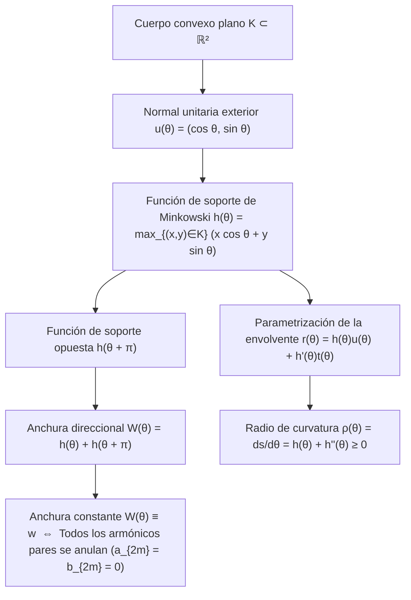
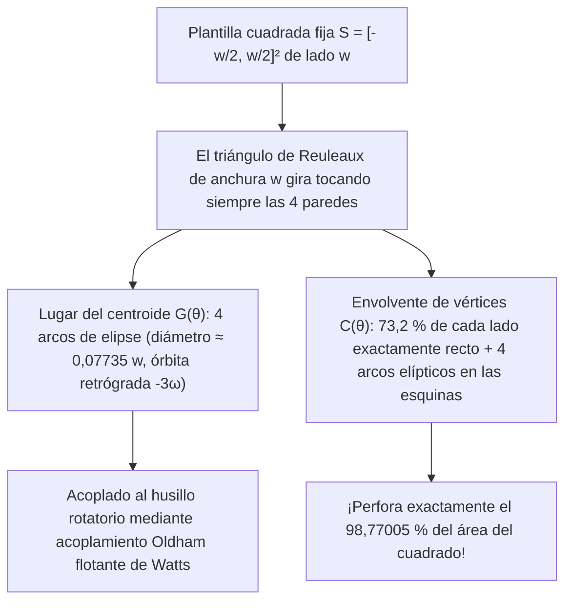

¿Por qué las <strong>tapas de alcantarilla (pozos de registro)</strong> de nuestras ciudades son casi universalmente redondas? Este célebre acertijo de ingeniería, popularizado por el premio Nobel Richard Feynman y las entrevistas de Microsoft, se basa en una desigualdad geométrica elemental.

Si una tapa de alcantarilla fuera un <strong>cuadrado</strong> de lado $w$, la abertura cuadrada tendría lado $w$, pero su diagonal mediría $\sqrt{2}w \approx 1,4142\,w$ por el teorema de Pitágoras. Si se levanta la pesada tapa cuadrada verticalmente y se gira $45^\circ$ alineándola con la diagonal del hueco, al ser $w < \sqrt{2}w$, la tapa se colará por su propio agujero hasta el fondo del pozo. En cambio, un <strong>círculo</strong> de diámetro $w$ tiene exactamente la misma anchura $w$ en todas las direcciones y jamás puede caer por su abertura.

Planteemos ahora la pregunta matemática inversa: <strong>¿Una tapa que no pueda caer por su hueco —o un rodillo sobre el cual una plataforma plana se deslice horizontalmente sin oscilar ni un milímetro hacia arriba o hacia abajo— tiene que ser necesariamente circular?</strong>

¡La respuesta es <strong>no</strong>! En geometría convexa existen infinitas figuras planas no circulares cuya distancia entre rectas tangentes de soporte paralelas es constantemente igual a $w$ en cualquier dirección: son las <strong>curvas de anchura constante</strong> (llamadas <em>orbiformes</em> por Leonhard Euler en 1778). Su representante más famoso y extremo es el <strong>triángulo de Reuleaux</strong>, bautizado en honor al ingeniero mecánico alemán <strong>Franz Reuleaux (1829–1905)</strong>.

Si colocamos un tablón plano sobre rodillos con sección de triángulo de Reuleaux de anchura $w$, el tablón avanza a altura constante $y = w$ <strong>de forma perfectamente horizontal y sin ningún cabeceo vertical</strong>. Y lo que es aún más asombroso: en 1914, el ingeniero Harry James Watts acopló una broca con perfil de triángulo de Reuleaux a un mandril flotante, logrando que un taladro rotatorio convencional <strong>perforase directamente un agujero cuadrado que cubre exactamente el $98,77005\,\%$ del área del cuadrado</strong>.

---

## 1. La paradoja cinemática: Rodillo sin vibración frente a eje saltarín

### 1.1 Traslación horizontal perfecta de un tablón

Cuando un triángulo de Reuleaux de anchura $w$ rueda sobre el suelo horizontal $y = 0$, permanece en todo ángulo de giro $\theta \in [0, 2\pi)$ simultáneamente tangente al suelo ($y = 0$) y a la cara inferior del tablón superior. Como la anchura vertical entre tangentes paralelas es constante e igual a $w$, el tablón se mantiene fijo a la altura $y_{\text{tablón}}(\theta) \equiv w$.

### 1.2 Oscilación vertical de un eje fijo en el baricentro $G$

¿Por qué entonces las ruedas de los automóviles no son triángulos de Reuleaux? Porque un vehículo se apoya sobre un <strong>eje central fijo</strong> que pasa por el centroide geométrico $G$. En un triángulo de Reuleaux construido sobre un triángulo equilátero $\triangle ABC$ de lado $w$:

- La distancia del centroide $G$ a los tres vértices $A, B, C$ es $R = \frac{w}{\sqrt{3}} = \frac{\sqrt{3}}{3}w \approx 0,57735\,w$.
- La distancia del centroide $G$ al punto medio del arco opuesto es $r = w - R = \left(1 - \frac{\sqrt{3}}{3}\right)w \approx 0,42265\,w$.

Al dar una vuelta completa sobre el suelo, la altura del eje $G$ sube y baja 3 veces por revolución con una excursión vertical de:

$$\Delta y_G = R - r = \left(\frac{2\sqrt{3}}{3} - 1\right) w \approx 0,15470\,w$$

Esta separación entre una <strong>envolvente exterior estacionaria</strong> y un <strong>centroide en órbita excéntrica</strong> es la clave cinemática de la broca para agujeros cuadrados y del motor rotativo Wankel.

---

## 2. Geometría convexa y la función de soporte de Minkowski $h_K(\theta)$

### 2.1 Función de soporte, envolvente y radio de curvatura

Sea $K \subset \mathbb{R}^2$ un cuerpo convexo compacto. Para cada ángulo $\theta \in [0, 2\pi)$, definimos el vector normal unitario exterior $\mathbf{u}(\theta) = (\cos\theta, \sin\theta)^\top$ y el vector tangente unitario $\mathbf{t}(\theta) = (-\sin\theta, \cos\theta)^\top$. La <strong>función de soporte de Minkowski (Support Function)</strong> de $K$ se define como:

$$h_K(\theta) \triangleq \max_{(x, y) \in K} \left(x\cos\theta + y\sin\theta\right)$$

Cuando $h(\theta) \in C^2(\mathbb{S}^1)$, la curva frontera $\partial K$ se reconstruye como la envolvente de las rectas de soporte $x\cos\theta + y\sin\theta = h(\theta)$ junto con su derivada $-x\sin\theta + y\cos\theta = h'(\theta)$:

$$\mathbf{r}(\theta) = \begin{pmatrix} x(\theta) \\ y(\theta) \end{pmatrix} = h(\theta)\mathbf{u}(\theta) + h'(\theta)\mathbf{t}(\theta) = \begin{pmatrix} h(\theta)\cos\theta - h'(\theta)\sin\theta \\ h(\theta)\sin\theta + h'(\theta)\cos\theta \end{pmatrix}$$

Derivando respecto a $\theta$ ($\mathbf{u}' = \mathbf{t}, \mathbf{t}' = -\mathbf{u}$), obtenemos el diferencial de arco $ds$ y el <strong>radio de curvatura</strong> $\rho(\theta)$:

$$\frac{d\mathbf{r}}{d\theta} = \left(h(\theta) + h''(\theta)\right)\mathbf{t}(\theta) \implies \rho(\theta) = \frac{ds}{d\theta} = h(\theta) + h''(\theta) \ge 0$$

### 2.2 Condición de anchura constante y series de Fourier impares

La anchura en la dirección $\theta$ es $W_K(\theta) = h_K(\theta) + h_K(\theta + \pi)$. Por tanto, $K$ tiene <strong>anchura constante $w$</strong> si y solo si:

$$h_K(\theta) + h_K(\theta + \pi) = w \qquad (\forall \theta \in [0, 2\pi))$$

De aquí se deduce que $\rho(\theta) + \rho(\theta + \pi) = w$ y que el desarrollo en serie de Fourier de $h_K(\theta)$ contiene <strong>únicamente armónicos impares</strong> ($a_{2m} = b_{2m} = 0$ para todo $m \ge 1$):

$$h_K(\theta) = \frac{w}{2} + \sum_{k=1}^{\infty} \left(a_{2k-1}\cos((2k-1)\theta) + b_{2k-1}\sin((2k-1)\theta)\right)$$

Tomando por ejemplo $h(\theta) = \frac{w}{2} + \frac{w}{16}\cos(3\theta)$, se cumple $\rho(\theta) = \frac{w}{2}(1 - \cos 3\theta) \ge 0$, lo que produce una <strong>curva de anchura constante analítica ($C^\infty$) no circular y totalmente libre de esquinas</strong> (ecuación polinómica de grado 8 de Rabinowitz, 1997).

---

## 3. Área del triángulo de Reuleaux y de los polígonos de Reuleaux impares

Trazando tres arcos de círculo de radio $w$ centrados en los vértices $A, B, C$ de un triángulo equilátero de lado $w$, obtenemos el triángulo de Reuleaux. Por inclusión-exclusión, su área es la suma de tres sectores circulares de ángulo $\frac{\pi}{3}$ ($\frac{\pi}{6}w^2$ cada uno) menos dos veces el área del triángulo equilátero central ($\frac{\sqrt{3}}{4}w^2$):

$$A_{\text{Reuleaux}} = 3\left(\frac{\pi}{6}w^2\right) - 2\left(\frac{\sqrt{3}}{4}w^2\right) = \frac{1}{2}\left(\pi - \sqrt{3}\right) w^2 \approx 0,7047709\,w^2$$

Esto representa un $10,27\,\%$ menos de área que el círculo del mismo diámetro $w$ ($A_{\text{círculo}} = \frac{\pi}{4}w^2 \approx 0,7853982\,w^2$). Para cualquier polígono regular de Reuleaux con un número impar de lados $n = 2k+1$ ($n = 3, 5, 7, \dots$), su área exacta viene dada por:

$$A_n = \frac{w^2}{2}\left(\pi - n\tan\left(\frac{\pi}{2n}\right)\right) \qquad (n = 3, 5, 7, 9, \dots)$$

| Curva de anchura constante $w$ | Vértices $n$ | Perímetro $L$ | Fórmula exacta del área $A(w)$ | Área numérica | Razón $A / A_{\text{círculo}}$ |
| :--- | :---: | :---: | :---: | :---: | :---: |
| <strong>Triángulo de Reuleaux</strong> | $3$ | $\pi w$ | $\frac{1}{2}\left(\pi - \sqrt{3}\right)w^2$ | $0,704771\,w^2$ | $89,73\%$ (<strong>Mínimo</strong>) |
| <strong>Pentágono de Reuleaux</strong> | $5$ | $\pi w$ | $\frac{1}{2}\left(\pi - 5\tan\frac{\pi}{10}\right)w^2$ | $0,756827\,w^2$ | $96,36\%$ |
| <strong>Heptágono de Reuleaux</strong> (Monedas UK 20p/50p) | $7$ | $\pi w$ | $\frac{1}{2}\left(\pi - 7\tan\frac{\pi}{14}\right)w^2$ | $0,770921\,w^2$ | $98,16\%$ |
| <strong>Curva suave analítica</strong> ($h = \frac{w}{2} + \frac{w}{16}\cos 3\theta$) | $0$ ($C^\infty$) | $\pi w$ | $\frac{63\pi}{256}w^2$ | $0,773126\,w^2$ | $98,44\%$ |
| <strong>Círculo (Circle)</strong> | $0$ ($C^\infty$) | $\pi w$ | $\frac{\pi}{4}w^2$ | $0,785398\,w^2$ | $100,00\%$ (<strong>Máximo</strong>) |

---

## 4. Dos demostraciones completas del teorema de Barbier (1860) y el teorema de Blaschke–Lebesgue (1914)

> <strong>Teorema de Barbier (Joseph-Émile Barbier, 1860).</strong>
> <em>Toda curva convexa plana de anchura constante $w$ posee exactamente el mismo perímetro que un círculo de diámetro $w$:</em>
> $$L(\partial K) = \pi w$$

### 4.1 Demostración 1: Geometría diferencial mediante la función de soporte

Integrando $ds = \left(h(\theta) + h''(\theta)\right)d\theta$ en $[0, 2\pi]$ y aplicando la $2\pi$-periodicidad de $h'(\theta)$:

$$L(\partial K) = \int_0^{2\pi} h(\theta)\,d\theta + \Big[h'(\theta)\Big]_0^{2\pi} = \int_0^{\pi} \underbrace{\left(h(\theta) + h(\theta + \pi)\right)}_{= w} d\theta = \int_0^{\pi} w\,d\theta = \pi w$$

Dado que una curva de anchura constante no puede contener segmentos rectos, $h_K$ es siempre de clase $C^1(\mathbb{S}^1)$ (o mediante aproximación por molificadores $h_\varepsilon = h_K * \eta_\varepsilon$ en la métrica de Hausdorff), por lo que la prueba es totalmente rigurosa incluso con vértices. $\blacksquare$

### 4.2 Demostración 2: Geometría integral, fórmula de Cauchy–Crofton y el «Fideo de Buffon»

En el espacio de rectas orientadas $\ell(p, \theta) : x\cos\theta + y\sin\theta = p$ con la medida cinemática invariante $d\ell = dp \wedge d\theta$, la linealidad de la esperanza aplicada al número de cortes $n_\gamma(p, \theta) = \#(\gamma \cap \ell(p, \theta))$ de una curva rectificable («fideo de Buffon») conduce a la <strong>fórmula de Cauchy–Crofton</strong>:

$$\int_0^{2\pi} \int_{-\infty}^{\infty} n_\gamma(p, \theta)\,dp\,d\theta = 4 L(\gamma)$$

Para la frontera $\gamma = \partial K$ de un cuerpo convexo, toda recta secante corta a $\partial K$ en exactamente $n_{\partial K} = 2$ puntos sobre un intervalo de longitud $W_K(\theta) = w$. Por consiguiente:

$$4 L(\partial K) = \int_0^{2\pi} 2 W_K(\theta)\,d\theta = 2 \int_0^{2\pi} w\,d\theta = 4\pi w \implies L(\partial K) = \pi w \quad \blacksquare$$

### 4.3 El teorema de Blaschke–Lebesgue (1914)

La fórmula de área de Blaschke $A(K) = \frac{1}{2}\int_0^{2\pi} \left(h(\theta)^2 - h'(\theta)^2\right)d\theta$ junto con la identidad de Parseval arroja:

$$A(K) = \frac{\pi}{4} w^2 - \frac{\pi}{2} \sum_{k=2}^{\infty} \left((2k-1)^2 - 1\right)\left(a_{2k-1}^2 + b_{2k-1}^2\right)$$

Así, el círculo maximiza de forma única el área ($\frac{\pi}{4}w^2$), mientras que la minimización bajo la restricción $0 \le \rho(\theta) \le w$ conduce por el principio del máximo de Pontryagin a una distribución de curvatura «bang-bang» $\rho(\theta) \in \{0, w\}$ con 3 conmutaciones: <strong>el triángulo de Reuleaux minimiza de forma única el área entre todas las curvas de anchura constante $w$</strong> (Henri Lebesgue 1914, Wilhelm Blaschke 1915).

---

## 5. Cómo el triángulo de Reuleaux taladra un agujero cuadrado: La broca de Harry Watts (1914)

Dentro del cuadrado fijo $S = \left[-\frac{w}{2}, \frac{w}{2}\right]^2$, en el intervalo fundamental $\theta \in \left[\frac{\pi}{6}, \frac{\pi}{3}\right]$, el vértice $A$ se desliza por la pared izquierda $x = -\frac{w}{2}$ y el vértice $B$ por la pared inferior $y = -\frac{w}{2}$:

$$A(\theta) = \begin{pmatrix} -\frac{w}{2} \\ -\frac{w}{2} + w\sin\theta \end{pmatrix}, \qquad B(\theta) = \begin{pmatrix} -\frac{w}{2} + w\cos\theta \\ -\frac{w}{2} \end{pmatrix}$$

### 5.1 Órbita elíptica del centroide $G(\theta)$ y cobertura del $98,77\,\%$ del cuadrado

1. <strong>Lugar del centroide $G(\theta)$</strong>:
   $$x_G(\theta) + \frac{w}{2} = \frac{w}{\sqrt{3}}\cos\left(\theta - \frac{\pi}{6}\right), \qquad y_G(\theta) + \frac{w}{2} = \frac{w}{\sqrt{3}}\sin\left(\theta + \frac{\pi}{6}\right)$$
   Es un arco de elipse exacto centrado en la esquina $\left(-\frac{w}{2}, -\frac{w}{2}\right)$ con semiejes $a_G = \frac{\sqrt{3}+1}{2\sqrt{3}}w$ y $b_G = \frac{\sqrt{3}-1}{2\sqrt{3}}w$. Los 4 arcos forman una pequeña órbita cerrada de diámetro $d_G = \left(\frac{2\sqrt{3}-3}{3}\right)w \approx 0,07735\,w$ recorrida a velocidad $-3\omega$, absorbida mediante un <strong>acoplamiento Oldham flotante</strong>.
2. <strong>Trayectoria de esquina $C(\alpha)$ y área barrida $A_{\text{swept}}$</strong>:
   Haciendo $\alpha = \frac{\pi}{3} - \theta \in \left[0, \frac{\pi}{6}\right]$, el vértice $C$ traza en la esquina superior derecha el arco de elipse:
   $$x_C(\alpha) = -\frac{w}{2} + w\cos\alpha, \qquad y_C(\alpha) = -\frac{w}{2} + w\cos\left(\frac{\pi}{6} - \alpha\right)$$
   En cada lado del cuadrado, el tramo central de longitud $(\sqrt{3}-1)w \approx 0,73205\,w$ ($73,2\,\%$ del lado) es <strong>matemáticamente recto</strong>. El área sin cortar en una esquina es:
   $$A_{\text{esquina}} = w^2 \int_0^{\pi/6} \left(1 - \cos\left(\frac{\pi}{6}-\alpha\right)\right)\sin\alpha\,d\alpha = \left(1 - \frac{\sqrt{3}}{2} - \frac{\pi}{24}\right) w^2 \approx 0,0030749\,w^2$$
   Por tanto, el área total excavada por la broca de Reuleaux es exactamente:
   $$A_{\text{barrida}} = w^2 - 4 A_{\text{esquina}} = \left(2\sqrt{3} + \frac{\pi}{6} - 3\right) w^2 \approx 0,9877005\,w^2 \quad (98,77\,\%!)$$

---

## 6. Aplicaciones modernas y frontera 3D: Cuerpos de Meissner (1911) y conjetura de Meissner (1934)

Además del <strong>motor rotativo Wankel</strong> (epitrocoide de dos lóbulos) y las <strong>monedas británicas de 20p y 50p</strong> (heptágonos de Reuleaux, $n=7$), el salto a 3 dimensiones revela que el <strong>tetraedro de Reuleaux</strong> <strong>no</strong> tiene anchura constante, pues la distancia entre los puntos medios de dos aristas curvas opuestas es

$$w_{\text{arista}} = \left(\sqrt{3} - \frac{\sqrt{2}}{2}\right) w \approx 1,024944\,w > w$$

En 1911, <strong>Ernst Meissner y Friedrich Schilling</strong> redondearon quirúrgicamente tres de las seis aristas mediante parches de toro husiforme (<em>spindle torus</em>), creando los dos <strong>cuerpos de Meissner</strong> $M_1$ y $M_2$ de volumen $V \approx 0,419860\,w^3$. La <strong>conjetura de Meissner (Bonnesen–Fenchel, 1934)</strong>, que afirma que $M_1$ y $M_2$ minimizan el volumen (y el área superficial vía la relación de Blaschke $V = \frac{1}{2}wS - \frac{\pi}{3}w^3$) entre todos los cuerpos 3D de anchura constante $w$, sigue siendo hoy uno de los grandes problemas abiertos de la geometría.
