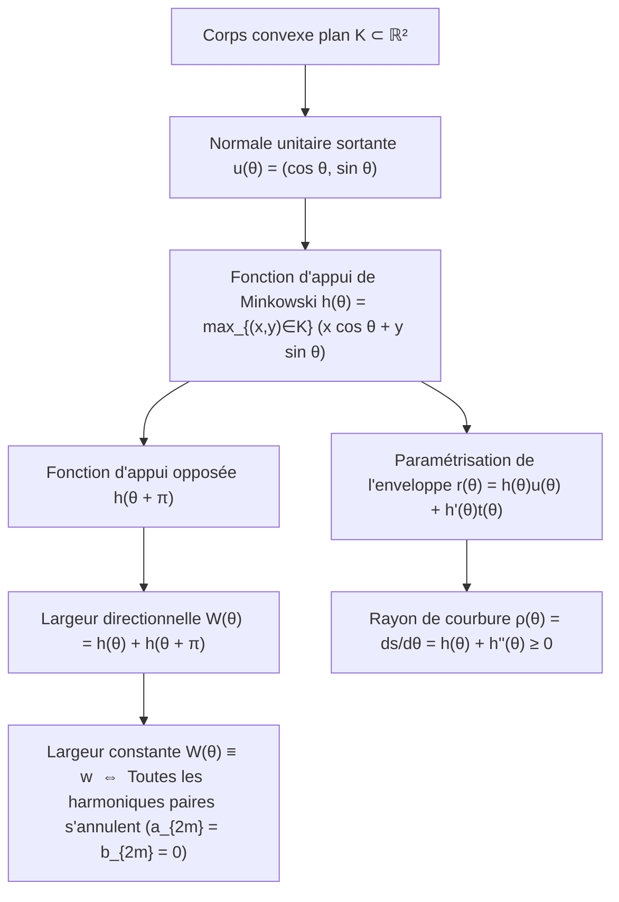
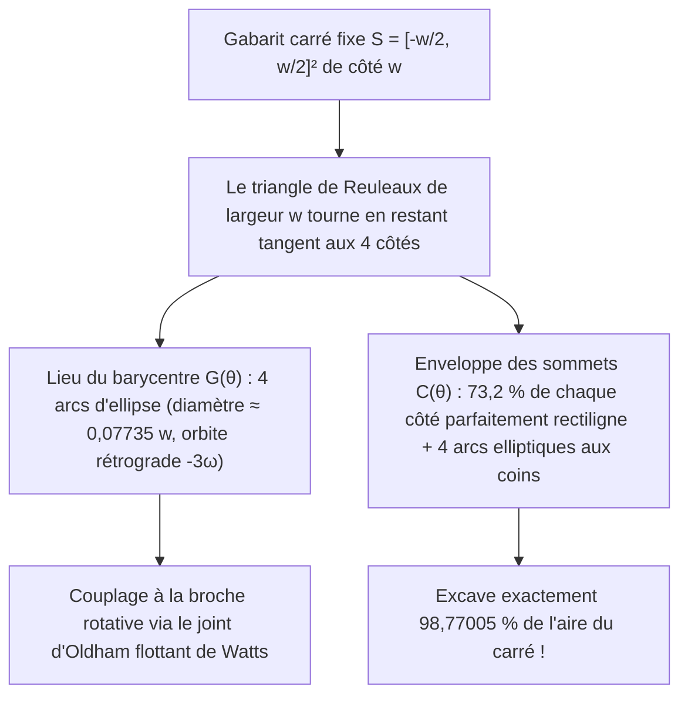

Pourquoi les <strong>plaques d'égout (regards de chaussée)</strong> de nos villes sont-elles presque universellement rondes ? Cette célèbre énigme d'ingénierie, popularisée par Richard Feynman et les entretiens de recrutement de Microsoft, repose sur une inégalité géométrique élémentaire.

Si une plaque d'égout était un <strong>carré</strong> de côté $w$, l'ouverture carrée aurait certes un côté $w$, mais sa diagonale mesurerait $\sqrt{2}w \approx 1,4142\,w$ d'après le théorème de Pythagore. En redressant verticalement le couvercle carré et en l'alignant à $45^\circ$ le long de la diagonale, la plaque — de largeur $w < \sqrt{2}w$ — glisserait à travers sa propre ouverture pour tomber au fond du puits. Un <strong>cercle</strong> de diamètre $w$, en revanche, présente la même largeur $w$ dans toutes les directions et ne peut jamais tomber dans son trou.

Posons alors la question mathématique inverse : <strong>Un couvercle qui ne peut pas tomber dans son ouverture — ou un rouleau sur lequel une planche plane glisse horizontalement sans la moindre oscillation verticale — doit-il nécessairement être circulaire ?</strong>

La réponse est <strong>non</strong> ! En géométrie convexe, il existe une infinité de figures planes non circulaires dont la distance entre deux droites d'appui parallèles est identiquement égale à $w$ dans toutes les directions : ce sont les <strong>courbes de largeur constante</strong> (appelées <em>orbiformes</em> par Leonhard Euler en 1778). Leur représentant le plus célèbre et le plus extrême est le <strong>triangle de Reuleaux</strong>, nommé d'après l'ingénieur allemand <strong>Franz Reuleaux (1829–1905)</strong>.

Si l'on pose une planche plate sur des rondins ayant pour section un triangle de Reuleaux de largeur $w$, la planche avance à la hauteur constante $y = w$ <strong>sans aucun soubresaut vertical</strong>. Plus spectaculaire encore : en 1914, l'ingénieur Harry James Watts monta une mèche en triangle de Reuleaux sur un mandrin flottant, permettant à une perceuse rotative ordinaire de <strong>percer directement un trou carré couvrant $98,77005\,\%$ de l'aire du carré</strong> !

---

## 1. Le paradoxe cinématique : Rouleau sans secousse contre essieu bondissant

### 1.1 Translation horizontale parfaite d'une planche

Lorsqu'un triangle de Reuleaux de largeur $w$ roule sans glisser sur le sol horizontal $y = 0$, il reste à tout angle $\theta \in [0, 2\pi)$ simultanément tangent au sol ($y = 0$) et à la face inférieure de la planche posée au-dessus. La largeur verticale étant constante et égale à $w$, la planche reste verrouillée à l'altitude $y_{\text{planche}}(\theta) \equiv w$.

### 1.2 Oscillation verticale d'un essieu fixé au centre de gravité $G$

Pourquoi ne fabrique-t-on pas de roues de vélo en triangle de Reuleaux ? Parce qu'une roue de véhicule est fixée par un <strong>essieu central</strong> passant par son centre de gravité géométrique $G$. Or, dans un triangle de Reuleaux construit sur un triangle équilatéral $\triangle ABC$ de côté $w$ :

- La distance du centre $G$ aux trois sommets $A, B, C$ vaut $R = \frac{w}{\sqrt{3}} = \frac{\sqrt{3}}{3}w \approx 0,57735\,w$.
- La distance du centre $G$ au milieu de l'arc opposé vaut $r = w - R = \left(1 - \frac{\sqrt{3}}{3}\right)w \approx 0,42265\,w$.

Au cours d'une rotation complète sur le sol, l'essieu $G$ monte et descend 3 fois par tour avec une amplitude crête-à-crête de :

$$\Delta y_G = R - r = \left(\frac{2\sqrt{3}}{3} - 1\right) w \approx 0,15470\,w$$

Ce découplage entre une <strong>enveloppe extérieure de hauteur constante</strong> et un <strong>barycentre en orbite excentrique</strong> est précisément le secret mécanique du foret à trou carré et du moteur rotatif Wankel.

---

## 2. Géométrie convexe et fonction d'appui de Minkowski $h_K(\theta)$

### 2.1 Fonction d'appui, enveloppe et rayon de courbure

Soit $K \subset \mathbb{R}^2$ un corps convexe compact. Pour tout angle $\theta \in [0, 2\pi)$, notons $\mathbf{u}(\theta) = (\cos\theta, \sin\theta)^\top$ la normale unitaire sortante et $\mathbf{t}(\theta) = (-\sin\theta, \cos\theta)^\top$ la tangente unitaire. La <strong>fonction d'appui de Minkowski (Support Function)</strong> de $K$ est définie par :

$$h_K(\theta) \triangleq \max_{(x, y) \in K} \left(x\cos\theta + y\sin\theta\right)$$

Lorsque $h(\theta) \in C^2(\mathbb{S}^1)$, la frontière $\partial K$ est l'enveloppe de la famille des droites d'appui $x\cos\theta + y\sin\theta = h(\theta)$, ce qui donne en dérivant par rapport à $\theta$ ($-x\sin\theta + y\cos\theta = h'(\theta)$) :

$$\mathbf{r}(\theta) = \begin{pmatrix} x(\theta) \\ y(\theta) \end{pmatrix} = h(\theta)\mathbf{u}(\theta) + h'(\theta)\mathbf{t}(\theta) = \begin{pmatrix} h(\theta)\cos\theta - h'(\theta)\sin\theta \\ h(\theta)\sin\theta + h'(\theta)\cos\theta \end{pmatrix}$$

En dérivant par rapport à $\theta$ ($\mathbf{u}' = \mathbf{t}, \mathbf{t}' = -\mathbf{u}$), on obtient l'élément d'arc $ds$ et le <strong>rayon de courbure</strong> $\rho(\theta)$ :

$$\frac{d\mathbf{r}}{d\theta} = \left(h(\theta) + h''(\theta)\right)\mathbf{t}(\theta) \implies \rho(\theta) = \frac{ds}{d\theta} = h(\theta) + h''(\theta) \ge 0$$

### 2.2 Condition de largeur constante et séries de Fourier impaires

La largeur dans la direction $\theta$ étant $W_K(\theta) = h_K(\theta) + h_K(\theta + \pi)$, $K$ est de <strong>largeur constante $w$</strong> si et seulement si :

$$h_K(\theta) + h_K(\theta + \pi) = w \qquad (\forall \theta \in [0, 2\pi))$$

On en déduit que $\rho(\theta) + \rho(\theta + \pi) = w$ (la somme des rayons de courbure aux points de contact opposés vaut $w$) et que le développement en série de Fourier de $h_K(\theta)$ ne contient <strong>que des harmoniques impaires</strong> ($a_{2m} = b_{2m} = 0$ pour tout $m \ge 1$) :

$$h_K(\theta) = \frac{w}{2} + \sum_{k=1}^{\infty} \left(a_{2k-1}\cos((2k-1)\theta) + b_{2k-1}\sin((2k-1)\theta)\right)$$

En choisissant par exemple $h(\theta) = \frac{w}{2} + \frac{w}{16}\cos(3\theta)$, on obtient $\rho(\theta) = \frac{w}{2}(1 - \cos 3\theta) \ge 0$, ce qui fournit une <strong>courbe de largeur constante analytique ($C^\infty$) non circulaire et totalement dépourvue de sommets anguleux</strong> (courbe algébrique polynomiale de degré 8 de Rabinowitz, 1997).

---

## 3. Aire du triangle de Reuleaux et des polygones de Reuleaux impairs

En traçant trois arcs de cercle de rayon $w$ centrés aux sommets $A, B, C$ d'un triangle équilatéral de côté $w$, on forme le triangle de Reuleaux. Par le principe d'inclusion-exclusion, son aire vaut la somme de trois secteurs circulaires d'angle $\frac{\pi}{3}$ ($\frac{\pi}{6}w^2$ chacun) diminuée de deux fois l'aire du triangle équilatéral central ($\frac{\sqrt{3}}{4}w^2$) :

$$A_{\text{Reuleaux}} = 3\left(\frac{\pi}{6}w^2\right) - 2\left(\frac{\sqrt{3}}{4}w^2\right) = \frac{1}{2}\left(\pi - \sqrt{3}\right) w^2 \approx 0,7047709\,w^2$$

C'est $10,27\,\%$ d'aire en moins que le disque de même diamètre $w$ ($A_{\text{cercle}} = \frac{\pi}{4}w^2 \approx 0,7853982\,w^2$). Pour tout entier impair $n = 2k+1$ ($n = 3, 5, 7, \dots$), l'aire du polygone de Reuleaux régulier à $n$ côtés est donnée par la formule générale :

$$A_n = \frac{w^2}{2}\left(\pi - n\tan\left(\frac{\pi}{2n}\right)\right) \qquad (n = 3, 5, 7, 9, \dots)$$

| Courbe de largeur constante $w$ | Sommets $n$ | Périmètre $L$ | Formule d'aire exacte $A(w)$ | Aire numérique | Ratio $A / A_{\text{cercle}}$ |
| :--- | :---: | :---: | :---: | :---: | :---: |
| <strong>Triangle de Reuleaux</strong> | $3$ | $\pi w$ | $\frac{1}{2}\left(\pi - \sqrt{3}\right)w^2$ | $0,704771\,w^2$ | $89,73\%$ (<strong>Minimum</strong>) |
| <strong>Pentagone de Reuleaux</strong> | $5$ | $\pi w$ | $\frac{1}{2}\left(\pi - 5\tan\frac{\pi}{10}\right)w^2$ | $0,756827\,w^2$ | $96,36\%$ |
| <strong>Heptagone de Reuleaux</strong> (Pièces UK 20p/50p) | $7$ | $\pi w$ | $\frac{1}{2}\left(\pi - 7\tan\frac{\pi}{14}\right)w^2$ | $0,770921\,w^2$ | $98,16\%$ |
| <strong>Courbe lisse analytique</strong> ($h = \frac{w}{2} + \frac{w}{16}\cos 3\theta$) | $0$ ($C^\infty$) | $\pi w$ | $\frac{63\pi}{256}w^2$ | $0,773126\,w^2$ | $98,44\%$ |
| <strong>Cercle (Circle)</strong> | $0$ ($C^\infty$) | $\pi w$ | $\frac{\pi}{4}w^2$ | $0,785398\,w^2$ | $100,00\%$ (<strong>Maximum</strong>) |

---

## 4. Deux démonstrations complètes du théorème de Barbier (1860) et théorème de Blaschke–Lebesgue (1914)

> <strong>Théorème de Barbier (Joseph-Émile Barbier, 1860).</strong>
> <em>Toute courbe convexe plane de largeur constante $w$ possède exactement le même périmètre qu'un cercle de diamètre $w$ :</em>
> $$L(\partial K) = \pi w$$

### 4.1 Preuve 1 : Géométrie différentielle et fonction d'appui

En intégrant $ds = \left(h(\theta) + h''(\theta)\right)d\theta$ sur $[0, 2\pi]$ et en utilisant la $2\pi$-périodicité de $h'(\theta)$ :

$$L(\partial K) = \int_0^{2\pi} h(\theta)\,d\theta + \Big[h'(\theta)\Big]_0^{2\pi} = \int_0^{\pi} \underbrace{\left(h(\theta) + h(\theta + \pi)\right)}_{= w} d\theta = \int_0^{\pi} w\,d\theta = \pi w$$

Comme une courbe de largeur constante ne contient aucun segment rectiligne, $h_K$ est partout de classe $C^1(\mathbb{S}^1)$ (ou par régularisation par convolution $h_\varepsilon = h_K * \eta_\varepsilon$ dans la métrique de Hausdorff), ce qui valide la preuve même en présence de coins. $\blacksquare$

### 4.2 Preuve 2 : Géométrie intégrale, formule de Cauchy–Crofton et « Nouille de Buffon »

Dans l'espace des droites orientées $\ell(p, \theta) : x\cos\theta + y\sin\theta = p$ muni de la mesure cinématique invariante $d\ell = dp \wedge d\theta$, la linéarité de l'espérance appliquée au nombre d'intersections $n_\gamma(p, \theta) = \#(\gamma \cap \ell(p, \theta))$ d'une courbe rectifiable (« nouille de Buffon ») donne la <strong>formule de Cauchy–Crofton</strong> :

$$\int_0^{2\pi} \int_{-\infty}^{\infty} n_\gamma(p, \theta)\,dp\,d\theta = 4 L(\gamma)$$

Pour la frontière $\gamma = \partial K$ d'un corps convexe, toute droite sécante coupe $\partial K$ en exactement $n_{\partial K} = 2$ points sur un intervalle de longueur $W_K(\theta) = w$. D'où :

$$4 L(\partial K) = \int_0^{2\pi} 2 W_K(\theta)\,d\theta = 2 \int_0^{2\pi} w\,d\theta = 4\pi w \implies L(\partial K) = \pi w \quad \blacksquare$$

### 4.3 Le théorème de Blaschke–Lebesgue (1914)

La formule d'aire de Blaschke $A(K) = \frac{1}{2}\int_0^{2\pi} \left(h(\theta)^2 - h'(\theta)^2\right)d\theta$ combinée à l'identité de Parseval donne :

$$A(K) = \frac{\pi}{4} w^2 - \frac{\pi}{2} \sum_{k=2}^{\infty} \left((2k-1)^2 - 1\right)\left(a_{2k-1}^2 + b_{2k-1}^2\right)$$

Le cercle maximise donc uniquement l'aire ($\frac{\pi}{4}w^2$), tandis que la minimisation sous la contrainte $0 \le \rho(\theta) \le w$ conduit par le principe du maximum de Pontryagin à une courbure « bang-bang » $\rho(\theta) \in \{0, w\}$ à 3 commutations : <strong>le triangle de Reuleaux minimise uniquement l'aire parmi toutes les courbes de largeur constante $w$</strong> (Henri Lebesgue 1914, Wilhelm Blaschke 1915).

---

## 5. Comment le triangle de Reuleaux perce un trou carré : Le foret de Harry Watts (1914)

Dans le carré fixe $S = \left[-\frac{w}{2}, \frac{w}{2}\right]^2$, sur l'intervalle fondamental $\theta \in \left[\frac{\pi}{6}, \frac{\pi}{3}\right]$, le sommet $A$ glisse sur le mur gauche $x = -\frac{w}{2}$ et le sommet $B$ sur le mur inférieur $y = -\frac{w}{2}$ :

$$A(\theta) = \begin{pmatrix} -\frac{w}{2} \\ -\frac{w}{2} + w\sin\theta \end{pmatrix}, \qquad B(\theta) = \begin{pmatrix} -\frac{w}{2} + w\cos\theta \\ -\frac{w}{2} \end{pmatrix}$$

### 5.1 Orbite elliptique du barycentre $G(\theta)$ et couverture de $98,77\,\%$ du carré

1. <strong>Lieu du centre de gravité $G(\theta)$</strong> :
   $$x_G(\theta) + \frac{w}{2} = \frac{w}{\sqrt{3}}\cos\left(\theta - \frac{\pi}{6}\right), \qquad y_G(\theta) + \frac{w}{2} = \frac{w}{\sqrt{3}}\sin\left(\theta + \frac{\pi}{6}\right)$$
   C'est un arc d'ellipse exact centré au coin $\left(-\frac{w}{2}, -\frac{w}{2}\right)$ de demi-axes $a_G = \frac{\sqrt{3}+1}{2\sqrt{3}}w$ et $b_G = \frac{\sqrt{3}-1}{2\sqrt{3}}w$. Les 4 arcs forment une petite orbite fermée de diamètre $d_G = \left(\frac{2\sqrt{3}-3}{3}\right)w \approx 0,07735\,w$ parcourue à vitesse $-3\omega$, compensée par un <strong>joint d'Oldham flottant</strong>.
2. <strong>Trajectoire de coin $C(\alpha)$ et aire balayée $A_{\text{swept}}$</strong> :
   En posant $\alpha = \frac{\pi}{3} - \theta \in \left[0, \frac{\pi}{6}\right]$, le sommet $C$ décrit dans le coin supérieur droit l'arc d'ellipse :
   $$x_C(\alpha) = -\frac{w}{2} + w\cos\alpha, \qquad y_C(\alpha) = -\frac{w}{2} + w\cos\left(\frac{\pi}{6} - \alpha\right)$$
   Sur chaque côté du carré, le segment central de longueur $(\sqrt{3}-1)w \approx 0,73205\,w$ ($73,2\,\%$ du côté) est <strong>mathématiquement rectiligne</strong> ! L'aire non coupée dans un coin vaut :
   $$A_{\text{coin}} = w^2 \int_0^{\pi/6} \left(1 - \cos\left(\frac{\pi}{6}-\alpha\right)\right)\sin\alpha\,d\alpha = \left(1 - \frac{\sqrt{3}}{2} - \frac{\pi}{24}\right) w^2 \approx 0,0030749\,w^2$$
   L'aire totale excavée par le foret de Reuleaux est donc exactement :
   $$A_{\text{balayée}} = w^2 - 4 A_{\text{coin}} = \left(2\sqrt{3} + \frac{\pi}{6} - 3\right) w^2 \approx 0,9877005\,w^2 \quad (98,77\,\%!)$$

---

## 6. Applications modernes et frontière 3D : Corps de Meissner (1911) et conjecture de Meissner (1934)

Outre le <strong>moteur rotatif Wankel</strong> (épitrochoïde à deux lobes), les <strong>pièces britanniques de 20p et 50p</strong> (heptagones de Reuleaux, $n=7$) et les cames à arrêt des projecteurs <strong>Lumière Cinématographe</strong>, le passage en dimension 3 réserve une surprise majeure : le <strong>tétraèdre de Reuleaux</strong> n'est <strong>pas</strong> de largeur constante car la distance entre les milieux de deux arêtes courbes opposées vaut

$$w_{\text{arête}} = \left(\sqrt{3} - \frac{\sqrt{2}}{2}\right) w \approx 1,024944\,w > w$$

En 1911, <strong>Ernst Meissner et Friedrich Schilling</strong> ont résolu ce problème en arrondissant trois des six arêtes par des portions de tore fusiforme (<em>spindle torus</em>), créant les deux <strong>corps de Meissner</strong> $M_1$ et $M_2$ de volume $V \approx 0,419860\,w^3$. La <strong>conjecture de Meissner (Bonnesen–Fenchel, 1934)</strong>, selon laquelle $M_1$ et $M_2$ minimisent le volume (et la surface via la relation de Blaschke $V = \frac{1}{2}wS - \frac{\pi}{3}w^3$) parmi tous les corps de largeur constante $w$ en 3D, demeure à ce jour un problème ouvert majeur.
