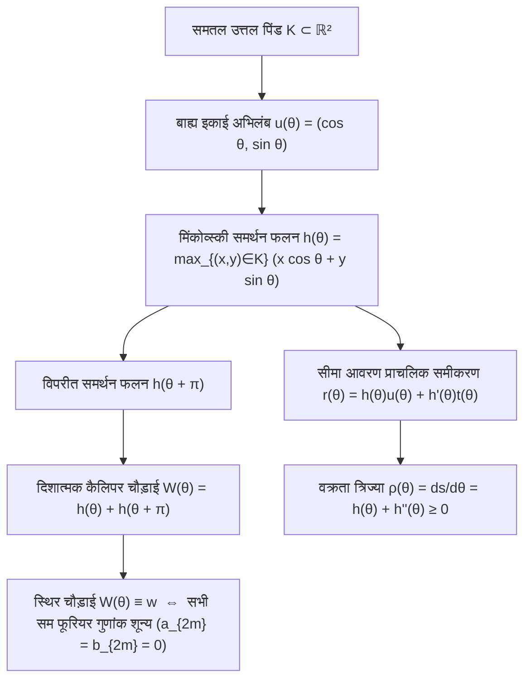
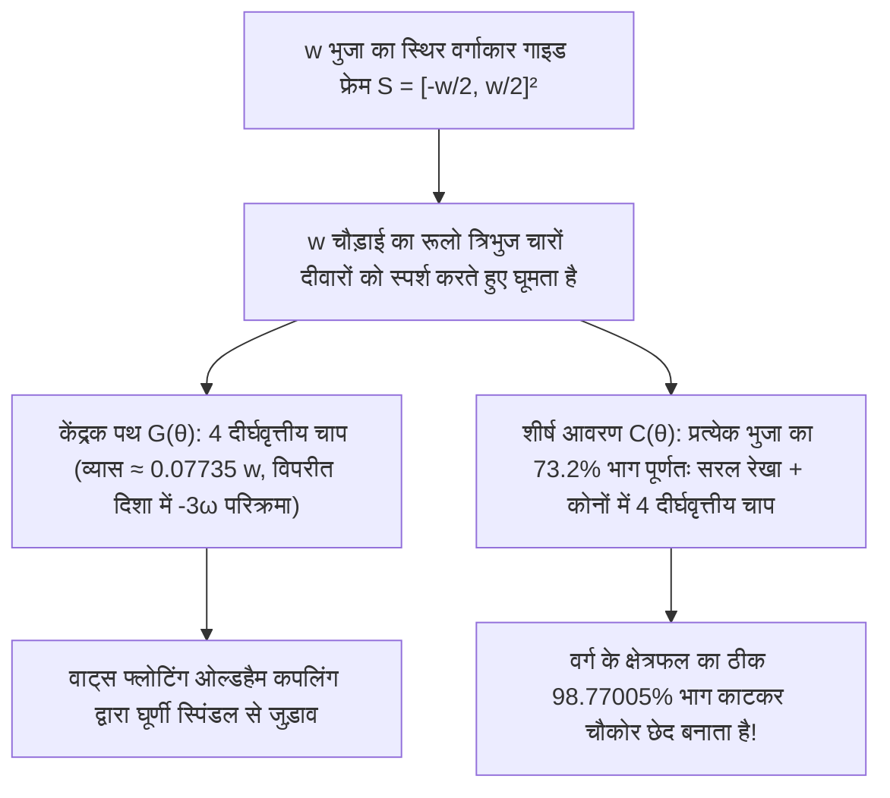

शहर की सड़कों पर चलते समय क्या आपने कभी सोचा है कि सीवर के <strong>मैनहोल के ढक्कन (Manhole Covers)</strong> लगभग हमेशा गोल (वृत्ताकार) ही क्यों होते हैं? नोबेल पुरस्कार विजेता भौतिक विज्ञानी रिचर्ड फाइनमैन द्वारा लोकप्रिय बनाई गई और बाद में माइक्रोसॉफ्ट के साक्षात्कारों में पूछी जाने वाली यह प्रसिद्ध अभियांत्रिकी पहेली एक सरल ज्यामितीय असमिका पर आधारित है।

यदि मैनहोल का ढक्कन $w$ भुजा वाला एक <strong>वर्ग (Square)</strong> होता, तो वर्गाकार खुले मुँह की भुजा भी $w$ होती, किंतु पाइथागोरस प्रमेय के अनुसार उसका विकर्ण $\sqrt{2}w \approx 1.4142\,w$ होता। यदि भारी ढलवाँ लोहे के वर्गाकार ढक्कन को सीधा खड़ा करके मुँह के विकर्ण की दिशा में $45^\circ$ घुमाया जाए, तो $w < \sqrt{2}w$ होने के कारण ढक्कन अपने ही छेद से फिसलकर नीचे सीवर में गिर जाएगा। इसके विपरीत, $w$ व्यास वाले <strong>वृत्त (Circle)</strong> की चौड़ाई हर दिशा में $w$ रहती है, इसलिए उसे किसी भी कोण पर झुकाने पर वह कभी छेद में नहीं गिर सकता।

अब आइए इसके विपरीत एक गहरा गणितीय प्रश्न पूछें: <strong>क्या एक ऐसा मैनहोल का ढक्कन जो अपने छेद में न गिरे — या एक ऐसा रोलर (बेलन) जिस पर रखा समतल तख्ता बिना एक मिलीमीटर भी ऊपर-नीचे हिले पूरी तरह क्षैतिज रूप से फिसल सके — अनिवार्य रूप से वृत्ताकार ही होना चाहिए?</strong>

उत्तर है — <strong>नहीं</strong>! उत्तल ज्यामिति (Convex Geometry) में अनंत रूप से अनेक ऐसी गैर-वृत्ताकार समतल आकृतियाँ हैं जिनके समानांतर स्पर्श रेखाओं (कैलिपर्स) के बीच की दूरी प्रत्येक दिशा में एक निश्चित स्थिरांक $w$ रहती है: इन्हें <strong>स्थिर चौड़ाई के वक्र (Curves of Constant Width)</strong> कहा जाता है। इनका सबसे प्रसिद्ध और चरम उदाहरण <strong>रूलो त्रिभुज (Reuleaux Triangle)</strong> है, जिसका नाम 19वीं सदी के जर्मन यांत्रिकी अभियंता <strong>फ्रांज रूलो (Franz Reuleaux, 1829–1905)</strong> के नाम पर रखा गया है।

यदि आप $w$ चौड़ाई वाले रूलो त्रिभुज के अनुप्रस्थ काट वाले लट्ठों के ऊपर एक समतल तख्ता रखें और उसे आगे धकेलें, तो तख्ता $y = w$ की स्थिर ऊँचाई पर <strong>बिना किसी ऊर्ध्वाधर कंपन के एकदम क्षैतिज रूप से आगे बढ़ता है</strong>। इससे भी अधिक आश्चर्यजनक बात यह है कि 1914 में ब्रिटिश अभियंता हैरी जेम्स वाट्स (Harry James Watts) ने रूलो त्रिभुज के आकार की ड्रिल बिट को एक फ्लोटिंग चक (Floating Chuck) में लगाकर साधारण रोटरी ड्रिल मशीन से धातु में <strong>सीधे चौकोर छेद (वर्ग के $98.77005\,\%$ क्षेत्रफल को काटते हुए) ड्रिल कर दिखाया</strong>!

---

## 1. गतिकी विरोधाभास: बिना कंपन का रोलर बनाम उछलती हुई धुरी (Axle)

### 1.1 रूलो रोलर्स पर समतल तख्ते की पूर्णतः क्षैतिज गति

जब $w$ चौड़ाई का रूलो त्रिभुज क्षैतिज फर्श $y = 0$ पर बिना फिसले लुढ़कता है, तो किसी भी घूर्णन कोण $\theta \in [0, 2\pi)$ पर वह एक साथ फर्श ($y = 0$) और तख्ते की निचली सतह को स्पर्श करता है। चूँकि समानांतर क्षैतिज स्पर्श रेखाओं के बीच की ऊर्ध्वाधर दूरी सदैव $w$ होती है, इसलिए तख्ता $y_{\text{plank}}(\theta) \equiv w$ की स्थिर ऊँचाई पर बना रहता है।

### 1.2 केंद्रक (Centroid) $G$ पर लगी स्थिर धुरी का ऊर्ध्वाधर दोलन

तो फिर साइकिल या कार के पहिये रूलो त्रिभुज के आकार के क्यों नहीं बनाए जाते? क्योंकि वाहन का भार पहिये के ज्यामितीय केंद्रक $G$ से गुजरने वाली <strong>स्थिर केंद्रीय धुरी (Axle)</strong> पर टिका होता है। $w$ भुजा वाले समबाहु त्रिभुज $\triangle ABC$ पर बने रूलो त्रिभुज में:

- केंद्रक $G$ से तीनों शीर्षों $A, B, C$ की दूरी $R = \frac{w}{\sqrt{3}} = \frac{\sqrt{3}}{3}w \approx 0.57735\,w$ होती है।
- केंद्रक $G$ से सम्मुख वृत्तीय चाप के मध्यबिंदु की दूरी $r = w - R = \left(1 - \frac{\sqrt{3}}{3}\right)w \approx 0.42265\,w$ होती है।

फर्श पर एक पूरा चक्कर लगाने में केंद्रक धुरी $G$ की ऊँचाई प्रति चक्कर 3 बार ऊपर-नीचे उछलती है, जिसका कुल आयाम है:

$$\Delta y_G = R - r = \left(\frac{2\sqrt{3}}{3} - 1\right) w \approx 0.15470\,w$$

<strong>स्थिर बाहरी आवरण (Envelope)</strong> और <strong>उत्केंद्रित कक्षा में घूमते केंद्रक $G$</strong> के बीच का यही अंतर चौकोर छेद वाली ड्रिल और वैंकल रोटरी इंजन का मूल रहस्य है।

---

## 2. उत्तल ज्यामिति और मिंकोव्स्की समर्थन फलन $h_K(\theta)$

### 2.1 समर्थन फलन, आवरण (Envelope) और वक्रता त्रिज्या

मान लीजिए $K \subset \mathbb{R}^2$ एक संहत उत्तल पिंड (Compact Convex Body) है। प्रत्येक दिशा कोण $\theta \in [0, 2\pi)$ के लिए बाह्य इकाई अभिलंब सदिश $\mathbf{u}(\theta) = (\cos\theta, \sin\theta)^\top$ और इकाई स्पर्शरेखा सदिश $\mathbf{t}(\theta) = (-\sin\theta, \cos\theta)^\top$ परिभाषित करें। $K$ का <strong>मिंकोव्स्की समर्थन फलन (Minkowski Support Function)</strong> इस प्रकार परिभाषित है:

$$h_K(\theta) \triangleq \max_{(x, y) \in K} \left(x\cos\theta + y\sin\theta\right)$$

जब $h(\theta) \in C^2(\mathbb{S}^1)$ होता है, तो सीमा वक्र $\partial K$ समर्थन रेखाओं $x\cos\theta + y\sin\theta = h(\theta)$ और उनके अवकलज $-x\sin\theta + y\cos\theta = h'(\theta)$ के आवरण के रूप में प्राप्त होता है:

$$\mathbf{r}(\theta) = \begin{pmatrix} x(\theta) \\ y(\theta) \end{pmatrix} = h(\theta)\mathbf{u}(\theta) + h'(\theta)\mathbf{t}(\theta) = \begin{pmatrix} h(\theta)\cos\theta - h'(\theta)\sin\theta \\ h(\theta)\sin\theta + h'(\theta)\cos\theta \end{pmatrix}$$

$\theta$ के सापेक्ष अवकलन करने पर ($\mathbf{u}' = \mathbf{t}, \mathbf{t}' = -\mathbf{u}$), चाप की लंबाई का अवकल $ds$ और <strong>वक्रता त्रिज्या</strong> $\rho(\theta)$ प्राप्त होती है:

$$\frac{d\mathbf{r}}{d\theta} = \left(h(\theta) + h''(\theta)\right)\mathbf{t}(\theta) \implies \rho(\theta) = \frac{ds}{d\theta} = h(\theta) + h''(\theta) \ge 0$$

### 2.2 स्थिर चौड़ाई की शर्त और विषम हार्मोनिक फूरियर श्रेणी

दिशा $\theta$ में चौड़ाई $W_K(\theta) = h_K(\theta) + h_K(\theta + \pi)$ है। अतः $K$ की <strong>स्थिर चौड़ाई $w$</strong> होगी यदि और केवल यदि:

$$h_K(\theta) + h_K(\theta + \pi) = w \qquad (\forall \theta \in [0, 2\pi))$$

इससे सिद्ध होता है कि $\rho(\theta) + \rho(\theta + \pi) = w$ तथा $h_K(\theta)$ के फूरियर श्रेणी विस्तार में <strong>केवल विषम हार्मोनिक्स (Odd Harmonics)</strong> ही रहते हैं ($a_{2m} = b_{2m} = 0$, $\forall m \ge 1$):

$$h_K(\theta) = \frac{w}{2} + \sum_{k=1}^{\infty} \left(a_{2k-1}\cos((2k-1)\theta) + b_{2k-1}\sin((2k-1)\theta)\right)$$

उदाहरण के लिए, $h(\theta) = \frac{w}{2} + \frac{w}{16}\cos(3\theta)$ लेने पर $\rho(\theta) = \frac{w}{2}(1 - \cos 3\theta) \ge 0$ मिलता है, जो <strong>बिना किसी कोने वाला अनंत बार अवकलनीय ($C^\infty$) गैर-वृत्ताकार स्थिर चौड़ाई का वक्र</strong> (राबिनोविट्ज़ का 8-घात बहुपद वक्र, 1997) प्रदान करता है।

---

## 3. रूलो त्रिभुज और विषम रूलो बहुभुजों का क्षेत्रफल

$w$ भुजा वाले समबाहु त्रिभुज $\triangle ABC$ के तीनों शीर्षों $A, B, C$ को केंद्र मानकर $w$ त्रिज्या के तीन वृत्तीय चाप खींचने पर रूलो त्रिभुज बनता है। समावेशन-अपवर्जन सिद्धांत से इसका क्षेत्रफल $\frac{\pi}{3}$ कोण वाले तीन वृत्तखंडों के क्षेत्रफल ($\frac{\pi}{6}w^2$ प्रत्येक) में से केंद्रीय समबाहु त्रिभुज का दोगुना क्षेत्रफल ($\frac{\sqrt{3}}{4}w^2$) घटाने पर प्राप्त होता है:

$$A_{\text{Reuleaux}} = 3\left(\frac{\pi}{6}w^2\right) - 2\left(\frac{\sqrt{3}}{4}w^2\right) = \frac{1}{2}\left(\pi - \sqrt{3}\right) w^2 \approx 0.7047709\,w^2$$

यह समान व्यास $w$ वाले वृत्त के क्षेत्रफल ($A_{\text{circle}} = \frac{\pi}{4}w^2 \approx 0.7853982\,w^2$) से $10.27\,\%$ कम है! किसी भी विषम भुजा संख्या $n = 2k+1$ ($n = 3, 5, 7, \dots$) वाले सम रूलो बहुभुज के क्षेत्रफल का सामान्य सूत्र है:

$$A_n = \frac{w^2}{2}\left(\pi - n\tan\left(\frac{\pi}{2n}\right)\right) \qquad (n = 3, 5, 7, 9, \dots)$$

| स्थिर चौड़ाई $w$ का वक्र | शीर्ष संख्या $n$ | परिमाप $L$ | सटीक क्षेत्रफल सूत्र $A(w)$ | संख्यात्मक क्षेत्रफल | अनुपात $A / A_{\text{circle}}$ |
| :--- | :---: | :---: | :---: | :---: | :---: |
| <strong>रूलो त्रिभुज</strong> | $3$ | $\pi w$ | $\frac{1}{2}\left(\pi - \sqrt{3}\right)w^2$ | $0.704771\,w^2$ | $89.73\%$ (<strong>न्यूनतम</strong>) |
| <strong>रूलो पंचभुज</strong> | $5$ | $\pi w$ | $\frac{1}{2}\left(\pi - 5\tan\frac{\pi}{10}\right)w^2$ | $0.756827\,w^2$ | $96.36\%$ |
| <strong>रूलो सप्तभुज</strong> (UK 20p/50p सिक्के) | $7$ | $\pi w$ | $\frac{1}{2}\left(\pi - 7\tan\frac{\pi}{14}\right)w^2$ | $0.770921\,w^2$ | $98.16\%$ |
| <strong>चिकना वैश्लेषिक वक्र</strong> ($h = \frac{w}{2} + \frac{w}{16}\cos 3\theta$) | $0$ ($C^\infty$) | $\pi w$ | $\frac{63\pi}{256}w^2$ | $0.773126\,w^2$ | $98.44\%$ |
| <strong>वृत्त (Circle)</strong> | $0$ ($C^\infty$) | $\pi w$ | $\frac{\pi}{4}w^2$ | $0.785398\,w^2$ | $100.00\%$ (<strong>अधिकतम</strong>) |

---

## 4. बार्बियर प्रमेय (1860) की दो पूर्ण उपपत्तियाँ और ब्लाश्के–लेबेग प्रमेय (1914)

> <strong>बार्बियर प्रमेय (Joseph-Émile Barbier, 1860).</strong>
> <em>$w$ स्थिर चौड़ाई वाले किसी भी समतल उत्तल वक्र का परिमाप (Perimeter) $w$ व्यास वाले वृत्त की परिधि के बराबर होता है:</em>
> $$L(\partial K) = \pi w$$

### 4.1 उपपत्ति 1: अवकल ज्यामिति और समर्थन फलन विधि

$ds = \left(h(\theta) + h''(\theta)\right)d\theta$ का $[0, 2\pi]$ पर समाकलन करने और $h'(\theta)$ की $2\pi$-आवधिकता का उपयोग करने पर:

$$L(\partial K) = \int_0^{2\pi} h(\theta)\,d\theta + \Big[h'(\theta)\Big]_0^{2\pi} = \int_0^{\pi} \underbrace{\left(h(\theta) + h(\theta + \pi)\right)}_{= w} d\theta = \int_0^{\pi} w\,d\theta = \pi w$$

चूँकि स्थिर चौड़ाई के वक्र में कोई सरल रेखाखंड नहीं हो सकता, इसलिए $h_K$ सर्वत्र $C^1(\mathbb{S}^1)$ वर्ग में होता है (अथवा हॉसडॉर्फ दूरी में $h_\varepsilon = h_K * \eta_\varepsilon$ के संवलन सन्निकटन से), जिससे यह उपपत्ति कोनों वाले वक्रों के लिए भी पूर्णतः मान्य है। $\blacksquare$

### 4.2 उपपत्ति 2: समाकल ज्यामिति, कॉशी–क्रॉफ्टन सूत्र और «बफन का नूडल»

अभिविन्यासित रेखाओं $\ell(p, \theta) : x\cos\theta + y\sin\theta = p$ के समष्टि में निश्चर गतिकीय माप $d\ell = dp \wedge d\theta$ के सापेक्ष किसी चापकलनीय वक्र («बफन का नूडल») के प्रतिच्छेदन बिंदुओं की संख्या $n_\gamma(p, \theta) = \#(\gamma \cap \ell(p, \theta))$ पर प्रत्याशा की रैखिकता से <strong>कॉशी–क्रॉफ्टन सूत्र (Cauchy–Crofton Formula)</strong> प्राप्त होता है:

$$\int_0^{2\pi} \int_{-\infty}^{\infty} n_\gamma(p, \theta)\,dp\,d\theta = 4 L(\gamma)$$

उत्तल पिंड की सीमा $\gamma = \partial K$ को काटने वाली लगभग प्रत्येक रेखा उसे ठीक $n_{\partial K} = 2$ बिंदुओं पर काटती है और प्रत्येक दिशा $\theta$ में $p$ के अंतराल की लंबाई $W_K(\theta) = w$ होती है। अतः:

$$4 L(\partial K) = \int_0^{2\pi} 2 W_K(\theta)\,d\theta = 2 \int_0^{2\pi} w\,d\theta = 4\pi w \implies L(\partial K) = \pi w \quad \blacksquare$$

### 4.3 ब्लाश्के–लेबेग प्रमेय (1914)

ब्लाश्के क्षेत्रफल सूत्र $A(K) = \frac{1}{2}\int_0^{2\pi} \left(h(\theta)^2 - h'(\theta)^2\right)d\theta$ और पार्सेवल सर्वसमिका से:

$$A(K) = \frac{\pi}{4} w^2 - \frac{\pi}{2} \sum_{k=2}^{\infty} \left((2k-1)^2 - 1\right)\left(a_{2k-1}^2 + b_{2k-1}^2\right)$$

अतः वृत्त अद्वितीय रूप से क्षेत्रफल को अधिकतम ($\frac{\pi}{4}w^2$) करता है, जबकि $0 \le \rho(\theta) \le w$ के अंतर्गत पोंट्र्यागिन के अधिकतम सिद्धांत द्वारा न्यूनतम मान «बैंग-बैंग» वक्रता $\rho(\theta) \in \{0, w\}$ (3 स्विचों के साथ) पर मिलता है: <strong>रूलो त्रिभुज $w$ स्थिर चौड़ाई वाले सभी वक्रों में क्षेत्रफल को अद्वितीय रूप से न्यूनतम करता है</strong> (हेनरी लेबेग 1914, विल्हेम ब्लाश्के 1915)।

---

## 5. रूलो त्रिभुज चौकोर छेद कैसे खोदता है: हैरी वाट्स की ड्रिल (1914)

स्थिर वर्ग $S = \left[-\frac{w}{2}, \frac{w}{2}\right]^2$ के भीतर मूल अंतराल $\theta \in \left[\frac{\pi}{6}, \frac{\pi}{3}\right]$ में शीर्ष $A$ बाईं दीवार $x = -\frac{w}{2}$ पर और शीर्ष $B$ निचली दीवार $y = -\frac{w}{2}$ पर फिसलता है:

$$A(\theta) = \begin{pmatrix} -\frac{w}{2} \\ -\frac{w}{2} + w\sin\theta \end{pmatrix}, \qquad B(\theta) = \begin{pmatrix} -\frac{w}{2} + w\cos\theta \\ -\frac{w}{2} \end{pmatrix}$$

### 5.1 केंद्रक $G(\theta)$ की दीर्घवृत्तीय कक्षा और $98.77\,\%$ क्षेत्रफल कवरेज

1. <strong>केंद्रक $G(\theta)$ का पथ</strong>:
   $$x_G(\theta) + \frac{w}{2} = \frac{w}{\sqrt{3}}\cos\left(\theta - \frac{\pi}{6}\right), \qquad y_G(\theta) + \frac{w}{2} = \frac{w}{\sqrt{3}}\sin\left(\theta + \frac{\pi}{6}\right)$$
   यह कोने $\left(-\frac{w}{2}, -\frac{w}{2}\right)$ पर केंद्रित एक सटीक दीर्घवृत्तीय चाप है जिसकी अर्ध-अक्षें $a_G = \frac{\sqrt{3}+1}{2\sqrt{3}}w$ और $b_G = \frac{\sqrt{3}-1}{2\sqrt{3}}w$ हैं। ऐसे 4 चाप मिलकर $d_G = \left(\frac{2\sqrt{3}-3}{3}\right)w \approx 0.07735\,w$ व्यास की सूक्ष्म कक्षा बनाते हैं जिसमें केंद्रक $-3\omega$ कोणीय वेग से घूमता है, जिसे <strong>फ्लोटिंग ओल्डहैम कपलिंग</strong> द्वारा संतुलित किया जाता है।
2. <strong>कोने का पथ $C(\alpha)$ और काटा गया क्षेत्रफल $A_{\text{swept}}$</strong>:
   $\alpha = \frac{\pi}{3} - \theta \in \left[0, \frac{\pi}{6}\right]$ रखने पर दाएँ ऊपरी कोने में शीर्ष $C$ का पथ है:
   $$x_C(\alpha) = -\frac{w}{2} + w\cos\alpha, \qquad y_C(\alpha) = -\frac{w}{2} + w\cos\left(\frac{\pi}{6} - \alpha\right)$$
   वर्ग की प्रत्येक भुजा का मध्य भाग $(\sqrt{3}-1)w \approx 0.73205\,w$ (भुजा का $73.2\,\%$) <strong>गणितीय रूप से पूर्णतः सीधी रेखा</strong> है! एक कोने का छूटा हुआ क्षेत्रफल है:
   $$A_{\text{corner}} = w^2 \int_0^{\pi/6} \left(1 - \cos\left(\frac{\pi}{6}-\alpha\right)\right)\sin\alpha\,d\alpha = \left(1 - \frac{\sqrt{3}}{2} - \frac{\pi}{24}\right) w^2 \approx 0.0030749\,w^2$$
   अतः रूलो त्रिभुज ड्रिल द्वारा काटा गया कुल क्षेत्रफल है:
   $$A_{\text{swept}} = w^2 - 4 A_{\text{corner}} = \left(2\sqrt{3} + \frac{\pi}{6} - 3\right) w^2 \approx 0.9877005\,w^2 \quad (98.77\,\%!)$$

---

## 6. आधुनिक अनुप्रयोग और त्रि-आयामी सीमांत: माइसनर पिंड (1911) तथा माइसनर अनुमान (1934)

<strong>वैंकल रोटरी इंजन</strong> (द्वि-पालि एपिट्रोकोइड) और <strong>ब्रिटेन के 20p/50p सिक्कों</strong> (रूलो सप्तभुज, $n=7$) के अतिरिक्त, 3D समष्टि में जाने पर पता चलता है कि <strong>रूलो चतुष्फलक (Reuleaux Tetrahedron)</strong> स्थिर चौड़ाई का पिंड <strong>नहीं</strong> है, क्योंकि इसकी दो सम्मुख वक्र कोरों के मध्यबिंदुओं के बीच की दूरी

$$w_{\text{edge}} = \left(\sqrt{3} - \frac{\sqrt{2}}{2}\right) w \approx 1.024944\,w > w$$

होती है! 1911 में <strong>अर्न्स्ट माइसनर और फ्रेडरिक शिलिंग</strong> ने छह में से तीन कोरों को स्पिंडल टोरस (<em>spindle torus</em>) की सतहों से गोल करके दो वास्तविक 3D स्थिर चौड़ाई के पिंड — <strong>माइसनर पिंड</strong> $M_1$ और $M_2$ ($V \approx 0.419860\,w^3$) — निर्मित किए। <strong>माइसनर अनुमान (बोनेसेन–फेंशेल, 1934)</strong>, जिसके अनुसार $M_1$ और $M_2$ सभी 3D स्थिर चौड़ाई के पिंडों में आयतन (तथा ब्लाश्के संबंध $V = \frac{1}{2}wS - \frac{\pi}{3}w^3$ से पृष्ठीय क्षेत्रफल) को न्यूनतम करते हैं, आज भी ज्यामिति की सबसे प्रसिद्ध अनसुलझी समस्याओं में से एक है।
