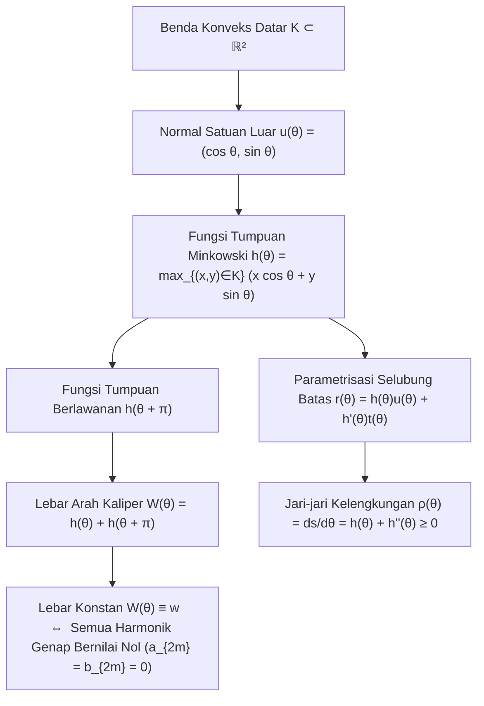
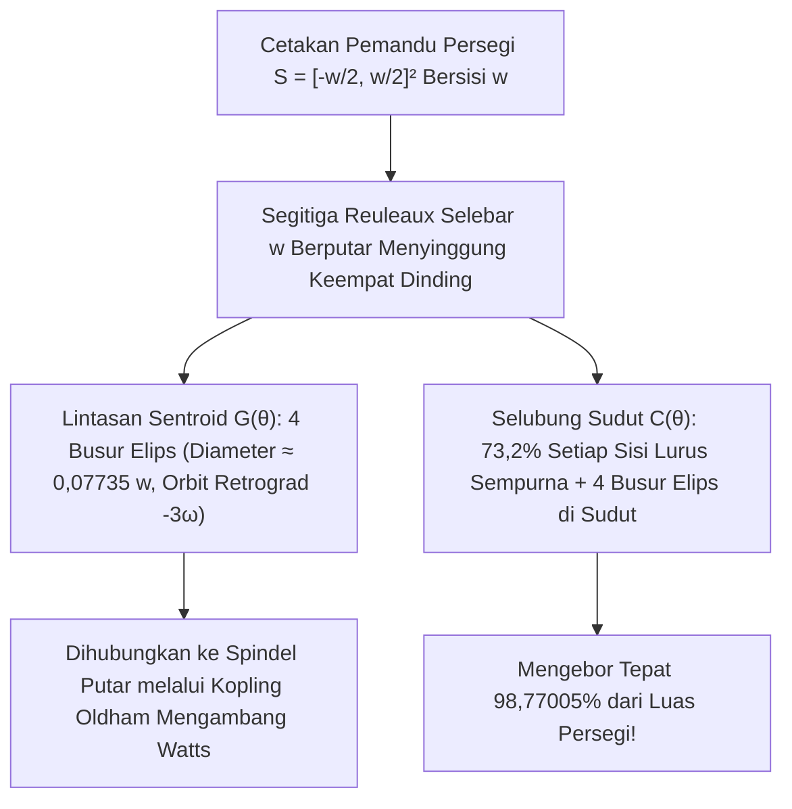

Mengapa <strong>tutup lubang got (manhole cover)</strong> di jalanan kota hampir semuanya berbentuk bulat? Teka-teki rekayasa terkenal yang dipopulerkan oleh peraih Nobel Fisika Richard Feynman dan wawancara kerja Microsoft ini didasarkan pada ketaksamaan geometri dasar.

Seandainya tutup lubang got berbentuk <strong>persegi</strong> dengan panjang sisi $w$, bukaan lubangnya memang memiliki sisi $w$, tetapi panjang diagonalnya menurut teorema Pythagoras adalah $\sqrt{2}w \approx 1,4142\,w$. Jika tutup persegi dari besi cor yang berat itu diberdirikan secara vertikal dan diputar $45^\circ$ sejajar diagonal bukaan, karena $w < \sqrt{2}w$, tutup tersebut akan langsung jatuh menembus lubangnya sendiri. Sebaliknya, <strong>lingkaran</strong> berdiameter $w$ memiliki lebar $w$ yang sama persis di segala arah sehingga tidak mungkin jatuh ke dalam lubangnya.

Sekarang mari kita ajukan pertanyaan matematika sebaliknya: <strong>Apakah tutup lubang got yang tidak bisa jatuh — atau gelondongan rol yang mampu menggelindingkan papan datar tanpa guncangan vertikal sedikit pun — harus berbentuk lingkaran?</strong>

Jawabannya adalah <strong>tidak</strong>! Dalam geometri konveks (Convex Geometry), terdapat tak hingga banyaknya bangun datar non-lingkaran yang jarak antara dua garis singgung sejajarnya selalu bernilai konstan $w$ di setiap arah: inilah yang disebut <strong>kurva lebar konstan (Curve of Constant Width)</strong>. Contoh paling terkenal dan paling ekstrem adalah <strong>Segitiga Reuleaux (Reuleaux Triangle)</strong>, dinamai menurut insinyur mesin Jerman abad ke-19 <strong>Franz Reuleaux (1829–1905)</strong>.

Jika kita meletakkan papan datar di atas gelondongan berpenampang segitiga Reuleaux selebar $w$, papan akan meluncur pada ketinggian konstan $y = w$ <strong>secara горизонтаal sempurna tanpa naik-turun satu milimeter pun</strong>. Lebih menakjubkan lagi: pada tahun 1914, insinyur Harry James Watts memasang mata bor berpenampang segitiga Reuleaux pada pencekam mengambang (<em>floating chuck</em>), sehingga mesin bor putar biasa dapat <strong>mengebor lubang persegi secara langsung yang mencakup tepat $98,77005\,\%$ luas persegi</strong>!

---

## 1. Paradoks Kinematika: Rol Tanpa Guncangan vs. Poros Roda yang Melompat-lompat

### 1.1 Translasi Horizontal Sempurna pada Papan Datar

Saat segitiga Reuleaux selebar $w$ menggelinding di atas lantai horizontal $y = 0$, pada setiap sudut rotasi $\theta \in [0, 2\pi)$ kurva ini selalu menyinggung lantai ($y = 0$) dan permukaan bawah papan secara bersamaan. Karena jarak vertikal antara dua garis singgung horizontal sejajar selalu konstan sebesar $w$, papan terkunci pada ketinggian $y_{\text{papan}}(\theta) \equiv w$.

### 1.2 Osilasi Vertikal Poros Tetap pada Titik Berat $G$

Mengapa roda sepeda atau mobil tidak berbentuk segitiga Reuleaux? Karena kendaraan bertumpu pada <strong>poros tengah tetap</strong> yang melewati titik berat (sentroid) geometris $G$. Pada segitiga Reuleaux yang dibangun dari segitiga sama sisi $\triangle ABC$ bersisi $w$:

- Jarak dari sentroid $G$ ke ketiga titik sudut $A, B, C$ adalah $R = \frac{w}{\sqrt{3}} = \frac{\sqrt{3}}{3}w \approx 0,57735\,w$.
- Jarak dari sentroid $G$ ke titik tengah busur di hadapannya adalah $r = w - R = \left(1 - \frac{\sqrt{3}}{3}\right)w \approx 0,42265\,w$.

Selama satu putaran penuh di atas lantai, ketinggian poros $G$ naik-turun sebanyak 3 kali per putaran dengan simpangan vertikal:

$$\Delta y_G = R - r = \left(\frac{2\sqrt{3}}{3} - 1\right) w \approx 0,15470\,w$$

Pemisahan antara <strong>selubung luar yang stasioner</strong> dan <strong>sentroid yang mengorbit secara eksentrik</strong> inilah rahasia kinematika mata bor lubang persegi Watts dan mesin rotari Wankel.

---

## 2. Geometri Konveks dan Fungsi Tumpuan Minkowski $h_K(\theta)$

### 2.1 Fungsi Tumpuan, Selubung (Envelope), dan Jari-jari Kelengkungan

Misalkan $K \subset \mathbb{R}^2$ adalah benda konveks kompak. Untuk setiap sudut arah $\theta \in [0, 2\pi)$, definisikan vektor normal satuan luar $\mathbf{u}(\theta) = (\cos\theta, \sin\theta)^\top$ dan vektor singgung satuan $\mathbf{t}(\theta) = (-\sin\theta, \cos\theta)^\top$. <strong>Fungsi tumpuan Minkowski (Support Function)</strong> dari $K$ didefinisikan sebagai:

$$h_K(\theta) \triangleq \max_{(x, y) \in K} \left(x\cos\theta + y\sin\theta\right)$$

Ketika $h(\theta) \in C^2(\mathbb{S}^1)$, kurva batas $\partial K$ direkonstruksi sebagai selubung dari keluarga garis tumpuan $x\cos\theta + y\sin\theta = h(\theta)$ bersama turunannya $-x\sin\theta + y\cos\theta = h'(\theta)$:

$$\mathbf{r}(\theta) = \begin{pmatrix} x(\theta) \\ y(\theta) \end{pmatrix} = h(\theta)\mathbf{u}(\theta) + h'(\theta)\mathbf{t}(\theta) = \begin{pmatrix} h(\theta)\cos\theta - h'(\theta)\sin\theta \\ h(\theta)\sin\theta + h'(\theta)\cos\theta \end{pmatrix}$$

Dengan menurunkan terhadap $\theta$ ($\mathbf{u}' = \mathbf{t}, \mathbf{t}' = -\mathbf{u}$), diperoleh elemen panjang busur $ds$ dan <strong>jari-jari kelengkungan</strong> $\rho(\theta)$:

$$\frac{d\mathbf{r}}{d\theta} = \left(h(\theta) + h''(\theta)\right)\mathbf{t}(\theta) \implies \rho(\theta) = \frac{ds}{d\theta} = h(\theta) + h''(\theta) \ge 0$$

### 2.2 Syarat Lebar Konstan dan Deret Fourier Harmonik Ganjil

Lebar pada arah $\theta$ adalah $W_K(\theta) = h_K(\theta) + h_K(\theta + \pi)$. Maka $K$ memiliki <strong>lebar konstan $w$</strong> jika dan hanya jika:

$$h_K(\theta) + h_K(\theta + \pi) = w \qquad (\forall \theta \in [0, 2\pi))$$

Hal ini membuktikan bahwa $\rho(\theta) + \rho(\theta + \pi) = w$ dan ekspansi deret Fourier dari $h_K(\theta)$ <strong>hanya memuat harmonik ganjil</strong> ($a_{2m} = b_{2m} = 0$ untuk semua $m \ge 1$):

$$h_K(\theta) = \frac{w}{2} + \sum_{k=1}^{\infty} \left(a_{2k-1}\cos((2k-1)\theta) + b_{2k-1}\sin((2k-1)\theta)\right)$$

Sebagai contoh, memilih $h(\theta) = \frac{w}{2} + \frac{w}{16}\cos(3\theta)$ menghasilkan $\rho(\theta) = \frac{w}{2}(1 - \cos 3\theta) \ge 0$, yaitu sebuah <strong>kurva lebar konstan analitik ($C^\infty$) non-lingkaran yang mulus sempurna tanpa sudut tajam</strong> (kurva polinomial derajat 8 Rabinowitz, 1997).

---

## 3. Luas Segitiga Reuleaux dan Poligon Reuleaux Ganjil

Dengan menggambar tiga busur lingkaran berjari-jari $w$ yang berpusat di titik sudut $A, B, C$ dari segitiga sama sisi bersisi $w$, terbentuklah segitiga Reuleaux. Berdasarkan prinsip inklusi-eksklusi, luasnya adalah jumlah tiga juring lingkaran bersudut $\frac{\pi}{3}$ (masing-masing $\frac{\pi}{6}w^2$) dikurangi dua kali luas segitiga sama sisi tengah ($\frac{\sqrt{3}}{4}w^2$):

$$A_{\text{Reuleaux}} = 3\left(\frac{\pi}{6}w^2\right) - 2\left(\frac{\sqrt{3}}{4}w^2\right) = \frac{1}{2}\left(\pi - \sqrt{3}\right) w^2 \approx 0,7047709\,w^2$$

Luas ini $10,27\,\%$ lebih kecil daripada luas lingkaran berdiameter $w$ ($A_{\text{lingkaran}} = \frac{\pi}{4}w^2 \approx 0,7853982\,w^2$). Untuk poligon Reuleaux beraturan dengan jumlah sisi ganjil $n = 2k+1$ ($n = 3, 5, 7, \dots$), rumus luas eksaknya adalah:

$$A_n = \frac{w^2}{2}\left(\pi - n\tan\left(\frac{\pi}{2n}\right)\right) \qquad (n = 3, 5, 7, 9, \dots)$$

| Kurva Lebar Konstan $w$ | Titik Sudut $n$ | Keliling $L$ | Rumus Luas Eksak $A(w)$ | Luas Numerik | Rasio $A / A_{\text{lingkaran}}$ |
| :--- | :---: | :---: | :---: | :---: | :---: |
| <strong>Segitiga Reuleaux</strong> | $3$ | $\pi w$ | $\frac{1}{2}\left(\pi - \sqrt{3}\right)w^2$ | $0,704771\,w^2$ | $89,73\%$ (<strong>Minimum</strong>) |
| <strong>Pentagon Reuleaux</strong> | $5$ | $\pi w$ | $\frac{1}{2}\left(\pi - 5\tan\frac{\pi}{10}\right)w^2$ | $0,756827\,w^2$ | $96,36\%$ |
| <strong>Heptagon Reuleaux</strong> (Koin UK 20p/50p) | $7$ | $\pi w$ | $\frac{1}{2}\left(\pi - 7\tan\frac{\pi}{14}\right)w^2$ | $0,770921\,w^2$ | $98,16\%$ |
| <strong>Kurva Analitik Mulus</strong> ($h = \frac{w}{2} + \frac{w}{16}\cos 3\theta$) | $0$ ($C^\infty$) | $\pi w$ | $\frac{63\pi}{256}w^2$ | $0,773126\,w^2$ | $98,44\%$ |
| <strong>Lingkaran (Circle)</strong> | $0$ ($C^\infty$) | $\pi w$ | $\frac{\pi}{4}w^2$ | $0,785398\,w^2$ | $100,00\%$ (<strong>Maksimum</strong>) |

---

## 4. Dua Bukti Lengkap Teorema Barbier (1860) dan Teorema Blaschke–Lebesgue (1914)

> <strong>Teorema Barbier (Joseph-Émile Barbier, 1860).</strong>
> <em>Setiap kurva konveks datar dengan lebar konstan $w$ memiliki keliling yang sama persis dengan lingkaran berdiameter $w$:</em>
> $$L(\partial K) = \pi w$$

### 4.1 Bukti 1: Geometri Diferensial melalui Fungsi Tumpuan

Mengintegrasikan $ds = \left(h(\theta) + h''(\theta)\right)d\theta$ pada $[0, 2\pi]$ dan menggunakan keperiodikan-$2\pi$ dari $h'(\theta)$:

$$L(\partial K) = \int_0^{2\pi} h(\theta)\,d\theta + \Big[h'(\theta)\Big]_0^{2\pi} = \int_0^{\pi} \underbrace{\left(h(\theta) + h(\theta + \pi)\right)}_{= w} d\theta = \int_0^{\pi} w\,d\theta = \pi w$$

Karena kurva lebar konstan tidak mungkin memuat segmen garis lurus, $h_K$ selalu berada di kelas $C^1(\mathbb{S}^1)$ (atau melalui penghalusan konvolusi $h_\varepsilon = h_K * \eta_\varepsilon$ dalam metrik Hausdorff), sehingga bukti ini berlaku eksak meskipun terdapat titik sudut. $\blacksquare$

### 4.2 Bukti 2: Geometri Integral, Rumus Cauchy–Crofton, dan «Mi Buffon»

Dalam ruang garis berarah $\ell(p, \theta) : x\cos\theta + y\sin\theta = p$ dengan ukuran kinematik invarian $d\ell = dp \wedge d\theta$, linearitas nilai harapan pada jumlah titik potong $n_\gamma(p, \theta) = \#(\gamma \cap \ell(p, \theta))$ dari kurva rektifiabel («mi Buffon») menghasilkan <strong>rumus Cauchy–Crofton</strong>:

$$\int_0^{2\pi} \int_{-\infty}^{\infty} n_\gamma(p, \theta)\,dp\,d\theta = 4 L(\gamma)$$

Untuk batas $\gamma = \partial K$ benda konveks, hampir setiap garis memotong $\partial K$ tepat di $n_{\partial K} = 2$ titik pada interval sepanjang $W_K(\theta) = w$. Maka:

$$4 L(\partial K) = \int_0^{2\pi} 2 W_K(\theta)\,d\theta = 2 \int_0^{2\pi} w\,d\theta = 4\pi w \implies L(\partial K) = \pi w \quad \blacksquare$$

### 4.3 Teorema Blaschke–Lebesgue (1914)

Rumus luas Blaschke $A(K) = \frac{1}{2}\int_0^{2\pi} \left(h(\theta)^2 - h'(\theta)^2\right)d\theta$ bersama identitas Parseval memberikan:

$$A(K) = \frac{\pi}{4} w^2 - \frac{\pi}{2} \sum_{k=2}^{\infty} \left((2k-1)^2 - 1\right)\left(a_{2k-1}^2 + b_{2k-1}^2\right)$$

Lingkaran secara tunggal memaksimumkan luas ($\frac{\pi}{4}w^2$), sedangkan minimisasi di bawah kendala $0 \le \rho(\theta) \le w$ menurut prinsip maksimum Pontryagin menghasilkan distribusi kelengkungan «bang-bang» $\rho(\theta) \in \{0, w\}$ dengan 3 pergantian: <strong>segitiga Reuleaux secara tunggal meminimumkan luas di antara semua kurva lebar konstan $w$</strong> (Henri Lebesgue 1914, Wilhelm Blaschke 1915).

---

## 5. Bagaimana Segitiga Reuleaux Mengebor Lubang Persegi: Mata Bor Harry Watts (1914)

Di dalam persegi tetap $S = \left[-\frac{w}{2}, \frac{w}{2}\right]^2$, pada interval dasar $\theta \in \left[\frac{\pi}{6}, \frac{\pi}{3}\right]$, titik sudut $A$ meluncur di dinding kiri $x = -\frac{w}{2}$ dan titik sudut $B$ di dinding bawah $y = -\frac{w}{2}$:

$$A(\theta) = \begin{pmatrix} -\frac{w}{2} \\ -\frac{w}{2} + w\sin\theta \end{pmatrix}, \qquad B(\theta) = \begin{pmatrix} -\frac{w}{2} + w\cos\theta \\ -\frac{w}{2} \end{pmatrix}$$

### 5.1 Orbit Elips Sentroid $G(\theta)$ dan Cakupan Luas $98,77\,\%$ Persegi

1. <strong>Lintasan Titik Berat $G(\theta)$</strong>:
   $$x_G(\theta) + \frac{w}{2} = \frac{w}{\sqrt{3}}\cos\left(\theta - \frac{\pi}{6}\right), \qquad y_G(\theta) + \frac{w}{2} = \frac{w}{\sqrt{3}}\sin\left(\theta + \frac{\pi}{6}\right)$$
   Ini adalah busur elips eksak yang berpusat di sudut $\left(-\frac{w}{2}, -\frac{w}{2}\right)$ dengan sumbu semi-mayor $a_G = \frac{\sqrt{3}+1}{2\sqrt{3}}w$ dan semi-minor $b_G = \frac{\sqrt{3}-1}{2\sqrt{3}}w$. Keempat busur membentuk orbit tertutup kecil berdiameter $d_G = \left(\frac{2\sqrt{3}-3}{3}\right)w \approx 0,07735\,w$ dengan kecepatan sudut $-3\omega$, yang diserap oleh <strong>kopling Oldham mengambang</strong>.
2. <strong>Lintasan Sudut $C(\alpha)$ dan Luas Tersapu $A_{\text{swept}}$</strong>:
   Dengan $\alpha = \frac{\pi}{3} - \theta \in \left[0, \frac{\pi}{6}\right]$, titik sudut $C$ membentuk busur elips di sudut kanan atas:
   $$x_C(\alpha) = -\frac{w}{2} + w\cos\alpha, \qquad y_C(\alpha) = -\frac{w}{2} + w\cos\left(\frac{\pi}{6} - \alpha\right)$$
   Pada setiap sisi persegi, bagian tengah sepanjang $(\sqrt{3}-1)w \approx 0,73205\,w$ ($73,2\,\%$ panjang sisi) adalah <strong>garis lurus sempurna secara matematis</strong>! Luas tak terpotong di satu sudut adalah:
   $$A_{\text{sudut}} = w^2 \int_0^{\pi/6} \left(1 - \cos\left(\frac{\pi}{6}-\alpha\right)\right)\sin\alpha\,d\alpha = \left(1 - \frac{\sqrt{3}}{2} - \frac{\pi}{24}\right) w^2 \approx 0,0030749\,w^2$$
   Maka luas total lubang persegi yang dibor oleh segitiga Reuleaux adalah:
   $$A_{\text{tersapu}} = w^2 - 4 A_{\text{sudut}} = \left(2\sqrt{3} + \frac{\pi}{6} - 3\right) w^2 \approx 0,9877005\,w^2 \quad (98,77\,\%!)$$

---

## 6. Aplikasi Rekayasa Modern dan Batas 3D: Benda Meissner (1911) serta Konjektur Meissner (1934)

Selain <strong>mesin rotari Wankel</strong> (epitrokoida dua lobus) dan <strong>koin Inggris 20p/50p</strong> (heptagon Reuleaux, $n=7$), perluasan ke dimensi 3 menunjukkan bahwa <strong>tetrahedron Reuleaux</strong> <strong>bukanlah</strong> benda lebar konstan karena jarak antar titik tengah dua rusuk lengkung yang berhadapan adalah

$$w_{\text{rusuk}} = \left(\sqrt{3} - \frac{\sqrt{2}}{2}\right) w \approx 1,024944\,w > w$$

Pada tahun 1911, <strong>Ernst Meissner dan Friedrich Schilling</strong> membulatkan tiga dari enam rusuknya menggunakan potongan permukaan torus gelendong (<em>spindle torus</em>), menciptakan dua <strong>benda Meissner</strong> $M_1$ dan $M_2$ dengan volume $V \approx 0,419860\,w^3$. <strong>Konjektur Meissner (Bonnesen–Fenchel, 1934)</strong>, yang menyatakan bahwa $M_1$ dan $M_2$ meminimumkan volume (dan luas permukaan melalui relasi Blaschke $V = \frac{1}{2}wS - \frac{\pi}{3}w^3$) di antara semua benda konveks 3D berlebar konstan $w$, hingga kini tetap menjadi salah satu masalah terbuka paling terkenal dalam geometri.
