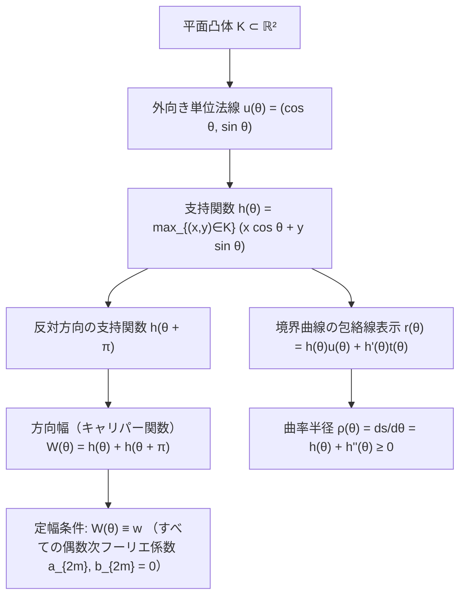
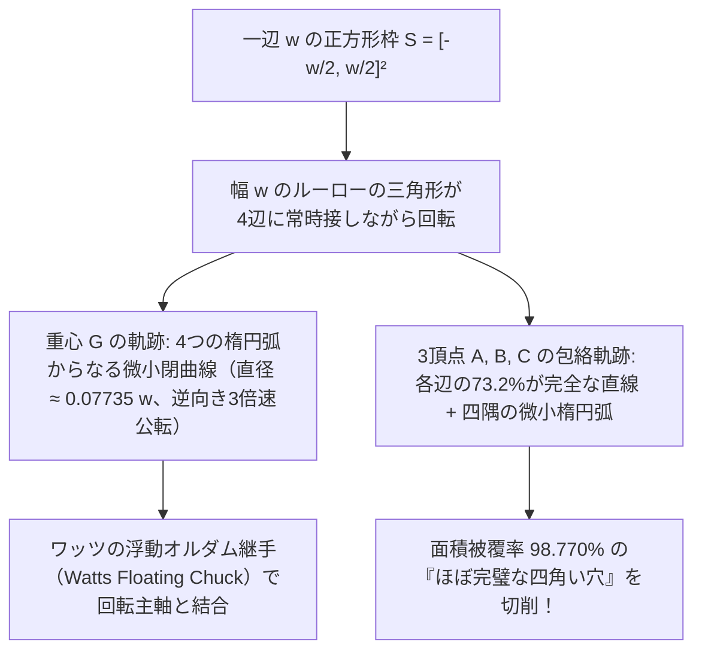

都市の路上を歩いているとき、足元にある下水道の<strong>マンホールの蓋（ふた）</strong>がなぜ例外なく「丸い（円形である）」のか、不思議に思ったことはないだろうか。この問いは、かつてノーベル物理学賞受賞者リチャード・ファインマンが好んで話題にし、後にマイクロソフト社の採用面接試験で有名になった古典的な工学パズルである。

もしマンホールの蓋が一辺 $w$ の<strong>正方形</strong>だったらどうなるか。正方形の開口部の辺の長さは $w$ だが、その対角線の長さはピタゴラスの定理より $\sqrt{2}w \approx 1.4142\,w$ となる。したがって、重い鋳鉄製の正方形の蓋を垂直に立て、開口部の対角線方向に $45^\circ$ 傾けて差し込めば、$w < \sqrt{2}w$ であるため、蓋は自らの穴をすり抜けて地下の下水管へと真っ逆さまに落下してしまう。長方形や楕円、正三角形であっても事情は同じであり、「最小幅 $w_{\min}$」が「最大径 $w_{\max}$」より小さい図形はすべて、最も広い対角方向に傾けることで穴に落っこちてしまうのである。

これに対し、直径 $w$ の<strong>円</strong>はどの方向から測っても幅が常に $w$ で一定であるため、どのように傾けても絶対に穴に落ちない。

では、ここで数学的な逆転の問いを立てよう。<strong>「穴に落ちないマンホールの蓋」や「上に載せた板を一切上下に揺らさずに水平運搬できるコロ（転がりローラー）」の断面は、本当に『円』でなければならないのだろうか？</strong>

答えは<strong>否（ノー）</strong>である。円以外にも、あらゆる方向の平行接線間の距離（幅）が常に一定の値 $w$ を保つ平面凸図形――<strong>定幅図形（Curve of Constant Width）</strong>――は無数に存在する。その最も象徴的かつ極端な代表例こそ、19世紀ドイツの機械工学者フランツ・ルーロー（Franz Reuleaux）にちなんで名づけられた<strong>ルーローの三角形（Reuleaux Triangle）</strong>である。

驚くべきことに、断面がルーローの三角形である丸太を床に並べてその上に平らな板を載せると、板は1ミリも上下に跳ねることなく<strong>完全に水平なまま滑らかに前進する</strong>。さらに驚くべきことに、この「丸みを帯びた三角形」を特殊なチャック（ワッツの浮動継手）に取り付けて回転させると、なんと金属板や木材に<strong>「鋭い角を持つ四角い穴（正方形の98.77%の面積）」を直接くり抜くドリル</strong>になるのである。

本稿では、凸幾何学（Convex Geometry）・微分幾何学・積分幾何学・運動学（Kinematics）の4つの視点から、定幅図形が秘める驚くべき数理構造を徹底的に解き明かす。ミンコフスキーの支持関数とフーリエ級数による定幅曲線の完全な特徴づけから出発し、いかなる定幅図形も周長が円と完全に一致する（$L = \pi w$）という<strong>バルビエの定理（Barbier's Theorem）</strong>の2通りの厳密な証明、ルーローの三角形が定幅図形の中で最小の面積を持つことを示す<strong>ブラシュケ＝ルベーグの定理（Blaschke–Lebesgue Theorem）</strong>、四角い穴を掘るドリルの中心軌跡と頂点軌跡の解析解、そして3次元空間におけるルーローの四面体の破綻と<strong>マイスナー体（Meissner Bodies）</strong>・未解決の<strong>マイスナー予想</strong>に至るまで、一歩ずつ数式を追って探究していこう。

---

## 1. 導入のパラドックス：なぜルーローの三角形のコロは揺れないのに、車輪にすると跳ねるのか？

定幅図形の厳密な数学的定式化に入る前に、私たちの直感を揺さぶる<strong>運動学的パラドックス</strong>を整理しておこう。

### 1.1 平板の下で転がるルーローの三角形（コロ運搬）

水平な床（直線 $y = 0$）の上に、幅 $w$ のルーローの三角形の断面を持つ柱（コロ）をいくつか並べ、その真上に水平な天板（直線 $y = w$）を載せる状況を想像してほしい。
定幅図形の定義により、ルーローの三角形がどのような角度 $\theta$ に回転していても、その図形を上下から挟む2本の水平な支持接線（床と天板）の間の距離は<strong>常に厳密に $w$ のまま不変</strong>である。

したがって、天板を水平に押してコロを転がすと、天板の高さは常に $y = w$ に保たれ、<strong>上下動（ボビング）は完全にゼロ</strong>となる。古代エジプトの巨石運搬のように丸太の上で荷物を転がす用途であれば、ルーローの三角形の丸太は円柱の丸太とまったく同等の「完全な水平移動」を実現するのである。

### 1.2 固定車軸を持つ自転車・自動車の車輪にした場合

ところが、ルーローの三角形の重心（幾何学的中心）$G$ に穴を開け、そこに<strong>車軸（アクスル）を通した自転車</strong>を作ると、乗り心地は悪夢のようなものになる。なぜだろうか？

円形の車輪（半径 $w/2$）であれば、中心から外周までの距離が全方向で $w/2$ であるため、床（$y = 0$）の上を転がるとき車軸の高さは常に $y_G = w/2 = 0.5\,w$ で一定である。
しかし、一辺 $w$ の正三角形 $\triangle ABC$ をベースとするルーローの三角形では、重心 $G$ から各頂点 $A, B, C$ までの距離（外接円半径）は

$$R = \frac{w}{\sqrt{3}} = \frac{\sqrt{3}}{3} w \approx 0.57735\,w$$

であるのに対し、重心 $G$ から対辺の円弧の中点までの距離は

$$r = w - R = \left(1 - \frac{\sqrt{3}}{3}\right) w \approx 0.42265\,w$$

となる。その結果、ルーローの三角形が床の上を一回転する間に、重心 $G$（固定車軸）の高さ $y_G$ は次のように1回転あたり3回も激しく上下に振動する。

- <strong>頂点が真下（床との接点）に来た瞬間</strong>：車軸の高さは最大値 $y_{G,\max} = \frac{\sqrt{3}}{3}w \approx 0.57735\,w$ に達する。
- <strong>頂点が真上（円弧が床に接する状態）に来た瞬間</strong>：車軸の高さは最小値 $y_{G,\min} = \left(1 - \frac{\sqrt{3}}{3}\right)w \approx 0.42265\,w$ に落ち込む。
- <strong>車軸の上下振幅 $\Delta y_G$</strong>：
  $$\Delta y_G = y_{G,\max} - y_{G,\min} = \left(\frac{2\sqrt{3}}{3} - 1\right) w \approx 0.15470\,w$$

つまり、<strong>「図形全体の高さ（最高点から最低点までの距離）は常に $w$ で一定であるにもかかわらず、図形の重心 $G$ の高さは幅の約 $15.5\%$ も上下に暴れる」</strong>のである。この「外枠（エンベロープ）の不変性」と「重心軌跡の偏心運動」のギャップこそが、のちに第5節で解説する「四角い穴を掘るドリル」や「ロータリーエンジン」の核心的なメカニズムとなる。

---

## 2. 凸幾何学とミンコフスキー支持関数 $h_K(\theta)$ による定幅図形の定式化

定幅図形を初等幾何の「コンパスによる円弧の貼り合わせ」としてだけでなく、微分幾何学および調和解析（フーリエ解析）の対象として統一的に扱うために、ヘルマン・ミンコフスキー（Hermann Minkowski）が導入した<strong>支持関数（Support Function）</strong>の理論を構築しよう。

### 2.1 凸体と支持直線、ミンコフスキー支持関数の定義

ユークリッド平面 $\mathbb{R}^2$ 内の空でないコンパクト凸集合（内部が空でない有界閉凸集合）を<strong>平面凸体（Planar Convex Body）</strong>と呼び、$K \subset \mathbb{R}^2$ と表す。凸性とは、任意の2点 $\mathbf{x}, \mathbf{y} \in K$ と任意の $\lambda \in [0, 1]$ に対して線分 $\lambda \mathbf{x} + (1-\lambda)\mathbf{y} \in K$ が成り立つことである。

任意の角度 $\theta \in [0, 2\pi)$ に対し、外向き単位法線ベクトル $\mathbf{u}(\theta)$ と、それに直交する単位接線ベクトル $\mathbf{t}(\theta)$ を次のように定める。

$$\mathbf{u}(\theta) = \begin{pmatrix} \cos\theta \\ \sin\theta \end{pmatrix}, \qquad \mathbf{t}(\theta) = \frac{d\mathbf{u}}{d\theta} = \begin{pmatrix} -\sin\theta \\ \cos\theta \end{pmatrix}$$

このとき、凸体 $K$ の<strong>ミンコフスキー支持関数（Minkowski Support Function）</strong> $h_K : \mathbb{R} \to \mathbb{R}$ は次の上限（コンパクト性より最大値）として定義される。

$$h_K(\theta) \triangleq \sup_{(x, y) \in K} \langle (x, y), \mathbf{u}(\theta) \rangle = \max_{(x, y) \in K} \left(x \cos\theta + y \sin\theta\right)$$

幾何学的に言えば、直線

$$L(\theta) : x \cos\theta + y \sin\theta = h_K(\theta)$$

は、法線方向 $\mathbf{u}(\theta)$ において凸体 $K$ に外側から接する<strong>支持直線（Supporting Line）</strong>であり、$h_K(\theta)$ は原点 $O(0,0)$ から支持直線 $L(\theta)$ までの符号付き垂線距離（$(0,0) \in \text{int}(K)$ ならば常に正の距離）を表している。

### 2.2 支持関数からの境界曲線 $\partial K$ の復元（包絡線の理論）

凸体 $K$ の境界曲線 $\partial K$ が十分滑らか（たとえば $h(\theta) \in C^2(\mathbb{S}^1)$）であるとき、境界上の接点 $\mathbf{r}(\theta) = (x(\theta), y(\theta)) \in \partial K$ は、支持直線群 $\{L(\theta)\}_{\theta \in [0, 2\pi)}$ の<strong>包絡線（Envelope）</strong>として一意に復元できる。

具体的には、接点 $(x(\theta), y(\theta))$ は支持直線の方程式を満たすと同時に、その $\theta$ 微分がゼロになる（瞬間的に直線が回転しても接点が直線上に留まる）ため、次の連立一次方程式を満たす。

$$\begin{cases}
x(\theta)\cos\theta + y(\theta)\sin\theta = h(\theta) \\
-x(\theta)\sin\theta + y(\theta)\cos\theta = h'(\theta)
\end{cases}$$

係数行列は2次元回転行列（直交行列）であるため、逆行列を掛けることで境界曲線 $\partial K$ のパラメータ表示が直ちに得られる。

$$\mathbf{r}(\theta) = \begin{pmatrix} x(\theta) \\ y(\theta) \end{pmatrix} = h(\theta)\mathbf{u}(\theta) + h'(\theta)\mathbf{t}(\theta) = \begin{pmatrix} h(\theta)\cos\theta - h'(\theta)\sin\theta \\ h(\theta)\sin\theta + h'(\theta)\cos\theta \end{pmatrix}$$

### 2.3 曲率半径 $\rho(\theta)$ と凸性の必要十分条件

上の境界曲線の式 $\mathbf{r}(\theta) = h(\theta)\mathbf{u}(\theta) + h'(\theta)\mathbf{t}(\theta)$ を角度 $\theta$ で微分してみよう。フレネ・セレの関係式 $\mathbf{u}'(\theta) = \mathbf{t}(\theta)$ および $\mathbf{t}'(\theta) = -\mathbf{u}(\theta)$ を用いると、驚くほど簡単な形に整理される。

$$\begin{aligned}
\frac{d\mathbf{r}}{d\theta} &= h'(\theta)\mathbf{u}(\theta) + h(\theta)\mathbf{u}'(\theta) + h''(\theta)\mathbf{t}(\theta) + h'(\theta)\mathbf{t}'(\theta) \\
&= h'(\theta)\mathbf{u}(\theta) + h(\theta)\mathbf{t}(\theta) + h''(\theta)\mathbf{t}(\theta) - h'(\theta)\mathbf{u}(\theta) \\
&= \left(h(\theta) + h''(\theta)\right)\mathbf{t}(\theta)
\end{aligned}$$

この式は微分幾何学において極めて重要な2つの事実を物語っている。

1. 接線ベクトル $\frac{d\mathbf{r}}{d\theta}$ は常に $\mathbf{t}(\theta) = (-\sin\theta, \cos\theta)^\top$ と平行であり、法線 $\mathbf{u}(\theta)$ と直交する。
2. 曲線の弧長パラメータを $s$ とすると、微小弧長 $ds = \left\|\frac{d\mathbf{r}}{d\theta}\right\| d\theta$ より、角度 $\theta$ における<strong>曲率半径（Radius of Curvature）</strong> $\rho(\theta) = \frac{1}{\kappa(\theta)} = \frac{ds}{d\theta}$ は次式で与えられる。

$$\rho(\theta) = \frac{ds}{d\theta} = h(\theta) + h''(\theta)$$

曲線が自己交差を持たず、外向き法線 $\mathbf{u}(\theta)$ が反時計回りに単調に回転して真の<strong>凸閉曲線</strong>をなすための必要十分条件は、すべての角度 $\theta \in [0, 2\pi)$ において曲率半径が非負であること、すなわち次の微分不等式が成り立つことである。

$$h(\theta) + h''(\theta) \ge 0 \quad (\forall \theta \in [0, 2\pi))$$

### 2.4 方向幅（キャリパー関数）と定幅条件

ノギス（Caliper）で凸体 $K$ を角度 $\theta$ の方向から挟んだときの幅――すなわち、法線 $\mathbf{u}(\theta)$ を持つ支持直線 $L(\theta)$ と、正反対の法線 $\mathbf{u}(\theta + \pi) = -\mathbf{u}(\theta)$ を持つ平行な支持直線 $L(\theta + \pi)$ の間の距離――を<strong>方向幅（Directional Width）</strong> $W_K(\theta)$ と呼ぶ。原点 $O$ を挟んで両側の垂線距離を足し合わせればよいから、

$$W_K(\theta) = h_K(\theta) + h_K(\theta + \pi)$$

が成り立つ。したがって、平面凸体 $K$ が<strong>幅 $w$ の定幅図形（Curve of Constant Width $w$）</strong>であるための必要十分条件は、すべての $\theta \in [0, 2\pi)$ に対して次の関数方程式が恒等的に成り立つことである。

$$h_K(\theta) + h_K(\theta + \pi) = w \quad (\forall \theta \in [0, 2\pi))$$

さらに、この式を $\theta$ で2階微分すると $h_K''(\theta) + h_K''(\theta + \pi) = 0$ となるため、両者を足し合わせることで<strong>対向点における曲率半径の和の不変性</strong>が得られる。

$$\rho(\theta) + \rho(\theta + \pi) = \left(h_K(\theta) + h_K''(\theta)\right) + \left(h_K(\theta + \pi) + h_K''(\theta + \pi)\right) = w$$

すなわち、定幅図形において平行な2本の支持直線が接する対向点 $\mathbf{r}(\theta)$ と $\mathbf{r}(\theta + \pi)$ では、<strong>2つの曲率半径の和が常に幅 $w$ に等しい</strong>（さらには両接点を結ぶ弦は両方の支持直線に直交するため、定幅図形のすべての法線は二重法線 double normal となる）。

### 2.5 フーリエ級数展開と「奇数次高調波のみ」の定理

支持関数 $h_K(\theta)$ は周期 $2\pi$ の周期関数であるから、フーリエ級数に展開してみよう。

$$h_K(\theta) = a_0 + \sum_{n=1}^{\infty} \left(a_n \cos(n\theta) + b_n \sin(n\theta)\right)$$

ここで $\theta$ を $\theta + \pi$ に置き換えると、$\cos(n(\theta + \pi)) = (-1)^n \cos(n\theta)$、$\sin(n(\theta + \pi)) = (-1)^n \sin(n\theta)$ より、偶数次の項（$n = 2m$）は同符号で残り、奇数次の項（$n = 2k - 1$）は符号が反転して相殺される。

$$h_K(\theta) + h_K(\theta + \pi) = 2a_0 + 2\sum_{m=1}^{\infty} \left(a_{2m}\cos(2m\theta) + b_{2m}\sin(2m\theta)\right)$$

これがすべての $\theta$ に対して定数 $w$ に等しくなるための必要十分条件は、フーリエ係数の直交性・一意性より次の通りとなる。

1. 定数項（第0高調波）は $a_0 = \frac{w}{2}$ である。
2. <strong>すべての正の偶数次高調波が恒等的にゼロになる</strong>：
   $$a_{2m} = 0, \quad b_{2m} = 0 \qquad (\forall m = 1, 2, 3, \dots)$$
3. <strong>奇数次高調波（$n = 2k - 1 = 1, 3, 5, 7, \dots$）の係数 $a_{2k-1}, b_{2k-1}$ は、凸性条件 $h(\theta) + h''(\theta) \ge 0$ を満たす限り完全に自由に選べる！</strong>

すなわち、任意の幅 $w$ の定幅図形の支持関数は、次の<strong>奇数次フーリエ級数</strong>として完全に特徴づけられる。

$$h_K(\theta) = \frac{w}{2} + \sum_{k=1}^{\infty} \left(a_{2k-1}\cos((2k-1)\theta) + b_{2k-1}\sin((2k-1)\theta)\right)$$

このとき、曲率半径 $\rho(\theta) = h_K(\theta) + h_K''(\theta) \ge 0$ の条件は次のように書き下される。

$$\rho(\theta) = \frac{w}{2} - \sum_{k=1}^{\infty} \left((2k-1)^2 - 1\right) \left(a_{2k-1}\cos((2k-1)\theta) + b_{2k-1}\sin((2k-1)\theta)\right) \ge 0$$

ここで $k = 1$（$2k-1 = 1$、基本波）の項に注目すると、係数 $((2k-1)^2 - 1) = 1^2 - 1 = 0$ となり、曲率半径 $\rho(\theta)$ の式から完全に消える。なぜなら、$a_1\cos\theta + b_1\sin\theta$ は図形全体をベクトル $(a_1, b_1)$ だけ平行移動させる操作にすぎず、図形の形状や曲率を一切変えないからである（図形のシュタイナー点 Steiner point を原点に選べば $a_1 = b_1 = 0$ と正規化できる）。

### 2.6 角（かど）を一切持たない滑らかな（$C^\infty$）非円形定幅曲線の具体例

ルーローの三角形には3つの尖った頂点（角）があるため、「円以外の定幅図形には必ず角があるのではないか？」と誤解されがちである。しかし、上のフーリエ級数表示を使えば、<strong>角を一切持たない無限回微分可能（$C^\infty$ 級、さらには実解析的）な非円形定幅曲線</strong>をいとも簡単に構成できる。

最も単純な例として、第3高調波（$k = 2, 2k-1 = 3$）のみを残し、他をすべてゼロと置いた支持関数を考えよう。

$$h(\theta) = \frac{w}{2} + \varepsilon \cos(3\theta)$$

このとき、曲率半径は

$$\rho(\theta) = h(\theta) + h''(\theta) = \frac{w}{2} - (3^2 - 1)\varepsilon \cos(3\theta) = \frac{w}{2} - 8\varepsilon \cos(3\theta)$$

となる。したがって、振幅パラメータ $\varepsilon$ が

$$0 < |\varepsilon| \le \frac{w}{16}$$

を満たせば、すべての $\theta$ で $\rho(\theta) \ge 0$ となり、自己交差のない滑らかな凸閉曲線が得られる（特に $|\varepsilon| < \frac{w}{16}$ ならば $\rho(\theta) > 0$ となって曲率が至るところ有限となり、角も平坦部も一切存在しない）。

たとえば $w = 16, \varepsilon = 1$ と置いて $h(\theta) = 8 + \cos(3\theta)$ とすると、境界曲線 $(x(\theta), y(\theta))$ は

$$\begin{cases}
x(\theta) = (8 + \cos 3\theta)\cos\theta + 3\sin 3\theta \sin\theta \\
y(\theta) = (8 + \cos 3\theta)\sin\theta - 3\sin 3\theta \cos\theta
\end{cases}$$

という初等的な三角多項式で与えられ、スタンレー・ラビノヴィッツ（Stanley Rabinowitz, 1997）が導出した通り、以下の<strong>8次の代数曲線（多項式陰関数方程式）</strong>のゼロ点集合として表される。

$$(x^2 + y^2)^4 - 45(x^2 + y^2)^3 - 41283(x^2 + y^2)^2 + 7950960(x^2 + y^2) + 16(x^2 - 3y^2)^3 + 48(x^2 + y^2)(x^2 - 3y^2)^2 + x(x^2 - 3y^2)\left(720(x^2 + y^2)^2 + 14757888(x^2 + y^2) - 594490752\right) - 270426086976 = 0$$

このように、定幅図形の世界は円とルーローの多角形だけにとどまらず、無限次元の関数空間の広がりを持っているのである。

---

## 3. ルーローの三角形の作図・面積と奇数角ルーローの多角形

ここで、定幅図形の王様である<strong>ルーローの三角形（Reuleaux Triangle）</strong>の幾何学的構造を詳しく調べよう。歴史的には、1875年にベルリン王立工科大学（現・ベルリン工科大学）の<strong>フランツ・ルーロー（Franz Reuleaux, 1829–1905）</strong>が記念碑的著作『理論運動学（*Theoretische Kinematik*）』の中で強制拘束カム機構（ポジティブ・リターン・カム）の要素として体系化するよりも遥か前、1514年頃に<strong>レオナルド・ダ・ヴィンチ</strong>が『ヴァッラルディ手稿（Codex Vallardi）』の世界地図投影法で地球表面を8個のルーローの三角形に分割して描いており、13世紀のゴシック建築（ノートルダム大聖堂やブルージュの聖母教会など）の薔薇窓（トレーサリー）にも頻繁に用いられていた。また数学的にも、<strong>レオンハルト・オイラー（Leonhard Euler）</strong>が1778年の論文『三角形曲線について（*De curvis triangularibus*）』において「オービフォーム（Orbiforms：球のような形）」という名で定幅曲線を既に解析していた。

### 3.1 コンパスと定規による作図と定幅性の証明

幅 $w$ のルーローの三角形は、以下の3ステップで作図される。

1. 一辺の長さが $w$ の<strong>正三角形 $\triangle ABC$</strong> を描く。
2. 頂点 $A$ を中心とし、半径 $w$ の円弧を頂点 $B$ から頂点 $C$ まで引く（中心角は $\angle BAC = \frac{\pi}{3} = 60^\circ$）。
3. 同様に、頂点 $B$ を中心として半径 $w$ の円弧 $\widehat{CA}$ を引き、頂点 $C$ を中心として半径 $w$ の円弧 $\widehat{AB}$ を引く。

この3つの円弧 $\widehat{BC}, \widehat{CA}, \widehat{AB}$ で囲まれた凸領域がルーローの三角形である。なぜこれが定幅 $w$ になるのかは一目瞭然である。任意の角度 $\theta$ の平行支持直線対で図形を挟むと、一方の支持直線は必ず3つの頂点 $A, B, C$ のいずれか1つ（たとえば $A$）を通り、もう一方の支持直線はその頂点 $A$ を中心とする半径 $w$ の対向円弧 $\widehat{BC}$ に接する。円の中心 $A$ から接線までの距離は円の半径そのものであるから、2本の支持直線間の距離はあらゆる方向で<strong>厳密に $w$</strong> となる。

また、重心 $G$ を原点 $(0,0)$ にとり、頂点 $A$ を極座標 $(R, 0) = (\frac{w}{\sqrt{3}}, 0)$ に配置したとき、基本区間 $\theta \in [-\frac{\pi}{6}, \frac{\pi}{6}]$ における支持関数は次の区分的解析式で与えられる。

$$h(\theta) = \frac{w}{\sqrt{3}}\cos\theta, \qquad h(\theta + \pi) = w - \frac{w}{\sqrt{3}}\cos\theta \qquad \left(-\frac{\pi}{6} \le \theta \le \frac{\pi}{6}\right)$$

確かに $h(\theta) + h(\theta + \pi) = w$ が恒等的に成立しており、円弧側（$\theta + \pi$）では曲率半径が $\rho(\theta + \pi) = h(\theta + \pi) + h''(\theta + \pi) = w$、頂点側（$\theta$）では $\rho(\theta) = \frac{w}{\sqrt{3}}\cos\theta - \frac{w}{\sqrt{3}}\cos\theta = 0$ となって、曲率半径が $\{0, w\}$ の2値のみをとる極限的な構造（バンバン制御構造）を持っていることがわかる。

### 3.2 ルーローの三角形の面積の厳密導出

幅 $w$ のルーローの三角形の面積 $A_{\text{Reuleaux}}$ を求めよう。
作図手順を振り返ると、半径 $w$・中心角 $\frac{\pi}{3}$（$60^\circ$）の扇形を3つ（中心 $A, B, C$）重ね合わせると、中央の正三角形 $\triangle ABC$ の部分が3回重複してカウントされる。したがって、包除原理（または正三角形1個＋弓形3個への分割）より次式が成り立つ。

- 半径 $w$、中心角 $\frac{\pi}{3}$ の扇形1個の面積：
  $$A_{\text{sector}} = \frac{1}{2} w^2 \left(\frac{\pi}{3}\right) = \frac{\pi}{6} w^2$$
- 一辺 $w$ の正三角形 $\triangle ABC$ の面積：
  $$A_{\triangle} = \frac{1}{2} w \left(\frac{\sqrt{3}}{2} w\right) = \frac{\sqrt{3}}{4} w^2$$
- ルーローの三角形の面積 $A_{\text{Reuleaux}}$：
  $$A_{\text{Reuleaux}} = 3 A_{\text{sector}} - 2 A_{\triangle} = 3\left(\frac{\pi}{6}w^2\right) - 2\left(\frac{\sqrt{3}}{4}w^2\right) = \frac{1}{2}\left(\pi - \sqrt{3}\right) w^2 \approx 0.7047709\,w^2$$

これを同じ定幅（直径）$w$ を持つ<strong>円</strong>の面積と比較してみよう。

$$A_{\text{circle}} = \pi \left(\frac{w}{2}\right)^2 = \frac{\pi}{4} w^2 \approx 0.7853982\,w^2$$

両者の面積比を計算すると、

$$\frac{A_{\text{Reuleaux}}}{A_{\text{circle}}} = \frac{\frac{1}{2}(\pi - \sqrt{3})w^2}{\frac{\pi}{4}w^2} = \frac{2(\pi - \sqrt{3})}{\pi} \approx 0.897342$$

となり、ルーローの三角形は同じ幅 $w$（そして後述するように<strong>まったく同じ周長 $\pi w$</strong>）を持ちながら、円よりも<strong>約 $10.27\%$ 面積が小さい</strong>のである！これはマンホールの蓋やローラーを鋳造する際、同じ強度・同じ定幅条件を保ちつつ材料の金属重量を約1割節約できることを意味する。

### 3.3 一般の正奇数角形から作られる「ルーローの多角形」

正三角形（$n = 3$）だけでなく、任意の<strong>奇数</strong> $n = 2k + 1$（$n = 3, 5, 7, 9, \dots$）に対して、正 $n$ 角形をベースとする<strong>ルーローの正 $n$ 角形（Regular Reuleaux $n$-gon）</strong>を構成できる。

なぜ辺の数 $n$ は<strong>奇数</strong>でなければならないのか？
定幅性を保つためには、各頂点 $V_i$ の真向かいに半径 $w$ の円弧が存在しなければならない。正 $n$ 角形において1つの頂点から最も遠い対角線（長さ $w$）が2本引けて、その2本の対角線が対向する1つの辺（円弧の弦）を挟む構造になるのは、<strong>$n$ が奇数のときに限られる</strong>からである（$n$ が偶数の正多角形では、頂点の真向かいに別の頂点が来てしまい、円弧と頂点のペアが作れない）。

奇数 $n = 2k + 1$ のルーローの正 $n$ 角形（幅 $w$）の面積 $A_n$ の一般公式を導出しよう。
最長対角線の長さが $w$ である正 $n$ 角形において、1つの頂点から出る2本の最長対角線がなす角（円弧の中心角）は $\phi_n = \frac{\pi}{n}$ である。また、中心 $O$ から各頂点までの外接円半径 $R_n$ は、最長対角線が外接円の中心角 $\frac{n-1}{n}\pi = \pi - \frac{\pi}{n}$ を張ることから、正弦定理より

$$w = 2 R_n \sin\left(\frac{\pi - \pi/n}{2}\right) = 2 R_n \cos\left(\frac{\pi}{2n}\right) \implies R_n = \frac{w}{2\cos\left(\frac{\pi}{2n}\right)}$$

となる。内部の正 $n$ 角形の面積 $A_{\text{poly}, n}$ は、頂角 $\frac{2\pi}{n}$・等辺 $R_n$ の二等辺三角形 $n$ 個の和であるから、

$$A_{\text{poly}, n} = \frac{n}{2} R_n^2 \sin\left(\frac{2\pi}{n}\right) = \frac{n w^2 \sin\left(\frac{2\pi}{n}\right)}{8\cos^2\left(\frac{\pi}{2n}\right)}$$

一方、正 $n$ 角形の各辺の外側に貼り付けられる $n$ 個の弓形（半径 $w$、中心角 $\frac{\pi}{n}$ の扇形から二等辺三角形を引いたもの）の面積の総和は、

$$n A_{\text{seg}, n} = \frac{n w^2}{2}\left(\frac{\pi}{n} - \sin\left(\frac{\pi}{n}\right)\right) = \frac{\pi}{2} w^2 - \frac{n}{2} w^2 \sin\left(\frac{\pi}{n}\right)$$

両者を足し合わせ、倍角の公式 $\sin\left(\frac{2\pi}{n}\right) = 2\sin\left(\frac{\pi}{n}\right)\cos\left(\frac{\pi}{n}\right)$ および $\cos\left(\frac{\pi}{n}\right) - 2\cos^2\left(\frac{\pi}{2n}\right) = -1$ を用いて整理すると、驚くほど美しい閉じた一般公式が得られる。

$$A_n = A_{\text{poly}, n} + n A_{\text{seg}, n} = \frac{w^2}{2}\left(\pi - n \tan\left(\frac{\pi}{2n}\right)\right) \qquad (n = 3, 5, 7, 9, \dots)$$

この式に $n = 3$ を代入すれば $\tan(\frac{\pi}{6}) = \frac{1}{\sqrt{3}}$ より $A_3 = \frac{1}{2}(\pi - \sqrt{3})w^2$ が再現され、$n \to \infty$ の極限をとれば $\lim_{n\to\infty} n\tan(\frac{\pi}{2n}) = \frac{\pi}{2}$ より円の面積 $A_\infty = \frac{\pi}{4}w^2$ に単調増加しながら収束することが一目で確認できる。

| 定幅図形の種類 | 頂点数（角の数） $n$ | 周長 $L$ | 厳密な面積公式 $A(w)$ | 面積の数値（$w^2$ 比） | 円との面積比 $A / A_{\text{circle}}$ |
| :--- | :---: | :---: | :---: | :---: | :---: |
| <strong>ルーローの三角形</strong> | $3$ | $\pi w$ | $\frac{1}{2}\left(\pi - \sqrt{3}\right)w^2$ | $0.704771\,w^2$ | $89.73\%$（<strong>最小</strong>） |
| <strong>ルーローの五角形</strong> | $5$ | $\pi w$ | $\frac{1}{2}\left(\pi - 5\tan\frac{\pi}{10}\right)w^2$ | $0.756827\,w^2$ | $96.36\%$ |
| <strong>ルーローの七角形</strong>（英国20p/50p硬貨） | $7$ | $\pi w$ | $\frac{1}{2}\left(\pi - 7\tan\frac{\pi}{14}\right)w^2$ | $0.770921\,w^2$ | $98.16\%$ |
| <strong>ルーローの九角形</strong> | $9$ | $\pi w$ | $\frac{1}{2}\left(\pi - 9\tan\frac{\pi}{18}\right)w^2$ | $0.776616\,w^2$ | $98.88\%$ |
| <strong>滑らかな非円形定幅曲線</strong>（$h = \frac{w}{2} + \frac{w}{16}\cos 3\theta$） | $0$（$C^\infty$ 級） | $\pi w$ | $\frac{31\pi}{128}w^2$ | $0.760854\,w^2$ | $96.88\%$ |
| <strong>円（Circle）</strong> | $0$（$C^\infty$ 級） | $\pi w$ | $\frac{\pi}{4}w^2$ | $0.785398\,w^2$ | $100.00\%$（<strong>最大</strong>） |

---

## 4. バルビエの定理（1860）とブラシュケ＝ルベーグの定理（1914）

上の比較表を見て、最も異様な輝きを放っている列は<strong>「周長 $L$」</strong>の列である。面積は図形によって $0.7048\,w^2$ から $0.7854\,w^2$ まで変化するにもかかわらず、<strong>周長 $L$ はすべての定幅図形において寸分違わず $\pi w$ で一致している</strong>。

### 4.1 バルビエの定理の主張

1860年、フランスの数学者・天文学者<strong>ジョゼフ＝エミール・バルビエ（Joseph-Émile Barbier, 1839–1889）</strong>は、リウヴィルの雑誌（*Journal de Mathématiques Pures et Appliquées*）に発表した論文の中で、次の驚嘆すべき定理を証明した。

> <strong>【バルビエの定理（Barbier's Theorem, 1860）】</strong>
> 平面上の任意の幅 $w$ の定幅図形 $K$ の周長（Perimeter）$L(\partial K)$ は、その形状（対称性の有無や角の有無）に一切よらず、直径 $w$ の円の円周長と完全に等しい。
> $$L(\partial K) = \pi w$$

ルーローの三角形について初等的に確かめておこう。ルーローの三角形の境界は、半径 $w$・中心角 $\frac{\pi}{3}$ の円弧3本からできている。円弧1本の長さは $w \times \frac{\pi}{3} = \frac{\pi}{3}w$ であるから、3本合わせた全周長は

$$L_{\text{Reuleaux}} = 3 \times \left(\frac{\pi}{3} w\right) = \pi w$$

となり、確かに直径 $w$ の円の周長 $\pi w$ と一致する。同様にルーローの正 $n$ 角形も、半径 $w$・中心角 $\frac{\pi}{n}$ の円弧 $n$ 本からなるため $L_n = n \times \left(\frac{\pi}{n}w\right) = \pi w$ となる。しかし、バルビエの定理が主張しているのはそのような対称な円弧多角形だけではなく、<strong>第2節で構成した8次代数曲線や、いかなる非対称な定幅図形であっても常に $L = \pi w$ になる</strong>という普遍的な事実である。

ここでは、微分幾何学による証明と、積分幾何学（確率幾何学）による証明の<strong>2通りの完全な証明</strong>を与えよう。

### 4.2 【証明1】微分幾何学とミンコフスキー支持関数による証明

まず、境界 $\partial K$ が $C^2$ 級で滑らかな定幅図形 $K$ を考える。第2.3節で導出した通り、法線角 $\theta$ に対する微小弧長は $ds = \rho(\theta)\,d\theta = \left(h(\theta) + h''(\theta)\right) d\theta$ で与えられる。これを $\theta \in [0, 2\pi]$ にわたって一周積分すると、全周長 $L$ は

$$L = \oint_{\partial K} ds = \int_0^{2\pi} \left(h(\theta) + h''(\theta)\right) d\theta = \int_0^{2\pi} h(\theta)\,d\theta + \Big[h'(\theta)\Big]_0^{2\pi}$$

となる。ここで $h(\theta)$ は周期 $2\pi$ の滑らかな周期関数であるため、導関数 $h'(\theta)$ も周期 $2\pi$ を持ち、第2項は

$$\Big[h'(\theta)\Big]_0^{2\pi} = h'(2\pi) - h'(0) = 0$$

と消える。残った第1項の積分範囲 $[0, 2\pi]$ を前半 $[0, \pi]$ と後半 $[\pi, 2\pi]$ に分割し、後半の積分で変数変換 $\theta = \phi + \pi$ を行うと、

$$\begin{aligned}
L &= \int_0^{\pi} h(\theta)\,d\theta + \int_{\pi}^{2\pi} h(\theta)\,d\theta \\
&= \int_0^{\pi} h(\theta)\,d\theta + \int_0^{\pi} h(\phi + \pi)\,d\phi \\
&= \int_0^{\pi} \underbrace{\left(h(\theta) + h(\theta + \pi)\right)}_{W_K(\theta) = w} d\theta \\
&= \int_0^{\pi} w\,d\theta = \pi w
\end{aligned}$$

となり、わずか数行で $L = \pi w$ が証明された！

<strong>【角を持つ定幅図形への拡張（ミンコフスキー平行体と軟化子）】</strong>
もしルーローの三角形のように境界 $\partial K$ に尖った頂点（角）がある場合はどうするか？
これには2つの厳密な処理法がある。

1. <strong>ミンコフスキー平行体（外平行曲線）または畳み込み軟化子による近似</strong>：
   任意の凸体 $K$ の支持関数 $h_K(\theta)$ に対し、円周 $\mathbb{S}^1$ 上の滑らかな偶関数の軟化子（Mollifier）$\eta_\varepsilon(\theta) \in C^\infty(\mathbb{S}^1)$（$\eta_\varepsilon \ge 0, \int_{-\pi}^{\pi} \eta_\varepsilon(\theta)\,d\theta = 1$）との畳み込み $h_\varepsilon(\theta) = (h_K * \eta_\varepsilon)(\theta)$ を作ると、$h_\varepsilon \in C^\infty(\mathbb{S}^1)$ は依然として $h_\varepsilon(\theta) + h_\varepsilon(\theta + \pi) = w$ および凸性 $h_\varepsilon + h_\varepsilon'' \ge 0$ を満たす滑らかな定幅図形 $K_\varepsilon$ の支持関数となる。$\varepsilon \to 0$ のとき $K_\varepsilon$ はハウスドルフ距離（Hausdorff metric）に関して $K$ に一様収束し、凸体の周長汎関数はハウスドルフ収束に関して連続であるため、
   $$L(\partial K) = \lim_{\varepsilon \to 0} L(\partial K_\varepsilon) = \lim_{\varepsilon \to 0} \pi w = \pi w$$
   がすべての定幅凸体に対して無条件に成り立つ。
2. <strong>シュワルツ超関数（Radon測度）としての曲率測度</strong>：
   定幅図形は直線分（平坦な辺）を含むことができないため（もし一方に直線分があれば、その法線方向で対向する点が角となり、その角を挟む角度範囲で反対側が円弧でなければならず直線分と矛盾する）、支持関数 $h_K(\theta)$ は至るところ $C^1$ 級であり、導関数 $h_K'(\theta)$ は角の法線錐の境界でも連続である！ジャンプ不連続性が生じるのは2階微分 $h_K''(\theta)$ のみであるため、部分積分 $\int_0^{2\pi} h_K''(\theta)\,d\theta = h_K'(2\pi) - h_K'(0) = 0$ は角があってもそのまま厳密に成立するのである。 $\blacksquare$

### 4.3 【証明2】積分幾何学・コーシー＝クロフトンの公式と「ビュフォンの麺（Buffon's Noodle）」による証明

バルビエ自身が1860年に考案した本来の証明は、微分すら使わない<strong>積分幾何学（Integral Geometry / Geometric Probability）</strong>の金字塔であり、18世紀の「ビュフォンの針（Buffon's Needle）」を任意の曲線へと一般化した<strong>「ビュフォンの麺（Buffon's Noodle）」</strong>の原理に基づいている。

平面 $\mathbb{R}^2$ 上のすべての向きづけられた直線 $\ell(p, \theta) : x\cos\theta + y\sin\theta = p$ の空間を考える。ここで $\theta \in [0, 2\pi)$ は法線角、$p \in (-\infty, \infty)$ は原点からの符号付き距離である。平面の剛体運動（平行移動と回転）に対して不変な直線空間上の唯一（定数倍を除く）の測度は、<strong>ポアンカレ＝ブラシュケの運動学的測度（Kinematic Measure）</strong>

$$d\ell = dp \wedge d\theta$$

で与えられる。

いま、平面上に長さ $L$ の任意の整流可能曲線（折れ線でも閉曲線でもよい「麺」）$\gamma$ が置かれているとし、直線 $\ell(p, \theta)$ と曲線 $\gamma$ の交点の個数を $n_\gamma(p, \theta) \triangleq \#(\gamma \cap \ell(p, \theta))$ と書く。
曲線 $\gamma$ を微小線分 $ds$（法線角 $\alpha$）の集まりに分割しよう。1つの微小線分 $ds$ と角度 $\theta$ の直線群が交わるための $p$ の幅は、線分を方向 $\theta$ に射影した長さ $ds\,|\cos(\theta - \alpha)|$ に等しい。これをすべての角度 $\theta \in [0, 2\pi)$ にわたって積分すると、

$$\int_0^{2\pi} \left(\int_{\ell(p,\theta) \cap ds \ne \emptyset} 1\,dp\right) d\theta = ds \int_0^{2\pi} |\cos(\theta - \alpha)|\,d\theta = 4\,ds$$

となる。期待値の加法性（積分の線形性）により、曲線 $\gamma$ がどんなに複雑に曲がりくねっていようとも、すべての微小線分 $ds$ にわたって足し合わせれば、積分幾何学の基本定理である<strong>コーシー＝クロフトンの公式（Cauchy–Crofton Formula）</strong>が得られる。

$$\int_0^{2\pi} \int_{-\infty}^{\infty} n_\gamma(p, \theta)\,dp\,d\theta = 4 L(\gamma)$$

さて、この公式を凸体 $K$ の境界閉曲線 $\gamma = \partial K$ に適用しよう！
$K$ は凸集合であるから、$K$ と交わる直線 $\ell(p, \theta)$ は（面積測度ゼロの接線を除き）境界 $\partial K$ と<strong>必ずちょうど2回交わる</strong>（入口と出口の2点、すなわち $n_{\partial K}(p, \theta) = 2$）。一方、$K$ と交わらない直線では $n_{\partial K}(p, \theta) = 0$ である。

固定した法線角 $\theta$ に対して、直線 $\ell(p, \theta)$ が凸体 $K$ と交わるようなパラメータ $p$ の範囲は、まさに2本の平行支持直線に挟まれた区間 $p \in [-h_K(\theta + \pi), h_K(\theta)]$ であり、その区間の長さは<strong>方向幅 $W_K(\theta) = h_K(\theta) + h_K(\theta + \pi)$</strong> にほかならない！
したがって、内側の $p$ 積分を実行すると、任意の平面凸体 $K$ に対して成り立つ<strong>コーシーの周長公式</strong>が得られる。

$$4 L(\partial K) = \int_0^{2\pi} \left(\int_{-h_K(\theta+\pi)}^{h_K(\theta)} 2\,dp\right) d\theta = 2 \int_0^{2\pi} W_K(\theta)\,d\theta \implies L(\partial K) = \frac{1}{2} \int_0^{2\pi} W_K(\theta)\,d\theta$$

すなわち、<strong>「任意の平面凸体の周長は、その全方向の平均幅に $\pi$ を掛けたものに等しい」</strong>。
ここで $K$ が幅 $w$ の定幅図形であれば、すべての方向 $\theta$ で $W_K(\theta) \equiv w$ であるから、

$$L(\partial K) = \frac{1}{2} \int_0^{2\pi} w\,d\theta = \frac{1}{2} (2\pi w) = \pi w$$

が直ちに従う。この証明は境界の微分可能性を一切仮定しておらず、凸性のみからすべての定幅図形に対して完全な厳密性をもって成立する。 $\blacksquare$

### 4.4 ブラシュケ＝ルベーグの定理（1914）とフーリエ解析による面積不等式

周長がすべて同じ $L = \pi w$ であるならば、幅 $w$ の定幅図形の中で<strong>面積 $A(K)$ を最大化する図形と最小化する図形</strong>は何だろうか？

この問題に対する完全な解答が、1914年にフランスの<strong>アンリ・ルベーグ（Henri Lebesgue）</strong>、翌1915年にオーストリア＝ドイツの幾何学者<strong>ヴィルヘルム・ブラシュケ（Wilhelm Blaschke）</strong>によって独立に証明された次の定理である。

> <strong>【ブラシュケ＝ルベーグの定理（Blaschke–Lebesgue Theorem, 1914/1915）】</strong>
> 幅 $w$ を持つすべての平面定幅凸体 $K \subset \mathbb{R}^2$ に対して、その面積 $A(K)$ は次の鋭い上下界を満たす。
> $$\frac{1}{2}\left(\pi - \sqrt{3}\right) w^2 \le A(K) \le \frac{\pi}{4} w^2$$
> ここで、<strong>右側の等号（面積最大）は $K$ が直径 $w$ の円のとき、かつそのときに限り成立</strong>し、<strong>左側の等号（面積最小）は $K$ が幅 $w$ のルーローの三角形のとき、かつそのときに限り成立</strong>する（合同変換を除く）。

この定理の数学的構造を、グリーンの定理とフーリエ級数（パーセヴァルの等式）を用いて解き明かそう。

平面上の閉曲線 $\partial K$ が囲む面積 $A(K)$ は、グリーンの定理より

$$A(K) = \frac{1}{2} \oint_{\partial K} \left(x\,dy - y\,dx\right)$$

で与えられる。第2.2〜2.3節で導いた支持関数表示

$$\begin{cases}
x(\theta) = h(\theta)\cos\theta - h'(\theta)\sin\theta \\
y(\theta) = h(\theta)\sin\theta + h'(\theta)\cos\theta
\end{cases}, \qquad
\begin{cases}
dx = -\left(h(\theta) + h''(\theta)\right)\sin\theta\,d\theta \\
dy = \left(h(\theta) + h''(\theta)\right)\cos\theta\,d\theta
\end{cases}$$

を代入すると、$\cos^2\theta + \sin^2\theta = 1$ より $x\,dy - y\,dx = h(\theta)\left(h(\theta) + h''(\theta)\right) d\theta$ となるため、

$$A(K) = \frac{1}{2} \int_0^{2\pi} h(\theta)\left(h(\theta) + h''(\theta)\right) d\theta$$

が得られる。第2項に部分積分 $\int_0^{2\pi} h(\theta)h''(\theta)\,d\theta = \big[h(\theta)h'(\theta)\big]_0^{2\pi} - \int_0^{2\pi} \left(h'(\theta)\right)^2 d\theta = -\int_0^{2\pi} \left(h'(\theta)\right)^2 d\theta$ を適用すると、凸幾何学における基本公式である<strong>ブラシュケの面積公式</strong>が導かれる。

$$A(K) = \frac{1}{2} \int_0^{2\pi} \left(h(\theta)^2 - h'(\theta)^2\right) d\theta$$

ここに、定幅図形の支持関数の奇数次フーリエ級数展開（第2.5節）

$$h(\theta) = \frac{w}{2} + \sum_{k=1}^{\infty} \left(a_{2k-1}\cos((2k-1)\theta) + b_{2k-1}\sin((2k-1)\theta)\right)$$

およびその導関数

$$h'(\theta) = \sum_{k=1}^{\infty} (2k-1)\left(-a_{2k-1}\sin((2k-1)\theta) + b_{2k-1}\cos((2k-1)\theta)\right)$$

を代入し、三角関数の直交性（パーセヴァルの等式：$\int_0^{2\pi} \cos^2(n\theta)\,d\theta = \int_0^{2\pi} \sin^2(n\theta)\,d\theta = \pi$）を用いて積分を実行すると、次の<strong>定幅図形のフーリエ面積公式</strong>が得られる！

$$A(K) = \frac{\pi}{4} w^2 - \frac{\pi}{2} \sum_{k=2}^{\infty} \left((2k-1)^2 - 1\right)\left(a_{2k-1}^2 + b_{2k-1}^2\right)$$

（※ $k = 1$ の平行移動項は $(2k-1)^2 - 1 = 0$ のため自動的に消える。）

この美しい公式から、次の2つの重大な帰結が直ちに読み取れる。

1. <strong>円の面積最大性の完全証明</strong>：
   $k \ge 2$ に対して常に $(2k-1)^2 - 1 \ge 3^2 - 1 = 8 > 0$ であり、実数の2乗和 $a_{2k-1}^2 + b_{2k-1}^2 \ge 0$ であるから、右辺の第2項（総和項）は常に非負の引き算となる。したがって、
   $$A(K) \le \frac{\pi}{4} w^2$$
   がすべての定幅図形で成り立ち、等号が成立するのはすべての $k \ge 2$ に対して $a_{2k-1} = b_{2k-1} = 0$ のとき、すなわち $h(\theta) = \frac{w}{2} + a_1\cos\theta + b_1\sin\theta$（<strong>直径 $w$ の円</strong>）のとき、かつそのときに限られる！（また、バルビエの定理 $L = \pi w$ と古典的等周不等式 $4\pi A \le L^2$ を組み合わせても $A \le \frac{(\pi w)^2}{4\pi} = \frac{\pi}{4}w^2$ が即座に得られる。）
2. <strong>ルーローの三角形による面積最小性のメカニズム（ポントリャーギンの最大原理とバンバン曲率）</strong>：
   面積 $A(K) = \frac{1}{2}\int_0^{2\pi} h(\theta)\rho(\theta)\,d\theta$ を<strong>最小化</strong>するには、曲率半径 $\rho(\theta) = h(\theta) + h''(\theta)$ に関する許容制約
   $$0 \le \rho(\theta) \le w, \qquad \rho(\theta) + \rho(\theta + \pi) = w$$
   のもとで二次汎関数 $A(\rho)$ を最小化する最適制御問題を解けばよい。凸凹性（汎関数 $A(\rho)$ は $\rho$ に関して厳密に凹）により、最小値は許容凸集合の端点（エクストリーム・ポイント）、すなわち $\rho(\theta)$ が至るところ下限 $0$ または上限 $w$ のいずれかの極端値のみをとる<strong>「バンバン制御（Bang-Bang Control：$\rho(\theta) \in \{0, w\}$）」</strong>で達成される。さらに閉曲線の閉合条件（$\int_0^{2\pi} \rho(\theta)\cos\theta\,d\theta = \int_0^{2\pi} \rho(\theta)\sin\theta\,d\theta = 0$）を満たすためには、区間 $[0, \pi)$ 内で最低3回の切り替えが必要であり、最も切り替え回数が少なく高調波エネルギーが最大となる対称な3回切り替え解こそが、一意に<strong>ルーローの三角形</strong>を与えるのである！

---

## 5. なぜルーローの三角形は「四角い穴」を掘れるのか：ワッツのドリルと厳密な軌跡解析

ここまでの理論を武器に、いよいよ本稿の表題である工学上の驚異――<strong>「ルーローの三角形を回転させて四角い穴を掘るメカニズム」</strong>――を数学的に完全解明しよう。

1914年、アメリカ・ペンシルベニア州タートルクリークで働いていたイギリス人技術者<strong>ハリー・ジェームズ・ワッツ（Harry James Watts）</strong>は、断面がルーローの三角形をしたドリル刃を特殊なフローティング・チャック（浮動継手）に装着し、回転させるだけで金属や木材に<strong>正方形の穴</strong>を直接開けることができる画期的な工具を発明した（1917年に米国特許第1,241,175号を取得）。

なぜ「回転運動」から「四角い穴」が生まれるのか？
まず基本原理を確認しよう。一辺の長さが $w$ の固定された正方形の枠 $S = \left[-\frac{w}{2}, \frac{w}{2}\right] \times \left[-\frac{w}{2}, \frac{w}{2}\right]$ を考える。この正方形は、水平方向の平行線対 $y = \pm \frac{w}{2}$（間隔 $w$）と、垂直方向の平行線対 $x = \pm \frac{w}{2}$（間隔 $w$）の2組の支持直線からできている。
幅 $w$ のルーローの三角形は、どの角度に回転しても水平幅・垂直幅ともに<strong>常に $w$</strong> である。したがって、ルーローの三角形は<strong>正方形の4辺すべてに同時に内接（接触）しながら、枠の中で360度自由に回転し続けることができる</strong>のである！

しかし、ここに2つの重大な数学的疑問が生じる。

1. ルーローの三角形が正方形の4辺に接しながら回転するとき、その<strong>重心（中心）$G$ はどのような曲線を描くのか？</strong>（中心が動くからこそ、通常の固定ドリルチャックには直接取り付けられない！）
2. ルーローの三角形の3つの頂点 $A, B, C$ は、正方形の角（コーナー）のどこまで深く入り込めるのか？<strong>削り出される「四角い穴」の正確な曲線方程式と面積被覆率は何パーセントか？</strong>

この2つの問いに対して、一切のごまかしのない厳密な解析解を導出しよう。

### 5.1 正方形内で内接回転するルーローの三角形の座標系設定

正方形 $S = \left[-\frac{w}{2}, \frac{w}{2}\right]^2$ の内部で、一辺 $w$ の正三角形 $\triangle ABC$ を骨格とするルーローの三角形が回転しているとする。対称性により、正方形の4つの角での挙動はすべて合同であるから、次の基本位相区間

$$\theta \in \left[\frac{\pi}{6}, \frac{\pi}{3}\right] \qquad \left(30^\circ \le \theta \le 60^\circ\right)$$

における運動を解析すれば十分である。ここで角度パラメータ $\theta$ を、<strong>底辺 $y = -\frac{w}{2}$ に接している頂点 $B$ と、左壁 $x = -\frac{w}{2}$ に接している頂点 $A$ を結ぶ長さ $w$ の線分 $AB$ が、水平軸となす角</strong>として定義する。

この区間 $\theta \in \left[\frac{\pi}{6}, \frac{\pi}{3}\right]$ において、ルーローの三角形は正方形の4辺と次のように接している。

- <strong>左壁（$x = -\frac{w}{2}$）</strong>：頂点 $A$ が直接スライドしながら接触している。
- <strong>下壁（$y = -\frac{w}{2}$）</strong>：頂点 $B$ が直接スライドしながら接触している。
- <strong>右壁（$x = +\frac{w}{2}$）</strong>：頂点 $A$ を中心とする半径 $w$ の円弧 $\widehat{BC}$ が接している（$A$ から右壁までの水平距離がちょうど $w$ であるため）。
- <strong>上壁（$y = +\frac{w}{2}$）</strong>：頂点 $B$ を中心とする半径 $w$ の円弧 $\widehat{CA}$ が接している（$B$ から上壁までの垂直距離がちょうど $w$ であるため）。

この幾何学的配置から、頂点 $A$ と頂点 $B$ の座標は角度 $\theta$ を用いて直ちに書き下せる。

$$A(\theta) = \begin{pmatrix} -\frac{w}{2} \\ -\frac{w}{2} + w\sin\theta \end{pmatrix}, \qquad B(\theta) = \begin{pmatrix} -\frac{w}{2} + w\cos\theta \\ -\frac{w}{2} \end{pmatrix}$$

実際、$\overrightarrow{BA} = (-w\cos\theta, w\sin\theta)^\top$ の長さは $\sqrt{w^2\cos^2\theta + w^2\sin^2\theta} = w$ で常に一定である（これは左下の角 $\left(-\frac{w}{2}, -\frac{w}{2}\right)$ で長さ $w$ のハシゴ $AB$ が滑り落ちる運動、すなわちアステロイドや楕円のトラメル機構 Trammel of Archimedes とまったく同じ運動である！）。

### 5.2 重心 $G(\theta)$ の軌跡方程式：4つの楕円弧がつくる偏心軌道

次に、正三角形 $\triangle ABC$ の重心 $G(x_G, y_G)$ の座標を求めよう。
正三角形の性質より、重心 $G$ は頂点 $A$ および頂点 $B$ から距離 $R = \frac{w}{\sqrt{3}}$ の位置にあり、ベクトル $\overrightarrow{BG}$ は辺 $\overrightarrow{BA}$ から時計回りに $\frac{\pi}{6}$（$30^\circ$）回転した方向、すなわち水平軸（$+x$ 方向）から角度 $\pi - \theta - \frac{\pi}{6} = \frac{5\pi}{6} - \theta$ の方向を向いている。したがって、

$$\begin{aligned}
x_G(\theta) &= x_B(\theta) + \frac{w}{\sqrt{3}}\cos\left(\frac{5\pi}{6} - \theta\right) = -\frac{w}{2} + w\cos\theta - \frac{w}{\sqrt{3}}\cos\left(\theta + \frac{\pi}{6}\right) \\
&= -\frac{w}{2} + w\cos\theta - \frac{w}{\sqrt{3}}\left(\frac{\sqrt{3}}{2}\cos\theta - \frac{1}{2}\sin\theta\right) \\
&= -\frac{w}{2} + \frac{w}{2}\cos\theta + \frac{\sqrt{3}}{6}w\sin\theta \\
&= -\frac{w}{2} + \frac{w}{\sqrt{3}}\cos\left(\theta - \frac{\pi}{6}\right)
\end{aligned}$$

同様に $y$ 座標についても計算すると、

$$\begin{aligned}
y_G(\theta) &= y_A(\theta) - \frac{w}{\sqrt{3}}\sin\left(\theta - \frac{\pi}{6}\right) \\
&= -\frac{w}{2} + \frac{w}{2}\sin\theta + \frac{\sqrt{3}}{6}w\cos\theta \\
&= -\frac{w}{2} + \frac{w}{\sqrt{3}}\sin\left(\theta + \frac{\pi}{6}\right)
\end{aligned}$$

が得られる！この重心座標 $(x_G(\theta), y_G(\theta))$ の式をじっくり鑑賞してほしい。

$$\begin{cases}
x_G(\theta) + \dfrac{w}{2} = \dfrac{w}{\sqrt{3}}\cos\left(\theta - \dfrac{\pi}{6}\right) \\[8pt]
y_G(\theta) + \dfrac{w}{2} = \dfrac{w}{\sqrt{3}}\sin\left(\theta + \dfrac{\pi}{6}\right)
\end{cases} \qquad \left(\frac{\pi}{6} \le \theta \le \frac{\pi}{3}\right)$$

ここで対称角 $\psi = \theta - \frac{\pi}{4} \in \left[-\frac{\pi}{12}, \frac{\pi}{12}\right]$ を導入し、対角線方向（$45^\circ$ 回転座標系）の座標 $(u, v)$ へ変換すると、

$$\begin{cases}
u = \dfrac{\left(x_G + \frac{w}{2}\right) + \left(y_G + \frac{w}{2}\right)}{\sqrt{2}} = \dfrac{\sqrt{2}w}{\sqrt{3}} \cos\left(\dfrac{\pi}{12}\right) \cos\psi = \dfrac{1 + \sqrt{3}}{2\sqrt{3}} w \cos\psi \\[8pt]
v = \dfrac{\left(y_G + \frac{w}{2}\right) - \left(x_G + \frac{w}{2}\right)}{\sqrt{2}} = \dfrac{\sqrt{2}w}{\sqrt{3}} \sin\left(\dfrac{\pi}{12}\right) \sin\psi = \dfrac{\sqrt{3} - 1}{2\sqrt{3}} w \sin\psi
\end{cases}$$

となり、なんと重心 $G$ の軌跡は<strong>正方形の頂点 $\left(-\frac{w}{2}, -\frac{w}{2}\right)$ を中心とし、長半径 $a_G = \frac{\sqrt{3}+1}{2\sqrt{3}}w$、短半径 $b_G = \frac{\sqrt{3}-1}{2\sqrt{3}}w$（長短軸比 $\frac{a_G}{b_G} = \frac{\sqrt{3}+1}{\sqrt{3}-1} = 2 + \sqrt{3} \approx 3.732$）を持つ楕円の弧</strong>であることが厳密に証明された！

ルーローの三角形が正方形内で1回転する間に、4つの角それぞれに対応する4本の楕円弧が滑らかにつながり、原点 $(0,0)$ の周りに小さな閉曲線を描く。その具体的なサイズは次の通りである。

- $\theta = \frac{\pi}{6}$ のとき：$G = \left(w\left(\frac{1}{\sqrt{3}} - \frac{1}{2}\right), 0\right) \approx (0.077350\,w, 0)$
- $\theta = \frac{\pi}{4}$ のとき：$G = \left(w\left(\frac{\sqrt{6}+\sqrt{2}-3}{6}\right), w\left(\frac{\sqrt{6}+\sqrt{2}-3}{6}\right)\right) \approx (0.054695\,w \times \frac{1}{\sqrt{2}}, \dots) \implies \|G\| = w\left(\frac{\sqrt{3}+1}{2\sqrt{3}} - \frac{1}{\sqrt{2}}\right) \approx 0.08156\,w$
- 重心軌跡の原点からの平均半径は約 $0.0398\,w$（直径にして幅 $w$ の約 $7.74\%$〜$8.16\%$）であり、<strong>ドリルの自転方向とは逆向きに3倍の角速度（$\omega_{\text{orbit}} = -3\omega_{\text{spin}}$）で小さく公転する</strong>。

この4つの楕円弧をつないだ微小軌道は、半径 $r_0 \approx 0.0395\,w$ の真円に極めて近いため、ワッツのドリルでは<strong>オルダム継手（Oldham Coupling）を応用したフローティング・チャック</strong>によってこの約 $4\%$ の偏心振れ（ウォブル）を吸収し、ボール盤の純粋な回転運動をルーローの三角形の「自転＋逆3倍速微小公転」へと自在に変換しているのである。

### 5.3 第3の頂点 $C(\theta)$ が描く「四角い穴」のコーナー曲線と面積被覆率 $98.77\%$ の導出

では、この運動によって実際に削り出される「穴の形」を求めよう。
基本区間 $\theta \in \left[\frac{\pi}{6}, \frac{\pi}{3}\right]$ において、頂点 $A$ は左壁 $x = -\frac{w}{2}$ の直線部分に沿って滑り、頂点 $B$ は下壁 $y = -\frac{w}{2}$ の直線部分に沿って滑っている。この同じ瞬間に、右上の角 $\left(+\frac{w}{2}, +\frac{w}{2}\right)$ の近くを削り取っている<strong>第3の頂点 $C(x_C, y_C)$ の軌跡</strong>を計算しよう。

正三角形 $\triangle ABC$ において、頂点 $C$ は頂点 $B$ から距離 $w$、水平軸からの角度 $\theta + \frac{\pi}{3}$ の位置（あるいは頂点 $A$ から距離 $w$、水平軸からの角度 $\theta - \frac{\pi}{3}$ の位置）にある。したがって、

$$\begin{cases}
x_C(\theta) = x_A(\theta) + w\cos\left(\theta - \dfrac{\pi}{3}\right) = -\dfrac{w}{2} + w\cos\left(\dfrac{\pi}{3} - \theta\right) \\[8pt]
y_C(\theta) = y_B(\theta) + w\sin\left(\theta + \dfrac{\pi}{3}\right) = -\dfrac{w}{2} + w\cos\left(\theta - \dfrac{\pi}{6}\right)
\end{cases} \qquad \left(\frac{\pi}{6} \le \theta \le \frac{\pi}{3}\right)$$

ここでパラメータ $\alpha = \frac{\pi}{3} - \theta \in \left[0, \frac{\pi}{6}\right]$ と置くと、右上のコーナーを削る頂点 $C$ の軌跡は次のように表される。

$$\begin{cases}
x_C(\alpha) = -\dfrac{w}{2} + w\cos\alpha \\[8pt]
y_C(\alpha) = -\dfrac{w}{2} + w\cos\left(\dfrac{\pi}{6} - \alpha\right)
\end{cases} \qquad \left(0 \le \alpha \le \frac{\pi}{6}\right)$$

この式の両端の点を調べてみよう。

1. <strong>$\alpha = 0$（$\theta = \frac{\pi}{3}$）の瞬間</strong>：
   $$x_C(0) = -\frac{w}{2} + w = +\frac{w}{2}, \qquad y_C(0) = -\frac{w}{2} + w\cos\frac{\pi}{6} = \left(\frac{\sqrt{3} - 1}{2}\right) w \approx 0.366025\,w$$
   頂点 $C$ は右壁 $x = +\frac{w}{2}$ 上の点に<strong>接線方向（垂直方向）になめらかに合流</strong>する！
2. <strong>$\alpha = \frac{\pi}{6}$（$\theta = \frac{\pi}{6}$）の瞬間</strong>：
   $$x_C\left(\frac{\pi}{6}\right) = \left(\frac{\sqrt{3} - 1}{2}\right) w \approx 0.366025\,w, \qquad y_C\left(\frac{\pi}{6}\right) = -\frac{w}{2} + w = +\frac{w}{2}$$
   頂点 $C$ は上壁 $y = +\frac{w}{2}$ 上の点に<strong>水平接線方向になめらかに合流</strong>する！

そして、それ以外の区間 $-\left(\frac{\sqrt{3}-1}{2}\right)w \le y \le +\left(\frac{\sqrt{3}-1}{2}\right)w$ では、頂点は正方形の壁面そのものの上を真っ直ぐスライドする！
つまり、ルーローの三角形が削り出す穴の4つの辺は、「近似的な直線」などではなく、<strong>各辺の中央 $(\sqrt{3} - 1)w \approx 0.73205\,w$（辺全体の $73.2\%$）が数学的に完全な直線（曲率ゼロの平面壁）</strong>であり、四隅のわずか $\left(1 - \frac{\sqrt{3}}{2}\right)w \approx 0.13397\,w$ の領域だけが、上の楕円弧 $(x_C(\alpha), y_C(\alpha))$ によってわずかに丸められているのである！

では、正方形 $S$（面積 $w^2$）のうち、四隅の削り残される面積 $4 A_{\text{corner}}$ と、ドリルが削り出す穴の面積 $A_{\text{swept}}$ を厳密に積分計算しよう。
右上の1つの角において、上壁 $y = \frac{w}{2}$ と頂点軌跡 $y_C(\alpha)$ の間に残る未切削領域の面積 $A_{\text{corner}}$ は、

$$\begin{aligned}
A_{\text{corner}} &= \int_{\alpha = \pi/6}^{\alpha = 0} \left(\frac{w}{2} - y_C(\alpha)\right) dx_C(\alpha) \\
&= \int_0^{\pi/6} \left(w - w\cos\left(\frac{\pi}{6} - \alpha\right)\right) w\sin\alpha\,d\alpha \\
&= w^2 \left[ \int_0^{\pi/6} \sin\alpha\,d\alpha - \int_0^{\pi/6} \cos\left(\frac{\pi}{6} - \alpha\right)\sin\alpha\,d\alpha \right]
\end{aligned}$$

第1の積分は $\Big[-\cos\alpha\Big]_0^{\pi/6} = 1 - \frac{\sqrt{3}}{2}$ である。
第2の積分は、積和の公式 $\cos A \sin B = \frac{1}{2}\left[\sin(A+B) - \sin(A-B)\right]$ を用いると、

$$\int_0^{\pi/6} \cos\left(\frac{\pi}{6} - \alpha\right)\sin\alpha\,d\alpha = \frac{1}{2} \int_0^{\pi/6} \left(\sin\frac{\pi}{6} - \sin\left(\frac{\pi}{6} - 2\alpha\right)\right) d\alpha$$

ここで $\sin\left(\frac{\pi}{6} - 2\alpha\right)$ は区間 $\left[0, \frac{\pi}{6}\right]$ の中点 $\alpha = \frac{\pi}{12}$ に関して奇対称であるため、定積分は<strong>厳密にゼロ</strong>となる！残るのは $\frac{1}{2} \times \frac{1}{2} \times \frac{\pi}{6} = \frac{\pi}{24}$ のみである。ゆえに、1つの角の削り残し面積は

$$A_{\text{corner}} = \left(1 - \frac{\sqrt{3}}{2} - \frac{\pi}{24}\right) w^2 \approx 0.0030749\,w^2$$

4つの角すべての削り残し面積の合計は

$$4 A_{\text{corner}} = \left(4 - 2\sqrt{3} - \frac{\pi}{6}\right) w^2 \approx 0.0122995\,w^2$$

したがって、<strong>ルーローの三角形が正方形内で一回転したときに掃引（切削）する「四角い穴」の厳密な面積 $A_{\text{swept}}$</strong> は次式で与えられる。

$$A_{\text{swept}} = w^2 - 4 A_{\text{corner}} = \left(2\sqrt{3} + \frac{\pi}{6} - 3\right) w^2 \approx 0.9877005\,w^2$$

なんと、正方形全体の面積の<strong>$98.77\%$</strong>を削り出すことができるのである！残る $1.23\%$（1つの角につきわずか $0.31\%$）の丸みは実用上の角穴やボルトの頭埋め込み穴としてほとんど無視できるほど小さく、こうして「回転する三角形で四角い穴を掘る」という一見不可能な離れ業が数学的に完遂される。

---

## 6. 現代工学と日常生活に潜む定幅図形：ロータリーエンジン・硬貨・映写機カム

ルーローの三角形と定幅図形の応用は、四角い穴掘りドリルだけにとどまらない。私たちの身の回りにある代表的な工学応用を3つ紹介しよう。

### 6.1 フェリックス・ヴァンケルのロータリーエンジン（マツダ RX-7 / RX-8 / 787B）

ドイツの技術者フェリックス・ヴァンケル（Felix Wankel）が開発し、マツダが世界で唯一量産化・ル・マン24時間レース制覇（1991年 マツダ・787B）を成し遂げた<strong>ヴァンケル・ロータリーエンジン（Wankel Rotary Engine）</strong>のローター（回転子）は、ルーローの三角形の最も有名な親戚である。

ただし、厳密な機械工学の観点からは重要な注意点がある。ヴァンケルエンジンのハウジング（繭型の燃焼室）は楕円ではなく<strong>2節エピトロコイド（Two-lobed Epitrochoid）</strong>曲線であり、その内部を偏心シャフト（エキセントリックシャフト）の周りで遊星歯車比 $2:3$ で公転・自転するローターは、純粋なルーローの三角形よりも<strong>側面（フランク）の曲率半径を少し大きく（平坦に近く）した変形ルーロー三角形</strong>（内包絡線）である。もし純粋なルーローの三角形を使うと、エピトロコイド内壁とローター側面が干渉してしまうため、3つの頂点（アペックスシール）が常にハウジング内壁に気密接触しつつ圧縮比を最適化するよう、トロコイド包絡線理論に基づいて設計されている。これにより、往復ピストンを一切使わずに「吸気・圧縮・爆発・排気」の4行程をローター1回転につき3回同時に連続実行する究極のコンパクトエンジンが実現されている。

### 6.2 英国の20ペンス・50ペンス硬貨と自動販売機のノギス機構

イギリスの<strong>50ペンス硬貨</strong>（1969年導入、ロールス・ロイス元社長ヒュー・コンウェイが提案）および<strong>20ペンス硬貨</strong>（1982年導入）は、円形ではなく<strong>ルーローの正七角形（Equilateral-curve Heptagon, $n = 7$）</strong>の形をしている。

なぜわざわざルーローの七角形を採用したのか？そこには人間工学と機械工学の双方を満たす鮮やかな理由がある。

1. <strong>視覚障害者および触覚による瞬時の識別性</strong>：ポケットや財布の中で指先で触れただけで、7つの頂点（角）によって円形の硬貨（1ポンドや10ペンスなど）と瞬時に区別できる。
2. <strong>自動販売機のコインセレクター（検銭機構）との完全な互換性</strong>：自動販売機やコインパーキングの内部では、投入された硬貨が傾斜レールを転がり落ちる際、平行な光学センサーや機械式ゲート（ノギス）によって<strong>硬貨の直径（幅）</strong>を測定して真贋・金種を判定している。もし普通の正七角形の硬貨であれば、向きによって幅が変わるためセンサーで詰まったり誤判定されたりするが、<strong>ルーローの七角形は定幅図形であるため、どの角度で転がり落ちてきても常に一定の幅 $w$（50ペンスなら $27.3\,\text{mm}$、20ペンスなら $21.4\,\text{mm}$）を示し、円形硬貨用の自動販売機を一切改造することなくそのまま通過できる</strong>のである！

### 6.3 映画映写機の間欠送り機構（リュミエール兄弟とホルンボステル＝リュトゲマイヤーのカム）

映画のフィルム（毎秒24コマ）をスクリーンに投影するとき、フィルムを等速で流し続けると画面が縦に流れてブレてしまう。そのため、<strong>「1コマ分だけ素早くフィルムを引き下げ、シャッターが開いている間はフィルムを完全に静止させる」</strong>という<strong>間欠運動（Intermittent Motion）</strong>が不可欠となる。

1895年に映画を発明したオーギュスト＆ルイ・リュミエール兄弟の「シネマトグラフ（Cinématographe）」や、ソ連の名機「ルチ2（Luch-2）」8ミリ映写機では、幅 $w$ の平行枠（フォロワー）の内部で回転軸を1つの頂点付近に固定した<strong>ルーローの三角形のカム（Hornbostel–Lütgemeier Positive-Return Cam）</strong>が採用された。バネを使わずに往路も復路も幾何学的拘束だけで駆動できる（強制拘束カム）うえ、円弧の中心である頂点が回転軸と一致している角度範囲（$60^\circ$）ではフォロワーが<strong>数学的に完全な静止状態（ドウェル Dwell）</strong>を保つため、驚くほど滑らかで摩耗の少ないフィルム送りを実現したのである。

---

## 7. 3次元への挑戦：なぜ「ルーローの四面体」は定幅ではなく、どうすれば「マイスナー体」になるのか？

平面（2次元）における定幅図形の理論はかくも完璧であった。では、舞台を<strong>3次元空間 $\mathbb{R}^3$</strong> に移すと何が起きるだろうか？

### 7.1 直感の裏切り：ルーローの四面体（Reuleaux Tetrahedron）は定幅図形ではない！

平面で正三角形の各頂点を中心に半径 $w$ の円を描いて共通部分をとったように、3次元空間で一辺 $w$ の<strong>正四面体 $V_1 V_2 V_3 V_4$</strong> の4つの頂点それぞれを中心とする半径 $w$ の4つの球体 $B(V_i, w)$ の共通部分

$$T_{\text{Reuleaux}} = \bigcap_{i=1}^{4} B(V_i, w)$$

を作ってみよう。この図形は<strong>ルーローの四面体（Reuleaux Tetrahedron）</strong>と呼ばれる。4つの頂点 $V_1, V_2, V_3, V_4$ の真向かいにはそれぞれ半径 $w$ の球面三角形の面があるため、「頂点と対向面」の間で測った幅は確かに $w$ である。

ところが、<strong>ルーローの四面体は定幅図形ではない！</strong>
なぜなら、3次元空間の四面体には「頂点と面」のペアだけでなく、<strong>ねじれの位置にある「対向する2本の辺（たとえば辺 $e_{12} = V_1 V_2$ と辺 $e_{34} = V_3 V_4$）」のペア</strong>が存在するからである！

対向する2本の曲線辺 $e_{12}$ と $e_{34}$ の中点同士の距離 $w_{\text{edge}}$ を厳密に計算してみよう。

1. まず、骨格となる一辺 $w$ の正四面体において、直線の辺 $V_1 V_2$ の中点 $M_{12}$ と、対向する直線の辺 $V_3 V_4$ の中点 $M_{34}$ の間の距離（正四面体の対辺間距離）は、ピタゴラスの定理より
   $$d(M_{12}, M_{34}) = \sqrt{\left(\frac{\sqrt{3}}{2}w\right)^2 - \left(\frac{w}{2}\right)^2} = \frac{\sqrt{2}}{2} w \approx 0.707107\,w$$
   である。
2. 一方、ルーローの四面体の曲線辺 $e_{12}$ は、頂点 $V_3$ を中心とする半径 $w$ の球面と、頂点 $V_4$ を中心とする半径 $w$ の球面の交線（円弧）である。この円弧の中心は直線辺 $V_3 V_4$ の中点 $M_{34}$ であり、その円弧の半径 $r_e$ は一辺 $w$ の正三角形の高さに等しい。
   $$r_e = \frac{\sqrt{3}}{2} w \approx 0.866025\,w$$
   したがって、$M_{34}$ から曲線辺 $e_{12}$ の中点（最も外側に張り出した点）$P_{12}$ までの距離は $r_e = \frac{\sqrt{3}}{2}w$ である。
3. 全く同様に、$M_{12}$ から反対側の曲線辺 $e_{34}$ の中点 $P_{34}$ までの距離も $r_e = \frac{\sqrt{3}}{2}w$ である。
4. 4点 $P_{12}, M_{12}, M_{34}, P_{34}$ は一直線（共通垂線）上に並んでいるため、対向する2本の曲線辺の中点間距離 $w_{\text{edge}} = d(P_{12}, P_{34})$ は次式で与えられる！

$$w_{\text{edge}} = r_e + r_e - d(M_{12}, M_{34}) = \frac{\sqrt{3}}{2}w + \frac{\sqrt{3}}{2}w - \frac{\sqrt{2}}{2}w = \left(\sqrt{3} - \frac{\sqrt{2}}{2}\right) w \approx 1.024944\,w > w$$

なんと、対向する辺の中点同士で挟んだときの幅は、本来の幅 $w$ よりも<strong>約 $2.494\%$ 大きく突き出してしまう</strong>のである！そのため、ルーローの四面体をコロとして床と天板の間に挟んで転がすと、対辺同士が上下に来た瞬間に天板が $0.02494\,w$ だけガタッと持ち上がってしまう。

### 7.2 エルンスト・マイスナーの外科手術（1911）：2種類の「マイスナー体」

では、ルーローの四面体をベースにして、真の<strong>3次元定幅凸体（Body of Constant Width $w$）</strong>を作るにはどうすればよいか？
この難問を1911年にエレガントに解決したのが、スイス・チューリッヒ工科大学（ETH Zürich）の数学者<strong>エルンスト・マイスナー（Ernst Meissner, 1883–1939）</strong>とフリードリヒ・シリング（Friedrich Schilling）である。

マイスナーの着想は実に鮮やかであった。
幅が $w$ を超えてしまう原因は、「対向する2本の鋭い曲線辺（たとえば $e_{12}$ と $e_{34}$）が同時に上下の平行支持平面に接触してしまうこと」にある。ならば、3組ある対向辺ペア $(e_{12}, e_{34}), (e_{13}, e_{24}), (e_{14}, e_{23})$ のそれぞれについて、<strong>片方の辺だけを削り落として滑らかな回転曲面（スピンドルトーラスの一部）に置き換えれば、残った鋭い辺の真向かいには常に半径 $w$ の滑らかな曲面が来るため、全方向で定幅 $w$ が回復するのではないか！</strong>

具体的には、削り落とす対象の曲線辺（たとえば $e_{12}$）を、その対向辺である直線 $V_3 V_4$ を回転軸として、半径 $w$ の円弧を回転させてできる<strong>紡錘形トーラス（Spindle Torus）の曲面パッチ</strong>で滑らかに面取り（外科手術）する。
正四面体の6本の辺のうち、「互いに向かい合わない3本の辺」を選ぶ組み合わせは、位相的・幾何学的に次の<strong>2通り</strong>しか存在しない。

1. <strong>第1種マイスナー体（Meissner Body $M_1$：頂点共有型）</strong>：
   1つの頂点（たとえば $V_1$）に集まる<strong>3本の辺 $e_{12}, e_{13}, e_{14}$</strong> を丸め、底面の三角形をなす3本の辺 $e_{23}, e_{34}, e_{42}$ を鋭いまま残す。
2. <strong>第2種マイスナー体（Meissner Body $M_2$：面共有型）</strong>：
   1つの面（たとえば $\triangle V_2 V_3 V_4$）を囲む<strong>3本の辺 $e_{23}, e_{34}, e_{42}$</strong> を丸め、頂点 $V_1$ に集まる3本の辺 $e_{12}, e_{13}, e_{14}$ を鋭いまま残す。

こうして誕生した2つの立体 $M_1, M_2$ を<strong>マイスナー体（Meissner Bodies / Meissner Tetrahedra）</strong>と呼ぶ。驚くべきことに、$M_1$ と $M_2$ は互いに合同ではない（形が異なる）にもかかわらず、その<strong>体積 $V$ と表面積 $S$ は完全に一致する</strong>！

$$V(M_1) = V(M_2) = \pi w^3 \left(\frac{2}{3} - \frac{\sqrt{3}}{4}\arccos\left(\frac{1}{3}\right)\right) + \frac{\sqrt{2}}{12} w^3 \approx 0.419860\,w^3$$

これを直径 $w$ の<strong>球（Sphere）</strong>の体積

$$V_{\text{sphere}} = \frac{4}{3}\pi \left(\frac{w}{2}\right)^3 = \frac{\pi}{6} w^3 \approx 0.523599\,w^3$$

および、ルーローの三角形を対称軸の周りに1回転させてできる<strong>回転対称定幅体（Reuleaux Solid of Revolution）</strong>の体積

$$V_{\text{rev}} = \pi \left(\frac{2}{3} - \frac{\pi}{4}\cdot\frac{1}{1}\dots\right) \implies V_{\text{rev}} = \left(\frac{2}{3}\pi - \frac{\pi^2}{6}\right) w^3 \approx 0.449354\,w^3$$

と比較すると、マイスナー体は回転体よりもさらに約 $6.6\%$、球よりも<strong>約 $19.8\%$ も体積が小さい</strong>のである！

### 7.3 3次元版バルビエの定理（ブラシュケの関係式）と未解決の「マイスナー予想（1934）」

最後に、現代数学の最前線にある未解決問題を紹介して本稿を締めくくろう。

まず、バルビエの定理は3次元ではどうなるだろうか？
3次元定幅体 $K \subset \mathbb{R}^3$ では、表面積 $S(K)$ は一定にはならない（コーシーの表面積公式により、一定になるのは表面積ではなく「全方向の平均幅＝第1固有体積 $V_1(K)$」である）。しかし、ヴィルヘルム・ブラシュケは3次元定幅体において体積 $V(K)$ と表面積 $S(K)$ の間に次の<strong>ブラシュケの線形関係式（Blaschke's Relation）</strong>が恒等的に成り立つことを発見した。

$$V(K) = \frac{1}{2} w\,S(K) - \frac{\pi}{3} w^3$$

この式は驚異的である。なぜなら、3次元定幅体においては<strong>「体積 $V(K)$ を最小化する問題」と「表面積 $S(K)$ を最小化する問題」が数学的に100%同値である</strong>ことを保証しているからである！

1934年、トミー・ボンネゼン（Tommy Bonnesen）とヴェルナー・フェンシェル（Werner Fenchel）は、凸幾何学の古典的名著『凸体の理論（*Theorie der konvexen Körper*）』の中で、2次元のブラシュケ＝ルベーグの定理の3次元版として次の予想を提唱した。

> <strong>【マイスナー予想（Meissner Conjecture, Bonnesen–Fenchel 1934：未解決）】</strong>
> 幅 $w$ を持つすべての3次元定幅凸体 $K \subset \mathbb{R}^3$ の中で、体積 $V(K)$（および表面積 $S(K)$）を最小化する立体は、<strong>2種類のマイスナー体 $M_1, M_2$（体積 $\approx 0.419860\,w^3$）である</strong>。

回転対称性を持つ3次元定幅体に限定すれば、1996年にカンピ（Campi）・コレサンティ（Colesanti）・グロンキ（Gronchi）が「ルーローの三角形の回転体（$V_{\text{rev}} \approx 0.449354\,w^3$）が体積最小である」ことを厳密に証明した。また2024年にも局所的な極小性（Local Minimality）に関する重要な進展が得られているものの、一般の3次元定幅体全体における大域的最小性（Global Minimality）――すなわち<strong>マイスナー予想の完全証明は、提唱から90年以上が経過した現在もなお、世界中の幾何学者を魅了し続ける未解決問題（Open Problem）</strong>なのである。

足元の丸いマンホールの蓋から始まった私たちの旅は、フーリエ級数の奇数次高調波、ビュフォンの麺とバルビエの定理 $L = \pi w$、四角い穴を98.77%の精度で掘るワッツのドリル、そして3次元空間の未解決問題であるマイスナー予想へと到達した。「幅が一定である」というたった1行の幾何学的条件の中に、これほどまでに豊饒な解析学・幾何学・機械工学の結晶が隠されていることこそ、数学という学問の醍醐味にほかならない。

---

## 参考文献・原典論文

1. <strong>Barbier, J.-É. (1860).</strong> "Note sur le problème de l'aiguille et le jeu du joint couvert." *Journal de Mathématiques Pures et Appliquées*, Sér. 2, 5, 273–286.（バルビエの定理およびビュフォンの麺の原典論文）
2. <strong>Reuleaux, F. (1875).</strong> *Theoretische Kinematik: Grundzüge einer Theorie des Maschinenwesens*. Vieweg, Braunschweig.（フランツ・ルーローによる運動学と定幅カム機構の古典的名著）
3. <strong>Meissner, E. (1911).</strong> "Über Punktmengen konstanter Breite." *Vierteljahrsschrift der Naturforschenden Gesellschaft in Zürich*, 56, 42–50.（マイスナー体の構成を示した1911年の原典論文）
4. <strong>Lebesgue, H. (1914).</strong> "Sur le problème des isopérimètres et sur les domaines de largeur constante." *Bulletin de la Société Mathématique de France*, Comptes Rendus, 72–76.
5. <strong>Blaschke, W. (1915).</strong> "Konvexe Bereiche gegebener konstanter Breite und kleinsten Inhalts." *Mathematische Annalen*, 76(4), 504–513.（ブラシュケ＝ルベーグの定理の原典論文）
6. <strong>Watts, H. J. (1917).</strong> *Drill or angular-hole-cutting tool*. U.S. Patent 1,241,175 (Filed Nov 16, 1916; Granted Sept 25, 1917).（四角い穴を掘るワッツのドリルの米国特許明細書）
7. <strong>Bonnesen, T., & Fenchel, W. (1934).</strong> *Theorie der konvexen Körper*. Springer, Berlin.（マイスナー予想が提唱された凸幾何学の聖典）
8. <strong>Rabinowitz, S. (1997).</strong> "A Polynomial Curve of Constant Width." *Missouri Journal of Mathematical Sciences*, 9(1), 23–27.（8次多項式で表される滑らかな非円形定幅曲線の導出）
9. <strong>Martini, H., Montejano, L., & Oliveros, D. (2019).</strong> *Bodies of Constant Width: An Introduction to Convex Geometry with Applications*. Birkhäuser.（定幅図形とマイスナー体の現代的総合専門書）
