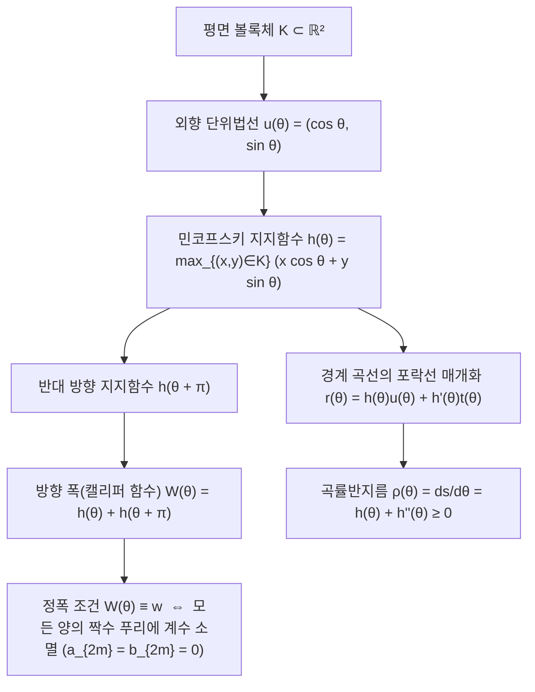
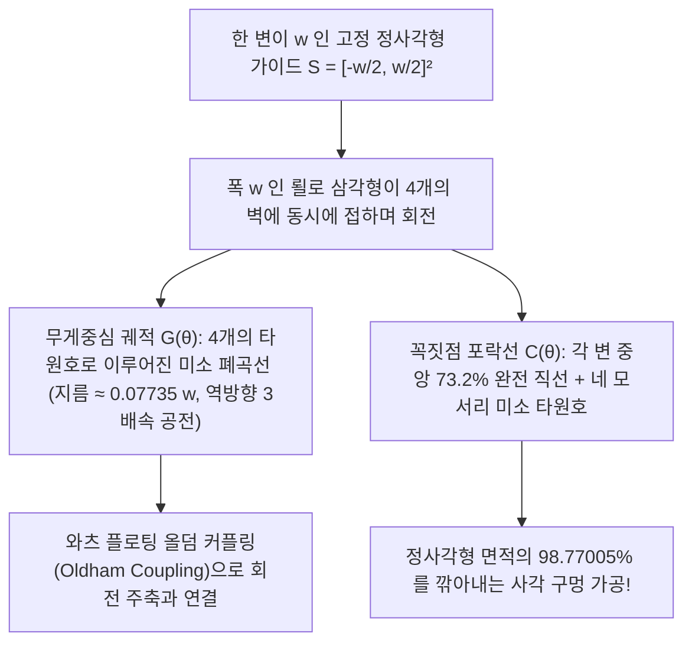

도시의 거리를 걸을 때 발아래 있는 하수도 <strong>맨홀 뚜껑(Manhole Cover)</strong>이 왜 예외 없이 둥근 원형인지 생각해 본 적이 있는가? 노벨 물리학상 수상자 리처드 파인만이 즐겨 인용하고 마이크로소프트 입사 면접 문제로 유명해진 이 퍼즐의 답은 간단한 기하학적 부등식에 있다.

만약 맨홀 뚜껑이 한 변의 길이가 $w$인 <strong>정사각형</strong>이라면 어떻게 될까? 정사각형 구멍의 변의 길이는 $w$이지만, 피타고라스 정리에 의해 대각선 길이는 $\sqrt{2}w \approx 1.4142\,w$가 된다. 따라서 무거운 정사각형 뚜껑을 수직으로 세워 대각선 방향으로 $45^\circ$ 돌려 넣으면, $w < \sqrt{2}w$이므로 뚜껑이 구멍 사이로 빠져 하수도 바닥으로 추락하고 만다. 직사각형, 타원, 정삼각형도 마찬가지로 최소 폭 $w_{\min}$이 최대 직경 $w_{\max}$보다 작기 때문에 가장 넓은 대각선 방향으로 기울이면 구멍에 빠진다. 반면 지름이 $w$인 <strong>원</strong>은 어느 방향에서 재어도 폭이 항상 $w$로 일정하므로 절대 구멍 아래로 떨어지지 않는다.

그렇다면 여기서 수학적 질문을 던져보자. <strong>"구멍에 빠지지 않는 맨홀 뚜껑"이나 "위에 얹은 평판을 단 1밀리미터도 위아래로 흔들지 않고 수평 이동시키는 통나무 롤러"의 단면은 반드시 '원'이어야만 할까?</strong>

정답은 <strong>'아니오'</strong>다! 평면 볼록기하학(Convex Geometry)에는 원이 아니면서도 모든 방향의 평행 지지접선 사이의 거리(폭)가 일정한 값 $w$로 유지되는 무수히 많은 도형, 즉 <strong>정폭도형(Curve of Constant Width)</strong>이 존재한다. 그중 가장 유명하고 극단적인 대표 주자가 바로 19세기 독일의 기계공학자 프란츠 뢸로(Franz Reuleaux)의 이름을 딴 <strong>뢸로 삼각형(Reuleaux Triangle)</strong>이다.

단면이 뢸로 삼각형인 통나무들을 바닥에 나란히 깔고 그 위에 평평한 판자를 얹어 밀면, 판자는 <strong>완벽하게 일정한 높이 $y = w$를 유지하며 수평으로 미끄러지듯 전진한다</strong>. 더욱 놀라운 사실은 1914년 영국 기술자 해리 제임스 와츠(Harry James Watts)가 뢸로 삼각형 단면의 드릴 날을 특수 플로팅 척에 장착하여 회전시킴으로써, 금속판에 <strong>정사각형 면적의 $98.77\%$를 깎아내는 '네모난 구멍' 드릴</strong>을 발명했다는 점이다! 본 글에서는 민코프스키 지지함수부터 바르비에 정리의 두 가지 엄밀한 증명, 블라슈케-르베그 정리, 사각 구멍 드릴의 궤적 방정식, 그리고 3차원 마이스너 입체(Meissner Bodies)까지 정폭도형의 수리적 구조를 완벽히 해부한다.

---

## 1. 구름의 역설: 왜 뢸로 삼각형 롤러는 흔들리지 않는데 바퀴로 쓰면 덜컹거릴까?

### 1.1 평판 아래에서 구르는 뢸로 삼각형 롤러

수평 바닥($y = 0$) 위에 폭 $w$인 뢸로 삼각형 롤러를 놓고 그 위에 평판을 얹어보자. 정폭도형의 정의에 의해 뢸로 삼각형이 어떤 각도 $\theta \in [0, 2\pi)$로 회전하더라도 바닥과 평판 사이의 수직 거리는 항상 $w$로 불변이다. 따라서 평판의 높이는 $y_{\text{plank}}(\theta) \equiv w$로 고정되어 <strong>상하 진동이 완전히 0</strong>이 된다.

### 1.2 고정 차축(무게중심 $G$)의 주기적 상하 진동

하지만 뢸로 삼각형의 기하학적 중심(무게중심) $G$에 고정된 차축을 꽂아 자전거 바퀴로 만들면 승차감은 악몽이 된다. 한 변이 $w$인 정삼각형 $\triangle ABC$를 기반으로 한 뢸로 삼각형에서:

- 중심 $G$에서 세 꼭짓점 $A, B, C$까지의 거리(외접원 반지름)는 $R = \frac{w}{\sqrt{3}} = \frac{\sqrt{3}}{3}w \approx 0.57735\,w$이다.
- 중심 $G$에서 반대편 원호의 중점까지의 거리는 $r = w - R = \left(1 - \frac{\sqrt{3}}{3}\right)w \approx 0.42265\,w$이다.

따라서 뢸로 삼각형이 바닥 위를 한 바퀴 구르는 동안 중심 차축 $G$의 높이 $y_G$는 1회전당 3번씩 최대 높이 $\frac{\sqrt{3}}{3}w$와 최소 높이 $\left(1 - \frac{\sqrt{3}}{3}\right)w$ 사이를 오르내리며, 그 상하 진폭은

$$\Delta y_G = y_{G,\max} - y_{G,\min} = \left(\frac{2\sqrt{3}}{3} - 1\right) w \approx 0.15470\,w$$

즉 폭의 약 $15.5\%$에 달한다! 이처럼 "외곽 포락선(Envelope)의 높이 불변성"과 "중심 $G$의 편심 궤도 운동" 사이의 괴리가 바로 사각 구멍 드릴과 방켈 로터리 엔진을 작동시키는 핵심 원리다.

---

## 2. 볼록기하학과 민코프스키 지지함수 $h_K(\theta)$

### 2.1 지지함수, 포락선 복원 및 곡률반지름

평면 볼록체 $K \subset \mathbb{R}^2$에 대하여 방향각 $\theta \in [0, 2\pi)$의 외향 단위법선벡터를 $\mathbf{u}(\theta) = (\cos\theta, \sin\theta)^\top$, 단위접선벡터를 $\mathbf{t}(\theta) = (-\sin\theta, \cos\theta)^\top$라 하자. $K$의 <strong>민코프스키 지지함수(Minkowski Support Function)</strong>는 다음과 같이 정의된다.

$$h_K(\theta) \triangleq \max_{(x, y) \in K} \left(x\cos\theta + y\sin\theta\right)$$

기하학적으로 $h_K(\theta)$는 원점 $O(0,0)$에서 법선 방향이 $\mathbf{u}(\theta)$인 지지직선 $L(\theta) : x\cos\theta + y\sin\theta = h_K(\theta)$까지의 부호 있는 수직 거리다.

$h(\theta) \in C^2(\mathbb{S}^1)$일 때, 경계 곡선 $\partial K$는 지지직선족 $L(\theta)$의 포락선(Envelope)으로서 연립방정식 $x\cos\theta + y\sin\theta = h(\theta)$와 $-x\sin\theta + y\cos\theta = h'(\theta)$를 풀어 다음과 같이 복원된다.

$$\mathbf{r}(\theta) = \begin{pmatrix} x(\theta) \\ y(\theta) \end{pmatrix} = h(\theta)\mathbf{u}(\theta) + h'(\theta)\mathbf{t}(\theta) = \begin{pmatrix} h(\theta)\cos\theta - h'(\theta)\sin\theta \\ h(\theta)\sin\theta + h'(\theta)\cos\theta \end{pmatrix}$$

이를 $\theta$에 대해 미분하면($\mathbf{u}' = \mathbf{t}, \mathbf{t}' = -\mathbf{u}$), 접선벡터와 곡률반지름 $\rho(\theta) = \frac{ds}{d\theta}$를 얻는다.

$$\frac{d\mathbf{r}}{d\theta} = \left(h(\theta) + h''(\theta)\right)\mathbf{t}(\theta) \implies \rho(\theta) = \frac{ds}{d\theta} = h(\theta) + h''(\theta)$$

주기함수 $h(\theta)$가 볼록체 $K$의 지지함수가 될 필요충분조건은 모든 $\theta$에서 $\rho(\theta) = h(\theta) + h''(\theta) \ge 0$을 만족하는 것이다.

### 2.2 정폭 조건과 홀수 고조파 푸리에 급수

방향 $\theta$에서의 캘리퍼 폭은 $W_K(\theta) = h_K(\theta) + h_K(\theta + \pi)$이므로, $K$가 <strong>폭 $w$인 정폭도형</strong>일 필요충분조건은 다음과 같다.

$$h_K(\theta) + h_K(\theta + \pi) = w \qquad (\forall \theta \in [0, 2\pi))$$

이를 두 번 미분하여 더하면 대향 접점에서의 곡률반지름 합 불변성 $\rho(\theta) + \rho(\theta + \pi) = w$를 얻는다. 또한 $h_K(\theta)$를 푸리에 급수로 전개하면 $\cos(n(\theta+\pi)) = (-1)^n\cos(n\theta)$에 의해 <strong>모든 양의 짝수 고조파 계수가 항등적으로 0($a_{2m} = b_{2m} = 0$)</strong>이 되며, 오직 홀수 고조파($n = 2k-1$)만 남는다!

$$h_K(\theta) = \frac{w}{2} + \sum_{k=1}^{\infty} \left(a_{2k-1}\cos((2k-1)\theta) + b_{2k-1}\sin((2k-1)\theta)\right)$$

예를 들어 3차 고조파만 남긴 $h(\theta) = \frac{w}{2} + \varepsilon\cos(3\theta)$ ($0 < |\varepsilon| \le \frac{w}{16}$)는 $\rho(\theta) = \frac{w}{2} - 8\varepsilon\cos(3\theta) \ge 0$을 만족하며, 모서리가 전혀 없는 <strong>무한번 미분가능한($C^\infty$ 해석적) 비원형 정폭곡선</strong>(8차 다항식 대수곡선)을 생성한다.

---

## 3. 뢸로 삼각형과 정홀수 뢸로 다각형의 넓이 공식

한 변이 $w$인 정삼각형 $\triangle ABC$의 각 꼭짓점을 중심으로 반지름 $w$인 $60^\circ$($\frac{\pi}{3}$) 원호 3개를 그리면 뢸로 삼각형이 완성된다. 반지름 $w$, 중심각 $\frac{\pi}{3}$인 부채꼴 3개의 넓이 합에서 중앙 정삼각형 넓이의 2배를 빼면 <strong>뢸로 삼각형의 넓이</strong>가 도출된다.

$$A_{\text{Reuleaux}} = 3\left(\frac{1}{2}w^2\cdot\frac{\pi}{3}\right) - 2\left(\frac{\sqrt{3}}{4}w^2\right) = \frac{1}{2}\left(\pi - \sqrt{3}\right) w^2 \approx 0.7047709\,w^2$$

이는 지름 $w$인 원의 넓이 $A_{\text{circle}} = \frac{\pi}{4}w^2 \approx 0.7853982\,w^2$보다 $10.27\%$ 더 작다. 일반적으로 홀수 $n = 2k+1$ ($n = 3, 5, 7, \dots$)에 대하여 정뢸로 $n$각형의 넓이는 내부 정$n$각형과 $n$개의 활꼴 넓이를 합산하여 다음과 같이 닫힌 형태로 주어진다.

$$A_n = \frac{w^2}{2}\left(\pi - n\tan\left(\frac{\pi}{2n}\right)\right) \qquad (n = 3, 5, 7, 9, \dots)$$

| 정폭도형 종류 | 꼭짓점 수 $n$ | 둘레 $L$ | 정확한 넓이 공식 $A(w)$ | 수치 넓이 | 원과의 넓이 비 $A / A_{\text{circle}}$ |
| :--- | :---: | :---: | :---: | :---: | :---: |
| <strong>뢸로 삼각형</strong> | $3$ | $\pi w$ | $\frac{1}{2}\left(\pi - \sqrt{3}\right)w^2$ | $0.704771\,w^2$ | $89.73\%$ (<strong>최소</strong>) |
| <strong>뢸로 오각형</strong> | $5$ | $\pi w$ | $\frac{1}{2}\left(\pi - 5\tan\frac{\pi}{10}\right)w^2$ | $0.756827\,w^2$ | $96.36\%$ |
| <strong>뢸로 칠각형</strong> (영국 20p/50p 동전) | $7$ | $\pi w$ | $\frac{1}{2}\left(\pi - 7\tan\frac{\pi}{14}\right)w^2$ | $0.770921\,w^2$ | $98.16\%$ |
| <strong>매끄러운 비원형 정폭곡선</strong> ($h = \frac{w}{2} + \frac{w}{16}\cos 3\theta$) | $0$ ($C^\infty$) | $\pi w$ | $\frac{63\pi}{256}w^2$ | $0.773126\,w^2$ | $98.44\%$ |
| <strong>원 (Circle)</strong> | $0$ ($C^\infty$) | $\pi w$ | $\frac{\pi}{4}w^2$ | $0.785398\,w^2$ | $100.00\%$ (<strong>최대</strong>) |

---

## 4. 바르비에 정리(1860)의 두 가지 완전한 증명과 블라슈케-르베그 정리(1914)

> <strong>【바르비에 정리 (Barbier's Theorem, 1860)】</strong>
> 폭이 $w$인 모든 평면 정폭 볼록곡선 $\partial K$의 둘레 길이는 도형의 구체적인 모양이나 대칭성과 무관하게 항상 지름 $w$인 원의 둘레와 정확히 같다:
> $$L(\partial K) = \pi w$$

### 4.1 증명 1: 미분기하학 및 민코프스키 지지함수 적분법

미소 호의 길이 $ds = \rho(\theta)\,d\theta = \left(h(\theta) + h''(\theta)\right)d\theta$를 $[0, 2\pi]$에서 적분하면 $h'(\theta)$의 주기성에 의해 $\big[h'(\theta)\big]_0^{2\pi} = 0$이 되므로:

$$L(\partial K) = \int_0^{2\pi} h(\theta)\,d\theta = \int_0^{\pi} \underbrace{\left(h(\theta) + h(\theta + \pi)\right)}_{W_K(\theta) = w} d\theta = \int_0^{\pi} w\,d\theta = \pi w$$

모서리가 있는 경우에도 정폭도형은 직선 구간을 포함할 수 없어 $h_K \in C^1(\mathbb{S}^1)$이 항상 성립하므로(또는 몰리파이어 합성곱 $h_\varepsilon = h_K * \eta_\varepsilon$의 하우스도르프 극한에 의해) $L = \pi w$가 엄밀히 성립한다. $\blacksquare$

### 4.2 증명 2: 적분기하학, 코시-크로프턴 공식과 '뷔퐁의 국수(Buffon's Noodle)'

평면 위 모든 유향 직선 $\ell(p, \theta) : x\cos\theta + y\sin\theta = p$의 운동학적 불변 측도는 $d\ell = dp \wedge d\theta$이다. 길이 $L$인 임의의 곡선('국수') $\gamma$와 직선 $\ell(p, \theta)$의 교점 개수를 $n_\gamma(p, \theta)$라 하면, 기댓값의 선형성에 의해 적분기하학의 기본 공식인 <strong>코시-크로프턴 공식(Cauchy–Crofton Formula)</strong>이 성립한다.

$$\int_0^{2\pi} \int_{-\infty}^{\infty} n_\gamma(p, \theta)\,dp\,d\theta = 4 L(\gamma)$$

볼록체 경계 $\gamma = \partial K$와 만나는 직선은 거의 모든 곳에서 정확히 2개의 교점($n_{\partial K} = 2$)을 가지며, 각 방향 $\theta$에서 $K$와 만나는 $p$의 구간 길이는 방향 폭 $W_K(\theta) = w$이므로:

$$4 L(\partial K) = \int_0^{2\pi} \left(\int_{-h_K(\theta+\pi)}^{h_K(\theta)} 2\,dp\right) d\theta = 2 \int_0^{2\pi} w\,d\theta = 4\pi w \implies L(\partial K) = \pi w \quad \blacksquare$$

### 4.3 블라슈케-르베그 정리(1914)와 푸리에 스펙트럼 넓이 공식

그린 정리와 부분적분으로부터 얻어지는 블라슈케 넓이 공식 $A(K) = \frac{1}{2}\int_0^{2\pi} \left(h(\theta)^2 - h'(\theta)^2\right)d\theta$에 홀수 고조파 푸리에 급수를 대입하고 파르세발(Parseval) 항등식을 적용하면 다음 공식을 얻는다.

$$A(K) = \frac{\pi}{4} w^2 - \frac{\pi}{2} \sum_{k=2}^{\infty} \left((2k-1)^2 - 1\right)\left(a_{2k-1}^2 + b_{2k-1}^2\right)$$

이 식으로부터 모든 $k \ge 2$ 고조파가 넓이를 감소시켜 <strong>원이 유일하게 넓이 최댓값 $\frac{\pi}{4}w^2$을 달성</strong>함을 즉시 알 수 있다. 반대로 $0 \le \rho(\theta) \le w$ 조건 아래 오목 범함수 $A(\rho)$를 최소화하면 폰트랴긴 최대 원리에 의해 곡률반지름이 양 끝값 $\{0, w\}$만 취하는 3회 전환 뱅뱅(Bang-Bang) 해, 즉 <strong>뢸로 삼각형이 유일하게 넓이 최솟값 $\frac{1}{2}(\pi - \sqrt{3})w^2$을 달성</strong>한다.

---

## 5. 뢸로 삼각형이 사각 구멍을 뚫는 원리: 해리 와츠의 드릴(1914)과 궤적 방정식

정사각형 가이드 $S = \left[-\frac{w}{2}, \frac{w}{2}\right]^2$ 내부에서 폭 $w$인 뢸로 삼각형이 네 변에 동시에 접하며 회전할 때, 기본 구간 $\theta \in \left[\frac{\pi}{6}, \frac{\pi}{3}\right]$에서 꼭짓점 $A$는 왼쪽 벽 $x = -\frac{w}{2}$, 꼭짓점 $B$는 바닥 벽 $y = -\frac{w}{2}$를 따라 미끄러진다:

$$A(\theta) = \begin{pmatrix} -\frac{w}{2} \\ -\frac{w}{2} + w\sin\theta \end{pmatrix}, \qquad B(\theta) = \begin{pmatrix} -\frac{w}{2} + w\cos\theta \\ -\frac{w}{2} \end{pmatrix}$$

### 5.1 무게중심 $G(\theta)$의 4개 타원호 편심 궤도

정삼각형 $\triangle ABC$의 무게중심 $G(x_G, y_G)$의 좌표는 다음과 같이 유도된다.

$$\begin{cases}
x_G(\theta) + \dfrac{w}{2} = \dfrac{w}{\sqrt{3}}\cos\left(\theta - \dfrac{\pi}{6}\right) \\[6pt]
y_G(\theta) + \dfrac{w}{2} = \dfrac{w}{\sqrt{3}}\sin\left(\theta + \dfrac{\pi}{6}\right)
\end{cases} \qquad \left(\frac{\pi}{6} \le \theta \le \frac{\pi}{3}\right)$$

이는 정사각형 꼭짓점 $\left(-\frac{w}{2}, -\frac{w}{2}\right)$를 중심으로 하고 장반경 $a_G = \frac{\sqrt{3}+1}{2\sqrt{3}}w$, 단반경 $b_G = \frac{\sqrt{3}-1}{2\sqrt{3}}w$를 갖는 <strong>정확한 타원호</strong>다! 4개의 타원호가 이어져 지름 $d_G = \left(\frac{2\sqrt{3}-3}{3}\right)w \approx 0.07735\,w$인 작은 궤도를 그리며 드릴 회전과 반대 방향으로 3배 빠르게($\omega_{\text{orbit}} = -3\omega_{\text{spin}}$) 공전한다. 와츠는 이를 <strong>플로팅 올덤 커플링(Oldham Coupling)</strong>으로 흡수하여 회전력을 전달했다.

### 5.2 꼭짓점 $C(\theta)$의 모서리 궤적과 $98.77\%$ 면적 피복률 증명

$\alpha = \frac{\pi}{3} - \theta \in \left[0, \frac{\pi}{6}\right]$라 두면 우측 상단 모서리를 깎는 꼭짓점 $C$의 궤적은 다음과 같다.

$$\begin{cases}
x_C(\alpha) = -\dfrac{w}{2} + w\cos\alpha \\[6pt]
y_C(\alpha) = -\dfrac{w}{2} + w\cos\left(\dfrac{\pi}{6} - \alpha\right)
\end{cases} \qquad \left(0 \le \alpha \le \frac{\pi}{6}\right)$$

- 정사각형 각 변의 중앙 구간 $(\sqrt{3}-1)w \approx 0.73205\,w$(변 길이의 $73.2\%$)는 꼭짓점이 벽면을 따라 직접 미끄러지므로 <strong>수학적으로 완벽한 직선</strong>이다!
- 한 모서리에서 깎이지 않고 남는 영역의 넓이 $A_{\text{corner}}$를 적분하면:
  $$A_{\text{corner}} = w^2 \int_0^{\pi/6} \left(1 - \cos\left(\frac{\pi}{6}-\alpha\right)\right)\sin\alpha\,d\alpha = \left(1 - \frac{\sqrt{3}}{2} - \frac{\pi}{24}\right) w^2 \approx 0.0030749\,w^2$$
- 따라서 네 모서리를 제외한 <strong>뢸로 삼각형 드릴의 전체 절삭 면적 $A_{\text{swept}}$</strong>는 다음과 같다.
  $$A_{\text{swept}} = w^2 - 4 A_{\text{corner}} = \left(2\sqrt{3} + \frac{\pi}{6} - 3\right) w^2 \approx 0.9877005\,w^2 \quad (98.77\%!)$$

---

## 6. 현대 공학 응용과 3차원 마이스너 입체(1911) 및 마이스너 추측(1934)

1. <strong>방켈 로터리 엔진과 영국 20p/50p 동전</strong>: 마쓰다 RX-7/787B로 유명한 로터리 엔진은 2엽 에피트로코이드 하우징 내부에서 변형 뢸로 삼각형 로터가 회전하며, 영국 20펜스·50펜스 주화는 <strong>정뢸로 칠각형($n = 7$)</strong>으로 설계되어 시각장애인의 촉각 식별과 자동판매기 캘리퍼 폭 인식을 동시에 해결했다.
2. <strong>3차원 '뢸로 사면체'의 실패와 마이스너 입체(Meissner Bodies)</strong>:
   한 변이 $w$인 정사면체의 네 꼭짓점을 중심으로 반지름 $w$인 구 4개를 교차시킨 <strong>뢸로 사면체(Reuleaux Tetrahedron)</strong>는 마주보는 두 곡선 모서리의 중점 간 거리가
   $$w_{\text{edge}} = \left(\sqrt{3} - \frac{\sqrt{2}}{2}\right) w \approx 1.024944\,w > w$$
   가 되어 정폭도형이 아니다! 1911년 에른스트 마이스너(Ernst Meissner)는 3쌍의 대향 모서리 중 한쪽씩 총 3개의 모서리를 스핀들 토러스(Spindle Torus) 곡면으로 둥글게 깎아내어 두 종류의 3차원 정폭 볼록체 $M_1, M_2$(부피 $V \approx 0.419860\,w^3$)를 완성했다. 이 두 마이스너 입체가 모든 3차원 정폭체 중 최소 부피(및 블라슈케 관계식 $V = \frac{1}{2}wS - \frac{\pi}{3}w^3$에 의해 최소 겉넓이)를 갖는다는 <strong>마이스너 추측(Bonnesen–Fenchel, 1934)</strong>은 90년이 넘도록 미해결 난제로 남아 있다.
