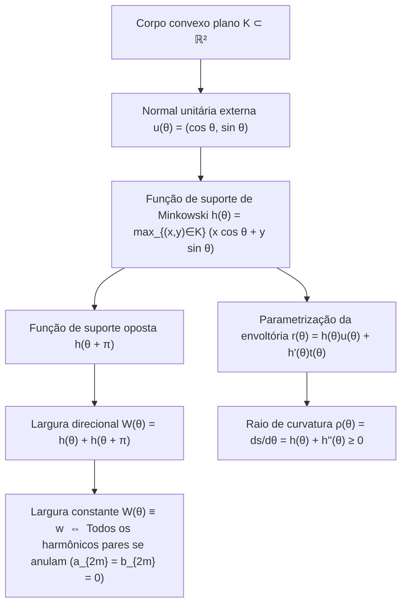
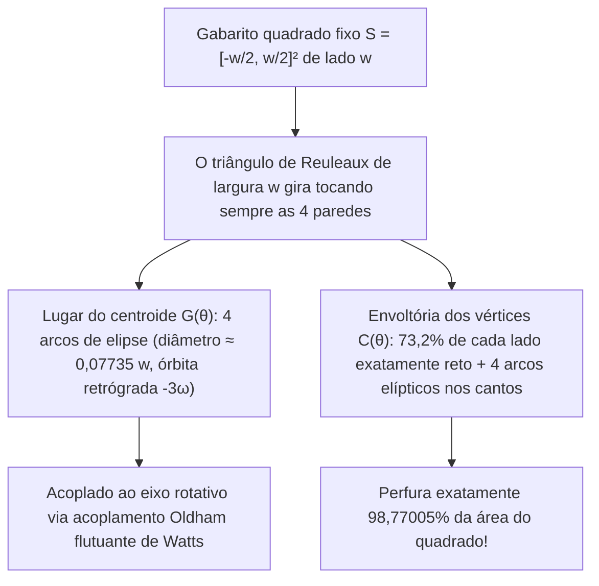

Por que as <strong>tampas de bueiro</strong> nas ruas das cidades são quase universalmente redondas? Esse famoso quebra-cabeça de engenharia, popularizado pelo prêmio Nobel Richard Feynman e pelas entrevistas da Microsoft, baseia-se em uma desigualdade geométrica simples.

Se uma tampa de bueiro fosse um <strong>quadrado</strong> de lado $w$, a abertura quadrada teria lado $w$, mas sua diagonal mediria $\sqrt{2}w \approx 1,4142\,w$ pelo teorema de Pitágoras. Se a pesada tampa quadrada for erguida verticalmente e girada em $45^\circ$ alinhada com a diagonal da abertura, por ser $w < \sqrt{2}w$, ela cairá diretamente através do próprio buraco. Um <strong>círculo</strong> de diâmetro $w$, por outro lado, possui exatamente a mesma largura $w$ em todas as direções e jamais pode cair pela abertura.

Façamos agora a pergunta matemática inversa: <strong>Uma tampa que não caia no próprio buraco — ou um rolo sobre o qual uma prancha plana deslize horizontalmente sem oscilar um único milímetro para cima ou para baixo — precisa necessariamente ser circular?</strong>

A resposta é <strong>não</strong>! Na geometria convexa, existem infinitas figuras planas não circulares cuja distância entre retas tangentes de suporte paralelas é constantemente igual a $w$ em qualquer direção: são as <strong>curvas de largura constante</strong> (chamadas de <em>orbiformes</em> por Leonhard Euler em 1778). Seu representante mais célebre e extremo é o <strong>triângulo de Reuleaux</strong>, batizado em homenagem ao engenheiro mecânico alemão <strong>Franz Reuleaux (1829–1905)</strong>.

Se apoiarmos uma prancha plana sobre rolos com seção de triângulo de Reuleaux de largura $w$, a prancha avança na altura constante $y = w$ <strong>de modo perfeitamente horizontal, sem nenhuma trepidação vertical</strong>. E o mais surpreendente: em 1914, o engenheiro Harry James Watts acoplou uma broca com seção de triângulo de Reuleaux a um mandril flutuante, permitindo que uma furadeira rotativa comum <strong>perfurasse diretamente um buraco quadrado cobrindo exatamente $98,77005\,\%$ da área do quadrado</strong>!

---

## 1. O paradoxo cinemático: Rolo sem vibração vs. eixo saltitante

### 1.1 Translação horizontal perfeita de uma prancha

Quando um triângulo de Reuleaux de largura $w$ rola sobre o piso horizontal $y = 0$, ele permanece em qualquer ângulo $\theta \in [0, 2\pi)$ simultaneamente tangente ao solo ($y = 0$) e à face inferior da prancha. Como a largura vertical entre tangentes paralelas é constantemente $w$, a prancha mantém-se travada na altura $y_{\text{prancha}}(\theta) \equiv w$.

### 1.2 Oscilação vertical de um eixo fixo no baricentro $G$

Por que então as rodas dos carros não são triângulos de Reuleaux? Porque um veículo apoia seu peso em um <strong>eixo central fixo</strong> passando pelo centroide geométrico $G$. Em um triângulo de Reuleaux construído sobre um triângulo equilátero $\triangle ABC$ de lado $w$:

- A distância do centroide $G$ aos três vértices $A, B, C$ é $R = \frac{w}{\sqrt{3}} = \frac{\sqrt{3}}{3}w \approx 0,57735\,w$.
- A distância do centroide $G$ ao ponto médio do arco oposto é $r = w - R = \left(1 - \frac{\sqrt{3}}{3}\right)w \approx 0,42265\,w$.

Ao completar uma volta sobre o solo, a altura do eixo $G$ sobe e desce 3 vezes por revolução com uma amplitude vertical de:

$$\Delta y_G = R - r = \left(\frac{2\sqrt{3}}{3} - 1\right) w \approx 0,15470\,w$$

Essa dissociação entre uma <strong>envoltória externa estacionária</strong> e um <strong>centroide em órbita excêntrica</strong> é o segredo cinemático tanto da broca de furos quadrados quanto do motor rotativo Wankel.

---

## 2. Geometria convexa e a função de suporte de Minkowski $h_K(\theta)$

### 2.1 Função de suporte, envoltória e raio de curvatura

Seja $K \subset \mathbb{R}^2$ um corpo convexo compacto. Para cada ângulo $\theta \in [0, 2\pi)$, definimos a normal unitária externa $\mathbf{u}(\theta) = (\cos\theta, \sin\theta)^\top$ e a tangente unitária $\mathbf{t}(\theta) = (-\sin\theta, \cos\theta)^\top$. A <strong>função de suporte de Minkowski (Support Function)</strong> de $K$ é definida por:

$$h_K(\theta) \triangleq \max_{(x, y) \in K} \left(x\cos\theta + y\sin\theta\right)$$

Quando $h(\theta) \in C^2(\mathbb{S}^1)$, a fronteira $\partial K$ é reconstruída como a envoltória das retas de suporte $x\cos\theta + y\sin\theta = h(\theta)$ junto com sua derivada $-x\sin\theta + y\cos\theta = h'(\theta)$:

$$\mathbf{r}(\theta) = \begin{pmatrix} x(\theta) \\ y(\theta) \end{pmatrix} = h(\theta)\mathbf{u}(\theta) + h'(\theta)\mathbf{t}(\theta) = \begin{pmatrix} h(\theta)\cos\theta - h'(\theta)\sin\theta \\ h(\theta)\sin\theta + h'(\theta)\cos\theta \end{pmatrix}$$

Derivando em relação a $\theta$ ($\mathbf{u}' = \mathbf{t}, \mathbf{t}' = -\mathbf{u}$), obtemos o elemento de arco $ds$ e o <strong>raio de curvatura</strong> $\rho(\theta)$:

$$\frac{d\mathbf{r}}{d\theta} = \left(h(\theta) + h''(\theta)\right)\mathbf{t}(\theta) \implies \rho(\theta) = \frac{ds}{d\theta} = h(\theta) + h''(\theta) \ge 0$$

### 2.2 Condição de largura constante e séries de Fourier ímpares

A largura na direção $\theta$ é $W_K(\theta) = h_K(\theta) + h_K(\theta + \pi)$. Portanto, $K$ possui <strong>largura constante $w$</strong> se e somente se:

$$h_K(\theta) + h_K(\theta + \pi) = w \qquad (\forall \theta \in [0, 2\pi))$$

Daí decorre que $\rho(\theta) + \rho(\theta + \pi) = w$ e que a série de Fourier de $h_K(\theta)$ contém <strong>apenas harmônicos ímpares</strong> ($a_{2m} = b_{2m} = 0$ para todo $m \ge 1$):

$$h_K(\theta) = \frac{w}{2} + \sum_{k=1}^{\infty} \left(a_{2k-1}\cos((2k-1)\theta) + b_{2k-1}\sin((2k-1)\theta)\right)$$

Escolhendo por exemplo $h(\theta) = \frac{w}{2} + \frac{w}{16}\cos(3\theta)$, temos $\rho(\theta) = \frac{w}{2}(1 - \cos 3\theta) \ge 0$, o que gera uma <strong>curva de largura constante analítica ($C^\infty$) não circular e totalmente livre de vértices</strong> (curva algébrica polinomial de grau 8 de Rabinowitz, 1997).

---

## 3. Área do triângulo de Reuleaux e dos polígonos de Reuleaux ímpares

Traçando três arcos circulares de raio $w$ centrados nos vértices $A, B, C$ de um triângulo equilátero de lado $w$, formamos o triângulo de Reuleaux. Pelo princípio da inclusão-exclusão, sua área é a soma de três setores circulares de ângulo $\frac{\pi}{3}$ ($\frac{\pi}{6}w^2$ cada) menos duas vezes a área do triângulo equilátero central ($\frac{\sqrt{3}}{4}w^2$):

$$A_{\text{Reuleaux}} = 3\left(\frac{\pi}{6}w^2\right) - 2\left(\frac{\sqrt{3}}{4}w^2\right) = \frac{1}{2}\left(\pi - \sqrt{3}\right) w^2 \approx 0,7047709\,w^2$$

Isso representa $10,27\,\%$ menos área que o círculo de mesmo diâmetro $w$ ($A_{\text{círculo}} = \frac{\pi}{4}w^2 \approx 0,7853982\,w^2$). Para qualquer polígono regular de Reuleaux com número ímpar de lados $n = 2k+1$ ($n = 3, 5, 7, \dots$), a área exata é dada por:

$$A_n = \frac{w^2}{2}\left(\pi - n\tan\left(\frac{\pi}{2n}\right)\right) \qquad (n = 3, 5, 7, 9, \dots)$$

| Curva de largura constante $w$ | Vértices $n$ | Perímetro $L$ | Fórmula exata da área $A(w)$ | Área numérica | Razão $A / A_{\text{círculo}}$ |
| :--- | :---: | :---: | :---: | :---: | :---: |
| <strong>Triângulo de Reuleaux</strong> | $3$ | $\pi w$ | $\frac{1}{2}\left(\pi - \sqrt{3}\right)w^2$ | $0,704771\,w^2$ | $89,73\%$ (<strong>Mínimo</strong>) |
| <strong>Pentágono de Reuleaux</strong> | $5$ | $\pi w$ | $\frac{1}{2}\left(\pi - 5\tan\frac{\pi}{10}\right)w^2$ | $0,756827\,w^2$ | $96,36\%$ |
| <strong>Heptágono de Reuleaux</strong> (Moedas UK 20p/50p) | $7$ | $\pi w$ | $\frac{1}{2}\left(\pi - 7\tan\frac{\pi}{14}\right)w^2$ | $0,770921\,w^2$ | $98,16\%$ |
| <strong>Curva suave analítica</strong> ($h = \frac{w}{2} + \frac{w}{16}\cos 3\theta$) | $0$ ($C^\infty$) | $\pi w$ | $\frac{63\pi}{256}w^2$ | $0,773126\,w^2$ | $98,44\%$ |
| <strong>Círculo (Circle)</strong> | $0$ ($C^\infty$) | $\pi w$ | $\frac{\pi}{4}w^2$ | $0,785398\,w^2$ | $100,00\%$ (<strong>Máximo</strong>) |

---

## 4. Duas demonstrações completas do Teorema de Barbier (1860) e o Teorema de Blaschke–Lebesgue (1914)

> <strong>Teorema de Barbier (Joseph-Émile Barbier, 1860).</strong>
> <em>Toda curva convexa plana de largura constante $w$ possui exatamente o mesmo perímetro que um círculo de diâmetro $w$:</em>
> $$L(\partial K) = \pi w$$

### 4.1 Demonstração 1: Geometria diferencial via função de suporte

Integrando $ds = \left(h(\theta) + h''(\theta)\right)d\theta$ em $[0, 2\pi]$ e usando a $2\pi$-periodicidade de $h'(\theta)$:

$$L(\partial K) = \int_0^{2\pi} h(\theta)\,d\theta + \Big[h'(\theta)\Big]_0^{2\pi} = \int_0^{\pi} \underbrace{\left(h(\theta) + h(\theta + \pi)\right)}_{= w} d\theta = \int_0^{\pi} w\,d\theta = \pi w$$

Como uma curva de largura constante não pode conter segmentos retos, $h_K$ é sempre de classe $C^1(\mathbb{S}^1)$ (ou via regularização por convolução $h_\varepsilon = h_K * \eta_\varepsilon$ na métrica de Hausdorff), tornando a prova rigorosa mesmo na presença de vértices. $\blacksquare$

### 4.2 Demonstração 2: Geometria integral, fórmula de Cauchy–Crofton e o «Macarrão de Buffon»

No espaço das retas orientadas $\ell(p, \theta) : x\cos\theta + y\sin\theta = p$ com a medida cinemática invariante $d\ell = dp \wedge d\theta$, a linearidade da esperança aplicada ao número de interseções $n_\gamma(p, \theta) = \#(\gamma \cap \ell(p, \theta))$ de uma curva retificável («macarrão de Buffon») produz a <strong>fórmula de Cauchy–Crofton</strong>:

$$\int_0^{2\pi} \int_{-\infty}^{\infty} n_\gamma(p, \theta)\,dp\,d\theta = 4 L(\gamma)$$

Para a fronteira $\gamma = \partial K$ de um corpo convexo, toda reta secante corta $\partial K$ em exatamente $n_{\partial K} = 2$ pontos sobre um intervalo de comprimento $W_K(\theta) = w$. Logo:

$$4 L(\partial K) = \int_0^{2\pi} 2 W_K(\theta)\,d\theta = 2 \int_0^{2\pi} w\,d\theta = 4\pi w \implies L(\partial K) = \pi w \quad \blacksquare$$

### 4.3 O Teorema de Blaschke–Lebesgue (1914)

A fórmula de área de Blaschke $A(K) = \frac{1}{2}\int_0^{2\pi} \left(h(\theta)^2 - h'(\theta)^2\right)d\theta$ combinada à identidade de Parseval fornece:

$$A(K) = \frac{\pi}{4} w^2 - \frac{\pi}{2} \sum_{k=2}^{\infty} \left((2k-1)^2 - 1\right)\left(a_{2k-1}^2 + b_{2k-1}^2\right)$$

O círculo maximiza de forma única a área ($\frac{\pi}{4}w^2$), enquanto a minimização sob $0 \le \rho(\theta) \le w$ conduz pelo princípio do máximo de Pontryagin à curvatura «bang-bang» $\rho(\theta) \in \{0, w\}$ com 3 comutações: <strong>o triângulo de Reuleaux minimiza de forma única a área entre todas as curvas de largura constante $w$</strong> (Henri Lebesgue 1914, Wilhelm Blaschke 1915).

---

## 5. Como o triângulo de Reuleaux fura um buraco quadrado: A broca de Harry Watts (1914)

No quadrado fixo $S = \left[-\frac{w}{2}, \frac{w}{2}\right]^2$, no intervalo fundamental $\theta \in \left[\frac{\pi}{6}, \frac{\pi}{3}\right]$, o vértice $A$ desliza pela parede esquerda $x = -\frac{w}{2}$ e o vértice $B$ pela parede inferior $y = -\frac{w}{2}$:

$$A(\theta) = \begin{pmatrix} -\frac{w}{2} \\ -\frac{w}{2} + w\sin\theta \end{pmatrix}, \qquad B(\theta) = \begin{pmatrix} -\frac{w}{2} + w\cos\theta \\ -\frac{w}{2} \end{pmatrix}$$

### 5.1 Órbita elíptica do centroide $G(\theta)$ e cobertura de $98,77\,\%$ do quadrado

1. <strong>Lugar do centroide $G(\theta)$</strong>:
   $$x_G(\theta) + \frac{w}{2} = \frac{w}{\sqrt{3}}\cos\left(\theta - \frac{\pi}{6}\right), \qquad y_G(\theta) + \frac{w}{2} = \frac{w}{\sqrt{3}}\sin\left(\theta + \frac{\pi}{6}\right)$$
   Trata-se de um arco de elipse exato centrado no canto $\left(-\frac{w}{2}, -\frac{w}{2}\right)$ com semieixos $a_G = \frac{\sqrt{3}+1}{2\sqrt{3}}w$ e $b_G = \frac{\sqrt{3}-1}{2\sqrt{3}}w$. Os 4 arcos formam uma pequena órbita fechada de diâmetro $d_G = \left(\frac{2\sqrt{3}-3}{3}\right)w \approx 0,07735\,w$ percorrida na velocidade $-3\omega$, compensada por um <strong>acoplamento Oldham flutuante</strong>.
2. <strong>Trajetória de canto $C(\alpha)$ e área varrida $A_{\text{swept}}$</strong>:
   Fazendo $\alpha = \frac{\pi}{3} - \theta \in \left[0, \frac{\pi}{6}\right]$, o vértice $C$ descreve no canto superior direito o arco de elipse:
   $$x_C(\alpha) = -\frac{w}{2} + w\cos\alpha, \qquad y_C(\alpha) = -\frac{w}{2} + w\cos\left(\frac{\pi}{6} - \alpha\right)$$
   Em cada lado do quadrado, o trecho central de comprimento $(\sqrt{3}-1)w \approx 0,73205\,w$ ($73,2\,\%$ do lado) é <strong>matematicamente reto</strong>. A área não cortada em um canto vale:
   $$A_{\text{canto}} = w^2 \int_0^{\pi/6} \left(1 - \cos\left(\frac{\pi}{6}-\alpha\right)\right)\sin\alpha\,d\alpha = \left(1 - \frac{\sqrt{3}}{2} - \frac{\pi}{24}\right) w^2 \approx 0,0030749\,w^2$$
   Portanto, a área total escavada pela broca de Reuleaux é exatamente:
   $$A_{\text{varrida}} = w^2 - 4 A_{\text{canto}} = \left(2\sqrt{3} + \frac{\pi}{6} - 3\right) w^2 \approx 0,9877005\,w^2 \quad (98,77\,\%!)$$

---

## 6. Aplicações modernas e fronteira 3D: Corpos de Meissner (1911) e conjectura de Meissner (1934)

Além do <strong>motor rotativo Wankel</strong> (epitrocoide de dois lóbulos) e das <strong>moedas britânicas de 20p e 50p</strong> (heptágonos de Reuleaux, $n=7$), a transição para 3 dimensões revela que o <strong>tetraedro de Reuleaux</strong> <strong>não</strong> possui largura constante, pois a distância entre os pontos médios de duas arestas curvas opostas é

$$w_{\text{aresta}} = \left(\sqrt{3} - \frac{\sqrt{2}}{2}\right) w \approx 1,024944\,w > w$$

Em 1911, <strong>Ernst Meissner e Friedrich Schilling</strong> arredondaram cirurgicamente três das seis arestas usando superfícies de toro fusiforme (<em>spindle torus</em>), criando os dois <strong>corpos de Meissner</strong> $M_1$ e $M_2$ de volume $V \approx 0,419860\,w^3$. A <strong>conjectura de Meissner (Bonnesen–Fenchel, 1934)</strong>, segundo a qual $M_1$ e $M_2$ minimizam o volume (e a área superficial via a relação de Blaschke $V = \frac{1}{2}wS - \frac{\pi}{3}w^3$) entre todos os corpos 3D de largura constante $w$, permanece até hoje como um dos grandes problemas abertos da geometria.
