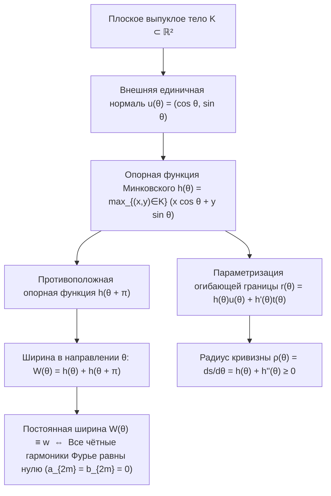
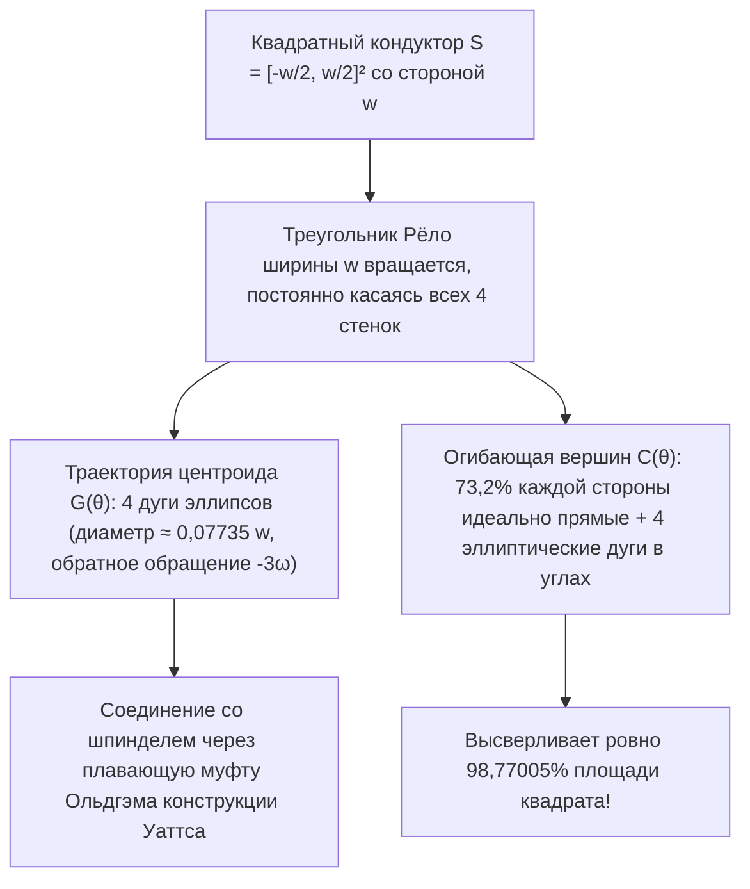

Почему чугунные <strong>крышки канализационных люков</strong> на улицах городов почти всегда круглые? Эта знаменитая инженерная загадка, популяризированная нобелевским лауреатом Ричардом Фейнманом и собеседованиями в Microsoft, опирается на простое геометрическое неравенство.

Если бы крышка люка была <strong>квадратом</strong> со стороной $w$, то квадратное отверстие имело бы сторону $w$, но его диагональ по теореме Пифагора равнялась бы $\sqrt{2}w \approx 1{,}4142\,w$. Если поставить тяжёлую квадратную крышку вертикально и повернуть на $45^\circ$ вдоль диагонали проёма, то из-за $w < \sqrt{2}w$ она свободно провалится сквозь собственное отверстие на дно шахты. Напротив, <strong>круг</strong> диаметра $w$ имеет одинаковую ширину $w$ во всех направлениях и ни при каком наклоне не может упасть в люк.

Поставим теперь обратный математический вопрос: <strong>Должна ли крышка люка — или каток, по которому плоская доска катится строго горизонтально без малейших вертикальных колебаний, — обязательно быть круглой?</strong>

Ответ — <strong>нет</strong>! В выпуклой геометрии существует бесконечно много некруглых плоских фигур, у которых расстояние между параллельными опорными касательными прямыми во всех направлениях постоянно и равно $w$: это <strong>фигуры (кривые) постоянной ширины</strong> (названные Леонардом Эйлером в 1778 году <em>орбиформами</em>). Самый знаменитый и экстремальный их представитель — <strong>треугольник Рёло (Reuleaux Triangle)</strong>, названный в честь немецкого механика и кинематика <strong>Франца Рёло (Franz Reuleaux, 1829–1905)</strong>.

Если положить плоскую доску на катки с сечением в форме треугольника Рёло ширины $w$, доска будет двигаться на постоянной высоте $y = w$ <strong>абсолютно горизонтально без единого миллиметра тряски</strong>. Ещё удивительнее то, что в 1914 году инженер Гарри Джеймс Уаттс закрепил сверло с профилем треугольника Рёло в плавающем патроне, позволив обычному сверлильному станку <strong>высверливать в металле квадратные отверстия, охватывающие ровно $98{,}77005\,\%$ площади квадрата</strong>!

---

## 1. Кинематический парадокс: Плавный каток против прыгающей оси колеса

### 1.1 Идеально горизонтальное движение плиты по каткам Рёло

Когда треугольник Рёло ширины $w$ катится без проскальзывания по горизонтальному полу $y = 0$, при любом угле поворота $\theta \in [0, 2\pi)$ он одновременно касается пола ($y = 0$) и нижней поверхности лежащей сверху плиты. Поскольку вертикальная ширина между параллельными опорными прямыми тождественно равна $w$, плита остаётся на неизменной высоте $y_{\text{плиты}}(\theta) \equiv w$.

### 1.2 Вертикальные биения оси, закреплённой в центре тяжести $G$

Почему же тогда колёса велосипедов и автомобилей не делают в форме треугольника Рёло? Потому что кузов транспортного средства опирается на <strong>фиксированную ось</strong>, проходящую через геометрический центр тяжести (центроид) $G$. В треугольнике Рёло, построенном на равностороннем треугольнике $\triangle ABC$ со стороной $w$:

- Расстояние от центроида $G$ до каждой из трёх вершин $A, B, C$ равно $R = \frac{w}{\sqrt{3}} = \frac{\sqrt{3}}{3}w \approx 0{,}57735\,w$.
- Расстояние от центроида $G$ до середины противоположной дуги равно $r = w - R = \left(1 - \frac{\sqrt{3}}{3}\right)w \approx 0{,}42265\,w$.

За один полный оборот колеса высота оси $G$ трижды подскакивает и опускается с размахом:

$$\Delta y_G = R - r = \left(\frac{2\sqrt{3}}{3} - 1\right) w \approx 0{,}15470\,w$$

Именно это расщепление между <strong>неподвижной внешней огибающей</strong> и <strong>эксцентрично обращающимся центром тяжести</strong> лежит в основе сверла Уаттса и роторно-поршневого двигателя Ванкеля.

---

## 2. Выпуклая геометрия и опорная функция Минковского $h_K(\theta)$

### 2.1 Опорная функция, огибающая и радиус кривизны

Пусть $K \subset \mathbb{R}^2$ — компактное выпуклое тело. Для каждого угла $\theta \in [0, 2\pi)$ введём единичный вектор внешней нормали $\mathbf{u}(\theta) = (\cos\theta, \sin\theta)^\top$ и единичный касательный вектор $\mathbf{t}(\theta) = (-\sin\theta, \cos\theta)^\top$. <strong>Опорная функция Минковского (Support Function)</strong> тела $K$ определяется как:

$$h_K(\theta) \triangleq \max_{(x, y) \in K} \left(x\cos\theta + y\sin\theta\right)$$

Если $h(\theta) \in C^2(\mathbb{S}^1)$, то граничная кривая $\partial K$ восстанавливается как огибающая семейства опорных прямых $x\cos\theta + y\sin\theta = h(\theta)$ совместно с производной $-x\sin\theta + y\cos\theta = h'(\theta)$:

$$\mathbf{r}(\theta) = \begin{pmatrix} x(\theta) \\ y(\theta) \end{pmatrix} = h(\theta)\mathbf{u}(\theta) + h'(\theta)\mathbf{t}(\theta) = \begin{pmatrix} h(\theta)\cos\theta - h'(\theta)\sin\theta \\ h(\theta)\sin\theta + h'(\theta)\cos\theta \end{pmatrix}$$

Дифференцируя по $\theta$ ($\mathbf{u}' = \mathbf{t}, \mathbf{t}' = -\mathbf{u}$), получаем дифференциал дуги $ds$ и <strong>радиус кривизны</strong> $\rho(\theta)$:

$$\frac{d\mathbf{r}}{d\theta} = \left(h(\theta) + h''(\theta)\right)\mathbf{t}(\theta) \implies \rho(\theta) = \frac{ds}{d\theta} = h(\theta) + h''(\theta) \ge 0$$

### 2.2 Условие постоянной ширины и нечётные ряды Фурье

Ширина тела в направлении $\theta$ равна $W_K(\theta) = h_K(\theta) + h_K(\theta + \pi)$. Следовательно, $K$ имеет <strong>постоянную ширину $w$</strong> тогда и только тогда, когда:

$$h_K(\theta) + h_K(\theta + \pi) = w \qquad (\forall \theta \in [0, 2\pi))$$

Отсюда следует, что сумма радиусов кривизны в противоположных точках постоянна: $\rho(\theta) + \rho(\theta + \pi) = w$, а разложение $h_K(\theta)$ в ряд Фурье содержит <strong>только нечётные гармоники</strong> ($a_{2m} = b_{2m} = 0$ при всех $m \ge 1$):

$$h_K(\theta) = \frac{w}{2} + \sum_{k=1}^{\infty} \left(a_{2k-1}\cos((2k-1)\theta) + b_{2k-1}\sin((2k-1)\theta)\right)$$

Например, взяв $h(\theta) = \frac{w}{2} + \frac{w}{16}\cos(3\theta)$, получаем $\rho(\theta) = \frac{w}{2}(1 - \cos 3\theta) \ge 0$ — <strong>бесконечно гладкую ($C^\infty$) аналитическую некруглую кривую постоянной ширины без единого угла</strong> (алгебраическая кривая 8-й степени Рабиновица, 1997).

---

## 3. Площадь треугольника Рёло и правильных нечётных многоугольников Рёло

Построив три дуги окружности радиуса $w$ с центрами в вершинах $A, B, C$ равностороннего треугольника со стороной $w$, получим треугольник Рёло. По формуле включений-исключений его площадь равна сумме площадей трёх секторов с углом $\frac{\pi}{3}$ (по $\frac{\pi}{6}w^2$) минус удвоенная площадь центрального равностороннего треугольника ($\frac{\sqrt{3}}{4}w^2$):

$$A_{\text{Reuleaux}} = 3\left(\frac{\pi}{6}w^2\right) - 2\left(\frac{\sqrt{3}}{4}w^2\right) = \frac{1}{2}\left(\pi - \sqrt{3}\right) w^2 \approx 0{,}7047709\,w^2$$

Это на $10{,}27\,\%$ меньше площади круга того же диаметра $w$ ($A_{\text{круга}} = \frac{\pi}{4}w^2 \approx 0{,}7853982\,w^2$). Для правильного $n$-угольника Рёло с нечётным числом сторон $n = 2k+1$ ($n = 3, 5, 7, \dots$) общая формула площади имеет вид:

$$A_n = \frac{w^2}{2}\left(\pi - n\tan\left(\frac{\pi}{2n}\right)\right) \qquad (n = 3, 5, 7, 9, \dots)$$

| Фигура постоянной ширины $w$ | Число вершин $n$ | Периметр $L$ | Точная формула площади $A(w)$ | Численная площадь | Отношение $A / A_{\text{круга}}$ |
| :--- | :---: | :---: | :---: | :---: | :---: |
| <strong>Треугольник Рёло</strong> | $3$ | $\pi w$ | $\frac{1}{2}\left(\pi - \sqrt{3}\right)w^2$ | $0{,}704771\,w^2$ | $89{,}73\%$ (<strong>Минимум</strong>) |
| <strong>Пятиугольник Рёло</strong> | $5$ | $\pi w$ | $\frac{1}{2}\left(\pi - 5\tan\frac{\pi}{10}\right)w^2$ | $0{,}756827\,w^2$ | $96{,}36\%$ |
| <strong>Семиугольник Рёло</strong> (Монеты Великобритании 20p/50p) | $7$ | $\pi w$ | $\frac{1}{2}\left(\pi - 7\tan\frac{\pi}{14}\right)w^2$ | $0{,}770921\,w^2$ | $98{,}16\%$ |
| <strong>Гладкая аналитическая кривая</strong> ($h = \frac{w}{2} + \frac{w}{16}\cos 3\theta$) | $0$ ($C^\infty$) | $\pi w$ | $\frac{63\pi}{256}w^2$ | $0{,}773126\,w^2$ | $98{,}44\%$ |
| <strong>Круг (Circle)</strong> | $0$ ($C^\infty$) | $\pi w$ | $\frac{\pi}{4}w^2$ | $0{,}785398\,w^2$ | $100{,}00\%$ (<strong>Максимум</strong>) |

---

## 4. Два полных доказательства теоремы Барбье (1860) и теорема Бляшке — Лебега (1914)

> <strong>Теорема Барбье (Жозеф-Эмиль Барбье, 1860).</strong>
> <em>Периметр любой плоской выпуклой кривой постоянной ширины $w$ в точности равен длине окружности диаметра $w$:</em>
> $$L(\partial K) = \pi w$$

### 4.1 Доказательство 1: Дифференциальная геометрия и опорная функция

Интегрируя элемент дуги $ds = \left(h(\theta) + h''(\theta)\right)d\theta$ по $[0, 2\pi]$ и учитывая $2\pi$-периодичность $h'(\theta)$:

$$L(\partial K) = \int_0^{2\pi} h(\theta)\,d\theta + \Big[h'(\theta)\Big]_0^{2\pi} = \int_0^{\pi} \underbrace{\left(h(\theta) + h(\theta + \pi)\right)}_{= w} d\theta = \int_0^{\pi} w\,d\theta = \pi w$$

Поскольку кривая постоянной ширины не может содержать прямолинейных отрезков, $h_K$ всюду принадлежит классу $C^1(\mathbb{S}^1)$ (либо аппроксимируется свёрткой $h_\varepsilon = h_K * \eta_\varepsilon$ в метрике Хаусдорфа), поэтому равенство $L = \pi w$ строго справедливо и для кривых с изломами. $\blacksquare$

### 4.2 Доказательство 2: Интегральная геометрия, формула Коши — Крофтона и «Лапша Бюффона»

В пространстве ориентированных прямых $\ell(p, \theta) : x\cos\theta + y\sin\theta = p$ с инвариантной кинематической мерой $d\ell = dp \wedge d\theta$ линейность математического ожидания для числа пересечений $n_\gamma(p, \theta) = \#(\gamma \cap \ell(p, \theta))$ спрямляемой кривой («лапши Бюффона») даёт <strong>формулу Коши — Крофтона</strong>:

$$\int_0^{2\pi} \int_{-\infty}^{\infty} n_\gamma(p, \theta)\,dp\,d\theta = 4 L(\gamma)$$

Для границы $\gamma = \partial K$ выпуклого тела почти каждая секущая прямая пересекает $\partial K$ ровно в $n_{\partial K} = 2$ точках на интервале длины $W_K(\theta) = w$. Следовательно:

$$4 L(\partial K) = \int_0^{2\pi} 2 W_K(\theta)\,d\theta = 2 \int_0^{2\pi} w\,d\theta = 4\pi w \implies L(\partial K) = \pi w \quad \blacksquare$$

### 4.3 Теорема Бляшке — Лебега (1914)

Подстановка нечётного ряда Фурье в формулу площади Бляшке $A(K) = \frac{1}{2}\int_0^{2\pi} \left(h(\theta)^2 - h'(\theta)^2\right)d\theta$ по равенству Парсеваля даёт:

$$A(K) = \frac{\pi}{4} w^2 - \frac{\pi}{2} \sum_{k=2}^{\infty} \left((2k-1)^2 - 1\right)\left(a_{2k-1}^2 + b_{2k-1}^2\right)$$

Таким образом, круг единственным образом максимизирует площадь ($\frac{\pi}{4}w^2$), а минимизация при ограничении $0 \le \rho(\theta) \le w$ по принципу максимума Понтрягина приводит к релейному («bang-bang») управлению $\rho(\theta) \in \{0, w\}$ с 3 переключениями: <strong>треугольник Рёло единственным образом минимизирует площадь среди всех фигур постоянной ширины $w$</strong> (Анри Лебег 1914, Вильгельм Бляшке 1915).

---

## 5. Как треугольник Рёло сверлит квадратное отверстие: Сверло Гарри Уаттса (1914)

Внутри фиксированного квадрата $S = \left[-\frac{w}{2}, \frac{w}{2}\right]^2$ на основном интервале $\theta \in \left[\frac{\pi}{6}, \frac{\pi}{3}\right]$ вершина $A$ скользит по левой стенке $x = -\frac{w}{2}$, а вершина $B$ — по нижней стенке $y = -\frac{w}{2}$:

$$A(\theta) = \begin{pmatrix} -\frac{w}{2} \\ -\frac{w}{2} + w\sin\theta \end{pmatrix}, \qquad B(\theta) = \begin{pmatrix} -\frac{w}{2} + w\cos\theta \\ -\frac{w}{2} \end{pmatrix}$$

### 5.1 Эллиптическая орбита центроида $G(\theta)$ и покрытие $98{,}77\,\%$ площади квадрата

1. <strong>Траектория центра тяжести $G(\theta)$</strong>:
   $$x_G(\theta) + \frac{w}{2} = \frac{w}{\sqrt{3}}\cos\left(\theta - \frac{\pi}{6}\right), \qquad y_G(\theta) + \frac{w}{2} = \frac{w}{\sqrt{3}}\sin\left(\theta + \frac{\pi}{6}\right)$$
   Это точная дуга эллипса с центром в углу $\left(-\frac{w}{2}, -\frac{w}{2}\right)$ и полуосями $a_G = \frac{\sqrt{3}+1}{2\sqrt{3}}w$, $b_G = \frac{\sqrt{3}-1}{2\sqrt{3}}w$. Четыре такие дуги образуют замкнутую орбиту диаметра $d_G = \left(\frac{2\sqrt{3}-3}{3}\right)w \approx 0{,}07735\,w$, по которой центр обращается со скоростью $-3\omega$, что компенсируется <strong>плавающей муфтой Ольдгэма</strong>.
2. <strong>Угловая траектория вершины $C(\alpha)$ и площадь высверливания $A_{\text{swept}}$</strong>:
   Полагая $\alpha = \frac{\pi}{3} - \theta \in \left[0, \frac{\pi}{6}\right]$, получаем параметризацию дуги эллипса, описываемой вершиной $C$ в правом верхнем углу:
   $$x_C(\alpha) = -\frac{w}{2} + w\cos\alpha, \qquad y_C(\alpha) = -\frac{w}{2} + w\cos\left(\frac{\pi}{6} - \alpha\right)$$
   На каждой стороне квадрата центральный участок длины $(\sqrt{3}-1)w \approx 0{,}73205\,w$ ($73{,}2\,\%$ стороны) является <strong>математически идеально прямым</strong>! Невысверленная площадь одного угла равна:
   $$A_{\text{угла}} = w^2 \int_0^{\pi/6} \left(1 - \cos\left(\frac{\pi}{6}-\alpha\right)\right)\sin\alpha\,d\alpha = \left(1 - \frac{\sqrt{3}}{2} - \frac{\pi}{24}\right) w^2 \approx 0{,}0030749\,w^2$$
   Следовательно, полная площадь отверстия, высверливаемого треугольником Рёло, равна:
   $$A_{\text{высв}} = w^2 - 4 A_{\text{угла}} = \left(2\sqrt{3} + \frac{\pi}{6} - 3\right) w^2 \approx 0{,}9877005\,w^2 \quad (98{,}77\,\%!)$$

---

## 6. Инженерные применения и 3D-рубеж: Тела Мейсснера (1911) и открытая гипотеза Мейсснера (1934)

Помимо <strong>роторного двигателя Ванкеля</strong> (двухвершинная эпитрохоида), <strong>британских монет 20p и 50p</strong> (семиугольники Рёло, $n=7$) и грейферного кулачка кинопроектора <strong>«Луч-2»</strong>, переход в трёхмерное пространство обнаруживает, что <strong>тетраэдр Рёло</strong> <strong>не</strong> является телом постоянной ширины: расстояние между серединами двух противоположных криволинейных рёбер составляет

$$w_{\text{ребра}} = \left(\sqrt{3} - \frac{\sqrt{2}}{2}\right) w \approx 1{,}024944\,w > w$$

В 1911 году <strong>Эрнст Мейсснер и Фридрих Шиллинг</strong> скруглили три из шести рёбер участками веретенообразного тора (<em>spindle torus</em>), построив два <strong>тела Мейсснера</strong> $M_1$ и $M_2$ объёмом $V \approx 0{,}419860\,w^3$. <strong>Гипотеза Мейсснера (Боннезен — Фенхель, 1934)</strong> о том, что тела Мейсснера минимизируют объём (и площадь поверхности в силу соотношения Бляшке $V = \frac{1}{2}wS - \frac{\pi}{3}w^3$) среди всех трёхмерных тел постоянной ширины $w$, по сей день остаётся одной из главных нерешённых задач геометрии.
