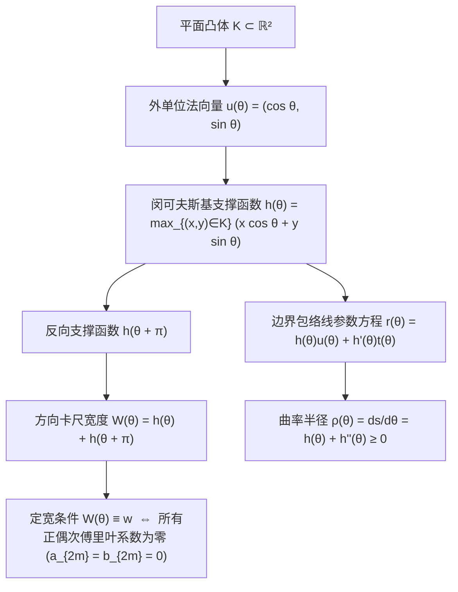
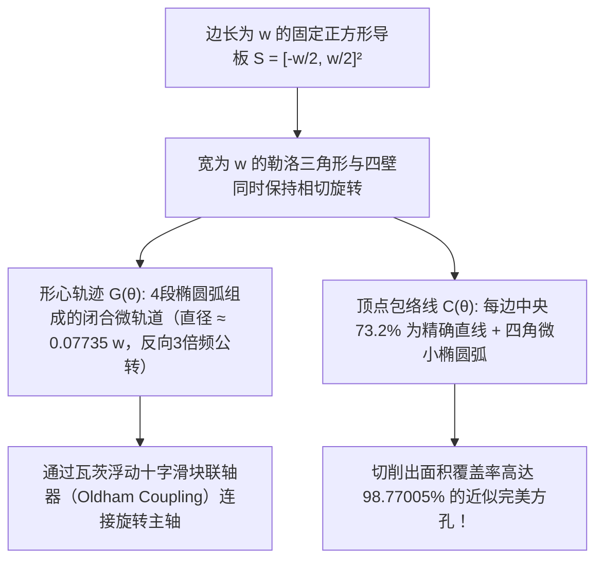

走在大街上，你是否思考过脚下的下水道<strong>井盖（Manhole Cover）</strong>为什么几乎全都是圆的？这道由诺贝尔物理学奖得主理查德·费曼推广、后来成为微软面试经典名题的工程谜题，背后隐藏着一个基本的几何不等式。

如果井盖是边长为 $w$ 的<strong>正方形</strong>，虽然井口边长也是 $w$，但根据勾股定理，井口的对角线长度达到了 $\sqrt{2}w \approx 1.4142\,w$。一旦工人将正方形井盖竖立起来并旋转 $45^\circ$ 对准井口对角线，由于 $w < \sqrt{2}w$，沉重的铸铁井盖就会直接掉进下水道井底。矩形、椭圆或正三角形同样如此：只要图形的最小卡尺宽度 $w_{\min}$ 小于最大卡尺直径 $w_{\max}$，它就能沿着最宽方向掉入自己的孔洞中。相反，直径为 $w$ 的<strong>圆</strong>在任何方向上的宽度恒为 $w$，无论怎样倾斜都绝不会掉下去。

那么，<strong>“不会掉进洞里的井盖”或“能平稳托起平板而不产生任何上下颠簸的滚木”，其截面形状一定是圆吗？</strong>

答案是<strong>否定</strong>的！在平面凸几何（Convex Geometry）中，存在无穷多种非圆凸图形，它们在任意方向上两条平行支撑切线之间的距离恒为常数 $w$——这就是<strong>定宽曲线（Curve of Constant Width）</strong>。其中最著名、性质最极端的代表，正是以19世纪德国机械运动学之父弗朗茨·勒洛（Franz Reuleaux）命名的<strong>勒洛三角形（Reuleaux Triangle）</strong>。

如果把一排截面为勒洛三角形的滚木铺在水平地面上，上面放一块水平木板，推动木板前进时，木板会保持在恒定高度 $y = w$ <strong>完全水平地平滑移动，不会有哪怕一毫米的上下起伏</strong>！更令人称奇的是，1914年英国工程师哈里·瓦茨（Harry James Watts）将勒洛三角形刀头装在浮动卡盘上，用普通旋转钻床竟然直接在金属板上<strong>钻出了覆盖率高达 $98.77\%$ 的方孔</strong>！本文将从凸几何、微分几何、积分几何与运动学四个维度，完整推导定宽曲线的数学结构。

---

## 1. 滚动悖论：为什么勒洛三角形当滚木极其平稳，当车轮却剧烈颠簸？

### 1.1 平板下的勒洛三角形滚木

设水平地面为直线 $y = 0$，宽度为 $w$ 的勒洛三角形滚木置于地面上，其顶部托着一块水平平板。根据定宽图形的定义，无论勒洛三角形旋转到什么角度 $\theta \in [0, 2\pi)$，夹住它的上下两条水平支撑切线之间的距离恒为 $w$。因此，平板底面始终锁定在高度

$$y_{\text{plank}}(\theta) \equiv w$$

平板在滚动过程中<strong>没有任何垂直颠簸</strong>。

### 1.2 固定车轴（形心 $G$）的周期性跳动

然而，如果我们在勒洛三角形的几何中心（形心）$G$ 处安装一根固定车轴来制造自行车轮，骑行体验将是一场灾难。对于边长为 $w$ 的正三角形 $\triangle ABC$ 构成的勒洛三角形：

- 形心 $G$ 到三个顶点 $A, B, C$ 的距离（外接圆半径）为：
  $$R = \frac{w}{\sqrt{3}} = \frac{\sqrt{3}}{3} w \approx 0.57735\,w$$
- 形心 $G$ 到对边圆弧中点的距离为：
  $$r = w - R = \left(1 - \frac{\sqrt{3}}{3}\right) w \approx 0.42265\,w$$

当勒洛三角形在地面 $y = 0$ 上滚动一周时，车轴 $G$ 的高度 $y_G$ 每转一圈就会在 $y_{G,\max} = \frac{\sqrt{3}}{3}w$ 与 $y_{G,\min} = \left(1 - \frac{\sqrt{3}}{3}\right)w$ 之间上下剧烈跳动 3 次，其垂直振幅高达：

$$\Delta y_G = y_{G,\max} - y_{G,\min} = \left(\frac{2\sqrt{3}}{3} - 1\right) w \approx 0.15470\,w$$

也就是说，虽然图形最高点始终保持在 $y = w$，但它的形心 $G$ 却有約 $15.5\%$ 的上下摆动。正是“外包络线恒定”与“中心轨迹偏心运动”之间的分离，构成了方孔钻头与转子发动机的核心运动学基础。

---

## 2. 凸几何与闵可夫斯基支撑函数 $h_K(\theta)$

### 2.1 支撑函数、包络线与曲率半径

设 $K \subset \mathbb{R}^2$ 为平面紧致凸体。对于任意方向角 $\theta \in [0, 2\pi)$，定义外单位法向量 $\mathbf{u}(\theta) = (\cos\theta, \sin\theta)^\top$ 与单位切向量 $\mathbf{t}(\theta) = (-\sin\theta, \cos\theta)^\top$。凸体 $K$ 的<strong>闵可夫斯基支撑函数（Minkowski Support Function）</strong>定义为：

$$h_K(\theta) \triangleq \max_{(x, y) \in K} \left(x\cos\theta + y\sin\theta\right)$$

几何上，$h_K(\theta)$ 是原点 $O(0,0)$ 到法向为 $\mathbf{u}(\theta)$ 的支撑直线 $L(\theta) : x\cos\theta + y\sin\theta = h_K(\theta)$ 的有向垂直距离。

当 $h(\theta) \in C^2(\mathbb{S}^1)$ 时，边界曲线 $\partial K$ 作为支撑直线族的包络线，由联立方程 $x\cos\theta + y\sin\theta = h(\theta)$ 与 $-x\sin\theta + y\cos\theta = h'(\theta)$ 唯一确定：

$$\mathbf{r}(\theta) = \begin{pmatrix} x(\theta) \\ y(\theta) \end{pmatrix} = h(\theta)\mathbf{u}(\theta) + h'(\theta)\mathbf{t}(\theta) = \begin{pmatrix} h(\theta)\cos\theta - h'(\theta)\sin\theta \\ h(\theta)\sin\theta + h'(\theta)\cos\theta \end{pmatrix}$$

利用 $\mathbf{u}'(\theta) = \mathbf{t}(\theta)$ 和 $\mathbf{t}'(\theta) = -\mathbf{u}(\theta)$ 对 $\theta$ 求导，得到切向量与微弧长 $ds$：

$$\frac{d\mathbf{r}}{d\theta} = \left(h(\theta) + h''(\theta)\right)\mathbf{t}(\theta) \implies \rho(\theta) = \frac{ds}{d\theta} = h(\theta) + h''(\theta)$$

其中 $\rho(\theta)$ 为边界在法向角 $\theta$ 处的<strong>曲率半径</strong>。周期函数 $h(\theta)$ 对应严格凸闭曲线的充要条件是处处满足凸性微分不等式：

$$\rho(\theta) = h(\theta) + h''(\theta) \ge 0 \qquad (\forall \theta \in [0, 2\pi))$$

### 2.2 定宽条件与奇次谐波傅里叶级数

凸体 $K$ 在方向 $\theta$ 上的平行卡尺宽度为 $W_K(\theta) = h_K(\theta) + h_K(\theta + \pi)$。因此，$K$ 为<strong>宽度 $w$ 的定宽曲线</strong>当且仅当：

$$h_K(\theta) + h_K(\theta + \pi) = w \qquad (\forall \theta \in [0, 2\pi))$$

由此立即推出定宽曲线的两条基本定理：
1. <strong>双重法线性质（Double Normals）</strong>：对向接触点之差为 $\mathbf{r}(\theta) - \mathbf{r}(\theta + \pi) = w\mathbf{u}(\theta)$，即连接任意一对平行支撑线切点的弦长恒为 $w$，且同时垂直于两条支撑切线。
2. <strong>对向曲率半径之和守恒</strong>：$\rho(\theta) + \rho(\theta + \pi) = w$。若一侧为尖角（$\rho(\theta) = 0$），则正对面必然是以该顶点为圆心、半径为 $w$ 的圆弧（$\rho(\theta + \pi) = w$）。

将 $h_K(\theta)$ 展开为傅里叶级数，由于 $\cos(n(\theta+\pi)) = (-1)^n\cos(n\theta)$，代入 $h_K(\theta) + h_K(\theta+\pi) = w$ 可知：所有正偶次谐波系数必然恒等于零（$a_{2m} = b_{2m} = 0$），而任意奇次谐波均可自由选取（只需满足 $\rho(\theta) \ge 0$）：

$$h_K(\theta) = \frac{w}{2} + \sum_{k=1}^{\infty} \left(a_{2k-1}\cos((2k-1)\theta) + b_{2k-1}\sin((2k-1)\theta)\right)$$

例如，仅取第3次谐波 $h(\theta) = \frac{w}{2} + \varepsilon\cos(3\theta)$（其中 $0 < |\varepsilon| \le \frac{w}{16}$），其曲率半径 $\rho(\theta) = \frac{w}{2} - 8\varepsilon\cos(3\theta) \ge 0$。当 $w = 16, \varepsilon = 1$ 时，$h(\theta) = 8 + \cos(3\theta)$ 给出了一条<strong>没有任何尖角的无穷阶光滑（$C^\infty$ 实解析）非圆定宽曲线</strong>（Rabinowitz 8次多项式代数曲线）！

---

## 3. 勒洛三角形与奇正勒洛多边形的面积推导

### 3.1 尺规作图与勒洛三角形面积

以边长为 $w$ 的正三角形 $\triangle ABC$ 的三个顶点 $A, B, C$ 为圆心、$w$ 为半径分别作 $60^\circ$（$\frac{\pi}{3}$ 弧度）圆弧 $\widehat{BC}, \widehat{CA}, \widehat{AB}$，所得图形即为勒洛三角形。

利用容斥原理计算其面积 $A_{\text{Reuleaux}}$：3个半径为 $w$、圆心角为 $\frac{\pi}{3}$ 的扇形面积之和，减去重复叠加了2次的中心正三角形 $\triangle ABC$ 的面积：

- 单个 $60^\circ$ 扇形面积：$A_{\text{sector}} = \frac{1}{2}w^2\left(\frac{\pi}{3}\right) = \frac{\pi}{6}w^2$
- 正三角形 $\triangle ABC$ 面积：$A_{\triangle} = \frac{\sqrt{3}}{4}w^2$
- <strong>勒洛三角形的面积</strong>：
  $$A_{\text{Reuleaux}} = 3 A_{\text{sector}} - 2 A_{\triangle} = \frac{1}{2}\left(\pi - \sqrt{3}\right) w^2 \approx 0.7047709\,w^2$$

相比之下，直径为 $w$ 的圆面积为 $A_{\text{circle}} = \frac{\pi}{4}w^2 \approx 0.7853982\,w^2$。勒洛三角形的宽度和周长与圆完全相同，但面积却比圆小了 $10.27\%$！

### 3.2 任意奇数边正勒洛 $n$ 边形（$n = 2k+1$）

定宽正多边形的边数 $n$ 必须是<strong>奇数</strong> $n = 2k+1$（$n = 3, 5, 7, 9, \dots$），因为只有奇数边正多边形的每个顶点正对面才是一条边（对应一段半径为 $w$、圆心角为 $\frac{\pi}{n}$ 的圆弧）。将内部核心正 $n$ 边形（外接圆半径 $R_n = \frac{w}{2\cos(\pi/(2n))}$）与外侧 $n$ 个半径为 $w$ 的弓形面积相加，利用三角恒等式可导出<strong>正勒洛 $n$ 边形的通用面积公式</strong>：

$$A_n = \frac{w^2}{2}\left(\pi - n\tan\left(\frac{\pi}{2n}\right)\right) \qquad (n = 3, 5, 7, 9, \dots)$$

| 定宽曲线类型 | 顶点数 $n$ | 周长 $L$ | 精确面积公式 $A(w)$ | 数值面积 | 与圆面积之比 $A / A_{\text{circle}}$ |
| :--- | :---: | :---: | :---: | :---: | :---: |
| <strong>勒洛三角形</strong> | $3$ | $\pi w$ | $\frac{1}{2}\left(\pi - \sqrt{3}\right)w^2$ | $0.704771\,w^2$ | $89.73\%$（<strong>全局最小</strong>） |
| <strong>勒洛五边形</strong> | $5$ | $\pi w$ | $\frac{1}{2}\left(\pi - 5\tan\frac{\pi}{10}\right)w^2$ | $0.756827\,w^2$ | $96.36\%$ |
| <strong>勒洛七边形</strong>（英国20p/50p硬币） | $7$ | $\pi w$ | $\frac{1}{2}\left(\pi - 7\tan\frac{\pi}{14}\right)w^2$ | $0.770921\,w^2$ | $98.16\%$ |
| <strong>光滑非圆解析定宽曲线</strong>（$h = \frac{w}{2} + \frac{w}{16}\cos 3\theta$） | $0$ ($C^\infty$) | $\pi w$ | $\frac{63\pi}{256}w^2$ | $0.773126\,w^2$ | $98.44\%$ |
| <strong>标准圆（Circle）</strong> | $0$ ($C^\infty$) | $\pi w$ | $\frac{\pi}{4}w^2$ | $0.785398\,w^2$ | $100.00\%$（<strong>全局最大</strong>） |

---

## 4. 巴比耶定理（1860）的两种完整严格证明与布拉施克-勒贝格定理（1914）

> <strong>【巴比耶定理（Barbier's Theorem, 1860）】</strong>
> 平面上任意宽度为 $w$ 的定宽凸曲线 $\partial K$，不论其形状对称与否、光滑与否，其周长恒等于直径为 $w$ 的圆的周长：
> $$L(\partial K) = \pi w$$

### 4.1 证明一：微分几何与支撑函数法

对于光滑定宽曲线，微弧长 $ds = \rho(\theta)\,d\theta = \left(h(\theta) + h''(\theta)\right)d\theta$。沿 $[0, 2\pi]$ 积分并利用 $h'(\theta)$ 的 $2\pi$-周期性：

$$\begin{aligned}
L(\partial K) &= \int_0^{2\pi} \left(h(\theta) + h''(\theta)\right) d\theta = \int_0^{2\pi} h(\theta)\,d\theta + \Big[h'(\theta)\Big]_0^{2\pi} \\
&= \int_0^{\pi} h(\theta)\,d\theta + \int_0^{\pi} h(\theta + \pi)\,d\theta = \int_0^{\pi} \underbrace{\left(h(\theta) + h(\theta + \pi)\right)}_{= w} d\theta = \pi w
\end{aligned}$$

对于带有尖角的定宽曲线（如勒洛多边形），由于定宽曲线不可能包含平直边（否则对向顶点处将产生矛盾），$h_K(\theta)$ 处处属于 $C^1(\mathbb{S}^1)$（也可通过光滑软化子 $h_\varepsilon = h_K * \eta_\varepsilon$ 在 Hausdorff 度量下逼近），因此 $\big[h'(\theta)\big]_0^{2\pi} = 0$ 与 $L = \pi w$ 严格成立。 $\blacksquare$

### 4.2 证明二：积分几何、柯西-克罗夫顿公式与“蒲丰投面条（Buffon's Noodle）”

平面上所有有向直线 $\ell(p, \theta) : x\cos\theta + y\sin\theta = p$ 具有刚体运动不变的运动学测度 $d\ell = dp \wedge d\theta$。对于任意长为 $L$ 的可求长曲线（“面条”）$\gamma$，其微元 $ds$ 在方向 $\theta$ 上的投影长度为 $ds\,|\cos(\theta - \alpha)|$。对 $\theta \in [0, 2\pi)$ 积分得 $\int_0^{2\pi} |\cos(\theta - \alpha)|\,d\theta = 4$。由期望的线性可加性（无论曲线如何弯曲），交点个数 $n_\gamma(p, \theta) = \#(\gamma \cap \ell(p, \theta))$ 满足著名的<strong>柯西-克罗夫顿公式（Cauchy–Crofton Formula）</strong>：

$$\int_0^{2\pi} \int_{-\infty}^{\infty} n_\gamma(p, \theta)\,dp\,d\theta = 4 L(\gamma)$$

取 $\gamma = \partial K$ 为凸体 $K$ 的边界。几乎所有与 $K$ 相交的直线都与 $\partial K$ 恰好交于 <strong>2 个点</strong>（$n_{\partial K} = 2$）。在固定方向 $\theta$ 上，与 $K$ 相交的直线参数 $p$ 构成的区间长度恰为方向宽度 $W_K(\theta) = h_K(\theta) + h_K(\theta + \pi) = w$。因此：

$$4 L(\partial K) = \int_0^{2\pi} \left(\int_{-h_K(\theta+\pi)}^{h_K(\theta)} 2\,dp\right) d\theta = 2 \int_0^{2\pi} W_K(\theta)\,d\theta = 2 \int_0^{2\pi} w\,d\theta = 4\pi w \implies L(\partial K) = \pi w \quad \blacksquare$$

### 4.3 布拉施克-勒贝格定理（Blaschke–Lebesgue Theorem, 1914）

由格林公式与分部积分，凸体 $K$ 的面积表示为 $A(K) = \frac{1}{2}\int_0^{2\pi} \left(h(\theta)^2 - h'(\theta)^2\right)d\theta$。代入奇次谐波傅里叶展开式并应用帕塞瓦尔（Parseval）恒等式，立即得到<strong>定宽曲线的谱面积公式</strong>：

$$A(K) = \frac{\pi}{4} w^2 - \frac{\pi}{2} \sum_{k=2}^{\infty} \left((2k-1)^2 - 1\right)\left(a_{2k-1}^2 + b_{2k-1}^2\right)$$

1. <strong>圆最大化面积</strong>：由于 $k \ge 2$ 时 $(2k-1)^2 - 1 \ge 8 > 0$，所有高阶奇次谐波均严格减小面积，故 $A(K) \le \frac{\pi}{4}w^2$，当且仅当 $K$ 为圆时取等号。
2. <strong>勒洛三角形最小化面积（布拉施克-勒贝格定理）</strong>：在凸性约束 $0 \le \rho(\theta) \le w$ 与 $\rho(\theta) + \rho(\theta+\pi) = w$ 下极小化凹泛函 $A(\rho)$，根据庞特里亚金极大值原理，极小值必在端点（Bang-Bang 控制 $\rho(\theta) \in \{0, w\}$）且切换次数最少（$n = 3$）时达到，从而唯一确定<strong>勒洛三角形</strong>达到面积下确界 $\frac{1}{2}(\pi - \sqrt{3})w^2$。

---

## 5. 勒洛三角形如何钻出方孔：哈里·瓦茨钻头（1914）与精确轨迹解析

设固定正方形导板为 $S = \left[-\frac{w}{2}, \frac{w}{2}\right]^2$。由四重旋转对称性，只需考察基本角区间 $\theta \in \left[\frac{\pi}{6}, \frac{\pi}{3}\right]$，其中顶点 $A$ 沿左壁 $x = -\frac{w}{2}$ 滑动，顶点 $B$ 沿底壁 $y = -\frac{w}{2}$ 滑动，弦 $AB$（长 $w$）与底壁夹角为 $\theta$：

$$A(\theta) = \begin{pmatrix} -\frac{w}{2} \\ -\frac{w}{2} + w\sin\theta \end{pmatrix}, \qquad B(\theta) = \begin{pmatrix} -\frac{w}{2} + w\cos\theta \\ -\frac{w}{2} \end{pmatrix}$$

### 5.1 形心 $G(\theta)$ 的四段椭圆弧偏心轨道

正三角形 $\triangle ABC$ 的形心 $G$ 到 $A, B$ 的距离为 $\frac{w}{\sqrt{3}}$，从而形心坐标为：

$$\begin{cases}
x_G(\theta) + \dfrac{w}{2} = \dfrac{w}{\sqrt{3}}\cos\left(\theta - \dfrac{\pi}{6}\right) \\[6pt]
y_G(\theta) + \dfrac{w}{2} = \dfrac{w}{\sqrt{3}}\sin\left(\theta + \dfrac{\pi}{6}\right)
\end{cases} \qquad \left(\frac{\pi}{6} \le \theta \le \frac{\pi}{3}\right)$$

旋转坐标系 $45^\circ$ 可证：这是一段以正方形左下角 $\left(-\frac{w}{2}, -\frac{w}{2}\right)$ 为中心、长半轴 $a_G = \frac{\sqrt{3}+1}{2\sqrt{3}}w$、短半轴 $b_G = \frac{\sqrt{3}-1}{2\sqrt{3}}w$ 的<strong>精确椭圆弧</strong>！四段椭圆弧围绕原点拼成一条直径为

$$d_G = 2w\left(\frac{1}{\sqrt{3}} - \frac{1}{2}\right) = \left(\frac{2\sqrt{3} - 3}{3}\right) w \approx 0.0773503\,w$$

的近似圆轨道，且以<strong>与钻头自转方向相反、角速度为3倍（$\omega_{\text{orbit}} = -3\omega_{\text{spin}}$）</strong>的规律公转。瓦茨钻头正是利用<strong>浮动奥尔德姆联轴器（Oldham Coupling）</strong>吸收这一微小偏心摆动，从而用普通旋转主轴驱动勒洛三角形刀头。

### 5.2 顶点 $C(\theta)$ 的四角切削轨迹与 $98.77\%$ 面积覆盖率证明

在同一区间 $\theta \in \left[\frac{\pi}{6}, \frac{\pi}{3}\right]$ 内，令 $\alpha = \frac{\pi}{3} - \theta \in \left[0, \frac{\pi}{6}\right]$，右上角顶点 $C$ 的轨迹方程为：

$$\begin{cases}
x_C(\alpha) = -\dfrac{w}{2} + w\cos\alpha \\[6pt]
y_C(\alpha) = -\dfrac{w}{2} + w\cos\left(\dfrac{\pi}{6} - \alpha\right)
\end{cases} \qquad \left(0 \le \alpha \le \frac{\pi}{6}\right)$$

- 在正方形每条边的中央区间 $\left[-\frac{\sqrt{3}-1}{2}w, +\frac{\sqrt{3}-1}{2}w\right]$ 上，顶点紧贴正方形侧壁笔直滑动，因此<strong>方孔每条边有 $(\sqrt{3}-1)w \approx 73.205\%$ 的长度是数学上绝对笔直的直线段</strong>！
- 单个角落未切削区域的精确面积积分为：
  $$A_{\text{corner}} = \int_0^{\pi/6} \left(\frac{w}{2} - y_C(\alpha)\right) w\sin\alpha\,d\alpha = w^2 \int_0^{\pi/6} \left(1 - \cos\left(\frac{\pi}{6}-\alpha\right)\right)\sin\alpha\,d\alpha = \left(1 - \frac{\sqrt{3}}{2} - \frac{\pi}{24}\right) w^2 \approx 0.0030749\,w^2$$
- 扣除四个角落后，<strong>勒洛三角形钻孔扫过的精确面积 $A_{\text{swept}}$</strong> 为：
  $$A_{\text{swept}} = w^2 - 4 A_{\text{corner}} = \left(2\sqrt{3} + \frac{\pi}{6} - 3\right) w^2 \approx 0.9877005\,w^2$$
  即削去了正方形 $98.77005\%$ 的面积！

---

## 6. 现代工程应用与三维前沿：迈斯纳体（1911）及未解的迈斯纳猜想（1934）

1. <strong>汪克尔转子发动机（马自达 RX-7 / 787B）与英国 20p/50p 硬币</strong>：转子发动机在双叶外旋轮线（Epitrochoid）缸体内配置变形勒洛三角形转子；英国 20 便士和 50 便士硬币采用<strong>正勒洛七边形（$n = 7$）</strong>，既便于盲人触觉识别，又因具有恒定宽度而能顺利通过自动售货机的平行卡尺检测器。
2. <strong>为什么三维“勒洛四面体”不是定宽体？</strong>
   取边长为 $w$ 的正四面体四个顶点为球心、$w$ 为半径的四个球体的交集，得到<strong>勒洛四面体（Reuleaux Tetrahedron）</strong>。虽然顶点到对面的距离为 $w$，但正四面体相对两条直边中点的距离为 $\frac{\sqrt{2}}{2}w$，而每条弧形棱边以对边中点为圆心、半径为 $\frac{\sqrt{3}}{2}w$。因此，<strong>相对两条弧形棱边中点之间的距离</strong>为：
   $$w_{\text{edge}} = \frac{\sqrt{3}}{2}w + \frac{\sqrt{3}}{2}w - \frac{\sqrt{2}}{2}w = \left(\sqrt{3} - \frac{\sqrt{2}}{2}\right) w \approx 1.024944\,w > w$$
   它比 $w$ 超出了 $2.494\%$！
3. <strong>迈斯纳体（Meissner Bodies, 1911）与迈斯纳猜想（1934）</strong>：
   1911年，瑞士数学家恩斯特·迈斯纳（Ernst Meissner）将勒洛四面体三对相对棱边中的各一条棱边切削掉，替换为以对边为旋转轴、半径为 $w$ 的圆弧旋转而成的<strong>纺锤环面（Spindle Torus）曲面片</strong>，成功构造出两种非全等的三维定宽凸体——<strong>第一类迈斯纳体 $M_1$（三修圆棱交于同一顶点）</strong>与<strong>第二类迈斯纳体 $M_2$（三修圆棱围成同一底面）</strong>，两者的体积完全相等：
   $$V(M_1) = V(M_2) = \pi w^3 \left(\frac{2}{3} - \frac{\sqrt{3}}{4}\arccos\left(\frac{1}{3}\right)\right) + \frac{\sqrt{2}}{12} w^3 \approx 0.419860\,w^3 < V_{\text{sphere}} = \frac{\pi}{6}w^3 \approx 0.523599\,w^3$$
   在三维定宽体中，体积与表面积满足<strong>布拉施克线性关系式</strong> $V(K) = \frac{1}{2}w S(K) - \frac{\pi}{3}w^3$。1934年 Bonnesen 与 Fenchel 提出的<strong>迈斯纳猜想（即 $M_1, M_2$ 在所有三维定宽凸体中体积最小）</strong>至今仍是凸几何学界最著名的未解难题之一。
