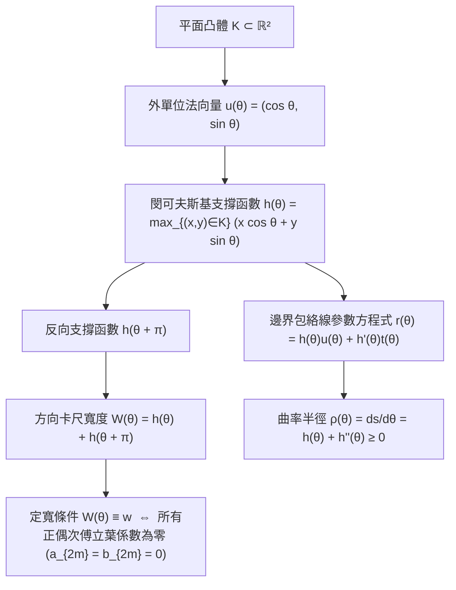
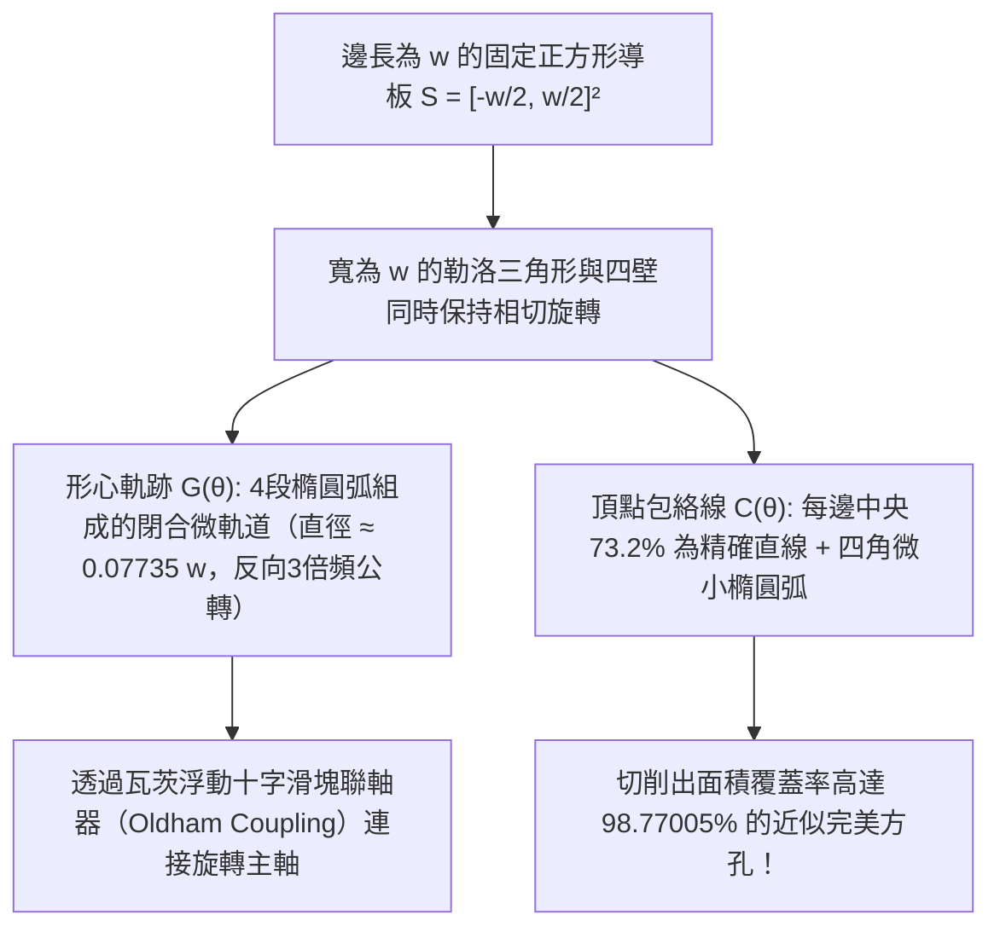

走在城市街道上，你是否曾思考過腳下的下水道<strong>人孔蓋（Manhole Cover）</strong>為什麼幾乎全都是圓形的？這道由諾貝爾物理學獎得主理查·費曼推廣、後來成為微軟面試經典名題的工程謎題，背後隱藏著一個直觀卻深刻的幾何不等式。

如果人孔蓋是邊長為 $w$ 的<strong>正方形</strong>，雖然井口邊長也是 $w$，但根據畢氏定理，正方形井口的對角線長度為 $\sqrt{2}w \approx 1.4142\,w$。一旦工人將正方形人孔蓋垂直立起並旋轉 $45^\circ$ 對準井口對角線，由於 $w < \sqrt{2}w$，沉重的鑄鐵蓋就會直接穿過自己的孔洞掉進下水道深處。矩形、橢圓或正三角形同樣如此：只要圖形的最小卡尺寬度 $w_{\min}$ 小於最大卡尺直徑 $w_{\max}$，它就能沿著最寬對角方向掉入孔中。相反地，直徑為 $w$ 的<strong>圓</strong>在任何方向上的寬度恆為 $w$，無論怎樣傾斜都絕不會掉下去。

那麼，<strong>「不會掉進洞裡的人孔蓋」或「能平穩托起平板而不產生任何上下顛簸的滾木」，其截面形狀必然是圓形嗎？</strong>

答案是<strong>否定</strong>的！在平面凸幾何（Convex Geometry）中，存在無窮多種非圓凸圖形，它們在任意方向上兩條平行支撐切線之間的距離恆為常數 $w$——這就是<strong>定寬曲線（Curve of Constant Width）</strong>。其中最著名、性質最極端的代表，正是以19世紀德國機械運動學之父弗朗茨·勒洛（Franz Reuleaux）命名的<strong>勒洛三角形（Reuleaux Triangle）</strong>。

如果把一排截面為勒洛三角形的滾木鋪在水平地面上，上面放一塊水平木板，推動木板前進時，木板會保持在恆定高度 $y = w$ <strong>完全水平地平滑移動，不會有哪怕一毫米的上下起伏</strong>！更令人驚嘆的是，1914年英國工程師哈里·瓦茨（Harry James Watts）將勒洛三角形刀頭裝在浮動卡盤上，用普通旋轉鑽床竟然直接在金屬板上<strong>鑽出了覆蓋率高達 $98.77\%$ 的方孔</strong>！本文將從凸幾何、微分幾何、積分幾何與運動學四個維度，完整推導定寬曲線的數學結構。

---

## 1. 滾動悖論：為什麼勒洛三角形當滾木極其平穩，當車輪卻劇烈顛簸？

### 1.1 平板下的勒洛三角形滾木

設水平地面為直線 $y = 0$，寬度為 $w$ 的勒洛三角形滾木置於地面上，其頂部托著一塊水平平板。根據定寬圖形的定義，無論勒洛三角形旋轉到什麼角度 $\theta \in [0, 2\pi)$，夾住它的上下兩條水平支撐切線之間的距離恆為 $w$。因此，平板底面始終鎖定在高度

$$y_{\text{plank}}(\theta) \equiv w$$

平板在滾動過程中<strong>沒有任何垂直顛簸</strong>。

### 1.2 固定車軸（形心 $G$）的週期性跳動

然而，如果我們在勒洛三角形的幾何中心（形心）$G$ 處安裝一根固定車軸來製造自行車輪，騎乘體驗將是一場災難。對於邊長為 $w$ 的正三角形 $\triangle ABC$ 構成的勒洛三角形：

- 形心 $G$ 到三個頂點 $A, B, C$ 的距離（外接圓半徑）為：
  $$R = \frac{w}{\sqrt{3}} = \frac{\sqrt{3}}{3} w \approx 0.57735\,w$$
- 形心 $G$ 到對邊圓弧中點的距離為：
  $$r = w - R = \left(1 - \frac{\sqrt{3}}{3}\right) w \approx 0.42265\,w$$

當勒洛三角形在地面 $y = 0$ 上滾動一週時，車軸 $G$ 的高度 $y_G$ 每轉一圈就會在 $y_{G,\max} = \frac{\sqrt{3}}{3}w$ 與 $y_{G,\min} = \left(1 - \frac{\sqrt{3}}{3}\right)w$ 之間上下劇烈跳動 3 次，其垂直振幅高達：

$$\Delta y_G = y_{G,\max} - y_{G,\min} = \left(\frac{2\sqrt{3}}{3} - 1\right) w \approx 0.15470\,w$$

也就是說，雖然圖形最高點始終保持在 $y = w$，但它的形心 $G$ 卻有約 $15.5\%$ 的上下擺動。正是「外包絡線恆定」與「中心軌跡偏心運動」之間的分離，構成了方孔鑽頭與轉子引擎的核心運動學基礎。

---

## 2. 凸幾何與閔可夫斯基支撐函數 $h_K(\theta)$

### 2.1 支撐函數、包絡線與曲率半徑

設 $K \subset \mathbb{R}^2$ 為平面緊緻凸體。對於任意方向角 $\theta \in [0, 2\pi)$，定義外單位法向量 $\mathbf{u}(\theta) = (\cos\theta, \sin\theta)^\top$ 與單位切向量 $\mathbf{t}(\theta) = (-\sin\theta, \cos\theta)^\top$。凸體 $K$ 的<strong>閔可夫斯基支撐函數（Minkowski Support Function）</strong>定義為：

$$h_K(\theta) \triangleq \max_{(x, y) \in K} \left(x\cos\theta + y\sin\theta\right)$$

幾何上，$h_K(\theta)$ 是原點 $O(0,0)$ 到法向為 $\mathbf{u}(\theta)$ 的支撐直線 $L(\theta) : x\cos\theta + y\sin\theta = h_K(\theta)$ 的有向垂直距離。

當 $h(\theta) \in C^2(\mathbb{S}^1)$ 時，邊界曲線 $\partial K$ 作為支撐直線族的包絡線，由聯立方程式 $x\cos\theta + y\sin\theta = h(\theta)$ 與 $-x\sin\theta + y\cos\theta = h'(\theta)$ 唯一確定：

$$\mathbf{r}(\theta) = \begin{pmatrix} x(\theta) \\ y(\theta) \end{pmatrix} = h(\theta)\mathbf{u}(\theta) + h'(\theta)\mathbf{t}(\theta) = \begin{pmatrix} h(\theta)\cos\theta - h'(\theta)\sin\theta \\ h(\theta)\sin\theta + h'(\theta)\cos\theta \end{pmatrix}$$

利用 $\mathbf{u}'(\theta) = \mathbf{t}(\theta)$ 和 $\mathbf{t}'(\theta) = -\mathbf{u}(\theta)$ 對 $\theta$ 求導，得到切向量與微弧長 $ds$：

$$\frac{d\mathbf{r}}{d\theta} = \left(h(\theta) + h''(\theta)\right)\mathbf{t}(\theta) \implies \rho(\theta) = \frac{ds}{d\theta} = h(\theta) + h''(\theta)$$

其中 $\rho(\theta)$ 為邊界在法向角 $\theta$ 處的<strong>曲率半徑</strong>。週期函數 $h(\theta)$ 對應嚴格凸閉曲線的充要條件是處處滿足凸性微分不等式：

$$\rho(\theta) = h(\theta) + h''(\theta) \ge 0 \qquad (\forall \theta \in [0, 2\pi))$$

### 2.2 定寬條件與奇次諧波傅立葉級數

凸體 $K$ 在方向 $\theta$ 上的平行卡尺寬度為 $W_K(\theta) = h_K(\theta) + h_K(\theta + \pi)$。因此，$K$ 為<strong>寬度 $w$ 的定寬曲線</strong>當且僅當：

$$h_K(\theta) + h_K(\theta + \pi) = w \qquad (\forall \theta \in [0, 2\pi))$$

由此立即推出定寬曲線的兩條基本定理：
1. <strong>雙重法線性質（Double Normals）</strong>：對向接觸點之差為 $\mathbf{r}(\theta) - \mathbf{r}(\theta + \pi) = w\mathbf{u}(\theta)$，即連接任意一對平行支撐線切點的弦長恆為 $w$，且同時垂直於兩條支撐切線。
2. <strong>對向曲率半徑之和守恆</strong>：$\rho(\theta) + \rho(\theta + \pi) = w$。若一側為尖角（$\rho(\theta) = 0$），則正對面必然是以該頂點為圓心、半徑為 $w$ 的圓弧（$\rho(\theta + \pi) = w$）。

將 $h_K(\theta)$ 展開為傅立葉級數，由於 $\cos(n(\theta+\pi)) = (-1)^n\cos(n\theta)$，代入 $h_K(\theta) + h_K(\theta+\pi) = w$ 可知：所有正偶次諧波係數必然恆等於零（$a_{2m} = b_{2m} = 0$），而任意奇次諧波均可自由選取（只需滿足 $\rho(\theta) \ge 0$）：

$$h_K(\theta) = \frac{w}{2} + \sum_{k=1}^{\infty} \left(a_{2k-1}\cos((2k-1)\theta) + b_{2k-1}\sin((2k-1)\theta)\right)$$

例如，僅取第3次諧波 $h(\theta) = \frac{w}{2} + \varepsilon\cos(3\theta)$（其中 $0 < |\varepsilon| \le \frac{w}{16}$），其曲率半徑 $\rho(\theta) = \frac{w}{2} - 8\varepsilon\cos(3\theta) \ge 0$。當 $w = 16, \varepsilon = 1$ 時，$h(\theta) = 8 + \cos(3\theta)$ 給出了一條<strong>沒有任何尖角的無窮階光滑（$C^\infty$ 實解析）非圓定寬曲線</strong>（Rabinowitz 8次多項式代數曲線）！

---

## 3. 勒洛三角形與奇正勒洛多邊形的面積推導

### 3.1 尺規作圖與勒洛三角形面積

以邊長為 $w$ 的正三角形 $\triangle ABC$ 的三個頂點 $A, B, C$ 為圓心、$w$ 為半徑分別作 $60^\circ$（$\frac{\pi}{3}$ 弧度）圓弧 $\widehat{BC}, \widehat{CA}, \widehat{AB}$，所得圖形即為勒洛三角形。

利用排容原理計算其面積 $A_{\text{Reuleaux}}$：3個半徑為 $w$、圓心角為 $\frac{\pi}{3}$ 的扇形面積之和，減去重複疊加了2次的中心正三角形 $\triangle ABC$ 的面積：

- 單個 $60^\circ$ 扇形面積：$A_{\text{sector}} = \frac{1}{2}w^2\left(\frac{\pi}{3}\right) = \frac{\pi}{6}w^2$
- 正三角形 $\triangle ABC$ 面積：$A_{\triangle} = \frac{\sqrt{3}}{4}w^2$
- <strong>勒洛三角形的面積</strong>：
  $$A_{\text{Reuleaux}} = 3 A_{\text{sector}} - 2 A_{\triangle} = \frac{1}{2}\left(\pi - \sqrt{3}\right) w^2 \approx 0.7047709\,w^2$$

相比之下，直徑為 $w$ 的圓面積為 $A_{\text{circle}} = \frac{\pi}{4}w^2 \approx 0.7853982\,w^2$。勒洛三角形的寬度和周長與圓完全相同，但面積卻比圓小了 $10.27\%$！

### 3.2 任意奇數邊正勒洛 $n$ 邊形（$n = 2k+1$）

定寬正多邊形的邊數 $n$ 必須是<strong>奇數</strong> $n = 2k+1$（$n = 3, 5, 7, 9, \dots$），因為只有奇數邊正多邊形的每個頂點正對面才是一條邊（對應一段半徑為 $w$、圓心角為 $\frac{\pi}{n}$ 的圓弧）。將內部核心正 $n$ 邊形（外接圓半徑 $R_n = \frac{w}{2\cos(\pi/(2n))}$）與外側 $n$ 個半徑為 $w$ 的弓形面積相加，利用三角恆等式可導出<strong>正勒洛 $n$ 邊形的通用面積公式</strong>：

$$A_n = \frac{w^2}{2}\left(\pi - n\tan\left(\frac{\pi}{2n}\right)\right) \qquad (n = 3, 5, 7, 9, \dots)$$

| 定寬曲線類型 | 頂點數 $n$ | 周長 $L$ | 精確面積公式 $A(w)$ | 數值面積 | 與圓面積之比 $A / A_{\text{circle}}$ |
| :--- | :---: | :---: | :---: | :---: | :---: |
| <strong>勒洛三角形</strong> | $3$ | $\pi w$ | $\frac{1}{2}\left(\pi - \sqrt{3}\right)w^2$ | $0.704771\,w^2$ | $89.73\%$（<strong>全域最小</strong>） |
| <strong>勒洛五邊形</strong> | $5$ | $\pi w$ | $\frac{1}{2}\left(\pi - 5\tan\frac{\pi}{10}\right)w^2$ | $0.756827\,w^2$ | $96.36\%$ |
| <strong>勒洛七邊形</strong>（英國20p/50p硬幣） | $7$ | $\pi w$ | $\frac{1}{2}\left(\pi - 7\tan\frac{\pi}{14}\right)w^2$ | $0.770921\,w^2$ | $98.16\%$ |
| <strong>光滑非圓解析定寬曲線</strong>（$h = \frac{w}{2} + \frac{w}{16}\cos 3\theta$） | $0$ ($C^\infty$) | $\pi w$ | $\frac{63\pi}{256}w^2$ | $0.773126\,w^2$ | $98.44\%$ |
| <strong>標準圓（Circle）</strong> | $0$ ($C^\infty$) | $\pi w$ | $\frac{\pi}{4}w^2$ | $0.785398\,w^2$ | $100.00\%$（<strong>全域最大</strong>） |

---

## 4. 巴比耶定理（1860）的兩種完整嚴格證明與布拉施克-勒貝格定理（1914）

> <strong>【巴比耶定理（Barbier's Theorem, 1860）】</strong>
> 平面上任意寬度為 $w$ 的定寬凸曲線 $\partial K$，不論其形狀對稱與否、光滑與否，其周長恆等於直徑為 $w$ 的圓的周長：
> $$L(\partial K) = \pi w$$

### 4.1 證明一：微分幾何與支撐函數法

對於光滑定寬曲線，微弧長 $ds = \rho(\theta)\,d\theta = \left(h(\theta) + h''(\theta)\right)d\theta$。沿 $[0, 2\pi]$ 積分並利用 $h'(\theta)$ 的 $2\pi$-週期性：

$$\begin{aligned}
L(\partial K) &= \int_0^{2\pi} \left(h(\theta) + h''(\theta)\right) d\theta = \int_0^{2\pi} h(\theta)\,d\theta + \Big[h'(\theta)\Big]_0^{2\pi} \\
&= \int_0^{\pi} h(\theta)\,d\theta + \int_0^{\pi} h(\theta + \pi)\,d\theta = \int_0^{\pi} \underbrace{\left(h(\theta) + h(\theta + \pi)\right)}_{= w} d\theta = \pi w
\end{aligned}$$

對於帶有尖角的定寬曲線（如勒洛多邊形），由於定寬曲線不可能包含平直邊（否則對向頂點處將產生矛盾），$h_K(\theta)$ 處處屬於 $C^1(\mathbb{S}^1)$（也可透過光滑軟化子 $h_\varepsilon = h_K * \eta_\varepsilon$ 在 Hausdorff 度量下逼近），因此 $\big[h'(\theta)\big]_0^{2\pi} = 0$ 與 $L = \pi w$ 嚴格成立。 $\blacksquare$

### 4.2 證明二：積分幾何、柯西-克羅夫頓公式與「蒲豐投麵條（Buffon's Noodle）」

平面上所有有向直線 $\ell(p, \theta) : x\cos\theta + y\sin\theta = p$ 具有剛體運動不變的運動學測度 $d\ell = dp \wedge d\theta$。對於任意長為 $L$ 的可求長曲線（「麵條」）$\gamma$，其微元 $ds$ 在方向 $\theta$ 上的投影長度為 $ds\,|\cos(\theta - \alpha)|$。對 $\theta \in [0, 2\pi)$ 積分得 $\int_0^{2\pi} |\cos(\theta - \alpha)|\,d\theta = 4$。由期望值的線性可加性（無論曲線如何彎曲），交點個數 $n_\gamma(p, \theta) = \#(\gamma \cap \ell(p, \theta))$ 滿足著名的<strong>柯西-克羅夫頓公式（Cauchy–Crofton Formula）</strong>：

$$\int_0^{2\pi} \int_{-\infty}^{\infty} n_\gamma(p, \theta)\,dp\,d\theta = 4 L(\gamma)$$

取 $\gamma = \partial K$ 為凸體 $K$ 的邊界。幾乎所有與 $K$ 相交的直線都與 $\partial K$ 恰好交於 <strong>2 個點</strong>（$n_{\partial K} = 2$）。在固定方向 $\theta$ 上，與 $K$ 相交的直線參數 $p$ 構成的區間長度恰為方向寬度 $W_K(\theta) = h_K(\theta) + h_K(\theta + \pi) = w$。因此：

$$4 L(\partial K) = \int_0^{2\pi} \left(\int_{-h_K(\theta+\pi)}^{h_K(\theta)} 2\,dp\right) d\theta = 2 \int_0^{2\pi} W_K(\theta)\,d\theta = 2 \int_0^{2\pi} w\,d\theta = 4\pi w \implies L(\partial K) = \pi w \quad \blacksquare$$

### 4.3 布拉施克-勒貝格定理（Blaschke–Lebesgue Theorem, 1914）

由格林公式與分部積分，凸體 $K$ 的面積表示為 $A(K) = \frac{1}{2}\int_0^{2\pi} \left(h(\theta)^2 - h'(\theta)^2\right)d\theta$。代入奇次諧波傅立葉展開式並應用帕塞瓦爾（Parseval）恆等式，立即得到<strong>定寬曲線的譜面積公式</strong>：

$$A(K) = \frac{\pi}{4} w^2 - \frac{\pi}{2} \sum_{k=2}^{\infty} \left((2k-1)^2 - 1\right)\left(a_{2k-1}^2 + b_{2k-1}^2\right)$$

1. <strong>圓最大化面積</strong>：由於 $k \ge 2$ 時 $(2k-1)^2 - 1 \ge 8 > 0$，所有高階奇次諧波均嚴格減小面積，故 $A(K) \le \frac{\pi}{4}w^2$，當且僅當 $K$ 為圓時取等號。
2. <strong>勒洛三角形最小化面積（布拉施克-勒貝格定理）</strong>：在凸性約束 $0 \le \rho(\theta) \le w$ 與 $\rho(\theta) + \rho(\theta+\pi) = w$ 下極小化凹泛函 $A(\rho)$，根據龐特里亞金極大值原理，極小值必在端點（Bang-Bang 控制 $\rho(\theta) \in \{0, w\}$）且切換次數最少（$n = 3$）時達到，從而唯一確定<strong>勒洛三角形</strong>達到面積下確界 $\frac{1}{2}(\pi - \sqrt{3})w^2$。

---

## 5. 勒洛三角形如何鑽出方孔：哈里·瓦茨鑽頭（1914）與精確軌跡解析

設固定正方形導板為 $S = \left[-\frac{w}{2}, \frac{w}{2}\right]^2$。由四重旋轉對稱性，只需考察基本角區間 $\theta \in \left[\frac{\pi}{6}, \frac{\pi}{3}\right]$，其中頂點 $A$ 沿左壁 $x = -\frac{w}{2}$ 滑動，頂點 $B$ 沿底壁 $y = -\frac{w}{2}$ 滑動，弦 $AB$（長 $w$）與底壁夾角為 $\theta$：

$$A(\theta) = \begin{pmatrix} -\frac{w}{2} \\ -\frac{w}{2} + w\sin\theta \end{pmatrix}, \qquad B(\theta) = \begin{pmatrix} -\frac{w}{2} + w\cos\theta \\ -\frac{w}{2} \end{pmatrix}$$

### 5.1 形心 $G(\theta)$ 的四段橢圓弧偏心軌道

正三角形 $\triangle ABC$ 的形心 $G$ 到 $A, B$ 的距離為 $\frac{w}{\sqrt{3}}$，從而形心座標為：

$$\begin{cases}
x_G(\theta) + \dfrac{w}{2} = \dfrac{w}{\sqrt{3}}\cos\left(\theta - \dfrac{\pi}{6}\right) \\[6pt]
y_G(\theta) + \dfrac{w}{2} = \dfrac{w}{\sqrt{3}}\sin\left(\theta + \dfrac{\pi}{6}\right)
\end{cases} \qquad \left(\frac{\pi}{6} \le \theta \le \frac{\pi}{3}\right)$$

旋轉座標系 $45^\circ$ 可證：這是一段以正方形左下角 $\left(-\frac{w}{2}, -\frac{w}{2}\right)$ 為中心、長半軸 $a_G = \frac{\sqrt{3}+1}{2\sqrt{3}}w$、短半軸 $b_G = \frac{\sqrt{3}-1}{2\sqrt{3}}w$ 的<strong>精確橢圓弧</strong>！四段橢圓弧圍繞原點拼成一條直徑為

$$d_G = 2w\left(\frac{1}{\sqrt{3}} - \frac{1}{2}\right) = \left(\frac{2\sqrt{3} - 3}{3}\right) w \approx 0.0773503\,w$$

的近似圓軌道，且以<strong>與鑽頭自轉方向相反、角速度為3倍（$\omega_{\text{orbit}} = -3\omega_{\text{spin}}$）</strong>的規律公轉。瓦茨鑽頭正是利用<strong>浮動奧爾德姆聯軸器（Oldham Coupling）</strong>吸收這一微小偏心擺動，從而用普通旋轉主軸驅動勒洛三角形刀頭。

### 5.2 頂點 $C(\theta)$ 的四角切削軌跡與 $98.77\%$ 面積覆蓋率證明

在同一區間 $\theta \in \left[\frac{\pi}{6}, \frac{\pi}{3}\right]$ 內，令 $\alpha = \frac{\pi}{3} - \theta \in \left[0, \frac{\pi}{6}\right]$，右上角頂點 $C$ 的軌跡方程式為：

$$\begin{cases}
x_C(\alpha) = -\dfrac{w}{2} + w\cos\alpha \\[6pt]
y_C(\alpha) = -\dfrac{w}{2} + w\cos\left(\dfrac{\pi}{6} - \alpha\right)
\end{cases} \qquad \left(0 \le \alpha \le \frac{\pi}{6}\right)$$

- 在正方形每條邊的中央區間 $\left[-\frac{\sqrt{3}-1}{2}w, +\frac{\sqrt{3}-1}{2}w\right]$ 上，頂點緊貼正方形側壁筆直滑動，因此<strong>方孔每條邊有 $(\sqrt{3}-1)w \approx 73.205\%$ 的長度是數學上絕對筆直的直線段</strong>！
- 單個角落未切削區域的精確面積積分為：
  $$A_{\text{corner}} = \int_0^{\pi/6} \left(\frac{w}{2} - y_C(\alpha)\right) w\sin\alpha\,d\alpha = w^2 \int_0^{\pi/6} \left(1 - \cos\left(\frac{\pi}{6}-\alpha\right)\right)\sin\alpha\,d\alpha = \left(1 - \frac{\sqrt{3}}{2} - \frac{\pi}{24}\right) w^2 \approx 0.0030749\,w^2$$
- 扣除四個角落後，<strong>勒洛三角形鑽孔掃過的精確面積 $A_{\text{swept}}$</strong> 為：
  $$A_{\text{swept}} = w^2 - 4 A_{\text{corner}} = \left(2\sqrt{3} + \frac{\pi}{6} - 3\right) w^2 \approx 0.9877005\,w^2$$
  即削去了正方形 $98.77005\%$ 的面積！

---

## 6. 現代工程應用與三維前沿：邁斯納體（1911）及未解的邁斯納猜想（1934）

1. <strong>汪克爾轉子引擎（馬自達 RX-7 / 787B）與英國 20p/50p 硬幣</strong>：轉子引擎在雙葉外旋輪線（Epitrochoid）缸體內配置變形勒洛三角形轉子；英國 20 便士和 50 便士硬幣採用<strong>正勒洛七邊形（$n = 7$）</strong>，既便於視障者觸覺識別，又因具有恆定寬度而能順利通過自動販賣機的平行卡尺檢測器。
2. <strong>為什麼三維「勒洛四面體」不是定寬體？</strong>
   取邊長為 $w$ 的正四面體四個頂點為球心、$w$ 為半徑的四個球體的交集，得到<strong>勒洛四面體（Reuleaux Tetrahedron）</strong>。雖然頂點到對面的距離為 $w$，但正四面體相對兩條直邊中點的距離為 $\frac{\sqrt{2}}{2}w$，而每條弧形稜邊以對邊中點為圓心、半徑為 $\frac{\sqrt{3}}{2}w$。因此，<strong>相對兩條弧形稜邊中點之間的距離</strong>為：
   $$w_{\text{edge}} = \frac{\sqrt{3}}{2}w + \frac{\sqrt{3}}{2}w - \frac{\sqrt{2}}{2}w = \left(\sqrt{3} - \frac{\sqrt{2}}{2}\right) w \approx 1.024944\,w > w$$
   它比 $w$ 超出了 $2.494\%$！
3. <strong>邁斯納體（Meissner Bodies, 1911）與邁斯納猜想（1934）</strong>：
   1911年，瑞士數學家恩斯特·邁斯納（Ernst Meissner）將勒洛四面體三對相對稜邊中的各一條稜邊切削掉，替換為以對邊為旋轉軸、半徑為 $w$ 的圓弧旋轉而成的<strong>紡錘環面（Spindle Torus）曲面片</strong>，成功構造出兩種非全等的三維定寬凸體——<strong>第一類邁斯納體 $M_1$（三修圓稜交於同一頂點）</strong>與<strong>第二類邁斯納體 $M_2$（三修圓稜圍成同一底面）</strong>，兩者的體積完全相等：
   $$V(M_1) = V(M_2) = \pi w^3 \left(\frac{2}{3} - \frac{\sqrt{3}}{4}\arccos\left(\frac{1}{3}\right)\right) + \frac{\sqrt{2}}{12} w^3 \approx 0.419860\,w^3 < V_{\text{sphere}} = \frac{\pi}{6}w^3 \approx 0.523599\,w^3$$
   在三維定寬體中，體積與表面積滿足<strong>布拉施克線性關係式</strong> $V(K) = \frac{1}{2}w S(K) - \frac{\pi}{3}w^3$。1934年 Bonnesen 與 Fenchel 提出的<strong>邁斯納猜想（即 $M_1, M_2$ 在所有三維定寬凸體中體積最小）</strong>至今仍是凸幾何學界最著名的未解難題之一。
