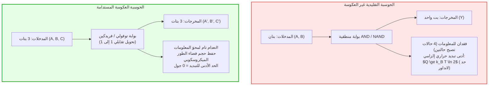

## مقدمة: الجدار الحراري للحواسيب الفائقة الحديثة

في عصر الحوسبة الفائقة ونماذج الذكاء الاصطناعي الضخمة، أصبح استهلاك الطاقة وتبديد الحرارة العقبة الفيزيائية القصوى أمام تطور عتاد المعالجة. تستهلك الحواسيب الفائقة المعاصرة عشرات الميغاوات من الطاقة الكهربائية — ما يعادل استهلاك مدن صغيرة بأكملها —، وتتحول هذه الطاقة بنسبة 100% تقريباً إلى حرارة مهدورة تُطرد إلى البيئة المحيطة. ومع انهيار قانون دينارد للتحجيم وظهور ما يُعرف بالسيليكون المظلم (Dark Silicon)، عجز تصغير الترانزستورات عن كبح جماح الكثافة الحرارية للرقائق الإلكترونية.

وهنا يطرح الفيزيائيون وعلماء الحاسوب سؤالاً تأسيسياً عميقاً:
<strong>هل تنبعث الحرارة من الحاسوب لأنه يقوم بعمليات حسابية منطقية، أم لأنه يمحو المعلومات الفيزيائية بشكل غير عكوس؟</strong>

تقدم الفيزياء الإحصائية المعاصرة إجابة ثورية: <strong>معالجة المعلومات بذاتها لا تتطلب حداً أدنى من استهلاك الطاقة في الديناميكا الحرارية؛ بل إن الحرارة تنشأ حصرياً وبشكل حتمي عند المحو غير العكوس للمعلومات (Information Erasure)!</strong> وإذا صُممت خطوات الحساب بحيث تحافظ على كل بت من المعلومات وتتيح عكس اتجاه الزمن (العكوسية)، فإن الحد الأدنى النظري للطاقة المتبددة يمكن أن يصل تماماً إلى الصفر! هذا هو الجوهر النظري لـ <strong>الحوسبة العكوسة (Reversible Computing)</strong> و<strong>ديناميكا المعلومات الحرارية</strong>.

---

## 1. الأسس الثرموديناميكية: شيطان ماكسويل ومبدأ لانداور

### 1.1 شيطان ماكسويل ومحرك زيلارد ذو الجزيء الواحد
في عام 1867، ابتكر جيمس كليرك ماكسويل تجربة فكرية افترض فيها وجود كائن ميكروسكوبي ذكي يفصل الجزيئات السريعة عن البطيئة دون بذل شغل خارجي، مما بدا خرقاً للقانون الثاني للديناميكا الحرارية.
وفي عام 1929، بسط ليو زيلارد المسألة بافتراض أسطوانة تحوي جزيئاً واحداً، مبيناً أن قياس موقع الجزيء يمنح الشيطان <strong>بتاً واحداً من المعلومات</strong> يمكن تحويله لشغل ميكانيكي قدره $W = k_B T \ln 2$. وظل الاعتقاد سائداً لعقود بأن عملية قياس الجزيء بالضوء هي التي تستهلك الطاقة.

### 1.2 مبدأ لانداور (1961)
حسم رولف لانداور (مختبرات IBM) هذا اللغز عام 1961:
<strong>إن قياس المعلومات وإجراء العمليات العكوسة يمكن نظرياً أن يتم دون أي تبديد للطاقة. الحرارة الحتمية لا تنبعث إلا في اللحظة التي يتم فيها محو ذاكرة الشيطان أو مسجلات الحاسوب (إعادة الضبط إلى 0)!</strong>

> <strong>مبرهنة (حد لانداور):</strong>
> عند المحو غير العكوس لبت واحد من المعلومات الفيزيائية في بيئة حرارية ذات درجة حرارة مطلقة $T$، فإن الحد الأدنى للحرارة التي يجب تبديدها في البيئة $Q_{\text{min}}$ يُعطى بالعلاقة:
> $$Q_{\text{min}} = k_B T \ln 2$$
> حيث $k_B \approx 1.3806 \times 10^{-23} \, \text{J/K}$ هو ثابت بولتزمان. وعند درجة حرارة الغرفة ($T = 300 \, \text{K}$)، يساوي هذا الحد حوالي $2.87 \times 10^{-21} \, \text{J}$ (نحو 0.018 إلكترون فولت).

ينتج عن محو البت انكماش في فضاء الحالات الميكروسكوبية للنظام ($\Delta S_{\text{sys}} = -k_B \ln 2$). وامتثالاً للقانون الثاني ($\Delta S_{\text{total}} \ge 0$)، يجب أن ترتفع إنتروبيا البيئة المحيطة بمقدار $\Delta S_{\text{env}} \ge k_B \ln 2$، ما يترجم إلى طرد حرارة $Q = T \Delta S_{\text{env}} \ge k_B T \ln 2$.

---

## 2. مبرهنة بينيت ودورة الحساب العكسي (Uncomputing)

في عام 1973، قدم تشارلز بينيت الحل الحاسم: <strong>يمكن لأي آلة تورنغ عامة أن تعمل بطريقة عكوسة بالكامل دون محو أي بت أثناء المعالجة، مما يجعل التبديد النظري مساوياً للصفر!</strong>

### 2.1 دورة الحساب والنسخ والعكس
لتجنب تراكم بتات الذاكرة الوسيطة (بتات النفايات) دون اللجوء لمحرها، ابتكر بينيت الدورة الثلاثية:
1. <strong>الحساب الأمامي:</strong> تولد الشبكة العكوسة من المدخلات $X$ المخرجات مع متغيرات وسيطة: $(X, 0, 0) \to (X, Y_{\text{anc}}, Z)$.
2. <strong>النسخ العكوس:</strong> تُنسخ النتيجة المفيدة $Z$ إلى سجل نقي باستخدام بوابات CNOT غير المدمرة.
3. <strong>الحساب العكسي (Uncomputing):</strong> تُشغل الدائرة الحسابية الأصلية بالاتجاه الزمني المعاكس، لتعود المتغيرات الوسيطة $Y_{\text{anc}}$ تماماً إلى قيمتها الصفرية الابتدائية!
4. <strong>الحالة النهائية:</strong> لا يتبقى سوى المدخلات $X$ والمخرجات $Z$ دون أي فقدان للإنتروبيا ودون انبعاث حراري.

---

## 3. بوابات المنطق العكوس العالمية: توفولي وفريدكين

### 3.1 بوابة توفولي (Toffoli Gate / CCNOT)
ابتكرها توماسو توفولي عام 1980: $(a, b, c) \to (a, b, c \oplus (a \land b))$. تمثل تحويلاً تقابلياً عكوساً بالكامل. وبضبط $c=0$ نحصل على بوابة AND، وبضبط $c=1$ نحصل على NAND، مما يجعلها بوابة شاملة للحوسبة الكلاسيكية.

### 3.2 بوابة فريدكين (Fredkin Gate / CSWAP)
ابتكرها إدوارد فريدكين: تبادل بين مساري بيانات عند تفعيل بت التحكم. تحافظ البوابة بشكل صارم على وزن هامينغ (عدد الآحاد)، مما يماثل قوانين الحفظ الفيزيائية للشحنات والجسيمات.

---

## 4. التطبيقات الفيزيائية: دوائر CMOS الأديباتية والدوائر الفائقة التوصيل

### 4.1 الثرموديناميكا في الزمن المحدود
يتطلب التبديد الصفري عمليات بطيئة وشبه ساكنة ($\tau \to \infty$). وفي الأزمنة المحدودة $\tau$، تظهر خسائر الاحتكاك المجهري وفق الديناميكا العشوائية:

$$\langle Q \rangle \ge k_B T \ln 2 + \frac{C}{\tau}$$

لذا تعتمد المعالجات العكوسة على التوازي المكثف بترددات معتدلة لتحسين جداء الطاقة والتأخير (EDP).

### 4.2 دوائر CMOS الأديباتية
بدلاً من التغيرات المفاجئة للجهد، تستخدم الدوائر الأديباتية مصادر قدرة متذبذبة برفق (Power-Clocks). وعند زمن شحن $T_{\text{charge}} \gg R C_L$، ينخفض الفقد الحراري:

$$E_{\text{diss}} = \frac{R C_L}{T_{\text{charge}}} C_L V_{DD}^2$$

مع استرجاع الشحنة بالرنين عند التفريغ، مما يقلص استهلاك الطاقة بنسبة تفوق 99%.

### 4.3 المنطق المغناطيسي الفائق التوصيل
عند درجات حرارة الهيليوم السائل (4.2 كلفن)، تستخدم وصلات جوزيفسون كمات التدفق المغناطيسي $\Phi_0 = h/2e$ دون مقاومة كهربائية. وتسمح هذه النبضات بتبديل منطقي بطاقات أقل بكثير من حد لانداور عند حرارة الغرفة.

---

## 5. خاتمة: المعلومات كيان فيزيائي

أكد رولف لانداور أن «المعلومات فيزيائية» (Information is Physical). إن الحوسبة ليست تجريداً حسابياً بل مسار حركي عكوس في فضاء الطور. ويعد فهم الحوسبة العكوسة مفتاح تجاوز الاختناقات الحرارية وبناء أنظمة حوسبة فائقة الكفاءة للأجيال القادمة.
