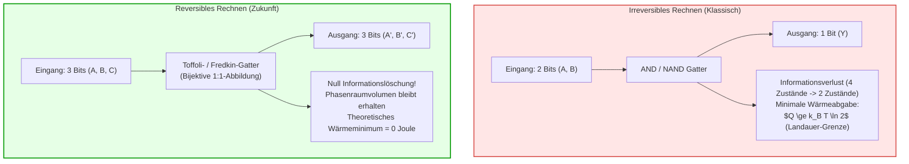
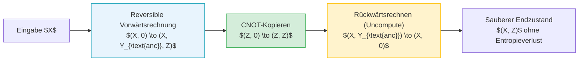

## Einführung: Die thermische Mauer moderner Supercomputer

In Zeiten von Exascale-Supercomputern und gigantischen Rechenzentren für künstliche Intelligenz ist der Energieverbrauch zum entscheidenden limitierenden Faktor der Computerarchitektur geworden. Heutige Höchstleistungsrechner verbrauchen Dutzende Megawatt an elektrischer Leistung – genug, um Kleinstädte zu versorgen –, wobei nahezu 100 % dieser Energie letztlich als Abwärme an die Umwelt abgegeben werden. Mit dem Zusammenbruch des Dennard-Skalierens und dem Phänomen des sogenannten „Dark Silicon“ stoßen konventionelle Halbleiterprozessoren unweigerlich an eine fundamentale physikalische Hitzemauer.

Hier stellt sich eine tiefgreifende theoretische Frage an der Schnittstelle von Physik und Informatik:
<strong>Erzeugt ein Computer Wärme, weil er logische Operationen ausführt, oder weil er physikalische Informationen unwiederbringlich löscht?</strong>

Die überraschende Antwort der modernen statistischen Physik lautet: <strong>Reine Informationsverarbeitung erfordert thermodynamisch kein theoretisches Minimum an Energieaufwand. Was unweigerlich Wärme dissipiert, ist das irreversible Löschen (Erasure) von Bits!</strong> Wenn es gelingt, jeden Berechnungsschritt so zu konstruieren, dass kein einziges Bit verloren geht und der Prozess zeitumkehrbar (reversibel) bleibt, kann der theoretische Energieverbrauch gegen null sinken. Dies ist das Fundament des <strong>reversiblen Rechnens (Reversible Computing)</strong> und der <strong>Informationsthermodynamik</strong>.

---

## 1. Die thermodynamische Grundlage: Maxwellscher Dämon und das Landauer-Prinzip

### 1.1 Der Maxwellsche Dämon und Szilards Ein-Molekül-Maschine
1867 formulierte James Clerk Maxwell ein berühmtes Gedankenexperiment: Ein winziges intelligentes Wesen (der Dämon) überwacht eine mikroskopische Tür zwischen zwei Gaskammern. Es lässt schnelle Moleküle nach rechts und langsame Moleküle nach links passieren. Ohne makroskopische Arbeit verrichtet zu haben, entsteht ein Temperaturgradient, was scheinbar den zweiten Hauptsatz der Thermodynamik verletzt.

1929 zeigte Leo Szilard anhand eines vereinfachten Zylinders mit einem einzelnen Molekül, dass der Dämon durch die Bestimmung der Position (links oder rechts) <strong>1 Bit objektive Information</strong> gewinnt und diese in mechanische Arbeit $W = k_B T \ln 2$ umwandeln kann. Jahrzehntelang glaubten Physiker, die Informationsmessung selbst verbrauche Energie, was sich jedoch als Irrtum herausstellte.

### 1.2 Das Landauer-Prinzip (1961)
Rolf Landauer (IBM Research) klärte das Paradoxon 1961 in seiner bahnbrechenden Arbeit auf:
<strong>Das Messen von Information und das Ausführen reversibler Operationen können im Prinzip ohne jede Energiedissipation erfolgen. Die unvermeidbare Wärme entsteht genau in dem Moment, in dem der Speicher des Dämons oder Computers zurückgesetzt (Reset to 0 / Erasure) wird!</strong>

> <strong>Satz (Landauer-Grenze):</strong>
> Beim irreversiblen Löschen von 1 Bit Information in einer Umgebung der absoluten Temperatur $T$ muss mindestens die Wärmemenge $Q_{\text{min}}$ an die Umgebung abgegeben werden:
> $$Q_{\text{min}} = k_B T \ln 2$$
> Hierbei ist $k_B \approx 1,3806 \times 10^{-23} \, \text{J/K}$ die Boltzmann-Konstante. Bei Raumtemperatur ($T = 300 \, \text{K}$) beträgt dieser Wert etwa $2,87 \times 10^{-21} \, \text{J}$ (ca. 0,018 eV).

Physikalisch entspricht das Löschen einer Reduktion des zugänglichen Phasenraums: Zwei mögliche mikroskopische Zustände $\{0, 1\}$ werden in einen Zustand $\{0\}$ kollabiert ($\Delta S_{\text{sys}} = -k_B \ln 2$). Um den zweiten Hauptsatz ($\Delta S_{\text{total}} \ge 0$) nicht zu verletzen, muss die Entropie der Umgebung um mindestens $\Delta S_{\text{env}} \ge k_B \ln 2$ steigen, was der Wärmeabgabe $Q = T \Delta S_{\text{env}} \ge k_B T \ln 2$ entspricht.

---

## 2. Das Bennett-Theorem und das Berechnen ohne Abwärme

1973 bewies Charles H. Bennett, dass universelle Berechnungen vollständig reversibel implementiert werden können, ohne dass während des gesamten Ablaufs jemals Informationen gelöscht werden müssen!

### 2.1 Unumkehrbarkeit klassischer Gatter
Klassische Logikgatter wie AND oder OR sind viele-zu-eins-Abbildungen. Ein AND-Gatter mit Ausgang $0$ erlaubt keine eindeutige Rekonstruktion der Eingänge ($(0,0), (0,1), (1,0)$). 1 Bit Entropie geht verloren und erzeugt Landauer-Abwärme.

### 2.2 Der Dreischritt: Berechnen, Kopieren, Zurückrechnen (Uncomputing)
Um die Akkumulation von Hilfsdaten (Müllbits) im Speicher ohne Löschung zu bewältigen, entwickelte Bennett das Uncomputing-Paradigma:
1. <strong>Vorwärtsberechnung:</strong> Aus der Eingabe $X$ erzeugen reversible Gatter Zwischenergebnisse $Y_{\text{müll}}$ und das Resultat $Z$: $(X, 0, 0) \to (X, Y_{\text{müll}}, Z)$.
2. <strong>Reversibles Kopieren:</strong> Das Ergebnis $Z$ wird mittels CNOT-Gattern zerstörungsfrei in ein freies Ausgaberegister kopiert: $(Z, 0) \to (Z, Z)$.
3. <strong>Zurückrechnen (Uncomputing):</strong> Das Netzwerk der Vorwärtsberechnung wird rückwärts durchlaufen. Die Zwischenvariablen $Y_{\text{müll}}$ werden exakt auf ihren Ausgangswert $0$ zurückgesetzt!
4. <strong>Endzustand:</strong> Am Ende verbleiben nur Eingabe $X$ und Ausgabe $Z$. Alle Zwischenregister sind wieder sauber auf $0$, ohne dass ein einziges Bit thermisch gelöscht werden musste.

---

## 3. Universelle reversible Gatter: Toffoli und Fredkin

### 3.1 Das Toffoli-Gatter (CCNOT)
Tommaso Toffoli führte 1980 ein 3-Bit-Eingang- und 3-Bit-Ausgang-Gatter ein: $(a, b, c) \to (a, b, c \oplus (a \land b))$.
Es stellt eine bijektive Permutation dar. Setzt man $c=0$, erhält man am Ausgang $a \land b$ (AND); setzt man $c=1$, erhält man NAND. Damit ist das Toffoli-Gatter universell für klassische Logik.

### 3.2 Das Fredkin-Gatter (CSWAP)
Edward Fredkin schlug das konservative Logikgatter vor: Wenn das Kontrollbit $c=1$ ist, vertauscht es die beiden Datenleitungen. Es ist nicht nur reversibel, sondern erhält strikt die Anzahl der Einsen (Hamming-Gewicht), was physikalischen Erhaltungssätzen (z. B. Ladung oder Photonenzahl) entspricht.

---

## 4. Physikalische Realisierung: Adiabatische CMOS- und Supraleiterschaltungen

### 4.1 Endliche Zeit und Reibungsverluste
Das Landauer-Minimum von null Dissipation gilt im quasi-statischen Grenzfall ($\tau \to \infty$). Bei endlicher Taktzeit $\tau$ entsteht dynamische Reibung gemäß stochastischer Thermodynamik:

$$\langle Q \rangle \ge k_B T \ln 2 + \frac{C}{\tau}$$

Reversible Architekturen zielen daher auf hochgradig parallele Systeme mit moderaten Taktfrequenzen ab, um das Energy-Delay-Produkt (EDP) zu minimieren.

### 4.2 Adiabatische CMOS-Logik
Klassische CMOS-Schaltungen verlieren beim Laden eines Kondensators $C_L$ stets die Energie $\frac{1}{2} C_L V_{DD}^2$ als Joule’sche Wärme im Transistorkanal.
Adiabatische Schaltungen verwenden dagegen oszillierende Wechselspannungs-Takte (Power-Clocks). Wird der Kondensator über eine Ladezeit $T_{\text{charge}}$ mit konstantem Strom geladen, sinkt die Verlustenergie proportional zur Ladezeit:

$$E_{\text{diss}} = \frac{R C_L}{T_{\text{charge}}} C_L V_{DD}^2$$

Beim Entladen wird die Ladung resonant zurückgewonnen (Energy Recovery), wodurch der Energieverbrauch um Größenordnungen sinkt.

### 4.3 Supraleitende Flussquanten-Logik
Bei kryogenen Temperaturen (4,2 K) nutzen Schaltungen auf Basis von Josephson-Kontakten einzelne magnetische Flussquanten ($\Phi_0 = h/2e$). Ohne ohmschen Widerstand können bistabile Potentialmulden adiabatisch verformt werden, wodurch Schaltenergien weit unterhalb des Landauer-Limits bei Raumtemperatur erreicht werden.

---

## 5. Fazit: Information ist physikalisch

Information ist kein abstraktes Konstrukt, sondern an physikalische Träger gebunden („Information is physical“). Die Entdeckung, dass Berechnungen im thermodynamischen Sinne reversibel und ohne prinzipiellen Energieverlust ablaufen können, bildet das Fundament zukünftiger hocheffizienter Rechnerarchitekturen und der Quanteninformatik.
