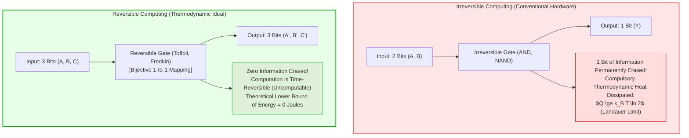
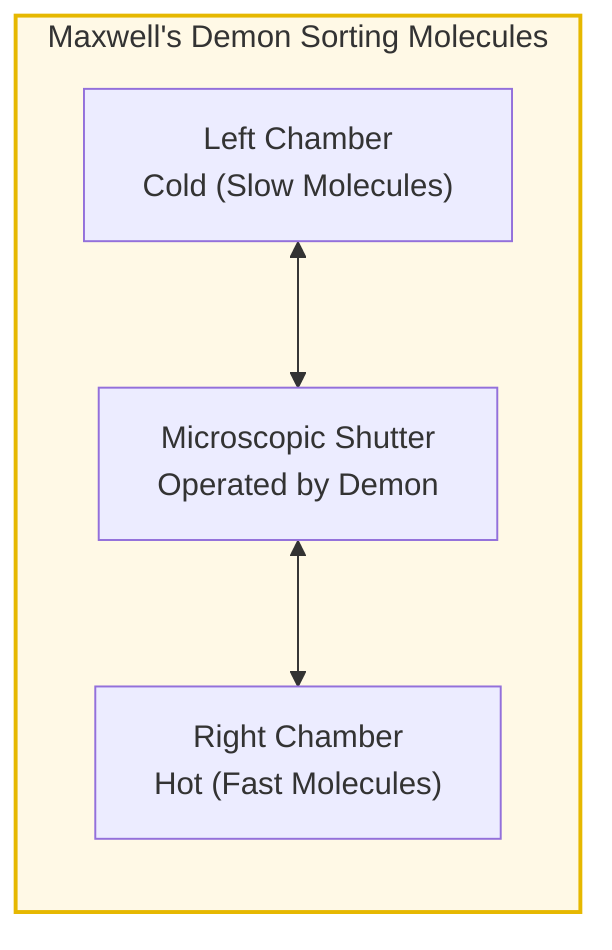
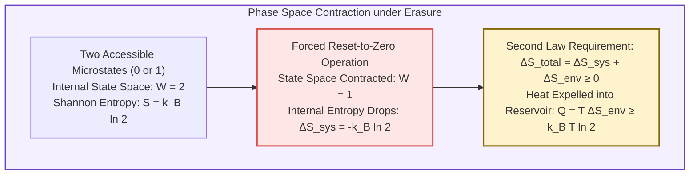
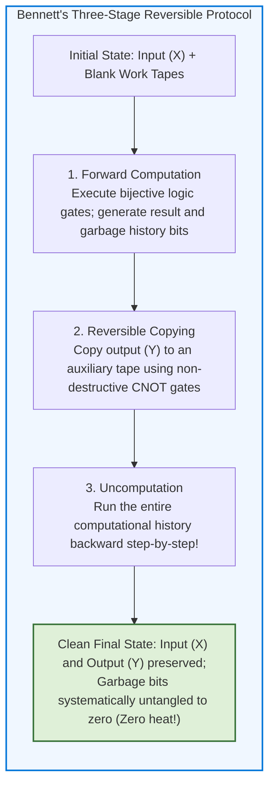
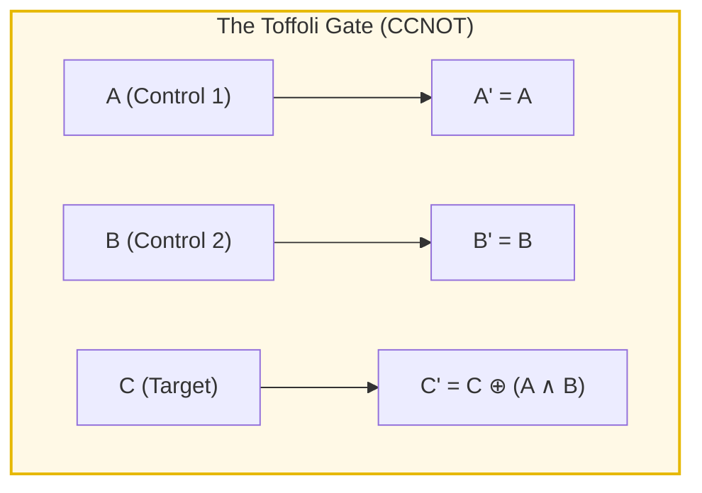
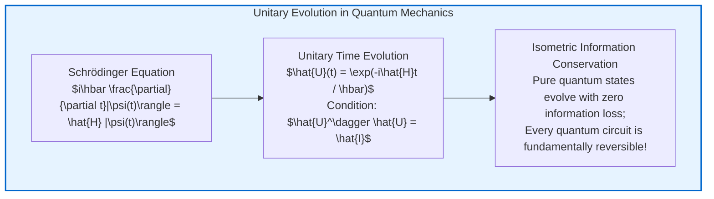
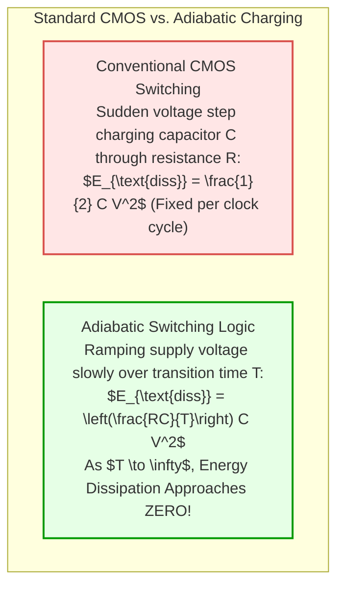
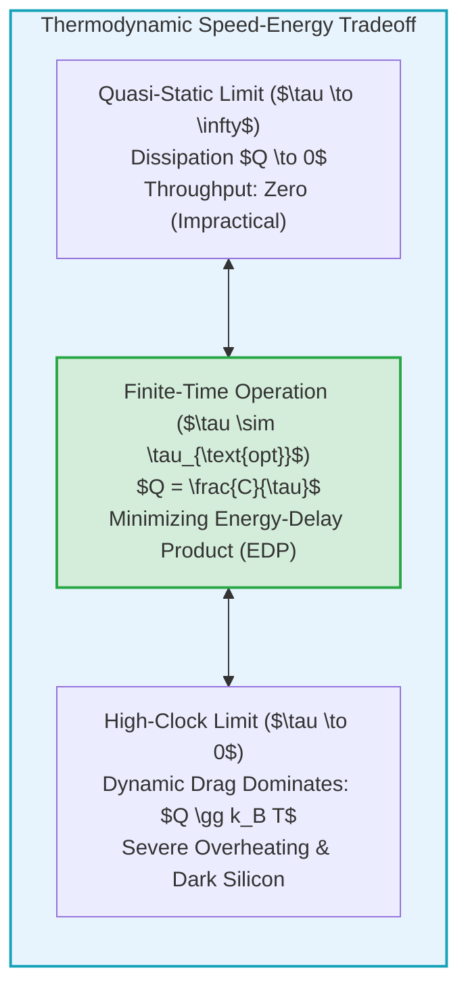
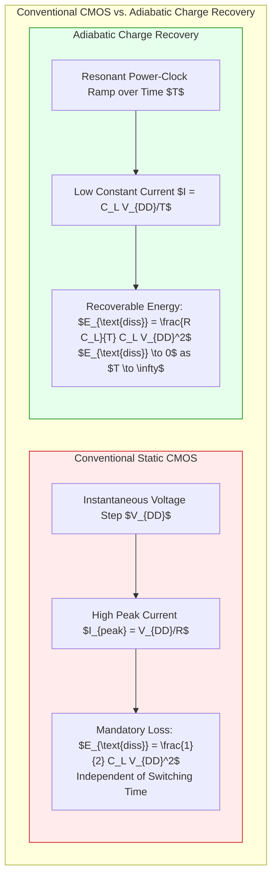
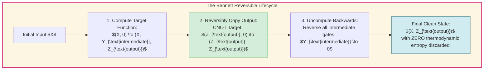

## Introduction: The Thermal Abyss of Modern Supercomputing

From training trillion-parameter artificial intelligence architectures to simulating climate dynamics and folding complex proteins, contemporary human civilization rests upon relentless, exponential increases in computational density. Yet anyone who steps inside a modern hyperscale data center or national supercomputing facility is immediately struck by a deafening roar: the sound of cooling infrastructure fighting a desperate war against <strong>heat dissipation</strong>.

Top-tier supercomputers consume tens of megawatts—comparable to the electrical demand of an entire city—and virtually 100% of that electrical energy is converted directly into waste thermal entropy expelled into the atmosphere. Following the breakdown of Dennard Scaling, microprocessors hit the catastrophic "Power Wall," giving rise to the "Dark Silicon" phenomenon: modern microchips contain billions of transistors that cannot all be powered simultaneously without melting the silicon die.



At the interface of theoretical physics and computer science, researchers posed a counter-intuitive and profound question:

<strong>"Does the act of processing information intrinsically require the dissipation of heat? Or does thermal dissipation arise from an entirely different, unnoticed physical operation?"</strong>
<strong>"If every step of a computational program could be executed in a completely time-reversible manner—without discarding a single bit of information—could computers theoretically operate with zero energy consumption?"</strong>

The exploration of these questions created the fields of <strong>Information Thermodynamics</strong> and <strong>Reversible Computing</strong>.
This treatise explores the resolution of Maxwell's Demon; the formulation of <strong>Landauer's Principle</strong>; Charles Bennett's proof of zero-energy computation; the mathematical mechanics of Toffoli and Fredkin gates; and the fundamental connection between classical reversibility and unitary quantum mechanics.

---

## 1. The Dawn of Information Thermodynamics: Maxwell's Demon & Landauer's Insight

### 1.1 The Century-Old Paradox of Maxwell's Demon
In 1867, Scottish physicist <strong>James Clerk Maxwell (1831–1879)</strong> formulated a thought experiment challenging the Second Law of Thermodynamics. The Second Law asserts that in an isolated system, macroscopic thermal entropy never spontaneously decreases; useful work cannot be extracted from a uniform heat bath without expenditure.

Maxwell imagined a vessel divided into two compartments by an insulated partition containing a frictionless, microscopic sliding door. A microscopic entity—<strong>Maxwell's Demon</strong>—monitors individual gas molecules approaching from both sides:
- When a fast (hot) molecule approaches from the left, the Demon opens the door, allowing it into the right chamber.
- When a slow (cold) molecule approaches from the right, the Demon permits it into the left chamber.

Over time, without performing mechanical work on the gas, the Demon creates a spontaneous temperature differential: the right chamber grows hot while the left chamber grows cold. This temperature difference could drive a heat engine, violating the Second Law.



### 1.2 Leo Szilard's Engine and the Cost of Information
In 1929, Hungarian-American physicist Leo Szilard reduced Maxwell's Demon to a single-molecule heat engine. Szilard demonstrated mathematically that the Demon's ability to extract work depended upon acquiring <strong>one bit of classical information</strong>: knowing whether the lone molecule was on the left or the right side of a partition.

For decades, the standard scientific consensus assumed the Second Law was saved by the physical cost of *measurement*—the assumption that shining a light or sensing a particle must dissipate at least $k_B T \ln 2$ of thermal energy. That hypothesis turned out to be completely incorrect.

### 1.3 Rolf Landauer and the Thermodynamics of Erasure
In 1961, at IBM's Thomas J. Watson Research Center, physicist <strong>Rolf Landauer (1927–1999)</strong> published a landmark paper: *"Irreversibility and Heat Generation in the Computing Process"*.

Landauer proved that neither the acquisition of information (measurement) nor the forward processing of information (computation) requires thermodynamic dissipation. The irreversible cost appears only when memory is <strong>erased</strong>:

> <strong>Landauer's Principle:</strong>
> Any logically irreversible manipulation of information, such as the erasure of one bit or the merging of two distinct computational trajectories into one, must be accompanied by a minimum thermodynamic entropy increase in the non-information-bearing degrees of freedom of the surrounding environment:
> 
> $$Q_{\text{min}} = k_B T \ln 2$$
> 
> Where $k_B = 1.380649 \times 10^{-23} \ \text{J/K}$ is the Boltzmann constant, $T$ is absolute temperature, and $\ln 2 \approx 0.69315$.



At ambient room temperature ($T = 300\text{K} \approx 27^\circ\text{C}$):

$$Q_{\text{min}} \approx 2.87 \times 10^{-21} \ \text{Joules} \quad (\approx 0.0178 \ \text{eV})$$

This thermodynamic threshold explains the mystery of Maxwell's Demon: The Demon can observe molecules and open doors reversibly, but its brain or memory register eventually fills with recorded bits. To complete a closed thermodynamic cycle and continue operating, the Demon <strong>must erase its memory</strong>. At that exact instant, the Demon expels heat $Q \ge k_B T \ln 2$ into the reservoir, perfectly preserving the Second Law.

---

## 2. The Original Sin of Computing: Irreversible Logic Gates

Every standard microchip fabricated today is built from <strong>logically irreversible gates</strong>.

Consider the standard <strong>AND gate</strong>:

$$\begin{array}{|c|c||c|}
\hline
\text{Input } A & \text{Input } B & \text{Output } Y = A \land B \\
\hline
0 & 0 & 0 \\
0 & 1 & 0 \\
1 & 0 & 0 \\
1 & 1 & 1 \\
\hline
\end{array}$$

The AND gate accepts two bits of input and produces one bit of output.
Suppose you observe an output of <strong>`0`</strong>. Can you determine what the input was?
It is mathematically impossible: the input could have been `(0,0)`, `(0,1)`, or `(1,0)`.

A mapping from four input states to two output states destroys information. The system compresses phase space from $\Omega = 4$ to $\Omega = 2$.
By Liouville's theorem in Hamiltonian mechanics, microscopic physical phase space volume is strictly conserved. If the computational degree of freedom contracts, that volume must expand into the unconstrained thermal degrees of freedom of the substrate. The destroyed information is cast out as lattice vibrations (phonons)—raw heat.

---

## 3. Charles Bennett's Triumph: The Physics of Uncomputation

In 1973, Landauer's colleague at IBM, <strong>Charles H. Bennett</strong>, established one of the foundational theorems of theoretical computer science:

> <strong>Bennett's Theorem (1973):</strong>
> Any arbitrary classical Turing computation can be simulated with perfect fidelity using exclusively logically reversible primitive operations. Consequently, computation does not intrinsically require the dissipation of energy.



### 3.1 The Garbage Problem and Uncomputation
If a computation must preserve every intermediate step to remain reversible, it generates an accumulation of "garbage bits." If those garbage bits are simply overwritten or cleared, Landauer's penalty applies immediately.

Bennett resolved this with <strong>Uncomputation</strong>:
1. <strong>Forward Pass:</strong> The machine computes the solution using strictly reversible, bijective logic gates, recording intermediate states along an auxiliary tape.
2. <strong>Result Isolation:</strong> Once the target answer $Y = f(X)$ is obtained, it is copied onto a blank output tape using reversible Controlled-NOT (CNOT) operations.
3. <strong>The Backward Pass (Uncomputation):</strong> The machine executes every preceding logic operation in exact reverse order.

Because the underlying physics of reversible gates is symmetrical under time reversal, running the program backward does not undo the copied answer on the separate tape. Instead, it systematically unwinds every intermediate garbage bit back into its pristine initial state! The machine returns to its original condition, holding the desired output, with <strong>zero net information erased and zero minimum thermodynamic dissipation</strong>.

---

## 4. Reversible Logic Gates: Toffoli, Fredkin, and Billiard Balls

To build a computer capable of uncomputation, every primitive gate must be a <strong>bijective mapping</strong> where the number of input wires equals the number of output wires.

### 4.1 The Toffoli Gate (CCNOT)
Introduced by Tommaso Toffoli in 1980, the <strong>Toffoli Gate</strong> (Controlled-Controlled-NOT) is a universal reversible gate:



- Inputs $A$ and $B$ pass through unchanged.
- The target bit $C$ is inverted if and only if both $A=1$ and $B=1$.
- The gate is its own inverse: applying the exact same gate a second time restores the original inputs ($T = T^{-1}$).
- By tying input $C$ to constant `0`, the output $C'$ produces $A \land B$ (AND). By setting $A=1$, it acts as a CNOT gate. The Toffoli gate is universal: any classical Boolean circuit can be constructed entirely from Toffoli gates without information loss.

### 4.2 The Fredkin Gate (CSWAP)
Invented by Edward Fredkin, the <strong>Fredkin Gate</strong> is a controlled-swap gate:
- If control bit $A=0$, bits $B$ and $C$ pass through unchanged ($B'=B, C'=C$).
- If control bit $A=1$, bits $B$ and $C$ swap positions ($B'=C, C'=B$).

Crucially, the Fredkin gate operates under <strong>Conservative Logic</strong>: the total number of 1s entering the gate strictly equals the number of 1s exiting the gate. This property maps directly onto physical conservation laws (such as particle number or charge).

### 4.3 The Billiard-Ball Computer
In 1982, Fredkin and Toffoli demonstrated that universal computation could be implemented using classical Newtonian mechanics without friction.
In their <strong>Billiard-Ball Computer</strong>, identical hard spheres collide elastically on a planar grid of reflecting mirrors. The presence of a ball represents bit `1`; the absence of a ball represents `0`. Collisions between balls alter their trajectories, executing precise Boolean logic gates. Because Newtonian mechanics is strictly time-reversible ($t \to -t$), inverting all velocity vectors causes the entire computation to retrace its steps without dissipating any energy as heat.

---

## 5. The Quantum Bridge: Unitary Evolution and Reversibility

The true natural habitat of reversible computing is <strong>Quantum Mechanics</strong>.



In quantum mechanics, the time evolution of a closed quantum system is governed by the Schrödinger equation, yielding <strong>unitary operators</strong> ($U^\dagger U = I$). A unitary operator preserves the norm of state vectors, ensuring that probability is conserved and quantum information cannot be destroyed.

Every fundamental quantum gate (Hadamard, Pauli-X, CNOT, Toffoli) is an inherently reversible unitary transformation. When writing quantum algorithms (such as Shor's factoring algorithm or Grover's search), programmers must implement uncomputation routines to disentangle and eliminate temporary quantum register states without triggering state collapse.

---

## 6. Engineering Realities: Adiabatic Circuits and Superconducting Logic

How does this theoretical foundation translate into practical electrical hardware?



### 6.1 Adiabatic Switching
In conventional CMOS digital circuits, charging a load capacitance $C$ through a pull-up transistor with resistance $R$ consumes energy from the supply. Half of that energy is stored in the capacitor ($\frac{1}{2}CV^2$), while the other half is dissipated as heat in the transistor channel.

In <strong>Adiabatic Switching</strong>, the flat DC power supply is replaced by an AC resonant clock that ramps voltage up and down gradually over a period $T$. The dissipated energy scales as:

$$E_{\text{diss}} = \left(\frac{RC}{T}\right) C V^2$$

If the clock transition period $T$ is made significantly larger than the intrinsic $RC$ time constant of the transistor channel, <strong>the energy dissipated per switching event approaches zero asymptotically</strong>.

### 6.2 Experimental Verification of the Landauer Bound
For decades, Landauer's limit was debated as a theoretical conjecture. In 2012, a team of experimental physicists led by Antoine Bérut at ENS de Lyon published experimental proof in *Nature*.
Using optical tweezers to trap a single 2-micrometer silica bead in a double-well potential, the researchers implemented a physical 1-bit memory where left represented `0` and right represented `1`. By modulating the laser potential, they executed a cycle that compressed the particle's state space into a single well. High-precision measurement confirmed that as the cycle time slowed toward quasi-static equilibrium, <strong>the average dissipated heat converged exactly to $k_B T \ln 2$</strong>.

---

## 7. Conclusion: Unwinding the Future of Computation

Can we reduce energy consumption by running computations backward?
The answer from modern theoretical and experimental physics is an unequivocal <strong>YES</strong>.

The thermodynamic dissipation plaguing contemporary computing is not an inescapable tax on computation itself. It is a penalty for our engineering habit of discarding computational history.

By treating information as a physical entity subject to the laws of thermodynamics, reversible computing reveals a profound reality: computation is fundamentally an isometric dance in state space. As reversible architectures, adiabatic circuits, and quantum processors mature, humanity approaches an era where the act of thinking in silicon no longer burns the world that created it.


---

## 7. Finite-Time Thermodynamics and Physical Hardware: From Adiabatic CMOS to Superconducting Flux Logic

### 7.1 The Finite-Time Landauer Bound: Dissipation in Non-Quasi-Static Regimes
The foundational Landauer bound $Q_{\text{min}} = k_B T \ln 2$ and Bennett's proof of dissipation-free reversible computation rely fundamentally on the assumption of quasi-static, infinitely slow transitions wherein the physical system remains in thermodynamic equilibrium with its environment at every instant.
In real-world computing machines, however, spending infinite time per gate operation corresponds to a clock frequency of zero—rendering the processor completely unusable.

Modern <strong>stochastic thermodynamics</strong> and <strong>finite-time thermodynamics</strong> have successfully characterized the non-equilibrium penalties associated with operating reversible transitions at a finite duration $\tau$.
Starting from the underdamped or overdamped Langevin equation governing microscopic degrees of freedom, the ensemble-averaged heat dissipation $\langle Q \rangle$ scales asymptotically as:

$$\langle Q \rangle \ge k_B T \ln 2 + \frac{C}{\tau} + \mathcal{O}\left(\frac{1}{\tau^2}\right)$$

where the constant $C$ represents the dynamic friction or microscopic dissipative coefficient, geometrically related to the thermodynamic metric tensor along the control path in parameter space.
This $C/\tau$ penalty represents the fundamental "hydrodynamic drag" of moving microscopic physical states through phase space at finite velocities.



This inescapable trade-off shifts the engineering objective of reversible architecture: rather than attempting to operate at near-zero clock speeds, one minimizes the <strong>Energy-Delay Product (EDP)</strong> or <strong>Energy-Delay-Squared Product ($Et^2$)</strong>.
By running massively parallel, high-density reversible cores clocked at moderate speeds, a reversible processor can achieve immense aggregate computational throughput while keeping per-operation energy orders of magnitude below conventional CMOS.

### 7.2 Principles of Adiabatic CMOS and Charge-Recovery Circuits
In standard static CMOS logic, charging a node with capacitive load $C_L$ to power-supply voltage $V_{DD}$ pulls an energy of $C_L V_{DD}^2$ from the DC power rail. Exactly half of this energy, $\frac{1}{2} C_L V_{DD}^2$, is irrevocably converted into Joule heat within the channel resistance of the pulling PMOS transistor, while the remaining half is stored in the capacitor and discharged to ground as heat during the next logic transition.

In contrast, <strong>adiabatic logic circuits</strong> replace static DC rails with oscillating AC "power-clocks" that ramp up and down gradually.
When charging load capacitance $C_L$ through an effective channel resistance $R$ using a constant-current ramp over a transition time $T_{\text{charge}}$, the current is:

$$I(t) = \frac{C_L V_{DD}}{T_{\text{charge}}}$$

The total dissipated energy across the channel resistance becomes:

$$E_{\text{diss}} = \int_0^{T_{\text{charge}}} I^2(t) R \, dt = R \left(\frac{C_L V_{DD}}{T_{\text{charge}}}\right)^2 T_{\text{charge}} = \frac{R C_L}{T_{\text{charge}}} \cdot C_L V_{DD}^2$$

Notice the critical proportionality factor $\frac{R C_L}{T_{\text{charge}}} = \frac{\tau_{RC}}{T_{\text{charge}}}$.
By making the switching duration $T_{\text{charge}}$ significantly larger than the intrinsic $RC$ time constant of the transistor channel, the dissipated energy decreases inversely with switching time—the quintessential signature of an adiabatic thermodynamic process.



Prominent architectural implementations include:
1. <strong>2N-2N2P and ECRL (Efficient Charge Recovery Logic)</strong>: Utilizing cross-coupled differential pairs to enable quasi-adiabatic energy recovery back into multiphase resonant power-clock supplies.
2. <strong>SCRL (Split-Level Charge Recovery Logic)</strong>: Invented by Younis and Knight at MIT, enforcing that no transistor is ever turned on while a non-zero drain-to-source voltage exists across it, yielding an energy reduction factor exceeding $100\times$ compared to conventional CMOS.

### 7.3 Superconducting Reversible Logic: Reversible Fluxon Devices
While semiconductor adiabatic CMOS remains constrained by sub-threshold leakage currents and non-zero bandgap voltages, superconducting circuits operating at liquid-helium temperatures (4.2 K) offer an extraordinarily fertile substrate for reversible logic.

Superconducting Quantum Interference Devices (SQUIDs) encode digital information as single magnetic flux quanta $\Phi_0 = \frac{h}{2e} \approx 2.067 \times 10^{-15} \, \text{Wb}$ trapped within zero-resistance loops.
In <strong>Reversible Fluxon Logic (RFL)</strong> and <strong>adiabatic nSQUID circuits</strong>, computational steps correspond to continuous, adiabatic deformations of double-well Josephson potential landscapes. Because Cooper pairs experience zero Ohm resistance, dynamic Joule dissipation vanishes completely.
Experimental demonstrations by research teams at Yokohama National University and Stony Brook have verified logic transitions dissipating energies substantially beneath the room-temperature Landauer limit, setting the architectural foundation for ultra-dense, ultra-cold exascale computing arrays.

---

## 8. Reversible Software Paradigms: Programming Languages and Reversible Garbage Collection

Even with theoretically perfect reversible hardware, conventional imperative programming languages (such as C, Rust, or Python) are inherently irreversible: assignment statements like `x = 5;` overwrite and erase prior values, incurring mandatory Landauer erasure penalties at the architectural level.
Executing fully reversible computation requires rethinking programming language design from the bedrock up.

### 8.1 The Janus Reversible Programming Language
First conceived by Lutz in 1986, <strong>Janus</strong> is a seminal programming language that is purely and structurally reversible: every syntactically valid Janus program can be executed both forward and backward deterministically.

In Janus, destructive assignment is prohibited. Instead, variables are modified exclusively through invertible modification operators:

```text
x += y;   // Invertible: backward step executes x -= y;
x ^= y;   // Invertible: backward step executes x ^= y;
x <=> y;  // Value exchange: self-inverse;
```

To preserve invertibility across control flow, conditional statements and loops require matching entry and exit assertions:

```text
if <condition1> then
    <forward_branch>
else
    <alternative_branch>
fi <condition2>   // Assertion checked in reverse execution
```

The terminal assertion `condition2` guarantees that when executing backward in time, the interpreter can unambiguously determine which computational path was traversed.

### 8.2 Reversible Garbage Collection and the Pebble Game
The central operational bottleneck in reversible computing is the rapid accumulation of intermediate "ancilla" or "garbage" data. If this data is discarded, Landauer's penalty is triggered.
Bennett resolved this via the <strong>Compute-Copy-Uncompute</strong> paradigm:



Mathematically, the scheduling of when to save intermediate state and when to uncompute within finite memory is modeled as the <strong>Reversible Pebble Game</strong> on Directed Acyclic Graphs (DAGs).
Given a graph of size $N$, finding the optimal schedule that minimizes pebble count (memory footprints) while bounding execution time overhead is PSPACE-complete. Bennett proved that any computation taking time $T$ can be simulated reversibly within space $O(S \log T)$ and time $O(T^{1+\epsilon})$, establishing that reversible computation incurs only polylogarithmic space and polynomial time overheads.

---

## 9. Conclusion: Information Thermodynamics and the Ultimate Limits of Computation

The convergence of statistical mechanics, quantum information theory, and computer science over the past six decades has irrevocably altered our perception of reality:

1. <strong>Information is Physical:</strong>
   Bits are not ethereal abstractions hovering above physical reality. A bit is invariably embodied in physical degrees of freedom—the spin of an electron, the phase of a superconducting loop, or the charge on a gate capacitor. To erase a bit is to compress the microscopic phase space volume of the universe, compelling a compensatory ejection of entropy into the thermal reservoir.
2. <strong>Computation is Not Fundamentally Dissipative:</strong>
   For generations, engineers assumed that processing information inherently demanded burning energy. Landauer, Bennett, Toffoli, and Feynman conclusively demolished this dogma: universal, Turing-complete computation can proceed with arbitrarily small energy dissipation, provided that logical reversibility is rigorously preserved.
3. <strong>The Cornerstone of Quantum Architectures:</strong>
   Unitary quantum computing is, at its foundational mathematical core, closed-system reversible computation. The reason quantum algorithms cannot employ non-invertible fan-out or arbitrary bit-overwriting is rooted in the very same unitarity that makes reversible computing thermodynamically conservative.

As humanity confronts the severe thermal limits of modern hyper-scale artificial intelligence clusters and high-performance supercomputers, reversible computing emerges not as a mere theoretical curiosity, but as the indispensable technological trajectory for the next century of computing machines.
By learning to rewind computation, we master the thermodynamics of thought itself.
