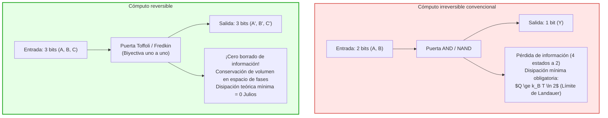
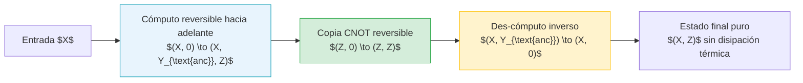

## Introducción: El muro térmico de la supercomputación

En la era del aprendizaje profundo y los centros de datos a escala de exaflops, el consumo de energía y la disipación térmica se han convertido en el obstáculo más crítico de la arquitectura de computadores. Una supercomputadora moderna consume decenas de megavatios de potencia eléctrica, y casi el 100 % de dicha energía se transforma en calor residual liberado al medio ambiente. Con el colapso del escalado de Dennard y la crisis del silicio oscuro (Dark Silicon), la reducción en el tamaño de los transistores ha dejado de reducir la densidad de calor.

Ante este límite, surge una pregunta trascendental:
<strong>¿Genera calor un computador porque realiza operaciones lógicas, o porque borra información física de manera irreversible?</strong>

La física estadística contemporánea ofrece una respuesta sorprendente: <strong>procesar información no exige intrínsecamente un gasto mínimo de energía; lo que realmente disipa calor es el borrado irreversible de información (Erasure)!</strong> Si cada paso de un algoritmo se diseña para preservar toda la información y permitir su inversión temporal (reversibilidad), el consumo teórico mínimo de energía puede reducirse a cero. Esta es la premisa de la <strong>computación reversible (Reversible Computing)</strong> y la <strong>termodinámica de la información</strong>.

---

## 1. Fundamentos termodinámicos: El demonio de Maxwell y el principio de Landauer

### 1.1 El demonio de Maxwell y el motor de Szilard
En 1867, James Clerk Maxwell formuló el célebre experimento mental en el que un ser microscópico inteligente separa moléculas rápidas de lentas abriendo y cerrando una trampilla sin realizar trabajo macroscópico, desafiando la segunda ley de la termodinámica.
En 1929, Leo Szilard modeló este proceso con un cilindro monomolecular, demostrando que al medir la posición de la partícula (izquierda o derecha), el demonio adquiere <strong>1 bit de información</strong>, que puede transformarse en trabajo mecánico $W = k_B T \ln 2$. Durante décadas se asumió erróneamente que la disipación ocurría durante la medición de la molécula.

### 1.2 El principio de Landauer (1961)
Rolf Landauer (IBM Research) resolvió la paradoja en 1961:
<strong>Medir y procesar información puede realizarse en principio sin disipación energética. El calor se libera obligatoriamente en el momento en que se borra la memoria del demonio o computador (Reset to 0)!</strong>

> <strong>Teorema (Límite de Landauer):</strong>
> Al borrar irreversiblemente 1 bit de información en un entorno a temperatura absoluta $T$, la energía mínima que debe disiparse como calor $Q_{\text{min}}$ es:
> $$Q_{\text{min}} = k_B T \ln 2$$
> donde $k_B \approx 1{,}3806 \times 10^{-23} \, \text{J/K}$ es la constante de Boltzmann. A temperatura ambiente ($T = 300 \, \text{K}$), equivale a unos $2{,}87 \times 10^{-21} \, \text{J}$ (~0,018 eV).

El borrado reduce el espacio de estados microscópicos del sistema ($\Delta S_{\text{sys}} = -k_B \ln 2$). Para cumplir con la segunda ley ($\Delta S_{\text{total}} \ge 0$), el entorno debe absorber al menos $\Delta S_{\text{ent}} \ge k_B \ln 2$, disipando $Q = T \Delta S_{\text{ent}} \ge k_B T \ln 2$.

---

## 2. Teorema de Bennett y el des-cómputo (Uncomputing)

En 1973, Charles H. Bennett demostró que cualquier máquina de Turing universal puede ejecutarse de manera totalmente reversible sin borrar bits intermedios, logrando disipación teórica cero.

### 2.1 El ciclo de des-cómputo sin generación de calor
Bennett ideó el protocolo de tres fases:
1. <strong>Cómputo hacia adelante:</strong> Transforma la entrada $X$ en $(X, Y_{\text{basura}}, Z)$ mediante compuertas reversibles.
2. <strong>Copia limpia no destructiva:</strong> Duplica el resultado $Z$ en un registro destino mediante compuertas CNOT.
3. <strong>Des-cómputo (Uncomputing):</strong> Invierte el circuito de cómputo hacia atrás, restaurando las variables auxiliares $Y_{\text{basura}}$ exactamente a su estado inicial cero ($0$).
4. <strong>Estado final:</strong> Solo quedan la entrada $X$ y el resultado útil $Z$, sin memoria intermedia residual y con disipación térmica nula.

---

## 3. Puertas lógicas reversibles universales: Toffoli y Fredkin

### 3.1 Puerta de Toffoli (CCNOT)
Propuesta por Tommaso Toffoli en 1980: $(a, b, c) \to (a, b, c \oplus (a \land b))$.
Fijando $c=0$, produce la función AND; fijando $c=1$, produce NAND. Es una puerta universal para la computación clásica reversible.

### 3.2 Puerta de Fredkin (CSWAP)
Propuesta por Edward Fredkin: conmuta dos líneas de datos si el bit de control es 1. Conserva estrictamente el peso de Hamming (número de 1s), modelando procesos físicos donde se conservan la carga, fotones o partículas.

---

## 4. Implementación física: CMOS adiabático y circuitos superconductores

### 4.1 Termodinámica de tiempo finito
La disipación cero asume procesos infinitamente lentos ($\tau \to \infty$). Para un tiempo finito $\tau$, la termodinámica estocástica describe pérdidas por fricción dinámica:

$$\langle Q \rangle \ge k_B T \ln 2 + \frac{C}{\tau}$$

Por ello, la computación reversible busca el paralelismo masivo con frecuencias moderadas para minimizar el producto energía-retardo (EDP).

### 4.2 Lógica CMOS adiabática
En vez de escalones bruscos de tensión que disipan $\frac{1}{2} C_L V_{DD}^2$, el CMOS adiabático emplea relojes oscilantes resonantes (Power-Clocks). Con un tiempo de conmutación $T_{\text{carga}} \gg R C_L$, la disipación se reduce a:

$$E_{\text{diss}} = \frac{R C_L}{T_{\text{carga}}} C_L V_{DD}^2$$

permitiendo recuperar la energía en cada ciclo y reducir el consumo en más de dos órdenes de magnitud.

### 4.3 Lógica de flujo superconductor
A temperaturas de helio líquido (4,2 K), las uniones Josephson manipulan cuantos de flujo magnético $\Phi_0 = h/2e$ sin resistencia eléctrica, permitiendo compuertas reversibles que conmutan con energías muy por debajo del límite de Landauer a temperatura ambiente.

---

## 5. Conclusión: La información es física

Como sentenció Rolf Landauer, «Information is Physical». La computación no es una abstracción desvinculada del mundo material, sino una evolución dinámica reversible en el espacio de fases. La computación reversible y la termodinámica de la información constituyen la base de la próxima revolución informática ante los límites de la física clásica.
