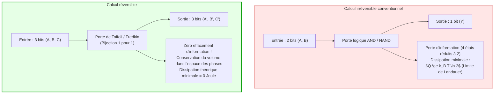
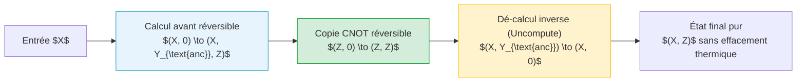

## Introduction : Le mur thermique des supercalculateurs

À l'ère de l'intelligence artificielle massive et des supercalculateurs exaflopiques, la dissipation thermique s'impose comme la frontière physique ultime de l'informatique. Un supercalculateur de pointe consomme des dizaines de mégawatts — l'équivalent de plusieurs dizaines de milliers de foyers —, et la quasi-totalité de cette énergie électrique finit irrémédiablement convertie en chaleur résiduelle rejetée dans l'environnement. Avec la fin de la mise à l'échelle de Dennard et l'avènement du phénomène de « silicium sombre » (Dark Silicon), la gravure microscopique ne suffit plus à contenir l'explosion de la densité thermique des puces.

Face à cette crise, physiciens et théoriciens posent une question fondamentale :
<strong>Un ordinateur dégage-t-il de la chaleur parce qu'il effectue des opérations logiques, ou parce qu'il détruit de l'information physique ?</strong>

La physique statistique moderne offre une réponse révolutionnaire : <strong>calculer ne requiert thermodynamiquement aucune dépense d'énergie minimale intrinsèque ; la chaleur provient exclusivement de l'effacement irréversible de l'information (Erasure) !</strong> Si chaque opération est conçue de manière bijective et réversible dans le temps, la dissipation thermique théorique peut être ramenée à zéro. Tel est le principe fondamental du <strong>calcul réversible (Reversible Computing)</strong> et de la <strong>thermodynamique de l'information</strong>.

---

## 1. Origines thermodynamiques : Démon de Maxwell et principe de Landauer

### 1.1 Le démon de Maxwell et le moteur de Szilard
En 1867, James Clerk Maxwell imagina une entité microscopique capable de trier les molécules d'un gaz entre deux compartiments sans dépense apparente de travail, violant le deuxième principe de la thermodynamique.
En 1929, Leo Szilard démontra qu'en observant la position d'une molécule (gauche ou droite), le démon acquiert <strong>1 bit d'information</strong>, convertible en travail mécanique $W = k_B T \ln 2$. Pendant un demi-siècle, la physique crut que la mesure elle-même provoquait la dissipation requise pour sauver le second principe.

### 1.2 Le principe de Landauer (1961)
En 1961, Rolf Landauer (IBM) démontra que cette vision était inexacte :
<strong>La mesure et le traitement de l'information peuvent en principe s'opérer sans dépense d'énergie. C'est l'opération d'effacement de la mémoire (Reset à 0) qui impose une pénalité thermodynamique incompressible !</strong>

> <strong>Théorème (Limite de Landauer) :</strong>
> Lors de l'effacement irréversible d'un bit d'information dans un environnement à la température absolue $T$, la quantité minimale de chaleur dissipée $Q_{\text{min}}$ est donnée par :
> $$Q_{\text{min}} = k_B T \ln 2$$
> où $k_B \approx 1{,}3806 \times 10^{-23} \, \text{J/K}$ est la constante de Boltzmann. À température ambiante ($T = 300 \, \text{K}$), cette limite vaut environ $2{,}87 \times 10^{-21} \, \text{J}$ (~0,018 eV).

L'effacement compresse les micro-états du système logique ($\Delta S_{\text{sys}} = -k_B \ln 2$). En vertu du second principe ($\Delta S_{\text{total}} \ge 0$), l'entropie de l'environnement doit augmenter d'au moins $\Delta S_{\text{env}} \ge k_B \ln 2$, libérant la chaleur $Q = T \Delta S_{\text{env}} \ge k_B T \ln 2$.

---

## 2. Théorème de Bennett et dé-calcul (Uncomputing)

En 1973, Charles H. Bennett apporta une solution décisive : <strong>toute machine de Turing universelle peut être simulée de manière entièrement réversible sans aucun effacement d'information, et donc sans dissipation d'énergie minimale.</strong>

### 2.1 Le cycle de calcul sans déchet
Pour éviter l'accumulation indéfinie de bits auxiliaires (garbage bits) sans les effacer, Bennett introduisit la méthode de dé-calcul (Uncomputing) :
1. <strong>Calcul avant :</strong> Le système transforme l'entrée $X$ en $(X, Y_{\text{déchets}}, Z)$ via des portes réversibles.
2. <strong>Copie non destructive :</strong> Le résultat $Z$ est dupliqué sur un registre vierge au moyen d'opérations CNOT bijectives.
3. <strong>Dé-calcul arrière :</strong> Le circuit de calcul est exécuté en sens inverse, ramenant les variables auxiliaires $Y_{\text{déchets}}$ exactement à leur état initial $0$.
4. <strong>État final :</strong> Le système ne conserve que l'entrée $X$ et le résultat $Z$, les registres de calcul étant parfaitement réinitialisés sans transfert d'entropie au milieu thermique !

---

## 3. Portes réversibles fondamentales : Toffoli et Fredkin

### 3.1 La porte de Toffoli (CCNOT)
Introduite par Tommaso Toffoli en 1980, cette porte à 3 entrées et 3 sorties applique la transformation : $(a, b, c) \to (a, b, c \oplus (a \land b))$.
En fixant $c=0$, on obtient la fonction AND ; en fixant $c=1$, on obtient NAND. La porte de Toffoli constitue un ensemble universel pour le calcul classique réversible.

### 3.2 La porte de Fredkin (CSWAP)
Conçue par Edward Fredkin, cette porte échange deux lignes de données si et seulement si la ligne de contrôle est active. Elle préserve rigoureusement le poids de Hamming (le nombre de 1), ce qui correspond directement aux lois de conservation de la physique (charge électrique, nombre de particules ou de photons).

---

## 4. Réalisations physiques : Du CMOS adiabatique aux fluxons supraconducteurs

### 4.1 Thermodynamique en temps fini
La dissipation nulle suppose une vitesse quasi-statique ($\tau \to \infty$). Pour une durée d'opération finie $\tau$, les frottements microscopiques imposent une pénalité :

$$\langle Q \rangle \ge k_B T \ln 2 + \frac{C}{\tau}$$

L'optimisation des architectures réversibles repose donc sur un parallélisme massif à fréquence modérée pour minimiser le produit énergie-délai (EDP).

### 4.2 Logique CMOS adiabatique
Tandis que le CMOS classique dissipe $\frac{1}{2} C_L V_{DD}^2$ à chaque cycle de charge, les circuits adiabatiques utilisent des horloges oscillantes en rampe (Power-Clocks). Pour un temps de charge $T_{\text{charge}} \gg R C_L$, l'énergie dissipée devient :

$$E_{\text{diss}} = \frac{R C_L}{T_{\text{charge}}} C_L V_{DD}^2$$

La charge est récupérée de façon résonante lors de la décharge, divisant la consommation énergétique par plus de cent.

### 4.3 Logique à fluxons supraconducteurs
À température d'hélium liquide (4,2 K), les jonctions Josephson permettent de manipuler des quanta de flux magnétique $\Phi_0 = h/2e$ sans résistance ohmique. Ces circuits permettent des transitions logiques dissipant une énergie bien inférieure à la limite de Landauer à température ambiante, ouvrant la voie aux supercalculateurs verts du futur.

---

## 5. Conclusion : L'information est physique

La formule célèbre de Rolf Landauer, « Information is Physical », résume la révolution en cours. Le calcul n'est pas une abstraction désincarnée, mais une trajectoire dynamique réversible dans l'espace des phases. En apprenant à inverser le calcul, l'humanité déverrouille les principes thermodynamiques ultimes qui façonneront l'informatique des siècles à venir.
