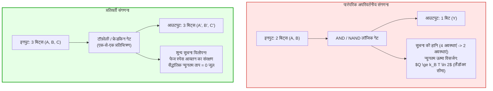
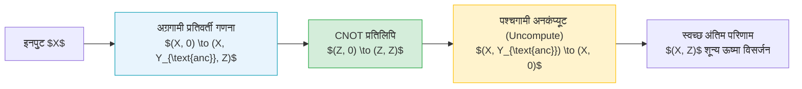

## प्रस्तावना: आधुनिक सुपरकंप्यूटरों की थर्मल दीवार और भौतिक सीमाएं

कृत्रिम बुद्धिमत्ता और विशाल डेटा केंद्रों के इस युग में अत्यधिक बिजली की खपत और भारी ताप उत्सर्जन कंप्यूटर वास्तुकला की सबसे बड़ी चुनौती बन चुके हैं। आज के उन्नत सुपरकंप्यूटर दर्जनों मेगावाट बिजली की खपत करते हैं, जो एक छोटे शहर की कुल बिजली के बराबर है, और यह लगभग शत-प्रतिशत बिजली अंततः अपशिष्ट ऊष्मा के रूप में पर्यावरण में विसर्जित हो जाती है। डेनार्ड स्केलिंग की समाप्ति और डार्क सिलिकॉन (Dark Silicon) की समस्या के कारण सेमीकंडक्टर ट्रांजिस्टर को छोटा करने मात्र से चिप का गर्म होना नहीं रोका जा सकता।

भौतिकी और कंप्यूटर विज्ञान के चौराहे पर एक मौलिक प्रश्न उठता है:
<strong>क्या कंप्यूटर तार्किक गणनाएं करने के कारण गर्म होता है, या इसलिए क्योंकि वह भौतिक सूचनाओं को अपरिवर्तनीय रूप से मिटाता है?</strong>

आधुनिक सांख्यिकीय ऊष्मागतिकी का उत्तर आश्चर्यजनक है: <strong>तार्किक गणना स्वयं ऊष्मागतिकीय रूप से ऊर्जा की खपत अनिवार्य नहीं बनाती; अनिवार्य ऊष्मा का उत्सर्जन केवल सूचना को स्थायी रूप से मिटाने (Information Erasure) से होता है!</strong> यदि गणना के प्रत्येक चरण को इस प्रकार संरचित किया जाए कि एक भी बिट नष्ट न हो और पूरी प्रक्रिया समय-प्रतिवर्ती (Reversible) बनी रहे, तो सैद्धांतिक न्यूनतम ऊर्जा खपत को शून्य तक घटाया जा सकता है! यही <strong>प्रतिवर्ती संगणना (Reversible Computing)</strong> और <strong>सूचना ऊष्मागतिकी (Information Thermodynamics)</strong> का मूल सिद्धांत है।

---

## 1. ऊष्मागतिकीय आधार: मैक्सवेल का दानव और लैंडॉअर सिद्धांत

### 1.1 मैक्सवेल का दानव और ज़िलार्ड का एकल अणु इंजन
1867 में जेम्स क्लर्क मैक्सवेल ने एक प्रसिद्ध विचार प्रयोग प्रस्तुत किया जिसमें एक सूक्ष्म बुद्धिमान प्राणी बिना किसी यांत्रिक कार्य के तेज और धीमे अणुओं को अलग कर तापमान का अंतर पैदा करता है, जो ऊष्मागतिकी के दूसरे नियम को चुनौती देता प्रतीत हुआ।
1929 में लियो ज़िलार्ड ने सिद्ध किया कि अणु की स्थिति को मापकर दानव <strong>1 बिट सूचना</strong> प्राप्त करता है और उसे $W = k_B T \ln 2$ के यांत्रिक कार्य में बदल सकता है। दशकों तक यह माना गया कि सूचना का मापन ही ऊर्जा की खपत करता है, जो अंततः गलत सिद्ध हुआ।

### 1.2 लैंडॉअर का सिद्धांत (1961)
1961 में आईबीएम के वैज्ञानिक रॉल्फ लैंडॉअर ने इस पहेली को सुलझाया:
<strong>सूचना का मापन और प्रतिवर्ती संचालन सैद्धांतिक रूप से बिना ऊर्जा अपव्यय के किया जा सकता है। अपरिहार्य ऊष्मा केवल तब उत्सर्जित होती है जब स्मृति (मेमोरी) में दर्ज बिट को मिटाया (Reset to 0) जाता है!</strong>

> <strong>प्रमेय (लैंडॉअर सीमा):</strong>
> तापमान $T$ वाले ऊष्मागतिक वातावरण में 1 बिट भौतिक सूचना को अपरिवर्तनीय रूप से मिटाने पर उत्सर्जित होने वाली न्यूनतम ऊष्मा $Q_{\text{min}}$ है:
> $$Q_{\text{min}} = k_B T \ln 2$$
> जहाँ $k_B \approx 1.3806 \times 10^{-23} \, \text{J/K}$ बोल्ट्जमान स्थिरांक है। कक्ष तापमान ($T = 300 \, \text{K}$) पर यह सीमा लगभग $2.87 \times 10^{-21} \, \text{J}$ (लगभग 0.018 eV) होती है।

सूचना को मिटाने से प्रणाली की सूक्ष्म अवस्थाएं संकुचित होती हैं ($\Delta S_{\text{sys}} = -k_B \ln 2$)। ऊष्मागतिकी के दूसरे नियम ($\Delta S_{\text{total}} \ge 0$) को बनाए रखने के लिए वातावरण को कम से कम $\Delta S_{\text{env}} \ge k_B \ln 2$ की एंट्रॉपी अवशोषित करनी पड़ती है, जिससे $Q = T \Delta S_{\text{env}} \ge k_B T \ln 2$ ऊष्मा उत्सर्जित होती है।

---

## 2. बेनेट का प्रमेय और अनकंप्यूटिंग (Uncomputing) चक्र

1973 में चार्ल्स एच. बेनेट ने सिद्ध किया कि किसी भी सार्वभौमिक ट्यूरिंग मशीन को पूरी तरह प्रतिवर्ती रूप से चलाया जा सकता है, जिससे स्मृति में बिना कोई बिट मिटाए शून्य ताप विसर्जन प्राप्त होता है।

### 2.1 अनकंप्यूटिंग का त्रिपक्षीय चक्र
कचरा बिट्स (Garbage Bits) को बिना मिटाए निपटाने के लिए बेनेट ने अनकंप्यूटिंग प्रतिमान प्रस्तुत किया:
1. <strong>अग्रगामी गणना:</strong> इनपुट $X$ से प्रतिवर्ती गेट्स के माध्यम से मध्यवर्ती अवस्था $(X, Y_{\text{anc}}, Z)$ प्राप्त होती है।
2. <strong>प्रतिवर्ती प्रतिलिपि:</strong> गैर-विनाशकारी CNOT गेट द्वारा परिणाम $Z$ को एक स्वच्छ रजिस्टर में कॉपी किया जाता है।
3. <strong>पश्चगामी अनकंप्यूटिंग:</strong> प्रारंभिक परिपथ को समय में पीछे की ओर चलाया जाता है, जिससे मध्यवर्ती चर $Y_{\text{anc}}$ वापस शून्य ($0$) अवस्था में आ जाते हैं।
4. <strong>अंतिम अवस्था:</strong> केवल इनपुट $X$ और उपयोगी परिणाम $Z$ बचते हैं, कोई भी बिट मिटाया नहीं जाता और सैद्धांतिक ऊष्मा विसर्जन शून्य रहता है।

---

## 3. सार्वभौमिक प्रतिवर्ती लॉजिक गेट्स: टॉफ़ोली और फ्रेडकिन

### 3.1 टॉफ़ोली गेट (CCNOT)
1980 में टोमासो टॉफ़ोली द्वारा विकसित: $(a, b, c) \to (a, b, c \oplus (a \land b))$। यह एक-से-एक प्रतिवर्ती प्रतिचित्रण है। $c=0$ रखने पर यह AND गेट और $c=1$ रखने पर NAND गेट के रूप में कार्य करता है, जिससे यह पूर्ण सार्वभौमिक गेट बन जाता है।

### 3.2 फ्रेडकिन गेट (CSWAP)
एडवर्ड फ्रेडकिन द्वारा प्रस्तावित: जब नियंत्रण बिट 1 होता है तो यह दो डेटा लाइनों को आपस में बदल देता है। यह हैमिंग भार (कुल 1s की संख्या) को पूर्णतः संरक्षित रखता है, जो भौतिकी के संरक्षण नियमों का सटीक प्रतिनिधित्व करता है।

---

## 4. भौतिक क्रियान्वयन: एडियाबेटिक सीएमओएस और सुपरकंडक्टिंग लॉजिक

### 4.1 सीमित-समय ऊष्मागतिकी
शून्य विसर्जन केवल अनंत धीमी प्रक्रियाओं ($\tau \to \infty$) में संभव है। व्यावहारिक परिमित समय $\tau$ में गतिशील घर्षण हानियां होती हैं:

$$\langle Q \rangle \ge k_B T \ln 2 + \frac{C}{\tau}$$

इसलिए प्रतिवर्ती प्रोसेसर उच्च समानांतरता और मध्यम क्लॉक गति का उपयोग करके ऊर्जा-विलंब उत्पाद (EDP) को न्यूनतम करते हैं।

### 4.2 एडियाबेटिक सीएमओएस परिपथ
पारंपरिक सीएमओएस की तरह अचानक वोल्टेज देने के बजाय, एडियाबेटिक लॉजिक धीरे-धीरे बढ़ने वाले पावर-क्लॉक का उपयोग करता है। $T_{\text{charge}} \gg R C_L$ की स्थिति में ऊर्जा हानि घट जाती है:

$$E_{\text{diss}} = \frac{R C_L}{T_{\text{charge}}} C_L V_{DD}^2$$

और डिस्चार्ज के समय ऊर्जा को पुनर्प्राप्त (Energy Recovery) कर लिया जाता है, जिससे ऊर्जा खपत में 99% से अधिक की कमी आती है।

### 4.3 सुपरकंडक्टिंग फ्लक्सॉन लॉजिक
तरल हीलियम (4.2 K) तापमान पर जोसेफसन जंक्शन चुंबकीय प्रवाह क्वांटा $\Phi_0 = h/2e$ का उपयोग करते हैं। शून्य प्रतिरोध के कारण यह स्विचिंग कमरे के तापमान की लैंडॉअर सीमा से बहुत कम ऊर्जा में संपन्न होती है।

---

## 5. निष्कर्ष: सूचना भौतिक है

रॉल्फ लैंडॉअर का प्रसिद्ध कथन "Information is Physical" इस सत्य को रेखांकित करता है कि सूचना कोई अमूर्त कल्पना नहीं बल्कि ब्रह्मांड की भौतिक अवस्था है। गणना को प्रतिवर्ती बनाकर हम न केवल ऊर्जा संकट का समाधान कर सकते हैं बल्कि प्रकृति के मूल नियमों के अनुरूप भविष्य की संगणना तकनीक की नींव रख रहे हैं।
