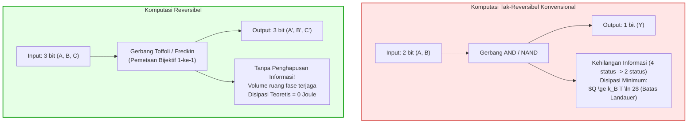
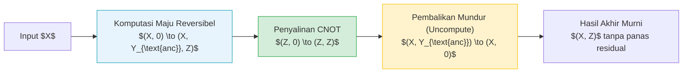

## Pendahuluan: Tembok Termal Superkomputer Modern

Di era komputasi super skala exaflops dan kluster kecerdasan buatan raksasa, konsumsi energi dan pembuangan panas telah menjadi pembatas utama kemajuan arsitektur komputer. Superkomputer mutakhir saat ini mengonsumsi puluhan megawatt daya listrik — setara dengan kebutuhan listrik kota kecil —, dan hampir 100% dari energi tersebut pada akhirnya terbuang ke lingkungan dalam bentuk panas residu. Dengan berakhirnya hukum penskalaan Dennard (Dennard Scaling) dan munculnya fenomena silikon gelap (Dark Silicon), miniaturisasi semikonduktor tidak lagi mampu menekan kerapatan panas yang ekstrem.

Pada persimpangan fisika statistik dan ilmu komputer, sebuah pertanyaan fundamental diajukan:
<strong>Apakah komputer menghasilkan panas karena melakukan komputasi logis, atau karena menghapus informasi fisik secara tidak dapat balik (irreversible)?</strong>

Fisika modern memberikan jawaban revolusioner: <strong>pemrosesan informasi murni secara termodinamika tidak memerlukan batas minimum energi; panas terbuang mutlak timbul karena penghapusan informasi secara tak terbalikkan (Erasure)!</strong> Jika setiap tahapan algoritma dirancang untuk mempertahankan seluruh informasi dan mendukung pembalikan waktu (reversibilitas), maka konsumsi energi teoretis dapat ditekan hingga mendekati nol. Inilah pilar utama dari <strong>komputasi reversibel (Reversible Computing)</strong> dan <strong>termodinamika informasi</strong>.

---

## 1. Landasan Termodinamika: Iblis Maxwell dan Prinsip Landauer

### 1.1 Iblis Maxwell dan Mesin Szilard
Pada tahun 1867, James Clerk Maxwell merancang eksperimen pikiran terkenal tentang sesosok makhluk mikro cerdas yang memilah molekul gas cepat dan lambat tanpa kerja makroskopis, seolah melanggar hukum kedua termodinamika.
Pada tahun 1929, Leo Szilard menyederhanakan fenomena ini menjadi silinder satu molekul dan membuktikan bahwa dengan mengukur posisi molekul (kiri atau kanan), iblis memperoleh <strong>1 bit informasi</strong>, yang dapat diubah menjadi kerja mekanis $W = k_B T \ln 2$. Bertahun-tahun lamanya fisikawan keliru menduga bahwa proses pengamatan itulah yang membuang energi.

### 1.2 Prinsip Landauer (1961)
Rolf Landauer (IBM Research) memecahkan teka-teki ini pada tahun 1961:
<strong>Mengukur informasi dan memprosesnya dapat dilakukan tanpa disipasi energi minimum. Panas secara mutlak dilepaskan saat memori iblis atau komputer direset (Reset ke 0 / Erasure)!</strong>

> <strong>Teorema (Batas Landauer):</strong>
> Ketika menghapus 1 bit informasi fisik secara tak terbalikkan pada suhu mutlak $T$, energi minimum yang harus dilepaskan ke lingkungan sebagai panas $Q_{\text{min}}$ adalah:
> $$Q_{\text{min}} = k_B T \ln 2$$
> dengan $k_B \approx 1{,}3806 \times 10^{-23} \, \text{J/K}$ adalah konstanta Boltzmann. Pada suhu kamar ($T = 300 \, \text{K}$), nilai batas ini sekitar $2{,}87 \times 10^{-21} \, \text{J}$ (~0,018 eV).

Penghapusan bit memadatkan status mikroskopis sistem ($\Delta S_{\text{sys}} = -k_B \ln 2$). Berdasarkan hukum kedua termodinamika ($\Delta S_{\text{total}} \ge 0$), lingkungan wajib menyerap entropi minimal $\Delta S_{\text{ling}} \ge k_B \ln 2$, menghasilkan pelepasan panas $Q = T \Delta S_{\text{ling}} \ge k_B T \ln 2$.

---

## 2. Teorema Bennett dan Siklus Uncomputing

Pada tahun 1973, Charles H. Bennett membuktikan bahwa mesin Turing universal dapat dijalankan secara sepenuhnya reversibel tanpa pernah menghapus bit memori perantara.

### 2.1 Siklus Komputasi Tanpa Panas Residual
Untuk mengatasi penumpukan data perantara (garbage bits), Bennett memperkenalkan siklus tiga tahap:
1. <strong>Komputasi Maju:</strong> Rangkaian reversibel memproses input $X$ menjadi $(X, Y_{\text{sampah}}, Z)$.
2. <strong>Penyalinan Reversibel:</strong> Hasil berguna $Z$ diduplikasi ke register bersih menggunakan gerbang CNOT.
3. <strong>Pembalikan Komputasi (Uncomputing):</strong> Algoritma dijalankan secara terbalik, mengembalikan variabel perantara $Y_{\text{sampah}}$ tepat ke kondisi awal 0.
4. <strong>Kondisi Akhir:</strong> Tersisa hanya input $X$ dan output $Z$, tanpa memori perantara yang terhapus dan tanpa pelepasan panas termal.

---

## 3. Gerbang Logika Reversibel Universal: Toffoli dan Fredkin

### 3.1 Gerbang Toffoli (CCNOT)
Diciptakan oleh Tommaso Toffoli tahun 1980: $(a, b, c) \to (a, b, c \oplus (a \land b))$. Gerbang ini bersifat bijektif dan memetakan status satu-ke-satu. Menetapkan $c=0$ menghasilkan operasi AND; menetapkan $c=1$ menghasilkan NAND, membentuk gerbang universal bagi komputasi klasik reversibel.

### 3.2 Gerbang Fredkin (CSWAP)
Diusulkan oleh Edward Fredkin: menukar dua jalur data ketika bit kontrol bernilai 1. Gerbang ini secara ketat mempertahankan jumlah bit bernilai 1 (bobot Hamming), mencerminkan hukum kekekalan partikel dan muatan dalam fisika.

---

## 4. Realisasi Perangkat Keras: CMOS Adiabatik dan Flukson Superkonduktor

### 4.1 Termodinamika Waktu Terhingga
Batas tanpa disipasi mensyaratkan proses kuasi-statis lambat tak terhingga ($\tau \to \infty$). Pada waktu operasi nyata $\tau$, timbul gesekan dinamis:

$$\langle Q \rangle \ge k_B T \ln 2 + \frac{C}{\tau}$$

Oleh karena itu, arsitektur reversibel memanfaatkan paralelisasi masif pada frekuensi clock moderat demi meminimalkan produk energi-tundaan (Energy-Delay Product / EDP).

### 4.2 Sirkuit CMOS Adiabatik
Sirkuit CMOS konvensional membuang energi $\frac{1}{2} C_L V_{DD}^2$ setiap pengisian kapasitor. Sebaliknya, logika adiabatik menggunakan catu daya osilasi bertahap (Power-Clocks). Dengan waktu pengisian $T_{\text{charge}} \gg R C_L$, disipasi energi turun menjadi:

$$E_{\text{diss}} = \frac{R C_L}{T_{\text{charge}}} C_L V_{DD}^2$$

Muatan dipulihkan kembali (Energy Recovery) saat pembuangan, menekan kehilangan energi hingga lebih dari 99%.

### 4.3 Logika Flukson Superkonduktor
Pada suhu helium cair (4,2 K), sambungan Josephson memanipulasi kuanta fluks magnetik $\Phi_0 = h/2e$ tanpa resistansi listrik. Transisi logika terjadi pada energi jauh di bawah batas Landauer suhu ruang, membuka era superkomputer hijau masa depan.

---

## 5. Kesimpulan: Informasi Adalah Fisik

Sebagaimana dicanangkan Rolf Landauer, "Information is Physical". Pemrosesan komputasi bukanlah abstraksi tanpa raga, melainkan lintasan fisika dinamis dalam ruang fase mikroskopis. Menguasai komputasi reversibel adalah kunci fundamental untuk melampaui batas termal silikon konvensional menuju peradaban komputasi masa depan.
