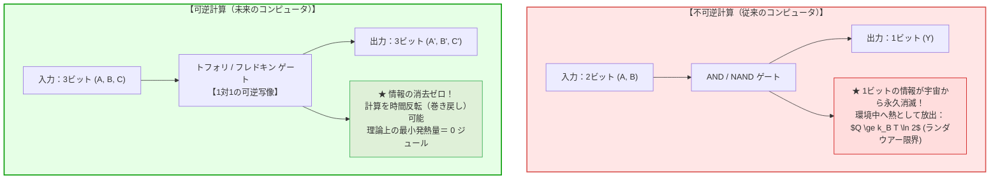
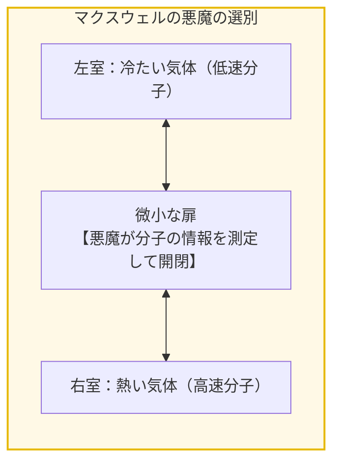
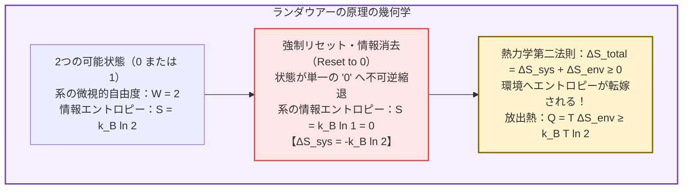
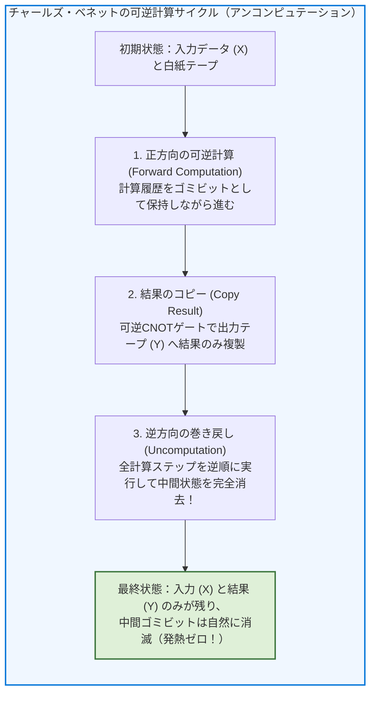
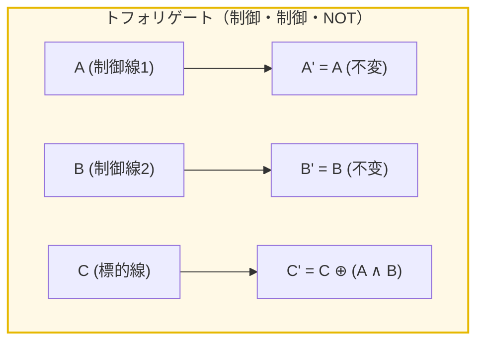
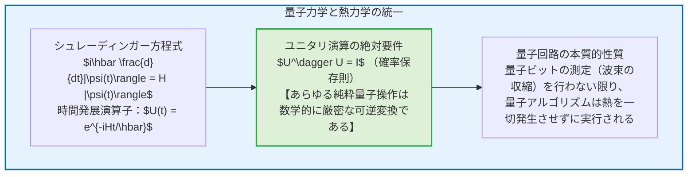
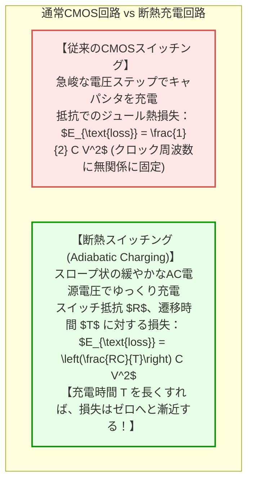
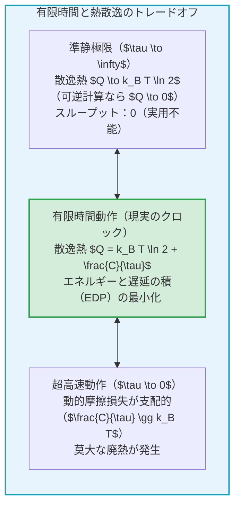
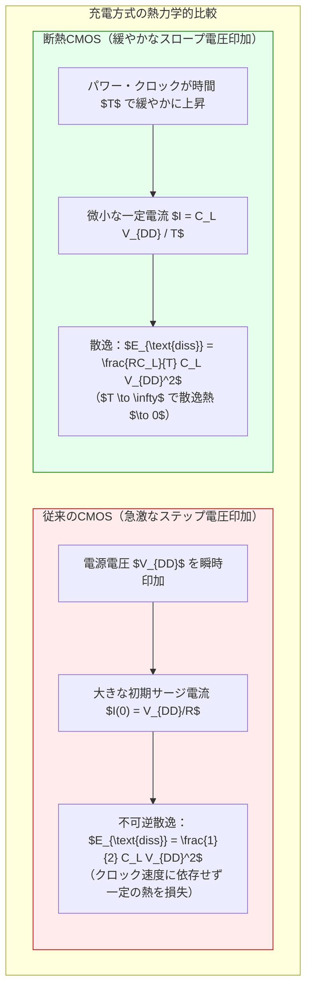
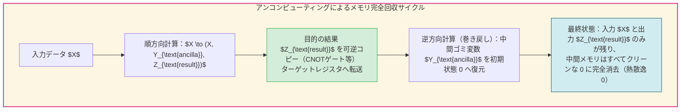

## 序論：スーパーコンピュータを焼き尽くす「熱の壁」

人工知能の巨大化、天候シミュレーション、創薬スクリーニング――現代文明の繁栄は、桁外れの計算能力によって支えられています。しかし、最先端のデータセンターやスーパーコンピュータの現場に足を踏み入れたとき、耳をつんざくような冷却ファンの爆音とともに私たちを圧倒するのは、プロセッサが放つ凄まじい<strong>「廃熱」</strong>の嵐です。

現代の最高峰スーパーコンピュータは、1台で数十メガワット――地方の小都市数万世帯分に匹敵する電力を消費し、その電力のほぼ100%が最終的に熱となって環境中へと捨てられています。半導体の微細化が進んでも消費電力が下がらなくなる「デナードスケーリング（Dennard Scaling）の崩壊」以降、チップの一部しか同時に通電できない「ダークシリコン（Dark Silicon）」問題が立ちはだかり、コンピュータの性能向上は物理的な<strong>「熱の壁」</strong>に衝突しました。



ここで、物理学と情報科学の境界領域に立つ理論家たちは、直観に反する根源的な問いを投げかけました：

<strong>「そもそも、コンピュータは『計算すること』によって熱を出しているのか？ それとも『別のこと』が熱を生んでいるのか？」</strong>
<strong>「もし計算の全工程を1ビットも漏らさずに『時間を巻き戻せる（可逆）』ように設計したなら、コンピュータの消費エネルギーを理論上ゼロにできるのではないか？」</strong>

この驚くべき問いから誕生したのが、<strong>情報熱力学（Information Thermodynamics）</strong>と<strong>可逆計算（Reversible Computing）</strong>の理論です。
本稿では、マクスウェルの悪魔のパラドックスから、物理学の金字塔である<strong>ランダウアーの原理</strong>、チャールズ・ベネットが証明した「ゼロエネルギー計算」の数学的構造、トフォリゲートやビリヤードボール・コンピュータの力学モデル、そして量子コンピューティングの本質であるユニタリ変換との不可分な関係までを徹底的に解き明かします。

---

## 1. 情報熱力学の夜明け：マクスウェルの悪魔とランダウアーの閃き

### 1.1 1867年：熱力学第二法則を破る「小悪魔」の亡霊
熱力学第二法則（エントロピー増大の法則）は、自然界において熱は自発的に高温から低温へと移動し、閉じた孤立系の乱雑さ（エントロピー）は決して減少しないと教えています。
しかし1867年、スコットランドの大物理学者<strong>ジェームズ・クラーク・マクスウェル（James Clerk Maxwell）</strong>は、この絶対的な物理法則に挑戦する思考実験を考案しました。これが有名な<strong>「マクスウェルの悪魔（Maxwell's Demon）」</strong>です。

中央に小さな扉のある仕切りで区切られた気体容器を考えます。仕切りの扉の前に、気体分子の個々の速度を見極めることができる微小な知性（悪魔）が立っています。
悪魔は、左側から高速の分子（熱い分子）が来たら扉を開けて右へ通し、低速の分子（冷たい分子）が来たら扉を閉めて左に留めます。
この選別を繰り返すと、外から何らの仕事も加えることなく、右室は熱く、左室は冷たくなり、温度差（エネルギーを取り出せる状態）が自発的に生じてしまいます。これは熱力学第二法則の明白な違反に見えました。



### 1.2 レオ・シラードの1分子熱機関と情報のエントロピー
1929年、物理学者レオ・シラード（Leo Szilard）は、マクスウェルの悪魔を1個の分子だけを含むシリンダーへと極限まで単純化しました。
シラードは、悪魔が「分子がシリンダーの左半分にいるか、右半分にいるか」という<strong>1ビットの客観的情報</strong>を獲得することによって、熱を仕事へと変換できることを数理的に示しました。

しかし、なぜ悪魔は熱力学第二法則を破ることができないのか？
物理学者たちは半世紀以上にわたり、「悪魔が分子の速度や位置を測定（光を当てて観察）するときに熱エネルギーを消費しているのだろう」と信じていました。
しかし、その説明は完全に間違っていたのです。

### 1.3 1961年：ロルフ・ランダウアーの金字塔
1961年、IBMトーマス・J・ワトソン研究所の物理学者<strong>ロルフ・ランダウアー（Rolf Landauer, 1927–1999）</strong>は、科学史を永遠に変える論文「不可逆性と散逸熱の発生（Irreversibility and Heat Generation in the Computing Process）」を発表しました。

ランダウアーは喝破しました：
<strong>「情報を『測定』することにも、『計算』することにも、熱力学的な最小エネルギー消費は存在しない。真に熱を発生させているのは、悪魔の頭の中（メモリ）にある情報を【消去（Erasure）】する瞬間なのだ！」</strong>

これが物理学における<strong>「ランダウアーの原理（Landauer's Principle）」</strong>です。



> <strong>定理（ランダウアーの原理）：</strong>
> どのような物理的実装であれ、1ビットの情報を不可逆的に消去（Reset）するとき、温度 $T$ の環境中に散逸しなければならない熱エネルギー $Q_{\text{min}}$ は、以下の下限値を下回ることはできない：
> 
> $$Q_{\text{min}} = k_B T \ln 2$$
> 
> ここで $k_B = 1.380649 \times 10^{-23} \ \text{J/K}$ はボルツマン定数、$\ln 2 \approx 0.69315$ である。

室温（$T = 300\text{K} \approx 27^\circ\text{C}$）において、このエネルギー限界を数値計算すると：

$$Q_{\text{min}} \approx (1.38 \times 10^{-23}) \times 300 \times 0.693 \approx \mathbf{2.87 \times 10^{-21} \ \text{ジュール} \ (約 0.0178 \ \text{eV})}$$

この数値は極めて小さく見えます。しかし、現代のプロセッサ内部で1秒間に何十兆回ものビット消去が繰り返されたとき、このミクロな熱力学的限界はマクロなメガワットの熱の壁となって立ち現れるのです。
悪魔がサイクルを完了して最初の白紙の状態に戻るためには、必ず記憶した1ビットを消去しなければならず、その瞬間に逃げ場のない熱が環境へ吐き出され、熱力学第二法則は見事に守られていたのです。

---

## 2. 不可逆計算の罪：なぜ従来の論理ゲートは熱を生むのか？

現在私たちが使っているすべてのCPUやGPUは、<strong>論理的に不可逆な演算（Logically Irreversible Operations）</strong>の上に構築されています。

### 2.1 ANDゲートの情報破壊
例として、デジタル回路の最も基本的な構成要素である <strong>ANDゲート</strong> を観察してみましょう。

$$\begin{array}{|c|c||c|}
\hline
\text{入力 } A & \text{入力 } B & \text{出力 } Y = A \land B \\
\hline
0 & 0 & 0 \\
0 & 1 & 0 \\
1 & 0 & 0 \\
1 & 1 & 1 \\
\hline
\end{array}$$

ANDゲートは、2ビットの入力を受け取って、1ビットの出力を返します。
いま、ANDゲートの出力が <strong>`0`</strong> であったとします。この出力結果 `0` だけを手渡された観測者は、元の入力 $(A, B)$ が `(0,0)`、`(0,1)`、`(1,0)` の3つのうちどれであったかを、後から特定することは論理的に絶対に不可能です！

<strong>「2ビットあった入力の自由度が、演算によって1ビットへと押し潰され、1ビット分の過去の記憶が宇宙から消滅した」</strong>のです。
この消去された1ビットの情報が、ランダウアーの原理に従って、熱力学的エントロピーとして回路のシリコン格子振動（フォノン）へと転換され、熱となって放射されます。

同様の不可逆性は、ORゲート、NANDゲート、XORゲートなど、入力ビット数が出力ビット数よりも多い（あるいは多対一写像である）すべての古典的ゲートに共通する宿命です。

---

## 3. チャールズ・ベネットの革命：計算の完全な巻き戻し

「計算とは、情報を処理・圧縮することなのだから、熱が出るのは不可避の物理法則なのだろう」
世界中の科学者たちがそう諦めていた1973年、ランダウアーの同僚であったIBMの若き物理学者<strong>チャールズ・ベネット（Charles H. Bennett）</strong>が、物理学界と情報科学界に激震を走らせる歴史的論文を発表しました。

> <strong>ベネットの定理（1973）：</strong>
> あらゆる古典的なチューリング計算は、情報を1ビットも消去することなく、<strong>完全に可逆な操作のみによって実行可能</strong>である。
> したがって、計算プロセスそのものには<strong>熱力学的なエネルギー消費の下限は存在せず、原理的にはゼロエネルギーで計算を行うことができる</strong>。



### 3.1 アンコンピュテーション（Uncomputation）の奇跡
ベネットのアイデアは驚くほど優美でした。
可逆計算を行おうとすると、過去を復元するために途中の計算過程（中間結果）をすべて「ゴミビット（Garbage bits）」としてメモリに残し続けなければなりません。しかし、ゴミビットがメモリを埋め尽くしてしまえば、いつかはそれを消去しなければならず、結局その消去の瞬間にランダウアーの熱が発生してしまいます。

そこでベネットは、<strong>「アンコンピュテーション（Uncomputation: 逆計算）」</strong>と呼ばれる3段階のプロセスを編み出しました：

1. <strong>順方向の計算（Forward Computation）：</strong>
   可逆論理ゲートのみを用いて計算を前進させます。この段階では情報は一切消去されず、中間状態はすべて保持されます。
2. <strong>結果の安全なコピー（Copying the Result）：</strong>
   最終的に得られた解を、可逆なコピーゲート（制御NOTゲートなど）を用いて、独立した白紙の出力テープへと安全に転写します。
3. <strong>完全な巻き戻し（Uncomputation）：</strong>
   ここが天才的な飛躍です。今度は、ステップ1で行ったすべての演算を、<strong>時間を完全に逆回転させるように後ろから前へと逆実行</strong>します！

逆実行を進めると、中間状態のゴミビットたちは次々と綺麗に解消され、最終的にシステムは<strong>「最初の入力データ」と「得られた最終結果」だけを残して、何ひとつゴミを残さずに完全に初期状態へと巻き戻ります</strong>。

この全サイクルにおいて、情報の不可逆的な消去は1回も行われていません。すべての物理的状態変化が1対1の可逆写像であるため、熱力学的なエントロピーの放出はゼロのまま、計算結果だけを取り出すことができるのです！

---

## 4. 可逆論理ゲートの数学と物理モデル

可逆計算を実現するためには、入力と出力が常に<strong>1対1の全単射（Bijection）</strong>であり、過去と未来を双方向に行き来できる特殊な論理ゲートが必要です。

### 4.1 トフォリゲート（Toffoli Gate / CCNOT）
1980年、トマソ・トフォリ（Tommaso Toffoli）によって考案された<strong>トフォリゲート</strong>は、3ビット入力・3ビット出力の可逆論理ゲートであり、<strong>これ単体で任意の古典的論理計算を構築できる「万能可逆ゲート（Universal Reversible Gate）」</strong>です。



- 入力 $A$ と $B$ は「制御ビット」であり、そのまま出力されます（$A' = A, B' = B$）。
- 第3のビット $C$ は、<strong>$A=1$ かつ $B=1$ のときだけビット反転</strong>されます（$C' = C \oplus (A \land B)$）。
- 逆向きに同じトフォリゲートを通せば、まったく同じ式によって元の入力 $(A, B, C)$ が完全に復元されます（自己逆演算性：$T = T^{-1}$）。
- 第3ビット $C$ をあらかじめ `0` に固定しておけば、出力 $C'$ には純粋な $A \land B$（AND）が得られます。つまり、トフォリゲートは情報の可逆性を一切損なうことなく、従来のAND演算を包含できるのです。

### 4.2 フレドキンゲート（Fredkin Gate / CSWAP）
エドワード・フレドキン（Edward Fredkin）が考案した<strong>フレドキンゲート（制御スワップゲート）</strong>もまた、万能な可逆論理ゲートです。

- 第1ビット $A$ が `0` ならば、第2・第3ビットはそのまま出力されます（$B' = B, C' = C$）。
- 第1ビット $A$ が `1` ならば、<strong>第2ビットと第3ビットがスワップ（交換）</strong>されます（$B' = C, C' = B$）。

フレドキンゲートの極めて魅力的な物理的特徴は、<strong>「入力の 1 の総数と、出力の 1 の総数が常に完全に等しい（保存則：Conservative Logic）」</strong>という点です。これは、電子の数や光子の数が計算の前後で厳密に保存される物理システムと完璧に調和します。

### 4.3 ビリヤードボール・コンピュータ（古典力学的実装）
フレドキンとトフォリは1982年、完全に摩擦のない理想的な平面上で、硬球（ビリヤードの球）が互いに完全弾性衝突する様子をモデル化した<strong>「ビリヤードボール・コンピュータ（Billiard-Ball Computer）」</strong>を発表しました。

球が存在することを「1」、存在しないことを「0」と定義します。球が軌道を進み、互いに衝突して軌道を変える幾何学的プロセスそのものが論理演算となり、鏡による反射が遅延素子となります。
ニュートンの運動方程式は時間反転対称性（$t \to -t$）を持つため、すべての球の速度ベクトルを逆転させれば、計算は完全な弾性衝突を逆回しにして初期状態へと戻ります。一切の熱摩擦なしに力学法則だけでチューリング完全な計算ができることが、物理モデルとして証明されたのです。

---

## 5. 量子コンピューティングへの架橋：ユニタリ性と可逆性の本質

現代において、可逆計算が最も純粋な形で現実のものとなっている領域、それこそが<strong>量子コンピューティング（Quantum Computing）</strong>です。



### 5.1 量子ゲートは必然的にすべて可逆である
量子力学の最も根源的な公理の一つに、孤立した量子系の時間発展は<strong>ユニタリ変換（Unitary Transformation）</strong>でなければならないという要件があります。
演算子 $U$ がユニタリであるとは、エルミート共役 $U^\dagger$ との積が恒等演算子になること（$U^\dagger U = I$）を意味し、これは<strong>「いかなる量子操作も、その逆演算 $U^\dagger$ が必ず一意に存在し、過去を完全に復元できる」</strong>ことを意味します。

量子コンピュータの基本ゲートであるアダマールゲート（H）、パウリX/Y/Zゲート、CNOTゲート、トフォリゲートは、例外なくすべてユニタリ行列であり、本質的に完璧な可逆ゲートです。
量子プログラミング言語（QiskitやCirqなど）でコードを書く際、プログラマが日常的に「アンコンピュート（Uncompute）」のステップを挿入しなければならないのは、まさにチャールズ・ベネットが示した可逆計算の物理的要請そのものなのです。

---

## 6. 現実世界の工学的挑戦：断熱回路と超伝導ロジック

「可逆計算が理論上熱を出さないのは分かった。しかし、それは現実のシリコンチップの上で役に立つのか？」
この問いに対して、エレクトロニクス工学の最前線では<strong>断熱回路（Adiabatic Circuits）</strong>や<strong>超伝導論理回路</strong>という形で実装が進められています。



### 6.1 断熱スイッチング（Adiabatic Switching）の数理
従来のCMOS回路では、ゲート容量 $C$ を電源電圧 $V$ で充電するたびに、トランジスタの内部抵抗によって $\frac{1}{2} C V^2$ のエネルギーが必ずジュール熱として熱に化けます。

しかし、電源として平坦なDC電圧ではなく、ゆっくりとした台形波や正弦波のAC電源を用い、トランジスタのオン・オフを両端の電圧差がゼロに近い状態（ソフトスイッチング）で行うと、消費エネルギーは次式に従います：

$$E_{\text{loss}} = \left(\frac{RC}{T}\right) C V^2$$

ここで $T$ はクロックの遷移時間です。
驚くべきことに、<strong>スイッチング時間 $T$ を回路の時定数 $RC$ よりも十分に長く（ゆっくり）取れば取るほど、消費エネルギー $E_{\text{loss}}$ はどこまでもゼロに近づけることができる</strong>のです！

### 6.2 2012年：ランダウアー限界の実験的実証
ランダウアーの原理は長年、理論上の仮説とみなされていましたが、2012年にフランスのENSリヨンを中心とする研究チームが学術誌『Nature』に発表した実験によって、ついに実験的に完全実証されました。

研究チームは、集光レーザー光の焦点（光ピンセット）によって生じる二重井戸ポテンシャルの中に、直径2マイクロメートルのシリカ微粒子を1個だけトラップしました。微粒子が左の井戸にあれば「0」、右の井戸にあれば「1」とみなします。
レーザーの障壁をゆっくりと制御し、粒子をどちらの井戸からであっても強制的に右の井戸（状態0）へとリセットする「1ビットの不可逆消去」を行いました。
その結果、周囲の流体に放出された熱量を測定したところ、<strong>消去速度を無限に遅くした極限において、放出熱がぴったり $k_B T \ln 2$ に漸近することが確認された</strong>のです。情報とは抽象的な概念ではなく、熱力学の法則に縛られた冷厳な物理的実体であることが、ナノスケールの実験で証明された瞬間でした。

---

## 7. 結論：時間を巻き戻すコンピュータが切り拓く極限の未来

「計算を巻き戻せば、消費エネルギーを減らせるのか？」
この問いに対する現代物理学の最終回答は、揺るぎない<strong>「YES」</strong>です。

熱を発生させていたのは、演算そのものの代償ではなく、私たちが使い終わった過去の記憶を無造作にゴミ箱へ捨てていた（消去していた）ことに対する、熱力学の冷厳な罰金だったのです。

計算を前進させ、結果を得て、そして中間状態をエレガントにアンコンピュートして元に戻す――この「時間を可逆に行き来するコンピュータ」という先人たちの夢想は、量子コンピュータの基盤として花開き、さらには深宇宙探査機や未来の極限省電力AIアクセラレータの究極の設計指針として具現化しつつあります。

情報とは何か。計算とは何か。そしてエントロピーとは何か。
ビットの消去という微小な現象の向こう側に、熱力学第二法則の崇高な調和が広がっています。


---

## 7. 有限時間熱力学と実世界ハードウェア：断熱CMOSから超伝導可逆回路まで

### 7.1 有限時間ランダウアー限界：なぜ現実の計算は「無限の遅さ」を待てないのか
ランダウアーの原理における $Q_{\text{min}} = k_B T \ln 2$ という限界値、およびベネットの可逆計算による発熱量ゼロという結論は、系が常に熱平衡を保ちながら無限の時間をかけて準静的（quasi-static）に変化することを仮定しています。
しかし、現実のコンピュータにおいて「1回の演算に無限の時間をかける」ことは不可能です。クロック周波数が有限である以上、系は必ず非平衡状態を経て動作します。

現代の<strong>有限時間熱力学（Finite-Time Thermodynamics）</strong>および<strong>確率論的熱力学（Stochastic Thermodynamics）</strong>では、有限の動作時間 $\tau$ における散逸エネルギーの下限が精力的に研究されています。
微視的ランジュバン方程式やフォッカー・プランク方程式に従う熱揺らぎのダイナミクスから、散逸熱 $\langle Q \rangle$ は動作時間 $\tau$ に対して次のような漸近スケーリングを示します：

$$\langle Q \rangle \ge k_B T \ln 2 + \frac{C}{\tau} + \mathcal{O}\left(\frac{1}{\tau^2}\right)$$

ここで係数 $C$ は、ポテンシャル障壁の形状や系の散逸摩擦係数、情報幾何学における熱力学的長さ（Thermodynamic Length）によって決定される定数です。
この $1/\tau$ に比例する散逸項は、まさに自動車のブレーキ摩擦や流体抵抗と同様の「動的摩擦損失」です。



このトレードオフは、可逆計算の実装において<strong>エネルギー遅延積（Energy-Delay Product, EDP）</strong>をいかに極小化するかという工学的至上命題へと直結します。
高速に動作させれば動的散逸が増大し、低速に動作させれば理論限界のゼロ発熱に近づく。可逆アーキテクチャの真価は、超並列・高密度集積によって動作クロックを抑えつつ、総スループットを維持する設計パラダイムにあります。

### 7.2 断熱CMOS（Adiabatic CMOS）ロジックの動作原理
従来の標準的なCMOSインバータ回路では、負荷容量 $C_L$ のキャパシタを電源電圧 $V_{DD}$ まで充電する際、電源から供給されるエネルギー $C_L V_{DD}^2$ のうち、半分（$\frac{1}{2} C_L V_{DD}^2$）がP型MOSFETのチャネル抵抗によって熱として散逸し、放電時にも残りの半分がN型MOSFETの抵抗によってグラウンドへと放熱されます。

これに対し、<strong>断熱CMOS（Adiabatic Logic）</strong>では、直流電源の代わりに、台形波や正弦波状にゆっくりと立ち上がり立ち下がる振動電源（パワー・クロック）を使用します。
抵抗 $R$ のトランジスタスイッチを通じて、時間 $T_{\text{charge}}$ をかけて一定電流でキャパシタを充電する場合、トランジスタで消費される熱エネルギー $E_{\text{diss}}$ は以下のように導出されます：

$$I(t) = \frac{C_L V_{DD}}{T_{\text{charge}}}$$

$$E_{\text{diss}} = \int_0^{T_{\text{charge}}} I^2(t) R \, dt = R \left(\frac{C_L V_{DD}}{T_{\text{charge}}}\right)^2 T_{\text{charge}} = \frac{R C_L}{T_{\text{charge}}} \cdot C_L V_{DD}^2$$

従来の充電損失 $\frac{1}{2} C_L V_{DD}^2$ と比較すると、係数 $\frac{2 R C_L}{T_{\text{charge}}}$ が掛かっています。
トランジスタのRC時定数 $\tau_{RC} = R C_L$ に対して、充電時間 $T_{\text{charge}}$ を十分に大きく（すなわち断熱的に、ゆっくりと）取れば、充電損失を理論上いくらでもゼロに近づけることができます。

さらに放電フェーズにおいても、電荷を単純にグラウンドへ捨ててショートさせるのではなく、立ち下がるパワー・クロック電源へ電荷を「回収（Energy Recovery）」して再利用します。
代表的な回路方式として、以下のアーキテクチャが開発されています：
1. <strong>2N-2N2P回路</strong>：差動クロス結合ラッチを用い、電荷の完全回収を目指す断熱論理ゲート。
2. <strong>SCRL（Split-Level Charge Recovery Logic）</strong>：MITのヨンス・ナイトらによって提案された完全可逆な電荷回収論理回路。すべてのノード間の電位差が微小な状態でスイッチングを行い、従来の1/100から1/1000の電力消費を達成。



### 7.3 超伝導可逆流束ロジック（Superconducting Reversible Flux Logic）
半導体CMOSの断熱動作には、シリコンのバンドギャップやサブスレッショルドリーク電流という物理的限界が存在します。
そこで近年、ゼロ抵抗の超伝導現象とジョセフソン接合を利用した<strong>可逆磁束ロジック（Reversible Fluxon Logic / nSQUID）</strong>が注目を集めています。

超伝導量子干渉素子（SQUID）の超伝導ループ内に保持される磁束量子 $\Phi_0 = \frac{h}{2e} \approx 2.07 \times 10^{-15} \, \text{Wb}$ を1ビットの情報単位として用いることで、電気抵抗による熱発生をゼロに抑えたまま、磁束のポテンシャル形状を断熱的に変形させて可逆ゲート（トフォリゲートやシフトレジスタ）を駆動できます。
横浜国立大学などの実験グループは、超伝導可逆ゲートにおいて、動作あたりの散逸エネルギーがランダウアー限界 $k_B T \ln 2$ を大きく下回る領域に達することを実証し、未来のエクサスケール・超伝導スパコンの基礎技術として世界的な注目を浴びています。

---

## 8. 可逆プログラミング言語とガベージコレクションの理論

物理的な可逆ハードウェアが存在しても、従来の命令型プログラミング言語（C言語やPythonなど）は「上書き代入（Destructive Assignment）」を前提としており、論理的に不可逆です。
可逆計算を実行するためには、アルゴリズムの設計思想そのものを「情報の完全保存」に基づいて再構築しなければなりません。

### 8.1 可逆プログラミング言語 Janus の設計原理
1986年にルッツ（Lutz）によって提唱された<strong>Janus（ヤヌス）</strong>は、すべての文が時間反転可能な純粋可逆プログラミング言語です。
Janusの最大の特徴は、変数への代入構文が「上書き」ではなく、<strong>「可逆更新演算子」</strong>として定義されている点です：

```text
x += y;   // x に y を加算（逆実行時は x -= y で完全に復元可能）
x ^= y;   // x に y をXOR（逆実行時も x ^= y で完全に復元可能）
```

変数を単純に定数で上書きする代入 `x = 5;` はJanusでは文法エラーとなります。古い `x` の値が失われてしまうからです。

また、制御構文である条件分岐 `if-then-else` やループ `from-until` も、時間反転時にどちらの分岐を通ったかを一意に判定できるように設計されています：

```text
if <condition1> then
    <statements1>
else
    <statements2>
fi <condition2>   // 実行終了後に状態を判定するアサーション
```

分岐を抜ける際のアサーション条件 `condition2` によって、逆方向からプログラムを実行したときにも、どちらのブロックを巻き戻せばよいかが決定論的に復元されます。

### 8.2 可逆ガベージコレクション：ベネットのアンコンピューティングとペブルゲーム
可逆プログラムを実行すると、中間ステップの計算結果がメモリ内に蓄積されていきます。不可逆なコンピュータであれば「メモリ解放（free）」によって消去できますが、可逆コンピュータでは消去が許されません。
ここで不可欠となるのが、ベネットが提唱した<strong>「計算の巻き戻し（Uncomputing）」</strong>によるガベージクリーンアップです。



この「どこで計算を保存し、どこで巻き戻すか」というメモリと計算ステップの最適化問題は、グラフ上の<strong>「ペブルゲーム（Pebble Game）」</strong>として数学的に定式化されています。
計算グラフの各ノードに変数を保持するペブルを置く際、メモリ容量（ペブルの最大個数 $S$）と実行時間（ステップ数 $T$）の間には厳密なトレードオフが存在し、一般の有向非巡回グラフ（DAG）において最小メモリで可逆計算を実行するスケジューリングはPSPACE完全問題となることが証明されています。

---

## 9. 結論：宇宙の熱的死と計算の究極の地平

情報熱力学と可逆計算の旅は、私たちに極めて重大な哲学的・物理学的洞察をもたらしました。

1. <strong>情報は抽象概念ではなく、物理的実体である（Information is Physical）：</strong>
   ビットは紙の上の記号ではなく、分子の配置、磁束量子の向き、電子のスピンとして空間に局所化された物理系です。ビットを消去することは、宇宙の微視的位相空間の体積を圧縮することであり、その代償として周囲の環境へエントロピーを熱として排出しなければなりません。
2. <strong>計算の本質は不可逆ではない：</strong>
   私たちは長年、計算とは「複雑な入力を単純な出力へと圧縮する不可逆な行為」であると誤解してきました。しかし、トフォリ、フレドキン、ベネット、ファインマンが証明したように、チューリング完全な任意のアルゴリズムは、1ビットのエントロピーも捨てることなく、完全に時間反転対称な力学系として実行可能です。
3. <strong>量子コンピュータの基盤：</strong>
   量子コンピューティングにおける閉じた系の時間発展は、シュレーディンガー方程式に従うユニタリ変換（可逆写像）そのものです。量子回路がすべて可逆ゲートによって構成されているのは偶然ではなく、情報熱力学の要請そのものなのです。

データセンターが世界の総発電量の数パーセントを貪り食う現代において、可逆計算は単なる「理論物理学の美しいおもちゃ」ではありません。
それは、デナードスケーリングの終焉を超え、超伝導量子ロジックや断熱CMOSを通じて、熱の壁に直面した情報社会が到達すべき<strong>「究極のエネルギー効率の地平」</strong>を示しているのです。

計算を巻き戻すこと――それは、宇宙のエントロピー増大に抗い、最小の熱的代償で知性を紡ぎ出すための、物理学が人類に授けた最大のギフトなのです。
