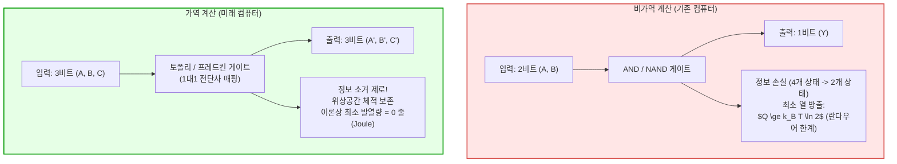
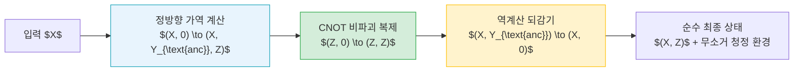

## 서론: 슈퍼컴퓨터를 불태우는 열의 장벽과 물리적 한계

인공지능의 거대화와 엑사스케일 고성능 컴퓨팅(HPC)이 고도화됨에 따라 전력 소비와 발열 문제는 현대 컴퓨터 공학의 절대적인 병목으로 부상했습니다. 첨단 데이터센터와 슈퍼컴퓨터는 중소 도시 수만 가구에 필적하는 수십 메가와트의 전력을 소비하며, 공급된 전력의 거의 100%가 궁극적으로 막대한 폐열로 전환되어 환경으로 방출됩니다. 데너드 스케일링(Dennard Scaling)의 붕괴와 칩의 일부만을 동시에 켤 수 있는 다크 실리콘(Dark Silicon) 현상으로 인해, 반도체 미세화만으로는 더 이상 프로세서의 단위 면적당 열 밀도를 낮출 수 없는 물리적 장벽에 부딪혔습니다.

그렇다면 컴퓨터는 근본적으로 "계산을 수행하기 때문"에 열을 발생하는 것일까요, 아니면 "정보를 비가역적으로 지우기 때문"에 열을 뿜어내는 것일까요?

물리학과 정보이론의 교차점에서 학자들은 직관을 뒤흔드는 결론에 도달했습니다: <strong>"계산 그 자체는 열역학적으로 에너지를 필연적으로 소비하지 않는다. 불가피한 열 방출을 유발하는 것은 바로 물리 정보의 '소거(Erasure)'이다!"</strong>
계산의 모든 과정을 단 1비트의 정보 손실도 없이 시간 반전이 가능한 가역(Reversible) 매핑으로 설계한다면, 이론적인 최소 에너지 소비를 0으로 만들 수 있습니다. 이것이 바로 <strong>가역 계산(Reversible Computing)</strong>과 <strong>정보 열역학(Information Thermodynamics)</strong>의 핵심 원리입니다.

---

## 1. 정보 열역학의 기초: 맥스웰의 악마와 란다우어 원리

### 1.1 맥스웰의 악마와 실라르드의 단분자 열기관
1867년 제임스 클러크 맥스웰은 열역학 제2법칙(엔트로피 증가의 법칙)을 시험하기 위해 기체 분자의 속도를 관찰하고 칸막이 문을 열고 닫아 고속 분자와 저속 분자를 자발적으로 분리하는 지적 존재, 즉 '맥스웰의 악마(Maxwell's Demon)'를 고안했습니다. 외부에 일을 하지 않고도 온도 차이를 생성하는 이 역설은 물리학계를 오랫동안 혼란에 빠뜨렸습니다.

1929년 레오 실라르드(Leo Szilard)는 이를 단일 분자 실린더 모델로 단순화하여, 악마가 분자의 좌우 위치라는 <strong>1비트의 객관적 정보</strong>를 측정함으로써 $k_B T \ln 2$의 역학적 일을 추출할 수 있음을 보였습니다. 오랫동안 물리학자들은 악마가 분자를 '측정'할 때 빛을 비추는 과정에서 에너지가 소모된다고 믿었으나, 이는 사실이 아니었습니다.

### 1.2 란다우어의 원리 (Landauer's Principle)
1961년 IBM 연구소의 롤프 란다우어(Rolf Landauer)는 《계산 과정에서의 비가역성과 열 발생》이라는 논문을 통해 패러다임을 혁명적으로 바꾸었습니다.
<strong>"정보를 측정하거나 처리하는 과정에는 근본적인 열역학적 최소 한계가 없다. 열이 필연적으로 발생하는 순간은 바로 악마의 두뇌(메모리)에 저장된 정보를 지우는(Reset to 0) 순간이다!"</strong>

> <strong>정리 (란다우어 한계):</strong>
> 절대온도 $T$의 열역학적 환경에서 1비트의 물리적 정보를 비가역적으로 소거할 때, 환경으로 방출되어야 하는 최소 열에너지 $Q_{\text{min}}$는 다음과 같습니다:
> $$Q_{\text{min}} = k_B T \ln 2$$
> 여기서 $k_B \approx 1.3806 \times 10^{-23} \, \text{J/K}$는 볼츠만 상수입니다. 상온(300 K)에서 이 값은 약 $2.87 \times 10^{-21} \, \text{J}$ (약 0.018 eV)에 해당합니다.

정보 엔트로피가 감소($\Delta S_{\text{sys}} = -k_B \ln 2$)함에 따라, 열역학 제2법칙($\Delta S_{\text{total}} \ge 0$)을 만족하기 위해 시스템은 반드시 환경으로 $Q = T \Delta S_{\text{env}} \ge k_B T \ln 2$의 열을 방출하여 환경 엔트로피를 증가시켜야만 하는 물리적 필연성입니다.

---

## 2. 베넷의 가역 튜링 기계와 언컴퓨팅(Uncomputing)

1973년 찰스 베넷(Charles H. Bennett)은 결정적인 해법을 제시했습니다: <strong>"정보를 소거하지 않는 가역적 알고리즘을 사용한다면, 튜링 완전한 임의의 계산을 열 방출 제로로 수행할 수 있다!"</strong>

### 2.1 기존 논리 게이트의 정보 파괴성
기존의 AND 게이트는 2비트 입력 중 $(0,0), (0,1), (1,0)$의 3가지 조합이 모두 출력 $0$으로 매핑됩니다. 결과가 $0$일 때 원래 입력이 무엇이었는지 복원할 수 없으며, 1비트의 정보가 영구 파괴되어 란다우어 열을 방출합니다.

### 2.2 계산-복사-역계산 (Compute-Copy-Uncompute)
베넷은 메모리에 쓰레기 정보(Garbage Bits)가 무한히 쌓이는 문제를 해결하기 위해 삼단계 가역 사이클을 증명했습니다:
1. <strong>정방향 가역 계산:</strong> 입력 $X$로부터 가역 게이트망을 통해 중간 보조 변수 $Y_{\text{ancilla}}$와 결과 $Z$를 생성: $(X, 0, 0) \to (X, Y_{\text{ancilla}}, Z)$.
2. <strong>결과 복제 (CNOT):</strong> 비파괴적인 CNOT 연산자를 통해 결과 $Z$를 클린 레지스터로 복사.
3. <strong>역계산 (Uncomputing):</strong> 계산 과정을 역방향으로 완벽하게 되감아(Time-Reversal) 중간 보조 레지스터 $Y_{\text{ancilla}}$를 초기 상태 $0$으로 복원.
4. <strong>결과:</strong> 어떠한 비가역적 메모리 소거도 없이 입력 $X$와 정답 $Z$만을 남기며, 폐열 방출은 이론상 0이 됩니다.

---

## 3. 만능 가역 논리 게이트: 토폴리와 프레드킨 게이트

가역 계산을 구성하는 대표적인 기본 빌딩 블록은 다음과 같습니다:

### 3.1 토폴리 게이트 (Toffoli Gate / CCNOT)
토마소 토폴리가 제안한 3입력 3출력 게이트로, $(a, b, c) \to (a, b, c \oplus (a \land b))$로 동작합니다.
입력의 모든 조합이 출력과 일대일 대응을 이루며, 보조 입력 $c=0$으로 고정하면 AND 게이트를 가역적으로 구현할 수 있어 고전 논리의 모든 계산을 표현할 수 있는 만능 게이트(Universal Gate)입니다.

### 3.2 프레드킨 게이트 (Fredkin Gate / CSWAP)
에드워드 프레드킨이 제안한 보존 논리(Conservative Logic) 게이트로, 제어 비트가 1일 때 두 데이터 비트를 교환합니다.
프레드킨 게이트는 가역적일 뿐만 아니라, 입력과 출력에서 비트 1의 총 개수가 완벽히 보존(해밍 무게 보존)되는 물리적 보존 법칙을 만족합니다.

---

## 4. 물리적 구현과 미래: 단열 CMOS 및 초전도 자속 소자

### 4.1 유한 시간 열역학의 속도-에너지 트레이드오프
무한히 느린 준정적 과정($\tau \to \infty$)에서는 란다우어 한계를 넘어 발열 제로에 도달할 수 있지만, 유한한 동작 시간 $\tau$에서는 비평형 마찰 손실이 발생합니다:

$$\langle Q \rangle \ge k_B T \ln 2 + \frac{C}{\tau}$$

따라서 가역 컴퓨터는 초고속 단일 코어보다 초병렬·저클럭 설계를 통해 에너지-지연 곱(Energy-Delay Product)을 극소화하는 방향으로 설계됩니다.

### 4.2 단열 CMOS (Adiabatic CMOS Logic)
전통적인 CMOS가 커패시터 충전 시 $\frac{1}{2} C_L V_{DD}^2$의 에너지를 저항 열로 버리는 반면, 완만하게 진동하는 교류 전원(Power-Clock)을 사용하는 단열 논리는 전하를 천천히 이동시키고 방전 시 에너지를 회수(Energy Recovery)함으로써 소모 전력을 100배 이상 절감합니다.

### 4.3 초전도 가역 자속 논리 (Superconducting Flux Logic)
4.2 K 극저온에서 저항이 0이 되는 초전도 조셉슨 접합을 이용해 단일 자속 양자($\Phi_0 = h/2e$)를 제어하는 초전도 가역 소자는 란다우어 한계 이하의 극미소 에너지로 스위칭을 달성하여 차세대 친환경 슈퍼컴퓨팅의 핵심 후보로 연구되고 있습니다.

---

## 5. 결론: 정보는 물리적 실체이다

란다우어의 선언대로 <strong>"정보는 물리적(Information is Physical)"</strong>입니다.
계산의 본질은 불가역적 엔트로피 증가가 아니라, 가역적인 유니터리 변환의 흐름입니다. 양자 컴퓨팅의 근간이자 차세대 초저전력 컴퓨팅의 궁극적 지향점인 가역 계산은 물리 법칙의 한계 속에서 인류의 계산 능력을 새로운 차원으로 도약시킬 것입니다.
