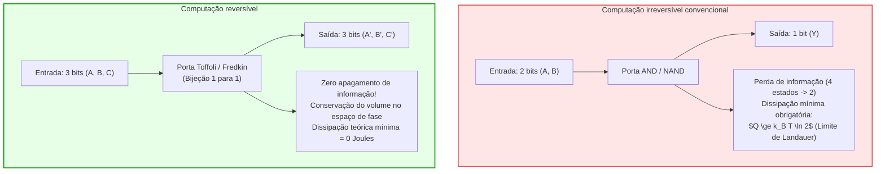
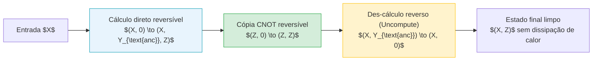

## Introdução: A barreira térmica dos supercomputadores

Com o avanço da computação de alto desempenho em escala de exaflops e dos modelos de inteligência artificial de grande porte, o consumo energético e a dissipação térmica tornaram-se o obstáculo supremo da engenharia de computação. Um supercomputador de última geração consome dezenas de megawatts — energia suficiente para abastecer cidades inteiras —, e praticamente 100% dessa eletricidade é convertida em calor residual dissipado no ambiente. Diante do colapso da escala de Dennard e do surgimento do silício escuro (Dark Silicon), a redução litográfica dos semicondutores já não consegue mitigar a densidade térmica dos chips.

Diante disso, físicos e cientistas da computação formularam uma questão basilar:
<strong>Um computador gera calor porque executa operações lógicas, ou porque apaga informações físicas de forma irreversível?</strong>

A resposta da física estatística contemporânea é inequívoca: <strong>processar informação, em si, não requer nenhum gasto energético teórico intrínseco; o calor surge exclusivamente do apagamento irreversível de bits (Erasure)!</strong> Se cada operação for estruturada como uma transformação bijetiva e reversível no tempo, a dissipação teórica de calor pode chegar a zero. Este é o fundamento da <strong>computação reversível (Reversible Computing)</strong> e da <strong>termodinâmica da informação</strong>.

---

## 1. Fundamentos termodinâmicos: O demônio de Maxwell e o princípio de Landauer

### 1.1 O demônio de Maxwell e o motor de Szilard
Em 1867, James Clerk Maxwell formulou o clássico experimento mental onde uma entidade microscópica inteligente monitora uma porta entre dois compartimentos de gás, separando moléculas velozes de lentas sem realizar trabalho macroscópico, violando a segunda lei da termodinâmica.
Em 1929, Leo Szilard simplificou o modelo para um cilindro monomolecular, demonstrando que o demônio extrai <strong>1 bit de informação</strong> sobre a posição da molécula e converte essa informação em trabalho mecânico $W = k_B T \ln 2$. Por décadas acreditou-se erradamente que a medição era o processo dissipativo.

### 1.2 O princípio de Landauer (1961)
Rolf Landauer (IBM Research) elucidou a física fundamental em 1961:
<strong>Medir e processar dados pode ocorrer sem dissipação mínima de energia. O calor é obrigatoriamente liberado no momento em que a memória do demônio ou computador é reinicializada (Reset to 0 / Erasure)!</strong>

> <strong>Teorema (Limite de Landauer):</strong>
> Ao apagar irreversivelmente 1 bit de informação em um ambiente à temperatura absoluta $T$, a quantidade mínima de calor dissipada $Q_{\text{min}}$ satisfaz:
> $$Q_{\text{min}} = k_B T \ln 2$$
> onde $k_B \approx 1{,}3806 \times 10^{-23} \, \text{J/K}$ é a constante de Boltzmann. À temperatura ambiente ($T = 300 \, \text{K}$), este valor equivale a cerca de $2{,}87 \times 10^{-21} \, \text{J}$ (~0,018 eV).

O apagamento comprime o espaço de estados microscópicos do sistema ($\Delta S_{\text{sys}} = -k_B \ln 2$). Para atender à segunda lei ($\Delta S_{\text{total}} \ge 0$), o ambiente absorve $\Delta S_{\text{amb}} \ge k_B \ln 2$, dissipando calor $Q = T \Delta S_{\text{amb}} \ge k_B T \ln 2$.

---

## 2. Teorema de Bennett e o des-cálculo (Uncomputing)

Em 1973, Charles H. Bennett provou que qualquer máquina de Turing universal pode operar de forma perfeitamente reversível, sem apagar nenhum bit durante o processo, atingindo dissipação teórica nula.

### 2.1 Ciclo de computação sem resíduos térmicos
Para contornar o acúmulo infinito de variáveis auxiliares (lixo de memória), Bennett introduziu o ciclo de des-cálculo:
1. <strong>Cálculo direto:</strong> O circuito reversível transforma $X$ em $(X, Y_{\text{lixo}}, Z)$.
2. <strong>Cópia não destrutiva:</strong> O resultado útil $Z$ é copiado para um registrador limpo via portas CNOT.
3. <strong>Des-cálculo reverso (Uncomputing):</strong> O circuito inicial é percorrido no sentido inverso do tempo, restaurando $Y_{\text{lixo}}$ exatamente ao estado inicial zero ($0$).
4. <strong>Estado final:</strong> Restam apenas a entrada $X$ e o resultado $Z$, com dissipação de energia teórica nula.

---

## 3. Portas lógicas reversíveis universais: Toffoli e Fredkin

### 3.1 Porta de Toffoli (CCNOT)
Criada por Tommaso Toffoli em 1980: $(a, b, c) \to (a, b, c \oplus (a \land b))$.
Com $c=0$, obtém-se AND; com $c=1$, obtém-se NAND. Constitui um conjunto universal para a computação clássica reversível.

### 3.2 Porta de Fredkin (CSWAP)
Criada por Edward Fredkin: permuta duas linhas de dados se o bit de controle for 1. Conserva estritamente o número total de bits 1 (peso de Hamming), em analogia direta com leis físicas de conservação de carga e partículas.

---

## 4. Implementações físicas: CMOS adiabático e lógica supercondutora

### 4.1 Termodinâmica em tempo finito
A dissipação zero requer transformações quase-estáticas infinitamente lentas ($\tau \to \infty$). Em tempos finitos $\tau$, perdas por atrito hidrodinâmico no espaço de fase surgem:

$$\langle Q \rangle \ge k_B T \ln 2 + \frac{C}{\tau}$$

Assim, sistemas reversíveis privilegiam arquiteturas maciçamente paralelas a frequências moderadas para minimizar o produto energia-atraso (EDP).

### 4.2 Circuitos CMOS adiabáticos
Em vez de tensões abruptas que dissipam $\frac{1}{2} C_L V_{DD}^2$, a lógica adiabática utiliza fontes de alimentação oscilantes (Power-Clocks). Com tempo de carga $T_{\text{carga}} \gg R C_L$, a perda reduz-se a:

$$E_{\text{diss}} = \frac{R C_L}{T_{\text{carga}}} C_L V_{DD}^2$$

reutilizando a carga na fase de descarga (Energy Recovery) e reduzindo a perda energética em mais de 99%.

### 4.3 Lógica supercondutora de fluxo
Em temperaturas criogênicas (4,2 K), junções de Josephson manipulam quanta de fluxo magnético $\Phi_0 = h/2e$ sem resistência elétrica, viabilizando portas lógicas reversíveis com dissipação ordens de grandeza inferior ao limite de Landauer à temperatura ambiente.

---

## 5. Conclusão: Informação é física

O célebre aforismo de Rolf Landauer, «Information is Physical», sintetiza essa revolução. A computação não é uma abstração etérea, mas uma trajetória dinâmica perfeitamente reversível nas leis da mecânica quântica e estatística. Dominar a computação reversível é a chave mestra para o futuro energético da computação global.
