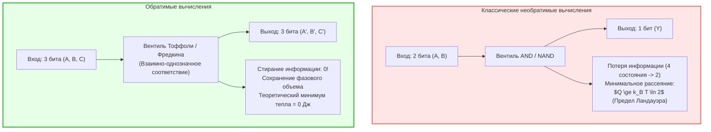
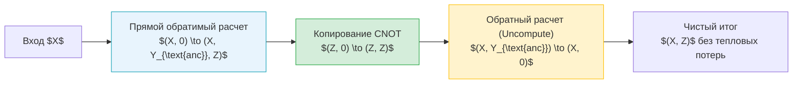

## Введение: Тепловой барьер современных суперкомпьютеров

В эпоху экзафлопсных суперкомпьютеров и гигантских кластеров искусственного интеллекта энергопотребление и теплоотвод стали непреодолимым физическим барьером вычислительной техники. Современные суперкомпьютеры потребляют десятки мегаватт электроэнергии — эквивалент электроснабжения целого города —, и почти 100% этой энергии в конечном счете превращается в рассеиваемое тепло. В условиях прекращения действия закона масштабирования Деннарда (Dennard Scaling) и эффекта «темного кремния» (Dark Silicon) классическое уменьшение топологических норм полупроводников больше не спасает от критического перегрева микропроцессоров.

На стыке физики и теории информации возникает фундаментальный вопрос:
<strong>Выделяет ли компьютер тепло потому, что выполняет логические вычисления, или потому, что необратимо стирает физическую информацию?</strong>

Ответ современной статистической термодинамики поражает воображение: <strong>сами по себе вычисления не требуют фундаментальных затрат энергии; тепло выделяется исключительно при необратимом стирании информации (Erasure)!</strong> Если каждый логический шаг спроектирован так, чтобы не терять ни единого бита и допускать обращение во времени (обратимость), минимальные теоретические тепловые потери могут быть равны нулю! Это составляет основу <strong>обратимых вычислений (Reversible Computing)</strong> и <strong>термодинамики информации</strong>.

---

## 1. Термодинамические основы: Демон Максвелла и принцип Ландауэра

### 1.1 Демон Максвелла и одномолекулярный двигатель Сциларда
В 1867 году Джеймс Клерк Максвелл предложил мысленный эксперимент: микроскопическое существо разделяет быстрые и медленные молекулы газа без совершения макроскопической работы, нарушая второе начало термодинамики.
В 1929 году Лео Сцилард упростил модель до цилиндра с одной молекулой, показав, что измерение координаты частицы дает <strong>1 бит информации</strong>, который превращается в работу $W = k_B T \ln 2$. Долгое время считалось, что рассеяние происходит при измерении, однако это объяснение оказалось неверным.

### 1.2 Принцип Ландауэра (1961)
В 1961 году Рольф Ландауэр (IBM Research) совершил революционное открытие:
<strong>Измерение и выполнение обратимых логических шагов теоретически не требуют рассеяния энергии. Тепло неизбежно выделяется лишь в момент стирания памяти (Reset to 0) демона или компьютера!</strong>

> <strong>Теорема (Предел Ландауэра):</strong>
> При необратимом стирании 1 бита информации в среде с абсолютной температурой $T$ системе необходимо рассеять в окружающую среду минимальное количество тепла $Q_{\text{min}}$:
> $$Q_{\text{min}} = k_B T \ln 2$$
> где $k_B \approx 1{,}3806 \times 10^{-23} \, \text{Дж/К}$ — постоянная Больцмана. При комнатной температуре ($T = 300 \, \text{К}$) этот предел составляет примерно $2{,}87 \times 10^{-21} \, \text{Дж}$ (~0,018 эВ).

Стирание бита уменьшает число доступных микросостояний системы ($\Delta S_{\text{sys}} = -k_B \ln 2$). Согласно второму началу ($\Delta S_{\text{total}} \ge 0$), энтропия окружающей среды обязана возрасти: $\Delta S_{\text{env}} \ge k_B \ln 2$, что выражается в тепловыделении $Q = T \Delta S_{\text{env}} \ge k_B T \ln 2$.

---

## 2. Теорема Беннета и парадигма Uncomputing

В 1973 году Чарльз Беннет доказал, что универсальная машина Тьюринга может быть реализована абсолютно обратимо без необратимого удаления битов памяти.

### 2.1 Цикл вычисления-копирования-обращения (Uncompute)
Чтобы предотвратить бесконечное накопление мусорных бит в памяти без их стирания, Беннет предложил элегантный цикл:
1. <strong>Прямое вычисление:</strong> Обратимая схема преобразует вход $X$ в $(X, Y_{\text{мусор}}, Z)$.
2. <strong>Неразрушающее копирование:</strong> Результат $Z$ копируется на чистый регистр вентилями CNOT.
3. <strong>Обратное вычисление (Uncomputing):</strong> Схема запускается в обратную сторону по времени, возвращая промежуточные переменные $Y_{\text{мусор}}$ точно в нулевое исходное состояние.
4. <strong>Конечный результат:</strong> Остаются только вход $X$ и результат $Z$, память очищена, а тепловое рассеяние строго равно нулю.

---

## 3. Обратимые логические вентили: Тоффоли и Фредкин

### 3.1 Вентиль Тоффоли (CCNOT)
Сконструирован Томмазо Тоффоли в 1980 году: $(a, b, c) \to (a, b, c \oplus (a \land b))$. Вентиль взаимно-однозначен и обратим. При $c=0$ реализуется функция AND; при $c=1$ — NAND, что делает его функционально полным для классической логики.

### 3.2 Вентиль Фредкина (CSWAP)
Вентиль консервативной логики Эдварда Фредкина: меняет местами два информационных бита при управляющем бите 1. Вентиль сохраняет вес Хэмминга (число единиц), моделируя физические законы сохранения заряда и числа частиц.

---

## 4. Физическая реализация: Адиабатический КМОП и сверхпроводящие схемы

### 4.1 Термодинамика конечного времени
Предел нулевого рассеяния требует бесконечно медленного квазистатического переключения ($\tau \to \infty$). При конечном тактовом интервале $\tau$ возникает динамическое трение:

$$\langle Q \rangle \ge k_B T \ln 2 + \frac{C}{\tau}$$

Поэтому обратимые архитектуры ориентируются на массивный параллелизм при умеренных частотах для оптимизации произведения энергии на задержку (EDP).

### 4.2 Адиабатические схемы КМОП
Вместо резких импульсов напряжения адиабатическая логика использует плавно нарастающие и спадающие резонансные переменные источники питания (Power-Clocks). При времени заряда $T_{\text{charge}} \gg R C_L$ потери уменьшаются:

$$E_{\text{diss}} = \frac{R C_L}{T_{\text{charge}}} C_L V_{DD}^2$$

а заряд рекуперируется обратно в источник при разряде, снижая энергопотребление в сотни раз.

### 4.3 Сверхпроводниковая квантовая логика
В среде жидкого гелия (4,2 К) на основе джозефсоновских переходов создаются обратимые схемы на магнитных квантах потока $\Phi_0 = h/2e$. Без омического сопротивления такие схемы способны переключаться с энерговыделением значительно ниже предела Ландауэра при комнатной температуре.

---

## 5. Заключение: Информация материальна

Принцип Ландауэра «Information is Physical» утверждает: информация не является бестелесной абстракцией, она неразрывно связана с физическими степенями свободы. Освоение обратимых вычислений открывает путь к созданию сверхэффективных вычислительных систем будущего за гранью традиционных кремниевых ограничений.
