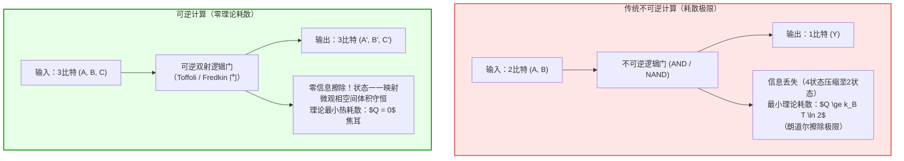
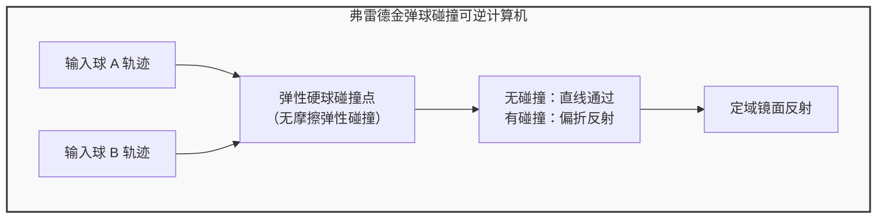

## 引言：超级计算机的“热墙”与物理极限

在当今的高性能计算（HPC）与超大规模人工智能集群中，能耗与散热已成为不可逾越的核心瓶颈。一台百亿亿次级（Exascale）超级计算机每小时消耗数十兆瓦的电能，而这些电能几乎百分之百最终转化为废热耗散于环境之中。伴随登纳德缩放定律（Dennard Scaling）的终结与“暗硅（Dark Silicon）”现象的普及，半导体工艺的微缩已无法从根本上遏制芯片热流密度的暴涨。

传统计算机之所以产生如此巨大的热量，究竟是因为“进行了逻辑运算”，还是因为“以不可逆的方式擦除了物理信息”？

在经典信息论与统计物理学的交叉路口，科学家们给出了颠覆直觉的答案：<strong>计算本身在热力学上并不必然消耗能量；产生不可逆耗散的真正根源，是对物理信息的擦除（Information Erasure）</strong>。如果计算的每一步都能够严格保全信息并支持时间反转（Time Reversal），那么理论上计算所耗散的最小能量可以无限趋近于零！这就是<strong>可逆计算（Reversible Computing）</strong>与<strong>信息热力学（Information Thermodynamics）</strong>的核心论断。

---

## 1. 物理学视角的奠基：麦克斯韦妖与朗道尔原理

### 1.1 麦克斯韦妖与齐拉德单分子热机
1867年，苏格兰物理学家詹姆斯·克拉克·麦克斯韦构想了一个著名的假想实验：一个微观精灵（麦克斯韦妖）守在分割气室的隔板门前，测量向门飞来的分子速率。妖将快速分子放至右室，将慢速分子留于左室，从而在不做宏观功的前提下自发产生温差与自由能，直接挑战热力学第二定律。

1929年，列奥·齐拉德（Leo Szilard）将此模型简化为单分子活塞热机。齐拉德证明，妖通过测定分子处于左半部分或右半部分，获取了 <strong>1比特（Bit）</strong> 的客观信息，并将该信息转化为 $W = k_B T \ln 2$ 的机械功。物理学界长达半个世纪的共识曾认为：是妖在“测量分子位置”或“感知微观状态”时光子探测过程产生了耗散。然而这一解释并不正确。

### 1.2 朗道尔原理（Landauer's Principle）
1961年，IBM物理学家罗尔夫·朗道尔（Rolf Landauer）发表了里程碑式的论文《计算过程中的不可逆性与热量产生》。朗道尔明确指出：
<strong>获取信息与执行可逆操作在理论上可以实现无耗散；真正导致熵增与热量耗散的，是在计算周期结束时对妖的记忆库或计算机寄存器执行“擦除（Reset to 0）”的不可逆操作！</strong>

> <strong>朗道尔极限（Landauer Bound）：</strong>
> 在温度为 $T$ 的热力学环境中，不可逆地擦除 1 比特物理信息，系统向环境耗散的最小热量 $Q_{\text{min}}$ 满足：
> $$Q_{\text{min}} = k_B T \ln 2$$
> 其中 $k_B \approx 1.3806 \times 10^{-23} \, \text{J/K}$ 为玻尔兹曼常数。在室温（$T = 300 \, \text{K}$）下，该极限值约为 $2.87 \times 10^{-21} \, \text{J}$（约 0.018 eV）。

微观物理本质在于：当计算机的逻辑状态由包含两种可能性的集合 $\{0, 1\}$ 强制重置为单一确定状态 $\{0\}$ 时，物理系统的微观自由度被压缩，微观相空间体积减半。根据玻尔兹曼熵公式 $S = k_B \ln \Omega$，计算系统的香农/玻尔兹曼熵改变了 $\Delta S_{\text{sys}} = -k_B \ln 2$。为了遵守热力学第二定律（全孤立系统的总熵不减 $\Delta S_{\text{total}} = \Delta S_{\text{sys}} + \Delta S_{\text{env}} \ge 0$），环境必须吸收至少 $\Delta S_{\text{env}} \ge k_B \ln 2$ 的熵，对应的热释放为 $Q = T \Delta S_{\text{env}} \ge k_B T \ln 2$。

---

## 2. 贝内特计算定理与可逆图灵机

1973年，查尔斯·贝内特（Charles H. Bennett）提出了革命性的解决方案：<strong>我们完全可以设计一种在逻辑与物理上完全可逆的计算机，它在整个计算过程中无需擦除任何比特，从而理论耗散为零！</strong>

### 2.1 不可逆逻辑门的本质缺陷
传统布尔逻辑门大多是不可逆的多对一映射。以基本与门（AND Gate）为例：
- 输入 $(0, 0) \to 0$
- 输入 $(0, 1) \to 0$
- 输入 $(1, 0) \to 0$
- 输入 $(1, 1) \to 1$

当输出为 $0$ 时，我们无法反向推导出原本的输入究竟是三种组合中的哪一种。两个输入比特被缩减为单个输出比特，系统不可挽回地丢失了 $\log_2(4) - \log_2(2) = 1$ 比特的信息，依据朗道尔原理必须释放热量。

### 2.2 贝内特的“计算-复制-逆计算（Uncompute）”范式
如何在不产生无限中间垃圾数据的前提下完成计算？贝内特证明了通用可逆计算的标准范式：
1. <strong>正向计算（Forward Computation）：</strong> 逻辑系统从输入 $X$ 出发，利用完全可逆的门网络运行算法，生成包含中间过程垃圾变量 $Y_{\text{garbage}}$ 和最终目标结果 $Z$ 的状态 $(X, Y_{\text{garbage}}, Z)$。
2. <strong>结果保全复制（Reversible Copying）：</strong> 利用受控非门（CNOT），将目标结果 $Z$ 复制到纯净的目标寄存器中。由于复制前后状态明确，该操作是双射且无信息擦除的。
3. <strong>反向退算（Uncomputing）：</strong> 将原计算网络的时间反转算子施加于系统，中间状态逐步倒流，垃圾变量 $Y_{\text{garbage}}$ 被完美逆转归零！
4. <strong>最终状态：</strong> 整个过程结束时，中间寄存器全部自发还原为初始状态 $0$，没有任何信息被不可逆地擦除。理论能耗严格为零！

---

## 3. 可逆逻辑门架构：托佛利门与弗雷德金门

为了在物理上实现可逆图灵机，理论计算机科学家构造了具有通用计算能力的保信息基本门电路。

### 3.1 托佛利门（Toffoli Gate / Controlled-Controlled-NOT）
托马索·托佛利（Tommaso Toffoli）于1980年提出了具有 3 个输入与 3 个输出的通用可逆门：
- 输入：$(a, b, c)$
- 输出：$(a', b', c') = (a, b, c \oplus (a \land b))$

托佛利门的真值映射是一一对应的置换（Permutation），并且是自反的（自身的逆为其本身）。当将第三输入固定为常量 $c=0$ 时，输出端即得到逻辑与操作 $c' = a \land b$；当固定 $c=1$ 时即可实现与非（NAND）。因此，托佛利门单独即可构成经典计算的通用完备集（Universal Gate Set）。

### 3.2 弗雷德金门（Fredkin Gate / Controlled-SWAP）
爱德华·弗雷德金（Edward Fredkin）提出了保守逻辑门（Conservative Logic Gate）：
- 输入：$(c, x, y)$
- 输出：若控制位 $c=0$，则输出 $(0, x, y)$；若控制位 $c=1$，则输出 $(1, y, x)$。

弗雷德金门不仅在映射上严格可逆，而且具有极其独特的物理守恒性质：<strong>输出端“1”的总个数严格等于输入端“1”的总个数（汉明重量守恒）</strong>。这意味着在物理实现中，电荷、粒子数或光子数在计算前后守恒，是构建完全保守力学计算模型的理想元件。

---

## 4. 物理实现与前沿突破：绝热CMOS与超导通量量子

### 4.1 有限时间热力学与速度-耗散权衡
朗道尔的零耗散结论建立在“准静态（Quasi-static）”假定之上，即状态转换经历无限缓慢的时间（$\tau \to \infty$）。但在现实工程中，时钟周期是有限的。现代随机热力学（Stochastic Thermodynamics）指出，有限时间 $\tau$ 内的耗散满足：

$$\langle Q \rangle \ge k_B T \ln 2 + \frac{C}{\tau}$$

其中系数 $C$ 代表动力学微观摩擦或相空间测地线度规。要在工程上获得实际优势，芯片架构必须通过超大规模并行运行于适度时钟频率，以实现能量延迟积（Energy-Delay Product）的最优化。

### 4.2 绝热CMOS电路（Adiabatic CMOS Logic）
传统静态CMOS在对负载电容 $C_L$ 充电至电源电压 $V_{DD}$ 时，电源提供的能量为 $C_L V_{DD}^2$，其中必须在PMOS沟道电阻 $R$ 上强制散逸出 $\frac{1}{2} C_L V_{DD}^2$ 的焦耳热。
而在绝热CMOS中，恒定直流电源被缓慢爬升的共振交流“功率时钟（Power-Clock）”所取代。在过渡时间 $T_{\text{charge}}$ 内以恒定斜率充电时，功耗公式变为：

$$E_{\text{diss}} = \frac{R C_L}{T_{\text{charge}}} C_L V_{DD}^2$$

当充电时间 $T_{\text{charge}} \gg R C_L$ 时，耗散热量将随时间呈反比下降，并在放电阶段将电荷通过LC共振谐振腔高效回收（Energy Recovery），能耗可降至传统CMOS的 1% 以下！

### 4.3 超导可逆磁通量子逻辑
在液氦温区（4.2 K），利用超导约瑟夫森结构建的<strong>可逆磁通逻辑（Reversible Fluxon Logic / nSQUID）</strong>将信息编码为单个超导磁通量子 $\Phi_0 = h/2e$。由于超导状态不存在欧姆电阻，磁通势阱的绝热形变能够以远低于室温朗道尔极限的微观能耗完成精确的逻辑反转，已成为国际顶尖超导计算实验室攻关下一代绿色超算的核心技术基石。

---

## 5. 总结：信息与物质的深刻统一

从麦克斯韦妖的百年思辨，到朗道尔确立“信息是物理的（Information is Physical）”，再到贝内特可逆图灵机与现代量子线路设计，人类对“计算”的理解经历了认识论的伟大飞跃。
计算不是单向消耗能量的纯粹抽象，而是物理微观态在希尔伯特空间与相空间中的可逆轨迹演化。掌握可逆计算，正是人类在摩尔定律的终点，开启下一个百年绿色计算文明的终极钥匙。
