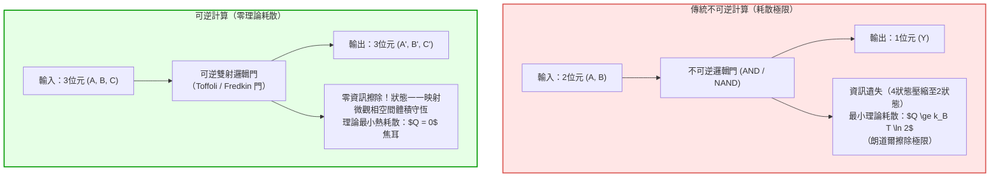
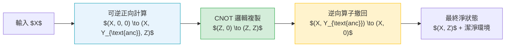
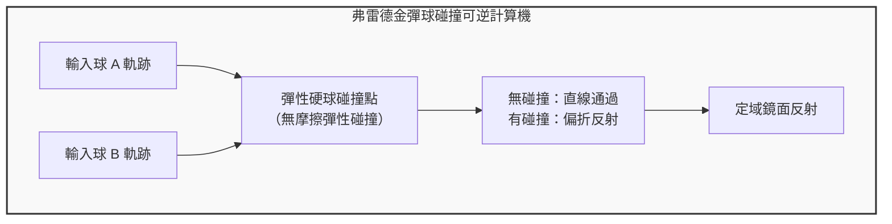

## 引言：超級計算機的「熱牆」與物理極限

在當今的高性能計算（HPC）與超大規模人工智慧集群中，能耗與散熱已成為不可逾越的核心瓶頸。一台百億億次級（Exascale）超級計算機每小時消耗數十兆瓦的電能，而這些電能幾乎百分之百最終轉化為廢熱耗散於環境之中。伴隨丹納德縮放定律（Dennard Scaling）的終結與「暗矽（Dark Silicon）」現象的普及，半導體工藝的微縮已無法從根本上遏制晶片熱流密度的暴漲。

傳統計算機之所以產生如此巨大的熱量，究竟是因為「進行了邏輯運算」，還是因為「以不可逆的方式擦除了物理資訊」？

在經典資訊論與統計物理學的交叉路口，科學家們給出了顛覆直覺的答案：<strong>計算本身在熱力學上並不必然消耗能量；產生不可逆耗散的真正根源，是對物理資訊的擦除（Information Erasure）</strong>。如果計算的每一步都能夠嚴格保全資訊並支援時間反轉（Time Reversal），那麼理論上計算所耗散的最小能量可以無限趨近於零！這就是<strong>可逆計算（Reversible Computing）</strong>與<strong>資訊熱力學（Information Thermodynamics）</strong>的核心論斷。

---

## 1. 物理學視角的奠基：馬克士威妖與朗道爾原理

### 1.1 馬克士威妖與齊拉德單分子熱機
1867年，蘇格蘭物理學家詹姆斯·克拉克·馬克士威構想了一個著名的假想實驗：一個微觀精靈（馬克士威妖）守在分割氣室的隔板門前，測量向門飛來的分子速率。妖將快速分子放至右室，將慢速分子留於左室，從而在不做宏觀功的前提下自發產生溫差與自由能，直接挑戰熱力學第二定律。

1929年，列奧·齊拉德（Leo Szilard）將此模型簡化為單分子活塞熱機。齊拉德證明，妖透過測定分子處於左半部分或右半部分，獲取了 <strong>1位元（Bit）</strong> 的客觀資訊，並將該資訊轉化為 $W = k_B T \ln 2$ 的機械功。物理學界長達半個世紀的共識曾認為：是妖在「測量分子位置」或「感知微觀狀態」時光子探測過程產生了耗散。然而這一解釋並不正確。

### 1.2 朗道爾原理（Landauer's Principle）
1961年，IBM物理學家羅爾夫·朗道爾（Rolf Landauer）發表了里程碑式的論文《計算過程中的不可逆性與熱量產生》。朗道爾明確指出：
<strong>獲取資訊與執行可逆操作在理論上可以實現無耗散；真正導致熵增與熱量耗散的，是在計算週期結束時對妖的記憶庫或計算機暫存器執行「擦除（Reset to 0）」的不可逆操作！</strong>

> <strong>朗道爾極限（Landauer Bound）：</strong>
> 在溫度為 $T$ 的熱力學環境中，不可逆地擦除 1 位元物理資訊，系統向環境耗散的最小熱量 $Q_{\text{min}}$ 滿足：
> $$Q_{\text{min}} = k_B T \ln 2$$
> 其中 $k_B \approx 1.3806 \times 10^{-23} \, \text{J/K}$ 為玻爾茲曼常數。在室溫（$T = 300 \, \text{K}$）下，該極限值約為 $2.87 \times 10^{-21} \, \text{J}$（約 0.018 eV）。

微觀物理本質在於：當計算機的邏輯狀態由包含兩種可能性的集合 $\{0, 1\}$ 強制重置為單一確定狀態 $\{0\}$ 時，物理系統的微觀自由度被壓縮，微觀相空間體積減半。根據玻爾茲曼熵公式 $S = k_B \ln \Omega$，計算系統的香農/玻爾茲曼熵改變了 $\Delta S_{\text{sys}} = -k_B \ln 2$。為了遵守熱力學第二定律（全孤立系統的總熵不減 $\Delta S_{\text{total}} = \Delta S_{\text{sys}} + \Delta S_{\text{env}} \ge 0$），環境必須吸收至少 $\Delta S_{\text{env}} \ge k_B \ln 2$ 的熵，對應的熱釋放為 $Q = T \Delta S_{\text{env}} \ge k_B T \ln 2$。

---

## 2. 貝內特計算定理與可逆圖靈機

1973年，查爾斯·貝內特（Charles H. Bennett）提出了革命性的處理解決方案：<strong>我們完全可以設計一種在邏輯與物理上完全可逆的計算機，它在整個計算過程中無需擦除任何位元，從而理論耗散為零！</strong>

### 2.1 不可逆邏輯門的本質缺陷
傳統布林邏輯門大多是不可逆的多對一映射。以基本及閘（AND Gate）為例：
- 輸入 $(0, 0) \to 0$
- 輸入 $(0, 1) \to 0$
- 輸入 $(1, 0) \to 0$
- 輸入 $(1, 1) \to 1$

當輸出為 $0$ 時，我們無法反向推導出原本的輸入究竟是三種組合中的哪一種。兩個輸入位元被縮減為單個輸出位元，系統不可挽回地丟失了 $\log_2(4) - \log_2(2) = 1$ 位元的資訊，依據朗道爾原理必須釋放熱量。

### 2.2 貝內特的「計算-複製-逆計算（Uncompute）」範式
如何在不產生無限中間垃圾資料的前提下完成計算？貝內特證明了通用可逆計算的標準範式：
1. <strong>正向計算（Forward Computation）：</strong> 邏輯系統從輸入 $X$ 出發，利用完全可逆的門網路運行演算法，生成包含中間過程垃圾變數 $Y_{\text{garbage}}$ 和最終目標結果 $Z$ 的狀態 $(X, Y_{\text{garbage}}, Z)$。
2. <strong>結果保全複製（Reversible Copying）：</strong> 利用受控反閘（CNOT），將目標結果 $Z$ 複製到純淨的目標暫存器中。由於複製前後狀態明確，該操作是雙射且無資訊擦除的。
3. <strong>反向退算（Uncomputing）：</strong> 將原計算網路的時間反轉算子施加於系統，中間狀態逐步倒流，垃圾變數 $Y_{\text{garbage}}$ 被完美逆轉歸零！
4. <strong>最終狀態：</strong> 整個過程結束時，中間暫存器全部自發還原為初始狀態 $0$，沒有任何資訊被不可逆地擦除。理論能耗嚴格為零！

---

## 3. 可逆邏輯門架構：托佛利門與弗雷德金門

為了在物理上實現可逆圖靈機，理論計算機科學家構造了具有通用計算能力的保資訊基本門電路。

### 3.1 托佛利門（Toffoli Gate / Controlled-Controlled-NOT）
托馬索·托佛利（Tommaso Toffoli）於1980年提出了具有 3 個輸入與 3 個輸出的通用可逆門：
- 輸入：$(a, b, c)$
- 輸出：$(a', b', c') = (a, b, c \oplus (a \land b))$

托佛利門的真值映射是一一對應的置換（Permutation），並且是自反的（自身的逆為其本身）。當將第三輸入固定為常數 $c=0$ 時，輸出端即得到邏輯及操作 $c' = a \land b$；當固定 $c=1$ 時即可實現反及（NAND）。因此，托佛利門單獨即可構成經典計算的通用完備集（Universal Gate Set）。

### 3.2 弗雷德金門（Fredkin Gate / Controlled-SWAP）
愛德華·弗雷德金（Edward Fredkin）提出了保守邏輯門（Conservative Logic Gate）：
- 輸入：$(c, x, y)$
- 輸出：若控制位 $c=0$，則輸出 $(0, x, y)$；若控制位 $c=1$，則輸出 $(1, y, x)$。

弗雷德金門不僅在映射上嚴格可逆，而且具有極其獨特的物理守恆性質：<strong>輸出端「1」的總個數嚴格等於輸入端「1」的總個數（漢明重量守恆）</strong>。這意味著在物理實現中，電荷、粒子數或光子數在計算前後守恆，是構建完全保守力學計算模型的理想元件。

---

## 4. 物理實現與前沿突破：絕熱CMOS與超導通量量子

### 4.1 有限時間熱力學與速度-耗散權衡
朗道爾的零耗散結論建立在「準靜態（Quasi-static）」假定之上，即狀態轉換經歷無限緩慢的時間（$\tau \to \infty$）。但在現實工程中，時鐘週期是有限的。現代隨機熱力學（Stochastic Thermodynamics）指出，有限時間 $\tau$ 內的耗散滿足：

$$\langle Q \rangle \ge k_B T \ln 2 + \frac{C}{\tau}$$

其中係數 $C$ 代表動力學微觀摩擦或相空間測地線度規。要在工程上獲得實際優勢，晶片架構必須透過超大規模並行運行於適度時鐘頻率，以實現能量延遲積（Energy-Delay Product）的最優化。

### 4.2 絕熱CMOS電路（Adiabatic CMOS Logic）
傳統靜態CMOS在對負載電容 $C_L$ 充電至電源電壓 $V_{DD}$ 時，電源提供的能量為 $C_L V_{DD}^2$，其中必須在PMOS溝道電阻 $R$ 上強制散逸出 $\frac{1}{2} C_L V_{DD}^2$ 的焦耳熱。
而在絕熱CMOS中，恆定直流電源被緩慢爬升的共振交流「功率時鐘（Power-Clock）」所取代。在過渡時間 $T_{\text{charge}}$ 內以恆定斜率充電時，功耗公式變為：

$$E_{\text{diss}} = \frac{R C_L}{T_{\text{charge}}} C_L V_{DD}^2$$

當充電時間 $T_{\text{charge}} \gg R C_L$ 時，耗散熱量將隨時間呈反比下降，並在放電階段將電荷透過LC共振諧振腔高效回收（Energy Recovery），能耗可降至傳統CMOS的 1% 以下！

### 4.3 超導可逆磁通量子邏輯
在液氦溫區（4.2 K），利用超導約瑟夫森結構建的<strong>可逆磁通邏輯（Reversible Fluxon Logic / nSQUID）</strong>將資訊編碼為單個超導磁通量子 $\Phi_0 = h/2e$。由於超導狀態不存在歐姆電阻，磁通勢阱的絕熱形變能夠以遠低於室溫朗道爾極限的微觀能耗完成精確的邏輯反轉，已成為國際頂尖超導計算實驗室攻關下一代綠色超算的核心技術基石。

---

## 5. 總結：資訊與物質的深刻統一

從馬克士威妖的百年思辨，到朗道爾確立「資訊是物理的（Information is Physical）」，再到貝內特可逆圖靈機與現代量子線路設計，人類對「計算」的理解經歷了認識論的偉大飛躍。
計算不是單向消耗能量的純粹抽象，而是物理微觀態在希伯特空間與相空間中的可逆軌跡演化。掌握可逆計算，正是人類在摩爾定律的終點，開啟下一個百年綠色計算文明的終極鑰匙。
