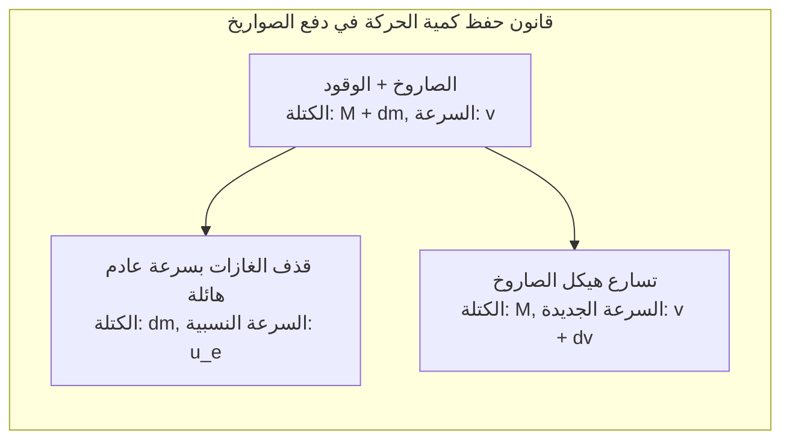
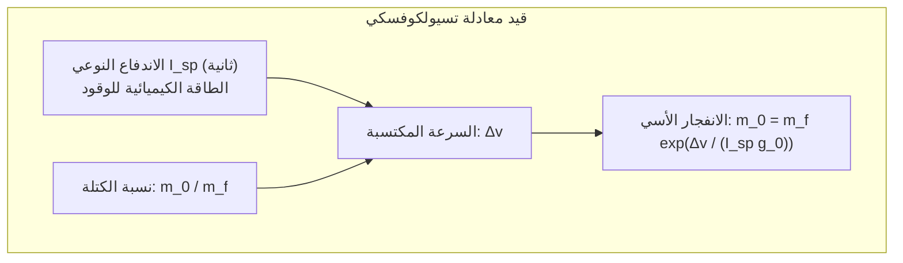
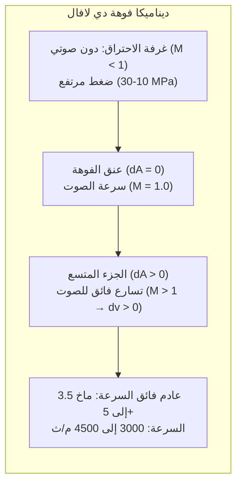

تشق الصواريخ المدارية ظلمات الليل بهدير يزلزل الأرض ولهيب أبيض ناصع، ممثلة أضخم وأعقد الآلات التي شيدتها البشرية. كيف يمكن لهذه الهياكل المعدنية العملاقة أن تخترق الغلاف الجوي الكثيف وتتغلب على الجاذبية الأرضية لتناور في فراغ الفضاء؟

تسود في الأذهان مفاهيم شائعة خاطئة: «كيف يتسارع الصاروخ في الفراغ حيث لا يوجد هواء ليدفعه؟» أو «أليس الصعود إلى الفضاء مجرد انطلاق عمودي بأقصى سرعة؟»

من منظور الفيزياء الأساسية، يُعد التحليق الفضائي <strong>ملحمة حقيقية في تحويل الطاقة: تطبيقاً صارماً لقانون حفظ كمية الحركة، وديناميكا الغازات القابلة للانضغاط، والميكانيكا المدارية، والديناميكا الهوائية الحرارية فائقة السرعة</strong>. لا يتكئ الصاروخ على الهواء المحيط، بل يتسارع حصرياً وفق <strong>القانون الثالث لنيوتن (لكل فعل رد فعل)</strong> عبر قذف كتل الغازات بسرعات فوق صوتية. والوصول إلى المدار لا يعني الارتفاع لأعلى فحسب، بل <strong>«السقوط الحر الدائم أفقياً حول انحناء الأرض بسرعة 7.9 كم/ثانية»</strong>.

---

### 1. مبدأ الدفع في الفراغ: قانون حفظ كمية الحركة

تعتمد المركبات الأرضية على الاحتكاك، وتدفع الطائرات الهواء المحيط للخلف.

أما الصاروخ، <strong>فلا يعتمد إطلاقاً على أي وسيط خارجي، بل ويعمل بأعلى كفاءة في الفراغ التام</strong> لعدم وجود ضغط جوي يعاكس اندفاع الغازات الخارجة من الفوهة.

في نظام معزول تخلو فيه القوى الخارجية، وبإهمال الحدود المتناهية في الصغر:

$$M dv = - u_e dM \implies dv = - u_e \frac{dM}{M}$$

يثبت هذا الاشتقاق أن تسارع الصاروخ يعتمد كلياً على سرعة خروج الغازات $u_e$ ومعدل استهلاك كتلة الوقود.

---

### 2. معادلة تسيولكوفسكي وطغيان المعادلة الأسية

في عام 1903، استنبط العالم الروسي قسطنطين تسيولكوفسكي القانون الرياضي المؤسس لعلوم الفضاء:

$$\Delta v = u_e \ln\left( \frac{m_0}{m_f} \right) = I_{sp} g_0 \ln\left( \frac{m_0}{m_f} \right)$$

حيث:
- $\Delta v$: الزيادة الإجمالية في السرعة التي يكتسبها الصاروخ؛
- $I_{sp}$: <strong>الاندفاع النوعي</strong> (بالثواني)، وهو معيار كفاءة الوقود الصاروخي؛
- $m_0 / m_f$: نسبة الكتلة الكلية عند الإقلاع إلى الكتلة الجافة بعد نفاد الوقود.

يتطلب الوصول إلى المدار الأرضي المنخفض (LEO) سرعة $\Delta v \approx 9.4\,\mathrm{km/s}$ مع احتساب الفواقد.
وبحل المعادلة لنسبة الكتلة:

$$\frac{m_0}{m_f} = \exp\left( \frac{\Delta v}{I_{sp} g_0} \right)$$

- عند استخدام الكيروسين والأكسجين السائل (LOX/RP-1)، تصل نسبة الكتلة إلى $22.0$: أي أن <strong>95.5% من وزن الصاروخ عند الإطلاق يجب أن يكون وقوداً خالصاً، ولا يتبقى سوى 4.5% فقط لهيكل الصاروخ ومحركاته والحمولة المفيدة</strong>!
- وحتى مع استخدام الهيدروجين السائل، تبلغ نسبة الوقود $88.1\%$.

تُعرف هذه المعضلة بـ <strong>«طغيان معادلة الصاروخ»</strong>. وكان الحل الهندسي الحتمي هو ابتكار <strong>الصواريخ متعددة المراحل (Staging)</strong> للتخلص المستمر من الخزانات الفارغة وتخفيف الوزن الميت لتسريع المراحل العليا.

---

### 3. فوهة دي لافال: التمدد فائق السرعة للغازات

كيف يحول المحرك ضغط الغازات الهائل وحرارتها التي تتجاوز $3000\,^\circ\mathrm{C}$ إلى تدفق نفاث موجه يفوق سرعة الصوت؟ عبر <strong>فوهة دي لافال (المتقاربة والمتباعدة)</strong>.

وفق معادلة المساحة والسرعة للموائع الانضغاطية:

$$\frac{dA}{A} = (M^2 - 1) \frac{dv}{v}$$

- <strong>القسم المتقارب ($M < 1$)</strong>: تضييق المجرى ($dA < 0$) يُسرّع التدفق ($dv > 0$)؛
- <strong>عنق الفوهة ($M = 1$)</strong>: يصل التدفق لسرعة الصوت محلياً؛
- <strong>القسم المتباعد ($M > 1$)</strong>: بمجرد تخطي سرعة الصوت، <strong>يؤدي اتساع المجرى ($dA > 0$) إلى تمدد كظوم مفاجئ يُسرّع الغازات إلى ما بعد سرعة الصوت ($dv > 0$)!</strong> لتنطلق بسرعة ماخ 3.5 إلى 5 ($3000$ إلى $4500\,\mathrm{m/s}$).

---

### 4. الميكانيكا المدارية: المدار هو «سقوط دائم باتجاه الأفق»

على ارتفاع محطة الفضاء الدولية ($400\,\mathrm{km}$)، تبلغ الجاذبية نحو $90\%$ من قيمتها الأرضية. يطفو رواد الفضاء لأنهم في حالة <strong>سقوط حر مستمر</strong>.

وفق تجربة مدفع نيوتن، عند بلوغ <strong>السرعة الكونية الأولى ($v_1 \approx 7.9\,\mathrm{km/s}$)</strong>، يتطابق انحناء مسار السقوط تماماً مع انحناء كوكب الأرض:

$$v_1 = \sqrt{g_0 R_E} \approx 7.9\,\mathrm{km/s} \quad (28,400\,\mathrm{km/h})$$

يُستهلك أكثر من <strong>80% من طاقة الصاروخ</strong> لبناء هذه السرعة الأفقية المدارية، وليس للصعود الرأسي.

---

### 5. إعادة الدخول الجوي: نظرية الجسم غير الحاد (Blunt Body Theory)

عند العودة من المدار، ينبغي تبديد طاقة حركية هائلة تبلغ $30.4\,\mathrm{MJ/kg}$ (تعادل 7 أضعاف كتلة المركبة من مادة TNT).

في عام 1953، صاغ جوليان ألين <strong>نظرية الجسم غير الحاد</strong>:
- يدفع الدرع الدائري المائل أمامه <strong>موجة صدمية قوسية منفصلة (Bow Shock)</strong>؛
- تتولد الحرارة الهائلة عن <strong>الانضغاط الكظوم للغازات بواسطة موجة الصدمة</strong>، محولة الهواء لبلازما ملتهبة بحرارة تصل إلى $10000\,\mathrm{K}$؛
- يقوم الجسم غير الحاد <strong>بإبعاد أكثر من 90% من هذه الحرارة مع تيار الهواء الجانبي بعيداً عن المركبة</strong>؛
- تتولى المواد الاستئصالية (مثل PICA-X) امتصاص الحرارة المتبقية بالتحلل والتبخر الذاتي.

---

### 6. خاتمة

من الدفع برد الفعل وقوانين تسيولكوفسكي، إلى فوهات دي لافال والتحليق المداري بسرعة 7.9 كم/ثانية، تمثل الصواريخ أعظم إنجازات العقل البشري لكسر قيود الأرض واقتحام آفاق الكون الرحبة.
