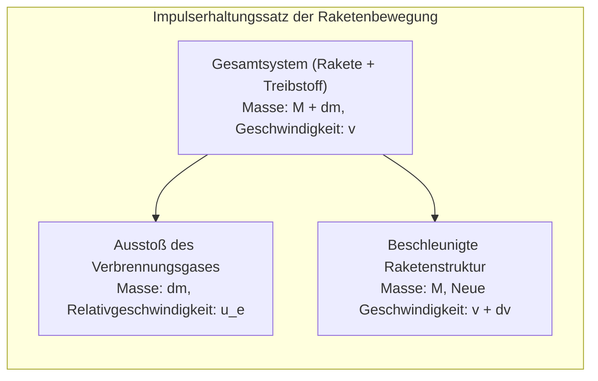
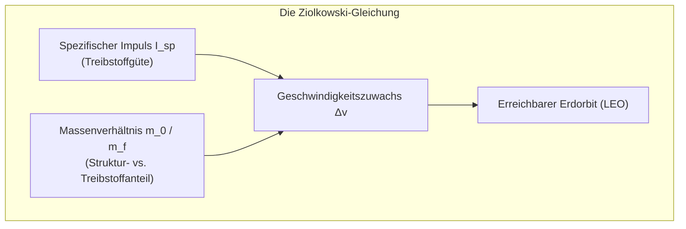
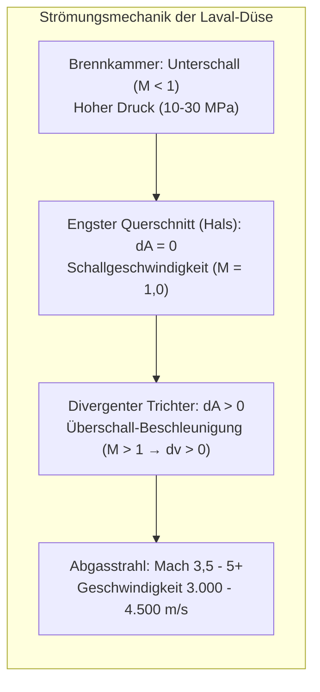

Mit ohrenbetäubendem Tosen und gigantischen Feuersäulen schraubt sich eine tonnenschwere Orbitalrakete in den Nachthimmel. Als extremste Maschinen der Menschheitsgeschichte überwinden Raketen die Erdatmosphäre und die Gravitation, um in das Vakuum des Weltraums vorzudringen.

Im Alltagsverständnis herrschen viele Irrtümer vor: „Wie kann eine Rakete im luftleeren Raum beschleunigen, wenn es nichts gibt, woran sie sich abstoßen kann?“ oder „Bedeutet Raumfahrt nicht einfach, mit maximaler Geschwindigkeit senkrecht nach oben zu fliegen?“

Aus physikalischer Sicht ist der Raumflug ein <strong>thermodynamisches und orbitalmechanisches Meisterwerk: Eine präzise Umsetzung von Impulserhaltung, kompressibler Gasdynamik und Hyperschall-Aerodynamik</strong>. Eine Rakete drückt sich niemals an äußerer Luft ab; sie beschleunigt ausschließlich nach dem <strong>Impulserhaltungssatz</strong>, indem sie Stützmasse mit Überschallgeschwindigkeit nach hinten ausstößt. Und die Erreichung eines Orbits bedeutet nicht bloß Höhe, sondern <strong>ein permanentes horizontales Vorbeifallen an der Erde mit 7,9 km/s (freier Fall in der Kreisbahn)</strong>.

---

### 1. Das physikalische Prinzip des Rückstoßes im Vakuum

Der Antrieb einer Rakete beruht auf Newtons <strong>drittem Axiom (Actio gleich Reactio)</strong> und dem <strong>Impulserhaltungssatz</strong>.

Fahrzeuge am Boden benötigen Reibungskräfte, Flugzeuge drücken Luft nach hinten. Eine Rakete hingegen arbeitet <strong>völlig unabhängig von einem umgebenden Medium und erreicht im reinen Vakuum ihren höchsten Wirkungsgrad</strong>, da kein atmosphärischer Gegendruck auf die Düse wirkt.

Die mathematische Bilanzierung im kräftefreien System ergibt:

$$(M + dm) v = M (v + dv) + dm (v - u_e)$$

Durch Vernachlässigung des Produkts zweiter Ordnung $dm dv$ und Substitution von $dM = -dm$ folgt die fundamentale Bewegungsgleichung:

$$M dv = - u_e dM \implies dv = - u_e \frac{dM}{M}$$

Die Beschleunigung hängt ausschließlich von der Ausströmgeschwindigkeit $u_e$ des Gases und dem relativen Massenverbrauch ab.

---

### 2. Ziolkowskis Raketengleichung und der Fluch der Exponentialfunktion

Konstantin Ziolkowski integrierte diese Differentialgleichung 1903 und schuf damit das Fundament der Raumfahrt:

$$\Delta v = u_e \ln\left( \frac{m_0}{m_f} \right) = I_{sp} g_0 \ln\left( \frac{m_0}{m_f} \right)$$

Wobei:
- $\Delta v$: Das erreichbare Geschwindigkeitsinkrement;
- $I_{sp}$: Der <strong>spezifische Impuls</strong> (in Sekunden), das Maß für die Treibstoffeffizienz;
- $m_0 / m_f$: Das Massenverhältnis aus Startmasse (voll betankt) und Leermasse (Struktur, Triebwerke, Nutzlast).

Um einen niedrigen Erdorbit (LEO) unter Berücksichtigung von Gravitations- und Luftwiderstandsverlusten zu erreichen, ist ein $\Delta v$ von ca. <strong>$9,4\,\mathrm{km/s}$</strong> erforderlich.
Aufgelöst nach dem Massenverhältnis:

$$\frac{m_0}{m_f} = \exp\left( \frac{\Delta v}{I_{sp} g_0} \right)$$

- Bei Kerosin/Flüssigsauerstoff (LOX/RP-1, $I_{sp} \approx 310\,\mathrm{s}$) beträgt das erforderliche Massenverhältnis $22,0$. Das bedeutet: <strong>$95,5\,\%$ der Startmasse müssen reiner Treibstoff sein! Nur $4,5\,\%$ bleiben für Struktur, Tanks, Triebwerke und Nutzlast übrig</strong>.
- Bei Wasserstoff/Sauerstoff (LOX/LH2, $I_{sp} \approx 450\,\mathrm{s}$) beträgt der Treibstoffanteil immer noch $88,1\,\%$.

Dieser exponentielle Zwang wird in der Raumfahrt als <strong>„Fluch der Raketengleichung“</strong> bezeichnet. Eine einstufige Rakete (SSTO) müsste gigantische, leere Tanks bis in den Orbit mitschleppen. Die physikalische Konsequenz ist die <strong>Mehrstufenrakete (Staging)</strong>: Ausgebrannte Stufen werden abgeworfen, wodurch die Folgestufen mit drastisch reduzierter Leermasse exponentiell weiterbeschleunigen.

---

### 3. Die Laval-Düse: Überschallströmung und thermodynamische Expansion

Wie verwandelt ein Raketentriebwerk den statischen Druck von Gasen bei über $3.000\,^\circ\mathrm{C}$ in einen gerichteten Überschallstrahl? Durch die <strong>de-Laval-Düse</strong> (konvergent-divergente Düse).

Für kompressible isentrope Strömungen gilt die Flächen-Geschwindigkeits-Beziehung:

$$\frac{dA}{A} = (M^2 - 1) \frac{dv}{v}$$

- <strong>Im Unterschallbereich ($M < 1$)</strong>: Eine Querschnittsverengung ($dA < 0$) beschleunigt das Gas ($dv > 0$);
- <strong>Am Düsenhals ($M = 1$)</strong>: Bei minimaler Fläche wird exakt Schallgeschwindigkeit erreicht (Choked Flow);
- <strong>Im Überschallbereich ($M > 1$)</strong>: <strong>Eine Aufweitung des Querschnitts ($dA > 0$) führt zu einer weiteren drastischen Beschleunigung ($dv > 0$)!</strong> Die Enthalpie des Gases wird in kinetische Energie umgewandelt; das Gas verlässt die Düse mit Mach 3,5 bis 5 ($3.000$ bis $4.500\,\mathrm{m/s}$).

---

### 4. Triebwerkszyklen: Turbopumpen und extreme Drücke

Um Tonnen an Treibstoff pro Sekunde gegen einen Brennkammerdruck von $10$ bis $30\,\mathrm{MPa}$ zu fördern, kommen ausgeklügelte Kreisprozesse zum Einsatz:
- <strong>Gasgenerator-Zyklus (Offener Zyklus)</strong>: Ein Teil des Treibstoffs treibt die Turbopumpe an und wird unvollständig verbrannt ausgestoßen (z. B. Merlin 1D);
- <strong>Hauptstromverfahren / Staged Combustion (Geschlossener Zyklus)</strong>: Das Vorbrennerabgas wird vollständig in die Hauptbrennkammer geleitet, was höchste Drücke ohne Treibstoffverlust ermöglicht (z. B. RD-180, SSME);
- <strong>Full-Flow Staged Combustion (FFSC)</strong>: Beim SpaceX-Raptor-Triebwerk vergasen zwei getrennte Vorbrenner Sauerstoff und Methan vollständig vor der Einspritzung und erreichen einen weltweiten Rekordbrennkammerdruck von $35\,\mathrm{MPa}$ (350 bar).

---

### 5. Orbitalmechanik: Warum ein Orbit „horizontales Vorbeifallen“ bedeutet

Ein verbreiteter Mythos besagt, Raketen flögen nach oben, um der Schwerkraft zu entkommen. In $400\,\mathrm{km}$ Höhe (ISS) beträgt die Erdanziehung noch ca. $90\,\%$ des Bodenwerts. Astronauten schweben nicht wegen fehlender Schwerkraft, sondern weil sie sich im <strong>dauerhaften freien Fall</strong> befinden.

Newtons Kanonenkugel-Gedankenexperiment zeigt: Erreicht ein Objekt die <strong>erste kosmische Geschwindigkeit (Kreisbahngeschwindigkeit $v_1$)</strong>, entspricht die Krümmung seines Fallwegs exakt der Krümmung der Erdoberfläche:

$$v_1 = \sqrt{g_0 R_E} \approx 7,9\,\mathrm{km/s} \quad (28.400\,\mathrm{km/h})$$

Über <strong>$80\,\%$ der Raketenenergie</strong> wird dafür aufgewendet, diese horizontale Geschwindigkeit von Mach 25 aufzubauen. Durch den <strong>Gravity Turn</strong> neigt sich die Rakete nach dem senkrechten Start kontinuierlich zur Seite, um diese Bahngeschwindigkeit effizient zu erreichen.

---

### 6. Atmosphären-Wiedereintritt: Die Physik des stumpfen Körpers (Blunt Body Theory)

Bei der Rückkehr aus dem Orbit muss die enorme kinetische Energie von $30,4\,\mathrm{MJ/kg}$ (das Äquivalent von mehr als dem Siebenfachen der eigenen Masse in TNT) abgebaut werden.

H. Julian Allens <strong>Blunt Body Theory (1953)</strong> revolutionierte den Hitzeschild:
- Ein stumpfer, abgerundeter Hitzeschild erzeugt eine vorgelagerte <strong>abgelöste Bugstoßwelle (Detached Bow Shock)</strong>;
- Die extreme Hitze entsteht nicht durch Reibung, sondern durch <strong>adiabatische Schockkompression der Luft</strong>, wodurch ein Plasma mit Temperaturen von $6.000\,\mathrm{K}$ bis $10.000\,\mathrm{K}$ entsteht;
- Durch die stumpfe Form werden <strong>über $90\,\%$ dieser Plasmahitze mit der Stoßwellenströmung seitlich an der Kapsel vorbeigeblasen</strong>, sodass weniger als $10\,\%$ die Struktur erreichen;
- Ablative Hitzeschilde (z. B. PICA-X) absorbieren die Restwärme durch kontrollierte pyrolytische Verdampfung.

---

### 7. Fazit

Von der Impulserhaltung über Ziolkowskis Gleichung und die thermodynamische Expansion in der Laval-Düse bis hin zum orbitalen freien Fall bei 7,9 km/s und der Stoßwellenphysik des Wiedereintritts: Die Raumfahrt ist die Vereinigung klassischer und moderner Physik, die es der Zivilisation ermöglicht, die irdische Wiege zu verlassen.
