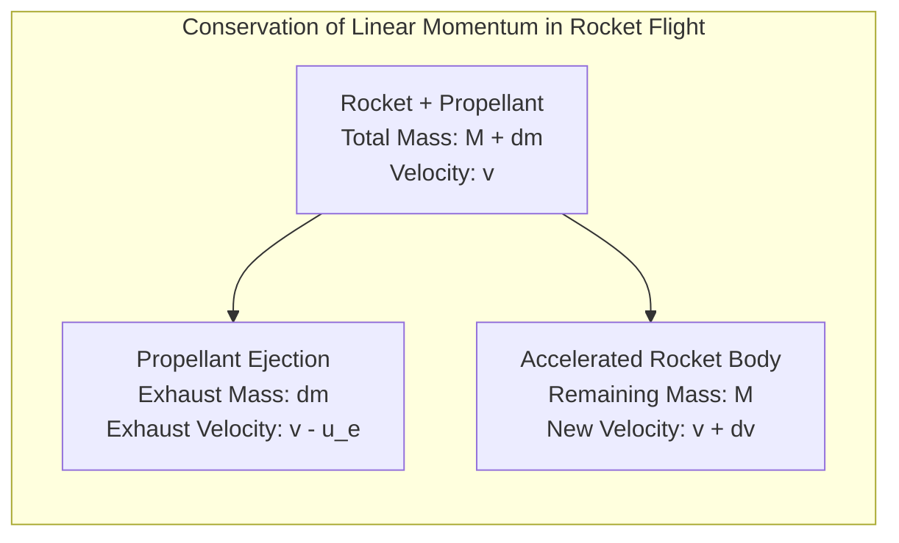
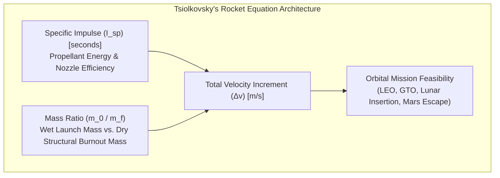
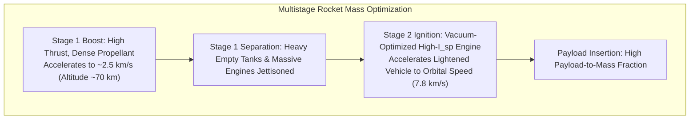
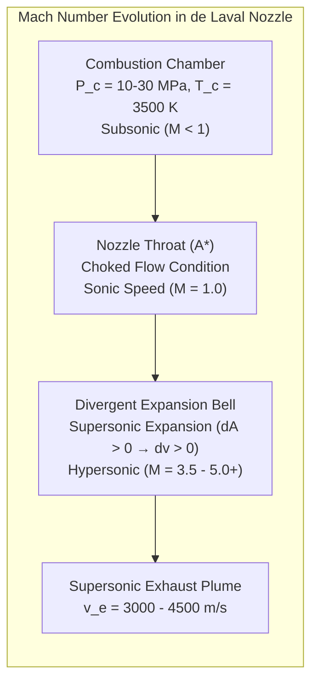
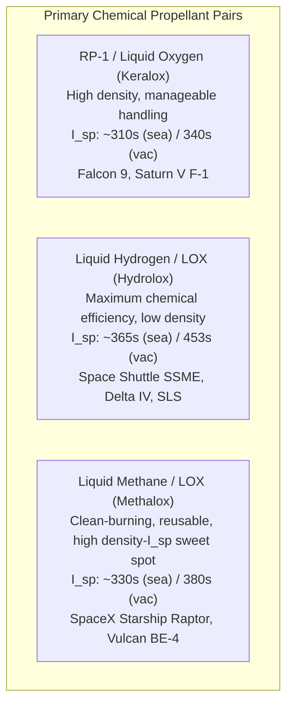
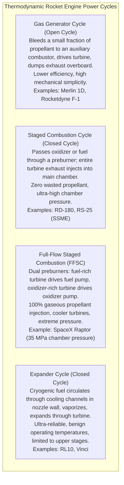
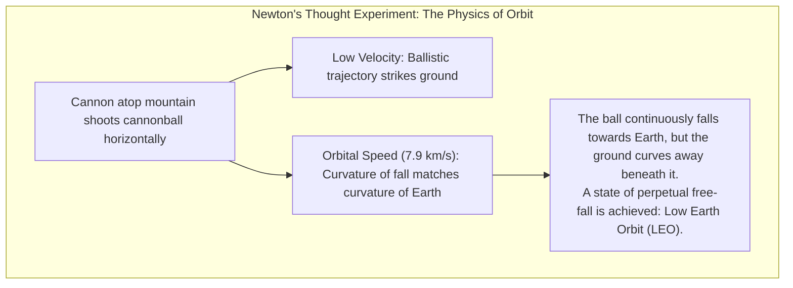
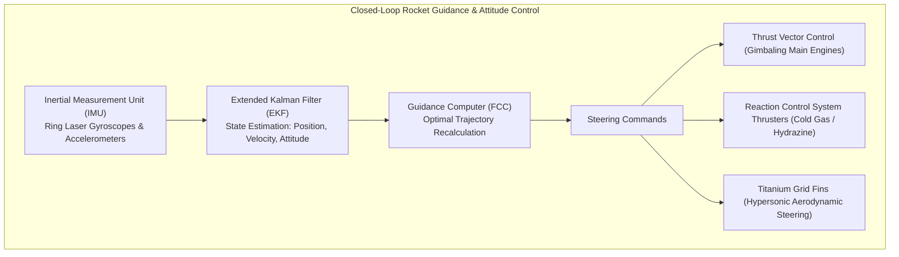
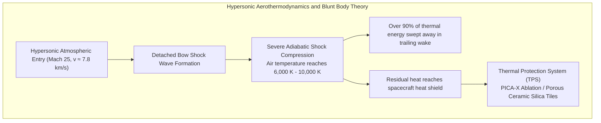

Tearing through the night sky with a deafening roar and expelling a searing plume of supersonic flame, an orbital rocket represents the absolute pinnacle of human engineering. It is the most extreme machine civilization has ever devised. Yet, how does a multi-thousand-ton metal tower breach Earth's dense atmospheric blanket, overcome the unyielding pull of planetary gravity, and deliver payloads into the cold vacuum of space?

Common intuition is often plagued by misconceptions: "In the vacuum of space, where there is no air or ground to push against, how can a rocket propel itself forward?" or "To reach space, doesn't a rocket simply need to fly straight up at maximum speed?"

From the perspective of fundamental physics, rocket flight is <strong>an extraordinary thermodynamic and mechanical symphony: a relentless triumph of Newton's laws of motion, compressible fluid dynamics, orbital mechanics, and hypersonic aerothermodynamics pushed to their mathematical extremes</strong>.

A rocket does not push against the surrounding air; it accelerates exclusively by hurling mass out of its engine nozzles at hypersonic velocities, in strict obedience to the conservation of momentum. Furthermore, "going to space" is not merely about reaching a high altitude—it is about <strong>falling sideways around the Earth so fast that you never hit the ground</strong> (orbital velocity of $7.9\,\mathrm{km/s}$). And returning to Earth requires safely dissipating that titanic kinetic energy into thousands of degrees of incandescent plasma heat through atmospheric shockwaves.

This comprehensive guide dissects the entire physics and engineering architecture of spaceflight: from Tsiolkovsky’s rocket equation and the de Laval nozzle to rocket engine thermodynamic cycles, gravity turns, Hohmann transfers, and the blunt-body theory of atmospheric reentry.

---

### 1. The Physics of Propulsion: Why Rockets Accelerate in a Vacuum

The foundational physical principle governing rocket propulsion is Sir Isaac Newton’s <strong>Third Law of Motion (action and reaction)</strong> and the <strong>Law of Conservation of Linear Momentum</strong>.

Terrestrial vehicles interact with their external environment to generate motive force:
- Automobiles push against the asphalt through frictional shear forces at the tire contact patch.
- Aircraft push surrounding atmospheric air rearward via propellers or turbojet bypass fans.
- Marine vessels push water rearward using submerged propellers.

In stark contrast, a rocket is <strong>completely independent of any external medium</strong>. In fact, a rocket operates with far greater efficiency in the absolute vacuum of space than in the atmosphere, because it does not suffer from atmospheric backpressure or aerodynamic drag.

#### Mathematical Derivation from First Principles
Consider an isolated system consisting of a rocket of instantaneous structural mass $M$ carrying an incremental mass of propellant $dm$. Let the total system move with velocity $v$ relative to an inertial reference frame.

The total initial momentum of the system at time $t$ is:

$$P(t) = (M + dm) v$$

Over an infinitesimal time interval $dt$, the engine expels the mass element $dm$ rearward with an effective exhaust velocity $u_e$ relative to the rocket. In the inertial frame, the velocity of this expelled gas packet is $(v - u_e)$. Simultaneously, the rocket body accelerates to a new velocity $(v + dv)$.

The total momentum of the system at time $t + dt$ is:

$$P(t + dt) = M(v + dv) + dm(v - u_e)$$

In the absence of external forces, linear momentum is conserved ($P(t) = P(t + dt)$):

$$(M + dm) v = M v + M dv + v dm + dm dv - u_e dm$$

Neglecting the second-order differential product $dm dv \approx 0$ and canceling algebraic terms:

$$M dv = u_e dm$$

Because the mass of the rocket decreases as propellant is consumed, the change in rocket mass is $dM = -dm$. Substituting this yields the fundamental differential equation of rocket propulsion:

$$M dv = - u_e dM \implies dv = - u_e \frac{dM}{M}$$

This equation proves that rocket thrust is fundamentally an <strong>internal recoil phenomenon</strong>. The acceleration of the rocket depends solely upon two parameters:
1. The rate at which propellant mass is ejected ($\dot{m} = |dM/dt|$).
2. The relative velocity $u_e$ at which the gas exits the nozzle throat and bell.

---

### 2. Tsiolkovsky’s Rocket Equation and the Tyranny of the Exponential

In 1903, Russian schoolteacher and visionary scientist Konstantin Tsiolkovsky integrated the fundamental propulsion equation across the vehicle's burn duration, establishing the foundational mathematical law of astronautics: <strong>Tsiolkovsky’s Rocket Equation</strong>.

Integrating from the rocket's fully fueled initial launch mass $m_0$ (wet mass) to its burnout mass $m_f$ (dry mass comprising structures, avionics, engines, and payload):

$$\int_0^{\Delta v} dv = - u_e \int_{m_0}^{m_f} \frac{dM}{M}$$

$$\Delta v = u_e \ln\left( \frac{m_0}{m_f} \right)$$

In aerospace engineering, exhaust velocity $u_e$ is conventionally characterized by the <strong>Specific Impulse ($I_{sp}$)</strong>, defined as the ratio of thrust to the weight flow rate of propellant at Earth's standard sea-level gravitational acceleration ($g_0 = 9.80665\,\mathrm{m/s^2}$):

$$u_e = I_{sp} g_0$$

Thus, the rocket equation is traditionally expressed as:

$$\Delta v = I_{sp} g_0 \ln\left( \frac{m_0}{m_f} \right)$$

#### Physical Meaning of Specific Impulse ($I_{sp}$)
Specific impulse $I_{sp}$ (measured in seconds) quantifies the fuel efficiency of a rocket engine: it represents <strong>the number of seconds for which 1 kilogram of propellant can produce 1 kilogram-force of thrust</strong>. A higher $I_{sp}$ directly reflects a higher exhaust velocity, allowing a rocket to achieve a greater $\Delta v$ for a given mass of propellant.

#### The Exponential Trap: The "Tyranny of the Rocket Equation"
The central operational bottleneck of spaceflight stems from the mathematical property of the exponential function:

$$\frac{m_0}{m_f} = \exp\left( \frac{\Delta v}{I_{sp} g_0} \right)$$

To achieve low Earth orbit (LEO), a rocket must not only acquire an orbital velocity of $\approx 7.8\,\mathrm{km/s}$, but it must also compensate for atmospheric aerodynamic drag losses ($\Delta v_{\text{drag}} \sim 150 - 300\,\mathrm{m/s}$) and gravity losses ($\Delta v_{\text{gravity}} \sim 1,200 - 1,500\,\mathrm{m/s}$). The total required velocity budget is approximately:

$$\Delta v_{\text{required}} \approx 9,400\,\mathrm{m/s} \quad (9.4\,\mathrm{km/s})$$

Let us evaluate the required mass ratio $m_0 / m_f$ for various chemical propulsion technologies:

1. <strong>Hydrolox Propulsion (LOX / LH2)</strong>:
   Operating with an exceptional vacuum specific impulse $I_{sp} \approx 450\,\mathrm{s}$ ($u_e \approx 4,410\,\mathrm{m/s}$):
   $$\frac{m_0}{m_f} = e^{9400 / 4410} = e^{2.13} \approx 8.42$$
   The propellant must constitute <strong>$88.1\%$</strong> of the rocket's total launch mass. The dry structure, plumbing, high-pressure tanks, avionics, engines, and the payload itself must fit within just <strong>$11.9\%$</strong>.
2. <strong>Keralox Propulsion (LOX / RP-1)</strong>:
   Operating with an effective average specific impulse $I_{sp} \approx 310\,\mathrm{s}$ ($u_e \approx 3,040\,\mathrm{m/s}$):
   $$\frac{m_0}{m_f} = e^{9400 / 3040} = e^{3.09} \approx 22.0$$
   Here, <strong>$95.5\%$ of the rocket's launch mass must be propellant</strong>, leaving a razor-thin margin of <strong>$4.5\%$</strong> for all structural materials and payload combined!

This harsh exponential reality is known across astronautics as the <strong>"Tyranny of the Rocket Equation"</strong>. If an engineer wants to add a heavier satellite, they must add more propellant; but that added propellant requires more propellant to lift it, causing launch vehicle size to balloon exponentially.

---

### 3. The Multistage Solution: Discarding Dead Weight

Building a single-stage rocket that can reach orbit—known as a <strong>Single-Stage-To-Orbit (SSTO)</strong> vehicle—is virtually impossible with modern materials because an empty fuel tank that has finished its job remains an enormous parasitic mass that must be accelerated all the way to orbital velocity.

The universal engineering solution is <strong>Multistage Staging</strong>.

By dropping the empty tanks and oversized sea-level engines of the first stage into the ocean or landing them back on Earth, the remaining vehicle's mass drops abruptly. The second-stage engine fires from an elevated position and high initial velocity, accelerating a dramatically lightened craft.

For an $N$-stage rocket, the total mission $\Delta v$ is the algebraic sum of the individual velocity increments:

$$\Delta v_{\text{total}} = \sum_{i=1}^N \Delta v_i = \sum_{i=1}^N I_{sp,i} g_0 \ln\left( \frac{m_{0,i}}{m_{f,i}} \right)$$

Staging breaks the single exponential barrier into a series of smaller, compounded mass ratios, transforming an otherwise impossible mission into an achievable operational reality.

---

### 4. Fluid Dynamics of the de Laval Nozzle: Supersonic Expansion

How does a rocket engine convert the chaotic thermal energy of chemical combustion into an aligned, hypersonic exhaust stream? The answer lies in the <strong>convergent-divergent nozzle</strong>, invented by Swedish engineer Gustaf de Laval in 1888.

#### The Area-Velocity Differential Relation
For quasi-one-dimensional steady isentropic flow of an ideal compressible gas, the continuity equation ($\rho A v = \text{const}$) and Euler's momentum equation ($dp = -\rho v dv$), combined with the local speed of sound ($a = \sqrt{\gamma R T}$), yield the fundamental <strong>Hugoniot Area-Velocity Relation</strong>:

$$\frac{dA}{A} = (M^2 - 1) \frac{dv}{v}$$

where $M = v/a$ is the local Mach number. This equation reveals the counterintuitive physics of compressible aerodynamics:

1. <strong>Subsonic Regime ($M < 1$)</strong>: $(M^2 - 1) < 0$. To accelerate the fluid ($dv > 0$), the cross-sectional area must decrease ($dA < 0$). The nozzle must converge, behaving like a garden hose nozzle.
2. <strong>Sonic Throat ($M = 1$)</strong>: When the cross-sectional area reaches its minimum ($dA = 0$), the flow reaches the speed of sound ($M = 1.0$). At this point, the flow becomes <strong>choked</strong>, meaning no downstream pressure disturbance can propagate upstream into the combustion chamber.
3. <strong>Supersonic Regime ($M > 1$)</strong>: $(M^2 - 1) > 0$. Once the gas exceeds Mach 1, <strong>increasing the cross-sectional area ($dA > 0$) causes the gas to accelerate further ($dv > 0$)!</strong>

In the diverging bell, the supersonic gas expands rapidly. Its internal static pressure and temperature plummet, converting thermal enthalpy ($c_p T$) into directed kinetic energy ($\frac{1}{2} v^2$). By the time the exhaust exits the nozzle lip, it is traveling between Mach 3 and Mach 5 ($3,000\,\mathrm{m/s}$ to $4,500\,\mathrm{m/s}$).

#### Ambient Pressure and Nozzle Expansion Ratio
The ratio of the nozzle exit area $A_e$ to the throat area $A^*$ is the <strong>expansion ratio ($\epsilon = A_e / A^*$)</strong>. The relationship between nozzle exit pressure $P_e$ and ambient atmospheric pressure $P_a$ dictates flow behavior:

| Nozzle Regime | Pressure Condition | Flow Physics & Shock Behavior | Optimal Operational Altitude |
| :--- | :--- | :--- | :--- |
| <strong>Optimum Expansion</strong> | $P_e = P_a$ | Exit pressure matches ambient. Exhaust plume exits perfectly parallel. Thrust coefficient is maximized. | Design Altitude |
| <strong>Over-Expanded</strong> | $P_e < P_a$ | Ambient air squeezes the plume inward, causing oblique compression shock waves. Excessive over-expansion triggers flow separation inside the nozzle bell, generating destructive asymmetric side-loads. | Sea Level Launch |
| <strong>Under-Expanded</strong> | $P_e > P_a$ | Exhaust exits at higher pressure than ambient, expanding violently outward in a billowing bulbous plume. Residual pressure energy expands sideways rather than rearward. | Space Vacuum |

Consequently, first-stage engines use compact nozzles with modest expansion ratios ($\epsilon \approx 20 - 40$) to prevent flow separation at sea level, while upper-stage vacuum engines feature massive skirts with expansion ratios exceeding $\epsilon \approx 150 - 300$.

---

### 5. Propellant Chemistry and Thermodynamic Engine Cycles

The performance of an orbital rocket engine is defined by its chemical propellant combination and the thermodynamic cycle driving its high-pressure turbopumps.

#### Turbopump Thermodynamic Cycles
Pumping hundreds of kilograms of cryogenic liquid per second into a combustion chamber pressurized at $10$ to $30\,\mathrm{MPa}$ requires tens of thousands of horsepower. Engineers utilize distinct thermodynamic cycles to spin the turbopump drive turbines:

---

### 6. Orbital Mechanics: Why Orbiting Means "Falling Sideways"

A ubiquitous misconception is that rockets reach space by climbing "above gravity". In reality, at the altitude of the International Space Station ($400\,\mathrm{km}$), Earth's gravitational acceleration is still roughly <strong>$8.7\,\mathrm{m/s^2}$—nearly $90\%$ of its surface value</strong>! Astronauts do not float because there is no gravity; they float because they are in <strong>perpetual free-fall</strong>.

#### First Cosmic Velocity (Circular Orbital Velocity)
For an object of mass $m$ to maintain a stable circular orbit at radius $r = R_E + h$, the centripetal force required to bend its path must equal the Newtonian gravitational force:

$$\frac{m v^2}{r} = G \frac{M_E m}{r^2} \implies v_{\text{orbit}} = \sqrt{\frac{G M_E}{r}}$$

At the surface of Earth ($r = R_E \approx 6,378\,\mathrm{km}$), this yields the <strong>First Cosmic Velocity</strong>:

$$v_1 = \sqrt{g_0 R_E} \approx \sqrt{9.81 \times 6.378 \times 10^6} \approx 7,905\,\mathrm{m/s} \approx 7.9\,\mathrm{km/s} \quad (28,400\,\mathrm{km/h})$$

More than <strong>$80\%$ of a rocket's total energy expenditure</strong> is dedicated not to ascending vertically, but to accelerating horizontally to this staggering orbital velocity of Mach 25.

#### The Gravity Turn Trajectory
Rockets launch vertically only for the first few seconds to clear the launch tower and escape the dense lower atmosphere. At an altitude of a few hundred meters, the flight computer initiates a subtle <strong>pitch-over maneuver</strong>.

From that point onward, the rocket executes a <strong>Gravity Turn</strong>: it aligns its thrust vector along the aerodynamic velocity vector (zero angle of attack, $\alpha \approx 0$). Planetary gravity naturally arches the flight trajectory from vertical to nearly horizontal, minimizing aerodynamic bending stress while reducing gravity steering losses ($\int g \sin\theta dt$) to an absolute minimum.

#### Orbital Transfers: The Vis-Viva Equation and Hohmann Trajectories
Any Keplerian orbit in a central gravitational field satisfies the <strong>Vis-Viva Equation</strong>:

$$v^2 = \mu \left( \frac{2}{r} - \frac{1}{a} \right)$$

where $\mu = G M_E$ is the standard gravitational parameter and $a$ is the semi-major axis.
To transfer a spacecraft from an initial circular orbit $r_1$ to a higher circular orbit $r_2$, the most fuel-efficient coplanar trajectory is the <strong>Hohmann Transfer Orbit</strong>:

$$\Delta v_1 = \sqrt{\frac{\mu}{r_1}} \left( \sqrt{\frac{2 r_2}{r_1 + r_2}} - 1 \right)$$

$$\Delta v_2 = \sqrt{\frac{\mu}{r_2}} \left( 1 - \sqrt{\frac{2 r_1}{r_1 + r_2}} \right)$$

Spacecraft perform impulsive Burns at periapsis and apoapsis, exploiting orbital mechanics paradoxes where "speeding up expands your orbit, making your orbital period longer".

---

### 7. Flight Control and Guidance: Steering a Rising Pencil

An ascending orbital rocket is aerodynamically and gravitationally unstable, behaving like an inverted pendulum balanced on a needle point. Keeping it flying on its precise trajectory requires millisecond-accurate guidance, navigation, and control (GNC).

- <strong>Thrust Vector Control (TVC)</strong>: Hydraulic or electromechanical actuators pivot the entire rocket engine nozzle by $\pm 5^\circ$ to $\pm 8^\circ$. Swiveling the exhaust plume creates a powerful control moment that steers the rocket through high-altitude wind shear.
- <strong>Reaction Control Systems (RCS)</strong>: In the vacuum of space where aerodynamic surfaces are useless, clusters of nitrogen or monopropellant thrusters pulse for milliseconds to control pitch, yaw, and roll.
- <strong>Supersonic Retro-Propulsion (SRP) & Grid Fins</strong>: Reusable boosters such as SpaceX’s Falcon 9 deploy four titanium grid fins to maintain aerodynamic authority from Mach 5 down to subsonic speeds, reigniting their main engines directly into incoming hypersonic airflow to decelerate smoothly for pinpoint pad landings.

---

### 8. Returning from the Abyss: Aerothermodynamics of Atmospheric Reentry

Reentering Earth's atmosphere is an engineering challenge every bit as perilous as escaping it.

A spacecraft returning from low Earth orbit possesses a specific kinetic energy of:

$$\frac{E_k}{m} = \frac{1}{2} v^2 = \frac{1}{2} (7,800\,\mathrm{m/s})^2 \approx 30.4\,\mathrm{MJ/kg}$$

Because $1\,\mathrm{kg}$ of TNT releases approximately $4.2\,\mathrm{MJ}$ of explosive energy, every kilogram of a returning space capsule carries the kinetic equivalent of <strong>over seven times its own mass in TNT</strong>.

#### H. Julian Allen’s Blunt Body Theory
Prior to the early 1950s, aircraft designers assumed that reentry vehicles should be needle-sharp to minimize air resistance. However, a sharp nose cone attaches the hypersonic shock wave directly to the vehicle skin, funneling intense convective heat into the nose and incinerating any known alloy.

In 1953, H. Julian Allen and A. J. Eggers at NACA (now NASA) formulated <strong>Blunt Body Theory</strong>:
- By giving the reentry capsule a broad, blunt, rounded heat shield, a powerful <strong>detached bow shock wave</strong> is pushed forward, maintaining a standoff distance $\Delta$ ahead of the vehicle.
- Atmospheric entry heating is dominated by <strong>adiabatic shock compression</strong>, not surface friction. The bow shock violently compresses the oncoming air into an incandescent plasma sheath reaching <strong>$6,000\,\mathrm{K}$ to $10,000\,\mathrm{K}$</strong> (hotter than the surface of the Sun).
- With a blunt body, <strong>more than $90\%$ of this extreme thermal energy is swept away into the surrounding atmosphere with the shock flow</strong>, allowing less than $10\%$ to conduct into the spacecraft structure.

#### Thermal Protection Systems (TPS)
To survive the remaining heat flux, spacecraft employ advanced thermal barriers:
1. <strong>Ablative Shields (PICA / PICA-X)</strong>: Resin-infused carbon-phenolic composites that absorb heat through endothermic pyrolysis, charring, and sublimating away. The outgassing vapor pushes the hot boundary layer away from the wall.
2. <strong>Reusable Radiative Ceramic Tiles</strong>: High-purity porous silica fiber tiles coated in borosilicate glass (as used on the Space Shuttle and Starship). Operating at thermal conductivity approaching zero, they radiate heat directly back into space according to the Stefan-Boltzmann law ($E = \epsilon \sigma T^4$).

#### Reentry Communications Blackout
During peak heating, the extreme temperature strips electrons from nitrogen and oxygen molecules, encasing the spacecraft in a dense plasma sheath. The plasma electron density $n_e$ defines the <strong>plasma frequency</strong>:

$$\omega_p = \sqrt{\frac{n_e e^2}{\epsilon_0 m_e}}$$

Electromagnetic signals with frequencies below $\omega_p$ undergo total internal reflection, cutting off voice and telemetry radio communication for several critical minutes.

---

### 9. Summary: The Grand Physics of Spaceflight

From ignition at the launchpad to orbital insertion and the fiery trial of reentry, the journey of an orbital rocket represents humanity’s most profound mastery over physical laws:

- <strong>Conservation of Momentum</strong>: Propels mass without an external medium by accelerating hot exhaust gases to hypersonic velocities;
- <strong>Tsiolkovsky's Rocket Equation</strong>: Dictates the exponential relationship between mass ratio and mission velocity increment ($\Delta v$);
- <strong>The de Laval Nozzle</strong>: Employs compressible fluid dynamics to convert thermodynamic enthalpy into supersonic kinetic thrust;
- <strong>Orbital Mechanics</strong>: Translates vertical ascent into a permanent state of horizontal free-fall at $7.9\,\mathrm{km/s}$;
- <strong>Hypersonic Aerodynamics</strong>: Uses blunt-body shock mechanics and advanced thermal protection materials to dissipate gigajoules of orbital energy during reentry.

Rockets are not merely transport vehicles. They are the physical embodiments of human intellect—bridges forged from mathematics, chemistry, and thermodynamics that liberate civilization from the gravitational cradle of Earth and open the infinite cosmos before us.
