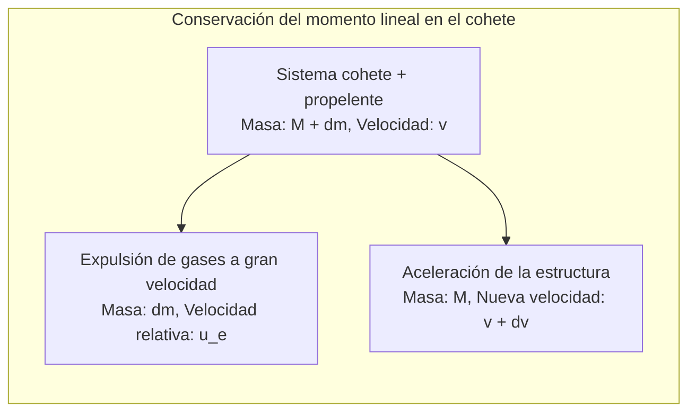
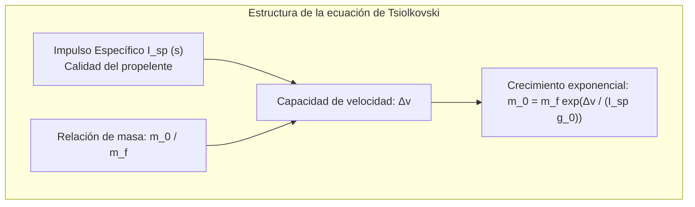
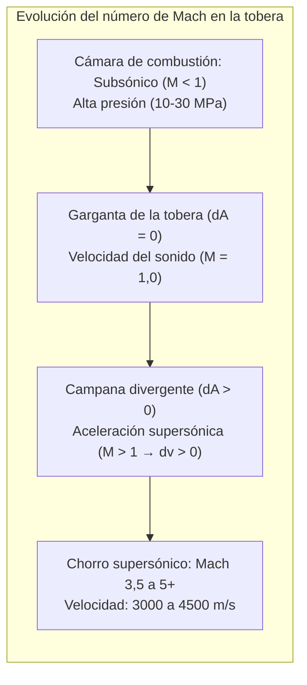

Rasgando el cielo nocturno con un rugido ensordecedor y expulsando chorros de fuego incandescente, los cohetes orbitales representan las máquinas más extremas construidas por la civilización. ¿Cómo logra una mole de miles de toneladas escapar de la gravedad terrestre e impulsarse en el vacío espacial?

La intuición común suele caer en errores: «¿Cómo puede acelerar un cohete en el vacío si no hay aire contra el que empujar?» o «¿Acaso ir al espacio no consiste simplemente en subir en vertical a toda velocidad?»

Desde la física fundamental, el vuelo espacial es <strong>una colosal sinfonía de leyes de conservación del momento, dinámica de fluidos compresibles, mecánica orbital y aerotermodinámica hipersónica</strong>. Un cohete no se apoya en el aire exterior; acelera exclusivamente mediante la <strong>tercera ley de Newton (acción y reacción)</strong>, expulsando masa a velocidades hipersónicas. Y entrar en órbita no significa subir alto, sino <strong>«caer perpetuamente hacia los lados a 7,9 km/s alrededor de la curvatura terrestre»</strong>.

---

### 1. El principio físico de la propulsión en el vacío: Conservación del momento

Los vehículos terrestres requieren fricción con el suelo y los aviones empujan aire hacia atrás.

Por el contrario, un cohete <strong>no depende en absoluto del entorno exterior y opera con su máxima eficiencia en el vacío absoluto</strong>, al no sufrir contrapresión atmosférica en la tobera.

En un sistema aislado sin fuerzas externas:

$$(M + dm) v = M (v + dv) + dm (v - u_e)$$

Despreciando $dm dv$ y con $dM = -dm$:

$$M dv = - u_e dM \implies dv = - u_e \frac{dM}{M}$$

La aceleración depende únicamente de la velocidad relativa de escape $u_e$ de los gases y del ritmo de consumo másico de combustible.

---

### 2. La ecuación del cohete de Tsiolkovski y la «tiranía exponencial»

En 1903, Konstantín Tsiolkovski formuló la ley matemática fundamental de la astronáutica:

$$\Delta v = u_e \ln\left( \frac{m_0}{m_f} \right) = I_{sp} g_0 \ln\left( \frac{m_0}{m_f} \right)$$

Donde:
- $\Delta v$ es el incremento total de velocidad;
- $I_{sp}$ es el <strong>impulso específico</strong> (en segundos), la métrica de eficiencia del propelente;
- $m_0 / m_f$ es la relación de masas entre el cohete cargado de combustible y la masa en seco tras la combustión.

Para alcanzar la órbita baja terrestre (LEO), sumando pérdidas por gravedad y rozamiento, se requiere un $\Delta v$ de aproximadamente <strong>$9,4\,\mathrm{km/s}$</strong>.
Despejando la relación de masas:

$$\frac{m_0}{m_f} = \exp\left( \frac{\Delta v}{I_{sp} g_0} \right)$$

- Con queroseno y oxígeno líquido (LOX/RP-1, $I_{sp} \approx 310\,\mathrm{s}$), el cociente es $22,0$: <strong>el $95,5\,\%$ de la masa en el despegue debe ser propelente puro, quedando solo un $4,5\,\%$ para motores, tanques y satélite</strong>.
- Con hidrógeno y oxígeno líquido (LOX/LH2, $I_{sp} \approx 450\,\mathrm{s}$), el combustible sigue ocupando el $88,1\,\%$ de la masa.

Esta limitación se denomina la <strong>«tiranía de la ecuación del cohete»</strong>. La solución de ingeniería ineludible es el <strong>cohete multietapa (Staging)</strong>: desechar tanques vacíos en vuelo para aligerar la estructura y permitir que las etapas superiores aceleren exponencialmente.

---

### 3. La tobera de Laval y la expansión supersónica

¿Cómo se convierte la enorme presión estática de combustión en un chorro supersónico dirigido? Mediante la <strong>tobera de Laval (convergente-divergente)</strong>.

Para flujo compresible isentrópico:

$$\frac{dA}{A} = (M^2 - 1) \frac{dv}{v}$$

- <strong>Sección convergente ($M < 1$)</strong>: Estrechar el conducto ($dA < 0$) acelera el flujo subsónico ($dv > 0$);
- <strong>Garganta ($M = 1$)</strong>: En el área mínima se alcanza la velocidad del sonido local;
- <strong>Campana divergente ($M > 1$)</strong>: Al superar Mach 1, <strong>¡ensanchar el conducto ($dA > 0$) provoca una violenta expansión adiabática que acelera aún más el gas ($dv > 0$)!</strong> El chorro escapa a entre Mach 3,5 y 5 ($3.000$ a $4.500\,\mathrm{m/s}$).

---

### 4. Ciclos termodinámicos de los motores cohete

Para inyectar toneladas de combustible por segundo a presiones de $20\,\mathrm{MPa}$ se requieren turbobombas de decenas de miles de caballos de potencia:
- <strong>Ciclo con generador de gas (abierto)</strong>: Quema una pequeña fracción de combustible para mover la turbina y la desecha (Merlin 1D de Falcon 9);
- <strong>Combustión escalonada (cerrado)</strong>: Todo el escape del prequemador se inyecta en la cámara principal para lograr máxima presión sin desperdicio (RD-180, SSME);
- <strong>Combustión escalonada de flujo completo (FFSC)</strong>: El motor Raptor de SpaceX gasifica por separado metano y oxígeno en prequemadores independientes, logrando un récord de presión de $35\,\mathrm{MPa}$ (350 atmósferas).

---

### 5. Mecánica orbital: Por qué orbitar es «caer de lado»

En la Estación Espacial Internacional ($400\,\mathrm{km}$), la gravedad terrestre sigue siendo del $90\,\%$ respecto a la superficie. Los astronautas flotan porque están en <strong>caída libre continua</strong>.

Según el experimento del cañón de Newton, al alcanzar la <strong>primera velocidad cósmica ($v_1 \approx 7,9\,\mathrm{km/s}$)</strong>, la curvatura de caída del proyectil coincide con la curvatura de la Tierra:

$$v_1 = \sqrt{g_0 R_E} \approx 7,9\,\mathrm{km/s} \quad (28.400\,\mathrm{km/h})$$

Más del <strong>$80\,\%$ de la energía del cohete</strong> se invierte en ganar esta velocidad horizontal. Mediante un <strong>giro gravitacional (Gravity Turn)</strong>, el cohete se tumba progresivamente para convertir el empuje en velocidad orbital.

---

### 6. Reentrada atmosférica: Teoría del cuerpo romo (Blunt Body Theory)

Al regresar de órbita debe disiparse una energía cinética de $30,4\,\mathrm{MJ/kg}$ (siete veces su peso en dinamita TNT).

En 1953, H. Julian Allen formuló la <strong>teoría del cuerpo romo</strong>:
- Una forma chata empuja una potente <strong>onda de choque desprendida (Bow Shock)</strong> por delante de la nave;
- El calor letal se debe a la <strong>compresión adiabática del aire por la onda de choque</strong>, que crea un plasma a entre $6.000\,\mathrm{K}$ y $10.000\,\mathrm{K}$;
- Gracias a la forma roma, <strong>más del $90\,\%$ de este calor de plasma se desvía lateralmente con el flujo de aire</strong>, evitando que penetre en la nave;
- Escudos ablativos (PICA-X) o losetas cerámicas disipan el calor restante por pirolisis y radiación infrarroja.

---

### 7. Conclusión

Desde el retropropulsor en el vacío hasta la ecuación de Tsiolkovski, la tobera de Laval y la caída libre a 7,9 km/s, la física de los cohetes representa la cúspide de la ingeniería para abrir a la humanidad las puertas del cosmos.
