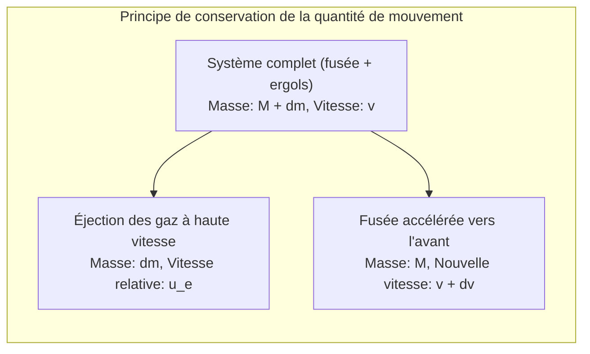
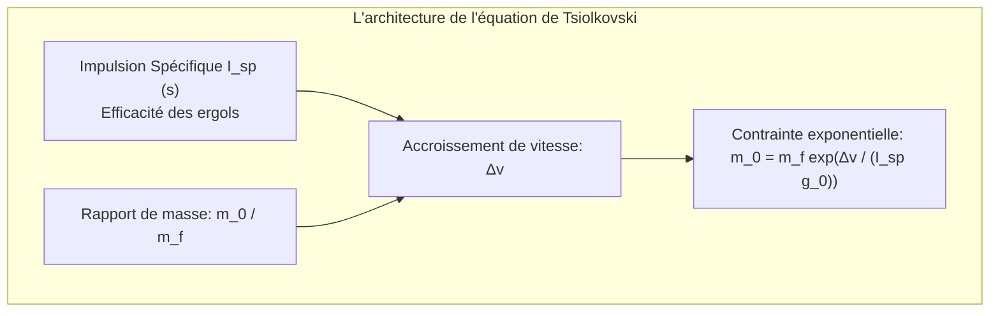
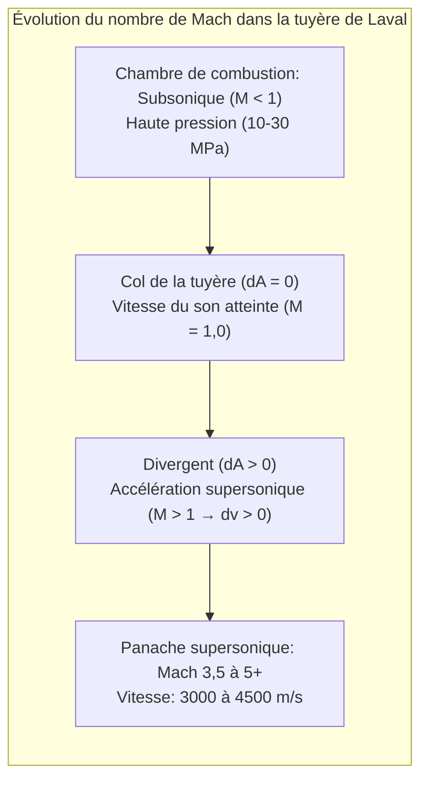

Déchirant le ciel nocturne dans un grondement assourdissant et crachant un panache de flammes incandescentes, une fusée spatiale représente l'une des machines les plus extrêmes jamais conçues par l'humanité. Comment ce colosse de métal parvient-il à s'arracher à la pesanteur terrestre pour naviguer dans le vide spatial ?

L'intuition commune est souvent trompeuse : « Comment une fusée peut-elle accélérer dans le vide où il n'y a pas d'air sur lequel prendre appui ? » ou « Aller dans l'espace ne consiste-t-il pas simplement à monter tout droit le plus vite possible ? »

Du point de vue de la physique fondamentale, le vol spatial est <strong>une symphonie thermodynamique et dynamique : une application rigoureuse de la conservation de la quantité de mouvement, de la dynamique des gaz compressibles, de la mécanique orbitale et de l'aérothermodynamique hypersonique</strong>. Une fusée ne s'appuie jamais sur l'air extérieur ; elle avance selon le <strong>principe d'action-réaction</strong> en éjectant des gaz à des vitesses hypersoniques. De plus, se mettre en orbite ne signifie pas monter haut, mais <strong>« chuter perpétuellement à l'horizontale à 7,9 km/s autour de la Terre »</strong>.

---

### 1. Le principe physique de la propulsion par réaction dans le vide

La propulsion d'une fusée découle directement de la <strong>troisième loi de Newton (action-réaction)</strong> et du <strong>principe de conservation de la quantité de mouvement</strong>.

Contrairement aux voitures ou aux avions qui interagissent avec leur milieu ambiant, une fusée <strong>fonctionne avec son rendement maximal dans le vide parfait</strong>, car aucun contre-pression atmosphérique ne s'oppose à l'éjection des gaz.

La dérivation mathématique dans un système isolé sans forces extérieures s'écrit :

$$(M + dm) v = M (v + dv) + dm (v - u_e)$$

En négligeant le terme du second ordre $dm dv$ et en posant $dM = -dm$ :

$$M dv = - u_e dM \implies dv = - u_e \frac{dM}{M}$$

L'accélération d'une fusée ne dépend donc que de la vitesse relative d'éjection des gaz $u_e$ et de la proportion de masse consommée.

---

### 2. L'équation de Tsiolkovski et la « tyrannie de la fusée »

En 1903, le savant russe Constantin Tsiolkovski intégra cette équation fondamentale, établissant la loi reine de l'astronautique :

$$\Delta v = u_e \ln\left( \frac{m_0}{m_f} \right) = I_{sp} g_0 \ln\left( \frac{m_0}{m_f} \right)$$

Où :
- $\Delta v$ est l'accroissement total de vitesse fourni par les moteurs ;
- $I_{sp}$ est l'<strong>impulsion spécifique</strong> (en secondes), mesurant l'efficacité énergétique des ergols ;
- $m_0 / m_f$ est le rapport entre la masse au décollage et la masse à sec en fin de combustion.

Pour atteindre l'orbite basse terrestre (LEO), en tenant compte de la traînée et des pertes gravitationnelles, il faut fournir un $\Delta v$ d'environ <strong>$9,4\,\mathrm{km/s}$</strong>.
En inversant la relation :

$$\frac{m_0}{m_f} = \exp\left( \frac{\Delta v}{I_{sp} g_0} \right)$$

- Avec du kérosène et de l'oxygène liquide (LOX/RP-1, $I_{sp} \approx 310\,\mathrm{s}$), le rapport de masse atteint $22,0$ : <strong>$95,5\,\%$ de la masse au décollage doit être constituée uniquement de carburant</strong>, ne laissant que <strong>$4,5\,\%$</strong> pour les moteurs, les réservoirs et la charge utile !
- Même avec l'hydrogène liquide (LOX/LH2, $I_{sp} \approx 450\,\mathrm{s}$), le carburant représente encore $88,1\,\%$ de la masse totale.

C'est la redoutable <strong>« tyrannie de l'équation de la fusée »</strong>. La solution d'ingénierie universelle est l'utilisation d'une <strong>fusée à étages (Staging)</strong> : larguer les réservoirs vides pour alléger drastiquement la structure et permettre aux étages supérieurs d'accélérer sans masse morte inutile.

---

### 3. La tuyère de Laval : Détente supersonique des gaz

Comment convertir la pression thermique des gaz en flammes supersoniques dirigées ? Grâce à la <strong>tuyère convergente-divergente inventée par Gustaf de Laval</strong>.

Pour un fluide compressible isentropique :

$$\frac{dA}{A} = (M^2 - 1) \frac{dv}{v}$$

- <strong>Section convergente ($M < 1$)</strong> : Le rétrécissement ($dA < 0$) accélère les gaz subsoniques ($dv > 0$) ;
- <strong>Col de la tuyère ($M = 1$)</strong> : Le fluide atteint exactement la vitesse locale du son (écoulement bloqué) ;
- <strong>Section divergente ($M > 1$)</strong> : Dès que l'écoulement devient supersonique, <strong>l'élargissement de la tuyère ($dA > 0$) provoque une détente adiabatique qui accélère encore les gaz ($dv > 0$) !</strong> Les gaz s'échappent à Mach 3,5 voire Mach 5 ($3\,000$ à $4\,500\,\mathrm{m/s}$).

---

### 4. Cycles thermodynamiques des moteurs-fusées

Alimenter une chambre de combustion à $20\,\mathrm{MPa}$ requiert des turbopompes d'une puissance colossale :
- <strong>Cycle à générateur de gaz (ouvert)</strong> : Une fraction d'ergols est brûlée pour actionner les turbines puis rejetée à l'extérieur (Merlin 1D de Falcon 9) ;
- <strong>Cycle à combustion étagée (fermé)</strong> : Les gaz de précombustion sont réinjectés dans la chambre principale pour une efficacité maximale sans perte (RD-180, SSME) ;
- <strong>Combustion étagée à flux total (FFSC)</strong> : La technologie du moteur Raptor de SpaceX, utilisant des prébrûleurs séparés riches en carburant et en comburant, atteignant une pression record de $35\,\mathrm{MPa}$ (350 bars).

---

### 5. Mécanique orbitale : Pourquoi satelliser, c'est « tomber à l'horizontale »

Contrairement à une idée reçue, une fusée ne cherche pas à « échapper à l'attraction ». À $400\,\mathrm{km}$ d'altitude (ISS), la gravité terrestre représente encore $90\,\%$ de celle au sol. Les spationautes flottent parce qu'ils sont en <strong>chute libre perpétuelle</strong>.

Selon l'expérience du canon de Newton, lorsqu'un projectile atteint la <strong>première vitesse cosmique ($v_1 \approx 7,9\,\mathrm{km/s}$)</strong>, la courbure de sa trajectoire de chute épouse parfaitement la courbure de la Terre :

$$v_1 = \sqrt{g_0 R_E} \approx 7,9\,\mathrm{km/s} \quad (28\,400\,\mathrm{km/h})$$

Plus de <strong>$80\,\%$ de l'énergie d'une fusée</strong> est dédiée à acquérir cette vitesse tangentielle horizontale. Par la manœuvre de <strong>virage gravitationnel (Gravity Turn)</strong>, la fusée s'incline progressivement pour transformer sa poussée en vitesse orbitale.

---

### 6. Rentrée atmosphérique : La théorie du corps émoussé (Blunt Body Theory)

Au retour d'orbite, le véhicule doit dissiper une énergie cinétique colossale de $30,4\,\mathrm{MJ/kg}$ (l'équivalent de sept fois son poids en TNT).

En 1953, H. Julian Allen révolutionna la rentrée avec la <strong>théorie du corps émoussé</strong> :
- Une forme arrondie pousse devant elle une <strong>onde de choc détachée (Bow Shock)</strong> ;
- L'échauffement provient de la <strong>compression adiabatique de l'air par l'onde de choc</strong>, créant un plasma entre $6\,000\,\mathrm{K}$ et $10\,000\,\mathrm{K}$ ;
- Avec un profil émoussé, <strong>plus de $90\,\%$ de cette chaleur extrême est emportée par l'écoulement d'air autour de la capsule</strong>, laissant moins de $10\,\%$ atteindre le bouclier thermique ;
- Les boucliers ablatifs (PICA-X) consument leur matière pour absorber les flux résiduels par chaleur latente de vaporisation.

---

### 7. Conclusion

De l'éjection de masse dans le vide à l'équation de Tsiolkovski, de la tuyère de Laval à la chute orbitale à 7,9 km/s et aux ondes de choc de rentrée, la physique des fusées est l'incarnation même du génie scientifique permettant à l'humanité d'ouvrir la frontière cosmique.
