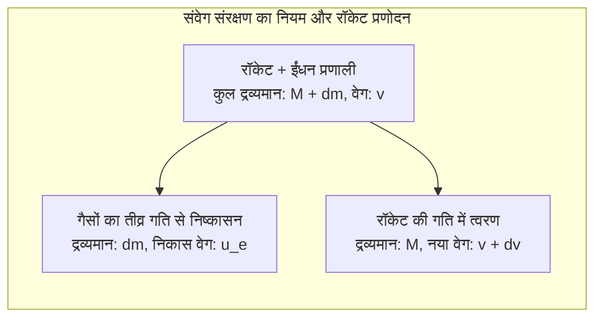
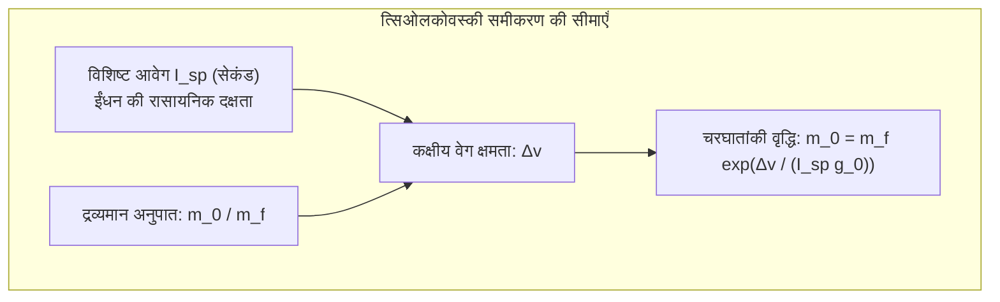
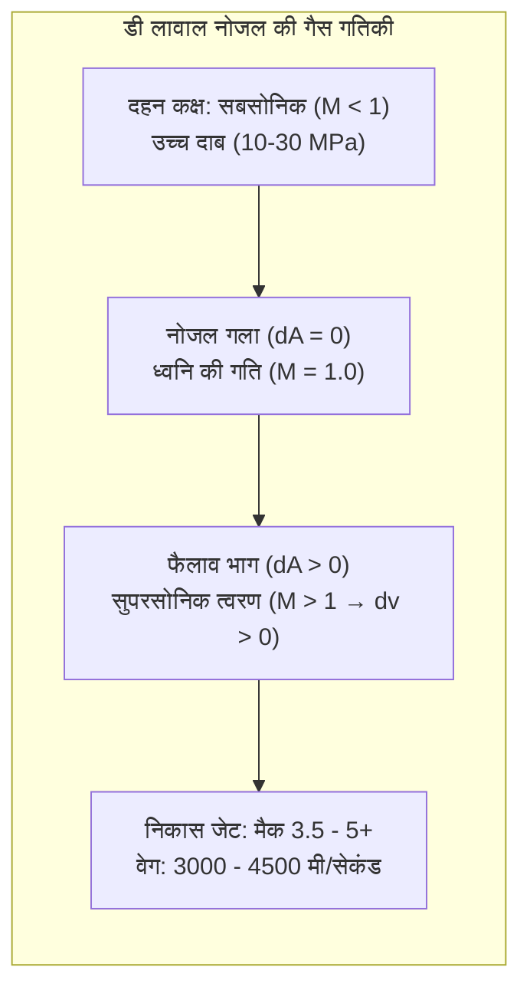

गगनभेदी गर्जना और भीषण आग की लपटों के साथ रात के सन्नाटे को चीरते हुए हजारों टन वजनी रॉकेट अंतरिक्ष की ओर उड़ान भरता है। मानव इतिहास की इस सबसे जटिल मशीन के पीछे कौन से भौतिक नियम कार्य करते हैं?

अक्सर लोगों में यह भ्रांति होती है: "अंतरिक्ष में जब हवा ही नहीं है तो रॉकेट आगे कैसे बढ़ता है?" या "अंतरिक्ष में जाने के लिए बस पूरी ताकत से सीधे ऊपर की ओर उड़ना काफी है?"

भौतिकी के दृष्टिकोण से रॉकेट की उड़ान <strong>संवेग संरक्षण के नियम, संपीड्य द्रव गतिकी, कक्षीय यांत्रिकी और हाइपरसोनिक ऊष्मागतिकी का अद्भुत संगम</strong> है। रॉकेट बाहरी हवा पर निर्भर नहीं करता, बल्कि वह <strong>न्यूटन के तीसरे नियम (क्रिया-प्रतिक्रिया)</strong> के अनुसार तीव्र गति से गैसों को बाहर फेंककर आगे बढ़ता है। और अंतरिक्ष की कक्षा में पहुंचने का अर्थ केवल ऊंचा उठना नहीं, बल्कि <strong>7.9 किमी/सेकंड की गति से पृथ्वी के चारों ओर लगातार गिरते रहना (कक्षीय मुक्त पतन)</strong> है।

---

### 1. निर्वात में प्रणोदन का भौतिक सिद्धांत: संवेग संरक्षण

जमीन पर चलने वाले वाहन पहियों के घर्षण पर निर्भर करते हैं और विमान हवा को पीछे धकेलते हैं।

इसके विपरीत, रॉकेट <strong>किसी भी बाहरी माध्यम पर निर्भर नहीं करता और निर्वात में इसकी दक्षता सबसे अधिक होती है</strong>, क्योंकि नोजल पर कोई वायुमंडलीय दबाव बाधा नहीं डालता।

एक विलगित निकाय में संवेग संरक्षण के नियम से:

$$(M + dm) v = M (v + dv) + dm (v - u_e)$$

इसे हल करने पर आधारभूत अवकल समीकरण प्राप्त होता है:

$$M dv = - u_e dM \implies dv = - u_e \frac{dM}{M}$$

यह समीकरण दर्शाता है कि रॉकेट का त्वरण केवल गैसों के निकास वेग $u_e$ और ईंधन की खपत दर पर निर्भर करता है।

---

### 2. त्सिओलकोवस्की का रॉकेट समीकरण और "रॉकेट का अभिशाप"

1903 में रूसी वैज्ञानिक कॉन्सटेंटिन त्सिओलकोवस्की ने रॉकेट विज्ञान का आधारभूत नियम प्रतिपादित किया:

$$\Delta v = u_e \ln\left( \frac{m_0}{m_f} \right) = I_{sp} g_0 \ln\left( \frac{m_0}{m_f} \right)$$

जहाँ:
- $\Delta v$: कुल प्राप्त वेग वृद्धि;
- $I_{sp}$: <strong>विशिष्ट आवेग (Specific Impulse)</strong>, जो ईंधन दक्षता का पैमाना है (सेकंड में);
- $m_0 / m_f$: प्रक्षेपण के समय का कुल द्रव्यमान और ईंधन समाप्त होने के बाद का सूखा द्रव्यमान।

पृथ्वी की निचली कक्षा (LEO) में जाने के लिए लगभग <strong>$9.4\,\mathrm{km/s}$</strong> की गति वृद्धि आवश्यक होती है।
चरघातांकी समीकरण के अनुसार:

$$\frac{m_0}{m_f} = \exp\left( \frac{\Delta v}{I_{sp} g_0} \right)$$

- केरोसिन और तरल ऑक्सीजन (LOX/RP-1) के साथ द्रव्यमान अनुपात $22.0$ होता है: यानी <strong>रॉकेट के कुल वजन का $95.5\%$ केवल ईंधन होना चाहिए, और केवल $4.5\%$ वजन में रॉकेट का ढांचा, इंजन और उपग्रह शामिल होते हैं</strong>!
- इसे <strong>"रॉकेट समीकरण का अभिशाप"</strong> कहा जाता है। इसका एकमात्र समाधान <strong>बहु-चरणीय रॉकेट (Multistage Rocket)</strong> है, जिसमें खाली हो चुके टैंकों को रास्ते में ही गिरा दिया जाता है ताकि हल्का हुआ ऊपरी चरण और तेजी से बढ़ सके।

---

### 3. डी लावाल नोजल (de Laval Nozzle) और सुपरसोनिक विस्तार

दहन कक्ष के $3000\,^\circ\mathrm{C}$ तापमान और उच्च दबाव को हजारों मीटर प्रति सेकंड की सुपरसोनिक गति में कैसे बदला जाता है? इसके लिए <strong>डी लावाल नोजल</strong> का उपयोग किया जाता है।

संपीड्य प्रवाह के क्षेत्रफल-वेग संबंध के अनुसार:

$$\frac{dA}{A} = (M^2 - 1) \frac{dv}{v}$$

- <strong>सबसोनिक भाग ($M < 1$)</strong>: नोजल सिकुड़ने पर ($dA < 0$) गैस की गति बढ़ती है ($dv > 0$);
- <strong>गला ($M = 1$)</strong>: सबसे संकरे भाग में प्रवाह ध्वनि की गति (मैक 1) पर पहुंच जाता है;
- <strong>सुपरसोनिक भाग ($M > 1$)</strong>: ध्वनि की गति पार करने के बाद, <strong>नोजल का क्षेत्रफल बढ़ने पर ($dA > 0$) गैस का अचानक दबाव घटता है और गति और तेजी से बढ़ती है ($dv > 0$)!</strong> निकास गैसें मैक 3.5 से 5 (3000 से 4500 मी/सेकंड) की गति से बाहर निकलती हैं।

---

### 4. कक्षीय यांत्रिकी: कक्षा में घूमना यानी "क्षैतिज गिरना"

अंतरराष्ट्रीय अंतरिक्ष स्टेशन ($400\,\mathrm{km}$) पर भी पृथ्वी का गुरुत्वाकर्षण जमीन का लगभग $90\%$ होता है। अंतरिक्ष यात्री इसलिए तैरते हैं क्योंकि वे <strong>लगातार स्वतंत्र रूप से नीचे गिर रहे होते हैं</strong>।

न्यूटन के तोप के प्रयोग के अनुसार, जब क्षैतिज वेग <strong>प्रथम ब्रह्मांडीय वेग ($v_1 \approx 7.9\,\mathrm{km/s}$)</strong> पर पहुंचता है, तो वस्तु के गिरने का वक्र पृथ्वी के गोल वक्र के बिल्कुल समानांतर हो जाता है:

$$v_1 = \sqrt{g_0 R_E} \approx 7.9\,\mathrm{km/s} \quad (28,400\,\mathrm{km/h})$$

रॉकेट की <strong>$80\%$ से अधिक ऊर्जा</strong> इस क्षैतिज कक्षीय वेग को प्राप्त करने में खर्च होती है। रॉकेट <strong>ग्रेविटी टर्न</strong> तकनीक द्वारा धीरे-धीरे झुकते हुए इस गति को हासिल करता है।

---

### 5. वायुमंडलीय पुन:प्रवेश: कुंद शरीर सिद्धांत (Blunt Body Theory)

अंतरिक्ष से लौटते समय यान में $30.4\,\mathrm{MJ/kg}$ की अत्यधिक गतिज ऊर्जा होती है (अपने वजन के 7 गुना टीएनटी बारूद के बराबर)।

1953 में एच. जूलियन एलन ने <strong>कुंद शरीर सिद्धांत (Blunt Body Theory)</strong> प्रस्तुत किया:
- आगे से चपटा गोल ढाल यान के आगे एक <strong>अलग धनुषाकार आघात तरंग (Bow Shock Wave)</strong> उत्पन्न करता है;
- भीषण गर्मी घर्षण से नहीं, बल्कि <strong>आघात तरंग द्वारा हवा के अत्यधिक संपीड़न</strong> से उत्पन्न होती है, जिससे $10000\,\mathrm{K}$ तक का प्लाज्मा बनता है;
- कुंद बनावट के कारण <strong>इस गर्मी का $90\%$ से अधिक भाग हवा के झोंकों के साथ किनारे से बाहर निकल जाता है</strong>, और यान तक $10\%$ से भी कम गर्मी पहुंचती है;
- शेष गर्मी को एब्लेटिव शील्ड (PICA-X) वाष्पीकृत होकर सोख लेती है।

---

### 6. निष्कर्ष

संवेग संरक्षण से लेकर त्सिओलकोवस्की के समीकरण, डी लावाल नोजल और 7.9 किमी/सेकंड की कक्षीय गति तक, रॉकेट विज्ञान मानव प्रतिभा का वह शिखर है जिसने हमें पृथ्वी के पालने से निकालकर सितारों की ओर कदम बढ़ाने में सक्षम बनाया।
