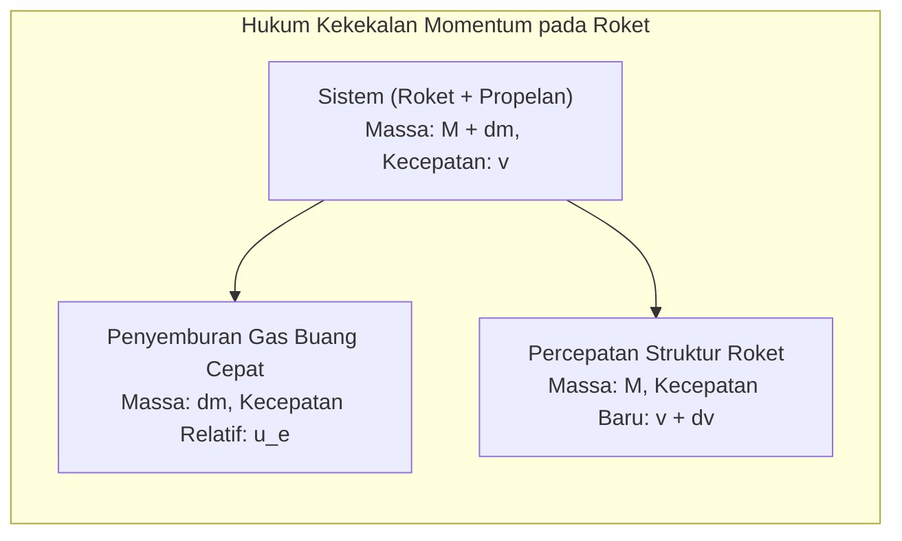
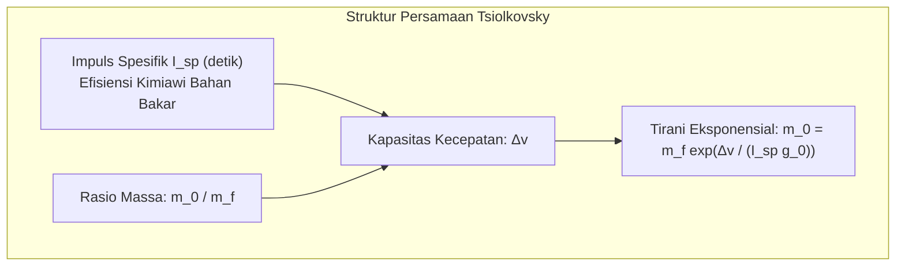
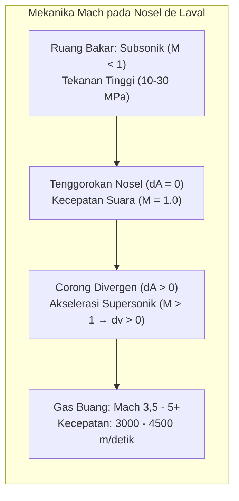

Membelah langit malam dengan gemuruh dahsyat dan menyemburkan lidah api pijar, roket orbital adalah mesin paling ekstrem yang pernah diciptakan peradaban manusia. Bagaimana struktur berbobot ribuan ton ini mampu menembus atmosfer tebal bumi, melepaskan diri dari tarikan gravitasi, dan melesat di ruang hampa antariksa?

Banyak kesalahpahaman umum bermunculan: "Bagaimana roket bisa terdorong di ruang hampa udara jika tidak ada udara untuk ditolak?" atau "Bukankah pergi ke luar angkasa cukup dengan meluncur lurus ke atas secepat-cepatnya?"

Dari kacamata fisika murni, penerbangan luar angkasa adalah <strong>simfoni termodinamika dan mekanika: penerapan ketat hukum kekekalan momentum, dinamika gas terkompresi, mekanika orbit, dan aerotermodinamika hipersonik</strong>. Roket tidak pernah mendorong udara luar; ia melaju murni berdasarkan <strong>hukum ketiga Newton (aksi-reaksi)</strong> dengan memuntahkan massa dengan kecepatan hipersonik. Dan mencapai orbit bukanlah tentang naik tinggi-tinggi, melainkan <strong>"jatuh bebas secara menyamping mengelilingi Bumi pada kecepatan 7,9 km/detik"</strong>.

---

### 1. Prinsip Fisika Propulsi di Ruang Hampa: Kekekalan Momentum

Kendaraan darat mengandalkan gesekan ban, dan pesawat terbang mendorong udara sekitar ke belakang.

Sebaliknya, roket <strong>sama sekali tidak bergantung pada medium eksternal dan justru bekerja paling efisien dalam kehampaan total</strong> karena tidak terhambat oleh tekanan balik atmosfer pada nosel.

Dalam sistem terisolasi tanpa gaya luar:

$$(M + dm) v = M (v + dv) + dm (v - u_e)$$

Dengan mengabaikan perkalian diferensial $dm dv$ dan substitusi $dM = -dm$:

$$M dv = - u_e dM \implies dv = - u_e \frac{dM}{M}$$

Persamaan ini membuktikan bahwa percepatan roket hanya ditentukan oleh kecepatan semburan gas $u_e$ dan rasio pembakaran massa propelan.

---

### 2. Persamaan Roket Tsiolkovsky dan "Tirani Persamaan Roket"

Pada tahun 1903, Konstantin Tsiolkovsky mengintegrasikan persamaan diferensial tersebut dan melahirkan hukum dasar astronautika:

$$\Delta v = u_e \ln\left( \frac{m_0}{m_f} \right) = I_{sp} g_0 \ln\left( \frac{m_0}{m_f} \right)$$

Di mana:
- $\Delta v$: Total penambahan kecepatan wahana;
- $I_{sp}$: <strong>Impuls spesifik</strong> (dalam detik), tolok ukur efisiensi propelan;
- $m_0 / m_f$: Rasio massa peluncuran terisi penuh terhadap massa kering saat bahan bakar habis.

Untuk mencapai orbit rendah Bumi (LEO), memperhitungkan rugi gravitasi dan hambatan udara, dibutuhkan $\Delta v \approx 9,4\,\mathrm{km/detik}$.
Menghitung rasio massa:

$$\frac{m_0}{m_f} = \exp\left( \frac{\Delta v}{I_{sp} g_0} \right)$$

- Dengan minyak tanah dan oksigen cair (LOX/RP-1, $I_{sp} \approx 310\,\mathrm{s}$), rasio massanya mencapai $22,0$: <strong>$95,5\%$ massa roket saat peluncuran harus berupa bahan bakar, menyisakan hanya $4,5\%$ untuk mesin, tangki, dan muatan satelit</strong>!
- Menggunakan hidrogen cair (LOX/LH2, $I_{sp} \approx 450\,\mathrm{s}$), porsi bahan bakar masih mencapai $88,1\%$.

Inilah yang dinamakan <strong>"Tirani Persamaan Roket"</strong>. Solusi mutlaknya adalah teknologi <strong>roket bertingkat (Multistage Staging)</strong>: membuang tangki-tangki kosong yang telah terbakar habis agar wahana tingkat atas yang jauh lebih ringan dapat terus berakselerasi secara eksponensial.

---

### 3. Nosel de Laval dan Ekspansi Supersonik

Bagaimana ruang pembakaran mengubah tekanan gas bersuhu $3.000\,^\circ\mathrm{C}$ menjadi semburan jet terarah berkecepatan ribuan meter per detik? Melalui <strong>nosel de Laval (konvergen-divergen)</strong>.

Berdasarkan relasi luas-kecepatan fluida kompresibel:

$$\frac{dA}{A} = (M^2 - 1) \frac{dv}{v}$$

- <strong>Bagian Konvergen ($M < 1$)</strong>: Penyempitan saluran ($dA < 0$) mempercepat aliran subsonik ($dv > 0$);
- <strong>Leher Nosel ($M = 1$)</strong>: Di luas penampang tersempit, aliran mencapai kecepatan suara lokal (*choked flow*);
- <strong>Bagian Divergen ($M > 1$)</strong>: Di daerah supersonik, <strong>pelebaran corong ($dA > 0$) justru memicu ekspansi adiabatik yang mempercepat aliran secara dahsyat ($dv > 0$)!</strong> Gas keluar pada rentang Mach 3,5 hingga 5 ($3.000$ hingga $4.500\,\mathrm{m/detik}$).

---

### 4. Siklus Termodinamika Mesin Roket

Memompa berton-ton propelan per detik ke dalam ruang bertekanan $20\,\mathrm{MPa}$ memerlukan turbopompa bertenaga puluhan ribu daya kuda:
- <strong>Siklus Generator Gas (Terbuka)</strong>: Sebagian kecil bahan bakar dibakar untuk memutar turbin lalu dibuang (Merlin 1D pada Falcon 9);
- <strong>Siklus Pembakaran Bertingkat (Tertutup)</strong>: Gas buang prapembakaran disalurkan seluruhnya ke ruang utama untuk pembakaran bertekanan tinggi tanpa pemborosan massa (RD-180, SSME);
- <strong>Full-Flow Staged Combustion (FFSC)</strong>: Mesin Raptor SpaceX merevolusi teknologi ini dengan memisahkan prapembakar metana dan oksigen, mencetak rekor tekanan ruang bakar $35\,\mathrm{MPa}$ (350 atm).

---

### 5. Mekanika Orbital: Mengapa Mengorbit Berarti "Jatuh Menyamping"

Di Stasiun Luar Angkasa Internasional (ISS, $400\,\mathrm{km}$), gravitasi Bumi masih mencapai $90\%$ dari nilai di permukaan. Para astronaut melayang bukan karena ketiadaan gravitasi, melainkan karena mereka berada dalam <strong>keadaan jatuh bebas abadi</strong>.

Eksperimen meriam Newton membuktikan: ketika kecepatan horizontal mencapai <strong>kecepatan kosmik pertama ($v_1 \approx 7,9\,\mathrm{km/detik}$)</strong>, kelengkungan jatuhnya proyektil tepat seimbang dengan kelengkungan permukaan Bumi:

$$v_1 = \sqrt{g_0 R_E} \approx 7,9\,\mathrm{km/detik} \quad (28.400\,\mathrm{km/jam})$$

Lebih dari <strong>$80\%$ energi roket</strong> dikerahkan untuk membangun kecepatan horizontal ini. Melalui manuver <strong>belokan gravitasi (Gravity Turn)</strong>, roket secara bertahap memiringkan badannya agar gaya dorong terkonversi menjadi kecepatan orbital.

---

### 6. Reentry Atmosfer: Teori Benda Tumpul (Blunt Body Theory)

Saat kembali dari orbit, wahana harus melenyapkan energi kinetik spesifik sebesar $30,4\,\mathrm{MJ/kg}$ (setara 7 kali beratnya dalam bom TNT).

Tahun 1953, H. Julian Allen mencetuskan <strong>teori benda tumpul (Blunt Body Theory)</strong>:
- Pelindung panas yang bulat tumpul mendorong terbentuknya <strong>gelombang kejut busur terpisah (Detached Bow Shock)</strong> di depan kapsul;
- Panas ekstrem berasal dari <strong>kompresi adiabatik udara akibat gelombang kejut</strong>, yang memanaskan plasma hingga $6.000\,\mathrm{K} - 10.000\,\mathrm{K}$;
- Desain tumpul membuat <strong>lebih dari $90\%$ panas plasma terhanyut bersama aliran udara samping</strong>, menyisakan kurang dari $10\%$ yang diserap wahana;
- Lapisan perisai ablasi (seperti PICA-X) menyerap sisa panas tersebut melalui proses pirolisis dan penguapan material.

---

### 7. Kesimpulan

Dari reaksi dorong di ruang hampa hingga persamaan Tsiolkovsky, dari nosel de Laval hingga orbit jatuh bebas 7,9 km/detik dan fisika gelombang kejut saat reentry, teknologi roket adalah bukti keunggulan akal manusia dalam meruntuhkan batasan gravitasi demi menjelajahi samudra kosmos.
