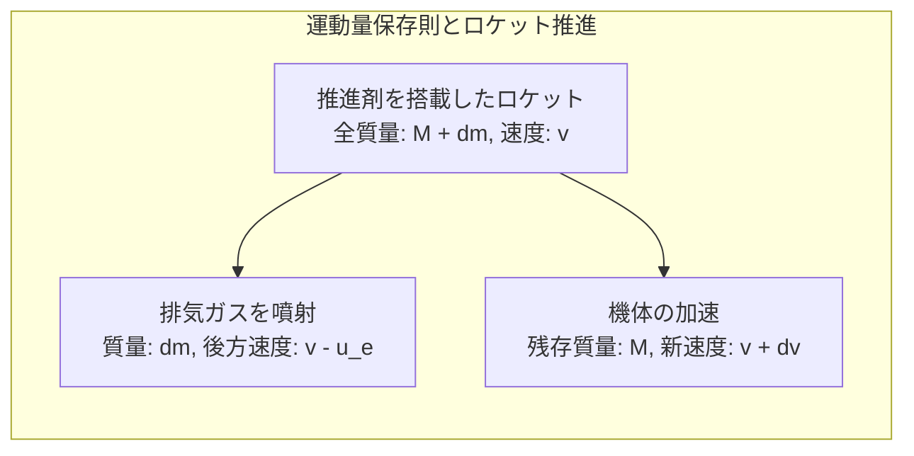
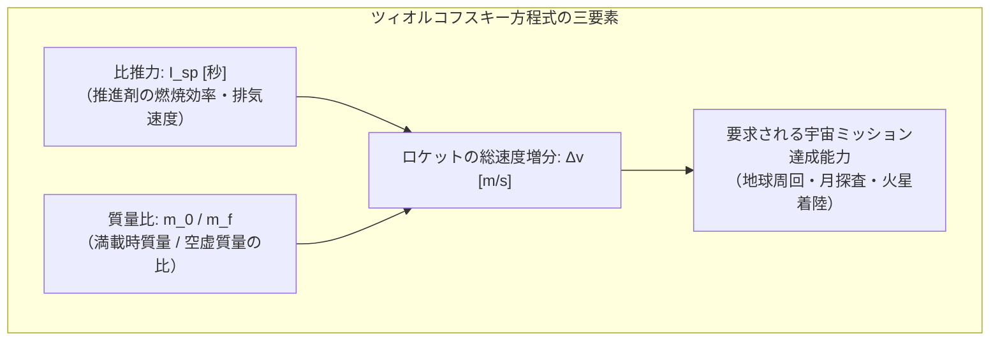
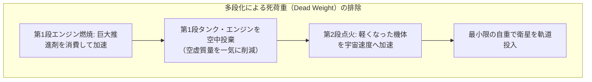
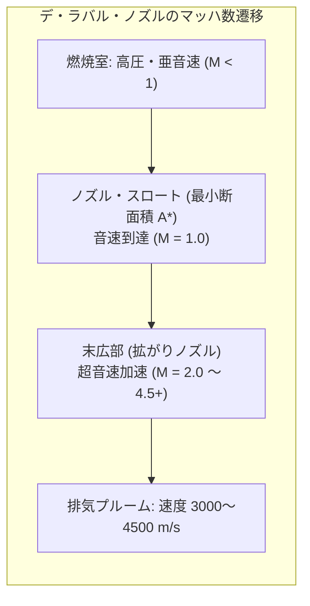
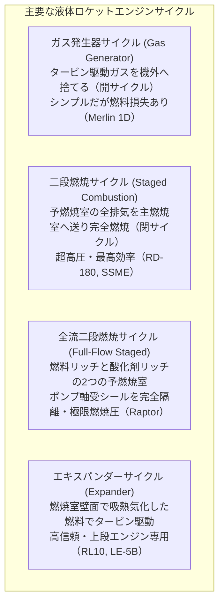
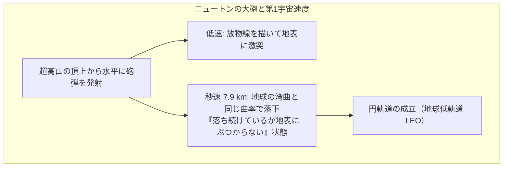
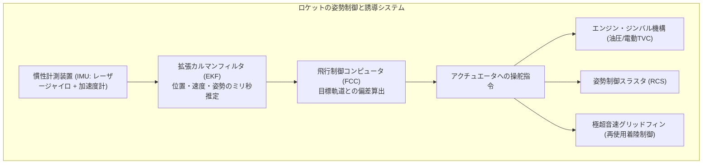
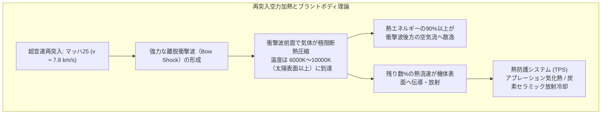

夜空を切り裂き、轟音とともに白熱の炎を噴射して上昇する巨大なロケット。人類が建造した最も過酷な極限機械であるロケットは、なぜ大気圏を突破し、重力の檻を脱して宇宙へと到達できるのか。

日常的な感覚では「空気のない宇宙空間では、地面や空気を蹴って進むことができないのに、どうして加速できるのか？」「宇宙に行くには、ただ真上に猛スピードで飛べばいいのではないか？」といった誤解が少なくない。

しかし物理学の視点に立てば、ロケットの飛行は<strong>「ニュートン力学、熱力学、圧縮性流体力学、軌道力学、そして超高温空力加熱という物理法則の限界に挑み、その制約を数学的極限まで利用した壮大なエネルギー変換劇」</strong>である。

ロケットは空気を押して進むのではなく、自らの体内に抱えた推進剤を猛烈な速度で後方へ投げ捨てる「運動量保存則」によってのみ進む。そして、宇宙へ行くとは「高く昇る」ことではなく<strong>「猛烈な速度で横に落ち続ける（地球を周回する）」</strong>ことであり、地球へ帰還するとはその莫大な運動エネルギーを大気との衝突によって灼熱のプラズマ熱へと変換して消散させることである。

ツィオルコフスキーのロケット方程式から超音速デ・ラバル・ノズル、エンジン燃焼サイクル、重力ターン、ホーマン遷移軌道、姿勢制御力学、そして大気圏再突入の鈍頭理論まで、ロケットを宇宙へ送り届け、無事に帰還させる物理学と工学の全貌を徹底的に解き明かしていく。

---

### 1. 推進の物理原理：真空中で加速できる理由

ロケットが宇宙を飛べる根源的な理由は、17世紀にアイザック・ニュートンが定式化した<strong>「運動量保存則」</strong>および<strong>「運動の第3法則（作用・反作用の法則）」</strong>に集約される。

自動車はタイヤと道路の摩擦力で進み、航空機は主翼とプロペラ・ジェットエンジンが大気を押し出す反作用で飛行する。これら地上・大気中の乗り物は、周囲の媒質（地面や空気）に依存して推力を得ている。

これに対し、ロケットは<strong>周囲に空気分子が1個も存在しない完全な真空中でこそ、最も効率よく加速できる</strong>。

#### 運動量保存則の微積分的導出
質量 $M$ のロケットが速度 $v$ で宇宙空間を飛行している系を考える。微小時間 $dt$ の間に、ロケットは微小質量 $dm$ の排気ガスを、機体に対する相対排気速度 $u_e$ で後方に向けて噴射したとする。

外力が作用しない孤立系において、噴射前後の全運動量は完全に保存される：

$$P(t) = (M + dm) v$$

噴射後、機体質量は $M$ となり速度は $v + dv$ に増加する。一方、噴射されたガス片の絶対速度は $(v - u_e)$ である。したがって噴射後の全運動量は：

$$P(t + dt) = M(v + dv) + dm(v - u_e)$$

運動量保存則 $P(t) = P(t + dt)$ より：

$$(M + dm) v = M v + M dv + v dm + dm dv - u_e dm$$

2次の微小量 $dm dv \approx 0$ を無視し、両辺を整理すると：

$$M dv = u_e dm$$

ここで、噴射によって機体質量は減少するため、$dM = -dm$（質量変化率は負）である。これを代入すると、ロケットの基本微分方程式が得られる：

$$M dv = - u_e dM \implies dv = - u_e \frac{dM}{M}$$

この式は決定的な事実を告げている：<strong>ロケットの加速 $dv$ は、外部の大気とは一切無関係であり、自らが排気ガスをどのくらいの質量比で、どのくらいの相対速度 $u_e$ で後方に放出したかによってのみ決定される</strong>。

大気が存在する環境では、大気圧がノズル出口からの排気を押し戻すバックプレッシャーとして作用し、さらに空気抵抗（抗力）が発生するため、ロケットは大気中よりも<strong>真空中のほうが圧倒的に高い推力と効率を発揮する</strong>のである。

---

### 2. ツィオルコフスキーのロケット方程式と「ロケットの呪い」

1903年、ロシアの科学者コンスタンチン・ツィオルコフスキーは、上記の微分方程式を積分し、宇宙工学の基礎となる<strong>「ツィオルコフスキーのロケット方程式」</strong>を導出した。

ロケットの点火前の初期全質量（機体＋推進剤）を $m_0$、燃料をすべて消費し尽くした後の燃焼完了時質量（構造体＋ペイロード）を $m_f$ とし、方程式を積分する：

$$\int_0^{\Delta v} dv = - u_e \int_{m_0}^{m_f} \frac{dM}{M}$$

$$\Delta v = u_e \ln\left( \frac{m_0}{m_f} \right)$$

ここで、排気速度 $u_e$ は宇宙工学の慣例として、海面重力加速度 $g_0 \approx 9.80665\,\mathrm{m/s^2}$ と<strong>比推力（Specific Impulse: $I_{sp}$）</strong>を用いて表現される：

$$u_e = I_{sp} g_0$$

したがって、ロケット方程式は以下のように記述される：

$$\Delta v = I_{sp} g_0 \ln\left( \frac{m_0}{m_f} \right)$$

#### 比推力 $I_{sp}$ の物理的意味
比推力 $I_{sp}$（単位：秒）とは、<strong>「$1\,\mathrm{kg}$ の推進剤が $1\,\mathrm{kgf}$ の推力を何秒間出し続けられるか」</strong>という推進効率の究極の指標である。
排気速度 $u_e$ が大きいほど比推力は高くなり、同じ速度増分 $\Delta v$ を得るために必要な燃料消費量を劇的に節約できる。

#### 指数関数の暴虐：ロケットの呪い（The Tyranny of the Rocket Equation）
この方程式の最も恐るべき物理的本質は、<strong>自然対数 $\ln(m_0/m_f)$</strong>、あるいはその逆関数である<strong>指数関数 $\exp(\Delta v / u_e)$</strong> にある。

必要な速度増分 $\Delta v$ を達成するための初期質量比を解くと：

$$\frac{m_0}{m_f} = e^{\Delta v / (I_{sp} g_0)}$$

地球低軌道（LEO）に到達するために必要な総速度変化 $\Delta v$ は、大気抗力損失や重力損失を含めると約 <strong>$9.3\,\mathrm{km/s} \sim 9.5\,\mathrm{km/s}$（$9400\,\mathrm{m/s}$）</strong> である。

世界最高の化学推進剤である液体酸素／液体水素（LOX/LH2）エンジンの比推力を $I_{sp} \approx 450\,\mathrm{s}$（$u_e \approx 4410\,\mathrm{m/s}$）と仮定して、単段でこの速度を達成しようとすると：

$$\frac{m_0}{m_f} = e^{9400 / 4410} = e^{2.13} \approx 8.42$$

これは、<strong>ロケットの打ち上げ時質量の実に $88.1\%$ が純粋な推進剤でなければならず、エンジン、推進剤タンク、配管、電子機器、そして肝心の人工衛星（ペイロード）を含む全構造物の合計質量を、わずか $11.9\%$ 以内に収めなければならない</strong>ことを意味する。

もしケロシン系（LOX/RP-1、実効 $I_{sp} \approx 310\,\mathrm{s}$）を用いた場合：

$$\frac{m_0}{m_f} = e^{9400 / (310 \times 9.81)} = e^{3.09} \approx 22.0$$

推進剤の割合は <strong>$95.5\%$</strong> に達し、構造体とペイロードの重量枠はわずか <strong>$4.5\%$</strong> しか残されない。卵の殻よりも薄い極限構造を作らなければ、1グラムの荷物も宇宙へ運べない。これが航空宇宙工学で「ロケットの呪い（Tyranny of the Rocket Equation）」と呼ばれる絶望的な物理的障壁である。

---

### 3. 多段化の力学：なぜロケットは空中で切り離すのか

単一のステージで地球低軌道に達する「単段式宇宙往還機（SSTO: Single-Stage-To-Orbit）」が現代の材料工学で極めて困難である理由は、燃え殻となった巨大な空タンクを軌道速度まで加速し続けなければならないからである。

この呪いを打破する唯一の工学的解答が<strong>「多段ロケット（Multistage Rocket）」</strong>である。

多段ロケットでは、燃料を使い切った巨大な第1段のエンジンとタンクを大気圏上層で即座に切り離して投棄する。残された第2段は、すでに高い高度と初速度を得た状態で、はるかに身軽になった状態から点火する。

$N$ 段式ロケットの総速度増分 $\Delta v_{\text{total}}$ は、各段の増分の単純な代数和となる：

$$\Delta v_{\text{total}} = \sum_{i=1}^N \Delta v_i = \sum_{i=1}^N I_{sp,i} g_0 \ln\left( \frac{m_{0,i}}{m_{f,i}} \right)$$

各段で空タンクという「死荷重（Dead Weight）」を大胆に切り捨てることで、実効的な質量比を指数関数的に改善し、ペイロード比率を劇的に向上させることが可能となる。

---

### 4. 燃焼と超音速ノズルの流体力学：デ・ラバル・ノズルの奇跡

推進剤の化学結合エネルギーを猛烈な運動エネルギーへと変換する心臓部が、<strong>ロケットエンジン</strong>と<strong>デ・ラバル・ノズル（Convergent-Divergent Nozzle）</strong>である。

燃焼室内で推進剤が燃焼すると、圧力は $5\,\mathrm{MPa} \sim 25\,\mathrm{MPa}$（大気圧の数十〜数百倍）、温度は $3000^\circ\mathrm{C} \sim 3500^\circ\mathrm{C}$ に達する高圧高温の静止気体が生み出される。この熱力学的エンタルピーを、いかにして後方への一方向の超音速噴流へと変換するのか。

#### 圧縮性流体の断面積変化と流速：面積・速度関係式
一次元等エントロピー流れにおいて、流路断面積 $A$ の変化と流速 $v$（マッハ数 $M = v/a$）の間には、流体力学の基本関係式が成立する：

$$\frac{dA}{A} = (M^2 - 1) \frac{dv}{v}$$

この式は驚くべき物理現象を記述している：

1. <strong>亜音速領域（$M < 1$）</strong>：$(M^2 - 1) < 0$ であるため、断面積を絞る（$dA < 0$）と流速は加速する（$dv > 0$）。これは水道ホースの先を指で絞ると水が勢いよく飛び出す日常的直感と一致する。
2. <strong>音速スロート（$M = 1$）</strong>：断面積が最小となる「のど部（スロート：$dA = 0$）」において、気体流速はちょうど局所音速（$M = 1$）に達する。
3. <strong>超音速領域（$M > 1$）</strong>：$(M^2 - 1) > 0$ であるため、<strong>断面積を広げる（$dA > 0$）と流速はさらに加速する（$dv > 0$）！</strong>

日常の感覚とは正反対に、超音速に達した気体は、流路を広げることによって急激な断熱膨張を起こし、熱エネルギーと圧力を運動エネルギーへと一気に変換して、マッハ3〜マッハ5以上（秒速3000〜4500m）へと爆発的に加速されるのである。

#### ノズル開口比と大気圧適応
ノズル出口断面積 $A_e$ とスロート断面積 $A^*$ の比を<strong>ノズル開口比（Expansion Ratio: $\epsilon = A_e / A^*$）</strong>と呼ぶ。
排気ガスの出口圧力 $P_e$ と周囲環境の大気圧 $P_a$ の関係により、ノズル効率は劇的に変動する：

| ノズル状態 | 圧力関係 | 流動現象と特徴 | 最適環境 |
| :--- | :--- | :--- | :--- |
| <strong>適正膨張 (Optimum)</strong> | $P_e = P_a$ | 排気流が平行に噴出し、推力係数が最大化。 | 特定の設計高度 |
| <strong>過膨張 (Over-expanded)</strong> | $P_e < P_a$ | 大気圧が排気圧より高いため、ノズル出口で圧縮衝撃波が発生。過度の場合はノズル内壁で流れが剥離し破壊的振動を起こす。 | 地上発射時 |
| <strong>不足膨張 (Under-expanded)</strong> | $P_e > P_a$ | 真空中で排気ガスが外側へ大きく放射状に拡散。膨張エネルギーの一部が横方向に散逸。 | 宇宙空間・高高度 |

このため、第1段エンジンは地上付近での剥離を防ぐため小さな開口比（$\epsilon \approx 20\sim 40$）を持ち、真空中で点火される第2段エンジンは長大なスカートを持つ巨大な開口比（$\epsilon \approx 100\sim 300$）を備える。

---

### 5. 推進剤の化学と熱力学燃焼サイクル

ロケットの性能を決定づけるもう一つの核心は、どのような化学反応でガスを加熱し、どのような熱力学サイクルでターボポンプを駆動するかである。

#### 主要な推進剤コンビネーション
化学ロケットでは、燃料（還元剤）と酸化剤を組み合わせた<strong>二液推進系</strong>が主流である：

1. <strong>液体酸素／ケロシン（LOX/RP-1）</strong>：
   比推力は $300\sim 340\,\mathrm{s}$。ケロシンの密度が高いためタンク体積を小型化でき、第1段ブースターとして絶大な離昇推力を発揮する（サターンVのF-1、ファルコン9のマーリンエンジン）。
2. <strong>液体酸素／液体水素（LOX/LH2）</strong>：
   比推力は理論限界に近い $440\sim 460\,\mathrm{s}$。分子量が極小（排気が主に水蒸気 $\mathrm{H_2O}$ と余剰 $\mathrm{H_2}$）であるため排気速度が極めて速い。ただし液体水素の密度が $70\,\mathrm{kg/m^3}$（水の14分の1）と極めて小さく、タンクが巨大化する（スペースシャトルのSSME、H3ロケットのLE-9）。
3. <strong>液体酸素／液体メタン（Methalox: LOX/CH4）</strong>：
   比推力 $360\sim 380\,\mathrm{s}$。水素より高密度で扱いやすく、スス（炭素煤）の発生が極めて少ないため、エンジンの再使用性に最も適する。火星大気からサバティエ反応で現地燃料製造（ISRU）が可能なこともあり、次世代ロケットの標準となりつつある（スペースXのラプターエンジン）。

#### エンジン燃焼サイクルの極限エンジニアリング
推進剤を高圧燃焼室（$10\sim 30\,\mathrm{MPa}$）に毎秒数トンも押し込むには、数万〜数十万馬力の<strong>ターボポンプ</strong>が必要である。このポンプを回す熱力学サイクルの選択が性能を左右する：

- <strong>二段燃焼サイクル（Staged Combustion）</strong>：予燃焼室で推進剤の一部を高圧燃焼させ、そのガスでタービンを回した後、全ガスを主燃焼室へ送り込んで残りの推進剤と混合燃焼させる。推進剤を1滴も無駄にしないため、燃焼室圧力を $20\,\mathrm{MPa}$ 以上に高めて極小のノズルで猛烈な推力を叩き出す。
- <strong>全流二段燃焼サイクル（Full-Flow Staged Combustion: FFSC）</strong>：スペースXの「ラプター」エンジンで実用化された人類工学の最高峰。燃料リッチガスと酸化剤リッチガスの2つの予燃焼室と独立タービンを備え、気化した推進剤同士を主燃焼室で衝突させることで、燃焼室圧 $35\,\mathrm{MPa}$（350気圧！）という前人未到の極限燃焼を達成している。

---

### 6. 宇宙へ「昇る」のではなく「横に落ちる」：軌道投入力学

「ロケットは真上に飛んで宇宙に行く」というイメージは、力学的に完全に誤りである。

地上 $100\,\mathrm{km}$ のカーマン・ライン（宇宙の境界）に垂直に上昇するだけであれば、必要な速度増分はわずか $1.5\,\mathrm{km/s}$ 程度であり、小型の観測ロケットでも到達可能である。しかし、真上に打ち上げた物体は、エンジンが停止した瞬間に地球の重力によって自由落下し、数分後には地上へ激突してしまう。

人工衛星として宇宙に留まり続けるためには、<strong>「地球を周回する（軌道に乗る）」</strong>必要がある。

#### ニュートンの思考実験と第1宇宙速度
アイザック・ニュートンは、巨大な山の山頂から大砲を水平に発射する思考実験を行った。
砲弾の初速を上げていくと、砲弾が落下する距離が延びていく。地球は球体であるため、地表面は水平方向に $8\,\mathrm{km}$ 進むごとに約 $4.9\,\mathrm{m}$ だけ下方へ湾曲している。

もし物体を水平方向に秒速約 $7.9\,\mathrm{km}$ で発射すると、重力によって物体が1秒間に落下する距離（約 $4.9\,\mathrm{m}$）と、地表面が丸まって逃げる距離が完全に一致する。

円軌道における遠心力と地球重力の釣り合いから、<strong>第1宇宙速度（First Cosmic Velocity: $v_1$）</strong>が導かれる：

$$\frac{m v_1^2}{R_E} = G \frac{M_E m}{R_E^2} \implies v_1 = \sqrt{\frac{G M_E}{R_E}} = \sqrt{g_0 R_E}$$

ここで地球半径 $R_E \approx 6378\,\mathrm{km}$、重力加速度 $g_0 \approx 9.8\,\mathrm{m/s^2}$ を代入すると：

$$v_1 = \sqrt{9.8 \times 6.378 \times 10^6} \approx 7905\,\mathrm{m/s} \approx 7.9\,\mathrm{km/s}$$

時速に換算すると <strong>約 $28,400\,\mathrm{km/h}$（マッハ25以上）</strong> である。
ロケットが消費する総エネルギーの $80\%$ 以上は、高度を稼ぐためではなく、この<strong>狂気的な水平速度 $7.9\,\mathrm{km/s}$ を獲得するため</strong>に費やされる。

#### 重力ターン（Gravity Turn）による軌道投入軌跡
打ち上げ直後のロケットは、濃密な下層大気を最短距離で突き抜けるために垂直に上昇するが、高度数千メートルでわずかに機体を傾ける（ピッチオーバー）。

その後はロケット自身の推進力で無理に旋回するのではなく、地球重力による自然なトルクを利用して徐々に軌道を水平方向へと倒していく<strong>「重力ターン（Gravity Turn）」</strong>を行う。これにより、横風による空力荷重（迎え角ゼロ）を最小限に抑えつつ、重力損失（$\int g \sin\theta dt$）を極小化して効率的に水平軌道速度へと加速していく。

#### 軌道間移動とホーマン遷移軌道
軌道力学を支配する基本方程式が、エネルギー保存則に基づく<strong>ビス・ビバ方程式（Vis-Viva Equation）</strong>である：

$$v^2 = G M_E \left( \frac{2}{r} - \frac{1}{a} \right)$$

ここで $r$ は地球中心からの距離、$a$ は軌道長半径である。
低軌道（LEO）から静止トランスファ軌道（GTO）や月・惑星間軌道へと移動する際、最もエネルギー消費が少ない軌道が<strong>ホーマン遷移軌道（Hohmann Transfer Orbit）</strong>である。出発円軌道の近地点で $\Delta v_1$ を噴射して楕円遷移軌道に乗り、目的の遠地点で $\Delta v_2$ を再噴射して円軌道化する。宇宙での運動は直感とは異なり、「加速すると軌道半径が広がり、結果として角速度が遅くなる」という天体力学のパラドックスに支配されている。

---

### 7. 姿勢制御と誘導力学：宙に浮くペンシルの安定化

細長いロケットがマッハ数倍の超音速で上昇する際、それをまっすぐ飛ばし続けることは「手のひらの上で鉛筆を垂直に立ててバランスを取る」以上に困難な制御問題である。

#### 推力ベクトル制御（TVC: Thrust Vector Control）
ロケットは大気圏外では舵（動翼）が効かないため、主エンジンのノズル全体を自在に首振り運動させる<strong>ジンバル機構（Gimbaling）</strong>によって推力線の向きを傾け、巨大な復元モーメントを発生させる。油圧アクチュエータや超高出力電動リニアアクチュエータが、数千トンの推力を受け止めながらミリ秒単位でノズル角を微調整する。

大気圏外での細かなスピンやロールの制御には、窒素ガスを吹く<strong>コールドガス・スラスタ</strong>やヒドラジン系<strong>反推力制御システム（RCS）</strong>が用いられる。さらにスペースXのファルコン9ブースターのように大気圏を逆突入して着陸復帰する機体では、チタン製の<strong>格子動翼（グリッドフィン）</strong>がマッハ5の極超音速から亜音速まで機体の空力姿勢を精密に操舵する。

加えて、極超音速の向かい風に逆らってエンジンを再点火して減速する<strong>超音速逆推進（Supersonic Retro-Propulsion: SRP）</strong>や、第1段エンジンが燃焼中のまま第2段を点火して分離する<strong>ホットステージング（Hot Staging）</strong>など、力学と制御工学のフロンティアは日進月歩で進化を続けている。

---

### 8. 地球への帰還：大気圏再突入の極限熱力学

宇宙へ行くのが過酷であるならば、地球へ帰還することはそれ以上に過酷な物理的挑戦である。

軌道上を秒速約 $7.8\,\mathrm{km}$ で周回する宇宙船が地球に帰還するためには、その莫大な運動エネルギーをすべて消散させなければならない。
質量 $1\,\mathrm{kg}$ あたりの比運動エネルギーは：

$$\frac{E_k}{m} = \frac{1}{2} v^2 = \frac{1}{2} (7800\,\mathrm{m/s})^2 \approx 3.04 \times 10^7\,\mathrm{J/kg} = 30.4\,\mathrm{MJ/kg}$$

TNT火薬 $1\,\mathrm{kg}$ の爆発エネルギーが約 $4.2\,\mathrm{MJ}$ であるため、帰還カプセルは<strong>自らの重量の7倍以上のTNT火薬に匹敵する運動エネルギー</strong>を抱えて大気圏に突入することを意味する。もしこのエネルギーがすべて機体の熱として吸収されれば、いかなる金属も瞬時に気化・蒸発してしまう。

#### アレンの「鈍頭物体理論（Blunt Body Theory）」
1950年代初頭まで、技術者たちは「空気抵抗を減らすために先端を鋭利な針のように尖らせるべきだ」と考えていた。しかし、鋭利なノーズコーンは大気突入時の超音速衝撃波が機体表面に密着するため、極限の空力加熱によって先端が溶解してしまう致命的欠陥を抱えていた。

1953年、NASAエイムズ研究センターのH・ジュリアン・アレン（H. Julian Allen）とA・J・エガーズは、宇宙開発史を塗り替える<strong>「鈍頭物体理論（Blunt Body Theory）」</strong>を発表した。

ロケットの先端をあえて丸く平らな「鈍頭形状（ブラントボディ）」にすると、機体の前方に強力な<strong>「離脱衝撃波（Bow Shock Wave）」</strong>が形成され、機体表面から一定の距離（スタンドオフ距離 $\Delta$）を保って前方に押し出される。

大気突入時の加熱の主原因は、摩擦熱ではなく<strong>気体の超音速断熱圧縮</strong>である。
マッハ25の衝撃波の背後では、空気分子が強烈に圧縮されて解離・電離し、温度は <strong>$6000\,\mathrm{K} \sim 10000\,\mathrm{K}$（太陽表面温度 $5800\,\mathrm{K}$ を超える！）</strong> の白熱プラズマと化す。

しかし鈍頭形状であれば、この<strong>プラズマ熱エネルギーの $90\% \sim 99\%$ は衝撃波後方の空気の流れに乗って周囲の宇宙空間へと吹き流され、機体表面に伝わる熱はわずか $1\% \sim 10\%$ にまで激減する</strong>のである。

#### 熱防護システム（TPS）の工学
機体に伝わる残りの熱を防ぐため、宇宙船は先端技術を結集した熱防護システム（Thermal Protection System: TPS）を装備する：

1. <strong>アブレーション材（Ablative Heat Shield）</strong>：
   アポロ司令船やスペースXのドラゴン宇宙船などに採用される樹脂・炭素複合材（PICA-Xなど）。機体表面の材料自身が意図的に熱分解・炭化・昇華（気化）し、蒸発潜熱によって熱を奪い去るとともに、吹き出すガスが境界層を押し広げて外部熱を遮断する。使い捨て型だが、極めて高い熱流束に耐える。
2. <strong>再使用型セラミック耐熱タイル（Radiative Tile）</strong>：
   スペースシャトルやスペースXのスターシップに採用される高純度シリカ繊維タイルや炭素繊維強化炭素複合材料（C/Cコンポジット）。熱伝導率が極めて低く、表面が白熱して赤外線を強力に放射（ステファン・ボルツマンの法則 $E = \epsilon \sigma T^4$）することで熱を宇宙空間へ放散する。

#### 通信途絶（ブラックアウト）の物理
再突入時に宇宙船と管制センターの通信が数分間完全に途絶する「再突入ブラックアウト」は、衝撃波層で空気分子が電離して高密度の電子プラズマ層が機体を包み込むために生じる。

プラズマ中の電子密度を $n_e$ とすると、<strong>プラズマ角周波数 $\omega_p$</strong> は次式で表される：

$$\omega_p = \sqrt{\frac{n_e e^2}{\epsilon_0 m_e}}$$

電波の周波数 $\omega$ がプラズマ周波数より低い場合（$\omega < \omega_p$）、電波はプラズマ層を透過できず全反射されてしまう。アポロ計画時代のSバンド電波は完全に遮断されたが、現代では機体後方の薄いプラズマ領域を狙って上方の中継衛星（TDRSやスターリンク）へマイクロ波（Ku/Kaバンド）を送信することで、ブラックアウトを克服しつつある。

---

### 9. まとめ：人類が重力を克服する知性の勝利

ロケットの打ち上げから軌道周回、そして帰還にいたる一連のプロセスは、自然界が定めた厳格な物理法則との闘いである：

- <strong>反作用の力学</strong>：外部の空気に頼らず、みずからの質量を削って光速に迫る勢いで後方に噴射することで推進力を生み出す；
- <strong>ツィオルコフスキー方程式の呪縛</strong>：指数関数の壁を打破するために、軽量化の極限を追求し、多段化によって燃え殻を切り捨てる；
- <strong>超音速流体力学</strong>：デ・ラバル・ノズルを通じて、燃焼室の熱エネルギーをマッハ数倍の超音速噴流へと整流する；
- <strong>軌道力学の神髄</strong>：高度ではなく水平速度を稼ぎ、秒速 $7.9\,\mathrm{km}$ で「地球の丸みに沿って落ち続ける」ことで無重力周回軌道を実現する；
- <strong>鈍頭空力理論</strong>：再突入時の猛烈な運動エネルギーを、離脱衝撃波とアブレーション技術によって制御し、乗組員とペイロードを生還させる。

ロケットとは、単なる乗り物ではない。それは人類が自らの知性と物理学の英知を結集し、地球という母なる重力の揺りかごを抜け出して、広大な宇宙文明へと歩み出すための不可欠な翼なのである。
