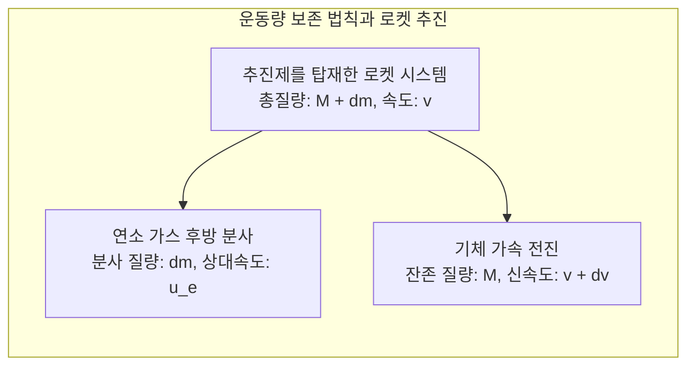
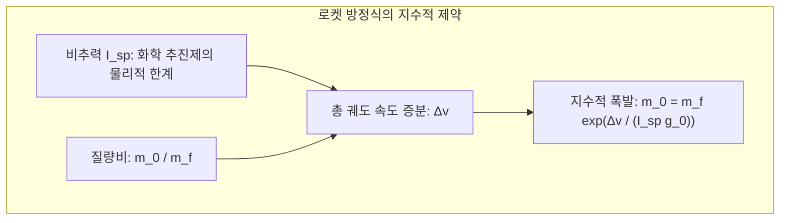
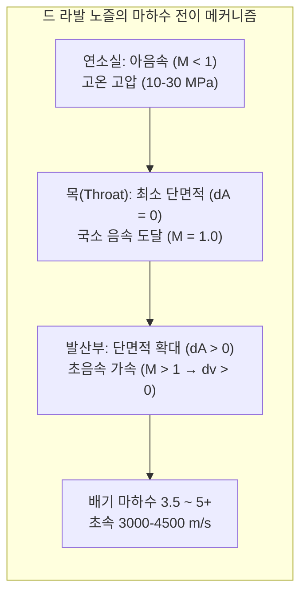

밤하늘을 가르고 굉음과 함께 백열의 화염을 뿜어내며 상승하는 거대한 로켓. 인류 공학 문명이 건설한 가장 극단적인 기계인 로켓은 어떻게 지구의 두터운 대기권을 뚫고 중력의 감옥을 벗어나 우주에 도달할 수 있을까요?

일상적인 직관에는 흔히 잘못된 상식이 자리 잡고 있습니다: "공기가 없는 진공 우주에서는 지면이나 공기를 밀어낼 수 없는데 어떻게 가속할까?", "우주에 가려면 그저 최고 속도로 수직으로 높이 솟구치기만 하면 되는 것 아닐까?"

그러나 현대 물리학의 시각에서 로켓의 비행은 <strong>뉴턴 역학, 열역학, 압축성 유체역학, 궤도역학 및 극초음속 공력가열이라는 물리 법칙의 한계에 도전하여 이를 극한까지 활용한 에너지 변환의 드라마</strong>입니다. 로켓은 공기를 밀어내는 것이 아니라 자신의 질량을 초음속으로 내던지는 <strong>운동량 보존 법칙</strong>에 의해서만 추진됩니다. 그리고 우주에 간다는 것은 높이 올라가는 것이 아니라 <strong>‘초속 7.9km라는 맹렬한 수평 속도로 지구 둘레를 영원히 낙하(원궤도 자유낙하)’</strong>하는 것이며, 지구로 귀환한다는 것은 그 막대한 운동에너지를 충격파를 통해 플라스마 열로 방출해 내는 과정입니다.

---

### 1. 진공 추진의 근본 물리: 운동량 보존 법칙

자동차는 타이어와 아스팔트의 마찰력으로 달리고, 비행기는 날개와 제트 엔진이 주변 공기를 밀어내는 반작용으로 날아갑니다.

반면 로켓은 <strong>외부 매질에 전혀 의존하지 않으며, 주변에 공기 분자가 단 하나도 없는 완벽한 진공에서 가장 높은 효율을 발휘</strong>합니다.

외부 힘이 작용하지 않는 미소 시간 $dt$ 동안 고립계의 운동량은 완벽히 보존됩니다:

$$(M + dm) v = M (v + dv) + dm (v - u_e)$$

2차 미소항 $dm dv$를 소거하면:

$$M dv = u_e dm = - u_e dM \implies dv = - u_e \frac{dM}{M}$$

이는 로켓의 순간 가속도가 외부 대기와는 아무런 관련이 없으며, 오직 단위 시간당 분사 질량과 노즐을 빠져나가는 배기가스의 상대 배출 속도 $u_e$에 의해서만 결정됨을 증명합니다.

---

### 2. 치올콥스키 로켓 방정식과 '로켓의 저주'

1903년 러시아의 과학자 콘스탄틴 치올콥스키는 이 미분방정식을 적분하여 우주공학의 기본 헌법인 <strong>치올콥스키 로켓 방정식</strong>을 도출했습니다:

$$\Delta v = u_e \ln\left( \frac{m_0}{m_f} \right) = I_{sp} g_0 \ln\left( \frac{m_0}{m_f} \right)$$

여기서 $I_{sp}$는 <strong>비추력(Specific Impulse)</strong>으로, 1kg의 추진제가 1초 동안 낼 수 있는 추력 효율을 뜻합니다.

지구 저궤도(LEO)에 진입하기 위해 요구되는 속도 증분 $\Delta v$는 중력 손실과 공기 저항 손실을 합쳐 약 <strong>$9.4\,\mathrm{km/s}$</strong>입니다.
이를 달성하기 위한 질량비는 다음과 같습니다:

$$\frac{m_0}{m_f} = \exp\left( \frac{\Delta v}{I_{sp} g_0} \right)$$

- 케로신/액체산소(LOX/RP-1, $I_{sp} \approx 310\,\mathrm{s}$) 사용 시, 질량비는 무려 $22.0$에 달합니다. 즉, <strong>로켓 발사 중량의 $95.5\%$가 연료여야 하며, 엔진과 탱크 및 위성 탑재체를 포함한 건조 질량은 고작 $4.5\%$ 이내로 제한</strong>됩니다!
- 수소/산소 엔진(LOX/LH2, $I_{sp} \approx 450\,\mathrm{s}$)을 쓰더라도 추진제 비율은 $88.1\%$에 달합니다.

이것이 우주공학에서 말하는 <strong>‘로켓 방정식의 저주(Tyranny of the Rocket Equation)’</strong>입니다. 단일 로켓(SSTO)으로는 빈 탱크 무게를 끌고 궤도에 오를 수 없으므로, 다 쓴 탱크를 공중에서 버려 질량을 극적으로 줄이는 <strong>다단식 로켓(Multistage Rocket)</strong>이 유일한 공학적 해법이 됩니다.

---

### 3. 드 라발 노즐(de Laval Nozzle)과 초음속 팽창의 유체역학

연소실의 고온·고압 정지 가스를 초속 수천 미터의 음속을 넘는 제트 기류로 바꾸는 장치가 <strong>드 라발 노즐(수렴-발산 노즐)</strong>입니다.

압축성 유체의 단면적-유속 관계식:

$$\frac{dA}{A} = (M^2 - 1) \frac{dv}{v}$$

- <strong>아음속 수렴부 ($M < 1$)</strong>: 단면적이 좁아질수록($dA < 0$) 기류는 가속($dv > 0$)됩니다;
- <strong>노즐 목 ($M = 1$)</strong>: 단면적이 최소인 목 부분에서 마하 1.0(음속)에 도달합니다;
- <strong>초음속 발산부 ($M > 1$)</strong>: 마하 1을 넘어서면 <strong>단면적이 넓어질수록($dA > 0$) 기류가 급격한 단열 팽창을 일으키며 오히려 폭발적으로 가속($dv > 0$)</strong>됩니다! 열에너지가 운동에너지로 변환되며 배기가스는 마하 3.5~5(초속 3,000~4,500m)로 분출됩니다.

---

### 4. 추진제 화학 및 열역학적 엔진 사이클

로켓 엔진의 성능은 터보펌프를 구동하는 사이클에 따라 결정됩니다:
1. <strong>가스 발생기 사이클 (Open Cycle)</strong>: 추진제 일부를 태워 터빈을 돌린 뒤 밖으로 버리는 방식으로 구조가 단순합니다(팰컨 9 Merlin 1D);
2. <strong>다단 연소 사이클 (Closed Cycle)</strong>: 예연소실 가스를 주연소실로 보내 100% 완전 연소시켜 극단적 고압($20\,\mathrm{MPa}$ 이상)을 달성합니다(RD-180, SSME);
3. <strong>전유량 다단 연소 사이클 (FFSC)</strong>: SpaceX 랩터(Raptor) 엔진에 적용된 최첨단 기술로, 산화제 리치와 연료 리치 터빈을 분리하여 기체 상태로 주연소실에 분사, 연소실 압력 $35\,\mathrm{MPa}$(350기압)라는 전인미답의 출력을 냅니다.

---

### 5. 궤도역학: 궤도 진입은 '상승'이 아니라 '수평 낙하'다

우주로 가는 것은 단순히 높이 올라가는 것이 아닙니다. 고도 400km의 ISS에서도 지구 중력은 지표면의 90%에 달합니다. 우주비행사가 둥둥 뜨는 것은 무중력이 아니라 <strong>끊임없이 낙하하고 있기 때문</strong>입니다.

뉴턴의 대포 사고실험처럼, 수평 발사 속도가 <strong>제1우주속도(초속 약 7.9km)</strong>에 이르면 물체가 낙하하는 궤적의 곡률과 지구가 둥글게 굽어지는 곡률이 완벽히 일치하게 됩니다:

$$v_1 = \sqrt{\frac{G M_E}{R_E}} = \sqrt{g_0 R_E} \approx 7.9\,\mathrm{km/s} \quad (28,400\,\mathrm{km/h})$$

로켓이 소비하는 총에너지의 80% 이상은 고도를 높이는 것이 아니라 이 맹렬한 <strong>수평 궤도 속도 $7.9\,\mathrm{km/s}$를 얻는 데 투입</strong>됩니다. 발사 직후 수직 상승하던 로켓은 <strong>중력 턴(Gravity Turn)</strong>을 통해 서서히 기체를 수평으로 눕혀 궤도에 안착합니다.

---

### 6. 대기권 재돌입의 극한 열역학: 뭉툭한 물체 이론(Blunt Body Theory)

궤도 속도(초속 7.8km)로 돌던 우주선이 귀환할 때 지닌 비운동에너지는 $30.4\,\mathrm{MJ/kg}$로, 자기 무게의 7배가 넘는 TNT 폭약의 에너지에 맞먹습니다.

1953년 H. 줄리언 앨런이 창안한 <strong>뭉툭한 물체 이론(Blunt Body Theory)</strong>은 열역학적 대반전을 일으켰습니다:
- 뾰족한 노즈콘 대신 넓고 뭉툭한 방열 바닥을 채택하면, 기체 전방에 강력한 <strong>분리 충격파(Bow Shock Wave)</strong>가 형성됩니다;
- 재돌입 열은 마찰이 아니라 <strong>충격파에 의한 공기의 극단적인 단열 압축</strong>에 의해 발생하며, 충격파 후방 온도는 $6,000\,\mathrm{K} \sim 10,000\,\mathrm{K}$에 달합니다;
- 뭉툭한 형태는 <strong>발생한 플라스마 열에너지의 90% 이상을 충격파 기류를 따라 주변 대기로 날려 보내며</strong>, 우주선 본체에는 10% 미만의 열만 전달되도록 격리합니다;
- 잔여 열은 삭마 방열재(PICA-X)의 기화 잠열이나 고내열 세라믹 타일의 복사 냉각으로 차단됩니다.

---

### 7. 결론

로켓은 공기를 밀어내지 않고 운동량을 보존하며, 다단화를 통해 지수함수의 벽을 깨고, 드 라발 노즐로 초음속 제트를 뿜으며, 초속 7.9km로 지구 둘레를 영원히 낙하하여 궤도를 돕니다. 로켓 공학은 고전 역학과 현대 첨단 재료과학이 결합하여 인류를 지구라는 요람 밖으로 인도하는 지성의 정점입니다.
